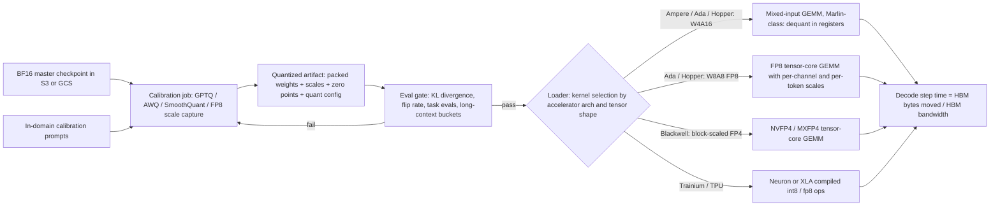

# Model Quantization and Compression

## TL;DR

- Quantization reduces the bytes moved per generated token. Decode is limited by memory bandwidth, so fewer bytes means proportionally faster decode until the matmul becomes compute-bound, which happens at roughly `batch ~ ridge_point / (2 / bytes_per_weight)`.
- Weight-only INT4 (GPTQ, AWQ in W4A16) speeds up small-batch decode and lets a model fit on fewer GPUs. It does nothing for prefill and loses its advantage at large batch, because the multiply still runs on BF16 tensor cores after dequantization.
- FP8 W8A8 halves the bytes and doubles tensor-core throughput on Hopper, Ada and Blackwell, so it speeds up prefill, large-batch decode and the KV cache together. Ampere-class parts (A100, A10G) have no FP8 tensor cores.
- Accuracy depends on outliers, not on bit width. LLM.int8(), SmoothQuant, AWQ, GPTQ and rotation methods each handle a few huge activation channels in a different way. Perplexity on WikiText is a weak pass gate; KL divergence, argmax flip rate and in-domain task evals are the real gates.
- A quantized checkpoint is tied to a hardware and kernel pair. If failover lands on a different accelerator generation, latency, memory fit and numerics can all change silently. Treat precision as part of the deployment's capacity contract.

## Mental Model



The useful intuition: quantization is a control-plane decision (calibrate offline, produce an artifact, gate it on evals) that changes a data-plane quantity (bytes per decode step across the HBM bus).
The calibration job runs once, can take hours, and is the only place where the accuracy trade-off is set.
The serving process only unpacks bits inside registers and multiplies.
Precision is not a "model" property but a property of the artifact-kernel-hardware triple, because the loader picks a kernel based on GPU architecture and tensor shapes.
That is why the eval gate sits between the artifact and the loader, and why one quantized artifact can be fast on an H100, slow on an A10G, and unloadable on a TPU.

## Internals

### The affine map and scale granularity

Every scheme in this chapter is a variant of `q = clamp(round(x / s) + z, qmin, qmax)` and `x_hat = s * (q - z)`, where `s` is a scale and `z` is an optional zero point.
Symmetric schemes fix `z = 0` and spend every code point on a range centered at zero.
Asymmetric schemes store `z` and fit skewed distributions better, at the cost of an extra subtract in the dequant path.
The main design lever is granularity: how many elements share one `(s, z)` pair.
Per-tensor scaling uses one scale for the whole matrix, is the cheapest to apply, and is the most exposed to outliers.
Per-channel (per output row) scaling for weights costs nothing at runtime, because the scale factors out of the dot product and can be applied to the GEMM output.
Per-group scaling, typically 128 consecutive input-channel elements per scale, is the standard for INT4 weights.
It adds `16 / 128 = 0.125` bits per weight for an FP16 scale, so W4 g128 costs about 4.125 bits per weight symmetric and about 4.16 bits with packed 4-bit zero points.
Per-token scaling for activations is computed dynamically on each forward pass and works for the same reason per-channel weight scaling does: it factors out of the GEMM on the other side.
Block scaling (microscaling) shares one scale across a short vector of 16 or 32 elements and is applied inside the tensor core instead of in an epilogue.
That is the defining property of Blackwell-class FP4 formats.

The factoring rule decides which granularities are "free".
For `Y = X W^T`, a scale that varies along the reduction dimension K cannot be pulled out of the sum, so the kernel must apply it inside the inner loop.
Per-token (rows of X) and per-output-channel (rows of W) scales vary along M and N, so they apply once per output element in the epilogue.
This is why SmoothQuant moves difficulty along K offline instead of using per-input-channel activation scales at runtime.

### Why LLMs are hard to quantize: emergent outlier features

[LLM.int8() (Dettmers et al., NeurIPS 2022)](https://arxiv.org/abs/2208.07339) found that once models reach about 6.7B parameters, a small set of hidden dimensions (about 0.1 percent of features) carries activations orders of magnitude larger than the rest, and this breaks naive vector-wise INT8.
Its fix is mixed-precision decomposition.
The outlier columns are pulled into an FP16 matmul and everything else runs in INT8.
This preserves accuracy, but the gather/scatter is slow, so LLM.int8() is a memory saver, not a latency win.
Every later method is a cheaper answer to the same physical fact: activation outliers are concentrated in a few channels and stay in those channels from token to token.

### SmoothQuant: moving difficulty from activations into weights

[SmoothQuant (Xiao et al., ICML 2023)](https://arxiv.org/abs/2211.10438) starts from the observation that weights are easy to quantize and activations are hard.
It applies a mathematically equivalent per-input-channel scaling offline: `Y = (X diag(s)^-1) (diag(s) W^T)`.
The smoothing factor is `s_j = max|X_j|^alpha / max|W_j|^(1 - alpha)`, with `alpha` around 0.5 for most models.
The inverse scale `diag(s)^-1` is folded into the preceding LayerNorm or RMSNorm gamma, so it costs nothing at runtime.
After smoothing, per-tensor or per-token INT8 activations and per-channel INT8 weights both fit, and the GEMM runs on INT8 tensor cores (W8A8).
The trade-off: a larger `alpha` flattens activations but makes weights spikier.
Folding only works where a linear normalization op precedes the matmul (QKV and the first MLP projection), not before `o_proj` or `down_proj` without extra work.

### GPTQ: second-order error compensation, column by column

[GPTQ (Frantar et al., ICLR 2023)](https://arxiv.org/abs/2210.17323) is a one-shot weight-only method.
The paper reports quantizing 175B-parameter models in about four GPU hours, down to 3 or 4 bits per weight, with small accuracy loss.
It solves the layer-wise problem `argmin_W_hat ||W X - W_hat X||^2` independently for each linear layer, using calibration activations `X` captured just before that layer.
The Hessian of this objective with respect to one row of W is `H = 2 X X^T`, a K-by-K matrix shared by every output row.
That shared Hessian is what makes the method tractable at 100B+ scale.
Following Optimal Brain Surgeon, quantizing one weight `w_q` introduces error `delta = w_q - quant(w_q)`.
The best update to the not-yet-quantized weights is `-delta / [H^-1]_qq * H^-1[:, q]`, which pushes the error onto columns that are still free to absorb it.
GPTQ quantizes all rows in the same fixed column order, which is what turns the per-row OBS loop into a batched matrix algorithm.
It takes the Cholesky factorization of `H^-1` once, which avoids the numerical blow-up of repeated rank-one inverse updates.
It also applies updates lazily in blocks of about 128 columns, which turns a memory-bound sequence of rank-one updates into compute-dense block operations.
A damping term (a small fraction of the mean diagonal of `H`, commonly 1 percent) is added before inversion.
If a calibration set never activates some input channel, that row and column of `H` are zero and the inverse would otherwise be singular.

The production subtlety is act-order (often exposed as `desc_act`).
Quantizing columns in descending order of `diag(H)`, meaning highest activation energy first, measurably improves accuracy because the most important columns get quantized while the most free columns remain to absorb error.
Combined with group quantization, though, act-order means the 128 columns sharing a scale are no longer contiguous in memory.
The checkpoint then carries a `g_idx` permutation vector.
A kernel must either gather scales through `g_idx` in its inner loop or permute the activation columns at runtime to match a reordered weight layout.
Marlin-class kernels take the second path, which adds a per-forward gather on activations.
Under tensor parallelism with row-parallel layers (`o_proj`, `down_proj`), the permutation must also be consistent with how K is split across ranks.
This is a recurring source of "loads fine at TP1, wrong or slow at TP4" bugs.

### AWQ: protect salient channels by scaling, not by mixed precision

[AWQ (Lin et al., MLSys 2024 Best Paper)](https://arxiv.org/abs/2306.00978) observes that only a small fraction of weight channels matter disproportionately.
Salience is set by input activation magnitude, not by weight magnitude.
Keeping those channels in FP16 (the LLM.int8() approach) would need a mixed-precision kernel, so AWQ scales them up instead.
Multiply input channel `j` of W by `s_j > 1` and divide the matching activation by `s_j`; the divide is folded into the previous op, as in SmoothQuant.
The mechanism is a ratio argument.
Group quantization error is roughly `s_group * 0.5 LSB`, where `s_group` is set by the group's maximum.
Scaling one channel among 128 barely moves the group maximum, so the absolute rounding error on that channel stays about the same while its magnitude grows by `s_j`.
After dividing back by `s_j` on the activation side, the effective error on the salient channel shrinks by roughly `1 / s_j`.
Push `s_j` too far and the channel becomes the group maximum, which inflates error for the other 127 channels.
That is why AWQ does a small grid search with `s = s_X^alpha`, `alpha` in [0, 1], and picks the value that minimizes the layer's output MSE on calibration data.
Because AWQ fits only per-channel scale statistics and does no reconstruction, it is less prone to overfitting the calibration distribution than GPTQ.
The paper explicitly claims this robustness, and it matters when the production prompt distribution drifts away from the calibration set.

### FP8: floating point instead of integers, and where the scales live

The [FP8 interchange formats (Micikevicius et al., 2022)](https://arxiv.org/abs/2209.05433) define E4M3 and E5M2.
E5M2 follows IEEE 754 conventions for special values.
E4M3 gives up infinities and keeps a single NaN mantissa pattern so that it can extend its range.
You can derive the range limits from the encodings.
E4M3 has bias 7 and a top exponent of 8 with mantissa 1.75, so its maximum finite value is 448.
E5M2 has bias 15 and a top normal exponent of 15, so its maximum is 57344.
Because each value carries its own exponent, FP8 tolerates the heavy-tailed activation distributions that break INT8 per-tensor scaling, which is why FP8 W8A8 is usually close to lossless with minimal effort.
For inference, E4M3 is used for weights and activations because precision matters more than range once a scale is applied.
E5M2 is mostly a training-gradient format.

FP8 still needs scales, because 448 is not a large number.
Static per-tensor activation scales are calibrated offline and are the cheapest at runtime.
Any production activation larger than the calibrated `amax` saturates to 448 silently.
Dynamic per-token activation scales compute `amax` per row on each forward pass, fused into the preceding kernel.
This costs a reduction pass but cannot saturate.
Weights almost always get static per-output-channel scales.
At the other extreme, the [DeepSeek-V3 technical report](https://arxiv.org/abs/2412.19437) trained in FP8 with fine-grained 1x128 tile scaling for activations and 128x128 block scaling for weights.
That shows block-wise scaling working at frontier scale, and inference stacks have adopted the same block layout for those checkpoints.

### Rotations: making outliers disappear before quantizing

Rotation methods such as QuaRot and SpinQuant multiply the hidden state by an orthogonal matrix `Q` (a randomized Hadamard transform in QuaRot, a learned rotation in SpinQuant) and fold `Q^T` into the adjacent weights.
The network computes the same function, but the energy of a single outlier channel is spread evenly across all channels ("incoherence processing").
After rotation, activations are close to Gaussian, which is what makes W4A4 and 4-bit KV cache feasible.
The cost is an online Hadamard transform where the rotation cannot be folded, for example before `down_proj` and on the KV path.
A fast Walsh-Hadamard transform is `O(d log d)`, cheap but not free.
Treat these as research-grade techniques that are only partly integrated into production engines (status UNVERIFIED as of 2026-10).

### Microscaling formats and Blackwell FP4

The OCP Microscaling (MX) specification defines MXFP8, MXFP6, MXFP4 and MXINT8 as blocks of 32 elements sharing one power-of-two E8M0 scale (OCP MX v1.0; UNVERIFIED as of 2026-10).
NVIDIA's NVFP4 uses 16-element blocks with an E4M3 block scale plus a per-tensor FP32 scale, so the block scale has fractional precision instead of power-of-two steps (NVIDIA docs; UNVERIFIED as of 2026-10).
The 4-bit element itself is E2M1, so it can represent only the magnitudes {0, 0.5, 1, 1.5, 2, 3, 4, 6}, which follows from the encoding.
That grid is non-uniform: denser near zero, which suits bell-shaped weights better than uniform INT4.
The hardware difference from INT4 W4A16 is decisive.
On Blackwell, block-scaled FP4 multiplies run natively in the tensor core with the scale applied inside the MMA.
So W4A4 in NVFP4 cuts both bytes and FLOP time, while W4A16 only cuts bytes (NVIDIA Blackwell docs; UNVERIFIED as of 2026-10).

### KV-cache quantization

The KV cache is the second large tensor read on every decode step, and at long context it can exceed weight traffic.
Llama-3-70B (80 layers, 8 KV heads, head dimension 128) stores `2 * 80 * 8 * 128 = 163,840` elements per token.
That is 320 KiB per token in BF16 and 160 KiB in FP8, so 2.5 GiB versus 1.25 GiB for one 8K-token sequence (derived from the published model config).
An FP8 KV cache halves both the PagedAttention block pool's bytes (see [[17-Cloud-AI-Engineering/Volume_11_LLM_Serving_and_Inference_Systems_on_Cloud/Chapter_03_KV_Cache_Management_and_PagedAttention|KV-Cache Management and PagedAttention]]) and the attention kernel's read bandwidth.
It also halves the bytes shipped between prefill and decode pools in [[17-Cloud-AI-Engineering/Volume_11_LLM_Serving_and_Inference_Systems_on_Cloud/Chapter_07_Prefill_and_Decode_Disaggregation|Prefill and Decode Disaggregation]].
The failure mode is scales.
KV quantization typically uses per-tensor or per-head `k_scale` and `v_scale`.
If a checkpoint ships no calibrated KV scales, engines fall back to a default (historically 1.0 in vLLM; UNVERIFIED for current releases as of 2026-10).
That works only because typical K and V magnitudes sit well inside the E4M3 range, and it breaks on models with large key norms.
Keys are more sensitive than values: an error in K perturbs the softmax logits, which are then exponentiated, while an error in V is averaged linearly.

### Hardware kernel acceleration: the roofline is the whole story

For one linear layer at decode, `Y[B, N] = X[B, K] W[N, K]^T`, FLOPs are `2 B N K`, and the bytes moved are dominated by the weights, `N K * bytes_per_weight`.
Arithmetic intensity is therefore `2B / bytes_per_weight` FLOPs per byte.
An H100 SXM's BF16 ridge point is about `989e12 / 3.35e12 = 295` FLOP/byte (NVIDIA datasheet figures; UNVERIFIED as of 2026-10).
BF16 weights (2 bytes) give intensity `B`, so decode stays memory-bound until about B = 295.
W4A16 g128 weights (0.516 bytes) give intensity `3.88 B`, so the layer turns compute-bound at about B = 76 under ideal kernels.
Past that point it is no faster than BF16, because the FLOPs still run on BF16 tensor cores, and dequantization makes it slower.
FP8 W8A8 gives intensity `2B` against an FP8 ridge of about 591, so it also crosses at about B = 295, but it is roughly 2x faster than BF16 on both sides of the ridge.
Real kernels fall short of the ideal.
The [Marlin paper (Frantar et al., PPoPP 2025)](https://arxiv.org/abs/2408.11743) reports close to the full 4x speedup up to batch 16-32, with gradually shrinking but still meaningful gains up to batch 64-128.
That agrees with the roofline once you account for dequant instructions and imperfect overlap.

Marlin reaches that ceiling with several mechanisms that getting-started guides never mention.
First, weights are pre-shuffled offline, at load time, into a layout where each thread's 128-bit global load holds exactly the 4-bit values that its tensor-core MMA fragment needs.
That removes shared-memory transposes from the hot loop.
Second, dequantization happens in registers with a bit trick.
A 4-bit integer `q` is OR-ed into the mantissa of the FP16 constant 1024 (bit pattern 0x6400), producing the FP16 value `1024 + q` with one logic op (a single LOP3 can do several lanes at once).
Subtracting `1024 + 8` then yields the signed value `q - 8` for symmetric INT4, all without an integer-to-float conversion instruction.
Third, global-memory loads are issued several pipeline stages ahead with asynchronous copies, so HBM streaming overlaps the MMAs.
Fourth, the K dimension is partitioned in stripes across SMs so that skinny decode matrices still occupy all SMs, with a global reduction at the end.
On Hopper, vLLM's Machete kernel plays the same role using wgmma instructions (vLLM project; UNVERIFIED as of 2026-10).

At the attention and step level, a decode step reads `W_bytes + sum_i(L_i * kv_bytes_per_token)`.
For Llama-3-70B at batch 32 with 8K contexts and FP8 KV, the KV term is about 43 GB.
FP8 weights are 70.6 GB, so KV is 38 percent of step traffic.
With INT4 weights (about 36 GB), KV becomes 54 percent of traffic.
On an H200 the step lower bound drops only from 23.7 ms to 16.5 ms, a 1.43x gain rather than the 2x the weight size suggests (derived; H200 4.8 TB/s per NVIDIA datasheet, UNVERIFIED as of 2026-10).
This is the mechanism behind the field observation that "INT4 helped less than expected on long-context traffic".

### Accelerator support matrix (what runs natively)

Ampere (A100, A10G) supports INT8 tensor-core math but not FP8.
FP8 checkpoints on Ampere fall back to weight-only FP8 via mixed-input kernels (W8A16), which saves memory but brings no compute gain (vLLM docs; UNVERIFIED as of 2026-10).
Ada (L4, L40S) and Hopper (H100, H200) support FP8 E4M3 and E5M2 tensor-core math.
Blackwell (B200, GB200) adds native block-scaled FP4 and FP6 (NVIDIA docs; UNVERIFIED as of 2026-10).
AWS Trainium2 supports FP8 compute, and the Neuron SDK exposes weight quantization for inference (AWS Neuron docs; UNVERIFIED as of 2026-10).
Google TPU v5e and v6e (Trillium) provide INT8 MXU throughput at twice their BF16 rate, which JAX stacks reach through AQT-style int8 quantization (Google Cloud docs; UNVERIFIED as of 2026-10).
Google describes Ironwood (TPU7x) as its first TPU with native FP8 (Google Cloud blog; UNVERIFIED as of 2026-10).
The portability consequence: GPTQ/AWQ INT4 artifacts packed for CUDA kernels do not run on Trainium or TPU.
Those targets recompile from the BF16 master with their own quantization toolchain.

### Perplexity versus latency curves

The useful plot has quality degradation on one axis and decode step time on the other, drawn separately for each operating regime.
A single "INT4 is 3x faster" number is meaningless without the regime.
At batch 1-16 with short context, the order from fastest to slowest is W4A16 / NVFP4, then FP8, then BF16, and step time scales almost linearly with weight bytes.
At batch 128 and above, FP8 and FP4 W4A4 keep their advantage because they cut FLOP time, while W4A16 converges to BF16 or falls behind it.
At long context, every curve flattens unless the KV cache is also quantized.
For prefill, only formats that reduce FLOP time (FP8, INT8 W8A8, FP4 W4A4) move TTFT.
Weight-only formats do not.

On the quality axis, perplexity is a lossy summary.
Two models can have the same WikiText perplexity and still disagree on the argmax token at many positions, and agentic or reasoning workloads amplify such flips because errors compound over long chains.
Better pass gates are mean token-level KL divergence against the BF16 reference on in-domain prompts, the argmax flip rate, and task evals stratified by context length and language.
Wire those gates into the platform eval harness described in [[17-Cloud-AI-Engineering/Volume_12_AI_Applications_MLOps_and_Data_Platforms/Chapter_06_Model_Evaluation_Monitoring_and_Drift_Detection|Model Evaluation, Monitoring, and Drift Detection]].
Published evaluations agree on a rough ordering.
FP8 W8A8 with dynamic per-token activation scales is close to indistinguishable from BF16.
W4A16 g128 with GPTQ or AWQ loses a small but measurable amount that grows on smaller models and harder tasks.
3-bit weights and un-rotated W4A4 lose noticeably (qualitative literature consensus; specific deltas UNVERIFIED as of 2026-10).

### Control plane versus data plane

The control plane is the calibration pipeline, the artifact registry and the eval gate.
It is batch, offline and reproducible, and it should be pinned to exact library versions because packing formats change across releases.
The data plane is the serving engine's loader and kernels.
The loader reads `quantization_config` from the checkpoint, picks a kernel from the GPU's compute capability and the tensor shapes, and either serves or refuses to load.
The failure-domain boundary sits at kernel selection.
A shape the fast kernel does not support, for example a K that is not a multiple of the tile or group size after a TP split, can silently route to a slow generic path instead of failing.
Alert on throughput per GPU, not just on errors.

## Numbers to Know

| Quantity | Value | Source |
|---|---|---|
| GPTQ quantization cost | 175B-parameter model in about 4 GPU hours, 3-4 bits per weight | (Frantar et al., ICLR 2023) |
| Marlin W4A16 speedup envelope | Near-ideal 4x up to batch 16-32; decreasing gains to batch 64-128 | (Frantar et al., PPoPP 2025) |
| Outlier emergence | About 6.7B params; about 0.1 percent of hidden dimensions | (Dettmers et al., NeurIPS 2022) |
| E4M3 max finite | 448 | (derived from Micikevicius et al., 2022 encoding) |
| E5M2 max finite | 57344 | (derived from Micikevicius et al., 2022 encoding) |
| E2M1 (FP4) magnitudes | 0, 0.5, 1, 1.5, 2, 3, 4, 6 | (derived from encoding) |
| MX block | 32 elements, shared E8M0 scale | (OCP MX v1.0; UNVERIFIED as of 2026-10) |
| NVFP4 block | 16 elements, E4M3 block scale + FP32 tensor scale | (NVIDIA docs; UNVERIFIED as of 2026-10) |
| W4 g128 storage | 4.125 bits/weight symmetric; about 4.16 with 4-bit zeros | (derived) |
| H100 SXM | 80 GB HBM3, 3.35 TB/s, about 989 BF16 / 1979 FP8 dense TFLOPS | (NVIDIA datasheet; UNVERIFIED as of 2026-10) |
| H200 | 141 GB HBM3e, 4.8 TB/s, compute as H100 | (NVIDIA datasheet; UNVERIFIED as of 2026-10) |
| L4 | 24 GB GDDR6, about 300 GB/s, FP8 capable | (NVIDIA datasheet; UNVERIFIED as of 2026-10) |
| L40S | 48 GB GDDR6, about 864 GB/s, FP8 capable | (NVIDIA datasheet; UNVERIFIED as of 2026-10) |
| A100 / A10G | No FP8 tensor cores; INT8 supported | (NVIDIA docs; UNVERIFIED as of 2026-10) |
| H100 BF16 ridge point | About 295 FLOP/byte | (derived from datasheet figures) |
| W4A16 compute crossover on H100 | Batch of about 76 (ideal kernel) | (derived) |
| Llama-3-70B KV per token | 320 KiB BF16, 160 KiB FP8 | (derived from model config) |
| Llama-3-70B weights | About 141 GB BF16, 71 GB FP8, 36 GB W4 g128 (+ about 4 GB BF16 embed/lm_head) | (derived) |
| Decode lower bound, 70B FP8 on 1x H200, batch 1 | About 14.7 ms/step | (derived) |
| TPU v5e / v6e | 16 GB / 32 GB HBM; INT8 at 2x BF16 rate | (Google Cloud docs; UNVERIFIED as of 2026-10) |
| Trainium2 | 96 GiB HBM per chip, FP8 support | (AWS docs; UNVERIFIED as of 2026-10) |
| Lab price g6e.xlarge (1x L40S) | About USD 1.86/hour on-demand, us-east-1 | (AWS pricing; UNVERIFIED as of 2026-10) |
| Lab price g2-standard-8 (1x L4) | About USD 0.85/hour on-demand, us-central1 | (Google Cloud pricing; UNVERIFIED as of 2026-10) |

## AWS vs GCP Mechanism Parity

| Dimension | AWS | Google Cloud | Critical difference |
|---|---|---|---|
| FP8-capable datacenter GPUs | P5 (H100), P5e/P5en (H200), P6 (B200) (AWS docs; UNVERIFIED as of 2026-10) | A3 High/Mega (H100), A3 Ultra (H200), A4 (B200) (GCP docs; UNVERIFIED as of 2026-10) | Same silicon, so the same quantized artifacts and kernels run on both; differences are in fabric and capacity products. |
| Low-cost FP8 inference GPUs | G6 (L4), G6e (L40S) | G2 (L4) | L40S gives 48 GB and about 2.9x L4 bandwidth, which matters for 30B-class models at W4 or FP8. |
| Non-FP8 legacy GPUs in fleet | G5 (A10G), P4d/P4de (A100) | A2 (A100) | FP8 artifacts fall back to weight-only paths here; failover onto these changes latency. |
| Custom silicon low precision | Trainium2 / Inferentia2 via Neuron SDK; compiled from BF16 master | TPU v5e/v6e INT8 via JAX/XLA; Ironwood FP8 (UNVERIFIED as of 2026-10) | CUDA-packed GPTQ/AWQ artifacts are not portable; each target needs its own quantization step and eval gate. |
| Quantization toolchain | Neuron quantization APIs; NVIDIA ModelOpt and llm-compressor on GPU | AQT-style int8 in JAX/MaxText; ModelOpt and llm-compressor on GPU | GPU toolchains are cloud-neutral; accelerator toolchains are vendor-locked. |
| Managed self-weights serving | SageMaker AI endpoints with LMI/vLLM containers; Bedrock Custom Model Import for supported architectures (quantized-format support UNVERIFIED as of 2026-10) | Vertex AI Model Garden vLLM containers and Hex-LLM on TPU; GKE with vLLM | Managed import paths may re-host weights at their own precision; verify what precision you are actually billed for. |
| Artifact storage | S3 (Standard or Express One Zone), SSE-KMS | Cloud Storage, CMEK via Cloud KMS | Smaller artifacts shorten cold starts, see [[17-Cloud-AI-Engineering/Volume_11_LLM_Serving_and_Inference_Systems_on_Cloud/Chapter_08_Cloud_GPU_Autoscaling_and_Cold_Start_Mitigation\|Cold-Start Mitigation]]. |
| Private artifact path | S3 gateway VPC endpoint with endpoint policy | Private Google Access plus VPC Service Controls perimeter | VPC SC blocks copying artifacts to a project outside the perimeter; endpoint policies must be written per bucket. |
| KV transfer fabric for disaggregation | EFA with SRD | GPUDirect-TCPXO on A3 Mega; RDMA on A3 Ultra/A4 (UNVERIFIED as of 2026-10) | FP8 KV halves transfer bytes on either fabric. |
| Capacity products | Capacity Blocks for ML, ODCRs | DWS calendar mode / flex-start, reservations (UNVERIFIED as of 2026-10) | Precision choice changes GPU count per replica, which changes how much reserved capacity you must buy. |

## Worked Example: FP8 and W4A16 on one cheap GPU, with quality and latency measured

The lab quantizes `Qwen/Qwen2.5-7B-Instruct` (Apache 2.0, ungated) to FP8-dynamic W8A8 and to GPTQ W4A16 g128 with llm-compressor.
It then serves BF16, FP8, W4A16 and FP8 plus FP8-KV with vLLM, and measures perplexity, argmax flip rate against BF16, and decode throughput at batch 1, 8 and 64.
Both lab GPUs (L40S on AWS, L4 on GCP) are Ada-class and support FP8 natively.
Library APIs shown match the llm-compressor and vLLM documentation as last known.
Pin the versions you test with, because packing formats and import paths change between releases (UNVERIFIED as of 2026-10).

### Cost estimate and guardrails

On AWS, g6e.xlarge costs about USD 1.86/hour (UNVERIFIED as of 2026-10).
A 3-hour run plus 200 GB of gp3 for 3 hours comes to about USD 5.70.
On GCP, g2-standard-8 costs about USD 0.85/hour (UNVERIFIED as of 2026-10), so a 3-hour run plus a 200 GB balanced disk comes to about USD 2.70.
Both instances get a hard self-destruct timer, so a forgotten lab cannot run past 4 hours.

### Provision on AWS

```bash
#!/usr/bin/env bash
set -euo pipefail
REGION=us-east-1
ACCT=$(aws sts get-caller-identity --query Account --output text)

# Budget alarm: email at 80 percent of USD 20 per month.
aws budgets create-budget --account-id "$ACCT" \
  --budget '{"BudgetName":"quant-lab","BudgetLimit":{"Amount":"20","Unit":"USD"},"TimeUnit":"MONTHLY","BudgetType":"COST"}' \
  --notifications-with-subscribers '[{"Notification":{"NotificationType":"ACTUAL","ComparisonOperator":"GREATER_THAN","Threshold":80,"ThresholdType":"PERCENTAGE"},"Subscribers":[{"SubscriptionType":"EMAIL","Address":"you@example.com"}]}]'

# Deep Learning Base AMI via public SSM parameter (path UNVERIFIED as of 2026-10; list with
# aws ssm get-parameters-by-path --path /aws/service/deeplearning/ami/x86_64 --recursive).
AMI=$(aws ssm get-parameter --region "$REGION" \
  --name /aws/service/deeplearning/ami/x86_64/base-oss-nvidia-driver-gpu-ubuntu-22.04/latest/ami-id \
  --query Parameter.Value --output text)

IID=$(aws ec2 run-instances --region "$REGION" \
  --image-id "$AMI" --instance-type g6e.xlarge --key-name my-key \
  --metadata-options HttpTokens=required \
  --instance-initiated-shutdown-behavior terminate \
  --user-data '#!/bin/bash
shutdown -h +240' \
  --block-device-mappings 'DeviceName=/dev/sda1,Ebs={VolumeSize=200,VolumeType=gp3,DeleteOnTermination=true}' \
  --tag-specifications 'ResourceType=instance,Tags=[{Key=Name,Value=quant-lab}]' \
  --query 'Instances[0].InstanceId' --output text)
echo "$IID" > /tmp/quant-lab-iid
```

### Provision on GCP

```bash
#!/usr/bin/env bash
set -euo pipefail
PROJECT=$(gcloud config get-value project)
ZONE=us-central1-a
BA=$(gcloud billing projects describe "$PROJECT" --format='value(billingAccountName)' | sed 's|billingAccounts/||')

gcloud billing budgets create --billing-account="$BA" --display-name=quant-lab \
  --budget-amount=20USD --threshold-rule=percent=0.8 --filter-projects="projects/$PROJECT"

# Pick a current CUDA 12 Deep Learning VM image family (families rotate; list before use).
gcloud compute images list --project deeplearning-platform-release \
  --filter="family~cu12 AND family~ubuntu" --format="value(family)" | sort -u
FAMILY=REPLACE_WITH_A_LISTED_FAMILY

# G2 machine types attach the L4 automatically; max-run-duration enforces teardown.
gcloud compute instances create quant-lab --zone "$ZONE" \
  --machine-type g2-standard-8 --maintenance-policy TERMINATE \
  --image-family "$FAMILY" --image-project deeplearning-platform-release \
  --boot-disk-size 200GB --metadata install-nvidia-driver=True \
  --max-run-duration=4h --instance-termination-action=DELETE
```

### Install (on the instance)

```bash
# Separate venvs: llm-compressor and vLLM often pin different torch versions.
python3 -m venv ~/venv-quant && . ~/venv-quant/bin/activate && pip install llmcompressor datasets && deactivate
python3 -m venv ~/venv-serve && . ~/venv-serve/bin/activate && pip install vllm datasets && deactivate
mkdir -p ~/models
```

### quantize.py

```python
import os
import sys

from datasets import load_dataset
from transformers import AutoModelForCausalLM, AutoTokenizer

try:
    from llmcompressor import oneshot
except ImportError:
    from llmcompressor.transformers import oneshot
from llmcompressor.modifiers.quantization import GPTQModifier, QuantizationModifier

MODEL_ID = "Qwen/Qwen2.5-7B-Instruct"
scheme = sys.argv[1]  # "fp8" or "w4a16"
tok = AutoTokenizer.from_pretrained(MODEL_ID)
model = AutoModelForCausalLM.from_pretrained(MODEL_ID, torch_dtype="auto", device_map="auto")

if scheme == "fp8":
    # Static per-channel FP8 weights, dynamic per-token FP8 activations: no calibration data needed.
    recipe = QuantizationModifier(targets="Linear", scheme="FP8_DYNAMIC", ignore=["lm_head"])
    oneshot(model=model, recipe=recipe)
else:
    # GPTQ needs activations X to build H = 2 X X^T per layer; use chat-formatted in-domain data.
    ds = load_dataset("HuggingFaceH4/ultrachat_200k", split="train_sft[:512]").shuffle(seed=0)
    ds = ds.map(lambda ex: {"text": tok.apply_chat_template(ex["messages"], tokenize=False)})
    ds = ds.map(lambda ex: tok(ex["text"], max_length=2048, truncation=True, add_special_tokens=False),
                remove_columns=ds.column_names)
    recipe = GPTQModifier(targets="Linear", scheme="W4A16", ignore=["lm_head"])
    oneshot(model=model, dataset=ds, recipe=recipe, max_seq_length=2048, num_calibration_samples=512)

out = os.path.expanduser(f"~/models/qwen2.5-7b-{scheme}")
model.save_pretrained(out, save_compressed=True)
tok.save_pretrained(out)
print("saved", out)
```

### bench.py

```python
import json
import sys
import time

from datasets import load_dataset
from vllm import LLM, SamplingParams

model, out = sys.argv[1], sys.argv[2]
kv_dtype = sys.argv[3] if len(sys.argv) > 3 else "auto"
llm = LLM(model=model, max_model_len=4096, gpu_memory_utilization=0.85, kv_cache_dtype=kv_dtype, seed=0)
tok = llm.get_tokenizer()

# Quality: teacher-forced NLL and argmax token at every position of held-out text.
text = "\n\n".join(load_dataset("wikitext", "wikitext-2-raw-v1", split="test")["text"])
ids = tok(text)["input_ids"][: 64 * 1024]
chunks = [ids[i : i + 1024] for i in range(0, len(ids), 1024)]
qp = SamplingParams(max_tokens=1, prompt_logprobs=1, temperature=0.0)
res = llm.generate([{"prompt_token_ids": c} for c in chunks], qp)
nll, n, argmax = 0.0, 0, []
for c, r in zip(chunks, res):
    for pos, d in enumerate(r.prompt_logprobs):
        if d is None:
            continue
        nll -= d[c[pos]].logprob
        n += 1
        argmax.append(next(t for t, lp in d.items() if lp.rank == 1))
ppl = float(2.718281828 ** (nll / n))

# Latency: decode-dominated generation at three batch sizes.
gp = SamplingParams(max_tokens=256, ignore_eos=True, temperature=0.0)
prompt = "Explain, step by step, how a distributed consensus protocol tolerates failures."
llm.generate([prompt] * 4, gp)  # warmup, CUDA graph capture
tput = {}
for b in (1, 8, 64):
    t0 = time.perf_counter()
    outs = llm.generate([prompt] * b, gp)
    dt = time.perf_counter() - t0
    tput[b] = sum(len(o.outputs[0].token_ids) for o in outs) / dt

json.dump({"model": model, "kv": kv_dtype, "ppl": ppl, "argmax": argmax, "tok_per_s": tput}, open(out, "w"))
print(model, kv_dtype, "ppl=%.4f" % ppl, {k: round(v, 1) for k, v in tput.items()})
```

### compare.py

```python
import json
import sys

base = json.load(open(sys.argv[1]))
for path in sys.argv[2:]:
    r = json.load(open(path))
    m = min(len(base["argmax"]), len(r["argmax"]))
    flips = sum(1 for i in range(m) if base["argmax"][i] != r["argmax"][i]) / m
    speed = {b: r["tok_per_s"][b] / base["tok_per_s"][b] for b in base["tok_per_s"]}
    print(f'{path}: dPPL={r["ppl"] - base["ppl"]:+.4f} flip_rate={flips:.4%} '
          f'speedup={ {k: round(v, 2) for k, v in speed.items()} }')
```

### Run

```bash
. ~/venv-quant/bin/activate
python quantize.py fp8
python quantize.py w4a16
deactivate
. ~/venv-serve/bin/activate
python bench.py Qwen/Qwen2.5-7B-Instruct bf16.json
python bench.py ~/models/qwen2.5-7b-fp8 fp8.json
python bench.py ~/models/qwen2.5-7b-w4a16 w4a16.json
python bench.py ~/models/qwen2.5-7b-fp8 fp8kv.json fp8
python compare.py bf16.json fp8.json w4a16.json fp8kv.json
```

### Back-of-the-envelope: predict before you measure

Qwen2.5-7B has about 6.5B non-embedding parameters and an untied 152K-by-3584 `lm_head` of about 0.55B parameters (model config; approximate, UNVERIFIED as of 2026-10).
The `lm_head` stays BF16 in all three variants because the recipes ignore it.
Every decode step reads the whole `lm_head` but only B rows of the input embedding, so per-step weight bytes are about:
BF16 at `6.5e9 * 2 + 1.1e9 = 14.1 GB`, FP8 at `6.5e9 * 1 + 1.1e9 = 7.6 GB`, and W4A16 at `6.5e9 * 0.516 + 1.1e9 = 4.5 GB`.
On an L4 at about 300 GB/s, the batch-1 lower bounds are about 47 ms, 25 ms and 15 ms per step, so expect roughly 1.9x for FP8 and 3.1x for W4A16 at batch 1.
The unquantized `lm_head` is 24 percent of W4A16 step bytes.
For small models with large vocabularies, "ignore lm_head" is a significant tax, and quantizing it to FP8 is a cheap next experiment.
At batch 64 the prediction changes.
FP8 should keep most of its gain because it also halves FLOP time on Ada tensor cores, while the W4A16 gain should shrink toward the crossover regime the Marlin paper describes.
On quality, FP8-dynamic should show a perplexity delta and flip rate well below W4A16's.
If FP8-KV moves the flip rate noticeably on top of FP8 weights, the KV scales are suspect.

### Teardown

```bash
# AWS
aws ec2 terminate-instances --instance-ids "$(cat /tmp/quant-lab-iid)"
aws budgets delete-budget --account-id "$(aws sts get-caller-identity --query Account --output text)" --budget-name quant-lab
# GCP
gcloud compute instances delete quant-lab --zone us-central1-a --quiet
gcloud billing budgets list --billing-account="$BA" --filter="displayName=quant-lab" --format="value(name)" \
  | xargs -r -n1 gcloud billing budgets delete --quiet
```

### Production capacity sizing: Llama-3-70B class, 4K average context

The assumptions are 70% of peak HBM bandwidth achieved, 90% of HBM usable, 4 GB of activation workspace per GPU, and all-reduce time ignored.
The figures come from the derived formulas in this chapter, not measurements.

| Configuration | KV pool capacity at 4K | Step time at batch 64 | Aggregate tok/s | tok/s per GPU |
|---|---|---|---|---|
| BF16 weights + BF16 KV, H100 TP4 | 97 seqs | 24.2 ms | about 2640 | about 660 |
| FP8 weights + FP8 KV, H100 TP2 | 97 seqs | 24.2 ms | about 2640 | about 1320 |
| FP8 weights + FP8 KV, H200 TP2 | 261 seqs | 16.9 ms | about 3790 | about 1890 |
| W4A16 + FP8 KV, H100 TP1 | 44 seqs (batch capped at 32) | 25.6 ms at batch 32 | about 1250 | about 1250 |

The first two rows are not a coincidence.
Halving every tensor and halving the GPU count gives the same per-GPU memory traffic, so FP8 doubles tokens per GPU-hour in the memory-bound regime.
In practice it does slightly better than that, because TP2 all-reduces are cheaper than TP4.
The W4A16 row is the trap.
INT4 lets the model fit on one H100, but only about 36 GB of HBM is left for KV, so concurrency (not bandwidth) caps throughput, and per-GPU efficiency ends up no better than FP8 on two GPUs.
The cost per million output tokens is `P_gpu_hour * GPUs / (tok_per_s * 3600) * 1e6`.
At a hypothetical USD 10 per GPU-hour, FP8 TP2 on H100 works out to `10 * 2 / (2640 * 3600) * 1e6 = USD 2.10` and BF16 TP4 to USD 4.20.
Plug in current negotiated rates from [[17-Cloud-AI-Engineering/Volume_09_FinOps_and_Cloud_Economics/Chapter_05_GPU_and_TPU_Unit_Economics|GPU and TPU Unit Economics]].

## Failure Modes and Pitfalls

- Static FP8 activation scales calibrated on short chat prompts can saturate on out-of-distribution inputs, for example long documents, code, non-English text or tool JSON, and they clamp silently to 448 without raising any error.
- Calibration overfitting in GPTQ shows up as excellent perplexity on the calibration domain and regressions elsewhere, so calibrate on production-shaped, chat-templated prompts and evaluate on a disjoint set.
- A calibration set that never exercises certain channels (rare languages, special tokens, tool-call formats) leaves those Hessian rows near zero, so GPTQ's damping dominates and those channels get essentially round-to-nearest treatment.
- W4A16 throughput regresses at high batch: a fleet tuned on single-stream demos can lose aggregate throughput after an INT4 rollout because the deployment runs past the compute crossover.
- Weight-only quantization never improves TTFT, so a team that quantized to fix TTFT will see no change, since prefill is compute-bound GEMM work at BF16.
- Kernel fallback is silent: a TP split that leaves K not divisible by the group size or tile, an act-order checkpoint on an engine without a fast permuted path, or an FP8 checkpoint on Ampere can each route to a slow generic kernel while still producing correct tokens.
- Heterogeneous failover breaks capacity math, because an FP8 TP2 replica that fails over to A100s runs weight-only FP8 or must be re-served in BF16 at twice the GPU count, so regional DR plans must be sized per precision (see [[17-Cloud-AI-Engineering/Volume_07_Reliability_and_SRE/Chapter_04_Disaster_Recovery_Tiers_and_RTO_RPO_Engineering|Disaster Recovery Tiers]]).
- An uncalibrated FP8 KV cache can degrade long-context retrieval and needle-style tasks while leaving short-prompt evals unchanged, because the errors accumulate across many attended positions.
- Quantizing a speculative-decoding target model shifts its distribution away from the draft model, which lowers the acceptance rate and can erase part of the expected speedup (see [[17-Cloud-AI-Engineering/Volume_11_LLM_Serving_and_Inference_Systems_on_Cloud/Chapter_05_Speculative_Decoding_and_Advanced_Decoding|Speculative Decoding]]).
- In MoE models, rarely routed experts receive few calibration tokens, so their GPTQ Hessians are poorly estimated, and quality on niche domains drops more than the aggregate metrics show.
- Numerics are not reproducible across hardware, TP degree or kernel versions, so golden-output tests and cached eval results go stale at every engine upgrade, and tests need tolerance bands on KL divergence instead of string equality.
- Re-exported quantized checkpoints sometimes drop or alter the chat template, the generation config or special-token settings, which produces quality regressions that have nothing to do with numerics.
- A public example of precision-related serving regressions is Anthropic's September 2025 postmortem ([A postmortem of three recent issues](https://www.anthropic.com/engineering/a-postmortem-of-three-recent-issues)), which describes a TPU compiler issue in which mixed bf16 and fp32 precision in token selection degraded outputs only for some requests, a class of bug that aggregate evals missed (details UNVERIFIED as of 2026-10).
- Most quantization regressions never get a public PIR, because they show up as quality complaints rather than availability incidents, which is why the KL and flip-rate canary in the interview answers below matters.

## Security and Cost Angles

- Supply chain: a third-party quantized checkpoint is a new binary artifact, not "the same model", so require safetensors, forbid `trust_remote_code`, record provenance, and sign artifacts per [[17-Cloud-AI-Engineering/Volume_08_Security_Identity_and_the_Data_Perimeter/Chapter_05_Software_Supply_Chain_Security_SLSA_and_Sigstore|Software Supply Chain Security]].
- Quantization-conditioned behavior is a demonstrated attack class: research ("Exploiting LLM Quantization", Egashira et al., 2024; venue UNVERIFIED as of 2026-10) builds models that behave benignly in full precision and maliciously after quantization, so safety evals must run on the exact artifact being served.
- IAM scoping on AWS: the calibration job role needs `s3:GetObject` on the master prefix and `s3:PutObject` on the quantized prefix, while serving roles get read-only access to approved prefixes through an S3 gateway endpoint whose policy pins the bucket ARNs.
- IAM scoping on GCP: grant `roles/storage.objectViewer` on the artifact bucket to the serving service account through Workload Identity, and put Cloud Storage and Vertex AI inside one VPC Service Controls perimeter so artifacts cannot be copied out (see [[17-Cloud-AI-Engineering/Volume_03_GCP_Deep_Dive/Chapter_03_VPC_Service_Controls_Security_Perimeters|VPC Service Controls]]).
- Encryption: store masters and quantized artifacts under SSE-KMS or CMEK with separate keys, so revoking access to fine-tuned or proprietary masters does not break serving of approved derivatives (see [[17-Cloud-AI-Engineering/Volume_08_Security_Identity_and_the_Data_Perimeter/Chapter_04_Encryption_Key_Hierarchies_and_Envelope_Encryption|Envelope Encryption]]).
- The biggest unit-economics lever is GPUs per replica: FP8 halves the replica size of a memory-bound deployment, roughly halving cost per token at equal SLO.
- The second lever is KV pool size: FP8 KV doubles concurrent sequences, which raises batch and therefore tokens per GPU-hour wherever the pool, not bandwidth, is the binding constraint.
- The third lever is the hardware tier: W4A16 can move a 30B-class model onto 48 GB L40S parts or a 70B model onto a single 80 GB part, which unlocks cheaper SKUs and smaller reservation blocks at the cost of high-batch efficiency.
- Cold-start cost scales with artifact bytes, so a 4x smaller checkpoint cuts object-storage-to-HBM load time and the idle GPU-seconds spent during scale-out.
- Hidden cost: every quantized variant multiplies the eval matrix (artifact x hardware x TP x engine version), so budget eval GPU-hours as a recurring platform cost, not a one-time effort.

## Interview Questions and Model Answers

### Question 1 (L5 - Senior)

A team reports that AWQ INT4 made their chatbot about 3x faster in a single-user demo on H100, but in production at peak load the gain is about 10 percent and TTFT did not change. Explain why.

#### Model Answer

Decode at batch 1 is a memory-bound GEMV, so step time is roughly weight bytes divided by HBM bandwidth.
Going from 2 bytes to about 0.52 bytes per weight gives close to a 4x ceiling, and 3x after overheads is realistic.
W4A16 does not reduce FLOP time, because the kernel dequantizes to BF16 in registers and runs BF16 MMAs.
Arithmetic intensity is about `3.88 * B` FLOP/byte against an H100 BF16 ridge of about 295, so the layer turns compute-bound near batch 76 with an ideal kernel.
The Marlin paper's measured envelope is near-ideal up to batch 16-32 and then tapers.
At production peak with continuous batching at 100+ sequences, the linear layers sit near or past the ridge, so the INT4 advantage collapses toward zero, and dequant instructions can make them slower than BF16.
Second, at moderate context the KV cache read is a large share of step bytes and INT4 weights do not touch it.
Third, TTFT is prefill, a compute-bound GEMM over the prompt, and weight-only formats do nothing for it.
My recommendation: for the high-batch tier, use FP8 W8A8 with FP8 KV, which halves bytes and doubles tensor-core throughput on both sides of the ridge.
Keep INT4 for latency-sensitive low-batch tiers or where memory fit is the real constraint.
I would prove it by plotting tok/s per GPU against batch size for BF16, W4A16 and FP8 on the production prompt-length mix before choosing.

#### Follow-up Interviewer Question

How does the picture change on Blackwell if you use NVFP4 W4A4 instead of W4A16, and what new accuracy risk do you take on?

### Question 2 (L5 - Senior)

Compare GPTQ and AWQ mechanistically. When would you pick each, and what does act-order cost you at serving time?

#### Model Answer

GPTQ is a second-order reconstruction method.
For each layer it builds `H = 2 X X^T` from calibration activations, quantizes columns in a fixed order, and after each column spreads the rounding error onto the remaining columns using the Cholesky factor of `H^-1`.
It uses lazy 128-column blocks for compute efficiency and damps the diagonal so the inverse stays defined.
AWQ does no reconstruction.
It identifies salient input channels by activation magnitude and scales them up before group quantization, folding the inverse scale into the previous op.
The group maximum barely moves, so relative error on salient channels drops by about `1/s`, and a grid search over the exponent `alpha` picks the scale.
Because AWQ fits only scaling statistics, it is less sensitive to calibration-set mismatch, which the paper emphasizes.
GPTQ can reach lower reconstruction error when the calibration data matches production, and it degrades more gracefully at 3 bits.
Both produce the same W4A16 g128 storage format, so serving speed is identical for the same kernel.
Act-order quantizes high-`diag(H)` columns first and helps accuracy, but it makes group membership non-contiguous.
The checkpoint then carries `g_idx`, and the kernel must gather scales or permute activations at runtime.
Under tensor parallelism, row-parallel layers must split K consistently with that permutation.
In practice I pick AWQ for broad, drifting, multi-tenant traffic, GPTQ with act-order when I control a narrow domain and can calibrate on it, and I validate both on the same KL and task-eval gate.

#### Follow-up Interviewer Question

Your calibration set is English chat and the model must also serve Japanese; which method degrades more, why, and how would you detect it before launch?

### Question 3 (L6 - Staff)

You migrated a 70B chat model from BF16 TP4 to FP8 weights plus FP8 KV at TP2 on H100. Throughput per GPU doubled and short-prompt evals are flat, but an enterprise customer reports worse answers on 60K-token legal documents. Walk through the investigation and fix.

#### Model Answer

First I separate the three changes the migration bundled together: FP8 weights and activations, FP8 KV cache, and TP4 to TP2.
TP degree changes reduction order but should not systematically hurt quality, so it is the least likely cause.
I rebuild the failing requests as a replay set and run four arms on identical hardware: BF16/BF16, FP8 weights with BF16 KV, BF16 weights with FP8 KV, and FP8/FP8.
For each arm I compute per-position KL divergence against the BF16 reference, bucketed by absolute position (0-4K, 4K-16K, 16K-64K), plus a long-context retrieval eval with facts planted at known depths.
If only the FP8 KV arms degrade, and degradation grows with position, the mechanism is KV quantization error accumulating over many attended keys.
K errors perturb attention logits before the exponent, and with 60K keys the softmax is flat enough that small logit errors reshuffle the attention mass.
I then check whether the checkpoint shipped calibrated `k_scale` and `v_scale`, or whether the engine used a default, and whether some heads have key norms near the E4M3 range.
If instead the FP8-weights arm degrades on long inputs, I check whether activation scales are static and were calibrated on short prompts, because long-document activations can exceed the calibrated `amax` and saturate silently.
The fixes, in order of cost, are dynamic per-token activation scales, per-head KV scales calibrated on long documents, keeping K in BF16 with V in FP8, and as a last resort a long-context tier that routes prompts above a length threshold to BF16 KV replicas.
The last option has a capacity cost I would quantify, because it halves KV pool capacity for that tier.
Finally, I add position-bucketed KL and the long-context retrieval eval to the release gate, because the original gate was blind to this mechanism by construction.

#### Follow-up Interviewer Question

How would you detect this class of regression continuously in production without storing customer documents or running BF16 shadow replicas at full cost?

### Question 4 (L6 - Staff)

Size the serving fleet for a 70B dense model at 4K average context, 2,000 concurrent streams, and an inter-token latency SLO of 40 ms at p50. Compare BF16, FP8 and INT4 options across AWS and GCP.

#### Model Answer

I start from per-step bytes and KV pool capacity, because decode is memory-bound in this regime.
The weights are about 141 GB BF16, 71 GB FP8 and about 40 GB for W4 including BF16 embeddings, and KV is 160 KiB per token in FP8, so about 640 MiB per 4K sequence.
I assume 70% achieved bandwidth and 90% usable HBM.
BF16 on H100 TP4 holds about 97 sequences and runs batch 64 at about 24 ms per step, roughly 660 tok/s per GPU.
FP8 with FP8 KV on H100 TP2 has the same per-GPU traffic at half the GPUs, about 1,320 tok/s per GPU, at the same 24 ms step.
W4A16 on a single H100 leaves only about 36 GB for KV, about 44 sequences, so it runs batch 32 at about 26 ms, roughly 1,250 tok/s per GPU, and concurrency caps it rather than bandwidth.
FP8 on H200 TP2 holds about 260 sequences and runs batch 64 at about 17 ms, roughly 1,900 tok/s per GPU, and I could push the batch to about 128 while staying under 40 ms.
At 2,000 streams with batch 64 per replica, H100 FP8 TP2 needs about 32 replicas and 64 GPUs, compared with 128 GPUs for BF16.
H200 FP8 TP2 at batch 120 needs about 17 replicas and 34 GPUs.
The cloud mapping is the same silicon: P5 or A3 High for H100, and P5e/P5en or A3 Ultra for H200.
The decision comes down to delivered price per GPU-hour, reservation availability (Capacity Blocks versus DWS or reservations), and the fabric if I disaggregate prefill.
I would also price a TPU v6e or Trainium2 path, which needs its own quantization pipeline from the BF16 master and its own eval gate.
I would only take that path if the cost-per-token gap justifies a second artifact lineage.
The estimate ignores all-reduce time and prefill interference, so I would add 20-30% headroom and validate with a load test using the production length distribution.

#### Follow-up Interviewer Question

The primary region runs out of H200 capacity and the DR plan lands on A100s; what happens to latency, memory fit and replica count, and what should the DR plan have said?

### Question 5 (L6 - Staff)

Should the platform enable FP8 KV cache by default? Cover throughput, interactions with prefix caching and disaggregation, format choice, and validation.

#### Model Answer

FP8 KV halves bytes per cached token.
That doubles the PagedAttention block pool and halves the attention kernel's read traffic per decode step.
Where KV pool capacity binds concurrency, which is common at long contexts, this translates almost directly into higher batch and more tokens per GPU-hour.
It also doubles the effective capacity of a prefix cache, raising hit rates for shared system prompts.
In a disaggregated deployment it halves the bytes per request moved from prefill to decode over EFA or RDMA, which cuts transfer time and makes disaggregation viable at lower fabric bandwidth.
Prefix-cache entries are only reusable within the same KV dtype and scale set, so mixed-dtype fleets fragment the cache, and I would standardize the dtype per model.
On format, I default to E4M3 with calibrated scales because K and V are already roughly normalized and precision matters more than range.
E5M2 avoids scale calibration thanks to its range, but it has only 2 mantissa bits, which hurts keys in particular.
On validation, I would gate on per-position KL bucketed by context length and on long-context retrieval evals, because short-prompt evals cannot see this error mode.
I would also verify that the attention backend in use actually has an FP8-KV path, rather than dequantizing to BF16 in a slower path.
My answer is yes as a default for models whose gates pass, with a per-model override and a long-context BF16-KV tier as the escape hatch.

#### Follow-up Interviewer Question

How would you split KV precision between keys and values, or across layers, if the uniform FP8 gate fails only on a few heads?

### Question 6 (L7+ - Principal)

Design the quantization release process for a multi-tenant inference platform serving dozens of open-weight and fine-tuned models across H100, H200, L4 and TPU fleets.

#### Model Answer

The core abstraction is the artifact-hardware-engine triple, not the model.
Every servable unit is `(master digest, quantization recipe and library version, target accelerator family, TP degree, engine version)`, and it is built reproducibly from a signed BF16 master.
Calibration runs as a control-plane batch pipeline with pinned containers.
Calibration sets are versioned and production-shaped, built from chat-templated, tool-call-heavy, multilingual and long-context samples, with tenant data excluded unless the contract allows it.
The eval gate has three layers.
First, distributional metrics against the BF16 reference: mean and tail KL, and argmax flip rate, bucketed by language, context length and task type.
Second, task suites relevant to each tenant tier, including safety evals run on the exact quantized artifact, since quantization-conditioned behavior is a known attack.
Third, performance gates that assert the expected kernel path was selected and that tok/s per GPU at the target batch matches the roofline prediction within a tolerance, which catches silent fallbacks.
Rollout is progressive (see [[17-Cloud-AI-Engineering/Volume_06_Infrastructure_as_Code_and_Delivery/Chapter_06_Progressive_Delivery_and_Deployment_Pipelines|Progressive Delivery]]).
I would run a shadow canary on a small sampled slice, computing online KL against a small BF16 reference pool, with automated rollback on KL or complaint-rate burn.
Tenant contracts state precision explicitly: premium tiers can pin BF16 or FP8-only, and model cards disclose the served precision, because tenants reasonably treat precision changes as model changes.
Capacity planning carries precision as a dimension.
DR targets list per-precision GPU counts per region, and failover to a different accelerator family is treated as a new artifact that must already exist and have passed the gate.
Organizationally, the platform owns recipes and gates, model owners own accepted-quality thresholds, and the error budget includes quality regressions, not just availability.

#### Follow-up Interviewer Question

A large customer demands bitwise-identical outputs across regions and over time; what can you honestly promise, and at what cost?

### Question 7 (L7+ - Principal)

Your three-year roadmap spans NVIDIA Hopper and Blackwell, Trainium, and TPU. Where would you standardize on formats, where do you accept fragmentation, and when is quantization-aware training worth it?

#### Model Answer

I standardize on the BF16 master as the single source of truth, plus a precision contract per tier: "W8A8-class", "W4-class", "KV8".
I deliberately do not standardize a single bit-level artifact, because kernels, block sizes and scale encodings differ by hardware.
On Hopper and Ada the efficient formats are FP8 W8A8 with per-channel and per-token or block scales, plus W4A16 for low-batch tiers.
On Blackwell, block-scaled FP4 (NVFP4, MXFP4) becomes the throughput frontier because it reduces FLOP time and not just bytes.
The OCP MX family is the closest thing to a cross-vendor standard, so I favor MX-compatible layouts where hardware supports them.
Trainium and TPU artifacts come from their own compilers and quantizers, so I accept fragmentation there and pay for it with automated per-target pipelines and gates, rather than pretending portability exists.
PTQ is the default because it costs GPU-hours, not training runs, and is good enough for FP8 and, for most large models, W4 weights.
QAT, or quantization-aware distillation, is worth its cost in three cases: when targeting W4A4 or lower on activations, when serving small models where PTQ losses are larger, and when a model is so high-volume that a few percent of serving cost exceeds a fine-tuning run.
The strongest version is training with low-precision formats from the start, as DeepSeek-V3 did with fine-grained FP8 scaling, which removes the PTQ gap for that format.
I would make this decision per model by comparing projected annual serving cost savings against QAT compute and eval cost, revisited each hardware generation.

#### Follow-up Interviewer Question

Rotation methods like QuaRot promise W4A4 without training; what would you need to see before relying on them in production on Hopper, which lacks native FP4?

### Question 8 (L6 - Staff)

A GPTQ act-order W4 g128 checkpoint serves correctly at TP1 but is 40 percent slower per GPU than expected at TP4 and fails to load at TP8. Explain the mechanics.

#### Model Answer

Group quantization ties scales to contiguous runs of 128 elements along K.
Column-parallel layers (QKV, gate, up) split along N, so each rank receives whole groups and the scales shard trivially.
Row-parallel layers (`o_proj`, `down_proj`) split along K, so each rank's K slice must be a whole multiple of the group size and of the kernel's K tile.
At some TP degree a projection's `K / TP` stops being a multiple of 128 or of the kernel's tile requirement.
That is the load failure at TP8, unless the engine pads or falls back.
With act-order, group membership follows the `g_idx` permutation rather than physical position.
So a contiguous K slice on one rank contains columns from many groups, and the kernel must permute activations to match a reordered weight layout or gather scales per column.
Some engines handle the row-parallel case by disabling the fast path or by performing extra gathers, which costs performance without any error, and that matches the 40 percent loss at TP4.
The fixes are to re-quantize without act-order for high-TP deployments (accepting a small accuracy cost), to choose a group size and TP degree whose shapes stay aligned, or to quantize with a recipe that reorders groups into contiguous blocks per rank before packing.
The operational lesson is to put "expected kernel path selected" and per-GPU throughput assertions into the release gate for every TP degree you intend to serve.

#### Follow-up Interviewer Question

How would you make the kernel-selection decision observable at runtime, so a silent fallback pages someone instead of quietly burning GPU budget?

## Further Reading

- [GPTQ (Frantar et al., ICLR 2023)](https://arxiv.org/abs/2210.17323) - The primary source for Hessian-based, column-by-column error compensation that most INT4 checkpoints still use.
- [AWQ (Lin et al., MLSys 2024)](https://arxiv.org/abs/2306.00978) - Explains activation-aware salience and the scaling argument that protects important channels without mixed-precision kernels.
- [SmoothQuant (Xiao et al., ICML 2023)](https://arxiv.org/abs/2211.10438) - The canonical difficulty-migration transform that makes W8A8 work and underlies many FP8 recipes.
- [LLM.int8() (Dettmers et al., NeurIPS 2022)](https://arxiv.org/abs/2208.07339) - First rigorous characterization of emergent outlier features, the root cause every later method addresses.
- [FP8 Formats for Deep Learning (Micikevicius et al., 2022)](https://arxiv.org/abs/2209.05433) - Defines E4M3 and E5M2 and the special-value choices that set their dynamic range.
- [MARLIN (Frantar et al., PPoPP 2025)](https://arxiv.org/abs/2408.11743) - Shows how a mixed-input kernel stays memory-bound under batching, and where the speedup envelope ends.
- [DeepSeek-V3 Technical Report](https://arxiv.org/abs/2412.19437) - Frontier-scale evidence for fine-grained block-scaled FP8, relevant to both training and serving layouts.
- Hassibi and Stork, "Second Order Derivatives for Network Pruning: Optimal Brain Surgeon" (NeurIPS 1992) - The origin of the error-compensation update that GPTQ scales up.
- [vLLM quantization documentation](https://docs.vllm.ai/en/latest/features/quantization/) - The authoritative, frequently updated matrix of which formats run on which hardware in vLLM.
- [llm-compressor](https://github.com/vllm-project/llm-compressor) - Reference implementation of the GPTQ, AWQ, SmoothQuant and FP8 recipes used in this chapter's lab.
- [Anthropic postmortem of three recent issues (2025)](https://www.anthropic.com/engineering/a-postmortem-of-three-recent-issues) - A rare public PIR showing how precision-related serving bugs evade aggregate evals.
- [[17-Cloud-AI-Engineering/Volume_10_AI_Infrastructure_on_Cloud/Chapter_01_Accelerator_Architectures_GPUs_Trainium_TPUs|Accelerator Architectures: GPUs, Trainium, TPUs]] - Tensor-core and MXU details behind the support matrix in this chapter.
- [[17-Cloud-AI-Engineering/Volume_11_LLM_Serving_and_Inference_Systems_on_Cloud/Chapter_01_LLM_Inference_Mechanics_Prefill_vs_Decode|LLM Inference Mechanics: Prefill vs Decode]] - The roofline foundations this chapter applies to precision.
- [[17-Cloud-AI-Engineering/Volume_11_LLM_Serving_and_Inference_Systems_on_Cloud/Chapter_07_Prefill_and_Decode_Disaggregation|Prefill and Decode Disaggregation]] - Next chapter, where FP8 KV halves the cost of moving KV between pools.
- [[17-Cloud-AI-Engineering/Volume_11_LLM_Serving_and_Inference_Systems_on_Cloud/Chapter_11_End_to_End_Latency_Throughput_and_Cost_Modeling|End-to-End Latency, Throughput, and Cost Modeling]] - Full capacity formulas that generalize the sizing table here.
