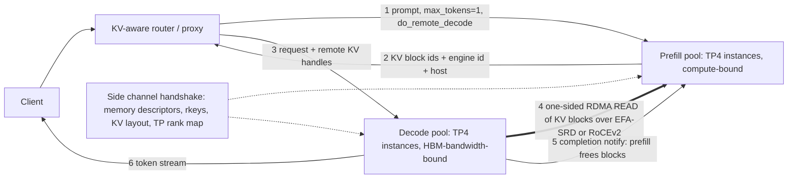

# Prefill and Decode Disaggregation

## TL;DR

Prefill is limited by compute and decode is limited by memory bandwidth, so putting both on the same GPU makes each phase hurt the other's latency SLO and forces one parallelism plan onto two very different workloads.
Disaggregation runs prefill and decode on separate GPU pools and moves the KV cache between them, which lets you tune TTFT and TPOT separately and size each pool for goodput instead of raw throughput.
The KV hand-off is the whole design: it is a one-sided RDMA transfer (EFA/SRD on AWS, RoCEv2 on Google Cloud A3 Ultra and A4) between KV pools that were registered once at startup, and it moves a few GiB per long prompt in tens of milliseconds, compared with close to a second over plain TCP.
The P:D ratio is a control variable that follows the prompt-length and output-length mix, so a fixed ratio is a latent incident that fires when the traffic mix shifts.
Disaggregation ties prefill and decode into one zonal fabric failure domain, adds a version-skew hazard (both sides must agree on weights, KV dtype, block size and layout), and does not pay off for short prompts or small fleets.

## Mental Model



Think of the system as two factories with different bottlenecks connected by a conveyor belt.
The prefill factory turns a prompt into a KV cache, and its throughput is measured in FLOPs.
The decode factory turns a KV cache into tokens, one step at a time, and its throughput is measured in HBM bytes per second.
The conveyor belt is an RDMA fabric that copies KV blocks straight from one GPU's HBM to another's, without going through either CPU's memory.
The control plane (router, side channel handshake, block lease bookkeeping) only moves small descriptors.
The data plane (the RDMA reads) moves gigabytes, and it stays fast only if both ends agreed on memory layout before the first request arrived.
Every interesting failure in this chapter happens on that belt: a reader that never shows up, a fabric that quietly fell back to TCP, two sides that disagree on the block format, or a factory ratio that no longer matches the order mix.

## Internals

### Why the phases fight when colocated

Prefill pushes all P prompt tokens through every weight matrix in one pass, so arithmetic intensity grows with P and the GEMMs stay compute-bound once P passes a few hundred tokens on H100-class parts (see [[17-Cloud-AI-Engineering/Volume_11_LLM_Serving_and_Inference_Systems_on_Cloud/Chapter_01_LLM_Inference_Mechanics_Prefill_vs_Decode|LLM Inference Mechanics]]).
Decode produces one token per sequence per step, so every step re-reads all weights plus the batch's whole KV cache, and step time is set by HBM bandwidth.
When both share one engine, the scheduler has two bad choices.
If it runs prefill first, as early vLLM did, every arriving long prompt stalls every in-flight decode stream for the full prefill duration, and TPOT p99 jumps.
If it uses chunked prefill, as Sarathi-Serve does ([Agrawal et al., OSDI 2024](https://arxiv.org/abs/2403.02310)), it caps how much prefill work fits into each decode step, which bounds TPOT but stretches TTFT and pins prefill throughput to the slack in the TPOT budget.
DistServe ([Zhong et al., OSDI 2024](https://www.usenix.org/system/files/osdi24-zhong-yinmin.pdf)) frames the goal as per-GPU goodput, meaning the highest request rate a GPU can serve while meeting both TTFT and TPOT SLOs, and reports up to 7.4x more requests or 12.6x tighter SLOs than colocated baselines (paper, 2024).
The second, less obvious coupling is parallelism.
Prefill favors whatever minimizes latency for a single prompt (higher TP, or pipelining for very long contexts), while decode favors whatever maximizes how many sequences fit in HBM and how many bytes per second you can stream.
A colocated engine has to choose one plan for both.

### The lineage: three papers, three emphases

DistServe treats placement as a search problem: it enumerates parallelism configs for each phase, simulates to find the best goodput, and on clusters without fast cross-node links it places matching prefill and decode pipeline stages on the same node so KV moves over NVLink (paper, 2024).
Splitwise ([Patel et al., ISCA 2024](https://www.microsoft.com/en-us/research/publication/splitwise-efficient-generative-llm-inference-using-phase-splitting/)) treats it as a hardware-provisioning problem: prompt machines and token machines can be different GPU generations, and it reports 1.4x higher throughput at 20% lower cost, or 2.35x more throughput at the same cost and power (paper, 2024).
Splitwise sends the KV cache in one serialized transfer for small prompts and layer by layer for large ones, which is the overlap mechanism described below.
Mooncake ([Qin et al., FAST 2025](https://arxiv.org/abs/2407.00079)), the serving platform behind Moonshot AI's Kimi, makes the KV cache the central object: a disaggregated KV pool built from otherwise idle CPU DRAM and SSD on GPU servers, a scheduler that routes for cache reuse, and a prediction-based early-rejection policy for overload.
It reports up to 525% more throughput in simulated long-context scenarios and 75% more requests handled under real Kimi traffic (paper, 2025).
DeepSeek-V3 ([DeepSeek-AI, arXiv 2412.19437](https://arxiv.org/abs/2412.19437)) shows the extreme form at production scale: prefill and decode use different deployment units and different expert-parallel layouts, with a far larger decode unit than prefill unit (UNVERIFIED exact unit sizes, recalled from the report).

### Data plane: what moves, and how big it is

For a standard GQA transformer, the KV bytes per token are `2 (K and V) x layers x kv_heads x head_dim x bytes_per_elem`.
Llama 3.1 70B (80 layers, 8 KV heads, head_dim 128) in BF16 comes to 327,680 B, or 320 KiB per token.
An 8,192-token prompt therefore produces 2.5 GiB of KV, and a 128K-token prompt produces 40 GiB, which matches Mooncake's own benchmark sizing of 40 GB for 128K tokens of LLaMA3-70B ([Mooncake README](https://github.com/kvcache-ai/Mooncake), as of 2026-10).
MLA models change the calculation completely.
DeepSeek-V3 caches one compressed latent of 512 + 64 elements per layer, so 61 layers in BF16 come to 70,272 B per token, about 4.7x smaller than Llama 70B even though the model is much larger.
MLA's latent is not split by head, so under TP every rank holds the same latent, and the transfer needs to read it from only one source rank rather than from all of them.
DistServe's warning still applies to MHA-era models: a 512-token OPT-66B request already carries about 1.13 GB of KV, and at 10 requests per second that is about 90 Gbps of sustained transfer (paper, 2024).
GQA and MLA are the reason disaggregation became economical on general-purpose cloud fabrics.

### Control plane: the handshake nobody draws

RDMA cannot read memory that has not been registered.
Registration pins the physical pages, programs the NIC's translation tables, and returns a remote key (rkey) that a peer must present to access the region.
Registering memory per request is far too slow for the serving path, so production engines register the whole paged KV pool once at startup.
Peers then exchange memory descriptors (base address, length, rkey, block size, layout, TP rank, engine id) over a side channel the first time they talk.
After that, a transfer is just a list of `(remote_addr, local_addr, len)` tuples computed from block ids, with no further control-plane round trips.
In vLLM's NIXL-based connector, the proxy first sends the request to a prefill instance with `max_tokens=1` and a flag asking for remote decode.
The prefill instance returns its block ids and engine identity in the response, keeps those blocks pinned, and the proxy forwards the request and those handles to a decode instance.
The decode instance allocates local blocks, issues one-sided READs, and then notifies the prefill side to release its blocks (vLLM docs, UNVERIFIED protocol details as of 2026-10).
NVIDIA's NIXL library ([ai-dynamo/nixl](https://github.com/ai-dynamo/nixl)) hides the transports behind backends such as UCX and, for AWS EFA, a libfabric plugin (UNVERIFIED backend list as of 2026-10).

### Pull versus push, and the lease that makes either correct

In pull (decode-initiated READ), prefill runs as soon as a prefill slot frees up, decode admission happens only after prefill finishes, and the prefill instance holds a lease on its KV blocks until the reader arrives.
The risk with pull is a leaked lease: if the decode instance crashes, or the proxy drops the request between steps 2 and 3, the prefill blocks stay pinned until a timeout reclaims them.
In push with pre-allocation, used by SGLang with the Mooncake transfer engine (UNVERIFIED detail as of 2026-10), the router contacts both sides up front, decode reserves its destination blocks and publishes their addresses, and prefill WRITEs into them.
Push lets prefill stream each layer as soon as it finishes, but it reserves decode HBM for the whole queueing time plus prefill time.
The reservation cost is easy to bound with Little's law: reserved bytes equal arrival rate times (prefill queue wait plus prefill time) times KV size.
At 20 requests per second, 0.63 s prefill, and 2.85 GiB per request at full length, that is about 36 GiB, roughly 3% of the decode pool sized below.
Pull puts the reservation cost on the prefill pool and push puts it on the decode pool.
Pick whichever side has more spare HBM, and in both designs make the lease timeout shorter than the time it would take leaked leases to exhaust that pool.

### Layer-wise streaming: hiding the transfer behind compute

Prefill finishes layer l's KV long before it finishes the forward pass.
If the transfer for layer l is issued while layers l+1 through L are still computing, the exposed transfer time drops from `T_xfer` to about `T_xfer / L` plus a per-layer completion cost.
Splitwise uses layer-wise transfer for large prompts and a single serialized transfer for small ones, because per-layer synchronization (a CUDA event per layer, completion polling, and broken CUDA-graph capture) costs more than it saves when the whole transfer is already short (paper, 2024).
On the cloud fabrics in this chapter, a well-provisioned Llama-70B transfer is only about 3% of prefill time (see the worked example), so layer-wise streaming mostly matters for very long prompts, slow fabrics, and TCP fallbacks.

### The mechanism that is not in the getting-started guide: descriptor explosion and layout

Paged KV caches are laid out for the attention kernel, not for the NIC.
With vLLM's default 16-token blocks, a TP4 rank's share of one layer's K for one block is 16 tokens x 2 heads x 128 x 2 B, or 8 KiB.
An 8K-token prompt therefore becomes 512 blocks x 80 layers x 2 (K and V), or 81,920 separate 8 KiB RDMA operations per rank, unless adjacent blocks happen to be physically contiguous and the transfer layer merges them.
NIC efficiency at 8 KiB messages is limited by per-operation work (work-queue entries, completions, and on SRD per-packet reliability state), not by line rate.
Moving to 64-token or 128-token blocks cuts the operation count to 20,480 or 10,240 per rank, at the cost of more internal fragmentation in the paged allocator (see [[17-Cloud-AI-Engineering/Volume_11_LLM_Serving_and_Inference_Systems_on_Cloud/Chapter_03_KV_Cache_Management_and_PagedAttention|KV-Cache Management and PagedAttention]]).
Run `ib_read_bw` (RoCE) or the libfabric `fi_rma_bw` fabtest (EFA) at both 8 KiB and 1 MiB message sizes before choosing a block size, because the gap between those two numbers is your real transfer budget.
Layout matters most when prefill and decode run different TP degrees.
If prefill runs TP4 (2 KV heads per rank) and decode runs TP8 (1 KV head per rank), each decode rank needs half of each source block.
In a token-major layout (NHD: block, token, head, dim) that half is 16 strided 256 B pieces, while in a head-major layout (HND) it is one contiguous 4 KiB run.
That is why heterogeneous-TP support in transfer libraries goes together with head-major KV layouts (UNVERIFIED which engines default to HND as of 2026-10).
The cost of getting this wrong does not show up as an error: the transfer still completes correctly, but with 16x more operations, and TTFT p99 rises only under load.

### Transport physics: EFA SRD versus RoCEv2

AWS EFA carries OS-bypass traffic over SRD, a reliable datagram protocol that sprays packets from a single flow across many network paths, delivers them out of order, and leaves reordering to the layer above ([Shalev et al., IEEE Micro 2020](https://ieeexplore.ieee.org/document/9167399)).
SRD does not rely on a lossless fabric, so it avoids PFC pause storms, and multipath spraying avoids the ECMP hash collisions that pin one large flow onto one hot link (see [[17-Cloud-AI-Engineering/Volume_10_AI_Infrastructure_on_Cloud/Chapter_02_Interconnect_Technologies_NVLink_EFA_and_TPU_ICI|Interconnect Technologies]]).
The catch for portability is the programming interface: EFA is exposed through libfabric RDM endpoints, not the ibverbs Reliable Connected queue pairs that most RoCE-first stacks were written against.
A transfer engine that hard-codes ibverbs RC will not run over EFA's RDMA path and, depending on its configuration, may silently fall back to TCP.
RoCEv2 on Google Cloud A3 Ultra and A4 uses ConnectX-7-class NICs with GPUDirect RDMA over a dedicated RDMA VPC (UNVERIFIED NIC and VPC-profile details as of 2026-10).
RC queue pairs keep per-connection state on the NIC, so a full mesh of prefill and decode ranks costs `N_prefill x N_decode x tp` connections.
That is fine at 18 x 8 x 4 = 576 connections and becomes a NIC-cache pressure problem at thousands, which is why UCX offers Dynamically Connected transports on NVIDIA NICs.
A3 Mega's GPUDirect-TCPXO is a TCP-based offload path designed for NCCL collectives, not a general one-sided RDMA verbs path, so expect KV transfer to go through host memory there (UNVERIFIED as of 2026-10).
Mooncake measured its transfer engine at up to 87 GB/s on 4x200 Gbps RoCE and 190 GB/s on 8x400 Gbps RoCE for 40 GB transfers, which is roughly 87% and 48% of line rate ([Mooncake README](https://github.com/kvcache-ai/Mooncake), as of 2026-10).
Plan for 50-70% of nominal line rate per NIC until you have measured your own numbers.

### Placement, failure domains, and the routing layer

RDMA fabrics are zonal, and on both clouds the densest topology needs explicit placement (EC2 cluster placement groups and UltraClusters, Compute Engine compact placement policies), so a P/D pair is a single-zone unit.
Treat a matched set of prefill pool, decode pool, and router as a cell (see [[17-Cloud-AI-Engineering/Volume_01_Cloud_Architecture_Principles/Chapter_03_Cell_Based_Architecture_and_Shuffle_Sharding|Cell-Based Architecture]]), never let KV transfers cross cells, and do failover at the request level by re-prefilling in another cell.
The router makes three decisions in sequence.
First, it decides whether to disaggregate at all: short prompts, or prompts with a large prefix-cache hit on a decode instance, are cheaper to prefill locally (sometimes called conditional disaggregation, for example in [NVIDIA Dynamo](https://github.com/ai-dynamo/dynamo); UNVERIFIED feature naming as of 2026-10).
Second, it picks a prefill instance by prefix-cache affinity and queue depth.
Third, it picks a decode instance by free KV blocks, not by request count.
Kubernetes-native stacks such as [llm-d](https://github.com/llm-d/llm-d) and the GKE Inference Gateway implement this kind of scoring as an extension of the gateway's endpoint picker (UNVERIFIED GA status as of 2026-10).

## Numbers to Know

| Quantity | Value | Source and status |
| --- | --- | --- |
| DistServe goodput gain | Up to 7.4x rate or 12.6x tighter SLO vs colocated | DistServe OSDI 2024 paper |
| Splitwise cost/throughput | 1.4x throughput at 20% lower cost; 2.35x at same cost and power | Splitwise ISCA 2024 paper |
| Mooncake gains | Up to +525% throughput (simulated long context); +75% requests (production) | Mooncake FAST 2025 paper |
| Mooncake transfer engine | 87 GB/s on 4x200 Gbps RoCE; 190 GB/s on 8x400 Gbps RoCE | Mooncake README, as of 2026-10 |
| OPT-66B KV, 512 tokens | ~1.13 GB per request | DistServe paper |
| Llama 3.1 70B KV per token, BF16 | 320 KiB | Derived from model config, this chapter |
| Llama 3.1 70B KV, 8K / 32K / 128K prompt | 2.5 GiB / 10 GiB / 40 GiB | Derived, this chapter |
| DeepSeek-V3 MLA KV per token, BF16 | 70,272 B (~69 KiB) | Derived from model config, this chapter |
| Ops per TP4 rank, 8K prompt, 16-token blocks | 81,920 x 8 KiB | Derived, this chapter |
| H100 SXM dense BF16 / HBM / HBM bandwidth | ~989 TFLOPS / 80 GB / 3.35 TB/s | NVIDIA datasheet, UNVERIFIED as of 2026-10 |
| H200 HBM / bandwidth | 141 GB / 4.8 TB/s | NVIDIA datasheet, UNVERIFIED as of 2026-10 |
| EC2 p5.48xlarge scale-out | 8x H100, 3,200 Gbps EFA aggregate | AWS docs, UNVERIFIED as of 2026-10 |
| EC2 p5en.48xlarge | 8x H200, 3,200 Gbps EFAv3 | AWS docs, UNVERIFIED as of 2026-10 |
| Compute Engine a3-ultragpu-8g | 8x H200, 8x 400 Gbps RoCE GPU NICs (3.2 Tbps) | Google Cloud docs, UNVERIFIED as of 2026-10 |
| Compute Engine A3 Mega | 8x H100, GPUDirect-TCPXO ~1.6 Tbps | Google Cloud docs, UNVERIFIED as of 2026-10 |
| p5.48xlarge on-demand, us-east-1 | ~$55/hr | AWS pricing, UNVERIFIED as of 2026-10 |
| 2.5 GiB KV over RDMA (TP4, 35 GB/s effective per rank) | ~19 ms | Derived, this chapter |
| 2.5 GiB KV over 25 Gbps effective TCP | ~860 ms | Derived, this chapter |

## AWS vs GCP Mechanism Parity

| Dimension | AWS | Google Cloud | Critical difference |
| --- | --- | --- | --- |
| KV fabric transport | EFA with SRD, multipath spraying, out-of-order delivery | RoCEv2 GPUDirect RDMA on A3 Ultra, A4 (UNVERIFIED as of 2026-10) | SRD needs libfabric; RoCE stacks assume ibverbs RC |
| Programming API | libfabric RDM endpoints; NCCL via aws-ofi-nccl | ibverbs; UCX and NCCL native | RoCE-native transfer engines need a libfabric backend on AWS |
| Loss handling | Transport-level retransmit in SRD on Nitro; no PFC dependence | Depends on fabric congestion control; operator managed | RoCE incast behavior depends on the fabric; SRD absorbs reordering |
| Previous-gen fabric | p4d EFA at 400 Gbps | A3 Mega GPUDirect-TCPXO, A3 High TCPX | TCPX/TCPXO target NCCL; KV transfer may go through host memory (UNVERIFIED) |
| Dense placement | Cluster placement groups, UltraClusters | Compact placement policy, dense deployment / reservations | Both zonal; P/D cells must be single-zone |
| Capacity acquisition | On-demand, ODCR, Capacity Blocks for ML | On-demand, reservations, DWS flex-start and calendar mode (UNVERIFIED naming as of 2026-10) | Size the decode pool on committed capacity; prefill is the elastic tier |
| Orchestration | EKS with Dynamo or llm-d; SageMaker HyperPod | GKE with Inference Gateway and llm-d | GKE gateway endpoint picking is a managed path (UNVERIFIED GA as of 2026-10) |
| Managed abstraction | Bedrock hides P/D entirely | Vertex AI hides P/D entirely | Only self-managed serving exposes these knobs ([[17-Cloud-AI-Engineering/Volume_11_LLM_Serving_and_Inference_Systems_on_Cloud/Chapter_09_Managed_Inference_Amazon_Bedrock_vs_Vertex_AI\|Managed Inference]]) |
| Network isolation | Security group must allow all traffic to itself for EFA | Dedicated RDMA VPC separate from host gVNIC VPC (UNVERIFIED) | Firewalling is coarse on both; isolate at the subnet or VPC level |
| Accelerator alternative | Trainium2 with Neuron; disaggregation support UNVERIFIED | TPU v6e/v7 with JetStream or vLLM TPU; disaggregation UNVERIFIED | Do not assume GPU transfer libraries exist on non-GPU silicon |

## Worked Example: Sizing a Llama 3.1 70B P/D Fleet and Validating the Hand-off

### Part A - Capacity model (runs locally, costs nothing)

Workload: RAG traffic with 8,192-token prompts, 512-token outputs, 20 requests per second, TPOT SLO of 50 ms, and a TTFT target under 2 s at p99.
Hardware assumptions: H100 SXM, TP4 instances, 50% prefill MFU, 70% achievable HBM bandwidth, and 50 GB/s of EFA per GPU at 70% efficiency.

```python
#!/usr/bin/env python3
"""Back-of-the-envelope sizing for prefill/decode disaggregation.

Pure standard library; provisions nothing and costs nothing to run.
All hardware constants are inputs - replace them with values verified
against current vendor documentation before using the output for a budget.
"""
from dataclasses import dataclass
import math


@dataclass
class Model:
    name: str
    params: float          # parameter count
    layers: int
    kv_heads: int
    head_dim: int
    d_model: int
    weight_bytes: float = 2.0   # BF16 weights
    kv_bytes: float = 2.0       # BF16 KV cache

    def kv_per_token(self) -> float:
        # K and V, every layer, every KV head
        return 2 * self.layers * self.kv_heads * self.head_dim * self.kv_bytes

    def prefill_flops(self, prompt: int) -> float:
        dense = 2 * self.params * prompt
        attn = 2 * self.layers * prompt * prompt * self.d_model  # causal QK^T + AV
        return dense + attn


@dataclass
class Gpu:
    name: str
    bf16_flops: float      # dense peak
    hbm_bytes: float
    hbm_bw: float          # bytes/s
    nic_bw: float          # bytes/s of scale-out NIC capacity per GPU


@dataclass
class Workload:
    prompt: int
    output: int
    rps: float
    tpot_slo_s: float
    prefill_util: float = 0.70   # queueing headroom for TTFT p99
    decode_util: float = 0.80


def size(m: Model, g: Gpu, w: Workload, tp: int, mfu: float = 0.5,
         bw_eff: float = 0.7, net_eff: float = 0.7, overhead_gb: float = 6.0,
         gpus_per_node: int = 8, node_usd_hr: float = 55.04) -> None:
    kv_tok = m.kv_per_token()
    kv_req = kv_tok * w.prompt

    # Prefill: compute bound, one TP group processes prompts back to back.
    t_prefill = m.prefill_flops(w.prompt) / (tp * g.bf16_flops * mfu)
    p_rps = 1.0 / t_prefill

    # KV hand-off: each TP rank ships 1/tp of the KV over its own NIC.
    t_xfer = (kv_req / tp) / (g.nic_bw * net_eff)

    # Decode: memory-bandwidth bound; batch limited by HBM left for KV.
    w_gpu = m.params * m.weight_bytes / tp
    kv_budget = g.hbm_bytes - w_gpu - overhead_gb * 1e9
    batch = int(kv_budget / ((w.prompt + w.output) * kv_tok / tp))
    kv_read = batch * (w.prompt + w.output / 2) * kv_tok / tp
    t_step = (w_gpu + kv_read) / (g.hbm_bw * bw_eff)
    d_rps = batch / t_step / w.output

    n_p = math.ceil(w.rps / p_rps / w.prefill_util)
    n_d = math.ceil(w.rps / d_rps / w.decode_util)
    disagg_nodes = math.ceil((n_p + n_d) * tp / gpus_per_node)

    # Colocated baseline with chunked prefill: each step may add a prefill
    # chunk only as large as the TPOT slack allows (optimistic: linear cost).
    slack = max(w.tpot_slo_s - t_step, 0.0)
    chunk = w.prompt * slack / t_prefill
    c_prefill_rps = (chunk / w.tpot_slo_s) / w.prompt
    c_decode_rps = batch / w.tpot_slo_s / w.output
    c_rps = min(c_prefill_rps, c_decode_rps)
    n_c = math.ceil(w.rps / c_rps / w.prefill_util)
    coloc_nodes = math.ceil(n_c * tp / gpus_per_node)

    out_tok_hr = w.rps * w.output * 3600
    print(f"model={m.name} gpu={g.name} TP={tp}")
    print(f"KV/token={kv_tok/1024:.0f} KiB  KV/request={kv_req/2**30:.2f} GiB")
    print(f"prefill={t_prefill*1e3:.0f} ms -> {p_rps:.2f} req/s per instance")
    print(f"KV transfer (per rank, RDMA)={t_xfer*1e3:.1f} ms "
          f"= {100*t_xfer/t_prefill:.1f}% of prefill time")
    print(f"decode batch={batch}  step={t_step*1e3:.1f} ms  "
          f"-> {batch/t_step:.0f} tok/s, {d_rps:.2f} req/s per instance")
    print(f"P:D instances = {n_p}:{n_d}  -> {disagg_nodes} nodes  "
          f"${disagg_nodes*node_usd_hr:,.0f}/hr  "
          f"${disagg_nodes*node_usd_hr/out_tok_hr*1e6:.2f} per 1M output tokens")
    print(f"colocated chunk={chunk:.0f} tok, TTFT~{w.prompt/chunk*w.tpot_slo_s:.2f} s, "
          f"{c_rps:.2f} req/s per instance -> {n_c} instances, {coloc_nodes} nodes  "
          f"${coloc_nodes*node_usd_hr:,.0f}/hr  "
          f"${coloc_nodes*node_usd_hr/out_tok_hr*1e6:.2f} per 1M output tokens")
    print(f"cluster KV fabric load={w.rps*kv_req*8/1e9:.0f} Gbps")


if __name__ == "__main__":
    llama70 = Model("llama-3.1-70b", 70.6e9, 80, 8, 128, 8192)
    h100 = Gpu("h100-sxm", 989e12, 80e9, 3.35e12, 50e9)  # 3200 Gbps / 8 GPUs
    size(llama70, h100, Workload(prompt=8192, output=512, rps=20, tpot_slo_s=0.050), tp=4)
```

Output:

```text
model=llama-3.1-70b gpu=h100-sxm TP=4
KV/token=320 KiB  KV/request=2.50 GiB
prefill=629 ms -> 1.59 req/s per instance
KV transfer (per rank, RDMA)=19.2 ms = 3.0% of prefill time
decode batch=54  step=31.0 ms  -> 1743 tok/s, 3.40 req/s per instance
P:D instances = 18:8  -> 13 nodes  $716/hr  $19.41 per 1M output tokens
colocated chunk=247 tok, TTFT~1.66 s, 0.60 req/s per instance -> 48 instances, 24 nodes  $1,321/hr  $35.83 per 1M output tokens
cluster KV fabric load=429 Gbps
```

### Part A walkthrough

Step 1: Prefill FLOPs are 2 x 70.6e9 x 8,192 for the dense layers plus 2 x 80 x 8,192^2 x 8,192 for causal attention, about 1.24e15 FLOPs in total.
At 50% MFU across 4 GPUs, that takes 629 ms, so one prefill instance handles about 1.59 requests per second.
Step 2: Each rank ships a quarter of the 2.5 GiB KV, about 671 MB, at 35 GB/s, which takes 19 ms, or 3% of prefill time.
Over a 25 Gbps effective TCP path, the same transfer would take about 860 ms and add close to 140% to TTFT.
Step 3: Decode holds 35.3 GB of weights per GPU and has about 38.7 GB left for KV, which fits 54 sequences at full 8,704-token length.
Each step reads 35.3 GB of weights plus 37.4 GB of KV at 2.35 TB/s effective bandwidth, so a step takes 31 ms, which gives 1,743 tokens per second per instance, or 3.4 requests per second at 512 output tokens.
Step 4: The goodput-optimal ratio is about 2.1 prefill instances per decode instance before headroom.
With 70% prefill utilization (to protect TTFT p99) and 80% decode utilization, the fleet is 18 prefill and 8 decode instances, which is 13 p5.48xlarge nodes.
Step 5: The colocated baseline with chunked prefill gets only 19 ms of slack per 50 ms step, which is a 247-token chunk.
That caps prefill at 0.6 requests per second per instance and needs 24 nodes.
The model treats chunk cost as linear, which flatters colocation, because a 247-token GEMM has lower MFU than a full 8K-token one.
Step 6: At the UNVERIFIED ~$55/hr p5 rate, disaggregation costs $716/hr versus $1,321/hr, which is $19.41 versus $35.83 per million output tokens (with 8K input tokens behind every 512 output tokens).
Step 7: The fabric carries about 429 Gbps of KV across the whole cluster, which is small next to 13 nodes x 3.2 Tbps.
Incast is the real constraint, so check the worst case where 18 prefill instances each target the same decode instance at once: 45 GiB into 4 GPUs at about 140 GB/s effective is roughly 345 ms of extra TTFT for the last request in line.
Change `prompt=1024` and run the script again: the P:D ratio inverts, the colocated penalty shrinks sharply, and the case for disaggregation weakens.

### Part B - Single-node hand-off validation on one p5.48xlarge (billable)

This lab runs a TP4 prefill instance on GPUs 0-3 and a TP4 decode instance on GPUs 4-7 of one node, so the KV moves over NVLink through NIXL's UCX backend.
It checks the protocol, the version-skew checks, and the lease behavior, but it does not exercise EFA.
Cost estimate: about $55/hr for the instance (UNVERIFIED as of 2026-10) plus about $0.08/GB-month for 500 GB of gp3 (UNVERIFIED), so a 2-hour session is roughly $112.
Many accounts have no on-demand P-instance quota, so expect to request a quota increase or buy an EC2 Capacity Block.

Budget alarm (create it before launching):

```bash
ACCOUNT_ID=$(aws sts get-caller-identity --query Account --output text)
cat > /tmp/budget.json <<'EOF'
{"BudgetName":"pd-lab-250","BudgetLimit":{"Amount":"250","Unit":"USD"},
 "TimeUnit":"MONTHLY","BudgetType":"COST"}
EOF
cat > /tmp/notify.json <<'EOF'
[{"Notification":{"NotificationType":"ACTUAL","ComparisonOperator":"GREATER_THAN",
  "Threshold":50,"ThresholdType":"PERCENTAGE"},
  "Subscribers":[{"SubscriptionType":"EMAIL","Address":"you@example.com"}]}]
EOF
aws budgets create-budget --account-id "$ACCOUNT_ID" \
  --budget file:///tmp/budget.json \
  --notifications-with-subscribers file:///tmp/notify.json
```

Launch:

```bash
export AWS_REGION=us-east-1
AMI=$(aws ssm get-parameter --region "$AWS_REGION" \
  --name /aws/service/deeplearning/ami/x86_64/base-oss-nvidia-driver-gpu-ubuntu-22.04/latest/ami-id \
  --query Parameter.Value --output text)
IID=$(aws ec2 run-instances --region "$AWS_REGION" \
  --image-id "$AMI" --instance-type p5.48xlarge \
  --key-name YOUR_KEY --subnet-id YOUR_SUBNET --security-group-ids YOUR_SG \
  --block-device-mappings '[{"DeviceName":"/dev/sda1","Ebs":{"VolumeSize":500,"VolumeType":"gp3","DeleteOnTermination":true}}]' \
  --tag-specifications 'ResourceType=instance,Tags=[{Key=lab,Value=pd-disagg}]' \
  --query 'Instances[0].InstanceId' --output text)
echo "$IID"
```

On the instance (vLLM with NIXL installed; check the connector name and flags against the vLLM version you install):

```bash
export HF_TOKEN=YOUR_TOKEN
MODEL=meta-llama/Llama-3.1-70B-Instruct
KVCFG='{"kv_connector":"NixlConnector","kv_role":"kv_both"}'

CUDA_VISIBLE_DEVICES=0,1,2,3 VLLM_NIXL_SIDE_CHANNEL_PORT=5600 \
  vllm serve "$MODEL" --port 8100 --tensor-parallel-size 4 \
  --kv-transfer-config "$KVCFG" > prefill.log 2>&1 &

CUDA_VISIBLE_DEVICES=4,5,6,7 VLLM_NIXL_SIDE_CHANNEL_PORT=5601 \
  vllm serve "$MODEL" --port 8200 --tensor-parallel-size 4 \
  --kv-transfer-config "$KVCFG" > decode.log 2>&1 &

# Proxy shipped in the vLLM repo under tests/v1/kv_connector/nixl_integration/
python toy_proxy_server.py --port 8000 \
  --prefiller-hosts localhost --prefiller-ports 8100 \
  --decoder-hosts localhost --decoder-ports 8200 &

curl -s localhost:8000/v1/completions -H 'Content-Type: application/json' \
  -d "{\"model\":\"$MODEL\",\"prompt\":\"Explain SRD in one paragraph.\",\"max_tokens\":64}"
```

Experiments to run:
1. Compare TTFT and TPOT against a single TP8 colocated server using `vllm bench serve` with 8K random prompts.
2. Kill the decode server in the middle of a run and watch prefill KV usage stay high until the abort timeout releases the leases.
3. Start the decode server with a different `--kv-cache-dtype` or `--block-size` and confirm that the handshake rejects the mismatch instead of returning wrong output.

Teardown (exact):

```bash
aws ec2 terminate-instances --region us-east-1 --instance-ids "$IID"
aws ec2 wait instance-terminated --region us-east-1 --instance-ids "$IID"
aws budgets delete-budget --account-id "$ACCOUNT_ID" --budget-name pd-lab-250
```

## Failure Modes and Pitfalls

### Silent TCP fallback

A transfer library that cannot find an RDMA-capable path for its chosen backend (UCX on EFA, a missing libfabric plugin, an RDMA VPC that was never attached) may move KV over TCP sockets instead of failing.
TTFT roughly doubles for long prompts, and nothing logs an error.
Mitigation: assert the active transport at startup, export transfer bandwidth per request as a metric, and fail readiness probes if the measured bandwidth falls below a floor.

### Leaked prefill leases

In pull mode, every request whose decode side never arrives pins prefill KV until the abort timeout.
A decode-pool brownout therefore becomes a prefill-pool outage within a few minutes: the prefill pool fills with orphaned blocks, prefill queues grow, and TTFT collapses fleet-wide.
Mitigation: set the lease timeout from Little's law against the prefill pool's free KV, alert on orphaned-lease count, and shed at the router when the decode pool's free blocks drop below the incoming prefill rate.

### Ratio drift

A P:D ratio tuned for 8K RAG prompts is wrong when the mix shifts to 500-token chat with 2K-token reasoning outputs.
The usual symptom is decode saturated and TPOT breached while prefill sits idle, or the reverse, which then shows up as a TTFT incident.
Mitigation: scale prefill on queue wait and TTFT, scale decode on KV block utilization and TPOT, and keep a pool of flexible instances that can switch roles (see [[17-Cloud-AI-Engineering/Volume_11_LLM_Serving_and_Inference_Systems_on_Cloud/Chapter_08_Cloud_GPU_Autoscaling_and_Cold_Start_Mitigation|Cloud GPU Autoscaling]]).

### Version and format skew

Prefill and decode must agree on weights revision, KV dtype, quantization scales, block size, KV layout, RoPE scaling, and TP rank mapping.
A rolling deploy that upgrades the decode pool before the prefill pool can produce fluent but wrong text without raising any errors.
Mitigation: put a format fingerprint in the handshake, reject mismatches, and deploy P and D together per cell, never pool by pool.
Anthropic's [September 2025 postmortem](https://www.anthropic.com/engineering/a-postmortem-of-three-recent-issues) is a public example of routing and configuration faults in a serving fleet degrading output quality without any availability signal, and of sticky routing amplifying how much traffic was affected.

### RoCE fabric pathologies

PFC-based lossless Ethernet can produce pause storms, deadlocks, and head-of-line blocking that spread across switches, as documented in Microsoft's [RDMA over Commodity Ethernet at Scale (Guo et al., SIGCOMM 2016)](https://www.microsoft.com/en-us/research/publication/rdma-over-commodity-ethernet-at-scale/).
P/D incast, where many prefill instances finish at once and target the same decode instance, is the traffic pattern most likely to trigger these problems.
Meta's [RDMA over Ethernet for Distributed AI Training at Meta Scale (SIGCOMM 2024)](https://dl.acm.org/doi/10.1145/3651890.3672233) is the most recent public account of running RoCE at that scale (UNVERIFIED DOI).
On managed clouds you cannot tune switch buffers, so control incast at the router by spreading decode targets and capping concurrent pulls per decode instance.

### NUMA and PCIe affinity

A GPU reading KV through a NIC attached to the other CPU socket sends traffic across the inter-socket link and can lose half its bandwidth.
On p5, launching with fewer EFA interfaces than there are network cards also caps bandwidth well below 3.2 Tbps (UNVERIFIED per-card detail as of 2026-10).
Mitigation: pin each TP rank to the NIC nearest its GPU and check with per-rank transfer metrics.

### Coupled failure domains

A zonal fabric event takes out both phases together, and an unhealthy prefill pool takes down every decode instance it feeds.
Mitigation: build cells, keep a few colocated-capable instances as a degraded mode, and re-prefill on failover instead of trying to move KV between cells.

### Registration cost on cold start

Registering a 40 GB-per-GPU KV pool with the NIC takes measurable time at startup and adds to the cold-start time covered in the next chapter.
Never resize the KV pool on the fly, because that forces re-registration and a new handshake with every peer.

## Security and Cost Angles

### IAM and network boundaries

The NIXL side channel and the RDMA endpoints are not authenticated at the application layer, so the security boundary is the network.
On AWS, EFA needs a security group that allows all traffic to and from itself, so use a dedicated SG and subnet per cell and never share that SG with general workloads.
On Google Cloud, put RDMA NICs in a dedicated RDMA VPC with no routes to other networks, and keep the router and API ingress on the host VPC (UNVERIFIED VPC-profile mechanics as of 2026-10).
Give the serving pods narrowly scoped workload identities (EKS Pod Identity or GKE Workload Identity, see [[17-Cloud-AI-Engineering/Volume_08_Security_Identity_and_the_Data_Perimeter/Chapter_02_Workload_Identity_Federation|Workload Identity Federation]]) that can only read the model bucket and write metrics.
If weights live in S3 or GCS, put the model bucket behind VPC endpoints and endpoint policies, or VPC Service Controls (see [[17-Cloud-AI-Engineering/Volume_08_Security_Identity_and_the_Data_Perimeter/Chapter_06_Constructing_an_Impenetrable_Data_Perimeter|Data Perimeter]]).

### KV is data

A KV cache is a deterministic function of the prompt and should be classified with the same sensitivity as the prompt.
Nitro-based in-transit encryption between supported instance types may cover inter-instance traffic on AWS (UNVERIFIED for EFA OS-bypass traffic as of 2026-10), and RoCE payloads should be assumed unencrypted unless the provider documents otherwise.
A tiered KV store in DRAM or SSD (the Mooncake design) puts prompt-derived data at rest, so encrypt that tier with envelope encryption (see [[17-Cloud-AI-Engineering/Volume_08_Security_Identity_and_the_Data_Perimeter/Chapter_04_Encryption_Key_Hierarchies_and_Envelope_Encryption|Envelope Encryption]]) or keep it in volatile memory only.
Cross-tenant prefix sharing creates a timing side channel, because a cache hit visibly lowers TTFT, so salt prefix hashes per tenant whenever tenants must not learn about each other's prompts.

### Unit-economics levers

Prefill runs one short-lived request at a time and holds state only until the KV is read, so it tolerates preemption and is the right tier for Spot and for burst capacity (see [[17-Cloud-AI-Engineering/Volume_09_FinOps_and_Cloud_Economics/Chapter_03_Spot_Economics_and_Interruption_Handling|Spot Economics]]).
Decode holds long-lived KV for every in-flight stream, so put it on committed capacity and size the commitment to the decode baseline (see [[17-Cloud-AI-Engineering/Volume_09_FinOps_and_Cloud_Economics/Chapter_02_Commitment_Discounts_Savings_Plans_vs_CUDs|Commitment Discounts]]).
Splitwise's core lever is heterogeneous hardware: buy FLOPs for prefill and HBM capacity and bandwidth for decode, for example H200's 141 GB for decode batch depth.
FP8 KV cache (see [[17-Cloud-AI-Engineering/Volume_11_LLM_Serving_and_Inference_Systems_on_Cloud/Chapter_06_Model_Quantization_and_Compression|Model Quantization]]) halves both transfer bytes and decode KV reads, but both sides must use identical scales.
Prefix caching on the prefill tier cuts FLOPs, and a cluster-wide KV store turns repeated system prompts into a lookup instead of recompute.
For RAG and agent traffic with long shared prefixes, that reuse is often worth more than the disaggregation gain itself.

## Interview Questions and Model Answers

### Question 1 (L5 - Senior)

Your team serves Llama 3.1 70B for a chat product with 600-token prompts and 300-token answers on 16 H100s, and someone proposes disaggregation, so do you approve it?

#### Model Answer

Probably not yet, and I would ask for the numbers that justify it first.
At 600 tokens, prefill takes about 50 ms on a TP4 group, so chunked prefill can fit most prompts into one or two steps without breaking a typical TPOT SLO.
That means the interference DistServe targets is small for this traffic.
Disaggregation also brings fixed costs: an RDMA path to validate, a router with per-request state, a P:D ratio to keep tuned, two pools that each need N+1 headroom, and a version-skew hazard.
With 16 GPUs, that is four TP4 instances, and splitting them into, say, one prefill and three decode instances leaves no headroom on either side, so one failure takes out a whole phase.
I would first measure the TTFT and TPOT p99 distributions under chunked prefill and check whether any SLO is actually being missed.
I would revisit disaggregation if prompts grow (RAG, long system prompts, agents), if the fleet grows enough that both pools can carry N+1, or if we want heterogeneous hardware.

#### Follow-up Interviewer Question

The product team adds 12K-token retrieved context to every request next quarter, so what changes in your analysis, and what is the first metric you would watch?

### Question 2 (L5 - Senior)

Estimate the KV transfer cost for a 32K-token prompt on Llama 3.1 70B from a TP4 prefill instance to a TP4 decode instance over p5 EFA and over a 25 Gbps TCP path, and tell me whether layer-wise streaming is worth building.

#### Model Answer

KV per token is 2 x 80 x 8 x 128 x 2 B = 320 KiB, so 32K tokens is 10 GiB, or about 2.7 GB per TP rank.
At an assumed 50 GB/s per GPU of EFA running at 70%, each rank takes about 77 ms, in parallel across ranks.
Prefill at 32K is about 2 x 70.6e9 x 32,768 plus 2 x 80 x 32,768^2 x 8,192, roughly 6.0e15 FLOPs, which is about 3 s at 50% MFU on 4 H100s.
So the serialized transfer adds about 2.5% to TTFT, and layer-wise streaming would cut that to about 1 ms exposed.
That saving is real but small, and it costs per-layer synchronization and makes CUDA graphs harder to use.
Over 25 Gbps TCP, the transfer takes about 3.4 s, more than doubling TTFT, and layer-wise overlap then becomes essential, since it hides all but about 1/80 of the transfer behind compute as long as per-layer transfer time stays below per-layer compute time.
My conclusion is to build layer-wise streaming only if the fabric is slow or prompts are very long, and to use the effort to verify that RDMA is actually active first.

#### Follow-up Interviewer Question

The same model at 32K moves to decode with TP8 while prefill stays at TP4, so what happens to the number and size of RDMA operations, and why does KV layout now matter?

### Question 3 (L6 - Staff)

Design the autoscaling control loop for a disaggregated fleet whose traffic swings between long-prompt RAG during business hours and long-output reasoning at night.

#### Model Answer

I would give each pool its own control loop driven by the signal that measures its own bottleneck, and then add a coordinator on top.
Prefill scales on queue wait time, plus TTFT p99 as a guardrail, because prefill is a FIFO service whose latency is dominated by queueing, and utilization alone hides the tail.
Decode scales on KV block utilization and admission wait, with TPOT p99 as the guardrail, because decode capacity is HBM, and request counts are misleading when output lengths differ by 10x.
The coordinator tracks the ratio of prompt tokens per second to output tokens per second, which predicts the right P:D ratio before either SLO is breached, and it pre-scales from that.
Day and night swings are slow and predictable compared with GPU cold starts, so I would add a scheduled baseline and keep reactive scaling for deviations.
The biggest lever is a role-flexible tier: instances that run the same weights and KV format and can change from prefill to decode by draining, which avoids a full cold start (weights already in HBM, KV pool already registered).
The draining rules matter: a decode instance changing role must finish or migrate its streams, and a prefill instance must wait until all its leases are read.
Safety limits: rate-limit role changes so the loop cannot oscillate, keep N+1 per role per cell, and have the router shed or fall back to colocated mode if one role drops to zero.
The trade-off is that the flexible tier runs a compromise parallelism config, so I would keep it small, around 15-20% of the fleet, and let the dedicated pools carry the baseline.

#### Follow-up Interviewer Question

Your decode loop scales up but the new decode instances stay empty while TPOT keeps degrading on old instances, so what is the router doing wrong?

### Question 4 (L6 - Staff)

Compare pull-based and push-based KV hand-off protocols and specify how each one behaves when the decode instance crashes in the middle of a transfer.

#### Model Answer

In pull, prefill runs without any decode reservation, returns block handles, and decode issues one-sided READs and then releases prefill's lease.
In push, the router contacts both sides up front, decode pre-allocates and publishes destination addresses, and prefill WRITEs, optionally per layer during compute.
With pull, the HBM cost of waiting falls on prefill, because blocks are pinned until read or until the timeout fires.
With push, the HBM cost falls on decode, because reservations are held during prefill queueing and compute, which Little's law puts at rate x (wait + prefill) x KV size.
If the decode instance crashes under pull, the reads stop, the prefill lease is orphaned until the timeout, and the router must re-dispatch to another decode instance, which can reuse the still-pinned prefill KV if the lease is alive.
That means an idempotent re-pull rather than a recompute, which is a real advantage of pull.
If the decode instance crashes under push, the in-flight WRITEs fail with completion errors, prefill frees its source blocks, and the request has to be prefilled again, because the KV existed only in prefill's working memory and in the destination that is now gone.
In both protocols, exactly one party must own the request's fate, since otherwise a client retry together with a router retry produces two decodes.
I would make the router the owner, with a per-request state machine (prefilling, handed-off, decoding, done) and a fencing token on each hand-off so a late decode completion cannot attach to a retried request.
I would choose pull when prefill HBM is cheaper than decode HBM, which is the common case, because decode memory is what limits batch size and therefore cost per token.

#### Follow-up Interviewer Question

How do you set the lease timeout, and what happens to fleet behavior if you set it ten times too long during a decode brownout?

### Question 5 (L6 - Staff)

You are porting a disaggregated stack built on RoCE and ibverbs from Google Cloud A3 Ultra to AWS p5en, so walk me through what breaks and how you de-risk it.

#### Model Answer

The transport API changes first: EFA exposes libfabric RDM endpoints over SRD rather than ibverbs RC queue pairs.
Code paths that create RC QPs, post verbs directly, or depend on in-order delivery have to move to a libfabric backend, for example NIXL's libfabric plugin or the stack's own provider.
Second, completion semantics change: SRD delivers out of order, so any protocol that signals completion with a flag written after the data (common in hand-rolled RC code) is unsafe unless the library provides completion ordering.
The correct pattern is to rely on the transfer completion event or a separate notification after the remote completion.
Third, network setup changes: on Google Cloud the RDMA NICs live in a dedicated RDMA VPC, while on AWS each network card needs its own EFA interface in a cluster placement group, plus the self-referencing security group.
Fourth, performance tuning changes: SRD's multipath spraying removes ECMP hot-spotting, but the per-operation cost profile differs, so the block size and coalescing tuned for ConnectX-7 may be wrong.
I would rerun the 8 KiB versus 1 MiB microbenchmarks with fi_rma_bw and adjust block size or merge contiguous blocks.
De-risking: pin the fallback policy to fail-closed so TCP is never used silently, add a startup self-test that measures per-rank bandwidth to one peer and refuses readiness below a floor, and run a shadow cell with mirrored traffic comparing TTFT distributions and output token-level equality before shifting real traffic.
The equality check matters because a transport bug can corrupt KV without any error, which shows up only as quality drift.

#### Follow-up Interviewer Question

Your shadow cell shows identical p50 TTFT but p99 is 40% worse on AWS, so which three hypotheses do you test first, and in what order?

### Question 6 (L7+ - Principal)

You own the inference platform for a company running 40 models across two clouds, so what is your strategy for disaggregation, prefix caching, and a tiered KV store, and how do you defend the investment?

#### Model Answer

I would not apply one architecture to all 40 models.
I would segment by traffic shape and scale, using the prompt-to-output token ratio, prompt length p90, prefix reuse rate, and fleet size per model.
Large models with long prompts and fleets large enough to carry N+1 in both pools get disaggregation.
Small models and short-prompt chat stay colocated with chunked prefill, because ratio-tuning and operational overhead would cost more than the gains.
Prefix caching comes before disaggregation for RAG and agent workloads, because a system prompt or document shared by many requests removes prefill FLOPs entirely, while disaggregation only reorganizes them.
A cluster-wide KV tier in DRAM and SSD, the Mooncake design, pays off when the reuse distance exceeds what fits in HBM but the reuse rate is high.
The defense is the break-even test: fetching a block from the tier must cost less, in both latency and dollars, than recomputing it, and with GQA models on 400 Gbps-class NICs that is usually true for prefixes of thousands of tokens and false for short ones.
Across clouds, I would standardize the abstraction (a router API, a KV format fingerprint, and a transfer-library interface with EFA and RoCE backends) and accept different implementations underneath, because the fabrics are not the same and pretending otherwise produces lowest-common-denominator performance.
Organizationally, the cell (one zone, one model version, P and D deployed together) is the unit of deployment, capacity, and failure, which makes version skew structurally impossible and keeps any blast radius within one cell.
I would defend the program in cost per million tokens at fixed SLO attainment, measured on shadow traffic.
The sizing in this chapter shows roughly a 45% cost reduction for 8K-prompt traffic, which I would present as an upper bound until our own shadow traffic confirms it.

#### Follow-up Interviewer Question

The CFO asks why you are not simply moving everything to the managed Bedrock and Vertex endpoints, so what is your answer, and which workloads would you actually move?

### Question 7 (L7+ - Principal)

A bar raiser says disaggregation only moves the bottleneck from the GPU to the network, so make the strongest version of that argument and then tell me where it is wrong.

#### Model Answer

The strongest version goes like this: disaggregation adds a mandatory copy of every request's state between pools, turns a GPU-local data structure into a fabric-wide distributed one, and adds a new shared dependency, the RDMA fabric plus router, whose failure modes (incast, PFC storms, silent fallback, lease leaks) do not exist in a colocated design.
On MHA-era models it was also true in raw bandwidth, since DistServe's OPT-66B example needs about 90 Gbps sustained at only 10 requests per second.
It is wrong on three counts for current models and fabrics.
First, the ratio of transfer to compute has changed: GQA cut KV per token 8x for Llama 70B and MLA cuts it further, while prefill FLOPs grow superlinearly with prompt length, so transfer is about 3% of prefill time in this chapter's sizing and shrinks as a fraction for longer prompts.
Second, the bottleneck that matters for cost is not bandwidth but SLO-constrained goodput, and colocation wastes capacity through interference that no amount of network can recover, as the chunked-prefill baseline needing 24 nodes versus 13 shows.
Third, the network load is easy to provision: 429 Gbps of cluster-wide KV traffic against tens of Tbps of installed fabric.
Where the critique stays right is the tail and the operations.
Incast, fabric failure correlation, and the new distributed state are real, and they must be designed for explicitly with per-decode pull concurrency caps, cells, fencing tokens, and fail-closed transport checks.
I would accept the critique for short-prompt workloads and small fleets and reject it for long-context, large-fleet serving.

#### Follow-up Interviewer Question

Name a future hardware change that would make the bar raiser right again, and explain how you would detect that shift in your fleet metrics before it shows up in your cost reports.

### Question 8 (L6 - Staff)

Why is the DeepSeek-V3 hand-off fundamentally cheaper and differently shaped than Llama 3.1 70B's, and how does that change transfer design and parallelism choice?

#### Model Answer

MLA caches a 576-element latent per layer instead of per-head K and V, so DeepSeek-V3 needs about 69 KiB per token in BF16 versus 320 KiB for Llama 70B, even though it has far more total parameters.
The latent is not divided by head, so under TP every rank holds an identical copy, and the transfer reads from one source rank and fans out, or each destination rank reads the same blocks.
That removes the heterogeneous-TP slicing problem but adds a choice between fan-out on the destination side over NVLink and duplicate reads over the NIC.
Because MoE decode is dominated by expert-parallel all-to-all and expert weight reads, decode for such models usually runs wide expert parallelism with attention data-parallel, and prefill runs a different, smaller layout, as DeepSeek's report describes.
So the hand-off maps a prefill DP/TP layout onto a different decode DP/EP layout, and the router has to place each request on a specific decode attention rank, not just a decode instance.
The transfer bytes are no longer the problem, and placement is the problem that remains.

#### Follow-up Interviewer Question

With KV transfer this cheap, would you ever move KV for MLA models across zones for capacity reasons, and what would stop you?

## Further Reading

- [DistServe (Zhong et al., OSDI 2024)](https://www.usenix.org/system/files/osdi24-zhong-yinmin.pdf) - Defines per-GPU goodput and the placement search, and is the basis of the interference argument.
- [Splitwise (Patel et al., ISCA 2024)](https://www.microsoft.com/en-us/research/publication/splitwise-efficient-generative-llm-inference-using-phase-splitting/) - Makes the heterogeneous-hardware and power-budget case and describes serialized versus layer-wise KV transfer.
- [Mooncake (Qin et al., FAST 2025)](https://arxiv.org/abs/2407.00079) - Production KV-centric architecture with a DRAM/SSD KV pool, a cache-aware scheduler, and early rejection under overload.
- [Mooncake Transfer Engine source](https://github.com/kvcache-ai/Mooncake) - A readable multi-NIC, topology-aware RDMA transfer implementation with published bandwidth figures.
- [Sarathi-Serve (Agrawal et al., OSDI 2024)](https://arxiv.org/abs/2403.02310) - The strongest colocated counterargument, chunked prefill, which every disaggregation proposal must beat.
- [TetriInfer (Hu et al., 2024)](https://arxiv.org/abs/2401.11181) - Another early disaggregation design, useful for comparing scheduling and prediction choices.
- [DeepSeek-V3 Technical Report](https://arxiv.org/abs/2412.19437) - Shows distinct prefill and decode deployment units for an MLA and MoE model at production scale.
- [SRD transport (Shalev et al., IEEE Micro 2020)](https://ieeexplore.ieee.org/document/9167399) - Primary source for why EFA behaves differently from RoCE RC under multipath and loss.
- [RDMA over Commodity Ethernet at Scale (Guo et al., SIGCOMM 2016)](https://www.microsoft.com/en-us/research/publication/rdma-over-commodity-ethernet-at-scale/) - The incident catalog for PFC deadlocks and pause storms that P/D incast can trigger.
- [NVIDIA NIXL](https://github.com/ai-dynamo/nixl) and [NVIDIA Dynamo](https://github.com/ai-dynamo/dynamo) - The transfer library and orchestration layer that many open-source engines use for KV movement.
- [llm-d](https://github.com/llm-d/llm-d) - Kubernetes-native reference for gateway-scored routing to prefill and decode pools on EKS and GKE.
- [vLLM disaggregated prefill docs](https://docs.vllm.ai/en/latest/features/disagg_prefill.html) - Current connector names, flags, and maturity status for the engine used in the lab.
- Related chapters: [[17-Cloud-AI-Engineering/Volume_11_LLM_Serving_and_Inference_Systems_on_Cloud/Chapter_04_Continuous_Batching_and_Scheduling_Algorithms|Continuous Batching]], [[17-Cloud-AI-Engineering/Volume_11_LLM_Serving_and_Inference_Systems_on_Cloud/Chapter_11_End_to_End_Latency_Throughput_and_Cost_Modeling|End-to-End Cost Modeling]], [[17-Cloud-AI-Engineering/Volume_10_AI_Infrastructure_on_Cloud/Chapter_03_High_Performance_AI_Cluster_Architectures|AI Cluster Architectures]], and [[17-Cloud-AI-Engineering/Volume_14_Staff_Plus_Interview_Arena/Chapter_01_Design_Multi_Tenant_LLM_Inference_Platform|Design a Multi-Tenant LLM Inference Platform]].
