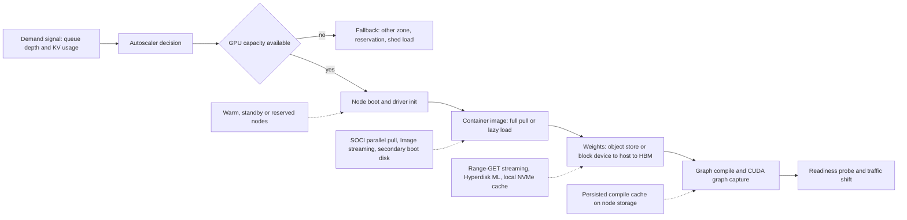

# Cloud GPU Autoscaling and Cold-Start Mitigation

## TL;DR

A GPU replica's cold start is a serial pipeline: capacity acquisition, node boot, image materialization, weight transfer into HBM, compilation, and warmup, and the slowest stage sets how much headroom you have to keep.
Container images and model weights are both "bytes that must land before the first token", and both are usually limited by serial software paths (one connection per layer, serial range GETs per worker, single-threaded gunzip, verify-then-decompress), not by the NIC.
Lazy loading (SOCI index, GKE Image streaming) trades a smaller startup working set for exposure to remote I/O at runtime, while parallel pull trades memory and disk bandwidth for a deterministic "fully local before start".
Weight streaming completion time is the maximum over N parallel workers, so the median load time follows roughly the p96 of per-worker time at N=17, which makes request timeouts and retries a first-class design parameter.
Every second of cold start is paid for as warm buffer capacity (buffer = demand ramp x time-to-ready), so cold-start engineering is a unit-economics lever, not just a latency one.

## Mental Model



Treat a new inference replica as a data-movement job with a compute tail.
The control plane (autoscaler, cloud instance API, Kubernetes scheduler) decides that a replica should exist, and the data plane (NIC, local NVMe, PCIe, HBM) then has to move tens to hundreds of GiB of image layers and weights before the replica produces a token.
Each stage has a different bottleneck and a different mitigation, and the mitigations work at different layers: capacity is a contract with the provider, images are a containerd snapshotter problem, weights are an object-storage concurrency problem, and compilation is a cache-locality problem.
The useful habit is to measure each stage separately on the actual instance type, because the cause shifts after every fix: once weights stream at line rate, compilation dominates, and once compilation is cached, node provisioning dominates.

## Internals

### The cold-start equation

Write time-to-ready for one replica as `T_ready = T_signal + T_decide + T_capacity + T_boot + T_image + T_weights + T_compile + T_warm + T_route`.
`T_signal` is metric emission plus scrape interval, `T_decide` is the autoscaler evaluation period plus stabilization windows, and `T_route` is readiness probe period plus load-balancer registration.
`T_capacity` is the time from "I want a GPU node" until the cloud returns a running instance, and it can be unbounded when the zone has no capacity (EC2 `InsufficientInstanceCapacity`, GCE `ZONE_RESOURCE_POOL_EXHAUSTED`).
The rest are data-plane stages on the node, and they are the subject of this chapter.
AWS instrumented the pod startup path on p5.48xlarge and, with default Run:ai Model Streamer settings, measured weights loading at about 29 s and torch.compile at about 53 s for a 64 GiB model, and weights loading at about 423 s (92 percent of model startup) for a 203 GiB model run with TP=4 ([AWS Containers blog, as of 2026-10](https://aws.amazon.com/blogs/containers/fast-model-loading-for-ai-inference-on-amazon-eks/)).
The same team treats CUDA graph capture as a small fixed cost and covers node launch and image pull through separate work (Karpenter provisioning and SOCI parallel pull) ([AWS Containers blog, as of 2026-10](https://aws.amazon.com/blogs/containers/fast-model-loading-for-ai-inference-on-amazon-eks/)).

### Control plane versus data plane in GPU autoscaling

The scale-out decision depends on the control plane: metrics pipelines, the HPA or KEDA controller, Karpenter or GKE node auto-provisioning, and the EC2 or GCE instance APIs.
The work that actually serves tokens is data plane: the engine process, its KV cache, and the bytes already sitting in HBM.
This is the same split as [[17-Cloud-AI-Engineering/Volume_01_Cloud_Architecture_Principles/Chapter_04_Control_Plane_vs_Data_Plane_Separation|Control Plane vs Data Plane Separation]], and the same lesson applies: a design that needs the control plane to succeed during an incident is not statically stable.
In practice, the replicas you need to survive losing a zone or region must already be running or already reserved, because instance-launch APIs are often degraded at the moment you need them most (see [[17-Cloud-AI-Engineering/Volume_01_Cloud_Architecture_Principles/Chapter_02_Regions_Zones_and_Static_Stability|Regions, Zones, and Static Stability]]).

### Autoscaling signals that actually track saturation

LLM serving saturates on KV-cache memory and on batch slots, not on "GPU busy".
NVIDIA's coarse utilization counter reports the fraction of time any kernel was running, so a decode loop running a memory-bound GEMV at small batch reads close to 100 percent while the SMs have plenty of arithmetic headroom.
A better leading indicator is queue depth at the engine (vLLM exposes `vllm:num_requests_waiting`) combined with KV-cache occupancy, because a growing wait queue at high KV occupancy means admission is blocked on memory, which more replicas fix (see [[17-Cloud-AI-Engineering/Volume_11_LLM_Serving_and_Inference_Systems_on_Cloud/Chapter_03_KV_Cache_Management_and_PagedAttention|KV-Cache Management and PagedAttention]]).
The exact name of the KV-usage gauge has changed across vLLM versions, so pin it against the engine version you run (UNVERIFIED for current naming).
Kubernetes HPA evaluates on a sync loop (15 s by default) and applies a default 300 s scale-down stabilization window, so your scale-in behavior is already damped unless you override it.
That damping is usually what you want for GPUs, as explained under Failure Modes.

### Image materialization: what containerd actually does

An OCI image is a manifest pointing at layers, and each layer is usually a gzip-compressed tar blob addressed by its SHA-256 digest.
The classic containerd pull path, per layer, is: fetch the blob over one HTTP connection, verify the digest, decompress, untar into a snapshot directory, then mount the snapshots as an overlay.
Gzip decompression of a single stream is inherently serial, and digest verification over the compressed blob has traditionally been a separate pass.
As a result, a 20 GB CUDA-plus-PyTorch image on a node with a 100+ Gbps NIC and fast NVMe can still take minutes, because only one core and one TCP flow are working per layer.
The Slacker study (USENIX FAST 2016) measured that pulling packages took 76 percent of container start time while only 6.4 percent of the pulled data was actually read ([Harter et al., FAST 16](https://www.usenix.org/conference/fast16/technical-sessions/presentation/harter)).
Borg reported a median task startup of about 25 s, mostly spent on package installation ([summary of Borg, EuroSys 2015, via The Morning Paper](https://blog.acolyer.org/2016/05/02/slacker-fast-distribution-with-lazy-docker-containers/)).
That gives two strategies: fetch less (lazy loading) or fetch everything faster (parallel pull).

### Lazy loading: how SOCI makes gzip seekable

This mechanism is usually missing from getting-started guides.
DEFLATE encodes back-references into a 32 KiB sliding window of previously decompressed output, so you cannot start decompressing at an arbitrary compressed offset without knowing the bit position and the preceding 32 KiB of plaintext.
The zran technique from zlib solves this by decompressing the stream once and saving checkpoints at intervals, each holding the compressed offset, the bit offset, and a copy of the 32 KiB window.
A reader seeks to the nearest checkpoint, primes the inflater with the saved bits and dictionary (`inflatePrime()` and `inflateSetDictionary()`), and decompresses forward only as far as the requested file.
SOCI builds this checkpoint table plus a tar table of contents into an external index stored next to the image, so the image digest, the registry, and the signatures do not change ([SOCI paper, arXiv 2607.06868, as of 2026-10](https://arxiv.org/html/2607.06868v1)).
At runtime a FUSE-backed snapshotter turns each file read into byte-range GETs against the registry blob, so startup cost scales with the working set rather than the image size.
The SOCI authors report 7-9x lower pull time on cold starts (about 2.8 s versus 20-25 s), and in one example only 10.9 percent of image bytes were fetched at pull time ([SOCI paper, as of 2026-10](https://arxiv.org/html/2607.06868v1)).
They also report SOCI lazy loading on ECS Fargate, which launched 18.4 million tasks per day during Prime Day 2025 ([SOCI paper, as of 2026-10](https://arxiv.org/html/2607.06868v1)).
GKE Image streaming follows the same idea: GKE mounts a remote filesystem as the container's root filesystem and streams image data from it as the container needs it ([Ray docs describing GKE Image streaming, as of 2026-10](https://docs.ray.io/en/latest/cluster/kubernetes/user-guides/reduce-image-pull-latency.html)).
GKE Autopilot turns Image streaming on by default for eligible images in Artifact Registry ([Google Cloud docs, as of 2026-10](https://docs.cloud.google.com/kubernetes-engine/docs/concepts/startup-latency-reduction-strategies)).

### Why lazy loading is often wrong for GPU images

A GPU inference container's startup working set is large and arrives in bursts: `import torch` maps CUDA, cuBLAS, cuDNN, and NCCL shared objects that together run to gigabytes, and the dynamic loader touches them in a scattered pattern.
With lazy loading, the container reports "Running" in seconds, but the first Python import then turns into thousands of remote page-ins, each paying registry round-trip latency.
The time has moved to the right without shrinking, and it now lands inside your readiness window where it is harder to see.
This is why AWS turned on SOCI parallel pull and unpack, rather than lazy loading, for G, P, and Trn instances with local NVMe in EKS Auto Mode, effective 2025-11-19, with no configuration required ([EKS Auto Mode release notes, as of 2026-10](https://docs.aws.amazon.com/eks/latest/userguide/auto-change.html)).

### Parallel pull: removing the serial stages

SOCI parallel pull/unpack mode opens multiple concurrent HTTP connections per layer, splits large layers into chunks fetched in parallel, and unpacks multiple layers at once ([EKS best practices, as of 2026-10](https://docs.aws.amazon.com/eks/latest/best-practices/aiml-performance.html)).
On instances with local NVMe, EKS Auto Mode decompresses layers onto NVMe instead of network-attached EBS ([AWS Containers blog, as of 2026-10](https://aws.amazon.com/blogs/containers/faster-nodes-smarter-scaling-whats-new-inside-amazon-elastic-kubernetes-service-amazon-eks-auto-mode/)).
On AL2023 you turn it on with the `nodeadm` `FastImagePull` feature gate, and on Bottlerocket you tune it under `settings.container-runtime-plugins.soci-snapshotter.parallel-pull-unpack` ([The New Stack, as of 2026-10](https://thenewstack.io/accelerating-eks-image-pulls/)).
Parallel pull has a memory cost.
In-memory parallel pull in containerd 2.2 used 4.1-19.2 GiB of daemon memory on production-scale images up to 48.5 GiB, and a disk-backed variant (DBPP) that writes each chunk straight to its final file offset cut that to 243 MiB-1.02 GiB with comparable throughput ([DBPP paper, arXiv 2607.05596, as of 2026-10](https://arxiv.org/html/2607.05596v1)).
Because each layer lands on disk as a complete, seekable file, DBPP can run SHA-256 verification and decompression at the same time instead of one after the other ([DBPP paper, as of 2026-10](https://arxiv.org/html/2607.05596v1)).
Remaining serial bottlenecks include single-stream gzip decompression and SHA-256 verification, which cannot be split into independent pieces, and the authors list chunk-parallel hashing such as BLAKE3 as open work ([The New Stack, as of 2026-10](https://thenewstack.io/accelerating-eks-image-pulls/)).

### Pre-materialized images: GKE secondary boot disks

GKE can attach a secondary boot disk built from a disk image that already holds container images or data such as model weights.
GKE creates that disk in parallel with node provisioning, so it does not normally add to node creation time ([Google Cloud docs, as of 2026-10](https://docs.cloud.google.com/kubernetes-engine/docs/how-to/data-container-image-preloading)).
GKE extends containerd with plugins that read images from the secondary disk, and Google's guidance is to preload the large base layers and pull the small upper layers from the registry ([Google Cloud docs, as of 2026-10](https://docs.cloud.google.com/kubernetes-engine/docs/how-to/data-container-image-preloading)).
Disks created from an image that is already in use in the same zone are created faster ([Google Cloud docs, as of 2026-10](https://docs.cloud.google.com/kubernetes-engine/docs/how-to/data-container-image-preloading)).
The trade-off is a build pipeline: every base-layer change requires a new disk image and a node-pool update, and a mismatch fails silently, because containerd falls back to pulling from the registry.
GKE also documents a standby-buffer pattern in which a DaemonSet pre-pulls workload images onto the boot disk during a node-initialization window (annotation `buffer.gke.io/standby-capacity-init-time`) before the node is suspended ([Google Cloud docs, as of 2026-10](https://docs.cloud.google.com/kubernetes-engine/docs/concepts/startup-latency-reduction-strategies)).
Check the launch stage of standby buffers for your GKE version before relying on them (launch stage UNVERIFIED).
On AWS the closest equivalent is baking images into a custom AMI.
EBS volumes restored from snapshots fetch blocks from S3 the first time they are read unless Fast Snapshot Restore or provisioned initialization is used, so a baked AMI can still be slow on first touch (UNVERIFIED in this session).

### Weight transport: four topologies

Topology A is two-hop: object storage to local disk (for example with s5cmd or `aws s3 cp`), then local disk to page cache to host memory to HBM.
Topology B is direct streaming: parallel byte-range GETs land in pinned host buffers and are DMA-copied straight to each GPU's HBM, which is what Run:ai Model Streamer does in vLLM and SGLang and what SageMaker fast model loading does.
Topology C is a shared read-only block device that many nodes attach at once, such as Hyperdisk ML in READ_ONLY_MANY mode.
Topology D is node-local persistence: weights baked into a secondary boot disk or cached on instance-store NVMe that outlives individual pods.
SageMaker fast model loading shards the model ahead of time so each piece fits one GPU, stores it in equal-sized chunks that load concurrently, and streams from S3 to the GPUs, skipping the S3-to-disk, disk-to-host, and host-side sharding steps ([SageMaker docs, as of 2026-10](https://docs.aws.amazon.com/sagemaker/latest/dg/model-optimize.html)).
AWS measured two-hop loading of a 200 GB model at about 25 s for s5cmd to NVMe plus about 20 s for the streamer to GPU, roughly 45 s in total, against about 25 s for tuned direct streaming ([AWS Containers blog, as of 2026-10](https://aws.amazon.com/blogs/containers/fast-model-loading-for-ai-inference-on-amazon-eks/)).
That works out to about 8 GB/s (about 64 Gbps) from S3 into one p5.48xlarge.
Two-hop still wins in one case: when the same node restarts pods often (rollouts, crash restarts), the NVMe copy turns S3 traffic into a local read.

### The serial-worker mechanism inside the streamer

Run:ai Model Streamer splits weight files into chunks and fetches each chunk with its own HTTP byte-range request ([AWS Containers blog, as of 2026-10](https://aws.amazon.com/blogs/containers/fast-model-loading-for-ai-inference-on-amazon-eks/)).
Within one worker those range requests are serial, with no pipelining or overlap on a connection, so the worker waits for each full response before sending the next request ([AWS Containers blog, as of 2026-10](https://aws.amazon.com/blogs/containers/fast-model-loading-for-ai-inference-on-amazon-eks/)).
Model each request as `t_req = TTFB + chunk / bw_conn`, so a worker's efficiency is `1 / (1 + TTFB x bw_conn / chunk)`.
With an illustrative TTFB of 50 ms and 100 MB/s per connection (both assumptions, measure your own with the lab), the bandwidth-delay term is 5 MB, so 8 MiB chunks run at about 63 percent efficiency and 256 MiB chunks at about 98 percent.
Once chunks are large enough that efficiency is near 1, adding parallelism only moves the bottleneck to the NIC, host memory bandwidth, or PCIe.
That matches AWS's result on p5: 256 MiB chunks at concurrency 256 loaded in 13.98 s, and 4 GiB chunks at concurrency 17 loaded in 13.35 s ([AWS Containers blog, as of 2026-10](https://aws.amazon.com/blogs/containers/fast-model-loading-for-ai-inference-on-amazon-eks/)).
The EKS guidance is `concurrency = ceil(model_size_GB / chunk_size_GB)`, which gives 17 for a 67 GB model with 4 GB chunks ([EKS docs, as of 2026-10](https://docs.aws.amazon.com/eks/latest/userguide/ml-inference-fast-model-loading.html)).
Default streamer concurrency is 8 for object storage and 16 for filesystems, and the CPU buffer cap defaults to unlimited in distributed mode and 40 GiB otherwise ([Azure SDK blog, as of 2026-10](https://devblogs.microsoft.com/azure-sdk/eliminate-llm-cold-starts-load-models-up-to-6x-faster-with-azure-blob-storage-and-runai-model-streamer/)).

### Order statistics: why the tail decides load time

The load finishes when the slowest worker finishes, so `P(T_load <= t) = F(t)^N`, where `F` is the CDF of one worker's completion time.
Setting `F(t)^N = 0.5` gives `F(t) = 0.5^(1/N)`, which is 0.960 at N=17, so the median model load lands at roughly the p96 of single-worker time.
The p99 load corresponds to `0.99^(1/17) = 0.99941`, the p99.94 of a single worker.
Large chunks cut the number of round trips, but each long request is then exposed to a stall for longer.
A single TCP flow stuck in retransmission backoff, or a slow storage node behind one request, can hold a 4 GiB chunk for tens of seconds while every other worker sits idle.
This is why AWS paired the 4 GiB chunk recommendation with aggressive timeouts and retries for S3 tail latency and stalled connections ([AWS Containers blog summary, as of 2026-10](https://aws-news.com/article/2026-09-01-fast-model-loading-for-ai-inference-on-amazon-eks)).
The design rule comes from "The Tail at Scale": set a per-chunk deadline from the observed size-normalized latency (for example 3x the p50 of `bytes / duration`), cancel the request, and re-issue the remaining byte range on a new connection instead of waiting for TCP to recover.

### The host-to-device hop

From host memory, each GPU sits behind its own PCIe link, and on Hopper-class SXM boards that link is PCIe Gen5 x16, about 63 GB/s per direction in theory.
`cudaMemcpy` from pageable memory is staged by the driver through an internal pinned bounce buffer, which adds a copy and serializes the transfer.
Streaming loaders therefore read into pre-pinned host buffers and issue asynchronous copies on separate CUDA streams per device, so network reads, host buffering, and DMA overlap.
With TP=8, eight PCIe links fill in parallel, so host-to-HBM is rarely the bottleneck, and the NIC and object-storage concurrency usually are.

### Safetensors, mmap, and FUSE

A safetensors file is an 8-byte little-endian header length, then a JSON header mapping tensor names to dtype, shape, and byte offsets, then the raw tensor bytes.
The default loader `mmap`s the file and materializes tensors by touching pages, which works well on a local NVMe page cache.
Put that file behind a FUSE mount of object storage (Mountpoint for Amazon S3, Cloud Storage FUSE), and page faults become small, poorly pipelined range reads issued in the order the model touches tensors.
That defeats readahead and leaves you with the "one worker, serial small requests" pattern described above.
Either use a streaming loader that reads the whole file with large parallel ranges, or use the FUSE layer's whole-file cache so the first access copies the file to local disk in bulk (Cloud Storage FUSE file cache and parallel downloads, current flags UNVERIFIED).

### Shared read-only block: Hyperdisk ML

Hyperdisk ML is a Compute Engine volume type built for high read throughput on immutable data, and a single volume can be attached read-only to many instances ([Google Cloud docs, as of 2026-10](https://docs.cloud.google.com/compute/docs/disks/hd-types/hyperdisk-ml)).
Provisioned throughput is shared dynamically across the attached instances and is capped by each instance's own Hyperdisk limit ([GKE docs, as of 2026-10](https://docs.cloud.google.com/kubernetes-engine/docs/concepts/hyperdisk)).
There are two operational limits that rarely show up in tutorials.
First, a Hyperdisk ML volume can be attached to at most 100 instances in any 30-second interval ([Google Cloud docs, as of 2026-10](https://docs.cloud.google.com/compute/docs/disks/hd-types/hyperdisk-ml)).
Second, once a volume is attached to more than 20 instances in READ_ONLY_MANY mode, provisioned throughput must be at least 100 MBps times the number of attached instances ([GKE docs, as of 2026-10](https://docs.cloud.google.com/kubernetes-engine/docs/concepts/hyperdisk)).
In a 300-node scale-out the attach limit alone is a bottleneck: the third batch of 100 cannot start attaching before t = 60 s.
Converting a volume to read-only sharing is one-way, so a new model version means a new volume, and the immutability doubles as a security property (see Security and Cost Angles) ([Google Cloud docs, as of 2026-10](https://docs.cloud.google.com/compute/docs/disks/hd-types/hyperdisk-ml)).

### Compilation and warmup

torch.compile produces fused Triton and CUDA kernels on first startup, and those artifacts can be cached.
AWS showed that caching torch.compile artifacts on an NVMe-backed persistent volume removes about 53 s of recompilation, so a second launch of a 64 GiB model on the same node took 16 s instead of 82 s ([AWS Containers blog, as of 2026-10](https://aws.amazon.com/blogs/containers/fast-model-loading-for-ai-inference-on-amazon-eks/)).
The cache key includes the model graph, engine version, compiler version, and GPU architecture, so an engine upgrade invalidates the whole fleet's cache at once.
Plan engine upgrades as cold-start events and pre-warm the compile cache in a canary before the rollout.

### Research lineage

ServerlessLLM (OSDI 2024) argued that inference servers should exploit multi-tier local storage, use a checkpoint format optimized for loading, and make scheduling decisions locality-aware so replicas start where weights are already cached (UNVERIFIED: citation not re-fetched this session).
In cloud products, that locality idea shows up as node-local caches, secondary boot disks, and shared read-only volumes.
A fleet scheduler can do the same thing by preferring nodes whose NVMe already holds the target model's digest.

## Numbers to Know

| Quantity | Value | Source |
| --- | --- | --- |
| Share of container start time spent pulling, and share of pulled data read | 76 percent and 6.4 percent | [Slacker, FAST 2016](https://www.usenix.org/conference/fast16/technical-sessions/presentation/harter) |
| Borg median task startup | about 25 s | [Borg EuroSys 2015, via The Morning Paper](https://blog.acolyer.org/2016/05/02/slacker-fast-distribution-with-lazy-docker-containers/) |
| SOCI lazy-load pull time reduction on cold start | 7-9x (about 2.8 s versus 20-25 s) | [SOCI paper, as of 2026-10](https://arxiv.org/html/2607.06868v1) |
| containerd 2.2 in-memory parallel pull daemon memory | 4.1-19.2 GiB (images up to 48.5 GiB) | [DBPP paper, as of 2026-10](https://arxiv.org/html/2607.05596v1) |
| Disk-backed parallel pull daemon memory | 243 MiB-1.02 GiB | [DBPP paper, as of 2026-10](https://arxiv.org/html/2607.05596v1) |
| EKS Auto Mode SOCI parallel pull default for G, P, Trn with NVMe | on since 2025-11-19 | [EKS docs, as of 2026-10](https://docs.aws.amazon.com/eks/latest/userguide/auto-change.html) |
| Weights load, 64 GiB model, p5.48xlarge, default streamer | about 29 s (plus about 53 s torch.compile) | [AWS Containers blog, as of 2026-10](https://aws.amazon.com/blogs/containers/fast-model-loading-for-ai-inference-on-amazon-eks/) |
| Weights load, 203 GiB model, TP=4, default streamer | about 423 s, 92 percent of startup | [AWS Containers blog, as of 2026-10](https://aws.amazon.com/blogs/containers/fast-model-loading-for-ai-inference-on-amazon-eks/) |
| Tuned startup, 64 GiB model, first launch and same-node relaunch | 82 s to 65 s and 82 s to 16 s | [AWS Containers blog, as of 2026-10](https://aws.amazon.com/blogs/containers/fast-model-loading-for-ai-inference-on-amazon-eks/) |
| Tuned startup, 203 GiB model | 457 s to 32 s | [AWS blog summary, as of 2026-10](https://aws-news.com/article/2026-09-01-fast-model-loading-for-ai-inference-on-amazon-eks) |
| Two-hop versus direct, 200 GB model | about 45 s versus about 25 s | [AWS Containers blog, as of 2026-10](https://aws.amazon.com/blogs/containers/fast-model-loading-for-ai-inference-on-amazon-eks/) |
| Chunk size versus load time (64 GiB) | 256 MiB/c=256: 13.98 s, 4 GiB/c=17: 13.35 s | [AWS Containers blog, as of 2026-10](https://aws.amazon.com/blogs/containers/fast-model-loading-for-ai-inference-on-amazon-eks/) |
| Run:ai streamer default concurrency | 8 (object storage), 16 (filesystem) | [Azure SDK blog, as of 2026-10](https://devblogs.microsoft.com/azure-sdk/eliminate-llm-cold-starts-load-models-up-to-6x-faster-with-azure-blob-storage-and-runai-model-streamer/) |
| g6e.4xlarge sustained network, and observed 10.4 GB stream | 20 Gbps, about 5 s | [EKS docs, as of 2026-10](https://docs.aws.amazon.com/eks/latest/userguide/ml-inference-load-serve-model.html) |
| Hyperdisk ML max throughput per volume | 2 TiB/s (2,097,152 MiB/s) | [Compute Engine docs, as of 2026-10](https://docs.cloud.google.com/compute/docs/disks/hd-types/hyperdisk-ml) |
| Hyperdisk ML IOPS per MiB/s provisioned | 16 | [Compute Engine docs, as of 2026-10](https://docs.cloud.google.com/compute/docs/disks/hd-types/hyperdisk-ml) |
| Hyperdisk ML attach rate | 100 instances per 30 s | [Compute Engine docs, as of 2026-10](https://docs.cloud.google.com/compute/docs/disks/hd-types/hyperdisk-ml) |
| Hyperdisk ML min throughput when more than 20 ROM attachments | 100 MBps x attached instances | [GKE docs, as of 2026-10](https://docs.cloud.google.com/kubernetes-engine/docs/concepts/hyperdisk) |
| Hyperdisk ML stated fan-out in GKE | 2,500 nodes at 1.2 TiB/s, up to 11.9x faster than a model registry | [GKE docs, as of 2026-10](https://docs.cloud.google.com/kubernetes-engine/docs/how-to/persistent-volumes/hyperdisk-ml) |
| Hyperdisk ML size range | 4 GiB to 64 TiB | [Compute Engine docs, as of 2026-10](https://docs.cloud.google.com/compute/docs/disks/add-hyperdisk) |
| GKE secondary boot disk minimum version | COS 1.30.1-gke.1329000, Ubuntu 1.35.0-gke.1403000 | [GKE docs, as of 2026-10](https://docs.cloud.google.com/kubernetes-engine/docs/how-to/data-container-image-preloading) |
| HPA default sync period and scale-down stabilization | 15 s and 300 s | Kubernetes upstream defaults (stable) |
| S3 request rate per partitioned prefix | 5,500 GET/HEAD per second | UNVERIFIED in this session |
| GPU instance list prices | Query the Pricing API at run time (see lab) | not stated; prices not verified in this session |

The two Hyperdisk ML throughput figures above differ: the Compute Engine page quotes 2 TiB/s per volume, while the GKE page quotes 1.2 TiB/s across 2,500 nodes.
Treat the per-instance limit for your machine type as the binding number.

## AWS vs GCP Mechanism Parity

| Concern | AWS mechanism | Google Cloud mechanism | Critical difference |
| --- | --- | --- | --- |
| Lazy image loading | SOCI lazy mode with an external zran index, on EKS and Fargate | GKE Image streaming from Artifact Registry, on by default in Autopilot for eligible images | SOCI works with unmodified images in any OCI registry, while Image streaming is tied to Artifact Registry eligibility |
| Fast full pull | SOCI parallel pull/unpack, default in EKS Auto Mode for G, P, Trn with NVMe since 2025-11 | Standard containerd pull, or a DaemonSet pre-pull on standby nodes | AWS parallelized the pull itself, while GCP mostly avoids the pull by pre-materializing images |
| Image baked into node storage | Custom AMI, EBS snapshot with lazy hydration (UNVERIFIED) | Secondary boot disk from a disk image, created in parallel with the node | GKE has first-class containerd integration for preloaded images, while AWS AMI baking needs a custom pipeline |
| Direct weight streaming | Run:ai Model Streamer from S3 in vLLM/SGLang, and SageMaker fast model loading | Run:ai Model Streamer from GCS (GCS support UNVERIFIED in this session) | SageMaker adds offline pre-sharding into equal chunks as a managed step |
| Shared read-only block for weights | No direct equivalent at Hyperdisk ML scale (EBS Multi-Attach limits UNVERIFIED) | Hyperdisk ML READ_ONLY_MANY, up to 2 TiB/s per volume, 100 attaches per 30 s | GCP offers block-level fan-out, while AWS steers you to S3 streaming or FSx for Lustre |
| POSIX view of object storage | Mountpoint for Amazon S3 | Cloud Storage FUSE with file cache | On both, mmap over FUSE is pathological without a whole-file cache |
| Node provisioning | Karpenter or EKS Auto Mode on EC2 Fleet | GKE node auto-provisioning and custom compute classes | Both depend on the instance-launch control plane, so neither is statically stable during launch impairment |
| Capacity assurance | On-Demand Capacity Reservations, Capacity Blocks for ML (current terms UNVERIFIED) | Reservations, Dynamic Workload Scheduler (current modes UNVERIFIED) | Reservations bill whether used or not, which is the price of static stability |
| Compile cache persistence | NVMe-backed persistent volume, shown by AWS for torch.compile | Local SSD or Hyperdisk-backed PV (same pattern) | Mechanism is engine-level and cloud-agnostic |
| Private path to weights | S3 gateway endpoint, ECR interface endpoints | Private Google Access, VPC Service Controls perimeter | GCP perimeters are API-level, AWS endpoints are route- and policy-level |

## Worked Example: Measuring the Weight-Streaming Mechanism and Sizing the Buffer

### What the lab proves

The lab launches one in-region EC2 instance that writes 16 GiB of synthetic shards to S3, then streams them back using the same serial-worker pattern as Run:ai Model Streamer.
It records TTFB, per-request duration, aggregate throughput, the ratio of slowest worker to median worker, and a bootstrap prediction of load-completion p50 and p99 using the `F(t)^N` model.
The instance terminates itself after uploading the results, and a dead-man shutdown at 90 minutes limits the cost if anything hangs.

### Cost estimate

One `c6in.4xlarge`-class instance for about 1 hour, 16 GiB of S3 Standard for under a day, and a few tens of thousands of GET requests should cost under USD 2 in total, but the underlying prices are UNVERIFIED in this session.
Get the current instance price with the Pricing API before running.

```bash
aws pricing get-products --region us-east-1 --service-code AmazonEC2 \
  --filters Type=TERM_MATCH,Field=instanceType,Value=c6in.4xlarge \
            Type=TERM_MATCH,Field=location,Value="US East (N. Virginia)" \
            Type=TERM_MATCH,Field=operatingSystem,Value=Linux \
            Type=TERM_MATCH,Field=tenancy,Value=Shared \
            Type=TERM_MATCH,Field=preInstalledSw,Value=NA \
            Type=TERM_MATCH,Field=capacitystatus,Value=Used \
  --max-items 1 --output json | jq -r '.PriceList[0]' | jq '.terms.OnDemand'
```

Check the network ceiling of the instance type you pick, since it bounds every result.

```bash
aws ec2 describe-instance-types --instance-types c6in.4xlarge \
  --query 'InstanceTypes[0].NetworkInfo.NetworkPerformance' --output text
```

### Step 1: budget alarm first

```bash
export REGION=us-east-1
export ACCOUNT_ID=$(aws sts get-caller-identity --query Account --output text)
export EMAIL=you@example.com

cat > /tmp/budget.json <<EOF
{"BudgetName":"cold-start-lab","BudgetLimit":{"Amount":"20","Unit":"USD"},
 "TimeUnit":"MONTHLY","BudgetType":"COST"}
EOF
cat > /tmp/notif.json <<EOF
[{"Notification":{"NotificationType":"ACTUAL","ComparisonOperator":"GREATER_THAN",
  "Threshold":50,"ThresholdType":"PERCENTAGE"},
  "Subscribers":[{"SubscriptionType":"EMAIL","Address":"${EMAIL}"}]}]
EOF
aws budgets create-budget --account-id "$ACCOUNT_ID" \
  --budget file:///tmp/budget.json \
  --notifications-with-subscribers file:///tmp/notif.json
```

### Step 2: bucket and least-privilege instance role

```bash
export BUCKET=cold-start-lab-${ACCOUNT_ID}-${REGION}
aws s3api create-bucket --bucket "$BUCKET" --region "$REGION"
# For regions other than us-east-1 add:
#   --create-bucket-configuration LocationConstraint=$REGION

cat > /tmp/trust.json <<'EOF'
{"Version":"2012-10-17","Statement":[{"Effect":"Allow",
 "Principal":{"Service":"ec2.amazonaws.com"},"Action":"sts:AssumeRole"}]}
EOF
cat > /tmp/s3.json <<EOF
{"Version":"2012-10-17","Statement":[
 {"Effect":"Allow","Action":"s3:ListBucket","Resource":"arn:aws:s3:::${BUCKET}",
  "Condition":{"StringLike":{"s3:prefix":["lab/*"]}}},
 {"Effect":"Allow","Action":["s3:GetObject","s3:PutObject"],
  "Resource":"arn:aws:s3:::${BUCKET}/lab/*"}]}
EOF
aws iam create-role --role-name cold-start-lab-role \
  --assume-role-policy-document file:///tmp/trust.json
aws iam put-role-policy --role-name cold-start-lab-role \
  --policy-name s3-lab --policy-document file:///tmp/s3.json
aws iam create-instance-profile --instance-profile-name cold-start-lab-profile
aws iam add-role-to-instance-profile \
  --instance-profile-name cold-start-lab-profile --role-name cold-start-lab-role
sleep 15
```

### Step 3: the benchmark harness

Save this as `stream_bench.py` in the working directory.

```python
#!/usr/bin/env python3
"""stream_bench.py - measure the mechanics of streaming weight shards from S3.

Models the Run:ai-style loader: W workers, each issuing SERIAL byte-range GETs
over its own contiguous slice of the shard set. Reports aggregate throughput,
per-request TTFB and duration, and a bootstrap estimate of how load-completion
time (max over workers) grows with worker count because of tail latency.
"""
import argparse
import json
import math
import random
import statistics
import time
from concurrent.futures import ThreadPoolExecutor

import boto3
from botocore.config import Config

MIB = 1024 * 1024


def list_shards(s3, bucket, prefix):
    out, token = [], None
    while True:
        kw = {"Bucket": bucket, "Prefix": prefix}
        if token:
            kw["ContinuationToken"] = token
        resp = s3.list_objects_v2(**kw)
        out += [(o["Key"], o["Size"]) for o in resp.get("Contents", [])]
        if not resp.get("IsTruncated"):
            return out
        token = resp["NextContinuationToken"]


def plan_chunks(shards, chunk_bytes):
    chunks = []
    for key, size in shards:
        off = 0
        while off < size:
            end = min(off + chunk_bytes, size) - 1
            chunks.append((key, off, end))
            off = end + 1
    return chunks


def split_contiguous(chunks, workers):
    per = math.ceil(len(chunks) / workers)
    return [chunks[i:i + per] for i in range(0, len(chunks), per)]


def fetch(s3, bucket, key, start, end):
    t0 = time.perf_counter()
    resp = s3.get_object(Bucket=bucket, Key=key, Range=f"bytes={start}-{end}")
    body = resp["Body"]
    first = None
    n = 0
    for part in body.iter_chunks(chunk_size=8 * MIB):
        if first is None:
            first = time.perf_counter() - t0
        n += len(part)
    return n, first or 0.0, time.perf_counter() - t0


def worker(s3, bucket, slice_):
    t0 = time.perf_counter()
    reqs = [fetch(s3, bucket, k, a, b) for (k, a, b) in slice_]
    return time.perf_counter() - t0, reqs


def pct(xs, p):
    xs = sorted(xs)
    i = min(len(xs) - 1, max(0, int(round(p / 100.0 * (len(xs) - 1)))))
    return xs[i]


def bootstrap_max(req_durations, reqs_per_worker, workers, trials=2000):
    """Predict load completion = max over workers of a sum of serial requests."""
    sims = []
    for _ in range(trials):
        sims.append(max(sum(random.choice(req_durations)
                            for _ in range(reqs_per_worker))
                        for _ in range(workers)))
    return pct(sims, 50), pct(sims, 99)


def run(bucket, prefix, chunk_mib, workers, read_timeout):
    cfg = Config(max_pool_connections=max(workers * 2, 10),
                 read_timeout=read_timeout, connect_timeout=5,
                 retries={"max_attempts": 4, "mode": "standard"})
    s3 = boto3.client("s3", config=cfg)
    shards = list_shards(s3, bucket, prefix)
    total = sum(s for _, s in shards)
    chunks = plan_chunks(shards, chunk_mib * MIB)
    slices = split_contiguous(chunks, workers)
    t0 = time.perf_counter()
    with ThreadPoolExecutor(max_workers=len(slices)) as ex:
        results = list(ex.map(lambda sl: worker(s3, bucket, sl), slices))
    wall = time.perf_counter() - t0
    durs = [r[2] for _, reqs in results for r in reqs]
    ttfbs = [r[1] for _, reqs in results for r in reqs]
    wtimes = [w for w, _ in results]
    p50_pred, p99_pred = bootstrap_max(durs, len(slices[0]), len(slices))
    return {
        "chunk_mib": chunk_mib,
        "workers": len(slices),
        "requests": len(chunks),
        "bytes": total,
        "wall_s": round(wall, 3),
        "agg_GBps": round(total / wall / 1e9, 3),
        "ttfb_p50_ms": round(1000 * pct(ttfbs, 50), 1),
        "ttfb_p99_ms": round(1000 * pct(ttfbs, 99), 1),
        "req_p50_s": round(pct(durs, 50), 3),
        "req_p99_s": round(pct(durs, 99), 3),
        "slowest_worker_over_median": round(max(wtimes) / statistics.median(wtimes), 2),
        "bootstrap_load_p50_s": round(p50_pred, 3),
        "bootstrap_load_p99_s": round(p99_pred, 3),
    }


def main():
    ap = argparse.ArgumentParser()
    ap.add_argument("--bucket", required=True)
    ap.add_argument("--prefix", default="lab/weights/")
    ap.add_argument("--chunk-mib", type=int, nargs="+", default=[8, 64, 256, 1024])
    ap.add_argument("--workers", type=int, nargs="+", default=[4, 16, 64])
    ap.add_argument("--read-timeout", type=int, default=20)
    a = ap.parse_args()
    for c in a.chunk_mib:
        for w in a.workers:
            print(json.dumps(run(a.bucket, a.prefix, c, w, a.read_timeout)), flush=True)


if __name__ == "__main__":
    main()
```

Python threads release the GIL during socket reads, but CPython tops out at a few GB/s on one process, so treat absolute throughput above that as a harness limit and read the ratios and tail shape instead.

### Step 4: self-terminating launch

```bash
cat > /tmp/userdata.sh <<EOF
#!/bin/bash
set -euo pipefail
shutdown -h +90
dnf install -y python3-pip
pip3 install boto3
for i in 0 1 2 3; do
  head -c 4294967296 /dev/urandom | \
    aws s3 cp - s3://${BUCKET}/lab/weights/shard-\$i.safetensors --expected-size 4294967296
done
cat > /root/stream_bench.py <<'PY'
$(cat stream_bench.py)
PY
python3 /root/stream_bench.py --bucket ${BUCKET} > /root/results.jsonl 2>&1 || true
aws s3 cp /root/results.jsonl s3://${BUCKET}/lab/results/results.jsonl
shutdown -h now
EOF

export INSTANCE_ID=$(aws ec2 run-instances --region "$REGION" \
  --instance-type c6in.4xlarge \
  --image-id resolve:ssm:/aws/service/ami-amazon-linux-latest/al2023-ami-kernel-default-x86_64 \
  --iam-instance-profile Name=cold-start-lab-profile \
  --instance-initiated-shutdown-behavior terminate \
  --user-data file:///tmp/userdata.sh \
  --tag-specifications 'ResourceType=instance,Tags=[{Key=lab,Value=cold-start}]' \
  --query 'Instances[0].InstanceId' --output text)
echo "$INSTANCE_ID"
aws ec2 wait instance-terminated --instance-ids "$INSTANCE_ID"
aws s3 cp "s3://${BUCKET}/lab/results/results.jsonl" - | jq -c \
  '{chunk_mib,workers,agg_GBps,ttfb_p99_ms,slowest_worker_over_median,bootstrap_load_p99_s}'
```

This uses the default VPC, where S3 traffic within the same region carries no data-transfer charge.
In production, add an S3 gateway endpoint so traffic never touches a NAT gateway (see Security and Cost Angles).

### Step 5: reading the results

As chunk size grows from 8 MiB to 256 MiB at fixed workers, `agg_GBps` should rise and then flatten, which is the `1 / (1 + TTFB x bw / chunk)` curve.
At fixed chunk size, raising workers should raise throughput until it hits the instance's NIC ceiling.
Past that point, `slowest_worker_over_median` and `bootstrap_load_p99_s` grow while median throughput stays flat, which is the max-of-N tail at work.
If the slowest worker is more than about 2x the median, a per-chunk deadline with re-issue of the remaining range will improve p99 load time more than any increase in concurrency.

### Optional step: the real engine

On a GPU node that already has the NVIDIA driver and vLLM, use the configuration AWS documents to stream straight from S3 into HBM ([EKS docs, as of 2026-10](https://docs.aws.amazon.com/eks/latest/userguide/ml-inference-fast-model-loading.html)).

```bash
python3 -m vllm.entrypoints.openai.api_server \
  --model=s3://<BUCKET_NAME>/<MODEL_PATH> \
  --load-format=runai_streamer \
  --model-loader-extra-config='{"concurrency":17,"distributed":true}'
```

### Optional GCP parity: Hyperdisk ML volume for read-only fan-out

The `--access-mode` update flag below follows the documented READ_ONLY_MANY workflow, but its exact gcloud spelling is UNVERIFIED in this session.

```bash
gcloud billing budgets create --billing-account=BILLING_ACCOUNT_ID \
  --display-name=cold-start-lab --budget-amount=20USD --threshold-rule=percent=0.5
gcloud compute disks create weights-hdml --zone=us-central1-a \
  --type=hyperdisk-ml --size=200GB --provisioned-throughput=20000
# Attach read-write to one loader VM, copy weights, detach, then:
gcloud compute disks update weights-hdml --zone=us-central1-a --access-mode=READ_ONLY_MANY
# Teardown:
gcloud compute disks delete weights-hdml --zone=us-central1-a --quiet
```

### Teardown (AWS)

```bash
aws ec2 terminate-instances --instance-ids "$INSTANCE_ID" || true
aws s3 rb "s3://${BUCKET}" --force
aws iam remove-role-from-instance-profile \
  --instance-profile-name cold-start-lab-profile --role-name cold-start-lab-role
aws iam delete-instance-profile --instance-profile-name cold-start-lab-profile
aws iam delete-role-policy --role-name cold-start-lab-role --policy-name s3-lab
aws iam delete-role --role-name cold-start-lab-role
aws budgets delete-budget --account-id "$ACCOUNT_ID" --budget-name cold-start-lab
```

### Capacity sizing: what cold start costs in buffer

Scenario: a chat service serves a 203 GiB model at TP=4, two replicas per 8-GPU p5.48xlarge-class node, 40 replicas (20 nodes) at steady state.
The morning ramp adds demand at 2 replicas per minute for 30 minutes.
Every phase duration below is a planning assumption unless it carries a source.
Untuned time-to-ready: node acquisition and boot 240 s (assumption), default image pull of a 20 GB image 180 s (assumption), and pod startup of 457 s with default streamer settings (AWS measured), for a total of 877 s, about 14.6 minutes.
Tuned time-to-ready: 240 s node, 30 s image with SOCI parallel pull onto NVMe (assumption), and 32 s tuned pod startup (AWS measured), for a total of 302 s, about 5 minutes.
To avoid shedding during a ramp, the warm buffer must be at least `ramp x T_ready`.
Untuned, that is 2 x 14.6 = 29.2, so 30 replicas or 15 nodes.
Tuned, it is 2 x 5 = 10 replicas, or 5 nodes.
The difference is 10 nodes held around the clock, which is 240 node-hours per day.
At an illustrative USD 55 per node-hour (UNVERIFIED, use the Pricing API), that is about USD 13,200 per day, or about USD 396,000 per month, of buffer you can stop paying for.
After tuning, the 240 s node-acquisition assumption is about 80 percent of `T_ready`, so the next lever is capacity placement (reservations, standby nodes, in-region spare pools), not more byte-pipe work.
A step change in demand, such as absorbing a failed region, is different from a ramp: no cold-start optimization removes the need for warm capacity equal to the step if you require zero shedding in the first `T_ready` seconds.
In that case you are choosing between pre-positioned capacity and deliberate load shedding (see [[17-Cloud-AI-Engineering/Volume_07_Reliability_and_SRE/Chapter_02_Load_Shedding_Backpressure_and_Admission_Control|Load Shedding, Backpressure, and Admission Control]]).

## Failure Modes and Pitfalls

### Thundering herd on object storage during failover

A region-level failover that starts 300 replicas of a 64 GiB model at once has to move 18.75 TiB.
To do that in 120 s, the fleet needs about 160 GiB/s of aggregate read throughput.
With 8 MiB chunks that is 2,457,600 GETs in 120 s, about 20,480 GET/s, roughly 4x the commonly cited per-prefix S3 GET rate (UNVERIFIED in this session), which leads to `503 SlowDown` and retry amplification.
With 4 GiB chunks the same transfer is 4,800 GETs total, so chunk size is also a request-rate control.
Spread weights across multiple prefixes, add jitter to replica start times, and use exponential backoff with full jitter (see [[17-Cloud-AI-Engineering/Volume_07_Reliability_and_SRE/Chapter_03_Resilient_Communication_Retries_Jitter_and_Circuit_Breakers|Resilient Communication: Retries, Jitter, and Circuit Breakers]]).

### KMS request amplification

With SSE-KMS and no S3 Bucket Key, S3 calls KMS for decryption on object reads, so a burst of small range GETs can turn into a burst of KMS requests that hits the account's shared KMS request quota (UNVERIFIED: per-range-request behavior not re-verified in this session).
The symptom is weight loading failing with access or throttling errors while S3 itself looks healthy, and unrelated services that share the KMS quota fail at the same time.
Enable S3 Bucket Keys on weight buckets and size chunks so the request count stays small.

### One stalled connection stalls the load

Because load completion is the maximum over workers, a single stuck TCP flow holds every GPU on the node idle.
AWS explicitly recommends aggressive timeouts and retries for S3 tail latency and stalled connections ([AWS blog summary, as of 2026-10](https://aws-news.com/article/2026-09-01-fast-model-loading-for-ai-inference-on-amazon-eks)).
Default SDK read timeouts are often 60 s or more, far longer than a healthy 4 GiB chunk transfer on a fast node.

### Probe misconfiguration and crash-loop amplification

If a liveness probe starts before weights finish loading, the kubelet kills a container that is healthy but still loading, and the restart repeats the full load.
The same node then re-downloads the model on every attempt, which multiplies object-storage load during the incident that triggered the scale-out.
Use a `startupProbe` whose budget (`failureThreshold x periodSeconds`) covers the measured p99 load time with margin, and gate readiness on a warmup inference, not on the HTTP port opening.

### Lazy-loaded GPU images that look healthy

Lazy loading makes the container "start" in seconds and moves the CUDA library page-ins into the engine's startup.
Dashboards that track image pull time will show an improvement while time-to-first-token for new replicas gets worse, so measure time-to-ready from the scale decision to the first successful inference.

### Parallel pull out-of-memory

In-memory parallel pull can use multiple GiB of containerd memory on large images ([DBPP paper, as of 2026-10](https://arxiv.org/html/2607.05596v1)).
On a node that is also starting a vLLM process with large pinned host buffers, the result can be a kernel OOM kill of containerd or the engine during startup.
Use disk-backed modes, set explicit streamer memory limits, and reserve system memory with kubelet `system-reserved`.

### Hyperdisk ML attach throttling and throughput floor

With 300 nodes, the 100-attaches-per-30-s limit adds at least 60 s before the last batch can begin attaching ([Google Cloud docs, as of 2026-10](https://docs.cloud.google.com/compute/docs/disks/hd-types/hyperdisk-ml)).
Above 20 read-only attachments, provisioned throughput must be at least 100 MBps per attached instance, so an under-provisioned volume makes the attach fail validation outright ([GKE docs, as of 2026-10](https://docs.cloud.google.com/kubernetes-engine/docs/concepts/hyperdisk)).
For large fan-out, use several volumes holding the same model, one per node group.

### Scale-in that you cannot reverse

Releasing an on-demand GPU node during a quiet period is a one-way door when capacity is scarce, because the next launch can fail with `InsufficientInstanceCapacity` or `ZONE_RESOURCE_POOL_EXHAUSTED`.
Aggressive scale-in on a lagging metric oscillates: shrink at 2 a.m., then fail to get capacity back at 8 a.m.
Keep scale-in slower than scale-out, and put the floor on reserved capacity rather than on hope.
See [[17-Cloud-AI-Engineering/Volume_09_FinOps_and_Cloud_Economics/Chapter_03_Spot_Economics_and_Interruption_Handling|Spot Economics and Interruption Handling]] for the Spot version of this problem.

### Control-plane impairment during the event you scaled for

AWS's post-event summary of the 2021-12-07 us-east-1 event describes how automated scaling activity in AWS's internal network caused a surge of connection activity that congested internal devices and degraded control-plane APIs ([AWS PES](https://aws.amazon.com/message/12721/)).
AWS's summary of the October 2025 us-east-1 event reports that a DynamoDB DNS failure cascaded into impaired EC2 instance launches and network configuration of new instances for hours ([AWS PES](https://aws.amazon.com/message/101925/)) (UNVERIFIED: details not re-fetched in this session).
In both cases, a design that depends on launching new GPU nodes during the incident fails exactly when it is needed.
Pre-provisioned or reserved capacity in a second region keeps working while launches are impaired, and so does a cache that survives pod restarts (see [[17-Cloud-AI-Engineering/Volume_07_Reliability_and_SRE/Chapter_07_Anatomy_of_Major_Cloud_Outages|Anatomy of Major Cloud Outages]]).

### Disk-image and compile-cache drift

A secondary boot disk built for image digest A gives no benefit when the Deployment moves to digest B, and the regression only shows up as slower scale-out.
An engine upgrade invalidates the fleet's compile cache, so the first scale-out after a rollout pays the full compile time on every node.
Track cache hit rate as a metric, and alert when time-to-ready p50 moves after a release.

## Security and Cost Angles

### IAM scoping

The inference role needs `s3:GetObject` on the specific model prefix and nothing else, and never write access to the weights it serves.
A role that can write weights can poison every replica that starts after the write.
On GCP, grant `roles/storage.objectViewer` at the bucket level to the workload's service account through GKE Workload Identity (see [[17-Cloud-AI-Engineering/Volume_08_Security_Identity_and_the_Data_Perimeter/Chapter_02_Workload_Identity_Federation|Workload Identity Federation]]).
Publish weights by immutable digest-named prefixes, so a rollback is a pointer change and an attacker cannot change bytes in place under a version the fleet already trusts.

### Artifact integrity

Prefer safetensors over pickle-based checkpoints, because unpickling can execute arbitrary code at load time.
Verify a manifest of per-shard SHA-256 digests after streaming, or sign the manifest with Sigstore tooling and verify it in an init step (see [[17-Cloud-AI-Engineering/Volume_08_Security_Identity_and_the_Data_Perimeter/Chapter_05_Software_Supply_Chain_Security_SLSA_and_Sigstore|Software Supply Chain Security: SLSA and Sigstore]]).
Hyperdisk ML read-only mode is irreversible, which is also a tamper-resistance property for the life of that volume ([Google Cloud docs, as of 2026-10](https://docs.cloud.google.com/compute/docs/disks/hd-types/hyperdisk-ml)).
SOCI keeps image digests and signatures unchanged because the index lives outside the image ([SOCI paper, as of 2026-10](https://arxiv.org/html/2607.06868v1)).

### Encryption hierarchy

S3 SSE-KMS with Bucket Keys uses a bucket-level key derived from the KMS key, so the KMS call rate stays low during scale-out bursts.
GCS with CMEK puts the key in Cloud KMS, and revoking the key stops new replicas from loading, which is both a kill switch and an availability dependency to include in your DR plan (see [[17-Cloud-AI-Engineering/Volume_08_Security_Identity_and_the_Data_Perimeter/Chapter_04_Encryption_Key_Hierarchies_and_Envelope_Encryption|Encryption Key Hierarchies and Envelope Encryption]]).

### Private paths, which are also the cost path

Pulling 200 GiB of weights per replica through a NAT gateway incurs NAT data-processing charges on every cold start, and that cost scales with replica churn.
An S3 gateway endpoint removes that charge and keeps traffic on the AWS network.
ECR image layers are stored in S3, so private ECR pulls need the ECR interface endpoints plus the S3 gateway endpoint.
On GCP, Private Google Access lets nodes without external IPs reach Cloud Storage and Artifact Registry, and a VPC Service Controls perimeter around the weights project blocks exfiltration of the model through stolen credentials (see [[17-Cloud-AI-Engineering/Volume_08_Security_Identity_and_the_Data_Perimeter/Chapter_06_Constructing_an_Impenetrable_Data_Perimeter|Constructing an Impenetrable Data Perimeter]]).

### Unit-economics levers

Buffer cost equals ramp rate times time-to-ready times node price, so a 3x reduction in `T_ready` is a 3x reduction in ramp buffer.
A warm node without a loaded replica costs the same as a warm node with one, so "keep nodes, drop pods" saves nothing for scale-out.
It only helps rollouts and crash restarts, where the node-local cache turns an 82 s start into 16 s ([AWS Containers blog, as of 2026-10](https://aws.amazon.com/blogs/containers/fast-model-loading-for-ai-inference-on-amazon-eks/)).
Suspended standby nodes change this calculation only if suspended capacity is billed below running capacity, so check the pricing for that state (UNVERIFIED).
Object-storage request charges are negligible with large chunks and become noticeable with small chunks multiplied by churn.
See [[17-Cloud-AI-Engineering/Volume_09_FinOps_and_Cloud_Economics/Chapter_05_GPU_and_TPU_Unit_Economics|GPU and TPU Unit Economics]] for turning these into cost per million tokens.

## Interview Questions and Model Answers

### Question 1 (L5 - Senior)

A new vLLM replica for a 70B-class model takes nine minutes from scale-out decision to first token.
How do you find out where the time goes, and what do you expect to find?

#### Model Answer

I would timestamp each stage boundary as a separate event: scale decision, node `Ready`, image pull complete, container start, first weight byte read, weights resident in HBM, compile done, readiness passed, and first successful inference.
I would expect a node of this size to spend minutes in capacity plus boot, minutes pulling a 15-25 GB image through a serial containerd path, and minutes loading weights if the loader uses default concurrency or a two-hop download.
Compilation adds tens of seconds to a minute unless its cache is persisted.
For weights, I would compare bytes moved per second against the instance's NIC ceiling.
At low utilization, the loader is latency-bound on serial requests, so I would increase chunk size and concurrency, roughly `ceil(model_size / chunk)` workers with GiB-scale chunks.
For the image, I would check whether the snapshotter is doing a single-connection, verify-then-unpack pull, and move to parallel pull onto local NVMe rather than lazy loading, because CUDA library imports would page in remotely anyway.
For compile, I would mount the cache on node NVMe and pre-warm it per engine version.
Then I would measure again, because the critical path moves after each fix, and with the byte pipe tuned, node acquisition usually dominates.

#### Follow-up Interviewer Question

After your fixes, weights load at line rate but p99 time-to-ready is still twice the p50, so where do you look?

### Question 2 (L5 - Senior)

Your team autoscales GPU replicas on average GPU utilization with a 70 percent target.
Users see TTFT spikes at peak while dashboards show 75 percent utilization, so what is wrong and what would you scale on instead?

#### Model Answer

The utilization counter measures the fraction of time some kernel is running, not how hard the SMs or HBM are working.
A decode-heavy engine reads high whether it is at batch 4 or batch 64, so the metric saturates early and stops tracking load.
The real limit in LLM serving is KV-cache memory: when it fills, the scheduler stops admitting or starts preempting requests, the wait queue grows, and TTFT goes up even though "utilization" looks steady.
I would scale on the engine's waiting-request count per replica, with KV-cache occupancy as a second condition, and alert on TTFT p99 as the SLI.
Waiting requests are a leading indicator, because the queue grows before latency does, while utilization is at best coincident.
I would make scale-out fast and scale-in slow, with a long stabilization window, because releasing GPUs is hard to undo when capacity is scarce.
I would also set the target to leave headroom equal to ramp rate times measured time-to-ready, rather than a round number.

#### Follow-up Interviewer Question

Queue depth is near zero most of the day and spikes within seconds, so how do you avoid both flapping and late reaction?

### Question 3 (L6 - Staff)

A colleague says the weight loader should use 8 MiB chunks with 1,024 parallel requests because more parallelism always uses the network better.
AWS's own measurements show 256 MiB at concurrency 256 and 4 GiB at concurrency 17 within half a second of each other, so explain why, and design the loader's request policy.

#### Model Answer

Each worker issues its range requests serially, so per-worker throughput is `chunk / (TTFB + chunk / bw_conn)`.
Efficiency is `1 / (1 + TTFB x bw_conn / chunk)`, and once the chunk is much larger than the bandwidth-delay product of one connection, efficiency is near 1.
At that point, total throughput is bounded by the NIC, host memory, or the object-store front end, not by the number of requests, which is why 256 MiB and 4 GiB converge.
Going smaller costs more round trips, more request charges, more TLS and HTTP overhead per byte, and, at fleet scale, request rates that can trip per-prefix throttling and KMS request quotas.
The real design problem is the tail: completion time is the maximum over N workers, so `P(T <= t) = F(t)^N`.
At N=17 the median load is about the p96 of single-worker time, and the p99 load is about the p99.94.
Bigger chunks make each stall last longer, so I would use GiB-scale chunks for request economy and add a progress-based deadline per request: track bytes per second per connection, and if a connection falls below a fraction of the fleet median for a few seconds, cancel it and re-issue the remaining byte range on a fresh connection.
That is a hedged request at sub-chunk granularity.
I would cap total in-flight bytes to bound pinned host memory, put connections on separate source ports so ECMP hashing spreads them across fabric paths, and emit per-request TTFB and throughput histograms so the timeout tracks the observed distribution instead of a constant.

#### Follow-up Interviewer Question

Hedging doubles some reads, so how do you stop hedges from turning a storage brownout into a storage outage?

### Question 4 (L6 - Staff)

Region A fails, and region B must start 300 replicas of a 64 GiB model within ten minutes.
Design weight and image distribution so that region B's storage and control plane do not fall over.

#### Model Answer

First the numbers: 300 x 64 GiB is 18.75 TiB, which over a two-minute load window is about 160 GiB/s aggregate.
With 4 GiB chunks that is 4,800 GETs, a trivial request rate, while with 8 MiB chunks it is about 20,000 GET/s, which I would expect to hit per-prefix throttling and, with SSE-KMS and no Bucket Key, KMS request quotas.
So I would use large chunks, Bucket Keys, and weights pre-replicated into region B under several prefixes so request load spreads across partitions.
I would not rely on lazy image loading for GPU images, and would use parallel pull onto NVMe, or on GKE a secondary boot disk holding the base layers so most of the image never crosses the registry.
On GCP, a Hyperdisk ML volume per node group is attractive, but the 100-attaches-per-30-s limit means 300 nodes need at least three attach waves.
Each volume also needs provisioned throughput of at least 100 MBps per attached node above 20 attachments, so I would spread the fleet across several volumes holding the same model.
I would start replicas in waves with jitter, because the object store and registry absorb a ramp much better than a step.
The most important point is that ten minutes is shorter than a realistic node-acquisition time under regional stress, and instance-launch control planes are often degraded during large events.
So region B must already hold reserved or warm capacity for the critical tier, and the cold-start pipeline only serves the elastic tier behind it.
During the gap, the gateway sheds by priority rather than letting queues grow without bound.

#### Follow-up Interviewer Question

Finance asks you to cut the reserved warm capacity in region B by half, so what do you give up, and how do you show it in an SLO?

### Question 5 (L6 - Staff)

When would you choose lazy image loading (SOCI index or GKE Image streaming) over parallel full pull for an inference fleet, and how would you prove the choice with data?

#### Model Answer

Lazy loading helps when the startup working set is a small fraction of the image and the rest is touched rarely or never.
Examples are CPU-side routers, tokenizer services, and sidecars, where SOCI-style indexes cut pull time by 7-9x.
It hurts when the working set is large and touched in bursts at startup, which is exactly the CUDA, cuBLAS, and NCCL footprint of a GPU engine.
It also hurts when runtime I/O latency matters, because a page fault deep in a request path becomes a registry round trip.
Parallel pull pays the full byte cost up front but uses multiple connections per layer, concurrent unpack, and fast local NVMe, and once the container starts its performance is deterministic.
To prove it, I would measure time from scale decision to first successful inference, not image pull duration, because lazy loading moves work across that metric boundary.
I would also measure remote bytes fetched after container start, and p99 TTFT of the first 100 requests on a new replica.
I would run both modes on the same instance type and image digest across many launches, and compare distributions, not means.
I would also check containerd memory during parallel pull, because in-memory modes can use multiple GiB on 20+ GB images, and if memory is tight I would choose a disk-backed mode.

#### Follow-up Interviewer Question

Your image is 25 GB, but 18 GB of it is the model weights baked into a layer, so what do you change first, and why?

### Question 6 (L7+ - Principal)

You own GPU serving across both clouds, with a large annual spend.
Present a strategy that treats cold-start latency as a financial instrument, and say where you would stop investing in it.

#### Model Answer

Required warm buffer is `ramp_rate x T_ready` for ramps, plus the largest step you refuse to shed for steps.
That makes `T_ready` a multiplier on idle GPU spend, and I can put a dollar value on each second.
In a representative case, going from about 14.6 to about 5 minutes of time-to-ready cuts a ramp buffer from 15 nodes to 5, which is hundreds of thousands of dollars a month at 8-GPU node prices.
I would fund the byte-pipe work first (parallel image pull, tuned direct streaming, compile caching), because it is cheap configuration with large returns.
I would then expect node acquisition to dominate what remains, at which point the levers are contractual and architectural, not engineering: a reserved floor, standby or suspended capacity if it is billed below running capacity, and cross-zone or cross-region spare pools.
I would stop investing when the marginal second removed from `T_ready` saves less than its engineering and operational cost.
I would also stop where step changes dominate, because no load optimization removes warm capacity for a region failover, and there the decision is an explicit shedding policy agreed with product.
I would standardize the measurement (scale decision to first good inference, broken down by stage) as a fleet SLI across both clouds, so the AWS-versus-GCP mechanism choice is made from the same data, not from vendor claims.
The parity is uneven: GCP has first-class preloaded disks and read-only block fan-out, and AWS has parallelized the pull path and object streaming, so the cheapest mechanism differs per cloud while the metric stays the same.

#### Follow-up Interviewer Question

The CFO proposes scale-to-zero for 60 percent of models that see a few requests per hour, so what architecture and SLO do you offer for that tail?

### Question 7 (L7+ - Principal)

Design the GPU serving platform so that a full outage of the cloud's instance-launch control plane in one region for six hours does not breach the availability SLO.

#### Model Answer

Static stability is the governing principle: the data plane must keep serving with whatever already exists, and no recovery path may require launching instances in the impaired region.
I would hold, in at least one other region, running or reserved capacity sized for the critical tier's peak, because reserved capacity that is not yet running may still need the launch API you are assuming is down.
In the impaired region, I would freeze scale-in when control-plane health degrades, since any node released cannot be replaced, and I would make that freeze automatic, triggered by launch-API error rates.
Replica restarts must not depend on the control plane: weights and compile caches on node-local NVMe or read-only attached volumes let a crashed engine restart in seconds without a new node, and the kubelet restarting a container on an existing node does not need EC2 or GCE APIs.
Identity tokens, KMS access, and registry access are dependencies of that restart path, so I would check that already-cached images and already-decrypted local caches are enough for a pod restart, or accept that dependency explicitly.
The global gateway routes by measured healthy capacity per region, not by DNS weights set by a human, and sheds the lower tiers first.
I would rehearse the drill quarterly by denying instance-launch permissions with a policy in one region during a game day (see [[17-Cloud-AI-Engineering/Volume_07_Reliability_and_SRE/Chapter_05_Chaos_Engineering_and_Game_Days|Chaos Engineering and Game Days]]).
Public post-event summaries describe exactly this pattern, where launch and network-configuration workflows for new instances were impaired for hours while existing instances kept running.

#### Follow-up Interviewer Question

Your secrets and KMS keys are regional and the impaired region's KMS is also degraded, so which restart paths still work, and what do you change?

## Further Reading

- [Slacker: Fast Distribution with Lazy Docker Containers (FAST 2016)](https://www.usenix.org/conference/fast16/technical-sessions/presentation/harter) - The original measurement showing images are mostly unread at startup, and the basis for every lazy-loading design.
- [Seekable OCI: Lazy-Loading Container Images via Range-Request Indexing (arXiv 2607.06868)](https://arxiv.org/html/2607.06868v1) - Explains the zran checkpoint index that makes unmodified gzip layers seekable, with production data.
- [Bounded-Memory Parallel Image Pulling for Large Container Images (arXiv 2607.05596)](https://arxiv.org/html/2607.05596v1) - The disk-backed parallel pull design and why in-memory parallel pull can OOM nodes.
- [Fast model loading for AI inference on Amazon EKS (AWS Containers blog)](https://aws.amazon.com/blogs/containers/fast-model-loading-for-ai-inference-on-amazon-eks/) - Stage-by-stage p5 measurements, the serial-worker finding, and the case against two-hop NVMe loading.
- [Accelerate model loading on Amazon EKS (EKS docs)](https://docs.aws.amazon.com/eks/latest/userguide/ml-inference-fast-model-loading.html) - The concurrency formula and the vLLM loader configuration.
- [Pulling multi-gigabyte container images in seconds on Amazon EKS (The New Stack)](https://thenewstack.io/accelerating-eks-image-pulls/) - A walk through the containerd pull pipeline and which stages remain serial.
- [SageMaker inference optimization: fast model loading (AWS docs)](https://docs.aws.amazon.com/sagemaker/latest/dg/model-optimize.html) - The managed pre-shard and stream design on AWS.
- [GKE secondary boot disks (Google Cloud docs)](https://docs.cloud.google.com/kubernetes-engine/docs/how-to/data-container-image-preloading) - How preloaded images integrate with containerd and are created in parallel with nodes.
- [GKE startup latency reduction strategies (Google Cloud docs)](https://docs.cloud.google.com/kubernetes-engine/docs/concepts/startup-latency-reduction-strategies) - Google's combined playbook, including Image streaming and standby buffers.
- [About Hyperdisk ML (Google Cloud docs)](https://docs.cloud.google.com/compute/docs/disks/hd-types/hyperdisk-ml) - Throughput, IOPS, and attach-rate limits for read-only fan-out of weights.
- [The Tail at Scale (Dean and Barroso, CACM 2013)](https://research.google/pubs/the-tail-at-scale/) - The theory behind max-of-N latency and hedged requests applied to weight streaming.
- [Static stability using Availability Zones (AWS Builders' Library)](https://aws.amazon.com/builders-library/static-stability-using-availability-zones/) - Why pre-provisioned capacity beats reactive scaling during control-plane impairment.
- [Timeouts, retries, and backoff with jitter (AWS Builders' Library)](https://aws.amazon.com/builders-library/timeouts-retries-and-backoff-with-jitter/) - How to set deadlines and retries without retry storms during fleet-wide loads.
- Related chapters: [[17-Cloud-AI-Engineering/Volume_11_LLM_Serving_and_Inference_Systems_on_Cloud/Chapter_07_Prefill_and_Decode_Disaggregation|Prefill and Decode Disaggregation]], [[17-Cloud-AI-Engineering/Volume_11_LLM_Serving_and_Inference_Systems_on_Cloud/Chapter_09_Managed_Inference_Amazon_Bedrock_vs_Vertex_AI|Managed Inference: Amazon Bedrock vs Vertex AI]], [[17-Cloud-AI-Engineering/Volume_05_Kubernetes_and_Platform_Engineering/Chapter_04_Autoscaling_at_Scale_HPA_KEDA_and_Karpenter|Autoscaling at Scale: HPA, KEDA, and Karpenter]], [[17-Cloud-AI-Engineering/Volume_02_AWS_Deep_Dive/Chapter_08_S3_Deep_Dive_Consistency_and_ShardStore|S3 Deep Dive]], [[17-Cloud-AI-Engineering/Volume_03_GCP_Deep_Dive/Chapter_09_Cloud_Storage_and_Colossus_Filesystem|Cloud Storage and Colossus]], [[17-Cloud-AI-Engineering/Volume_10_AI_Infrastructure_on_Cloud/Chapter_06_High_Throughput_Checkpointing_to_Object_Storage|High-Throughput Checkpointing to Object Storage]], [[17-Cloud-AI-Engineering/Volume_15_Capstones_Production_Systems/Chapter_03_Capstone_High_Throughput_LLM_Serving_Stack|Capstone 3: High-Throughput LLM Serving Stack]].
