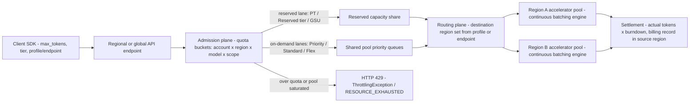

# Managed Inference: Amazon Bedrock vs Vertex AI

## TL;DR

On both clouds, a managed inference call goes through an admission plane (quotas and tiers), then a routing plane (region selection), then a capacity plane (shared or reserved accelerator pools), and only then reaches a continuous-batching engine.
Bedrock admits requests by pre-reserving `input + cache_write + max_tokens` against a per-minute token quota, then settles to `input + cache_write + output x burndown`, where Claude output tokens burn 5x or more. That makes `max_tokens` and output length the main levers on quota headroom.
Vertex AI pay-as-you-go has no per-project token quota: Dynamic Shared Quota admits requests based on how loaded the shared pool is in real time. Provisioned Throughput (GSUs) is enforced over a sliding window that gets shorter as the purchase gets larger, and traffic above it spills over to pay-as-you-go by default.
Cross-region routing (Bedrock geographic or global inference profiles, Vertex global or multi-region endpoints) trades data-residency guarantees for capacity and price. On Bedrock, routing has to be explicitly allowed by your SCPs, IAM and quota scopes, or it fails closed.
At full utilization, reserved capacity on both clouds costs roughly the same per token as on-demand. You buy it for admission priority and predictable latency, not as a discount, so size it to your baseline and serve peaks from premium or standard on-demand lanes.

## Mental Model



Think of a managed model endpoint as a GPU or TPU fleet you do not see, sitting behind a metering layer you do see.
The metering layer has to admit requests before it knows how many tokens they will generate, so it reserves capacity pessimistically and settles once the request finishes.
The routing layer decides which region's fleet does the work, and that decision is made by a profile ID or endpoint hostname you chose at build time.
The fleet then runs the same iteration-level batching and paged KV-cache engines covered in [[17-Cloud-AI-Engineering/Volume_11_LLM_Serving_and_Inference_Systems_on_Cloud/Chapter_04_Continuous_Batching_and_Scheduling_Algorithms|Continuous Batching and Scheduling Algorithms]] and [[17-Cloud-AI-Engineering/Volume_11_LLM_Serving_and_Inference_Systems_on_Cloud/Chapter_03_KV_Cache_Management_and_PagedAttention|KV-Cache Management and PagedAttention]].
Almost every surprise you will hit in production comes from mixing up these three planes - for example, assuming a 429 means "the GPUs are full" when it really means "your reservation arithmetic ran out."

## Internals

### What is published and what is inferred

Neither AWS nor Google publishes the serving-plane design behind Bedrock or Vertex AI generative endpoints.
This section separates documented behavior (tagged with a source) from a mechanism model that is consistent with that behavior and with the published research on LLM serving.
Use the inferred parts as reasoning tools, not as vendor commitments.

### Catalog plane: what a "model" is on each cloud

On Bedrock, a serverless foundation model is addressed by a versioned model ID, or by an inference profile ID that wraps the model with a routing policy.
Geographic profiles carry a prefix such as `us.`, `eu.` or `apac.`, and global profiles carry `global.` ([AWS docs](https://docs.aws.amazon.com/bedrock/latest/userguide/cross-region-inference.html), as of 2026-10).
An inference profile is a routing object with its own quota scope, not an alias: geographic and global profiles each have separate "Cross-region model inference tokens per minute" and "Global Cross-region model inference tokens per minute" quotas ([AWS docs](https://docs.aws.amazon.com/bedrock/latest/userguide/cross-region-inference.html), as of 2026-10).
Application inference profiles are user-created, taggable handles on a model or a cross-region profile, and their main job is cost allocation (secondary: [Sailor.sh summary](https://sailor.sh/blog/aws-ai-practitioner-bedrock-cross-region-inference-prompt-caching-prompt-routing-distillation/), as of 2026-10).
Bedrock also exposes an OpenAI-compatible path on the runtime host (`https://bedrock-runtime.<region>.amazonaws.com/openai/v1`), authenticated with a Bedrock API key bearer token ([AWS re:Post article](https://repost.aws/articles/ARaIuaNrrURJCURHWk8ZEr6Q/balance-cost-performance-reliability-for-ai-at-enterprise-scale-through-bedrock-inference-tiers), as of 2026-10).
Per-model feature coverage varies: some model cards list only in-region inference and no geographic or global profiles (secondary: [Caylent](https://caylent.com/blog/amazon-bedrock-pricing-explained), as of 2026-10).

On Google Cloud, the generative AI documentation is now filed under the name "Gemini Enterprise Agent Platform", while the API host is still `aiplatform.googleapis.com` ([Google Cloud docs](https://cloud.google.com/vertex-ai/generative-ai/docs/learn/locations), as of 2026-10).
This chapter keeps the name Vertex AI to match the API surface.
Model Garden contains two kinds of model.
Model-as-a-Service APIs (Gemini, plus partner models such as Anthropic Claude) are served by Google-operated capacity and metered per token.
Self-deployed open-weights models run on endpoints backed by your own accelerator quota and are billed per node-hour, which brings back every concern from [[17-Cloud-AI-Engineering/Volume_11_LLM_Serving_and_Inference_Systems_on_Cloud/Chapter_08_Cloud_GPU_Autoscaling_and_Cold_Start_Mitigation|Cloud GPU Autoscaling and Cold-Start Mitigation]].
Vertex exposes regional endpoints, multi-region endpoints that keep ML processing inside a jurisdiction (`https://aiplatform.us.rep.googleapis.com`, `https://aiplatform.eu.rep.googleapis.com`), and a global endpoint ([Google Cloud docs](https://cloud.google.com/vertex-ai/generative-ai/docs/learn/locations), as of 2026-10).

### Admission plane on Bedrock: reservation and settlement

This mechanism is the most important one in the chapter, and getting-started guides do not explain it.
Bedrock deducts tokens from your TPM and TPD quotas in three stages ([AWS docs](https://docs.aws.amazon.com/bedrock/latest/userguide/quotas-token-burndown.html), as of 2026-10).
At admission, it deducts `InputTokenCount + CacheWriteInputTokenCount + max_tokens`; the documented example deducts 5,250 for 3,000 input, 1,000 cache-write and `max_tokens=1,250`.
While the request runs, the deduction is periodically adjusted toward actual generation (secondary: [AWS Builder Center](https://builder.aws.com/content/34jeVcp6um2UIA0euKnxiAobwC3/throttling-error-when-amazon-bedrock-hits-the-brakes), as of 2026-10).
At completion, it settles to `InputTokenCount + CacheWriteInputTokenCount + OutputTokenCount x burndown`.
Cache-read tokens do not count toward the quota ([AWS ML blog](https://aws.amazon.com/blogs/machine-learning/optimize-your-applications-for-scale-and-reliability-on-amazon-bedrock/), as of 2026-07).
The output burndown is 5x for Anthropic models at version 4.7 and below, 10x or 15x for specific newer Claude generations named in the docs, and 1:1 for most other models ([AWS docs](https://docs.aws.amazon.com/bedrock/latest/userguide/quotas-token-burndown.html), as of 2026-10).
If `max_tokens` is omitted, it defaults to the model's maximum output, for example 64,000 for Claude Sonnet ([AWS ML blog](https://aws.amazon.com/blogs/machine-learning/optimize-your-applications-for-scale-and-reliability-on-amazon-bedrock/), as of 2026-07).

Three non-obvious consequences follow.

First, admission concurrency is set by the worst case, not the average.
With a 2,000,000 TPM quota and 500-token prompts, `max_tokens=1,000` admits about 2,000,000 / 1,500 = 1,333 requests per minute, while an unset `max_tokens` (64,000) admits about 2,000,000 / 64,500 = 31.
That is a 43x collapse in admission capacity with no change in actual work.

Second, with a 5x burndown the settled cost can exceed the reservation.
Take 3,000 input tokens, 400 output tokens and `max_tokens=1,024`: the reservation is 4,024 but the settlement is 3,000 + 2,000 = 5,000.
The extra 976 tokens are charged after the fact, so the debt lands on requests admitted later in the same window.
Admission therefore lags reality, and a client-side limiter that only mirrors the initial deduction will systematically under-predict 429s.

Third, quota and billing diverge.
The documented example is 1,000 input and 100 output tokens on Claude Sonnet 4: that consumes 1,500 tokens of quota but is billed as 1,100 tokens (secondary, reproducing the AWS example: [BlowStack](https://blowstack.com/tools/aws-bedrock-throttling-calculator), as of 2026-10).
A FinOps dashboard built on billed tokens will show 70% utilization of a quota that is actually exhausted.

Why would a provider burn output tokens at 5x?
Prefill processes all input tokens in parallel as compute-bound matrix multiplications, whereas each output token costs one memory-bandwidth-bound decode iteration and keeps a KV-cache slot occupied for the whole generation ([[17-Cloud-AI-Engineering/Volume_11_LLM_Serving_and_Inference_Systems_on_Cloud/Chapter_01_LLM_Inference_Mechanics_Prefill_vs_Decode|Prefill vs Decode]]).
A quota denominated in "input-token equivalents" has to weight decode tokens by their accelerator-time cost, and the price ratio is a public proxy for that cost.
For Claude models priced at a 5:1 output-to-input ratio, the 5x burndown matches the price ratio exactly.
Newer Claude generations on Bedrock burn at 10x or 15x even though the price ratio stays 5:1 (for example, $5 / $25 per million on a global profile; secondary: [Caylent](https://caylent.com/blog/amazon-bedrock-pricing-explained), as of 2026-10).
So for those models the Bedrock burndown is a capacity signal, probably reflecting long reasoning outputs and large contexts that hold KV memory, rather than a price signal.
Pre-reserving `max_tokens` is the admission-control counterpart of the problem vLLM solves inside the engine with paged allocation and preemption ([Kwon et al., SOSP 2023](https://arxiv.org/abs/2309.06180)).
The metering layer cannot preempt your request, so it reserves pessimistically.

### Admission plane on Vertex AI: Dynamic Shared Quota, tiers and Provisioned Throughput

Under default pay-as-you-go, Vertex uses Dynamic Shared Quota (DSQ), which has no predefined usage limit and allocates from a shared pool based on real-time availability and demand ([Google Cloud docs](https://docs.cloud.google.com/vertex-ai/generative-ai/docs/resources/throughput-quota), as of 2026-10).
Under DSQ, a 429 `RESOURCE_EXHAUSTED` means the shared pool is under high demand from many tenants, not that you crossed a number on your project ([Google Cloud docs](https://cloud.google.com/vertex-ai/generative-ai/docs/resources/dynamic-shared-quota), as of 2026-10).
The same error code can also mean an explicit API quota was exceeded or a logprobs daily limit was reached ([Google Cloud docs](https://docs.cloud.google.com/vertex-ai/generative-ai/docs/model-reference/api-errors), as of 2026-10).
Google also describes Usage Tiers, which raise TPM limits as spend grows (secondary summary of a Google Cloud blog: [daily.dev](https://daily.dev/posts/build-a-robust-and-cost-effective-gen-ai-strategy-3y6j3f70j), as of 2026-10).
The tier thresholds are UNVERIFIED.

Priority PayGo charges a higher per-token rate in exchange for more consistent performance than Standard PayGo, with no upfront commitment ([Google Cloud docs](https://docs.cloud.google.com/vertex-ai/generative-ai/docs/priority-paygo), as of 2026-10).
Flex PayGo is the discounted lane for latency-tolerant work; its discount percentage is UNVERIFIED.
Lane selection happens through HTTP headers.
`X-Vertex-AI-LLM-Request-Type: dedicated` restricts a request to Provisioned Throughput and returns 429 instead of spilling over.
`X-Vertex-AI-LLM-Request-Type: shared` bypasses Provisioned Throughput.
`X-Vertex-AI-LLM-Shared-Request-Type: priority` or `flex` selects the PayGo sub-lane (secondary: [pydantic-ai issue 5095](https://github.com/pydantic/pydantic-ai/issues/5095) and [Flexprice](https://flexprice.io/pricing-index/google-vertex-ai), as of 2026-10).

Provisioned Throughput is sold in generative AI scale units (GSUs).
Each model publishes its throughput per GSU and its burndown rates, which convert input, output, cached and multimodal tokens into one standard per-second unit ([Google Cloud docs](https://docs.cloud.google.com/vertex-ai/generative-ai/docs/provisioned-throughput/measure-provisioned-throughput), as of 2026-10).
Cached input tokens burn at 0.1, so 1,000 cached tokens to Gemini 2.5 Pro consume 100 tokens per second of PT ([Google Cloud docs](https://docs.cloud.google.com/vertex-ai/generative-ai/docs/provisioned-throughput/measure-provisioned-throughput), as of 2026-10).
Partner models carry context-length cliffs.
For a Claude Haiku model on Vertex, inputs above 100,000 tokens multiply every burndown by 5: input goes from 1 to 5, output from 5 to 25, and cache hits from 0.1 to 0.5 ([Google Cloud docs](https://docs.cloud.google.com/vertex-ai/generative-ai/docs/provisioned-throughput/supported-models), as of 2026-10).

The deep mechanism here is the enforcement window.
PT is not a per-second hard cap; it is checked against a quota enforcement window whose length depends on how much you bought ([Google Cloud docs](https://docs.cloud.google.com/vertex-ai/generative-ai/docs/provisioned-throughput/use-provisioned-throughput), as of 2026-10).
For 3 GSUs or fewer, the window is 40 to 120 seconds, so that one large request can be absorbed by averaging; for medium purchases (more than 3, for example under 50 GSUs), it is 5 to 30 seconds.
In token-bucket terms, a small purchase is a bucket with a large depth relative to its fill rate.
A 1-GSU buyer of gemini-2.5-flash (2,690 tokens per second average) can absorb a single request worth roughly 100,000 or more burndown-adjusted tokens without spilling.
A 40-GSU buyer gets a much shallower bucket relative to its rate, so sub-minute bursts spill over to PayGo sooner.
That is why two teams with the same average utilization can see very different spillover bills.
Spillover above PT is served and billed at pay-as-you-go rates by default (secondary: [PointFive](https://www.pointfive.co/efficiency-hub/inefficiencies/underutilized-vertex-ai-provisioned-throughput), as of 2026-09).

### Admission plane on Bedrock: service tiers and Provisioned Throughput

Bedrock has four tiers: Reserved, Priority, Standard and Flex. The tier is selected with a `service_tier` runtime parameter whose values are `reserved`, `priority`, `default` or `flex` (secondary, citing the AWS tiers doc: [Westloop](https://www.westloop.io/post/updated-list-of-models-supported-for-service-tiers-updated-list-of-models-supported-for-priority-and-flex-service-tiers), as of 2026-10).
Priority requests jump ahead of Standard requests in the processing queue and can see up to 25% better output tokens per second on most supported models ([AWS service tiers page](https://aws.amazon.com/cn/bedrock/service-tiers/), as of 2026-10).
Reserved buys guaranteed tokens-per-minute capacity for 1 or 3 months at a fixed price per 1K TPM, billed monthly ([AWS service tiers page](https://aws.amazon.com/cn/bedrock/service-tiers/), as of 2026-10).
Standard, Priority and Flex share one on-demand quota per model ([AWS re:Post](https://repost.aws/articles/ARaIuaNrrURJCURHWk8ZEr6Q/balance-cost-performance-reliability-for-ai-at-enterprise-scale-through-bedrock-inference-tiers), as of 2026-10).
Because the quota is shared, Flex batch traffic can starve Priority traffic of quota even though Priority wins in the queue.
Priority is a queue position, not a quota partition.

Provisioned Throughput by Model Units reserves model-specific capacity, billed hourly, with no commitment or a 1-month or 6-month term ([AWS docs](https://docs.aws.amazon.com/bedrock/latest/userguide/prov-thru-purchase.html), as of 2026-10).
Before buying, you must request an MU allocation through AWS Support.
AWS now documents a second type, Provisioned Throughput by Tokens; its semantics are UNVERIFIED here.
Inference profiles do not support Provisioned Throughput ([AWS docs](https://docs.aws.amazon.com/bedrock/latest/userguide/cross-region-inference.html), as of 2026-10).
That makes a PT purchase a single-region capacity island: it cannot borrow from other regions the way an on-demand inference profile can.

### Routing plane: inference profiles versus global endpoints

On Bedrock, the source region is where you call the API, the profile defines the set of destination regions, and the service picks a destination based on available capacity.
Pricing follows the source region, with no extra routing charge ([AWS docs](https://docs.aws.amazon.com/bedrock/latest/userguide/cross-region-inference.html), as of 2026-10).
Global profiles can route to any supported commercial region worldwide and are about 10% cheaper on input and output tokens than geographic profiles ([AWS docs](https://docs.aws.amazon.com/bedrock/latest/userguide/global-cross-region-inference.html), as of 2026-10).
Quotas for global profiles are requested and managed through Service Quotas in US East (N. Virginia) ([AWS docs](https://docs.aws.amazon.com/bedrock/latest/userguide/cross-region-inference.html), as of 2026-10).
That is a control-plane dependency on a single region even though the data plane is global.
SCPs that restrict `aws:RequestedRegion` must allow every destination region of a geographic profile, and must allow the value `unspecified` for global profiles (secondary: [Sailor.sh](https://sailor.sh/blog/aws-ai-practitioner-bedrock-cross-region-inference-prompt-caching-prompt-routing-distillation/), as of 2026-10).
This interacts directly with the evaluation order covered in [[17-Cloud-AI-Engineering/Volume_02_AWS_Deep_Dive/Chapter_01_IAM_Policy_Evaluation_Engine|IAM Policy Evaluation Engine]].

On Vertex, region selection is done with the hostname rather than a model-ID prefix.
Requests to the global endpoint may be processed in any Google Cloud location and carry no data-residency guarantee, while data at rest stays in the location you chose ([Google Cloud docs](https://docs.cloud.google.com/vertex-ai/generative-ai/docs/learn/data-residency), as of 2026-10).
Multi-region `us` and `eu` endpoints keep ML processing of customer data inside that jurisdiction ([Google Cloud docs](https://cloud.google.com/vertex-ai/generative-ai/docs/learn/locations), as of 2026-10).

The inferred design behind both is an anycast-like overflow router.
Each region's pool reports headroom, and the router either sends to the source region first and overflows, or chooses by load.
Neither vendor documents the selection policy, so you should assume that consecutive requests in a session may land in different regions.
That affects prompt-cache hit rates, because KV prefix caches are local to the replica.
The cache-affinity problem is the same one Mooncake ([Qin et al., FAST 2025](https://www.usenix.org/conference/fast25/presentation/qin)) and Llumnix ([Sun et al., OSDI 2024](https://www.usenix.org/conference/osdi24/presentation/sun-biao)) solve inside one fleet with KV-aware scheduling and migration.
Whether the managed routers are cache-affine is UNVERIFIED.

### Capacity plane: what tiers probably map to inside the fleet

Iteration-level scheduling ([Yu et al., Orca, OSDI 2022](https://www.usenix.org/conference/osdi22/presentation/yu)) means every running request shares each decode step with the rest of the batch.
A "priority lane" is therefore most plausibly implemented in two places: admission order into the running batch, and preemption or eviction order under KV-cache pressure.
Priority is unlikely to mean faster arithmetic for a given request.
That reading matches AWS's wording that Priority moves requests ahead in the processing queue.
It also explains why the claimed gain is "up to 25%" in output tokens per second rather than a multiple: once you are in the batch, decode speed is set by batch size and memory bandwidth, not by how much you paid.
Fair sharing across tenants inside one pool is an open research problem.
The Virtual Token Counter ([Sheng et al., OSDI 2024](https://www.usenix.org/conference/osdi24/presentation/sheng)) shows that request-count fairness is wrong for LLMs and that tokens weighted by cost (output weighted more heavily than input) are the right currency, which is exactly what burndown rates encode.
Chunked prefill ([Agrawal et al., Sarathi-Serve, OSDI 2024](https://www.usenix.org/conference/osdi24/presentation/agrawal)) and prefill/decode disaggregation ([Zhong et al., DistServe, OSDI 2024](https://www.usenix.org/conference/osdi24/presentation/zhong-yinmin); [Patel et al., Splitwise, ISCA 2024](https://arxiv.org/abs/2311.18677)) explain why long prompts hurt everyone else's inter-token latency, and why a provider would put a context-length cliff into its burndown (see [[17-Cloud-AI-Engineering/Volume_11_LLM_Serving_and_Inference_Systems_on_Cloud/Chapter_07_Prefill_and_Decode_Disaggregation|Prefill and Decode Disaggregation]]).

### Failure domains

The admission plane is a global, shared dependency.
On Google Cloud it is Service Control, the system that performs API quota and policy checks.
The routing plane fails per profile or per endpoint scope.
The capacity plane fails per region and per model.
Reserved capacity (Bedrock PT, Vertex PT) protects you from capacity-plane contention but not from admission-plane or control-plane outages, which is why [[17-Cloud-AI-Engineering/Volume_01_Cloud_Architecture_Principles/Chapter_02_Regions_Zones_and_Static_Stability|static stability]] still applies to "serverless" models.

## Numbers to Know

| Item | Value | Source |
| --- | --- | --- |
| Bedrock admission deduction | input + cache write + max_tokens | (AWS docs, as of 2026-10) |
| Bedrock settled deduction | input + cache write + output x burndown; cache reads excluded | (AWS docs, as of 2026-10) |
| Bedrock Claude output burndown | 5x for Claude 4.7 and below; 10x or 15x for specific newer generations; 1:1 for most others | (AWS docs, as of 2026-10) |
| Default max_tokens if unset | Model maximum, e.g. 64,000 for Claude Sonnet | (AWS ML blog, as of 2026-07) |
| Example default TPM | 2,000,000 TPM for Claude Opus 4.6 | (AWS ML blog, as of 2026-07) |
| Quota vs billed example | Sonnet 4, 1,000 in / 100 out: 1,500 quota, 1,100 billed | (AWS docs example via BlowStack, as of 2026-10) |
| Global vs geographic profile price | About 10% lower for global | (AWS docs, as of 2026-10) |
| Sonnet 4.6, global, Standard | $3 / $15 per 1M input / output; geographic and in-region +10% | (secondary: CloudForecast, as of 2026-10) |
| Priority tier gain | Up to 25% better output tokens per second | (AWS service tiers page, as of 2026-10) |
| Priority / Flex price | +75% / -50% vs Standard | (secondary: CloudBurn, Sailor.sh, as of 2026-10) |
| Bedrock Reserved tier term | 1 or 3 months, fixed price per 1K TPM, billed monthly | (AWS service tiers page, as of 2026-10) |
| Reserved tier minimum | 100K input TPM / 10K output TPM | (secondary: Sailor.sh, as of 2026-10; UNVERIFIED against AWS docs) |
| Bedrock PT terms | No commitment, 1-month, 6-month; MUs must be requested via Support | (AWS docs, as of 2026-10) |
| Bedrock batch inference | 50% discount vs on-demand | (secondary: Sailor.sh, CloudBurn, as of 2026-10) |
| Vertex DSQ | No predefined project limit; 429 = shared pool pressure | (Google Cloud docs, as of 2026-10) |
| Vertex PT terms | 1 week, 1 month, 3 months, 1 year | (secondary: PointFive, as of 2026-09) |
| GSU price, global endpoint | $7.14 / $3.70 / $2.74 per GSU-hour for 1-week / 1-month / 1-year; non-global 8-10% higher | (secondary: Markaicode, as of 2026-10) |
| gemini-2.5-flash per GSU | 2,690 tokens/s average | (Google Cloud docs, as of 2026-10) |
| PT enforcement window | 40-120 s at 3 GSUs or fewer; 5-30 s for medium allocations | (Google Cloud docs, as of 2026-10) |
| PT cached-token burndown | 0.1 | (Google Cloud docs, as of 2026-10) |
| Claude Haiku on Vertex PT | 10,417 tokens/s per GSU; all burndowns x5 above 100K input tokens | (Google Cloud docs, as of 2026-10) |
| Google worked PT example | gemini-2.0-flash: 3,360/GSU, output 4, audio 7; 10 QPS -> 57,000 tok/s -> 17 GSUs | (Google Cloud docs mirror and Flexprice, as of 2026-10) |
| Gemini 2.5 Flash PayGo | $0.30 / $2.50 per 1M input / output | (secondary: drpranayjha, as of 2026-10) |
| Vertex global endpoint | No data-residency guarantee | (Google Cloud docs, as of 2026-10) |

## AWS vs GCP Mechanism Parity

| Dimension | Amazon Bedrock | Vertex AI | Critical difference |
| --- | --- | --- | --- |
| Model addressing | Versioned model ID or inference-profile ID (`us.`, `eu.`, `apac.`, `global.`) | Model name plus endpoint hostname (regional, `us`/`eu` multi-region, global) | AWS encodes routing in the model ID; Google encodes it in the host |
| On-demand admission | Per account x region x model quotas (RPM, TPM, TPD), separate for in-region, geographic, global | DSQ: no fixed project limit, pool-load admission; Usage Tiers scale TPM | Bedrock 429s are mostly your arithmetic; DSQ 429s are mostly other tenants |
| Reservation semantics | Pre-deducts max_tokens, settles with output burndown | PT is checked per request within an enforcement window; reservation of max_output_tokens is not documented | Bedrock punishes a large max_tokens at admission time |
| Premium lane | Priority tier, shares on-demand quota | Priority PayGo, selected by header | Neither partitions quota; both reorder queues |
| Discount lane | Flex tier; batch at 50% | Flex PayGo; batch prediction (discount UNVERIFIED) | Flex shares quota with production on Bedrock |
| Reserved capacity | PT by MUs (none/1/6 months) and Reserved tier (1/3 months, per 1K TPM) | PT by GSUs (1 week/1/3/12 months) | Vertex sells a 1-week term; Bedrock sells a no-commit hourly MU |
| Overflow above reservation | PT overflow behavior UNVERIFIED; PT not usable via inference profiles | Spillover to PayGo by default; `dedicated` header fails closed | Vertex overflow is a silent cost risk; Bedrock PT is a regional island |
| Cross-region price | Source-region pricing; global about 10% cheaper | Global-endpoint PT 8-10% cheaper (secondary) | Both pay you to give up residency |
| Residency control | Geographic profiles bound processing to a geography | `us`/`eu` multi-region endpoints bound processing | Both: global means "anywhere commercial" |
| Governance hook | SCP `aws:RequestedRegion` must allow destinations or `unspecified` | Org Policy resource locations and VPC-SC perimeter on `aiplatform.googleapis.com` | AWS routing can be broken by an SCP written years earlier |
| Throttle signal | HTTP 429 `ThrottlingException` | HTTP 429 `RESOURCE_EXHAUSTED` | Same code, different meaning |
| Quota for cross-region | Global quotas managed in us-east-1 | Not region-scoped under DSQ | Bedrock has a control-plane region dependency |

## Worked Example: Quota Arithmetic, Dual-Cloud Probe, and PT Sizing

### What the lab does

The script below has three modes.
`simulate` runs offline and reproduces Bedrock's reserve-then-settle accounting, so you can see admission collapse as `max_tokens` grows.
`bedrock` sends a small number of Converse calls through an inference profile, with SDK retries disabled and full-jitter retries applied by hand. For each call it prints quota consumed versus tokens billed.
`vertex` sends the same prompt to the Vertex global endpoint with the `shared` request-type header, so it never touches PT.

### Cost estimate

Twenty Bedrock calls at about 200 input and 256 output tokens on a $3 / $15 model cost about 20 x (200 x $3e-6 + 256 x $15e-6) = $0.09.
Twenty Vertex calls on Gemini 2.5 Flash at $0.30 / $2.50 cost about $0.02. Thinking tokens are billed as output and can raise this.
The whole lab costs under $0.25 (estimate from the list prices above, as of 2026-10).
No standing resources are created except the budgets.

### Budget alarms (create first)

```bash
# AWS: account-level monthly cost budget with an 80% actual-spend alert.
# The budget is not filtered by service, because third-party model usage may be itemized outside "Amazon Bedrock" (UNVERIFIED).
ACCOUNT_ID=$(aws sts get-caller-identity --query Account --output text)
cat > /tmp/budget.json <<'EOF'
{"BudgetName":"bedrock-lab-5usd","BudgetLimit":{"Amount":"5","Unit":"USD"},
 "TimeUnit":"MONTHLY","BudgetType":"COST"}
EOF
cat > /tmp/notif.json <<'EOF'
[{"Notification":{"NotificationType":"ACTUAL","ComparisonOperator":"GREATER_THAN",
  "Threshold":80,"ThresholdType":"PERCENTAGE"},
  "Subscribers":[{"SubscriptionType":"EMAIL","Address":"you@example.com"}]}]
EOF
aws budgets create-budget --account-id "$ACCOUNT_ID" \
  --budget file:///tmp/budget.json \
  --notifications-with-subscribers file:///tmp/notif.json

# GCP: project-scoped budget with 50% and 90% thresholds.
gcloud billing budgets create \
  --billing-account="$BILLING_ACCOUNT_ID" \
  --display-name="vertex-lab-5usd" \
  --budget-amount=5USD \
  --filter-projects="projects/$GOOGLE_CLOUD_PROJECT" \
  --threshold-rule=percent=0.5 \
  --threshold-rule=percent=0.9
```

### Code: `managed_inference_probe.py`

```python
#!/usr/bin/env python3
"""Managed inference probe: Bedrock quota arithmetic and a dual-cloud smoke test.

Usage:
  python managed_inference_probe.py simulate
  BEDROCK_PROFILE_ID=global.anthropic.claude-sonnet-4-5-20250929-v1:0 \
    AWS_REGION=us-east-1 python managed_inference_probe.py bedrock
  GOOGLE_CLOUD_PROJECT=my-proj VERTEX_MODEL=gemini-2.5-flash \
    python managed_inference_probe.py vertex
Model IDs are examples; replace them with a GA model listed in your console.
"""
import os
import random
import sys
import time

PROMPT = "In three sentences, explain why LLM decode is memory-bandwidth bound."
MAX_TOKENS = int(os.environ.get("MAX_TOKENS", "256"))
CALLS = int(os.environ.get("CALLS", "20"))
BURNDOWN = float(os.environ.get("OUTPUT_BURNDOWN", "5"))  # Claude <= 4.7 on Bedrock


def simulate(tpm=2_000_000, inp=500, out=300):
    """Reserve-then-settle model of a per-minute Bedrock TPM bucket."""
    print("max_tokens  reserve  settle  admitted/min(reserve)  admitted/min(settle)")
    for mx in (256, 1_000, 4_096, 16_000, 64_000):
        reserve = inp + mx
        settle = inp + out * BURNDOWN
        print(f"{mx:>10} {reserve:>8} {settle:>7.0f} {tpm // reserve:>22} "
              f"{int(tpm // settle):>21}")
    print("Admission is capped by the reservation; steady-state spend by settlement.")


def full_jitter_sleep(attempt, base=0.5, cap=20.0):
    time.sleep(random.uniform(0, min(cap, base * (2 ** attempt))))


def bedrock():
    import boto3
    from botocore.config import Config
    from botocore.exceptions import ClientError

    profile = os.environ["BEDROCK_PROFILE_ID"]
    # max_attempts=1 disables SDK retries so throttles are visible to our own policy.
    client = boto3.client("bedrock-runtime",
                          config=Config(retries={"max_attempts": 1, "mode": "standard"},
                                        read_timeout=120))
    extra = {}
    tier = os.environ.get("BEDROCK_SERVICE_TIER")  # e.g. "flex"; shape UNVERIFIED
    if tier:
        extra["serviceTier"] = {"type": tier}
    retry_budget = max(1, CALLS // 10)  # at most ~10% extra load from retries
    for i in range(CALLS):
        attempt = 0
        while True:
            try:
                r = client.converse(
                    modelId=profile,
                    messages=[{"role": "user", "content": [{"text": PROMPT}]}],
                    inferenceConfig={"maxTokens": MAX_TOKENS, "temperature": 0.2},
                    **extra)
                u = r["usage"]
                cw = u.get("cacheWriteInputTokens", 0)
                reserved = u["inputTokens"] + cw + MAX_TOKENS
                settled = u["inputTokens"] + cw + u["outputTokens"] * BURNDOWN
                billed = u["inputTokens"] + cw + u["outputTokens"]
                print(f"call={i} in={u['inputTokens']} out={u['outputTokens']} "
                      f"reserved={reserved} settled={settled:.0f} billed_tokens={billed} "
                      f"latency_ms={r['metrics']['latencyMs']}")
                break
            except ClientError as e:
                code = e.response["Error"]["Code"]
                if code in ("ThrottlingException", "ServiceUnavailableException") \
                        and retry_budget > 0 and attempt < 4:
                    retry_budget -= 1
                    print(f"call={i} {code}; retry_budget={retry_budget}")
                    full_jitter_sleep(attempt)
                    attempt += 1
                    continue
                raise


def vertex():
    from google import genai
    from google.genai import errors, types

    client = genai.Client(
        vertexai=True,
        project=os.environ["GOOGLE_CLOUD_PROJECT"],
        location=os.environ.get("VERTEX_LOCATION", "global"),
        # "shared" bypasses Provisioned Throughput; "dedicated" would fail closed on PT.
        http_options=types.HttpOptions(
            headers={"X-Vertex-AI-LLM-Request-Type": "shared"}))
    model = os.environ.get("VERTEX_MODEL", "gemini-2.5-flash")
    for i in range(CALLS):
        for attempt in range(5):
            try:
                t0 = time.time()
                r = client.models.generate_content(
                    model=model, contents=PROMPT,
                    config=types.GenerateContentConfig(max_output_tokens=MAX_TOKENS,
                                                       temperature=0.2))
                um = r.usage_metadata
                print(f"call={i} prompt={um.prompt_token_count} "
                      f"output={um.candidates_token_count} "
                      f"cached={um.cached_content_token_count} "
                      f"latency_ms={int((time.time() - t0) * 1000)}")
                break
            except errors.APIError as e:
                if e.code == 429 and attempt < 4:
                    print(f"call={i} RESOURCE_EXHAUSTED attempt={attempt}")
                    full_jitter_sleep(attempt)
                    continue
                raise


if __name__ == "__main__":
    {"simulate": simulate, "bedrock": bedrock, "vertex": vertex}[sys.argv[1]]()
```

Run `simulate` first.
With TPM 2,000,000, 500-token prompts and 300-token outputs, the reservation-bound admission falls from 2,000,000 / 756 = 2,645 per minute at `max_tokens=256` to 2,000,000 / 64,500 = 31 per minute at 64,000.
The settlement-bound steady state stays at 2,000,000 / 2,000 = 1,000 per minute regardless of `max_tokens`.
The gap between those two columns is the cost of an over-sized `max_tokens`, paid in admissions rather than dollars.

### Capacity and cost sizing: a customer-facing assistant

Workload assumptions: 20 RPS peak and 8 RPS average; each request has 3,000 input tokens, of which a 2,500-token system prompt and tool schema is cacheable, 400 output tokens, and `max_tokens=1,024`.

Step 1 - Bedrock quota, no caching, Claude at 5x burndown.
Settled tokens per request = 3,000 + 400 x 5 = 5,000.
Peak RPM = 20 x 60 = 1,200, so the required TPM is 1,200 x 5,000 = 6,000,000.
That is 3x the 2,000,000 example default, so you need a quota increase before launch.
Make the request against the profile scope you will actually call (in-region, geographic or global).

Step 2 - Bedrock quota with prompt caching.
Cache reads do not count toward quota, so settled = 500 + 2,000 = 2,500 and peak TPM drops to 3,000,000.
The reservation is 500 + 1,024 = 1,524 per request, or 1,828,800 per minute at peak.
Caching therefore halves quota demand, which is often worth more than the price discount.

Step 3 - Bedrock monthly cost on a $3 / $15 model via a global profile.
Requests per month = 8 x 86,400 x 30 = 20,736,000.
Without caching: 3,000 x $3e-6 + 400 x $15e-6 = $0.015 per request, or $311,040 per month.
With caching, using an assumed cache-read price of 0.1x input ($0.30 per 1M; the multiplier is UNVERIFIED for your model): 500 x $3e-6 + 2,500 x $0.30e-6 + 400 x $15e-6 = $0.00825, or $171,072 per month.
Cache-write premiums are ignored because the prefix is stable.
Calling through a geographic profile adds 10%, about $188,179 per month.
Moving a latency-tolerant 30% of traffic to Flex at -50% saves about 0.3 x 0.5 x $171,072 = $25,661 per month.
Output is 73% of the cached cost (400 x $15e-6 / $0.00825), so trimming output length by 25% saves more than any tier change.

Step 4 - Vertex PT sizing with Google's published gemini-2.0-flash burndowns (substitute your model's row from the supported-models table).
Per query = 3,000 x 1 + 400 x 4 = 4,600; at 20 QPS that is 92,000 per second, and 92,000 / 3,360 = 27.4, so 28 GSUs at peak.
With caching = 500 + 2,500 x 0.1 + 1,600 = 2,350; at 20 QPS that is 47,000 per second, or 14 GSUs at peak with zero headroom.
Sizing to the 8 QPS baseline instead: 2,350 x 8 = 18,800 per second, so 6 GSUs. That costs 6 x $3.70 x 730 = $16,206 per month on a 1-month term, and peaks spill over to PayGo or Priority PayGo.

Step 5 - Is PT a discount? A derivation the docs do not state.
For gemini-2.0-flash, the published burndowns (output 4, audio 7) match its list-price ratios, so a GSU is denominated in input-token dollars (the price-ratio claim is UNVERIFIED).
For gemini-2.5-flash, one GSU delivers 2,690 x 3,600 = 9.68M input-equivalent tokens per hour, worth 9.68 x $0.30 = $2.91 per hour at PayGo, assuming the output burndown tracks the 8.3:1 price ratio (UNVERIFIED).
That compares with $3.70 per hour (1-month) or $2.74 per hour (1-year).
At 100% utilization, a 1-year GSU is about 6% cheaper than PayGo, and a 1-month GSU is about 27% more expensive.
At 60% utilization, every PT term is more expensive per token than PayGo.
Buy PT for admission priority and its SLA, size it to a baseline you will hold above roughly 90% utilization, and do not expect it to lower unit cost.
The same reasoning applies to Bedrock PT and the Reserved tier; see [[17-Cloud-AI-Engineering/Volume_09_FinOps_and_Cloud_Economics/Chapter_02_Commitment_Discounts_Savings_Plans_vs_CUDs|Commitment Discounts]] for breakeven formulas.

### Teardown

```bash
aws budgets delete-budget --account-id "$ACCOUNT_ID" --budget-name bedrock-lab-5usd
gcloud billing budgets list --billing-account="$BILLING_ACCOUNT_ID" --format="value(name)"
gcloud billing budgets delete BUDGET_ID --billing-account="$BILLING_ACCOUNT_ID"
# Only if you purchased a no-commitment Bedrock PT while experimenting:
aws bedrock list-provisioned-model-throughputs --query 'provisionedModelSummaries[].provisionedModelArn'
aws bedrock delete-provisioned-model-throughput --provisioned-model-id "$PT_ARN"
```

## Failure Modes and Pitfalls

### 429 at low traffic on Bedrock

Cause: `max_tokens` is unset or copied from an example (4,096 or 64,000), and requests are fanned out in parallel, for example by an agent framework.
Signature: CloudWatch `InputTokenCount` and `OutputTokenCount` sit far below the quota while `ThrottlingException` rates climb. Only invocation logs, which capture `max_tokens`, reveal the reservation ([AWS ML blog](https://aws.amazon.com/blogs/machine-learning/optimize-your-applications-for-scale-and-reliability-on-amazon-bedrock/), as of 2026-07).
A 20-second burst can exceed the TPM even when the per-minute average would fit ([AWS re:Post](https://repost.aws/questions/QU41JbEn0NStC1P3KB6cd5UA/understanding-bedrock-tpm-deductions-getting-too-many-tokens-with-parallel-langgraph-workflows), as of 2026-01).
Fix: set `max_tokens` per route to around the p99 of observed output, plus a client-side token bucket that charges the settled formula, not the reservation.

### The model upgrade that silently halves your quota

Moving from a 5x-burndown Claude generation to a 10x or 15x generation at the same list price doubles or triples quota consumption per output token, even though the bill barely changes.
Teams that run quota capacity planning off billed tokens find out at the first traffic peak.
Treat a model-version change as a capacity change and redo the TPM math before rollout.

### DSQ 429 storms on Vertex

Under DSQ, other tenants' demand can throttle you even at small volume. Public forum threads describe production 429s on Gemini Flash at low traffic ([Google Developers forum](https://discuss.google.dev/t/google-vertex-not-suitable-for-small-production-workloads-in-practice-error-429-resources-exhausted/332643), as of 2026-03).
Synchronized retries from many clients turn a short pool squeeze into sustained overload.
Fix: full-jitter backoff with a retry budget ([[17-Cloud-AI-Engineering/Volume_07_Reliability_and_SRE/Chapter_03_Resilient_Communication_Retries_Jitter_and_Circuit_Breakers|Retries and Jitter]]), the global endpoint where residency allows it, and PT or Priority PayGo for the traffic that matters.

### PT spillover bill shock and fail-open cost

Vertex PT spills over to PayGo by default.
A traffic shift such as a long-context feature launch, combined with the 5x long-context cliff for partner models, can move most spend onto PayGo without a single error.
Fix: alert on the share of PT-served versus spillover traffic, and send `dedicated` for workloads where you would rather shed load than pay PayGo rates.

### SCPs that break cross-region inference

A long-standing region-deny SCP that allows only `us-east-1` and `us-west-2` will reject inference-profile calls whose destination is another region, and with global profiles the requested region evaluates as `unspecified`.
The failure looks like `AccessDeniedException`, not throttling, and it can be intermittent because it depends on which destination the router picked.
Fix: add explicit carve-outs for Bedrock profiles and test with a policy simulator before migrating profile IDs ([[17-Cloud-AI-Engineering/Volume_02_AWS_Deep_Dive/Chapter_02_AWS_Organizations_and_Account_Governance|AWS Organizations and Account Governance]]).

### Priority and Flex sharing one quota

Moving batch summarization to Bedrock Flex to save 50% lets batch traffic consume the shared on-demand TPM, so customer-facing Priority traffic gets throttled even though it would have won in the queue.
Fix: put Flex on a separate account or region (a quota cell), or rate-limit Flex client-side to a fixed fraction of the quota ([[17-Cloud-AI-Engineering/Volume_01_Cloud_Architecture_Principles/Chapter_03_Cell_Based_Architecture_and_Shuffle_Sharding|Cell-Based Architecture]]).

### Admission-plane outages: public post-incident reviews

On 2025-06-12, a Google Service Control policy change containing blank fields replicated globally and triggered a null-pointer crash loop. Many Google Cloud APIs, Vertex AI Gemini among them, failed until the change was rolled back, and us-central1 recovered slowly because of herd effects on the backing store ([Google Cloud incident report](https://status.cloud.google.com/incidents/ow5i3PPK96RduMcb1SsW)).
The lesson for managed inference is that quota checking is itself a global dependency, and reserved capacity does not protect you from it.
On 2025-10-19 and 20, a race condition in DynamoDB's DNS automation in us-east-1 emptied the regional endpoint record and cascaded through services that depend on it ([AWS summary](https://aws.amazon.com/message/101925/)).
Any Bedrock architecture whose global-profile quotas are managed in us-east-1, or whose IAM and STS calls go to us-east-1, inherits that region's control-plane blast radius.
See [[17-Cloud-AI-Engineering/Volume_07_Reliability_and_SRE/Chapter_07_Anatomy_of_Major_Cloud_Outages|Anatomy of Major Cloud Outages]].

### Quality regressions that vary by platform

Anthropic's 2025 postmortem described three infrastructure bugs: a context-window routing error, a TPU misconfiguration that corrupted output tokens, and an XLA approximate top-k miscompilation. They affected Claude output quality differently across Anthropic's API, Bedrock and Vertex AI because each platform runs different hardware and serving stacks ([Anthropic engineering](https://www.anthropic.com/engineering/a-postmortem-of-three-recent-issues)).
The same model ID on two clouds is not the same artifact operationally.
Run continuous evals per platform and per region ([[17-Cloud-AI-Engineering/Volume_12_AI_Applications_MLOps_and_Data_Platforms/Chapter_06_Model_Evaluation_Monitoring_and_Drift_Detection|Model Evaluation and Drift Detection]]).

### Prompt-cache hit collapse under cross-region routing

When the router spreads a session across regions, the replica-local KV prefix caches miss. You lose the quota exemption for cache reads on Bedrock, the 0.1 burndown on Vertex PT, and the price discount, all together.
Watch the cache-read token share as a first-class SLI after any change of profile or endpoint.

### Bedrock PT as a regional island

PT cannot be used through inference profiles, so a region-level capacity event leaves PT-backed traffic with nowhere to go unless the client fails over to an on-demand profile with pre-approved quota.
Commitment PT cannot be cancelled mid-term (secondary: [PointFive](https://www.pointfive.co/efficiency-hub/inefficiencies/underutilized-bedrock-provisioned-throughput), as of 2026-09).

## Security and Cost Angles

### Identity and least privilege

On Bedrock, scope `bedrock:InvokeModel` and `bedrock:InvokeModelWithResponseStream` (Converse is authorized by these) to specific inference-profile ARNs.
Also scope them to the foundation-model ARNs in every destination region of that profile, because the routed call is authorized against the model in the destination (UNVERIFIED against current AWS docs).
Prefer IAM roles with short-lived credentials over Bedrock API keys.
If you must issue keys (`AWS_BEARER_TOKEN_BEDROCK`), use short-term keys and deny long-term key creation with an SCP; the key-type semantics are UNVERIFIED.
On Vertex, grant `roles/aiplatform.user` only at the project level where it is needed. Use Workload Identity Federation rather than service account keys ([[17-Cloud-AI-Engineering/Volume_08_Security_Identity_and_the_Data_Perimeter/Chapter_02_Workload_Identity_Federation|Workload Identity Federation]]), and restrict API-key ("express mode") usage with Org Policy.

### Private network boundaries

On AWS, put interface VPC endpoints for `bedrock-runtime` in each source region. Attach endpoint policies that allow only approved profile ARNs, and add `aws:SourceVpce` conditions to the role policies.
Cross-region routing starts at the source-region endpoint, so the VPC endpoint is still your boundary. AWS states that routed traffic stays on its network (UNVERIFIED in this revision).
On Google Cloud, place `aiplatform.googleapis.com` inside a VPC Service Controls perimeter and reach it through Private Service Connect or Private Google Access ([[17-Cloud-AI-Engineering/Volume_03_GCP_Deep_Dive/Chapter_03_VPC_Service_Controls_Security_Perimeters|VPC Service Controls]]).
For the combined design, see [[17-Cloud-AI-Engineering/Volume_08_Security_Identity_and_the_Data_Perimeter/Chapter_06_Constructing_an_Impenetrable_Data_Perimeter|Constructing an Impenetrable Data Perimeter]].

### Residency as a security control

Choosing a global profile or the global endpoint is a data-processing location decision, not just a price choice.
Encode it in policy rather than in code review.
On AWS, use SCP region conditions plus IAM conditions on profile ARNs; on GCP, use multi-region `us`/`eu` hostnames and Org Policy resource-location constraints.
Zero-data-retention configurations on Vertex also require disabling in-memory caching (UNVERIFIED in this revision).

### Encryption and logging

Invocation logs (Bedrock model invocation logging to CloudWatch Logs or S3, and Vertex request-response logging) contain prompts and completions, so they are your highest-sensitivity dataset.
Encrypt them with customer-managed keys (KMS, or Cloud KMS CMEK), restrict decrypt permission to a break-glass role, and set retention to match your data classification ([[17-Cloud-AI-Engineering/Volume_08_Security_Identity_and_the_Data_Perimeter/Chapter_04_Encryption_Key_Hierarchies_and_Envelope_Encryption|Envelope Encryption]]).
You still need logging, because it is the only place `max_tokens` is observable for quota forensics.

### Unit-economics levers, ranked by typical impact

1. Output length: output tokens cost 5x or more per token in both price and quota, so instruct for concision and cap `max_tokens` per route.
2. Prompt caching of stable prefixes: on Bedrock it removes tokens from quota entirely and discounts them on price; on Vertex PT they burn at 0.1.
3. Lane mix: move latency-tolerant traffic to Flex or batch (about -50%), and confine Priority to the interactive slice.
4. Global versus geographic routing: about 10% on Bedrock, and 8-10% on Vertex PT, where residency allows.
5. Reserved capacity sized to a high-utilization baseline: it buys admission priority, not lower unit cost.
6. Attribution: tag application inference profiles per team or tenant on AWS and use labels on GCP, so showback works ([[17-Cloud-AI-Engineering/Volume_09_FinOps_and_Cloud_Economics/Chapter_01_Cloud_Billing_Models_and_Unit_Cost_Allocation|Unit Cost Allocation]]).

## Interview Questions and Model Answers

### Question 1 (L5 - Senior)

Your Bedrock dashboard shows 400K tokens per minute against a 2M TPM quota, yet you get sustained `ThrottlingException`s. Explain why, and what you would change.

#### Model Answer

The dashboard is counting billed or settled tokens, but admission is governed by the reservation.
Bedrock deducts input plus cache-write plus `max_tokens` when a request arrives, and settles to input plus cache-write plus output times burndown when it completes.
If the client leaves `max_tokens` unset, each request reserves the model maximum, around 64,000 for Sonnet-class models, so roughly 31 requests can be in flight against a 2M minute budget, whatever they actually generate.
I would confirm this from invocation logs, because CloudWatch token metrics do not show `max_tokens`.
Next I would check burst shape: an agent framework that fans out 50 parallel calls in two seconds spends the minute's budget in a sliver of the window.
Then I would check burndown: with 5x on output, the settled number is what matters for steady state, and dashboards that plot raw output tokens understate it fivefold.
Fixes, in order: set `max_tokens` per route near the observed p99 output; add a client-side token bucket that charges the settled formula and smooths bursts; cache stable prefixes, because cache reads do not count against quota; and only then ask for a quota increase, quoting the settled TPM at peak.
I would also check whether the calls go through in-region, geographic or global scope, because those have separate quotas and the increase must target the scope in use.

#### Follow-up Interviewer Question

Your client-side limiter charges the settled formula, but you still see occasional 429s at 85% of quota. What is the residual cause, and how would you set the limiter's ceiling?

### Question 2 (L5 - Senior)

Compare Bedrock geographic and global inference profiles with the Vertex AI global and multi-region endpoints, for a European bank.

#### Model Answer

Both clouds offer a ladder from single-region, to jurisdiction-bounded multi-region, to worldwide routing. Capacity and price get better as you climb it, and residency guarantees get weaker.
On Bedrock, the ladder is selected by the model-ID prefix: `eu.` keeps processing inside EU commercial regions, while `global.` can route anywhere commercial and is about 10% cheaper, with pricing determined by the source region.
On Vertex, it is selected by hostname: the `eu` multi-region endpoint keeps ML processing in the EU, and the global endpoint gives no residency guarantee even though data at rest stays where you put it.
For a bank, the requirement is usually about where processing happens, not just storage, so I would mandate `eu.` profiles or the `eu` endpoint and enforce that in policy rather than in code.
On AWS that means an SCP with an explicit EU region allow-list that covers every destination region of the `eu.` profile. Global profiles evaluate as an unspecified requested region, so a region-deny SCP blocks them automatically, which is the behavior we want.
On GCP, I would combine Org Policy resource-location constraints with a VPC-SC perimeter and route clients only to the `eu` hostname.
The trade-off I would put to the risk committee is that we give up the extra capacity of the global pool and pay a 10% premium in exchange for an auditable processing boundary. To compensate, we would pre-approve quota in two EU source regions.

#### Follow-up Interviewer Question

A developer reports that the `eu.` profile intermittently returns `AccessDeniedException` but works on retry. What do you suspect, and how do you prove it?

### Question 3 (L6 - Staff)

Design the capacity strategy for a customer-facing assistant at 20 RPS peak and 8 RPS average on Claude via Bedrock, with a 99.9% availability target for interactive turns and a large nightly summarization workload.

#### Model Answer

I would split the problem into three planes and give each a different instrument.
For admission, I size against settled tokens: 3,000 input, of which 2,500 is cacheable, plus 400 output at 5x gives 2,500 settled tokens per request with caching, so 3M TPM at peak, with `max_tokens` capped at 1,024 to keep the reservation at about 1.8M per minute.
For capacity, I cover the interactive baseline with the Reserved tier, or PT if the model needs it, sized to around 90% utilization of the 8 RPS average. Reserved capacity costs roughly the same per token as on-demand at full utilization, so idle reserved capacity is pure waste.
Interactive traffic above the baseline goes to Priority on a geographic profile, which reorders our requests ahead of Standard during contention.
Nightly summarization goes to batch or Flex, at roughly half price.
The structural risk is that Priority, Standard and Flex share one on-demand quota, so I would put Flex and batch in a separate AWS account (a quota cell) so they cannot consume the interactive quota.
For routing, the interactive path uses a primary source region and a secondary source region with independently approved quota. Failover is client-side and pre-warmed by sending a constant 5-10% of traffic to the secondary, because quota you have never exercised is a hypothesis, not capacity.
For resilience, retries use full jitter and a retry budget of about 10% of requests. The gateway sheds work by priority, cutting summarization first and then non-premium tenants, before it lets retries amplify overload.
To reach 99.9%, I measure availability at the gateway, counting a 429 that we absorbed successfully as success and an exhausted retry budget as failure, and I alert on burn rate ([[17-Cloud-AI-Engineering/Volume_07_Reliability_and_SRE/Chapter_01_SLIs_SLOs_and_Error_Budget_Engineering|SLOs]]).
Costs at list price come to about $171K per month for interactive traffic with caching. Output is about 73% of that, so the first optimization is a product decision about response length, not a pricing tier.

#### Follow-up Interviewer Question

The vendor ships a new model generation at the same price but with a 10x output burndown. Walk through exactly what changes in your plan and what you do before migrating.

### Question 4 (L6 - Staff)

Finance says Vertex Provisioned Throughput is a discount and wants 100% of Gemini traffic on 1-year GSUs. Respond with numbers.

#### Model Answer

I would reframe PT as an admission-priority and SLA instrument whose unit cost is close to PayGo at full utilization, and show why.
A GSU of gemini-2.5-flash delivers an average of 2,690 burndown-adjusted tokens per second, which is 9.68M input-equivalent tokens per hour.
At $0.30 per million input tokens, that is worth about $2.91 per hour at PayGo, assuming the output burndown tracks the output-to-input price ratio. That relationship holds exactly for the published gemini-2.0-flash burndowns, and I would verify it for our model.
A 1-year GSU is about $2.74 per hour and a 1-month GSU about $3.70 per hour, so even a 1-year term saves only about 6%, and only at 100% utilization.
Utilization is what matters most: traffic with a 2.5:1 peak-to-average ratio, provisioned for peak, averages 40% utilization, which makes the effective unit cost about 2.4x PayGo.
The enforcement window also matters: purchases above 3 GSUs are enforced over 5 to 30 seconds, so sub-minute bursts spill over to PayGo even when the hourly average fits, and we pay both the commitment and the spillover.
My recommendation is to buy 1-year GSUs only for a baseline we can hold above roughly 90% utilization, cover the shoulder with 1-month or 1-week terms around known events, and serve the peak with Priority PayGo for the interactive slice and Standard or Flex PayGo for the rest.
We send `dedicated` only on workloads where load-shedding is preferable to the spillover price, and we monitor the spillover share as a cost SLI.
If finance wants a real discount, the bigger levers are context caching (0.1 burndown and a lower price), batch and Flex lanes, and shorter outputs.

#### Follow-up Interviewer Question

How would you measure PT utilization correctly, given that cached tokens, multimodal inputs and long-context requests burn at different rates?

### Question 5 (L6 - Staff)

You run a multi-tenant SaaS on one AWS account's Bedrock quota. One tenant's agent loop causes 429s for everyone. Design the fix.

#### Model Answer

The root problem is that the vendor quota is a shared pool with no tenant isolation, so we have to build tenant isolation above it.
First, an internal token-bucket limiter per tenant whose currency is settled quota tokens, meaning input plus cache-write plus output times burndown. This follows the Virtual Token Counter result that request counts are the wrong fairness unit for LLMs.
The limiter admits on the reservation and refunds on settlement, so an agent that asks for a 32K `max_tokens` pays for that headroom while it holds it.
Second, weighted fair queuing across tenants at the gateway, with per-tier weights, so a noisy tenant degrades into its own queue rather than into the shared quota.
Third, blast-radius containment through quota cells: several AWS accounts, or account and region pairs, each with its own approved quota, and tenants shuffle-sharded across two of N cells. A poison tenant then saturates its cells but almost no other tenant shares both of them.
Fourth, cost attribution through an application inference profile per tenant tier, so showback matches what the limiter enforces.
Fifth, agent-specific guards: a per-session token budget, a cap on loop iterations, and `max_tokens` that tightens as the session's budget depletes.
The trade-offs are operational overhead (N accounts, N quota requests, N sets of PrivateLink endpoints) and some stranded quota per cell, which I would size using the shuffle-shard overlap math in [[17-Cloud-AI-Engineering/Volume_01_Cloud_Architecture_Principles/Chapter_03_Cell_Based_Architecture_and_Shuffle_Sharding|Shuffle Sharding]].

#### Follow-up Interviewer Question

How do you keep the internal limiter's state consistent across a fleet of 200 gateway pods without adding a synchronous dependency on the hot path?

### Question 6 (L7+ - Principal)

The board wants Claude to stay available even through a full outage of either cloud. Propose an active-active Bedrock plus Vertex AI architecture and tell me what will not be equivalent.

#### Model Answer

I would accept the goal but restate it: we are building static stability against the capacity and admission planes of one provider, which is not the same as simply buying a second endpoint.
The architecture is a gateway in each cloud that speaks one internal API and forwards to Bedrock geographic profiles or Vertex multi-region or regional endpoints, with continuous weighted traffic (for example 70/30) so both quotas, IAM paths and private connectivity are exercised every minute.
Failover means shifting weights within pre-approved quota on the target. You cannot raise a quota during the incident, and the incident reports show why: the 2025 Google Service Control crash and the 2025 us-east-1 DynamoDB DNS event both took out admission or control dependencies that reserved capacity does not protect.
What is not equivalent:
Quota semantics differ: Bedrock reserves `max_tokens` and burns output at 5x or more, while Vertex PT uses a different per-second, windowed accounting, so capacity numbers do not translate one-to-one.
Prompt caches are per platform and per replica, so a failover arrives cold, and the target's input cost and burndown both rise exactly when traffic doubles. I would size target quota for uncached load.
Model artifacts differ operationally: Anthropic's 2025 postmortem showed platform-specific quality regressions from routing and compiler bugs, so I would run continuous canary evals on both paths and gate weight shifts on eval health, not only on HTTP success.
Feature parity is per model and per platform: tool-use schemas, citation features, context limits and new versions land on different dates, so the gateway pins versions and refuses to fail over to a platform where the pinned version is missing.
Residency, IAM, KMS and logging are two separate control planes, so audit evidence doubles.
Cross-cloud egress for retrieval context and logs is a real cost line ([[17-Cloud-AI-Engineering/Volume_04_AWS_vs_GCP_Translation/Chapter_07_Multi_Cloud_and_Hybrid_Architecture_Reality|Multi-Cloud Reality]]).
Finally I would quantify it: if each provider's regional admission plane gives us 99.9% and failures are mostly independent, the combined path approaches 99.99% before correlated risk. Correlated risk is the shared model vendor's own serving bugs, and our own gateway, which now has to be the most reliable component in the system.
I would recommend the dual-cloud setup only for the interactive tier, and keep batch and Flex on one cloud.

#### Follow-up Interviewer Question

The CFO points out that keeping 30% of traffic on the secondary cloud costs 10% more because of residency premiums and duplicated reserved capacity. How do you reduce that cost without making the failover path cold?

### Question 7 (L7+ - Principal)

When should a platform organization stop using managed per-token inference and self-host open-weights models on reserved GPUs or TPUs instead?

#### Model Answer

I would decide on four axes, and I would not let headline token price dominate.
Utilization economics: managed reserved capacity already costs about the same as PayGo at full utilization, so self-hosting only wins if our engine efficiency (batching, quantization, speculative decoding) multiplied by our sustained utilization beats the provider's margin on top of its own efficiency. In practice that means steady, high-volume, single-model traffic above roughly 60-70% accelerator utilization, plus the ability to use a smaller fine-tuned model ([[17-Cloud-AI-Engineering/Volume_11_LLM_Serving_and_Inference_Systems_on_Cloud/Chapter_11_End_to_End_Latency_Throughput_and_Cost_Modeling|Cost Modeling]]).
Control: self-hosting gives us prefix-cache affinity, our own SLO-aware scheduler and disaggregated prefill/decode, all of which managed endpoints hide.
Risk transfer: managed services absorb hardware failure, kernel bugs, capacity procurement and model-version churn, whereas self-hosting brings back cold starts, accelerator stockouts and on-call ([[17-Cloud-AI-Engineering/Volume_11_LLM_Serving_and_Inference_Systems_on_Cloud/Chapter_08_Cloud_GPU_Autoscaling_and_Cold_Start_Mitigation|Cold-Start Mitigation]]).
Model access: frontier closed models are only available managed, so the realistic end state is a portfolio, with managed frontier models for hard reasoning and self-hosted distilled models for high-volume narrow tasks, behind one gateway with a router.
I would run the decision as a quarterly review driven by telemetry: per-route tokens, cache share, output share, latency SLO attainment and the per-route cost per successful task. A route migrates only when its cost per successful task, including eval-measured quality, crosses a threshold for two consecutive quarters.

#### Follow-up Interviewer Question

Your self-hosted route hits its cost target, but its p99 time-to-first-token regresses during traffic spikes that the managed endpoint absorbed. Which mechanism did you lose, and how do you buy it back?

## Further Reading

- [How tokens are counted in Amazon Bedrock (AWS docs)](https://docs.aws.amazon.com/bedrock/latest/userguide/quotas-token-burndown.html) - the authoritative reserve-and-settle formulas and burndown table that drive every Bedrock capacity plan.
- [Optimize your applications for scale and reliability on Amazon Bedrock (AWS ML blog)](https://aws.amazon.com/blogs/machine-learning/optimize-your-applications-for-scale-and-reliability-on-amazon-bedrock/) - AWS's own deep dive on 429 causes, including the default-max_tokens trap.
- [Increase throughput with cross-Region inference (AWS docs)](https://docs.aws.amazon.com/bedrock/latest/userguide/cross-region-inference.html) - profile scopes, quota names, source-region pricing, and the PT incompatibility.
- [Global cross-Region inference (AWS docs)](https://docs.aws.amazon.com/bedrock/latest/userguide/global-cross-region-inference.html) - the global routing scope and its price differential.
- [Amazon Bedrock service tiers](https://aws.amazon.com/bedrock/service-tiers/) - definitions of the Reserved, Priority, Standard and Flex lanes.
- [Vertex AI Provisioned Throughput: use and enforcement windows (Google Cloud docs)](https://docs.cloud.google.com/vertex-ai/generative-ai/docs/provisioned-throughput/use-provisioned-throughput) - the window-length mechanism that explains spillover behavior.
- [Vertex AI PT supported models and burndown rates (Google Cloud docs)](https://docs.cloud.google.com/vertex-ai/generative-ai/docs/provisioned-throughput/supported-models) - per-model GSU throughput and the long-context cliffs.
- [Vertex AI Dynamic Shared Quota (Google Cloud docs)](https://cloud.google.com/vertex-ai/generative-ai/docs/resources/dynamic-shared-quota) - what a 429 means when there is no per-project quota.
- [Vertex AI data residency (Google Cloud docs)](https://docs.cloud.google.com/vertex-ai/generative-ai/docs/learn/data-residency) - the processing-versus-storage distinction behind global endpoints.
- [Orca: iteration-level scheduling (OSDI 2022)](https://www.usenix.org/conference/osdi22/presentation/yu) - why tiers can only reorder admission into a shared batch.
- [Efficient Memory Management for LLM Serving with PagedAttention (SOSP 2023)](https://arxiv.org/abs/2309.06180) - the engine-level counterpart to max_tokens reservation.
- [Fairness in Serving Large Language Models (OSDI 2024)](https://www.usenix.org/conference/osdi24/presentation/sheng) - cost-weighted token fairness, which is the theory behind burndown rates and tenant limiters.
- [DistServe (OSDI 2024)](https://www.usenix.org/conference/osdi24/presentation/zhong-yinmin) and [Splitwise (ISCA 2024)](https://arxiv.org/abs/2311.18677) - why prefill and decode cost different amounts and interfere with each other.
- [Mooncake (FAST 2025)](https://www.usenix.org/conference/fast25/presentation/qin) - KV-cache-centric scheduling, which shows what cache-affine routing would require.
- [AWS Builders' Library: Fairness in multi-tenant systems](https://aws.amazon.com/builders-library/fairness-in-multi-tenant-systems/) - token-bucket quota design from the team that runs these admission planes.
- [AWS Builders' Library: Timeouts, retries, and backoff with jitter](https://aws.amazon.com/builders-library/timeouts-retries-and-backoff-with-jitter/) - the retry discipline that keeps 429 storms from becoming outages.
- [Google SRE book: Handling Overload](https://sre.google/sre-book/handling-overload/) - client-side throttling and criticality, the conceptual model for Priority and Flex lanes.
- [Anthropic: A postmortem of three recent issues](https://www.anthropic.com/engineering/a-postmortem-of-three-recent-issues) - evidence that the same model can behave differently on different managed platforms.
- Related chapters: [[17-Cloud-AI-Engineering/Volume_11_LLM_Serving_and_Inference_Systems_on_Cloud/Chapter_08_Cloud_GPU_Autoscaling_and_Cold_Start_Mitigation|Previous: Cloud GPU Autoscaling and Cold-Start Mitigation]], [[17-Cloud-AI-Engineering/Volume_11_LLM_Serving_and_Inference_Systems_on_Cloud/Chapter_10_Claude_on_Bedrock_and_Vertex_AI|Next: Claude on Bedrock and Vertex AI]], and [[17-Cloud-AI-Engineering/Volume_14_Staff_Plus_Interview_Arena/Chapter_01_Design_Multi_Tenant_LLM_Inference_Platform|System Design: Multi-Tenant LLM Inference Platform]].
