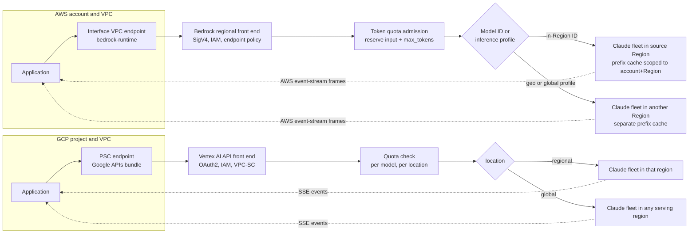

# Claude on Bedrock and Vertex AI

## TL;DR

You can reach Claude through four separate control planes: the legacy Bedrock integration (InvokeModel and Converse, for Opus 4.6 and earlier), the newer Bedrock integration that uses the Messages API shape (Opus 4.7 and later), Claude Platform on AWS (Anthropic model IDs and Anthropic's lifecycle), and Vertex AI publisher endpoints (Anthropic docs, as of 2026-10).
Bedrock admits a request by reserving input tokens plus `max_tokens` against a per-model, per-Region token quota, then settles at input plus cache writes plus output times a burndown multiplier of 5x or 15x, so an oversized `max_tokens` cuts the concurrency you get even though it costs nothing extra (AWS docs, as of 2026-10).
Prompt caching reuses an exact prefix and is scoped per account and per Region on Bedrock, so a router that spreads requests across Regions can turn caching into a net cost: the break-even warm-hit probability is 21.7% with the 5-minute TTL and 52.6% with the 1-hour TTL (derived below).
Streaming uses different wire framing on each cloud: Bedrock sends binary AWS event-stream messages with CRC checks, and Vertex sends Server-Sent Events. On both, once the first byte arrives, an error comes in-band under an HTTP 200, and a retry replays and re-bills the whole generation.
For private routing, AWS uses interface VPC endpoints plus endpoint policies plus SCP carve-outs for cross-Region profiles, and GCP uses Private Service Connect plus a VPC Service Controls perimeter. Global or cross-Region routing buys capacity at the cost of residency guarantees and cache locality.

## Mental Model



Think of each cloud as a front door that does three jobs on your behalf: it authenticates you, it admits you against a token bucket, and it picks a serving pool.
The model weights are the same family on every surface, but everything that affects your bill and your p99 differs: the quota bucket, the routing decision, the cache scope, and the stream framing.
The serving pool owns the prompt cache, and you never see which pool you landed on, so the routing decision quietly decides whether you pay 0.1x or 1.25x for the same prefix tokens.
Engineers who treat the choice between Bedrock and Vertex as a choice of model are optimizing the wrong variable.
The real decision is which admission, routing, and cache-locality semantics you are accepting, and whether your gateway reproduces them closely enough to predict throttling and cost before the provider shows them to you.

## Internals

### The four integration surfaces as of 2026-10

Anthropic now documents two separate Bedrock integrations.
The legacy integration covers Claude Opus 4.6 and earlier and uses InvokeModel and Converse with ARN-versioned model identifiers such as `anthropic.claude-haiku-4-5-20251001-v1:0`. Haiku 4.5 is also offered through a global cross-Region profile (Anthropic docs, as of 2026-10).
The newer integration, "Claude in Amazon Bedrock", covers Opus 4.7 and later and uses unversioned IDs with an `anthropic.` prefix, for example `anthropic.claude-opus-5` (Anthropic docs, as of 2026-10).
Anthropic says this newer integration runs on AWS-managed infrastructure with zero operator access, meaning Anthropic staff cannot reach the inference infrastructure, and that it accepts the same Messages API request shape as Anthropic's first-party API (Anthropic docs, as of 2026-10).
Its recommended authentication is a Bedrock service role: an administrator provisions the role and grants developers `iam:PassRole` on its ARN (Anthropic docs, as of 2026-10).
Access is gated per model. Anthropic lists Claude Fable 5.1, Fable 5, Opus 4.8, Sonnet 5, Opus 4.7, and Haiku 4.5 as open to all Bedrock customers, while Claude Mythos Preview requires an invitation through Project Glasswing and a dedicated, allowlisted AWS account (Anthropic docs, as of 2026-10).
Claude Platform on AWS is a third surface. It uses Anthropic's first-party model IDs such as `claude-opus-4-6`, and its model lifecycle follows Anthropic's deprecation schedule rather than Bedrock's (Anthropic docs, as of 2026-10).
On Vertex AI, Claude is a publisher model. The model is named in the URL path (`publishers/anthropic/models/{model}`) and called through `:rawPredict` or `:streamRawPredict`; the request body carries `anthropic_version: "vertex-2023-10-16"` instead of a `model` field; the location is either a region or `global` (UNVERIFIED as of 2026-10).
On the legacy Bedrock InvokeModel path, the body carries `anthropic_version: "bedrock-2023-05-31"` and the model is named in the `modelId` path parameter (UNVERIFIED as of 2026-10).

The operational consequence is that "Claude on AWS" is three products, each with its own ID scheme, lifecycle, and possibly its own endpoint surface.
AWS's scaling guide notes that Bedrock now exposes two endpoint surfaces that share one inference engine but apply quotas differently (AWS docs, as of 2026-10).
This chapter documents the quota behavior of the `bedrock-runtime` surface only. I could not verify the name and quota semantics of the second surface, so check them before you migrate (UNVERIFIED as of 2026-10).

### Control plane versus data plane

Model access grants, quota increases, inference profile discovery, and provisioned capacity purchases all belong to the control plane.
Invoke, Converse, rawPredict, and their streaming variants belong to the data plane.
The static-stability rule from [[17-Cloud-AI-Engineering/Volume_01_Cloud_Architecture_Principles/Chapter_04_Control_Plane_vs_Data_Plane_Separation|Control Plane vs Data Plane Separation]] applies directly here. Never call `ListFoundationModels`, `GetInferenceProfile`, or Model Garden listing APIs on the request path. Resolve model IDs at deploy time and ship them as configuration.
GCP's June 2025 global incident is the cautionary case. A bad policy change crashed Service Control, the component that authorizes and quota-checks Google API calls, and it took down API surfaces including Vertex AI. That shows the admission check is a shared dependency that sits on the data path, not off to the side ([Google Cloud incident report](https://status.cloud.google.com/incidents/ow5i3PPK96RduMB9yLsU), UNVERIFIED link as of 2026-10).

### Quota admission: reservation, adjustment, settlement

AWS documents a three-stage token accounting model for `bedrock-runtime` (AWS docs and AWS ML blog, as of 2026-10):

1. At admission, the request is debited its total input tokens plus `max_tokens`.
2. While it runs, the debit is adjusted periodically to reflect the output tokens actually generated.
3. At completion, the final charge is `InputTokenCount + CacheWriteInputTokens + OutputTokenCount x burndown_rate`, and unused reservation is returned.

`CacheReadInputTokens` do not count toward the quota at all (AWS ML blog, as of 2026-10).
The burndown rate for Claude 4.8-version models is 15x on output tokens, and the AWS page lists other current Claude models at 5x (AWS docs, as of 2026-10). The exact membership of the 5x list was truncated in my source and is UNVERIFIED.
Quotas are per model and per Region and count input and output together. Some models also have a requests-per-minute quota, and others are governed only by tokens (AWS docs, as of 2026-10).

Three mechanisms follow from this, and none of them appears in a getting-started guide.

First, burst admission is limited by reservation, while steady-state throughput is limited by settlement.
With a per-minute bucket Q, a burst that arrives before any refunds can admit about `floor(Q / (I + M))` requests, where I is input tokens and M is `max_tokens`.
Sustained throughput instead approaches `Q / (I_uncached + C_w + b x O)` requests per minute, where O is actual output tokens and b is the burndown rate.
Take a hypothetical Q of 2,000,000 tokens per minute, 8,000 input tokens, `max_tokens` of 32,000, and 1,000 actual output tokens at 5x. Burst admission is 50 requests, while settled cost is 13,000 tokens per request, about 153 requests per minute sustained.
Cutting `max_tokens` to 2,000 raises the burst ceiling to 200 without changing the bill at all, because `max_tokens` affects quota, not cost.

Second, caching helps settlement more than admission.
Cache-read tokens are free at settlement, but at admission the provider cannot yet know whether a prefix will hit, and AWS describes the admission debit as total input tokens. So a cached prefix most likely still counts against burst headroom (inference from the documented stages; UNVERIFIED as of 2026-10).

Third, settlement can exceed reservation.
If output burns down at 5x and the reservation is `input + max_tokens` at 1x, a request that uses most of its `max_tokens` settles above what was reserved. That is why the adjustment stage exists, and it is also why a long, verbose stream can start throttling its neighbors partway through.
The source I read does not say whether the admission debit applies the burndown multiplier to `max_tokens` (UNVERIFIED as of 2026-10).

This is the reservation-style admission control described in [[17-Cloud-AI-Engineering/Volume_07_Reliability_and_SRE/Chapter_02_Load_Shedding_Backpressure_and_Admission_Control|Load Shedding, Backpressure, and Admission Control]], and it matches the per-tenant fairness approach in the AWS Builders' Library article [Fairness in multi-tenant systems](https://aws.amazon.com/builders-library/fairness-in-multi-tenant-systems/).
Your gateway should copy the provider's algorithm: keep a local token bucket per model and Region that debits `I + M` at admission and refunds at settlement, so it sheds load before the provider returns a 429.
On Vertex AI, Claude quotas are likewise per model and per location, covering requests and tokens per minute, with the `global` location counted separately from regional locations. I could not verify the exact quota names or whether Vertex uses a burndown multiplier (UNVERIFIED as of 2026-10).

### Prompt caching: what the API promises and why

The contract, verified for Bedrock: up to four cache checkpoints per request, TTLs of 5 minutes or 1 hour, and checkpoints allowed in system prompts, message content, and tool definitions. Converse marks checkpoints with a `cachePoint` block, and cache entries are scoped to an individual AWS account and Region (AWS ML blog, as of 2026-10).
The default 5-minute TTL is refreshed on every hit. The 1-hour TTL costs 2x the base input price to write (Anthropic cookbook, as of 2026-10).
A 5-minute write costs 1.25x base input and a read costs about 0.1x (third-party summaries consistent with Anthropic pricing, as of 2026-10).
The minimum cacheable prefix is set per model version and is not monotonic across versions:

- Sonnet 4.5 and Sonnet 4.6 need at least 1,024 tokens per checkpoint, and the 4.x Opus models AWS describes need at least 4,096 (AWS ML blog, as of 2026-10).
- Haiku 4.5 needs 4,096 (Anthropic cookbook, as of 2026-10).
- Some newer models accept a cumulative prefix as short as 512 tokens (AWS ML blog, as of 2026-10), and a third-party table assigns 512 to Opus 5 (UNVERIFIED as of 2026-10).

If a prefix is below the minimum, the request succeeds without caching and without any error. The only evidence is that the cache-read counter stays at zero (third-party docs, as of 2026-10).

Why the match has to be exact: in a causal transformer, the key and value vectors at position t are functions of every token at positions up to t.
Change one byte at position k and the KV state for every position from k onward is invalid. So the only reusable unit is a prefix, and the cache key has to be a hash over everything up to the breakpoint.
This is why the documented processing order is tools, then system, then messages (UNVERIFIED as of 2026-10). Editing a tool definition invalidates everything cached after it, while appending a conversation turn invalidates nothing upstream.
The research behind this mechanism is public, even though Anthropic's own implementation is not.

- PagedAttention ([Kwon et al., SOSP 2023](https://arxiv.org/abs/2309.06180)) stores KV in fixed-size blocks that requests can share copy-on-write, which makes prefix sharing cheap in memory. See [[17-Cloud-AI-Engineering/Volume_11_LLM_Serving_and_Inference_Systems_on_Cloud/Chapter_03_KV_Cache_Management_and_PagedAttention|KV-Cache Management and PagedAttention]].
- RadixAttention in SGLang ([Zheng et al., 2023](https://arxiv.org/abs/2312.07104)) indexes cached prefixes in a radix tree with LRU eviction.
- Prompt Cache ([Gim et al., MLSys 2024](https://arxiv.org/abs/2311.04934)) reuses attention state for modules declared ahead of time, which is the closest academic analogue to explicit breakpoints.
- Mooncake ([Qin et al., FAST 2025](https://arxiv.org/abs/2407.00079)) builds a KV pool spread across GPU memory, DRAM, and SSD that schedulers route requests toward.

Read against that literature, the observable contract (explicit breakpoints, a minimum length, two TTL tiers, and a write premium that doubles for the long TTL) is consistent with a tiered KV store.
Under that reading, the minimum length keeps tiny entries whose bookkeeping and transfer cost more than recomputing them, and the 1-hour premium pays for holding state in a larger, colder tier for twelve times as long (inference, not a documented Anthropic design).

### Cache hit probability as a routing problem

Suppose a cached prefix receives requests as a Poisson process with rate lambda, and the TTL T is refreshed on every hit.
If every request goes to the one Region that holds the entry, the probability that the next request finds it warm is `p = 1 - exp(-lambda x T)`.
If a cross-Region or global router spreads requests uniformly over k Regions, and each Region keeps its own entry (which AWS's account-and-Region scoping implies), each Region sees a rate of lambda/k and `p = 1 - exp(-(lambda/k) x T)`.
The expected cost per prefix token, as a multiple of base input price, is then `p x 0.1 + (1 - p) x w`, where w is 1.25 for the 5-minute TTL and 2.0 for the 1-hour TTL.
Setting that equal to 1.0, the cost without caching, gives break-even values of `p* = (w - 1) / (w - 0.1)`, which is 0.217 for the 5-minute TTL and 0.526 for the 1-hour TTL.

| Prefix arrival rate | Regions in rotation (k) | Warm-hit probability (5m TTL) | Cost multiplier vs uncached |
| --- | --- | --- | --- |
| 2 per minute | 1 | 1.000 | 0.10 |
| 2 per minute | 4 | 0.918 | 0.19 |
| 0.5 per minute | 1 | 0.918 | 0.19 |
| 0.5 per minute | 4 | 0.465 | 0.72 |
| 0.2 per minute | 1 | 0.632 | 0.52 |
| 0.2 per minute | 4 | 0.221 | 1.00 |

The last row is the trap. A prefix used about once every five minutes is a solid saving when pinned to one Region, and it breaks exactly even once a global profile spreads it across four.
As I recall, AWS documentation warns that cross-Region inference can produce more cache writes during periods of high demand. That is the same effect seen from the provider's side (UNVERIFIED as of 2026-10).
Inside a single Region, the provider's router must also send your request to a replica, or a shared KV tier, that holds the entry. That layer is not visible to you, so treat measured `cache_read_input_tokens` as the only real hit rate.

A second mechanism hurts fan-out workloads. When N parallel requests share a new prefix, they all miss and all pay the write premium, because an entry is not readable until it has been created. Anthropic has historically documented this as "after the first response begins" (UNVERIFIED as of 2026-10).
The fix is a warm-up request: send one request, wait for its first streamed token, then fan out the other N-1.

### Streaming wire formats and failure semantics

Bedrock `InvokeModelWithResponseStream` and `ConverseStream` return `application/vnd.amazon.eventstream`. Each message is framed as follows:

- a 4-byte total length,
- a 4-byte headers length,
- a 4-byte CRC32 over that prelude,
- typed headers such as `:event-type` and `:message-type`,
- the payload,
- a 4-byte CRC32 over the whole message (UNVERIFIED as of 2026-10).

On InvokeModel streams, each payload chunk wraps one Anthropic event as JSON bytes. Converse streams instead emit Bedrock-normalized events such as `messageStart`, `contentBlockDelta`, `messageStop`, and a final `metadata` event that carries usage and latency (UNVERIFIED as of 2026-10).
Vertex `streamRawPredict` returns `text/event-stream` SSE with Anthropic's native event types: `message_start`, `content_block_start`, `content_block_delta`, `content_block_stop`, `message_delta`, `message_stop`, plus `ping` keepalives and `error` (UNVERIFIED as of 2026-10).

Four engineering consequences follow.
First, any middlebox that buffers or compresses responses (a misconfigured reverse proxy, a gzip filter, a non-streaming API gateway integration) collapses time to first token into total latency, and every server-side metric still looks healthy.
Second, long gaps between tokens, for example during extended reasoning or tool-heavy turns, run into idle timeouts. An ALB's default idle timeout is 60 seconds (UNVERIFIED as of 2026-10), and the SSE `ping` events exist for exactly this reason.
Third, once headers are sent the HTTP status is fixed at 200, so throttling or overload mid-stream arrives as an in-band exception event, and a client that checks only status codes records a truncated answer as a success.
Fourth, there is no transparent retry. Retrying replays the prompt (at least it may hit the cache), regenerates from the beginning, and bills the partial output twice. Agents should therefore checkpoint at tool-call boundaries and retry only from the last completed turn. This applies the deadline and retry-budget discipline from [[17-Cloud-AI-Engineering/Volume_07_Reliability_and_SRE/Chapter_03_Resilient_Communication_Retries_Jitter_and_Circuit_Breakers|Resilient Communication: Retries, Jitter, and Circuit Breakers]].

### Private endpoint routing and cross-Region paths

On AWS, an interface VPC endpoint for `com.amazonaws.<region>.bedrock-runtime` places ENIs in your subnets. With private DNS enabled, the public hostname resolves to those private IPs, so SDKs need no code change (UNVERIFIED as of 2026-10). See [[17-Cloud-AI-Engineering/Volume_02_AWS_Deep_Dive/Chapter_03_VPC_Networking_Internals|VPC Networking Internals]] for how PrivateLink carries that traffic.
The endpoint policy is a second, independent authorization layer, and an `aws:SourceVpce` condition in identity or resource policies can require that calls come through the endpoint.
With a cross-Region or global inference profile, traffic still enters through your source Region's endpoint. Bedrock then forwards it to a destination Region on the provider side, so private connectivity is decided by the source Region and residency is decided by the profile's geography.
IAM must allow both the inference profile ARN and the underlying foundation-model ARNs in every destination Region, and an SCP that denies "all Regions except X" silently breaks the profile (UNVERIFIED as of 2026-10). This interaction is covered under [[17-Cloud-AI-Engineering/Volume_02_AWS_Deep_Dive/Chapter_01_IAM_Policy_Evaluation_Engine|IAM Policy Evaluation Engine]].
On GCP, a Private Service Connect endpoint for Google APIs gives you an internal IP that fronts `*.googleapis.com`, paired with a private DNS zone. A VPC Service Controls perimeter that includes `aiplatform.googleapis.com` then turns IAM-authorized calls from outside the perimeter into denials (UNVERIFIED as of 2026-10). See [[17-Cloud-AI-Engineering/Volume_03_GCP_Deep_Dive/Chapter_03_VPC_Service_Controls_Security_Perimeters|VPC Service Controls: Security Perimeters]].
Regional Vertex locations use `{region}-aiplatform.googleapis.com`, and the `global` location uses `aiplatform.googleapis.com`. Your DNS overrides must cover both if you use both (UNVERIFIED as of 2026-10).

### Failure domain boundaries

The prompt cache shares a failure domain with its Region, so a Regional failover is also a cache flush. Plan input-token cost and quota headroom on the failover target at the uncached settled rate, not the cached rate.
The quota bucket is also per Region, so failover traffic lands on a bucket sized for that Region's normal load. A quota that has not been pre-raised on the standby Region turns a Regional outage into a 429 storm. This is the capacity form of [[17-Cloud-AI-Engineering/Volume_01_Cloud_Architecture_Principles/Chapter_02_Regions_Zones_and_Static_Stability|Regions, Zones, and Static Stability]].
Model lifecycle forms a third failure domain. A model ID can be retired on one surface (Bedrock lifecycle) while it stays live on another (Anthropic first-party lifecycle on Claude Platform on AWS), so "same model on both clouds" is a property you have to monitor, not a fixed fact.

## Numbers to Know

| Quantity | Value | Source |
| --- | --- | --- |
| Max cache checkpoints per request (Bedrock) | 4 | (AWS ML blog, as of 2026-10) |
| Cache TTL options | 5 min (refreshed on hit) or 1 h | (AWS ML blog; Anthropic cookbook, as of 2026-10) |
| Cache write price, 5-min TTL | 1.25x base input | (third-party summaries of Anthropic pricing, as of 2026-10) |
| Cache write price, 1-h TTL | 2x base input | (Anthropic cookbook, as of 2026-10) |
| Cache read price | about 0.1x base input | (third-party summaries of Anthropic pricing, as of 2026-10) |
| Min cache prefix, Sonnet 4.5 and 4.6 | 1,024 tokens per checkpoint | (AWS ML blog, as of 2026-10) |
| Min cache prefix, Haiku 4.5 | 4,096 tokens | (Anthropic cookbook, as of 2026-10) |
| Min cache prefix, Opus 4.x as described by AWS | 4,096 tokens | (AWS ML blog, as of 2026-10) |
| Min cumulative cache prefix, newest listed models | 512 tokens | (AWS ML blog, as of 2026-10) |
| Cache scope on Bedrock | per AWS account and Region | (AWS ML blog, as of 2026-10) |
| Output burndown, Claude 4.8-version models | 15x | (AWS docs, as of 2026-10) |
| Output burndown, other listed Claude models | 5x | (AWS docs, as of 2026-10; exact model list UNVERIFIED) |
| Cache-read tokens counted against Bedrock TPM | no | (AWS ML blog, as of 2026-10) |
| Bedrock token quota scope | per model, per Region, input and output combined | (AWS docs, as of 2026-10) |
| Legacy and new Bedrock integration boundary | Opus 4.6 and earlier vs Opus 4.7 and later | (Anthropic docs, as of 2026-10) |
| Haiku 4.5 legacy Bedrock base ID | `anthropic.claude-haiku-4-5-20251001-v1:0`, global profile available | (Anthropic docs, as of 2026-10) |
| Mythos Preview account allowlisting | typically within 24 hours | (Anthropic docs, as of 2026-10) |
| Break-even warm-hit probability, 5-min TTL | 21.7% | derived from the multipliers above |
| Break-even warm-hit probability, 1-h TTL | 52.6% | derived from the multipliers above |
| 1-h TTL beats 5-min TTL when gaps exceed 5 min and reuse is | at least 2 per hour | derived: 1.25n > 2 + 0.1(n-1) |
| Per-token list prices for any Claude model on either cloud | check the Bedrock and Vertex pricing pages | UNVERIFIED as of 2026-10 |
| Vertex regional-endpoint price premium over global | UNVERIFIED | UNVERIFIED as of 2026-10 |
| Default ALB idle timeout | 60 s | UNVERIFIED as of 2026-10 |

## AWS vs GCP Mechanism Parity

| Dimension | AWS (Bedrock and Claude Platform on AWS) | GCP (Vertex AI) | Critical difference |
| --- | --- | --- | --- |
| Integration surfaces | Legacy Bedrock (InvokeModel and Converse, Opus 4.6 and earlier), new Claude in Amazon Bedrock (Messages API shape, Opus 4.7 and later), and Claude Platform on AWS (Anthropic IDs) (Anthropic docs, as of 2026-10) | One publisher-model surface through rawPredict and streamRawPredict (UNVERIFIED as of 2026-10) | AWS gives you three lifecycles to track, GCP gives you one |
| Model ID format | ARN-versioned (`...-20251001-v1:0`) on legacy, unversioned `anthropic.claude-opus-5` on new, first-party IDs on Claude Platform on AWS | `model@version` style in the URL path (UNVERIFIED as of 2026-10) | ID strings do not carry over between surfaces, so abstract them in config |
| Request body | `anthropic_version: bedrock-2023-05-31` on InvokeModel, normalized schema on Converse (UNVERIFIED as of 2026-10) | `anthropic_version: vertex-2023-10-16`, no `model` field (UNVERIFIED as of 2026-10) | Converse is AWS-specific, and Messages-shape payloads move most easily |
| Authentication | SigV4 with IAM, plus a service role and `iam:PassRole` on the new integration (Anthropic docs, as of 2026-10) | OAuth2 access token from a service account or Workload Identity | Different identity primitives, see [[17-Cloud-AI-Engineering/Volume_08_Security_Identity_and_the_Data_Perimeter/Chapter_02_Workload_Identity_Federation\|Workload Identity Federation]] |
| Streaming framing | Binary AWS event-stream with per-message CRC32 (UNVERIFIED as of 2026-10) | SSE text frames with `ping` keepalives (UNVERIFIED as of 2026-10) | A shared gateway must parse two framings and normalize the errors |
| Cache syntax | `cache_control` on InvokeModel and Messages shape, `cachePoint` on Converse (AWS ML blog, as of 2026-10) | `cache_control` as in the Anthropic API (UNVERIFIED as of 2026-10) | Same semantics, different markup on Converse |
| Cache scope | Account and Region (AWS ML blog, as of 2026-10) | Project and location assumed (UNVERIFIED as of 2026-10) | Cross-Region routing splits the cache on both clouds |
| Quota model | Per-model, per-Region tokens per minute with reservation of `max_tokens` and output burndown (AWS docs, as of 2026-10) | Per-model, per-location requests and tokens per minute (UNVERIFIED as of 2026-10) | AWS's output burndown makes verbose output cost 5x to 15x more quota |
| Cross-Region routing | Geographic and global inference profiles, entering through the source Region (Anthropic docs show a global profile for Haiku 4.5, as of 2026-10) | `global` location versus regional locations (UNVERIFIED as of 2026-10) | AWS routes per request behind one ID, while GCP makes you pick the location per call |
| Private connectivity | Interface VPC endpoint for `bedrock-runtime` with endpoint policy (UNVERIFIED as of 2026-10) | PSC endpoint for the Google APIs bundle (UNVERIFIED as of 2026-10) | The AWS endpoint is per service and per Region, while GCP's PSC fronts many APIs from one IP |
| Exfiltration perimeter | SCPs, `aws:SourceVpce` conditions, endpoint policies | VPC Service Controls perimeter around `aiplatform.googleapis.com` | VPC-SC is a single perimeter primitive, while AWS composes several, see [[17-Cloud-AI-Engineering/Volume_08_Security_Identity_and_the_Data_Perimeter/Chapter_06_Constructing_an_Impenetrable_Data_Perimeter\|Data Perimeter]] |
| Operator access | Zero operator access stated for the new Bedrock integration (Anthropic docs, as of 2026-10) | Governed by Vertex AI data governance terms (UNVERIFIED as of 2026-10) | Check the claim per surface, because it is documented per surface |

## Worked Example: Measuring Cache Economics, Quota Headroom, and TTFT on Both Clouds

### What the lab proves

The script sends four requests with a prefix of roughly 6,000 or more tokens, which is above Haiku 4.5's 4,096-token minimum:

1. A cold call, which should show a cache write.
2. A warm call, which should show a cache read.
3. A call with one byte changed at the start of the prefix, which should show a full cache write again and proves exact-prefix invalidation.
4. A warm streaming call that measures time to first token.

For each call it prints the reservation the request would hold under Bedrock's admission rule, its settled quota cost, and its dollar cost at prices you supply.
It creates no persistent cloud resources. You pay only per-token usage, plus the optional private endpoints described further down.

### Prerequisites

On AWS, enable access to the Haiku 4.5 model, then use credentials allowed to call `bedrock:InvokeModel` and `bedrock:InvokeModelWithResponseStream` on the inference profile and on the foundation-model ARNs it routes to.
On GCP, run `gcloud services enable aiplatform.googleapis.com`, enable the Claude model in Model Garden, set up Application Default Credentials (`gcloud auth application-default login`), and install `pip install boto3 "anthropic[vertex]"`.
The Vertex model string and the global profile ID below follow naming patterns I could not verify for 2026-10, so check them in your console first.

### Code

```python
#!/usr/bin/env python3
"""claude_cache_probe.py - measure prompt-cache behavior, quota accounting, and TTFT.

AWS (legacy Bedrock integration, InvokeModel):
  python claude_cache_probe.py aws --region us-east-1 \
      --model global.anthropic.claude-haiku-4-5-20251001-v1:0
GCP (Vertex AI):
  python claude_cache_probe.py gcp --project MY_PROJECT --region global \
      --model claude-haiku-4-5@20251001
Prices are parameters on purpose: read them from the pricing page on the day you run.
"""
import argparse
import json
import time

QUESTION = "In one sentence, what latency objective does the document state?"


def build_prefix(salt: str = "") -> str:
    para = ("Section {i}. The service level objective for the order pipeline is 99.9 percent "
            "of requests completing within 800 milliseconds measured at the load balancer. ")
    return salt + "".join(para.format(i=i) for i in range(260))


def anthropic_body(prefix: str, max_tokens: int) -> dict:
    return {
        "max_tokens": max_tokens,
        "system": [{"type": "text", "text": prefix, "cache_control": {"type": "ephemeral"}}],
        "messages": [{"role": "user", "content": [{"type": "text", "text": QUESTION}]}],
    }


def account(u: dict, max_tokens: int, burndown: float, p_in: float, p_out: float) -> dict:
    inp = u.get("input_tokens", 0) or 0
    cw = u.get("cache_creation_input_tokens", 0) or 0
    cr = u.get("cache_read_input_tokens", 0) or 0
    out = u.get("output_tokens", 0) or 0
    reserve = inp + cw + cr + max_tokens
    settled = inp + cw + out * burndown
    usd = (inp * p_in + cw * p_in * 1.25 + cr * p_in * 0.10 + out * p_out) / 1e6
    return {"input": inp, "cache_write": cw, "cache_read": cr, "output": out,
            "reserve_tokens": reserve, "settled_quota_tokens": settled, "usd": round(usd, 6)}


def run_aws(a):
    import boto3
    from botocore.config import Config
    rt = boto3.client("bedrock-runtime", region_name=a.region,
                      config=Config(read_timeout=300, retries={"mode": "adaptive", "max_attempts": 4}))

    def call(prefix):
        body = anthropic_body(prefix, a.max_tokens)
        body["anthropic_version"] = "bedrock-2023-05-31"
        r = rt.invoke_model(modelId=a.model, body=json.dumps(body),
                            contentType="application/json", accept="application/json")
        return json.loads(r["body"].read())["usage"], None

    def stream(prefix):
        body = anthropic_body(prefix, a.max_tokens)
        body["anthropic_version"] = "bedrock-2023-05-31"
        t0 = time.monotonic()
        r = rt.invoke_model_with_response_stream(modelId=a.model, body=json.dumps(body))
        usage, ttft = {}, None
        for event in r["body"]:
            if "chunk" not in event:
                raise RuntimeError(f"in-band stream error after HTTP 200: {list(event)}")
            ev = json.loads(event["chunk"]["bytes"])
            if ev["type"] == "message_start":
                usage.update(ev["message"]["usage"])
            elif ev["type"] == "content_block_delta" and ttft is None:
                ttft = time.monotonic() - t0
            elif ev["type"] == "message_delta":
                usage["output_tokens"] = ev["usage"]["output_tokens"]
        return usage, ttft

    return call, stream


def run_gcp(a):
    from anthropic import AnthropicVertex
    client = AnthropicVertex(project_id=a.project, region=a.region)

    def call(prefix):
        b = anthropic_body(prefix, a.max_tokens)
        m = client.messages.create(model=a.model, **b)
        return m.usage.model_dump(), None

    def stream(prefix):
        b = anthropic_body(prefix, a.max_tokens)
        t0, ttft = time.monotonic(), None
        with client.messages.stream(model=a.model, **b) as s:
            for _ in s.text_stream:
                if ttft is None:
                    ttft = time.monotonic() - t0
            final = s.get_final_message()
        return final.usage.model_dump(), ttft

    return call, stream


def main():
    p = argparse.ArgumentParser()
    p.add_argument("cloud", choices=["aws", "gcp"])
    p.add_argument("--region", required=True)
    p.add_argument("--model", required=True)
    p.add_argument("--project")
    p.add_argument("--max-tokens", type=int, default=256)
    p.add_argument("--burndown", type=float, default=5.0)
    p.add_argument("--price-in", type=float, required=True, help="USD per 1M input tokens")
    p.add_argument("--price-out", type=float, required=True, help="USD per 1M output tokens")
    a = p.parse_args()
    call, stream = run_aws(a) if a.cloud == "aws" else run_gcp(a)
    base = build_prefix()
    steps = [("cold", lambda: call(base)),
             ("warm", lambda: call(base)),
             ("one-byte-change", lambda: call(build_prefix(salt="X"))),
             ("warm-stream", lambda: stream(base))]
    for name, fn in steps:
        t0 = time.monotonic()
        usage, ttft = fn()
        row = account(usage, a.max_tokens, a.burndown, a.price_in, a.price_out)
        row["wall_s"] = round(time.monotonic() - t0, 3)
        row["ttft_s"] = None if ttft is None else round(ttft, 3)
        print(name, json.dumps(row))


if __name__ == "__main__":
    main()
```

### What you should see

With a model whose minimum the prefix clears, the cold call should report a large `cache_write` and `cache_read` of zero, and the warm call the reverse.
The one-byte-change call should report a full write again, because the salt sits at position zero and invalidates the entire prefix.
If every call shows `cache_read` of zero, check three things: the prefix may be below the model's minimum, the global profile may have routed successive calls to different Regions, or something in your prefix varies between calls.
When you run against a global profile, repeating the cold and warm pair several times gives a direct empirical estimate of the cross-Region scatter probability.

### Lab cost estimate

At illustrative Haiku-class prices of 1 USD per million input tokens and 5 USD per million output tokens (UNVERIFIED as of 2026-10), one full run comes to roughly 6,000 x 1.25 write + 2 x 6,000 x 0.1 read + 6,000 x 1.25 write again, plus 4 x 256 output tokens at most, or about 0.02 USD.
Even with an order-of-magnitude pricing error, ten runs stay under 1 USD.

### Budget alarms

```bash
# AWS: monthly cost budget with an 80 percent email alert.
ACCOUNT_ID=$(aws sts get-caller-identity --query Account --output text)
aws budgets create-budget --account-id "$ACCOUNT_ID" \
  --budget '{"BudgetName":"claude-lab","BudgetLimit":{"Amount":"5","Unit":"USD"},"TimeUnit":"MONTHLY","BudgetType":"COST"}' \
  --notifications-with-subscribers '[{"Notification":{"NotificationType":"ACTUAL","ComparisonOperator":"GREATER_THAN","Threshold":80,"ThresholdType":"PERCENTAGE"},"Subscribers":[{"SubscriptionType":"EMAIL","Address":"you@example.com"}]}]'

# GCP: budget scoped to the lab project with an 80 percent threshold.
gcloud billing budgets create --billing-account="$BILLING_ACCOUNT_ID" \
  --display-name="claude-lab" --budget-amount=5USD \
  --threshold-rule=percent=0.8 --filter-projects="projects/$PROJECT_ID"
```

Budgets on both clouds only send alerts. They do not cap spend, and billing data arrives with a delay of hours, so a runaway loop can overshoot before any alert fires.
For a hard stop, use the quota itself as the limiter: request a low quota for the lab account or project.

### Optional private path

```bash
# AWS: interface endpoint for the runtime API in two subnets (hourly per-AZ and per-GB charges apply, UNVERIFIED as of 2026-10).
aws ec2 create-vpc-endpoint --vpc-id "$VPC_ID" --vpc-endpoint-type Interface \
  --service-name "com.amazonaws.us-east-1.bedrock-runtime" \
  --subnet-ids "$SUBNET_A" "$SUBNET_B" --security-group-ids "$SG_ID" --private-dns-enabled

# GCP: PSC endpoint for Google APIs (also requires a private DNS zone for googleapis.com).
gcloud compute addresses create claude-psc-ip --global --purpose=PRIVATE_SERVICE_CONNECT \
  --addresses=10.255.0.10 --network="$NETWORK"
gcloud compute forwarding-rules create claudepsc --global --network="$NETWORK" \
  --address=claude-psc-ip --target-google-apis-bundle=all-apis
```

### Teardown

```bash
aws budgets delete-budget --account-id "$ACCOUNT_ID" --budget-name claude-lab
aws ec2 delete-vpc-endpoints --vpc-endpoint-ids "$VPCE_ID"
gcloud billing budgets delete "$BUDGET_ID" --billing-account="$BILLING_ACCOUNT_ID"
gcloud compute forwarding-rules delete claudepsc --global --quiet
gcloud compute addresses delete claude-psc-ip --global --quiet
```

### Capacity sizing: a support assistant at 20 RPS peak

Inputs:

- 20 requests per second at peak, which is 1,200 per minute.
- A shared prefix of 12,000 tokens (tools, system prompt, and policy documents).
- 1,500 tokens of unique context per request.
- 400 output tokens on average, with `max_tokens` set to 1,024.
- A 5x burndown rate.
- A measured warm-hit probability of 0.95.

Step 1, reservation per request: 12,000 + 1,500 + 1,024 = 14,524 tokens.
Step 2, in-flight reservation: with about 0.8 s TTFT plus 400 tokens at an assumed 60 tokens per second, each request lasts about 7.5 s. By Little's law that is about 150 requests in flight, holding about 2.2 million reserved tokens at any moment.
Step 3, settled quota without caching: 12,000 + 1,500 + 400 x 5 = 15,500 tokens per request, which at 1,200 per minute needs 18.6 million tokens per minute.
Step 4, settled quota with caching at p = 0.95: 1,500 + 0.05 x 12,000 written + 2,000 = 4,100 tokens per request, which needs 4.9 million tokens per minute, a 3.8x reduction in quota requirement.
Step 5, cost at illustrative Sonnet-class prices of 3 USD input and 15 USD output per million tokens (UNVERIFIED as of 2026-10): uncached is 0.0465 USD per request, and cached is 0.0162 USD per request, so 46,500 USD versus 16,170 USD per million requests.
Step 6, failover sizing: the standby Region starts cold, so its quota must cover the uncached 18.6 million tokens per minute for at least one TTL window, plus the reservation burst from every client reconnecting at once.
Step 7, sensitivity: if a global profile drops p from 0.95 to 0.47, the cost per request rises by about 60%, and the quota requirement more than doubles.
The full cost model continues in [[17-Cloud-AI-Engineering/Volume_11_LLM_Serving_and_Inference_Systems_on_Cloud/Chapter_11_End_to_End_Latency_Throughput_and_Cost_Modeling|End-to-End Latency, Throughput, and Cost Modeling]].

## Failure Modes and Pitfalls

### Throttling at low real usage

The symptom is `ThrottlingException` while the CloudWatch input and output token metrics sit well below quota.
The cause is a `max_tokens` value copied from a model's maximum output length, such as 32,000 or more, which multiplies the admission reservation even though actual output is small. AWS's own guidance names `max_tokens` as the usual culprit when quotas trip early (AWS ML blog, as of 2026-10).
The fix is to set `max_tokens` per route from a high percentile of observed output length, then raise it adaptively when a response ends with a max-tokens stop reason.

### Caching that costs more than it saves

The symptom is a cache-write line item that grows while `cache_read_input_tokens` stays low.
There are four common causes:

- A timestamp, request ID, or user name placed before the breakpoint.
- Tool definitions serialized from a hash map whose iteration order is not deterministic.
- Low-rate prefixes spread across Regions by a global profile.
- A 1-hour TTL on a prefix that is reused only once.

The fix has four parts:

- Byte-stable serialization (sorted keys, frozen tool order).
- Volatile fields moved after the last breakpoint.
- Region pinning for low-rate prefixes.
- A per-prefix alert on the ratio of cache writes to cache reads.

### Silent cache loss on model upgrade

Minimum cacheable lengths change between model versions in both directions. For example, Haiku 4.5 needs 4,096 tokens while Sonnet 4.5 needs 1,024 (Anthropic cookbook and AWS ML blog, as of 2026-10).
Upgrading from a 1,024-minimum model to a 4,096-minimum model with a 3,000-token prefix disables caching without any error, and input cost and quota consumption jump by up to 10x on that prefix.
Make a cache-hit canary part of every model rollout gate in [[17-Cloud-AI-Engineering/Volume_06_Infrastructure_as_Code_and_Delivery/Chapter_06_Progressive_Delivery_and_Deployment_Pipelines|Progressive Delivery and Deployment Pipelines]].

### Fan-out miss storms

A map-reduce agent that fires 200 parallel subcalls on a new prefix pays 200 cache writes and reserves 200 full prefixes against quota.
Send one warm-up call first, wait for its first token, and then release the rest.

### Streams that look successful but are truncated

Mid-stream throttling or overload arrives after HTTP 200. A client or proxy that ignores in-band error events and missing stop events logs a truncated answer as a success, and the downstream evaluation pipeline scores garbage.
Treat a stream as successful only if you received a terminal event with a stop reason and final usage.

### Retry amplification

Unbounded client retries on 429s multiply the load the reservation system has already refused, and every retried stream re-bills its partial output.
Use token-bucket retry budgets and full jitter, as in the AWS Builders' Library article [Timeouts, retries, and backoff with jitter](https://aws.amazon.com/builders-library/timeouts-retries-and-backoff-with-jitter/), and shed load in your own gateway first.

### SCPs and residency conflicts with cross-Region profiles

An organization-wide SCP that denies all Regions except two causes intermittent `AccessDenied` errors from a geographic profile whose destination set includes a third Region. It is intermittent because only some requests route there (UNVERIFIED as of 2026-10).
The fix is to carve out the inference profile and model ARNs explicitly, or to use in-Region IDs where residency must be exact.

### Integration and lifecycle drift

Moving from the legacy Bedrock integration to the new one changes model ID format and request schema, and may change the endpoint surface and quota bucket. Check VPC endpoint coverage and quotas before you cut over (UNVERIFIED as of 2026-10).
A model that is retired on one surface while still live on another breaks a multi-cloud failover plan that assumed the same model on both sides.

### Public post-incident reviews

Anthropic's September 2025 postmortem described three overlapping infrastructure bugs that degraded output quality: requests misrouted to servers configured for a different context window, a misconfiguration that corrupted output on some servers, and a compiler issue on TPU in approximate top-k sampling. The impact differed by serving platform, which shows that "the same model" on different clouds runs on different hardware and different routing code ([Anthropic engineering postmortem](https://www.anthropic.com/engineering/a-postmortem-of-three-recent-issues), UNVERIFIED link and per-platform details as of 2026-10).
The lesson for operators is to run continuous quality canaries on each surface, not just availability probes. An HTTP 200 with degraded output is invisible to SLOs based on success rate. See [[17-Cloud-AI-Engineering/Volume_12_AI_Applications_MLOps_and_Data_Platforms/Chapter_06_Model_Evaluation_Monitoring_and_Drift_Detection|Model Evaluation, Monitoring, and Drift Detection]].
AWS's October 2025 us-east-1 event began with a DNS automation race in DynamoDB and cascaded into dependent services ([AWS summary](https://aws.amazon.com/message/101925/), UNVERIFIED link as of 2026-10). The lesson is that an inference stack pinned to one Region inherits that Region's foundational dependencies, whatever the model provider's own availability.
Google's June 2025 Service Control incident showed that a global admission and policy layer can take out every regional Vertex AI endpoint at once ([Google Cloud incident report](https://status.cloud.google.com/incidents/ow5i3PPK96RduMB9yLsU), UNVERIFIED link as of 2026-10). Choosing between regional and global locations does not escape that shared dependency.
[[17-Cloud-AI-Engineering/Volume_07_Reliability_and_SRE/Chapter_07_Anatomy_of_Major_Cloud_Outages|Anatomy of Major Cloud Outages]] dissects these patterns in depth.

## Security and Cost Angles

### IAM scoping

On the legacy Bedrock integration, grant `bedrock:InvokeModel` and `bedrock:InvokeModelWithResponseStream` only on the specific inference-profile ARNs and foundation-model ARNs your workload uses, never on `*`.
On the new integration, the documented pattern is a service role that developers pass with `iam:PassRole` (Anthropic docs, as of 2026-10). Constrain `iam:PassRole` with an `iam:PassedToService` condition so the role can only be handed to Bedrock (UNVERIFIED as of 2026-10).
Add an SCP that denies invocation of any model ARN outside an approved list. This is how you enforce model governance across an organization, because model access grants are made per account. See [[17-Cloud-AI-Engineering/Volume_02_AWS_Deep_Dive/Chapter_02_AWS_Organizations_and_Account_Governance|AWS Organizations and Account Governance]].
On GCP, bind the narrowest predefined Vertex AI role that grants prediction to a dedicated service account, and use Workload Identity instead of keys (UNVERIFIED role names as of 2026-10).

### Network boundaries

On AWS, require `aws:SourceVpce` on the invoking principals so that a stolen credential cannot call Bedrock from the internet, and attach an endpoint policy that lists only approved model ARNs.
On GCP, put the inference project and its logging sinks inside one VPC-SC perimeter, so a principal with valid IAM cannot copy prompts to a project outside it.
Both controls are covered in depth in [[17-Cloud-AI-Engineering/Volume_08_Security_Identity_and_the_Data_Perimeter/Chapter_06_Constructing_an_Impenetrable_Data_Perimeter|Constructing an Impenetrable Data Perimeter]].

### Key hierarchy and data at rest

You cannot apply a customer-managed key to the provider's prompt cache. It is provider-held, ephemeral state bounded by its TTL.
Your controls apply to what you persist. Invocation logs and request-response logs contain full prompts and completions, so send them to a dedicated, KMS- or CMEK-encrypted bucket or dataset with its own key policy, short retention, and access separate from operator roles. See [[17-Cloud-AI-Engineering/Volume_08_Security_Identity_and_the_Data_Perimeter/Chapter_04_Encryption_Key_Hierarchies_and_Envelope_Encryption|Encryption Key Hierarchies and Envelope Encryption]].
The zero-operator-access property is documented for the new Bedrock integration (Anthropic docs, as of 2026-10). Do not assume it for other surfaces without equivalent written terms.

### Unit-economics levers, in order of typical impact

1. Cache hit rate. Measure it per prefix, keep prefixes byte-stable, and pin low-rate prefixes to one Region. A drop from 0.95 to 0.47 costs about 60% more per request in the worked example.
2. Model tiering. Route classification and extraction to Haiku-class models and reserve Opus-class models for multi-step reasoning, enforced in the gateway rather than left to caller discretion.
3. Choosing the TTL. Use the 1-hour TTL only when the same prefix recurs at least twice per hour with gaps longer than 5 minutes; otherwise the 5-minute TTL with refresh-on-hit is cheaper.
4. Right-sizing `max_tokens`. It costs nothing in dollars but directly buys quota headroom, which delays the need for quota increases or provisioned capacity.
5. Output length discipline. On Bedrock, each output token consumes 5x or 15x quota (AWS docs, as of 2026-10), so instructing terse output pays twice: once in price and again in admitted concurrency.
6. Batch interfaces for offline work, which both clouds offer at a discount (discount levels UNVERIFIED as of 2026-10).

Cost allocation and showback for these levers belong in [[17-Cloud-AI-Engineering/Volume_09_FinOps_and_Cloud_Economics/Chapter_01_Cloud_Billing_Models_and_Unit_Cost_Allocation|Cloud Billing Models and Unit Cost Allocation]].

## Interview Questions and Model Answers

### Question 1 (L5 - Senior)

Your Bedrock application returns `ThrottlingException` at 30% of its tokens-per-minute quota according to CloudWatch, and the quota increase request is pending. What is happening, and what do you change today?

#### Model Answer

CloudWatch shows settled consumption, but admission is decided on reservation. Bedrock debits input tokens plus `max_tokens` when a request starts and settles later at input plus cache writes plus output times the burndown rate (AWS docs, as of 2026-10).
If the code sets `max_tokens` to something like 32,000 while typical output is 500 tokens, each request reserves about 64 times what it actually uses for output, so a burst exhausts the bucket while settled usage looks low.
I would first confirm this by logging input tokens, `max_tokens`, output tokens, and stop reason per request, then computing peak in-flight reservation with Little's law (arrival rate times duration times reservation per request).
The same-day fix is to set `max_tokens` per route from a high percentile of observed output, plus a small margin, and to treat a max-tokens stop reason as a signal to re-issue with a larger limit only for that request.
Next, I would move shared context behind cache checkpoints, because cache-read tokens do not count at settlement, even though they probably still count toward the admission reservation.
Finally, I would add a client-side token bucket in the gateway that copies the reserve-and-refund semantics, so overload is shed at our edge with a clean 429 and a retry-after hint instead of being amplified by SDK retries.
The trade-off with a tight `max_tokens` is a small rate of re-issued requests, which costs some latency on those requests in exchange for several times more admitted concurrency.

#### Follow-up Interviewer Question

Output burns down at 5x on this model, and some responses legitimately run long. How does that change your client-side bucket, and can settlement exceed what you reserved?

### Question 2 (L5 - Senior)

Design the cache breakpoint layout for an agent that has 40 tool definitions, a 3,000-token system prompt, a 20,000-token retrieved document set that changes per session, and a growing conversation. Which edits invalidate what?

#### Model Answer

The cache key is an exact prefix, because KV state at any position depends on every earlier token, and the documented processing order is tools, then system, then messages (UNVERIFIED as of 2026-10).
I would place breakpoints at four layers, matching the four-checkpoint limit (AWS ML blog, as of 2026-10):

1. After the tools, which change only on deploy.
2. After the system prompt, which changes on prompt releases.
3. After the session's retrieved documents, which change per session.
4. At the end of the latest assistant turn, which moves forward every turn.

Changing a tool definition invalidates all four layers. Changing the system prompt invalidates layers 2 to 4. A new session invalidates layers 3 and 4. A new turn invalidates nothing upstream and adds only the new turn's tokens as a write.
For stability I would serialize tools with sorted keys and a frozen order, keep timestamps and user identifiers out of the system prompt by moving them into the latest user message, and check every layer against the model's minimum. On a Haiku 4.5-class model, for example, the tools-plus-system layer has to reach 4,096 tokens or it caches nothing (Anthropic cookbook, as of 2026-10).
I would verify the layout with per-turn assertions on `cache_read_input_tokens` in CI, because a silent miss here produces no error.
The trade-off is that very fine-grained breakpoints pay several write premiums per turn, so I would drop the per-session document breakpoint if sessions average fewer than two turns.

#### Follow-up Interviewer Question

Product wants tool definitions personalized per user. What does that do to your cache economics, and how would you restructure the prompt to keep most of the saving?

### Question 3 (L6 - Staff)

Your team wants to move every Bedrock call to a global cross-Region inference profile to get more capacity. Your finance partner reports that prompt caching saves 60% today. Make the call.

#### Model Answer

The global profile trades cache locality for capacity, because cache entries are scoped per account and per Region (AWS ML blog, as of 2026-10). Every routing decision that sends a request to a Region without a warm entry pays the write premium again.
I would model each prefix as a Poisson arrival stream with rate lambda and TTL T. Pinned to one Region, the warm probability is `1 - exp(-lambda T)`; spread uniformly across k Regions, it becomes `1 - exp(-(lambda/k) T)`.
With a 5-minute TTL, a prefix arriving twice a minute barely notices four-way scatter: the cost multiplier goes from 0.10 to 0.19 of uncached input. A prefix arriving once every five minutes goes from 0.52 to 1.00, which is break-even, and anything colder becomes a net loss.
The break-even warm probability is 21.7% for the 5-minute TTL and 52.6% for the 1-hour TTL, so the 1-hour tier is especially sensitive to scatter.
So I would not make a blanket decision. I would segment prefixes by measured arrival rate and route high-rate prefixes and capacity-sensitive traffic through the global profile, while pinning low-rate, long-prefix traffic to an in-Region ID.
I would also point out that the real router is not uniformly random and probably prefers the source Region when it has headroom. That makes my model a worst case, which is exactly why I would measure it: run a canary on the global profile, compare cache-read-to-write ratios per prefix for a week, and decide from data.
Residency and governance come before cost. A global profile can process data outside the geography, so regulated tenants stay on geographic or in-Region IDs whatever the economics.
Finally, the capacity argument has to account for the fact that quota is still debited in the source Region, so I would check whether we are throttled by our own quota or by provider capacity before assuming that global routing fixes our 429s.

#### Follow-up Interviewer Question

How would you build a gateway router that keeps cache affinity per prefix but still spills over across Regions under pressure, and what metric triggers the spillover?

### Question 4 (L6 - Staff)

Design a single streaming gateway that fronts Claude on both Bedrock and Vertex AI for 200 internal teams, with a TTFT SLO of 1.5 s at p95. What are the hard parts?

#### Model Answer

The first hard part is framing. Bedrock streams arrive as binary event-stream messages with per-message CRC32 checks, and Vertex streams arrive as SSE text events (UNVERIFIED as of 2026-10).
I would terminate both upstream inside the gateway, decode them into one internal event model (start, delta, tool-use, stop with reason, usage, error), and re-emit SSE downstream, so clients see one protocol.
The second hard part is truthful latency measurement. I would record TTFT at three points (upstream first delta, gateway emit, client receipt), because buffering anywhere on the path, a gzip filter for example, quietly turns TTFT into total latency.
The third is failure semantics after the first byte. Errors arrive in-band under HTTP 200, so the gateway counts a stream as successful only if it saw a terminal stop event and usage. Retries are allowed only before the first token, or at an application checkpoint such as a completed tool call, because replaying a stream re-bills its output and duplicates text.
The fourth is idle timeouts. Long reasoning gaps need keepalive pings toward the client, and the load balancer's idle timeout has to exceed the longest expected gap.
The fifth is admission control. I would keep per-team token buckets that copy Bedrock's reserve-and-settle semantics with output burndown, plus a per-provider-Region bucket. Priority classes then shed batch-style traffic before interactive traffic, following [[17-Cloud-AI-Engineering/Volume_07_Reliability_and_SRE/Chapter_02_Load_Shedding_Backpressure_and_Admission_Control|Load Shedding, Backpressure, and Admission Control]].
The sixth is cache-aware routing. The gateway hashes the prefix up to the last breakpoint and keeps routing that hash to the same provider and Region, because changing the provider means a guaranteed cache miss and a different quota bucket.
The trade-off is that the gateway becomes a tier-zero dependency, so I would deploy it as cells per Region, keep no runtime dependency on any control plane, and statically load model ID maps from configuration, per [[17-Cloud-AI-Engineering/Volume_01_Cloud_Architecture_Principles/Chapter_03_Cell_Based_Architecture_and_Shuffle_Sharding|Cell-Based Architecture and Shuffle Sharding]].

#### Follow-up Interviewer Question

A client disconnects halfway through a 4,000-token generation. What does the gateway do upstream, what are you billed for, and how do you prove it?

### Question 5 (L6 - Staff)

A regulated tenant requires that prompts never cross the public internet, never leave the EU, and cannot be exfiltrated by a compromised developer credential. Lay out the controls on both clouds.

#### Model Answer

On AWS, the transport control is an interface VPC endpoint for `bedrock-runtime` in an EU Region with private DNS. The authorization controls are an endpoint policy that lists approved EU model and profile ARNs, identity policies conditioned on `aws:SourceVpce`, and an SCP that denies Bedrock invocation outside approved ARNs and approved Regions.
For residency, I would use in-Region IDs or an EU geographic profile, never a global profile. I would also verify that the SCP's Region restriction includes every destination Region of the EU profile, because a destination Region missing from the SCP produces intermittent denials, not a clean failure (UNVERIFIED as of 2026-10).
If the tenant needs models served only through the new Claude in Amazon Bedrock integration, I would confirm that its endpoint surface is covered by the same VPC endpoint service before migrating (UNVERIFIED as of 2026-10). Its documented zero-operator-access property is useful evidence for the tenant's risk review (Anthropic docs, as of 2026-10).
On GCP, the transport control is a PSC endpoint for Google APIs with private DNS for `aiplatform.googleapis.com` and regional hosts. The exfiltration control is a VPC-SC perimeter around the inference project and its logging destinations. Residency means calling a regional EU location, never `global`.
On both clouds, the persisted prompt surface (invocation logs, request-response logs, application traces) sits under customer-managed keys, with retention limits and separate reader roles, because that is where a compromised credential would actually find the data.
To defeat a compromised developer credential, I rely on the network condition (source endpoint or perimeter) combined with short-lived federated credentials. A stolen token used from outside the VPC or perimeter then fails even though IAM allows it.
The trade-off is availability. Without global profiles, the tenant gets the EU's capacity only, so I would pre-negotiate quota in two EU Regions and accept that failover between them starts with a cold cache.

#### Follow-up Interviewer Question

How would you prove to an auditor, continuously rather than at a point in time, that no request for this tenant was ever served outside the EU?

### Question 6 (L7+ - Principal)

The CTO asks for active-active Claude serving across Bedrock and Vertex AI to reach 99.99% availability for a customer-facing assistant. Do you build it, and what does it really cost?

#### Model Answer

First I would split availability into its real failure classes. Provider-wide control or admission failures, such as GCP's 2025 Service Control incident, are where a second provider genuinely helps. Regional failures can usually be absorbed within one provider using two Regions. Quota exhaustion is a capacity-planning problem, not a reason to go multi-cloud. Quality regressions, as in Anthropic's 2025 postmortem, return 200s, so multi-cloud only helps there if you detect them.
The hidden costs of active-active across providers are mostly mechanical:

- Cache locality is lost on every cross-provider move.
- The standby provider must hold quota for full uncached load, which in the worked example is 3.8x the cached quota requirement.
- Two streaming protocols and two auth stacks.
- Two model lifecycles that drift, because IDs and retirement dates differ by surface (Anthropic docs, as of 2026-10).
- Output that is not exactly identical across serving stacks, which matters for regression testing and evaluation baselines.

My recommendation is active-passive across providers with a warm standby that continuously handles a small canary share, a few percent, so the auth path, quota, model version, and streaming path are proven every minute, not discovered during an incident.
Within the primary provider, I would run two Regions with cache-affinity routing and pre-raised quota in both, which covers the most common failure class at much lower cost.
Failover is triggered by gateway-side signals: provider error rate, TTFT, and a quality canary score. It moves traffic in steps, with admission control capping the new provider at its quota, because a full cutover at an uncached reservation rate will itself cause a 429 storm.
I would push back on 99.99% as an end-to-end target unless the assistant can degrade gracefully, for example to a smaller model, a cached answer, or a queued response. Above about three nines, the dependency chain (identity provider, gateway, retrieval store) dominates the error budget, as in [[17-Cloud-AI-Engineering/Volume_07_Reliability_and_SRE/Chapter_01_SLIs_SLOs_and_Error_Budget_Engineering|SLIs, SLOs, and Error Budget Engineering]].
The cost I would present is the standby's committed quota, the canary spend, the engineering cost of the normalization layer, and the higher input cost during and after failover, set against the revenue at risk per hour of outage.

#### Follow-up Interviewer Question

During a primary-provider brownout, error rates are only 8% but p95 TTFT has tripled. What is your automated failover policy, and how do you stop it from flapping?

### Question 7 (L7+ - Principal)

You own inference capacity for a company spending eight figures a year on Claude across both clouds. How do you structure quotas, routing, and commitments, and what do you instrument to defend the plan to finance?

#### Model Answer

I would treat settled quota tokens per business outcome as the primary unit, not raw tokens. On Bedrock, output tokens cost 5x to 15x more quota than input tokens (AWS docs, as of 2026-10), and cache reads cost no quota, so two workloads with the same dollar spend can need quota differing by a factor of four.
Instrumentation per route and per prefix would cover:

- Reservation (input plus `max_tokens`) versus settlement.
- Cache write and read tokens and warm-hit probability.
- Output length distribution.
- TTFT and inter-token latency.
- Truncation and retry rates.
- A quality canary score.

All of it is joined to billing exports by tag, per [[17-Cloud-AI-Engineering/Volume_09_FinOps_and_Cloud_Economics/Chapter_06_FinOps_Organizational_Practices_and_Automation|FinOps Organizational Practices and Automation]].
For capacity, I would size each Region's quota as peak settled consumption at the measured cache rate, plus headroom for reservation bursts, plus a failover share at the uncached rate. Then I would negotiate with the provider on that number, because the gap between reserved and settled consumption is exactly what providers expect sophisticated buyers to manage.
For routing, high-rate prefixes and interactive traffic go to cache-affine in-Region IDs, overflow goes to geographic or global profiles with explicit residency tags, and batch work goes to discounted batch interfaces.
I would consider commitments only for the stable baseline proven by six months of data. Model generations turn over fast, and a commitment tied to one model or surface can strand value when a cheaper, better model arrives on a different integration, which the 2026 split between Bedrock integrations makes concrete.
The plan's top risks would be lifecycle drift, a change in cache minimums or pricing multipliers on the next model, and single-provider admission-layer outages. For each one I would show finance its detection signal and the cost of mitigating it.

#### Follow-up Interviewer Question

A new model generation offers 30% better task success at the same list price but a 4x higher cache minimum than your current prefixes. Walk me through the migration economics.

## Further Reading

- [How tokens are counted in Amazon Bedrock](https://docs.aws.amazon.com/bedrock/latest/userguide/quotas-token-burndown.html) - the primary source for reservation, burndown rates, and settlement, which drive every quota calculation here.
- [Optimize your applications for scale and reliability on Amazon Bedrock](https://aws.amazon.com/blogs/machine-learning/optimize-your-applications-for-scale-and-reliability-on-amazon-bedrock/) - AWS's own walkthrough of the three accounting stages and of `max_tokens` as the usual source of early throttling.
- [Bedrock scaling and throughput best practices](https://docs.aws.amazon.com/bedrock/latest/userguide/scaling-throughput-best-practices.html) - documents the per-model, per-Region quota semantics and the two endpoint surfaces.
- [Bedrock prompt caching user guide](https://docs.aws.amazon.com/bedrock/latest/userguide/prompt-caching.html) - the authoritative per-model table of cache minimums, checkpoint limits, and cacheable fields.
- [Optimizing cost and latency with Amazon Bedrock prompt caching](https://aws.amazon.com/blogs/machine-learning/optimizing-cost-and-latency-with-amazon-bedrock-prompt-caching/) - confirms the account-and-Region cache scope and the 5-minute and 1-hour TTL tiers.
- [Claude in Amazon Bedrock (Opus 4.7 and later)](https://platform.claude.com/docs/en/build-with-claude/claude-in-amazon-bedrock) - Anthropic's description of the new integration, its access gating, and its zero-operator-access property.
- [Claude on Amazon Bedrock (Opus 4.6 and earlier)](https://platform.claude.com/docs/en/build-with-claude/claude-on-amazon-bedrock-legacy) - the legacy InvokeModel and Converse integration with ARN-versioned IDs.
- [Claude models overview](https://platform.claude.com/docs/en/about-claude/models/overview) - the current model list and how Claude Platform on AWS IDs and lifecycle differ from Bedrock's.
- [Kwon et al., Efficient Memory Management for LLM Serving with PagedAttention, SOSP 2023](https://arxiv.org/abs/2309.06180) - the block-level KV sharing that makes prefix caching cheap in memory.
- [Zheng et al., SGLang and RadixAttention](https://arxiv.org/abs/2312.07104) - radix-tree prefix indexing and cache-aware scheduling, the clearest public model of cache-affinity routing.
- [Gim et al., Prompt Cache: Modular Attention Reuse, MLSys 2024](https://arxiv.org/abs/2311.04934) - the academic precursor of explicit cache breakpoints.
- [Qin et al., Mooncake: A KVCache-centric Architecture, FAST 2025](https://arxiv.org/abs/2407.00079) - a production-scale KV pool across memory tiers that explains why TTL tiers cost different amounts.
- [AWS Builders' Library: Fairness in multi-tenant systems](https://aws.amazon.com/builders-library/fairness-in-multi-tenant-systems/) - the quota and token-bucket design philosophy behind Bedrock admission.
- [AWS Builders' Library: Timeouts, retries, and backoff with jitter](https://aws.amazon.com/builders-library/timeouts-retries-and-backoff-with-jitter/) - required reading before you write any retry policy around throttled streams.
- [Google SRE Book: Handling Overload](https://sre.google/sre-book/handling-overload/) - client-side throttling and criticality-based shedding, which your gateway should implement.
- [Anthropic engineering postmortem of three recent issues](https://www.anthropic.com/engineering/a-postmortem-of-three-recent-issues) - why quality canaries per serving platform belong in your SLOs.
- [[17-Cloud-AI-Engineering/Volume_11_LLM_Serving_and_Inference_Systems_on_Cloud/Chapter_09_Managed_Inference_Amazon_Bedrock_vs_Vertex_AI|Managed Inference: Amazon Bedrock vs Vertex AI]] - the previous chapter on catalog, provisioned throughput, and routing architecture.
- [[17-Cloud-AI-Engineering/Volume_11_LLM_Serving_and_Inference_Systems_on_Cloud/Chapter_11_End_to_End_Latency_Throughput_and_Cost_Modeling|End-to-End Latency, Throughput, and Cost Modeling]] - the next chapter, which extends the sizing math here into full cost-per-token models.
- [[13-Agentic-AI/Agentic_AI_Zero_to_Godhood/Volume_12_Production_Engineering/Chapter_06_Capacity_and_Quotas|Capacity and Quotas]] - the agent-side view of quota planning that complements this provider-side view.
