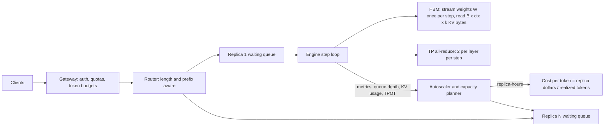
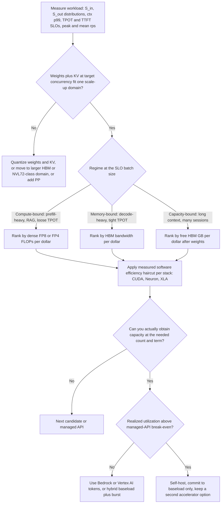

# End-to-End Latency, Throughput, and Cost Modeling

## TL;DR

Every generated token uses four resources: tensor FLOPs, HBM bandwidth, HBM capacity, and interconnect latency. Whichever one runs out first sets your throughput, and you can tell which one it is by looking at the workload's input:output token ratio, its context length, and its TPOT SLO.
Prefill is compute-bound and costs about `2P / (F * MFU)` replica-seconds per prompt token. Decode costs `(W + B * ctx * k) / (BW * eta) / B` per output token, so batching spreads the cost of reading the weights across requests. Nothing spreads the cost of reading the KV cache, so long context sets a floor on cost per token.
Little's law (`B = lambda * S_out * TPOT`) links the per-replica batch size the SLO allows to requests per second. Replica count is then that load divided by a utilization headroom that comes from queueing theory, not from habit.
Cost per million tokens has three denominators: peak (datasheet), SLO-constrained (model or benchmark), and realized (actual utilization over the day). The realized number is usually 2-5x the SLO-constrained one, and that gap matters more than the choice of hardware.
To pick hardware, sort the workload into prefill-heavy, decode-heavy, or long-context. Rank candidates by FLOPs per dollar, bandwidth per dollar, or HBM per dollar respectively. Then discount each by measured software efficiency and by whether you can actually get the capacity, before you commit to anything.

## Mental Model



A serving replica is a step loop.
Each iteration streams the full weight tensor out of HBM once, reads the KV cache of every running sequence, runs one token's worth of GEMMs for each decoding sequence plus a chunk of prompt tokens for sequences still in prefill, then emits one token per decoding sequence.
TPOT is the wall time of one iteration.
Throughput is the number of tokens carried per iteration divided by that time.
Cost is replica-dollars divided by the tokens you actually produced, not the tokens you could have produced.
Capacity planning means choosing how many tokens each iteration carries (batch size and chunk size) so iteration time stays under the SLO, then choosing replica count so queueing stays negligible at peak.

## Internals

### The four resources and their per-token prices

Use these symbols throughout: `P` parameters, `b_w` bytes per weight, `W = P * b_w`, `L` layers, `n_kv` KV heads, `d_h` head dimension, `b_kv` bytes per KV element, `N` chips per replica, `F` peak dense FLOP/s per chip, `BW` peak HBM bytes/s per chip, `eta` achieved fraction of peak bandwidth, and `MFU` achieved fraction of peak FLOPs.
KV bytes per token is `k = 2 * L * n_kv * d_h * b_kv`, where the factor 2 counts K and V.
A Llama-3.1-70B-class dense model has 80 layers, 64 query heads, 8 KV heads, and head dimension 128 ([Llama 3 paper, Table 3](https://arxiv.org/abs/2407.21783)).
So `k = 2 * 80 * 8 * 128 * 2 = 327,680` bytes (320 KiB) per token in BF16, or 160 KiB in FP8.
Without grouped-query attention (64 KV heads), `k` would be 8x larger and every capacity number in this chapter would shrink by 8x.
This is why KV-head count, MLA-style latent compression, and KV quantization are cost decisions, not just model-architecture details.

### Prefill: a compute-bound GEMM

Prefill multiplies an `S_in x d_model` activation matrix by every weight matrix, so arithmetic intensity grows with `S_in`, and on modern accelerators it passes the roofline ridge point after a few hundred tokens ([Williams, Waterman, Patterson, Roofline, CACM 2009](https://dl.acm.org/doi/10.1145/1498765.1498785)).
Linear-layer FLOPs are `2 * P * S_in`.
Causal attention adds about `2 * L * (n_q * d_h) * S_in` FLOPs per prompt token, averaged over positions. That is about 1.9% (about 2%) of linear FLOPs at 2K context for a 70B model, 30% at 32K, and more than the linear FLOPs at 128K.
Prefill time on one replica is `T_pre = S_in * (2P + 2 * L * n_q * d_h * S_in) / (N * F * MFU)`.
For the 70B model in FP8 on 8x H100 at an assumed MFU of 0.45, a 2,000-token prompt takes about 40 ms of whole-replica time, and a 128K-token prompt takes about 5.6 s.

### Decode: the step-time equation

Decode does one token per sequence per step, so each weight byte loaded from HBM is used for only `B` multiply-adds.
Step time is:

```
T_step(B) = max( (W + B * ctx * k) / (N * BW * eta),  2 * P * B / (N * F * MFU) ) + T_allreduce + T_overhead
```

The first term streams the weights once and reads the KV of all `B` sequences.
The second term is the GEMM compute.
The maximum is an idealization of overlap, and real kernels lose some of it, which is one reason `eta` and `MFU` have to be calibrated rather than assumed.
For the 70B FP8 model on 8x H100 at `eta = 0.70`, reading the weights alone takes `70.6e9 / (8 * 3.35e12 * 0.70) = 3.76 ms`. That is the hard floor on TPOT before any interconnect or scheduler cost ([Pope et al., Efficiently Scaling Transformer Inference, MLSys 2023](https://arxiv.org/abs/2211.05102)).

### The ridge point: why batching works and where it stops

With FP8 weights each parameter is 1 byte and costs 2 FLOPs per token, so weight-streaming arithmetic intensity is `2B` FLOP/byte.
The H100 FP8 ridge point is `1979e12 / 3.35e12 = ~591` FLOP/byte (datasheet figures, UNVERIFIED this cycle). If you ignore KV traffic, decode GEMMs become compute-bound at about `B = 295`.
Below that batch size, adding a sequence costs almost nothing in step time. That is the whole economic argument for continuous batching ([Orca, OSDI 2022](https://www.usenix.org/conference/osdi22/presentation/yu)).
Above it, step time grows linearly with `B` and cost per token stops falling.

### Mechanism 1: the KV-read floor no batch size can amortize

Getting-started guides say bigger batches are cheaper.
That is true for the weight term only.
Divide the memory term by `B` to get per-token decode time:

```
t_token = W / (B * N * BW * eta)  +  ctx * k / (N * BW * eta)
```

The second term does not depend on `B`.
Every sequence has to read its own KV cache on every step, and attention over a private KV cache has an arithmetic intensity of only a few FLOPs per byte (about `2 * n_q / n_kv` for GQA), far below any ridge point.
For the 70B FP8 model on 8x H100, this floor is 17 us per token at 2K context, 70 us at 8K, 279 us at 32K, and 1.1 ms at 128K. That caps the replica at roughly 57,000, 14,000, 3,600, and 900 decode tokens per second respectively, however you batch.
This is the physical reason providers price long-context tiers higher, and why FP8 KV (halves `k`), GQA or MLA (shrinks `n_kv * d_h`), and sliding-window or sparse attention (shrinks effective `ctx`) cut cost per token more than a faster GPU does.

### Mechanism 2: the tensor-parallel all-reduce floor

Megatron-style tensor parallelism inserts two all-reduces per transformer layer: after the attention output projection and after the MLP down projection.
For an 80-layer model that is 160 serialized collectives per decode step.
At small batch each message is only `B * d_model * 2` bytes, so the collective is latency-bound, not bandwidth-bound.
Assuming about 8 us per small all-reduce across 8 NVLink-connected GPUs (UNVERIFIED planning value; measure yours with `nccl-tests all_reduce_perf`), that adds 1.28 ms per step regardless of `B`.
At `B = 1` the model predicts `3.76 + 1.28 + 0.5 = 5.56 ms` TPOT on TP8 versus 9.35 ms on TP4. TP8 halves weight-streaming time but cannot remove the collective floor.
This is why TP degree is a latency decision and DP replica count is a throughput decision. Once you are compute-bound, the two have the same cost per token.

### Mechanism 3: chunked prefill turns the workload ratio into the step composition

Sarathi-Serve showed that prefill and decode interfere when they are scheduled as separate iterations. It proposed splitting prompts into chunks and piggybacking those chunks onto decode iterations, so the spare compute in memory-bound decode steps does prefill work ([Agrawal et al., Taming Throughput-Latency Tradeoff in LLM Inference with Sarathi-Serve, OSDI 2024](https://arxiv.org/abs/2403.02310)).
In steady state, prefill tokens per second must equal `lambda * S_in` and decode tokens per second must equal `lambda * S_out`.
So every step carries `B` decode tokens and `C = B * S_in / S_out` prefill tokens.
That turns the hybrid step time into a function of `B` alone:

```
T_step(B) = max( (W + B * ctx * k) / (N * BW * eta),  (2P * (B + C) + attn * C) / (N * F * MFU) ) + T_ar + T_ovh,   C = B * S_in / S_out
```

TPOT equals `T_step`, and the largest `B` that satisfies `T_step(B) <= TPOT_SLO` sets the replica's capacity.
A chat workload with a 5:1 input:output ratio carries five prefill tokens for every decode token. It becomes compute-bound at modest batch sizes, so H200's extra bandwidth buys nothing there, while B200's extra FLOPs buy almost everything.
A reasoning workload with a 1:10 ratio stays memory-bound until the TPOT SLO is loose, so bandwidth per dollar wins.
The input:output ratio is the most important number on a capacity-planning intake form, and it is the one most often left out.

### Little's law, concurrency, and square-root staffing

Little's law applied to the decode phase gives `B = lambda_r * S_out * TPOT`. Each request occupies one batch slot for `S_out` steps.
Across the fleet, concurrent in-flight requests are `R = lambda * (TTFT + S_out * TPOT)`. At 50 req/s with 400 output tokens at 50 ms, that is about 1,003 concurrent sequences.
A replica is effectively a pool of `B_max` servers, so the right queueing model is a many-server one, not a single queue.
With Poisson arrivals, Halfin-Whitt square-root staffing says that `R + beta * sqrt(R)` slots keep waiting probability small. With `beta = 2` that is about 1,066 slots, or 2.7 replicas of 399 slots.
Large batches therefore multiplex well, and you can run LLM replicas hotter than single-threaded RPC servers.
That only holds while arrivals look Poisson and lengths have bounded tails. Bursty multi-turn sessions and heavy-tailed prompts break both assumptions, so production fleets still keep 25-35% headroom plus N+1 replicas for failure.

### Mechanism 4: the latency cliff near the weight-streaming floor

Cost per token is not linear in the TPOT SLO.
For a 200-in/2,000-out reasoning workload on one 8x H100 replica, the model gives these numbers:

| TPOT SLO | Max batch | Regime | Output tok/s per replica | $ per M output tokens (on-demand) |
|---|---|---|---|---|
| 5.7 ms | 14 | memory | 2,460 | 6.21 |
| 6 ms | 43 | memory | 7,174 | 2.13 |
| 7 ms | 138 | memory | 19,744 | 0.77 |
| 8 ms | 234 | memory | 29,266 | 0.52 |
| 15 ms | 606 | compute | 40,417 | 0.38 |

Within 2 ms above the 5.56 ms floor, cost per token falls 12x. Past the ridge it barely moves.
If you set an SLO without looking at where your floor is, you either pay 10x for latency nobody perceives or get no savings from a looser SLO.
The chat workload is compute-bound at every SLO from 10 ms to 120 ms, and its cost per token varies only between $2.25 and $1.90. Relaxing its SLO saves almost nothing.

### Cost per token: three denominators

The peak denominator uses datasheet FLOPs and bandwidth and belongs only in vendor slides.
The SLO-constrained denominator is the model output above, calibrated against a benchmark like the one in the worked example.
The realized denominator is tokens actually served divided by replica-hours actually billed. It includes the diurnal trough, N+1 spares, warm pools kept up because cold starts take minutes, and failed or retried requests.
A fleet sized for a 50 req/s peak but averaging 20 req/s pays $7.64 per million output tokens on p5 on-demand, against $1.91 at saturation.
DistServe calls the SLO-satisfying throughput "goodput" and optimizes it directly. That is the right objective for the SLO-constrained layer ([Zhong et al., DistServe, OSDI 2024](https://arxiv.org/abs/2401.09670)).

### Control plane and data plane of a serving fleet

The data plane is the engine step loop plus the router. It has to keep serving with the control plane down: fixed replica set, cached routing tables, static admission limits.
The control plane covers capacity procurement (reservations, capacity blocks, commitments), autoscaling, model rollout, and routing-policy updates.
The failure domain is the replica. An 8-GPU host running TP8 loses the entire replica if any single GPU, NVLink, or host component fails, so replica count, not GPU count, determines blast radius.
Spread replicas across zones only where zone capacity allows. For accelerators the scarce resource is obtainable capacity in a zone, and cross-zone spreading can cost you the reservation itself; see [[17-Cloud-AI-Engineering/Volume_01_Cloud_Architecture_Principles/Chapter_02_Regions_Zones_and_Static_Stability|Regions, Zones, and Static Stability]].
Disaggregating prefill and decode onto separate pools moves the interference problem into the network ([Patel et al., Splitwise, ISCA 2024](https://arxiv.org/abs/2311.18677)); see [[17-Cloud-AI-Engineering/Volume_11_LLM_Serving_and_Inference_Systems_on_Cloud/Chapter_07_Prefill_and_Decode_Disaggregation|Prefill and Decode Disaggregation]].

### Hardware selection decision tree



## Numbers to Know

| Quantity | Value | Source |
|---|---|---|
| p5.48xlarge (8x H100 80 GB, 192 vCPU, 2 TiB, 3,200 Gbps EFA) on-demand, us-east-1 | $55.04/hr ($6.88 per GPU-hr) | [AWS list price via Holori and DoiT aggregators](https://calculator.holori.com/aws/ec2/p5.48xlarge), as of 2026-10 |
| p5.48xlarge 1-yr Compute Savings Plan, no upfront | $43.344/hr | Holori aggregator, as of 2026-10 |
| p5.48xlarge 3-yr EC2 Instance Savings Plan, no upfront | $23.7773/hr | Holori aggregator, as of 2026-10 |
| p5.48xlarge Spot, us-east-1 | ~$20.3-21.0/hr, varies by AZ | DoiT and Holori aggregators, as of 2026-10 |
| p5en.48xlarge (8x H200 141 GB) on-demand, us-east-1 | $63.296/hr | Holori aggregator, as of 2026-10 |
| p6-b200.48xlarge (8x B200, ~179 GiB each) on-demand, us-east-1 | $113.9328/hr | [DoiT aggregator](https://www.doit.com/compute/spot/us-east-1/p6-b200.48xlarge), as of 2026-10 |
| AWS GPU price cut (P4d, P4de, P5, P5en), on-demand and Savings Plans | up to 45% | [AWS Weekly Roundup, 2025-06-09](https://aws.amazon.com/blogs/aws/aws-weekly-roundup-new-aws-heroes-amazon-q-developer-ec2-gpu-price-reduction-and-more-june-9-2025/), as of 2026-10 |
| a3-highgpu-8g (8x H100, 208 vCPU, 1,872 GB) on-demand, us-central1 | ~$88/hr (aggregators report $87.83-$88.49) | Holori and DevZero aggregators, as of 2026-10 |
| Cloud TPU v6e (Trillium) on-demand, selected US regions | $2.70 per chip-hour | [Google Cloud TPU pricing](https://cloud.google.com/tpu/pricing) as reported by third parties, as of 2026-10 |
| TPU v6e per-chip HBM and BF16 peak | 32 GB, ~918 TFLOPS | Google Cloud TPU docs via third-party summary, as of 2026-10 |
| TPU v6e per-chip HBM bandwidth | 1,640 GB/s | Google Cloud TPU docs, UNVERIFIED this cycle |
| H100 SXM: HBM, bandwidth, dense BF16, dense FP8 | 80 GB, 3.35 TB/s, 989 TFLOPS, 1,979 TFLOPS | NVIDIA datasheet, UNVERIFIED this cycle |
| H200: HBM, bandwidth | 141 GB, 4.8 TB/s | NVIDIA datasheet, capacity confirmed via AWS listing, bandwidth UNVERIFIED |
| B200: bandwidth, dense FP8 | 8 TB/s, ~4.5 PFLOPS | NVIDIA HGX B200 spec, UNVERIFIED this cycle |
| KV bytes per token, 70B GQA (80 L, 8 KV heads, d_h 128) | 320 KiB BF16, 160 KiB FP8 | derived from [Llama 3 paper](https://arxiv.org/abs/2407.21783) architecture |
| KV bytes per token, 8B GQA (32 L, 8 KV heads, d_h 128) | 128 KiB BF16, 64 KiB FP8 | derived |
| Weight-streaming TPOT floor, 70B FP8, 8x H100, eta 0.7 | 3.76 ms (+1.28 ms TP8 all-reduce, +0.5 ms overhead) | derived, all-reduce latency is a planning assumption |
| KV-read floor per token at 2K / 32K / 128K ctx, same replica | 17 / 279 / 1,118 us | derived |
| 128K-token prefill, 70B FP8, 8x H100 at MFU 0.45 | ~5.6 s | derived |
| KV capacity, 70B FP8 on 8x H100 (10% reserve) | ~3.08 M tokens (376 x 8K sessions) | derived |
| KV capacity, 70B BF16 on 8x H100 | ~1.33 M tokens (162 x 8K sessions) | derived |
| Measured inference cost, Llama 3.3 70B on vLLM | NVIDIA H100 and B200 about 5x more tokens per dollar than TPU v6e in Artificial Analysis's metric | [Artificial Analysis](https://x.com/ArtificialAnlys/status/1993878037226557519), late 2025 |

The aggregator prices match each other and match AWS's announced June 2025 cut. Before committing spend, re-pull them from the AWS Price List Query API and the Cloud Billing Catalog API.

## AWS vs GCP Mechanism Parity

| Concern | AWS | Google Cloud | Critical difference for modeling |
|---|---|---|---|
| NVIDIA H100 node | p5.48xlarge, 8x H100, 3,200 Gbps EFA | a3-highgpu-8g, 8x H100 | List prices differ by more than 50% at on-demand (as of 2026-10), so the same tokens/s gives different $/token |
| NVIDIA H200 node | p5en.48xlarge | a3-ultragpu-8g (A3 Ultra) | Same chip. Bandwidth helps only memory-bound regimes |
| NVIDIA B200 node | p6-b200.48xlarge | a4-highgpu-8g (A4), price UNVERIFIED | Most FP8 FLOPs per node. Wins compute-bound chat/RAG regimes |
| Rack-scale NVLink domain | P6e-GB200 UltraServers, UNVERIFIED status | A4X (GB200 NVL72), UNVERIFIED status | Changes the "fits one scale-up domain" branch for very large MoE models |
| First-party accelerator | Trainium2 and Inferentia2 via the Neuron SDK, specs and prices UNVERIFIED this cycle | TPU v6e (Trillium) and newer generations via XLA/JAX and vLLM-TPU | Paper roofline per dollar may look competitive, but measured stack efficiency decides. Benchmark before you commit |
| Scale-out fabric | EFA with SRD multipath transport | GPUDirect over Google's fabric (TCPXO on A3 Mega, RDMA on A3 Ultra and A4) | Matters for disaggregated KV transfer and multi-node TP/PP, not for single-node TP8 decode |
| Spot interruption notice | 2 minutes | 30 seconds | Long decodes cannot drain in 30 s. Use spot only for batch or offline inference on GCP |
| Capacity procurement | On-Demand Capacity Reservations, EC2 Capacity Blocks for ML, Savings Plans | Reservations, Dynamic Workload Scheduler, committed use discounts | A commitment pins price but not physical availability. A reservation pins availability |
| Price discovery API | Price List Query API (`pricing:GetProducts`) | Cloud Billing Catalog API (`services.skus.list`) | Both are free to call. Wire them into the sizing model so prices are never stale |
| Managed token serving | Bedrock on-demand, batch, Provisioned Throughput (model units) | Vertex AI on-demand, batch, Provisioned Throughput (GSUs) | Per-token pricing moves utilization risk to the provider. Provisioned throughput moves it back to you |
| Engine-level autoscaling signal | EKS plus Karpenter, scaling on engine queue depth via KEDA or custom metrics | GKE plus node auto-provisioning, scaling on engine metrics; GKE Inference Gateway, GA status UNVERIFIED | `nvidia-smi` GPU utilization is the wrong signal on both clouds (see Failure Modes) |
| Local NVMe for weight caching | Instance store on p5 (about 30 TB), encrypted by Nitro | Local SSD on A3 | Cold-start time sets the minimum warm pool, which sets the realized denominator |

## Worked Example: Sizing a 70B chat fleet, then calibrating the model

### Step 1: intake

The workload is a chat assistant on a Llama-3.1-70B-class dense model with FP8 weights and FP8 KV.
Mean input is 2,000 tokens and mean output is 400 tokens, a 5:1 ratio.
SLOs are TPOT p99 <= 50 ms and TTFT p99 <= 1 s.
Peak is 50 req/s and the 24-hour mean is 20 req/s.

### Step 2: the model

This script runs offline, provisions nothing, and costs nothing.
The optional `--fetch-aws-price` call goes to the free Price List Query API and needs `pricing:GetProducts`.

```python
#!/usr/bin/env python3
"""llm_capacity.py - roofline + Little's-law sizing for LLM serving (ASCII only).
Usage: python3 llm_capacity.py [--fetch-aws-price p5.48xlarge]
All hardware specs, efficiencies, and prices are inputs; calibrate them."""
import argparse, json, math
from dataclasses import dataclass

@dataclass
class Model:
    name: str; params: float; layers: int; kv_heads: int; head_dim: int
    q_heads: int; w_bytes: float; kv_bytes: float
    def weight_bytes(self): return self.params * self.w_bytes
    def kv_per_token(self):  # K and V, every layer, every KV head
        return 2 * self.layers * self.kv_heads * self.head_dim * self.kv_bytes

@dataclass
class Replica:
    name: str; chips: int; flops: float; hbm_bw: float; hbm: float; usd_hr: float
    eta_bw: float = 0.70        # achieved / peak HBM bandwidth (calibrate)
    mfu: float = 0.45           # achieved / peak dense FLOPs on GEMMs (calibrate)
    step_overhead: float = 5e-4 # scheduler, sampling, launch gaps per step (s)
    ar_latency: float = 8e-6    # one small TP all-reduce (s); measure with nccl-tests
    mem_reserve: float = 0.10   # activations, CUDA graphs, fragmentation

@dataclass
class Workload:
    s_in: int; s_out: int; tpot_slo: float; peak_rps: float
    headroom: float = 0.70; max_batch: int = 512

def kv_capacity_tokens(m, r):
    free = r.chips * r.hbm * (1 - r.mem_reserve) - m.weight_bytes()
    return max(0.0, free / m.kv_per_token())

def step(m, r, w, b):
    """One engine iteration under chunked prefill: b decode tokens plus
    c = b * s_in / s_out prefill tokens, so the mix matches the workload."""
    c = b * w.s_in / w.s_out
    ctx = w.s_in + w.s_out / 2
    t_mem = (m.weight_bytes() + b * ctx * m.kv_per_token()) / (r.chips * r.hbm_bw * r.eta_bw)
    attn = 2 * m.layers * m.q_heads * m.head_dim * w.s_in  # causal prefill attention per prompt token
    t_cmp = (2 * m.params * (b + c) + attn * c) / (r.chips * r.flops * r.mfu)
    t_ar = 2 * m.layers * r.ar_latency if r.chips > 1 else 0.0
    return max(t_mem, t_cmp) + t_ar + r.step_overhead, c, ("compute" if t_cmp > t_mem else "memory")

def size(m, r, w):
    best = None
    for b in range(1, w.max_batch + 1):
        if b * (w.s_in + w.s_out) > kv_capacity_tokens(m, r):
            break
        ts, c, bound = step(m, r, w, b)
        if ts > w.tpot_slo:
            break
        best = dict(batch=b, chunk=round(c), step_ms=round(ts * 1e3, 1), bound=bound,
                    out_tps=round(b / ts), in_tps=round(c / ts), rps=round(b / ts / w.s_out, 2),
                    ttft_service_ms=round(w.s_in / c * ts * 1e3, 1))
    if best is None:
        return {"replica": r.name, "fits": False}
    reps = math.ceil(w.peak_rps / (best["rps"] * w.headroom))
    best.update(replica=r.name, kv_cap_tokens=int(kv_capacity_tokens(m, r)), replicas=reps,
                fleet_usd_hr=round(reps * r.usd_hr, 2),
                usd_per_m_out=round(r.usd_hr / (3600 * best["out_tps"]) * 1e6, 2),
                usd_per_1k_req=round(r.usd_hr / 3600 / best["rps"] * 1e3, 3))
    return best

def fetch_aws_price(instance_type, location="US East (N. Virginia)"):
    """On-demand Linux list price from the AWS Price List Query API (free to call)."""
    import boto3
    pricing = boto3.client("pricing", region_name="us-east-1")
    f = lambda k, v: {"Type": "TERM_MATCH", "Field": k, "Value": v}
    resp = pricing.get_products(ServiceCode="AmazonEC2", MaxResults=10, Filters=[
        f("instanceType", instance_type), f("location", location), f("operatingSystem", "Linux"),
        f("tenancy", "Shared"), f("preInstalledSw", "NA"), f("capacitystatus", "Used")])
    for item in resp["PriceList"]:
        for term in json.loads(item)["terms"]["OnDemand"].values():
            for dim in term["priceDimensions"].values():
                return float(dim["pricePerUnit"]["USD"])
    raise RuntimeError("no price found")

if __name__ == "__main__":
    ap = argparse.ArgumentParser()
    ap.add_argument("--fetch-aws-price", metavar="INSTANCE_TYPE")
    a = ap.parse_args()
    if a.fetch_aws_price:
        print(a.fetch_aws_price, fetch_aws_price(a.fetch_aws_price), "USD/hr")
    # Llama-3.1-70B-class dense GQA model: 80 layers, 64 Q heads, 8 KV heads, head_dim 128.
    fp8 = Model("70B FP8/FP8-KV", 70.6e9, 80, 8, 128, 64, 1.0, 1.0)
    bf16 = Model("70B BF16/BF16-KV", 70.6e9, 80, 8, 128, 64, 2.0, 2.0)
    fleet = [  # (model, replica); prices are on-demand list, re-verify before use
        (fp8, Replica("p5.48xlarge 8xH100", 8, 1979e12, 3.35e12, 80e9, 55.04)),
        (fp8, Replica("p5en.48xlarge 8xH200", 8, 1979e12, 4.8e12, 141e9, 63.296)),
        (fp8, Replica("p6-b200.48xlarge 8xB200", 8, 4500e12, 8.0e12, 180e9, 113.9328)),
        (fp8, Replica("a3-highgpu-8g 8xH100", 8, 1979e12, 3.35e12, 80e9, 88.49)),
        (bf16, Replica("TPU v6e-8 (BF16)", 8, 918e12, 1.64e12, 32e9, 8 * 2.70)),
    ]
    for name, w in {"chat 2000in/400out TPOT<=50ms": Workload(2000, 400, 0.050, 50),
                    "reasoning 200in/2000out TPOT<=8ms": Workload(200, 2000, 0.008, 50, max_batch=1024)}.items():
        print("##", name)
        for m, r in fleet:
            print(json.dumps(size(m, r, w)))
```

### Step 3: read the output

Output of the script as written, with uncalibrated defaults:

| Replica | Max batch at SLO | Regime | Out tok/s | In tok/s | Req/s | Replicas at peak (70% headroom) | Fleet $/hr | $/M out (all-in) |
|---|---|---|---|---|---|---|---|---|
| p5.48xlarge 8x H100 | 399 | compute | 7,986 | 39,931 | 19.97 | 4 | 220.16 | 1.91 |
| p5en.48xlarge 8x H200 | 399 | compute | 7,986 | 39,931 | 19.97 | 4 | 253.18 | 2.20 |
| p6-b200.48xlarge 8x B200 | 512 (engine cap) | compute | 17,673 | 88,367 | 44.18 | 2 | 227.87 | 1.79 |
| a3-highgpu-8g 8x H100 | 399 | compute | 7,986 | 39,931 | 19.97 | 4 | 353.96 | 3.08 |
| TPU v6e-8, BF16 | 113 (KV-capacity bound) | compute | 3,622 | 18,111 | 9.06 | 8 | 172.80 | 1.66 |

What the numbers show:

1. The workload is compute-bound, so H200 has the same throughput as H100 at 15% higher price. Its only benefit is 1.9x the KV capacity, which this workload does not need.
2. B200 matches 4x p5 throughput with 2 nodes. Fleet dollars are about the same, but there are fewer, larger failure units: losing one replica loses half the fleet, so N+1 means 3 nodes and $341.80/hr.
3. On paper, TPU v6e-8 has the lowest $/M, but its batch is capped by 256 GB of HBM holding 141 GB of BF16 weights. Artificial Analysis measured NVIDIA ahead by about 5x on tokens per dollar for a comparable 70B model. The gap between the paper roofline and the measured stack is why the decision tree applies a software haircut.
4. On the reasoning workload at 8 ms TPOT, TPU v6e-8 BF16 does not fit at all: streaming 141 GB at 9.2 TB/s effective takes 15.4 ms per step. You would need INT8, more chips, or a looser SLO.

Capacity math for the p5 fleet:

- Little's check: `B = lambda_r * S_out * TPOT = 19.97 * 400 * 0.050 = 399`.
- Fleet concurrency at peak: `R = 50 * (0.05 + 400 * 0.05) = ~1,003` sequences. Square-root staffing with `beta = 2` needs about 1,066 slots, or 2.67 replicas.
- Add the 70% utilization ceiling and N+1 and you get 4 replicas (32 H100), which happens to equal the headroom-only answer here.
- Monthly cost at 730 hours: on-demand $160,717, 1-yr Compute Savings Plan $126,564, 3-yr EC2 Instance Savings Plan $69,430, using the aggregator rates above.
- Realized cost at a 20 req/s mean is `220.16 / (3600 * 20 * 400) * 1e6 = $7.64` per million output tokens, 4x the saturated figure.
- Blended across input and output tokens at saturation: `55.04 / 3600 / (7,986 + 39,931) * 1e6 = $0.32` per million tokens.

The lever with the biggest effect is commitment coverage of the baseload, not the choice of GPU. Commit only to the trough (about 2 replicas). Cover the rest with on-demand, Capacity Blocks for planned peaks, or overflow to a managed API.

### Step 4: calibrate `eta_bw` and `MFU` on real hardware (billable, optional)

The model above is only as good as its two efficiency parameters.
This step calibrates them on a small, cheap configuration: Llama-3.1-8B in FP8 on one GPU, using vLLM's OpenAI-compatible server.

Cost estimate: one single-GPU instance, for example g6e.xlarge with one L40S, for 2 hours. The rate is in the low single-digit dollars per hour (UNVERIFIED; fetch it with `python3 llm_capacity.py --fetch-aws-price g6e.xlarge`), so expect under $10 in total.

Budget alarm first:

```bash
# AWS: monthly cost budget with an 80% actual-spend email alert
aws budgets create-budget --account-id "$ACCOUNT_ID" \
  --budget '{"BudgetName":"llm-sizing-lab","BudgetLimit":{"Amount":"25","Unit":"USD"},"TimeUnit":"MONTHLY","BudgetType":"COST"}' \
  --notifications-with-subscribers '[{"Notification":{"NotificationType":"ACTUAL","ComparisonOperator":"GREATER_THAN","Threshold":80,"ThresholdType":"PERCENTAGE"},"Subscribers":[{"SubscriptionType":"EMAIL","Address":"you@example.com"}]}]'

# GCP equivalent
gcloud billing budgets create --billing-account="$BILLING_ACCOUNT" \
  --display-name="llm-sizing-lab" --budget-amount=25USD --threshold-rule=percent=0.8
```

Launch, serve, measure:

```bash
# Launch from a GPU-enabled AMI of your choice (driver + CUDA preinstalled); AMI ID is region-specific.
IID=$(aws ec2 run-instances --instance-type g6e.xlarge --image-id "$GPU_AMI_ID" \
  --subnet-id "$PRIVATE_SUBNET" --security-group-ids "$SG_ID" --key-name "$KEY" \
  --tag-specifications 'ResourceType=instance,Tags=[{Key=lab,Value=llm-sizing}]' \
  --query 'Instances[0].InstanceId' --output text)

# On the instance:
pip install vllm
vllm serve meta-llama/Llama-3.1-8B-Instruct --quantization fp8 --max-model-len 8192

# From a host in the same VPC: 1) floor TPOT at near-zero load, 2) saturation sweep
python3 measure.py http://$HOST:8000 meta-llama/Llama-3.1-8B-Instruct 0.2 30 2000 400
for rps in 2 4 8 12 16; do python3 measure.py http://$HOST:8000 meta-llama/Llama-3.1-8B-Instruct $rps 300 2000 400; done
```

```python
#!/usr/bin/env python3
"""measure.py - open-loop Poisson load against an OpenAI-compatible /v1/completions
endpoint (vLLM, SGLang, TGI). Reports TTFT and TPOT percentiles. Stdlib only."""
import json, random, sys, threading, time, urllib.request

URL, MODEL = sys.argv[1], sys.argv[2]
RPS, N, S_IN, S_OUT = float(sys.argv[3]), int(sys.argv[4]), int(sys.argv[5]), int(sys.argv[6])
results, lock = [], threading.Lock()

def one(i):
    # Random words defeat prefix caching; use production traces for real sizing.
    prompt = " ".join(random.choice(["alpha", "bravo", "delta", "omega"]) for _ in range(S_IN))
    body = json.dumps({"model": MODEL, "prompt": prompt, "max_tokens": S_OUT, "stream": True,
                       "ignore_eos": True, "stream_options": {"include_usage": True}}).encode()
    req = urllib.request.Request(URL + "/v1/completions", body, {"Content-Type": "application/json"})
    t0 = time.perf_counter(); t_first = None; n_out = 0
    with urllib.request.urlopen(req, timeout=600) as resp:
        for raw in resp:
            line = raw.decode().strip()
            if not line.startswith("data: ") or line == "data: [DONE]":
                continue
            ev = json.loads(line[6:])
            if ev.get("choices") and ev["choices"][0].get("text") and t_first is None:
                t_first = time.perf_counter()
            if ev.get("usage"):
                n_out = ev["usage"]["completion_tokens"]
    t_end = time.perf_counter()
    if t_first and n_out > 1:
        with lock:
            results.append((t_first - t0, (t_end - t_first) / (n_out - 1)))

threads = []
for i in range(N):
    th = threading.Thread(target=one, args=(i,)); th.start(); threads.append(th)
    time.sleep(random.expovariate(RPS))            # open loop: arrivals do not wait for completions
for th in threads:
    th.join()
def pct(xs, p): xs = sorted(xs); return xs[min(len(xs) - 1, int(p * len(xs)))]
ttft = [r[0] for r in results]; tpot = [r[1] for r in results]
print(f"ok={len(results)}/{N} TTFT p50={pct(ttft,.5)*1e3:.0f}ms p99={pct(ttft,.99)*1e3:.0f}ms "
      f"TPOT p50={pct(tpot,.5)*1e3:.1f}ms p99={pct(tpot,.99)*1e3:.1f}ms")
```

Calibration arithmetic:

- From the near-idle run, `eta_bw = W / (N * BW * (TPOT_min - T_overhead))`, where `W = 8.03e9` bytes for 8B FP8 and `BW` is the L40S datasheet bandwidth.
- From the saturation sweep, take the highest rps whose TPOT p99 is under SLO. Its throughput gives `MFU = 2P * (out_tps + in_tps) / (N * F)` once the regime is compute-bound.
- Put both back into `Replica(...)` and rerun the sizing. Treat any 70B projection that differs from a short p5 validation run by more than 20% as a model bug, not noise.
- The load generator is deliberately open-loop. Closed-loop generators slow down when the server slows down, which hides queueing ("coordinated omission").

Teardown:

```bash
aws ec2 terminate-instances --instance-ids "$IID"
aws ec2 wait instance-terminated --instance-ids "$IID"
aws budgets delete-budget --account-id "$ACCOUNT_ID" --budget-name llm-sizing-lab
```

## Failure Modes and Pitfalls

### Sizing on means when lengths are heavy-tailed

Prompt lengths in production RAG and agent traffic are heavy-tailed, so a mean of 2,000 tokens can coexist with a p99 of 30,000.
One 30K prompt is about 15 mean prompts of prefill work. Without chunked prefill it stalls every co-batched decode for hundreds of milliseconds, and TPOT p99 breaches while the mean looks fine.
Mitigations: chunked prefill with a bounded per-step token budget; routing long prompts to a dedicated pool; and running the sizing model on the p95 length mix, not the mean.

### KV exhaustion, preemption, and goodput collapse

When admitted sequences outgrow the KV pool, PagedAttention engines preempt by swapping blocks to host memory or discarding and recomputing them ([Kwon et al., vLLM, SOSP 2023](https://arxiv.org/abs/2309.06180)).
Recompute spends prefill FLOPs again on tokens already processed. Under sustained overload that can push the replica into a regime where most FLOPs redo work, so throughput falls as load rises, the classic congestion-collapse shape.
Admission control has to run on projected KV occupancy (prompt plus `max_tokens`), not on request count; see [[17-Cloud-AI-Engineering/Volume_07_Reliability_and_SRE/Chapter_02_Load_Shedding_Backpressure_and_Admission_Control|Load Shedding, Backpressure, and Admission Control]].

### Autoscaling on the wrong signal

`nvidia-smi` GPU utilization is the fraction of sample time in which at least one kernel was running. A replica decoding at `B = 1` reads close to 100% while using a small fraction of its capacity.
Scale on the engine's waiting-queue depth and KV-cache utilization gauges, for example vLLM's `vllm:num_requests_waiting` and its KV-usage gauge, whose metric name has changed across versions. Also scale on TTFT p99 against SLO.
Replica cold start is model pull plus engine warmup and CUDA graph capture, and takes minutes, so scaling reactions lag. Pre-provision for the diurnal ramp instead of reacting to it; see [[17-Cloud-AI-Engineering/Volume_11_LLM_Serving_and_Inference_Systems_on_Cloud/Chapter_08_Cloud_GPU_Autoscaling_and_Cold_Start_Mitigation|Cloud GPU Autoscaling and Cold-Start Mitigation]].

### Benchmarks that flatter the model

Random-token prompts give prefix-cache hit rates of zero. Templated production prompts can hit 50-90%, so synthetic benchmarks understate real throughput for chat products and overstate it for unique-document RAG.
Speculative decoding acceptance rates depend heavily on the data, so a speedup measured on one domain does not carry over to another ([Leviathan et al., ICML 2023](https://arxiv.org/abs/2211.17192)).
`ignore_eos` fixes output length for measurement. Real output lengths vary, and that variance raises queueing delay through Kingman's `(c_a^2 + c_s^2) / 2` term.

### Routing changes are capacity changes

Anthropic's September 2025 postmortem described a context-window routing error. Some requests were sent to servers configured for a different context-window size, and a later load-balancing change increased the share of traffic affected. Separately, it described a TPU-side misconfiguration and a compiler miscompilation that degraded output quality ([Anthropic engineering postmortem](https://www.anthropic.com/engineering/a-postmortem-of-three-recent-issues)).
The capacity lesson: length-aware pools improve cost per token, but every routing-policy change has to be canaried, rolled out progressively, and quality-evaluated like a model change. A pool configured for one context regime behaves differently under another.

### Regional control-plane events freeze your scaling

AWS's summary of the October 2025 us-east-1 event describes a DynamoDB DNS automation race that left an empty endpoint record. EC2 instance launches stayed impaired for an extended period after DynamoDB recovered ([AWS post-event summary](https://aws.amazon.com/message/101925/)).
A fleet that depends on scaling out during an incident has no capacity at exactly the wrong moment. Pre-provisioned N+1 replicas and static admission limits keep serving; see [[17-Cloud-AI-Engineering/Volume_07_Reliability_and_SRE/Chapter_07_Anatomy_of_Major_Cloud_Outages|Anatomy of Major Cloud Outages]].
Google Cloud's June 2025 incident, in which a Service Control policy change crash-looped across regions, is the managed-API counterpart. A token API in a single region and single provider shares fate with that provider's API control plane.

### Quota and 429 retry storms on managed APIs

Bedrock and Vertex AI enforce per-model tokens-per-minute and requests-per-minute quotas.
Clients that retry 429s without jittered backoff and a retry budget multiply offered load during the very event that caused the throttling; see [[17-Cloud-AI-Engineering/Volume_07_Reliability_and_SRE/Chapter_03_Resilient_Communication_Retries_Jitter_and_Circuit_Breakers|Resilient Communication: Retries, Jitter, and Circuit Breakers]].
Size quota requests in tokens per minute at peak, `(S_in + S_out) * peak_rps * 60`, not in requests.

### Capacity you modeled but cannot obtain

Accelerator capacity in a given zone is the binding constraint more often than price.
Multi-zone spreading, standard practice for CPU fleets, can make a reservation impossible to fill. Decide explicitly between zonal concentration with regional failover and spreading with a smaller fleet.

## Security and Cost Angles

### IAM scoping

The sizing pipeline needs only `pricing:GetProducts` on AWS and read access to the Cloud Billing Catalog on GCP. Give it a dedicated role, not a developer's admin session.
Serving replicas need read-only access to the weight bucket prefix (`s3:GetObject` on one prefix, or `roles/storage.objectViewer` on one bucket) through workload identity, with no static keys; see [[17-Cloud-AI-Engineering/Volume_08_Security_Identity_and_the_Data_Perimeter/Chapter_02_Workload_Identity_Federation|Workload Identity Federation]].
Applications calling managed inference should hold `bedrock:InvokeModel` or `aiplatform.endpoints.predict` scoped to specific model ARNs or endpoints, so a compromised client cannot run up spend on the most expensive model in the catalog.

### Encryption and data boundaries

Store weights in S3 or GCS encrypted with a customer-managed KMS key, so key policy rather than bucket policy alone controls who can decrypt; see [[17-Cloud-AI-Engineering/Volume_08_Security_Identity_and_the_Data_Perimeter/Chapter_04_Encryption_Key_Hierarchies_and_Envelope_Encryption|Encryption Key Hierarchies and Envelope Encryption]].
On Nitro instances, data on NVMe instance store is encrypted by the hardware, which matters when local NVMe caches weights or offloads KV blocks containing user prompts.
Reach managed inference over PrivateLink interface endpoints for the Bedrock runtime, or over Private Service Connect with a VPC Service Controls perimeter around Vertex AI, so prompts never cross the public internet and exfiltration to other projects is blocked; see [[17-Cloud-AI-Engineering/Volume_08_Security_Identity_and_the_Data_Perimeter/Chapter_06_Constructing_an_Impenetrable_Data_Perimeter|Constructing an Impenetrable Data Perimeter]].

### Prefix-cache side channels

A shared prefix cache returns faster TTFT on a hit, and that timing difference can reveal whether another tenant recently sent a given prefix.
In multi-tenant engines, include the tenant identifier in the prefix-cache block hash, or keep separate cache namespaces. This deliberately gives up cross-tenant cache hits in exchange for isolation.

### Unit-economics levers, ranked by typical impact

1. Realized utilization: soak troughs with offline or batch work, commit only to baseload, and overflow peaks to managed APIs. The swing is 2-5x in $/token.
2. Commitment coverage: the 3-yr EC2 Instance Savings Plan on p5 is 57% below on-demand at the aggregator rates above. The June 2025 cut of up to 45% shows that list prices themselves fall, so long commitments carry price risk as well as utilization risk.
3. Bytes per token: FP8 weights halve the weight-streaming floor, and FP8 KV halves the KV floor and doubles session capacity. Validate quality on your own evals; see [[17-Cloud-AI-Engineering/Volume_11_LLM_Serving_and_Inference_Systems_on_Cloud/Chapter_06_Model_Quantization_and_Compression|Model Quantization and Compression]].
4. Prefix caching: each cached prompt token avoids `2P` FLOPs of prefill, which matters most in compute-bound chat and agent workloads with long shared system prompts.
5. Matching SLO to regime: loosen TPOT only where the workload is memory-bound (Mechanism 4). In compute-bound regimes it saves almost nothing.
6. Spot for offline inference: p5 Spot is roughly 62% below on-demand in us-east-1 per aggregators. Use it only for jobs that checkpoint progress at request granularity, and avoid it on GCP for long decodes given the 30-second notice.

For cross-volume context, see [[17-Cloud-AI-Engineering/Volume_09_FinOps_and_Cloud_Economics/Chapter_05_GPU_and_TPU_Unit_Economics|GPU and TPU Unit Economics]] and [[13-Agentic-AI/Agentic_AI_Zero_to_Godhood/Volume_12_Production_Engineering/Chapter_03_Cost_Engineering|Agentic Cost Engineering]].

## Interview Questions and Model Answers

### Question 1 (L5 - Senior)

You serve a 70B dense GQA model (80 layers, 8 KV heads, head dimension 128) on one 8x H100 80 GB node. How many concurrent 8K-token sessions fit in FP8 and in BF16, and what does the engine do when you exceed that?

#### Model Answer

KV bytes per token is `2 * L * n_kv * d_h * b_kv`. That is 327,680 bytes in BF16 and 163,840 in FP8.
HBM is 640 GB. Reserving 10% for activations, CUDA graphs, and fragmentation leaves 576 GB.
In FP8, weights take about 70.6 GB, leaving about 505 GB, or 3.08 M tokens, which is about 376 sessions at 8K.
In BF16, weights take 141 GB, leaving 435 GB, or 1.33 M tokens, which is about 162 sessions.
FP8 everywhere therefore gives 2.3x the sessions, not 2x, because the weight saving also frees HBM for KV.
When admitted sequences outgrow the pool, a PagedAttention engine preempts a victim. It either swaps the victim's blocks to host memory over PCIe or discards them and recomputes the prefill later.
Recompute is usually cheaper for short contexts because prefill is compute-efficient. Swap is better for very long contexts, where recompute costs grow quadratically through attention.
Either way, sustained preemption means admission control is too permissive. The real fix is admitting on projected KV (prompt plus `max_tokens`) and shedding at the gateway.

#### Follow-up Interviewer Question

Your p99 session is 64K tokens while the mean is 4K. How does that change admission policy and pool design?

### Question 2 (L5 - Senior)

Why do LLM APIs typically charge several times more per output token than per input token? Derive it from hardware.

#### Model Answer

Prefill is a GEMM with `S_in` rows, compute-bound after a few hundred tokens. Its cost per prompt token is `2P / (N * F * MFU)`, about 20 us of 8x H100 time for a 70B FP8 model at MFU 0.45.
Decode is one token per sequence per step. Per-token cost is `(W / B + ctx * k) / (N * BW * eta)` plus fixed per-step costs.
At `B = 256` and 2.2K context, decode costs about 41 us per token, 2x prefill. At `B = 32` it costs 192 us, about 10x. At `B = 64` and 32K context it costs 366 us, about 14x, because the KV-read term does not shrink with batch size.
A provider has to run below the decode ridge to meet interactive TPOT SLOs, and has to keep KV capacity reserved for the whole generation. So the realistic ratio sits somewhere in the 3-10x range, which matches common price ratios.
The same logic explains prompt-caching discounts. A cache hit skips the `2P`-per-token prefill FLOPs, though the cached KV still costs HBM or host memory to hold. That is why cache writes and reads are priced separately.

#### Follow-up Interviewer Question

Under what workload would the true hardware cost of input tokens exceed that of output tokens on your own fleet?

### Question 3 (L6 - Staff)

Size a self-hosted fleet for a 70B FP8 chat product: 2,000 tokens in and 400 out on average, TPOT p99 50 ms, TTFT p99 1 s, 50 req/s peak, 20 req/s daily mean. Give replicas, monthly cost, realized cost per million tokens, and the three things you would verify before signing a commitment.

#### Model Answer

First classify the regime. With chunked prefill each step carries five prefill tokens per decode token, so at any useful batch size the step is compute-bound. That rules out paying for H200 bandwidth.
Next solve for the largest `B` with `T_step(B) <= 50 ms`. With FP8 at MFU 0.45, each token in the step costs `2P` FLOPs plus prefill attention. That gives about 399 decode slots per TP8 H100 replica and about 20 req/s by Little's law (`399 / (400 * 0.05)`).
Fleet concurrency at peak is about 1,003 sequences. Square-root staffing needs about 2.7 replicas. A 70% utilization ceiling plus N+1 gives 4 p5.48xlarge, which is 32 H100.
Monthly: about $161K on-demand, about $127K on a 1-yr Compute Savings Plan, about $69K on a 3-yr Instance Savings Plan, at the aggregator rates as of 2026-10.
Realized cost at a 20 req/s mean is about $7.6 per million output tokens, against $1.9 at saturation. That 4x gap tells me the commitment should cover only the trough (about 2 replicas), with the peak on on-demand or managed-API overflow.
Before committing I would verify three things.
First, `eta` and `MFU`, measured on a one-node validation run with production prompts. Every downstream number scales with them.
Second, the p95 length mix and prefix-cache hit rate from real traffic, because the mean hides the prefill tail and caching can cut prefill FLOPs by half.
Third, obtainable capacity at 4 nodes in the target zones, plus a measured cold-start time, because cold start sets the warm-pool floor and so the realized denominator.
I would also compare B200: 2 nodes cover the peak at similar fleet dollars, but a replica becomes 50% of capacity, so N+1 costs a third node and the B200 option is about 55% more expensive at equal resilience.

#### Follow-up Interviewer Question

Traffic is 5:1 peak-to-trough with a sharp morning ramp, and a replica takes 6 minutes to become ready. Design the scaling policy and say what it does to realized cost.

### Question 4 (L6 - Staff)

On an 8x H100 node with a 70B FP8 model, compare one TP8 replica, two TP4 replicas, and eight TP1 replicas. When is each right?

#### Model Answer

TP1 is out: 70.6 GB of weights on an 80 GB GPU leaves almost no KV space, so batch size and context would both be negligible.
TP8 versus 2x TP4 is a latency-versus-granularity trade, not a throughput trade.
In the compute-bound regime both deliver the same tokens per second per node, because total FLOPs are the same.
The weight-streaming floor halves under TP8. With about 1.3 ms of all-reduce latency per step either way, the model gives a `B = 1` TPOT of about 5.6 ms for TP8 versus 9.3 ms for TP4, and prefill TTFT halves as well.
TP4 replicates the weights twice, so total KV capacity drops from about 3.08 M to 2.65 M tokens per node. That is 14% fewer sessions.
TP4 also gives two failure units per node, half the blast radius per GPU fault, and finer scaling steps, which matters when the fleet is only a few nodes.
I choose TP8 when the TPOT or TTFT SLO is close to the floor or when contexts are long, and TP4 when the SLO is loose and the fleet is small enough that granularity and blast radius matter.
For MoE models the answer shifts to expert parallelism and data-parallel attention, because there all-to-all bandwidth, not all-reduce latency, is the dominant collective.

#### Follow-up Interviewer Question

How would you measure, rather than assume, the all-reduce latency term on a given instance type, and how could it differ between AWS and GCP H100 nodes?

### Question 5 (L6 - Staff)

Leadership asks whether to self-host an open 70B model or use a managed per-token API on Bedrock or Vertex AI. Give the break-even model and the non-price factors.

#### Model Answer

The self-host cost per million blended tokens is `C_hr / (3600 * T_max * u) * 1e6`, where `C_hr` is replica dollars per hour, `T_max` is SLO-constrained tokens per second, and `u` is realized utilization.
Break-even utilization is `u* = C_hr * 1e6 / (3600 * T_max * P_api)`.
For p5 on-demand the saturated blended cost is about $0.32 per million tokens. If the API charged a hypothetical $0.70 per million blended tokens, `u*` would be about 46% before engineering cost.
Add on-call and platform staff. With a hypothetical 2 FTE at $300K loaded, that is about $68 per hour, a 31% surcharge on a 4-node fleet, and it pushes `u*` to about 60%.
Most product traffic has diurnal mean-to-peak around 0.4, so for a single workload that is a loss unless troughs are filled with batch work.
Non-price factors: API quotas and 429 behavior at your peak; data residency and perimeter controls; model choice (open weights versus proprietary models available only through APIs); control over latency SLOs; and capacity-procurement risk, which the API provider absorbs.
My usual recommendation is hybrid. Self-host the baseload with commitments and route bursts and long-tail models to the managed API behind one gateway with a common token budget.

#### Follow-up Interviewer Question

The managed provider offers provisioned throughput with a monthly commitment. How does that change the break-even analysis, and what risk moves back to you?

### Question 6 (L7+ - Principal)

You own the accelerator strategy for the next three years across AWS and GCP. Options include H100, H200, B200, TPU, and Trainium. How do you decide, and how do you structure commitments?

#### Model Answer

I start from a workload portfolio, not a chip.
Each major workload is classified by regime at its SLO batch size: compute-bound (prefill-heavy chat and RAG), memory-bound (decode-heavy reasoning with tight TPOT), or capacity-bound (long context, many sessions).
Each candidate gets three per-dollar rooflines: dense low-precision FLOPs per dollar, HBM bandwidth per dollar, and free HBM per dollar after weights. Each is multiplied by a measured software-efficiency factor for the stack (CUDA engines, Neuron, XLA).
The measured factor carries most of the weight. Paper numbers put TPU v6e close to NVIDIA on bandwidth per dollar, yet a public benchmark measured about a 5x tokens-per-dollar gap for a 70B model on vLLM. So I fund a two-week benchmark on production traces before any non-CUDA commitment.
Next comes obtainability: confirmed capacity in specific zones, at the needed node count and term. A cheap chip I cannot get is worth nothing.
For commitments, I cover only the measured trough of the aggregate portfolio. I use flexible instruments (Compute Savings Plans, flexible CUDs) where the price premium is modest, and save rigid 3-year instance commitments for the most stable baseload.
The June 2025 GPU price cut of up to 45% is the case study for price risk: a rigid 3-year commitment signed the month before locked in a rate the market undercut.
I keep at least two accelerator paths production-qualified, typically NVIDIA plus one first-party chip. That buys negotiating leverage and capacity diversity, and the cost is a portability tax: an engine abstraction such as vLLM with multiple backends, plus continuous performance regression tests.
I revisit quarterly against the realized cost-per-token dashboard, not against vendor roadmaps.

#### Follow-up Interviewer Question

A new generation offers 2x FP4 throughput, but your quality evals regress 1.5 points under FP4. How do you decide whether the cost saving justifies the quality loss, and who owns that decision?

### Question 7 (L7+ - Principal)

Product wants a 128K-context tier on the same 70B model. Model its cost, say what breaks in the current architecture, and propose a design and a pricing structure.

#### Model Answer

A 128K session holds about 21 GB of FP8 KV, so one 8x H100 replica fits about 24 such sessions instead of about 376 at 8K.
Prefill is about 5.6 s of whole-replica time per 128K prompt at MFU 0.45, and attention FLOPs exceed linear-layer FLOPs at this length.
Decode at `B = 24` costs about 32 ms per step: KV reads alone are about 27 ms, and replica time per output token is about 1.35 ms, about 10x the chat tier.
Three things break. Long prefills monopolize replicas and blow TTFT for short requests. KV capacity drops batch size until weight streaming can no longer be amortized. And routing mistakes between context pools become correctness and capacity incidents, as the 2025 Anthropic postmortem shows.
Design: a separate length-routed pool with its own SLOs, plus prefill/decode disaggregation so 5-second prefills run on compute-dense nodes and KV moves over the fabric to decode nodes with large HBM ([DistServe](https://arxiv.org/abs/2401.09670), [Splitwise](https://arxiv.org/abs/2311.18677)).
Add KV-centric caching across HBM, host DRAM, and local NVMe so that repeated long documents become prefix hits rather than recomputation ([Mooncake, FAST 2025](https://arxiv.org/abs/2407.00079)), and use FP8 KV as the default.
Pricing should mirror the mechanism: higher per-token rates above a context threshold, a strong discount on cached input, and per-tenant concurrency limits measured in KV tokens, not requests.
Before launch, I would demand a capacity model per tier and canaried routing changes with quality evals, and make tier-level realized cost per token a launch gate.

#### Follow-up Interviewer Question

Your cache hit rate on 128K documents is 70% in testing but falls to 20% in production because tenants upload unique documents. What do you change, technically and commercially?

## Further Reading

- [Orca: A Distributed Serving System for Transformer-Based Generative Models (OSDI 2022)](https://www.usenix.org/conference/osdi22/presentation/yu) - introduced iteration-level scheduling, the basis of the step-loop model in this chapter.
- [Efficient Memory Management for LLM Serving with PagedAttention (SOSP 2023)](https://arxiv.org/abs/2309.06180) - explains why KV capacity, not just bandwidth, bounds batch size, and how preemption behaves.
- [Sarathi-Serve (OSDI 2024)](https://arxiv.org/abs/2403.02310) - the chunked-prefill mechanism behind the hybrid step-time equation.
- [DistServe (OSDI 2024)](https://arxiv.org/abs/2401.09670) - defines goodput under SLOs and derives when disaggregation pays.
- [Splitwise (ISCA 2024)](https://arxiv.org/abs/2311.18677) - hardware-level analysis of prefill and decode phases and heterogeneous pool sizing.
- [Efficiently Scaling Transformer Inference (MLSys 2023)](https://arxiv.org/abs/2211.05102) - the canonical analytic treatment of latency, MFU, and partitioning trade-offs for inference.
- [Roofline: An Insightful Visual Performance Model (CACM 2009)](https://dl.acm.org/doi/10.1145/1498765.1498785) - the arithmetic-intensity framework behind every regime classification here.
- [Mooncake: KV-cache-centric disaggregated serving (FAST 2025)](https://arxiv.org/abs/2407.00079) - production design for tiered KV caching at long context.
- [The Llama 3 Herd of Models](https://arxiv.org/abs/2407.21783) - architecture table used for every KV-byte calculation in this chapter.
- [The Tail at Scale (CACM 2013)](https://research.google/pubs/the-tail-at-scale/) - why p99, not the mean, sets fleet size.
- [AWS Builders' Library: Using load shedding to avoid overload](https://aws.amazon.com/builders-library/using-load-shedding-to-avoid-overload/) - admission-control principles that apply directly to KV-aware gateways.
- [Google SRE Book: Handling Overload](https://sre.google/sre-book/handling-overload/) - per-customer limits and client-side throttling for managed-API consumers.
- [AWS GPU price reduction announcement (June 2025)](https://aws.amazon.com/blogs/aws/aws-weekly-roundup-new-aws-heroes-amazon-q-developer-ec2-gpu-price-reduction-and-more-june-9-2025/) - the reference case for commitment price risk.
- Related chapters: [[17-Cloud-AI-Engineering/Volume_11_LLM_Serving_and_Inference_Systems_on_Cloud/Chapter_01_LLM_Inference_Mechanics_Prefill_vs_Decode|Prefill vs Decode Mechanics]], [[17-Cloud-AI-Engineering/Volume_11_LLM_Serving_and_Inference_Systems_on_Cloud/Chapter_04_Continuous_Batching_and_Scheduling_Algorithms|Continuous Batching]], [[17-Cloud-AI-Engineering/Volume_11_LLM_Serving_and_Inference_Systems_on_Cloud/Chapter_10_Claude_on_Bedrock_and_Vertex_AI|Claude on Bedrock and Vertex AI]], [[17-Cloud-AI-Engineering/Volume_14_Staff_Plus_Interview_Arena/Chapter_01_Design_Multi_Tenant_LLM_Inference_Platform|Design: Multi-Tenant LLM Inference Platform]].
