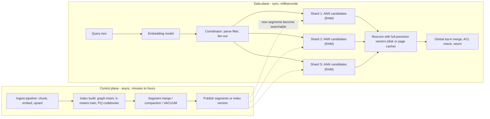

# Vector Databases and Similarity Search on Cloud

## TL;DR

Approximate nearest neighbor (ANN) search trades exactness for latency, and every managed vector service on AWS and Google Cloud is a different point on the recall vs latency vs memory vs freshness surface.
HNSW is a pointer-chasing graph bound by memory latency: it gives high recall at low ef, but it must stay resident in RAM, and its adjacency lists (about 8*m bytes per vector) become the dominant memory cost once vectors are quantized.
IVF and ScaNN-style partition indexes scan sequential buckets and are bound by memory bandwidth, which is why they compress well, run well on disk and GPU, and degrade more gracefully under heavy updates.
Filters and shard fan-out are what drive p99: a selective filter applied after a fixed-size candidate beam collapses recall, and the slowest of S shards sets the p99, so per-shard tails must be held to roughly the p(1 - 0.01/S) quantile.
Choose the engine by its binding constraint: OpenSearch or Vertex AI Vector Search for low-latency hot tiers, pgvector on Aurora or AlloyDB when transactional joins and ACLs matter, and S3 Vectors for cheap cold tiers at about 100 ms.

## Mental Model



A vector database is two systems that share a file format.
The control plane turns embeddings into a search structure: graph edges, centroids, quantization codebooks.
This is CPU-heavy and runs asynchronously, and it has its own failure modes (merge storms, build memory exhaustion, compaction lag).
The data plane walks that structure under a latency budget.
It is limited by DRAM latency for graphs, memory or disk bandwidth for partition scans, and the order statistics of fan-out for the tail.
Almost every production vector incident is one of three things: the control plane falls behind (freshness lag, too many segments), the structure falls out of the memory tier it was sized for, or a filter makes the data plane do much more or much less work than its tuning assumed.

## Internals

### The two index families and why their hardware profiles differ

HNSW (Malkov and Yashunin, IEEE TPAMI 2020, [arXiv:1603.09320](https://arxiv.org/abs/1603.09320)) builds a multi-layer proximity graph.
Each inserted element draws a top layer from an exponentially decaying distribution with normalization mL = 1/ln(M), so each layer up holds about 1/M as many nodes as the one below it.
Search runs greedily with beam width 1 through the upper layers to find an entry point, then runs a best-first beam search of width ef on layer 0, where nodes keep up to 2*M neighbors.
Neighbor selection uses a diversity heuristic: a candidate edge is kept only if the candidate is closer to the base node than to any neighbor already selected.
This keeps long-range edges and gives the graph its navigable small-world property and roughly logarithmic hop count.
The cost model has one consequence that governs everything below: each hop is a dependent random memory access to a vector and its adjacency list.
At ef = 100 and M = 16 a query evaluates up to about 3,200 candidates on layer 0, and each one is a 3 KB fp32 fetch at 768 dimensions.
That makes query time a function of DRAM latency, not FLOPs, and it means a page fault on any hop costs a disk round trip.

IVF (inverted file) indexes, formalized with product quantization by Jegou, Douze, and Schmid ("Product Quantization for Nearest Neighbor Search", IEEE TPAMI 2011), train nlist k-means centroids.
They assign each vector to its nearest centroid and, at query time, scan the nprobe closest buckets.
Bucket scans are sequential and SIMD-friendly, so the cost is bandwidth-bound: scanned bytes = (nprobe/nlist) * N * code_size.
With PQ codes of 64 bytes instead of 3 KB floats, a 100M-vector index with nlist = 10,000 and nprobe = 32 scans about 20 MB per query, which takes 1-2 ms on a modern socket (derived estimate).
The same layout is why Faiss runs IVF efficiently on GPUs (Johnson, Douze, Jegou, [arXiv:1702.08734](https://arxiv.org/abs/1702.08734)) and why IVF tolerates disk residency far better than a pointer-chasing graph.

ScaNN, which powers Vertex AI Vector Search and the AlloyDB ScaNN index, is an IVF-family design with two further mechanisms.
First, anisotropic vector quantization (Guo et al., ICML 2020, [arXiv:1908.10396](https://arxiv.org/abs/1908.10396)) weights quantization error parallel to the data point more heavily than orthogonal error.
For maximum inner product search, parallel error shifts the scores of exactly the high-scoring neighbors that matter, while orthogonal error mostly affects irrelevant points.
Second, SOAR (Sun, Guo, Kumar, NeurIPS 2023, [arXiv:2404.00774](https://arxiv.org/abs/2404.00774)) assigns each vector to a second partition chosen so the second residual is close to orthogonal to the first.
When the query misses the primary partition because of a large residual, the spilled copy is likely to be found.
The scoring kernel uses 4-bit PQ codes, so each subspace codebook has 16 entries and its distance lookup table fits in a SIMD register.
That turns code scoring into in-register shuffles instead of memory gathers, which is the main reason ScaNN partitions scan quickly.

DiskANN (Subramanya et al., NeurIPS 2019, [github.com/microsoft/DiskANN](https://github.com/microsoft/DiskANN)) is the graph answer to disk residency.
It keeps PQ-compressed vectors in RAM for navigation and full vectors plus adjacency on SSD, and it issues beam-width-wide batched reads to hide SSD latency.
OpenSearch on_disk mode follows a related split: a compressed in-memory HNSW is searched first, and the results are then rescored with full-precision vectors read from disk.

### Mechanism 1: under quantization, graph links dominate memory

The OpenSearch k-NN docs give HNSW memory as 1.1 * (4 * d + 8 * m) bytes per vector for fp32 (OpenSearch docs, as of 2026-10).
For fp16 it is 1.1 * (2 * d + 8 * m), and for byte vectors 1.1 * (d + 8 * m) (OpenSearch docs, as of 2026-10).
At d = 768 and m = 16, the fp32 vector term is 3,072 bytes and the link term is 128 bytes, so links are 4% of memory.
At 32x binary quantization the vector term drops to 96 bytes while the link term stays at 128 bytes, so links become 57% of resident memory.
So past roughly 16x compression the next memory lever is m, not more compression.
Dropping m from 16 to 8 cuts a 100M-vector 32x index from 24.6 GB to 17.6 GB per copy.
The price is lower graph connectivity and recall, which you then recover with a larger ef or oversampling.
Getting-started guides present compression_level as the only dial, but on a cost-optimized cluster it is the second dial.

### Mechanism 2: filter selectivity times beam width equals recall collapse

pgvector applies a WHERE clause after the index returns candidates.
The HNSW scan yields at most hnsw.ef_search candidates, which defaults to 40 (pgvector README, UNVERIFIED as of 2026-10).
With a tenant filter of selectivity s and filter-independent candidates, the expected number of survivors is ef_search * s.
At s = 0.1% (1,000 equal tenants) that is 0.04 rows, so LIMIT 10 usually returns zero rows rather than slow rows.
This is a silent correctness bug, not a latency bug.
pgvector 0.8.0 added iterative index scans (hnsw.iterative_scan = strict_order or relaxed_order), which keep extending the scan until enough rows pass the filter or hnsw.max_scan_tuples is reached (default 20,000) (pgvector README, UNVERIFIED as of 2026-10).
At s = 0.1% a 20,000-tuple budget yields about 20 survivors, so LIMIT 10 succeeds, but the query now does up to 500x the layer-0 work, and that is a p99 problem.
For very selective filters the right plan is often exact search: with a B-tree on tenant_id, the Postgres planner can choose a bitmap scan plus sort when it estimates the tenant is small.
That is both exact and fast.
Lucene, and therefore the OpenSearch Lucene engine, makes the same decision inside the engine.
It computes the filter bitset first, runs exact search if the bitset cardinality is at most k, and otherwise runs HNSW with a visit limit equal to that cardinality, falling back to exact search when the limit is hit.
That fallback is the right asymptotic choice, because once the graph walk would visit more nodes than pass the filter, brute force over the filtered set is cheaper.
ACORN (Patel et al., SIGMOD 2024, [arXiv:2403.04871](https://arxiv.org/abs/2403.04871)) is the research answer: build a denser graph, then at query time traverse only predicate-passing neighbors, including two-hop neighbors, so filtered subgraphs stay connected.

### Mechanism 3: fan-out order statistics set the p99

If each of S shards independently exceeds latency t with probability 0.01, the query exceeds t with probability 1 - 0.99^S.
That is 9.6% at S = 10, 18.2% at S = 20, and 63.4% at S = 100 (derived).
To hold a query-level p99 at t, each shard must hit t at quantile 0.99^(1/S), which is p99.95 at S = 20 and p99.99 at S = 100.
This is the effect Dean and Barroso described in "The Tail at Scale" (CACM 2013), and ANN makes it worse than for key-value fan-out in two ways.
First, ANN shard cost scales roughly with log(N/S), so sharding does not divide work the way it does for B-tree lookups.
S shards perform about S times the per-shard work, which is only slightly less than the work of one unsharded index.
Total CPU per query therefore grows almost linearly with S, which raises utilization and pushes every shard's queueing tail out.
Second, every shard must return its own top k, or k * oversample for rescoring, so coordinator merge cost and network bytes also scale with S.
The design rule is to use the fewest, largest shards that fit the memory tier.
Scale query throughput with replicas, which add capacity without adding fan-out, and use hedged requests or adaptive replica selection for the remaining tail.

### Mechanism 4: segment-level graphs in Lucene-based engines

OpenSearch builds one HNSW graph per Lucene segment, whether the engine is Lucene or native Faiss, and a shard query searches every segment and merges the results.
A shard with 40 small segments does 40 graph descents, so a high refresh rate during bulk ingest directly inflates query latency until merges catch up.
Merges rebuild graphs, so merge CPU is proportional to vector count times build cost, and a merge storm after a bulk load competes with query threads.
Deletes only mark documents in a live-docs bitset, and the graph still routes through dead nodes until a merge drops them.
A high delete ratio therefore wastes visits and reduces effective recall at a fixed ef.
With document replication, every replica re-indexes the documents and builds its own graphs, so indexing CPU is multiplied by (1 + replicas).
Segment replication ships built segments instead and avoids that multiplication.
OpenSearch Serverless goes further and separates indexing compute from search compute, with segments persisted to S3.
That is the right topology for vector workloads, where build cost dwarfs query cost per vector.

### Mechanism 5: replication topology in the Postgres options

In self-managed or RDS PostgreSQL, the HNSW index pages are WAL-logged and replayed on each physical replica, so index maintenance I/O repeats per replica.
In Aurora PostgreSQL and AlloyDB the index lives on the shared distributed storage volume, so it is built once and every reader sees it.
Each reader still has its own buffer cache.
A newly promoted writer or a newly added reader starts with a cold cache, and HNSW on a cold cache is a random-read storm against storage.
Aurora PostgreSQL cluster cache management (apg_ccm_enabled) keeps a designated failover reader's cache warm for exactly this reason.
See [[17-Cloud-AI-Engineering/Volume_02_AWS_Deep_Dive/Chapter_11_Amazon_Aurora_Log_Is_The_Database|Aurora: Log-Is-The-Database]] and [[17-Cloud-AI-Engineering/Volume_03_GCP_Deep_Dive/Chapter_12_AlloyDB_for_PostgreSQL_Disaggregated_Architecture|AlloyDB disaggregated architecture]].
pgvector's HNSW build is fast only while the graph fits in maintenance_work_mem.
After that, the README warns that the build slows sharply as inserts hit shared buffers, so size maintenance_work_mem and parallel maintenance workers before you build, not after.

### Service-by-service control and data plane

Amazon OpenSearch Service (provisioned) uses the k-NN plugin with the Faiss and Lucene engines.
The default engine changed from NMSLIB to Faiss in OpenSearch 2.18, and NMSLIB is deprecated in 3.0 (OpenSearch docs, as of 2026-10).
Native Faiss graphs live off the JVM heap and are capped by knn.memory.circuit_breaker.limit, which defaults to 50% of the RAM left after the heap (OpenSearch docs, as of 2026-10).
on_disk mode, introduced in 2.17, defaults to Faiss HNSW with 32x compression and rescoring enabled (OpenSearch docs, as of 2026-10).
The default oversample at 32x is 2.0 (AWS OpenSearch blog via community post, as of 2026-10).
OpenSearch Serverless vector search collections bill in OCUs, each bundling about 6 GB of RAM with compute, at $0.24 per OCU-hour in us-east-1 (AWS pricing page, as of 2026-10).

Amazon S3 Vectors has been GA since 2025-12-02.
It supports up to 2 billion vectors per index, 10,000 indexes per vector bucket, and dimensions from 1 to 4,096 (AWS docs, as of 2026-10).
AWS describes latency qualitatively: about 100 ms or less for frequently queried indexes and under one second for infrequent ones (AWS launch announcement, as of 2026-10).
AWS has not published S3 Vectors' index structure.
The frequency-dependent latency implies a cache tier in front of object storage, but that is an inference, not a documented mechanism.

Vertex AI Vector Search (formerly Matching Engine) serves ScaNN indexes.
It offers a tree-AH algorithm (partition tree plus asymmetric hashing) or brute force, and approximateNeighborsCount sets how many candidates are re-ranked with exact distances.
Filtering uses restricts: token namespaces with allow and deny lists, plus numeric restricts, evaluated during search rather than after it.
Crowding attributes cap the number of results per group, for example per document, so one long document cannot fill the top k.
Indexes update by batch rebuild or by streaming updates.
Streaming writes become searchable in seconds and are periodically compacted into a rebuilt index, which is billed as index building (Google Cloud docs, UNVERIFIED as of 2026-10).

AlloyDB for PostgreSQL supports pgvector (HNSW and IVFFlat) plus the alloydb_scann extension, which adds a ScaNN partition index with scalar quantization inside Postgres (Google Cloud docs, GA status UNVERIFIED as of 2026-10).
Aurora PostgreSQL supports pgvector, including the 0.8.x iterative-scan releases on current minor versions (AWS docs, UNVERIFIED as of 2026-10).

### Failure domain boundaries

OpenSearch provisioned domains spread primaries and replicas across two or three AZs with zone awareness.
An AZ loss halves or thirds query capacity immediately, and shard recovery copies hundreds of GB of segments across AZs before the domain regains its replica count.
Size for N-1 AZ capacity as described in [[17-Cloud-AI-Engineering/Volume_01_Cloud_Architecture_Principles/Chapter_02_Regions_Zones_and_Static_Stability|Static Stability]].
Aurora and AlloyDB storage replicate across zones below the database engine, so the engine's failure domain is the writer instance and its cache, not the index data.
S3 Vectors inherits S3's regional durability model.
Vertex AI Vector Search deployed indexes scale by replicas of the full shard set behind an endpoint.
Their zone placement is managed by the service and is not a documented customer-controlled parameter (UNVERIFIED as of 2026-10).

## Numbers to Know

| Item | Value | Source |
| --- | --- | --- |
| OpenSearch HNSW memory, fp32 | 1.1 * (4d + 8m) bytes/vector | (OpenSearch docs, as of 2026-10) |
| OpenSearch HNSW memory, fp16 / byte | 1.1 * (2d + 8m) / 1.1 * (d + 8m) bytes/vector | (OpenSearch docs, as of 2026-10) |
| OpenSearch IVF memory | 1.1 * (4 * d * N + 4 * nlist * d) bytes | (OpenSearch docs, as of 2026-10) |
| Example: 1M x 256d, m=16, fp32 | about 1.27 GB | (OpenSearch docs, as of 2026-10) |
| k-NN native memory circuit breaker default | 50% of RAM remaining after JVM heap | (OpenSearch docs, as of 2026-10) |
| on_disk mode default | Faiss HNSW, 32x compression, rescoring on | (OpenSearch docs, as of 2026-10) |
| on_disk default oversample at 32x | 2.0 | (AWS OpenSearch blog, as of 2026-10) |
| Default k-NN engine | Faiss since 2.18; NMSLIB deprecated in 3.0 | (OpenSearch docs, as of 2026-10) |
| OpenSearch Serverless OCU | about 6 GB RAM, $0.24/OCU-hour us-east-1 | (AWS pricing page, as of 2026-10) |
| S3 Vectors vectors per index | up to 2 billion (preview was 50 million) | (AWS docs, as of 2026-10) |
| S3 Vectors indexes per bucket / buckets per Region | 10,000 / 10,000 | (AWS docs, as of 2026-10) |
| S3 Vectors dimension | 1 to 4,096 | (AWS docs, as of 2026-10) |
| S3 Vectors metadata | 40 KB total, 2 KB filterable, 50 keys, 10 non-filterable keys per index | (AWS docs, as of 2026-10) |
| S3 Vectors write limits per index | 1,000 Put+Delete requests/s; 2,500 vectors/s; 500 vectors per PutVectors; 20 MiB payload | (AWS docs, as of 2026-10) |
| S3 Vectors query latency | about 100 ms or less frequent; under 1 s infrequent | (AWS launch announcement, as of 2026-10) |
| S3 Vectors storage price | $0.06 per logical GB-month | (UNVERIFIED as of 2026-10, secondary sources) |
| pgvector HNSW defaults | m = 16, ef_construction = 64, hnsw.ef_search = 40 | (pgvector README, UNVERIFIED as of 2026-10) |
| pgvector iterative scan budget | hnsw.max_scan_tuples = 20,000 | (pgvector README, UNVERIFIED as of 2026-10) |
| pgvector max indexed dimensions | 2,000 for vector, 4,000 for halfvec | (pgvector README, UNVERIFIED as of 2026-10) |
| pgvector IVFFlat sizing heuristic | lists = rows/1000 up to 1M rows, sqrt(rows) above; probes about sqrt(lists) | (pgvector README, UNVERIFIED as of 2026-10) |
| Vertex AI Vector Search shard sizes | SMALL 2 GiB, MEDIUM 20 GiB, LARGE 50 GiB | (Google Cloud docs, UNVERIFIED as of 2026-10) |
| Fan-out tail amplification | P(query > shard p99) = 1 - 0.99^S: 18.2% at S=20, 63.4% at S=100 | (derived) |
| HNSW layer-0 work at ef=100, M=16, d=768 | up to about 3,200 distance evals, about 10 MB touched, about 1 ms/core | (derived estimate) |

## AWS vs GCP Mechanism Parity

| Dimension | AWS | Google Cloud | Critical difference |
| --- | --- | --- | --- |
| Dedicated low-latency ANN service | OpenSearch Service (provisioned) and OpenSearch Serverless vector collections | Vertex AI Vector Search | OpenSearch is a general search engine with vectors per Lucene segment; Vertex is a purpose-built ScaNN serving system with no lexical engine of its own |
| Core algorithm | Faiss HNSW or IVF, Lucene HNSW | ScaNN tree-AH (partitions, anisotropic 4-bit AH, exact re-rank) or brute force | Graph (latency-bound) vs partition (bandwidth-bound); different tuning knobs (ef_search vs leaf fraction) |
| Compression | fp16, byte, Faiss PQ, Lucene SQ, binary quantization via on_disk with rescoring | AH codes built into the index; re-rank depth via approximateNeighborsCount | AWS exposes the compression level explicitly; Vertex hides codebook choices |
| Filtering | Efficient filtering: engine chooses exact or approximate from filter cardinality | Restricts (token allow/deny, numeric) evaluated in the search loop; crowding | Both avoid naive post-filtering; Vertex restricts must be declared at upsert time, OpenSearch filters are arbitrary query DSL |
| Freshness | refresh_interval (NRT, segment-based), merges in the background | Streaming updates in seconds, background compaction; or batch rebuild | Segment explosion (AWS) vs compaction cost and delay (GCP) are the analogous control-plane debts |
| Postgres-native | Aurora PostgreSQL and RDS with pgvector HNSW/IVFFlat | AlloyDB with pgvector and alloydb_scann; Cloud SQL with pgvector | AlloyDB adds a partition (ScaNN) index inside Postgres; Aurora offers pgvector only |
| Object-storage-native | S3 Vectors (GA 2025-12) | No direct equivalent; BigQuery vector indexes are the closest analytical analog (UNVERIFIED as of 2026-10) | S3 Vectors is the only first-party pay-per-query vector store on object storage |
| Scale unit | Data node or OCU; shards and replicas | Deployed index replicas of a fixed shard layout and machine type | Vertex shard count follows from shard size; OpenSearch shard count is the operator's choice and can be misjudged |
| Replication | Document or segment replication; Serverless separates indexing and search compute over S3 | Managed replicas behind an endpoint | OpenSearch document replication multiplies graph-build CPU per replica |
| Private networking | VPC domains; Serverless VPC endpoints (PrivateLink); S3 Vectors via IAM and VPC endpoints | Private Service Connect or VPC peering for index endpoints; public endpoints optional | See [[17-Cloud-AI-Engineering/Volume_04_AWS_vs_GCP_Translation/Chapter_02_Networking_and_Load_Balancing_Translation\|PrivateLink vs PSC]] |
| Perimeter | SCPs, RCPs, endpoint policies, resource policies | VPC Service Controls around aiplatform.googleapis.com and alloydb.googleapis.com | VPC-SC is an API-level perimeter; AWS requires composing several policy types |
| Hybrid lexical plus vector | OpenSearch hybrid query with score normalization processors | Vertex hybrid search with sparse plus dense embeddings | OpenSearch runs BM25 natively; Vertex expects you to supply the sparse vectors |

## Worked Example: Measuring Filtered Recall Collapse and S3 Vectors p99

### Lab A: pgvector filter collapse on a local container (zero cloud cost)

This lab reproduces Mechanism 2 on any pgvector 0.8+ build, and the result transfers directly to Aurora and AlloyDB because the planner and index access method are the same code.

```bash
docker run -d --name pgv --shm-size 2g -e POSTGRES_PASSWORD=pw -p 5432:5432 pgvector/pgvector:pg17
sleep 5
docker exec -i pgv psql -U postgres <<'SQL'
CREATE EXTENSION IF NOT EXISTS vector;
DROP TABLE IF EXISTS docs;
CREATE TABLE docs (id bigserial PRIMARY KEY, tenant int NOT NULL, embedding vector(768));
-- 100k rows, 1000 tenants => each tenant is 0.1% of rows
INSERT INTO docs (tenant, embedding)
SELECT g % 1000,
       (SELECT array_agg(random()::real) FROM generate_series(1,768) WHERE g > 0)::vector
FROM generate_series(1,100000) g;
SET maintenance_work_mem = '2GB';
CREATE INDEX docs_hnsw ON docs USING hnsw (embedding vector_cosine_ops) WITH (m = 16, ef_construction = 64);
ANALYZE docs;
SELECT embedding AS qv FROM docs WHERE id = 1 \gset
-- 1) default beam, post-filter: expect ~0 rows
SET hnsw.ef_search = 40;
SELECT count(*) AS rows_default FROM (
  SELECT id FROM docs WHERE tenant = 7 ORDER BY embedding <=> :'qv' LIMIT 10) s;
-- 2) iterative scan: expect 10 rows, at higher cost
SET hnsw.iterative_scan = relaxed_order;
SET hnsw.max_scan_tuples = 20000;
EXPLAIN (ANALYZE, BUFFERS) SELECT id FROM docs WHERE tenant = 7 ORDER BY embedding <=> :'qv' LIMIT 10;
-- 3) exact path for selective tenants: planner can now choose btree + sort
RESET hnsw.iterative_scan;
CREATE INDEX docs_tenant ON docs (tenant);
ANALYZE docs;
EXPLAIN (ANALYZE, BUFFERS) SELECT id FROM docs WHERE tenant = 7 ORDER BY embedding <=> :'qv' LIMIT 10;
SQL
docker rm -f pgv   # teardown
```

Read the three results as one story.
Query 1 returns close to zero rows because 40 candidates times 0.001 selectivity gives 0.04 expected survivors.
Query 2 returns 10 rows, but its BUFFERS line shows the scan reading thousands of index pages.
Query 3 should switch to an index scan on docs_tenant plus a sort over about 100 rows, which is exact and is usually the fastest of the three.
Uniform random vectors are a worst case for ANN structure, so absolute recall numbers here understate real embeddings, but the filter arithmetic does not depend on the data distribution.

### Lab B: S3 Vectors recall and client-observed p50/p99 (billable, cents)

Cost estimate: 20,000 vectors * (3,072 + about 64 bytes) is about 63 MB.
Storage is about $0.004 per month at $0.06/GB-month, and PUT data is under $0.02 at the secondary-source rate of $0.20/GB.
200 queries add a per-request and per-TB-processed charge whose current rates are UNVERIFIED but negligible at this scale.
Budget the lab at under $0.10 (estimate, as of 2026-10).

Budget alarm (run first):

```bash
ACCT=$(aws sts get-caller-identity --query Account --output text)
export BUCKET="vec-lab-${ACCT}-$(date +%s)"
aws budgets create-budget --account-id "$ACCT" \
  --budget '{"BudgetName":"vec-lab","BudgetLimit":{"Amount":"5","Unit":"USD"},"TimeUnit":"MONTHLY","BudgetType":"COST"}' \
  --notifications-with-subscribers '[{"Notification":{"NotificationType":"ACTUAL","ComparisonOperator":"GREATER_THAN","Threshold":80,"ThresholdType":"PERCENTAGE"},"Subscribers":[{"SubscriptionType":"EMAIL","Address":"you@example.com"}]}]'
```

Lab script (run from an EC2 instance in the same Region so the latency is service time, not WAN RTT):

```python
# s3vectors_lab.py - requires boto3 with the s3vectors client and numpy
import os, time, sys
import numpy as np
import boto3

REGION, D, N, NQ, K, TENANTS = "us-east-1", 768, 20000, 200, 10, 20
BUCKET = sys.argv[1] if len(sys.argv) > 1 else os.environ.get("BUCKET", f"vec-lab-{int(time.time())}")
INDEX = "lab-768"
s3v = boto3.client("s3vectors", region_name=REGION)
rng = np.random.default_rng(7)

# Clustered data approximates real embedding geometry better than iid noise
centers = rng.normal(size=(64, D)).astype(np.float32)
X = centers[rng.integers(64, size=N)] + 0.35 * rng.normal(size=(N, D)).astype(np.float32)
X /= np.linalg.norm(X, axis=1, keepdims=True)
tenant = rng.integers(TENANTS, size=N)

s3v.create_vector_bucket(vectorBucketName=BUCKET)
s3v.create_index(vectorBucketName=BUCKET, indexName=INDEX,
                 dataType="float32", dimension=D, distanceMetric="cosine")

# Respect the documented 500 vectors/call and 2,500 vectors/s/index limits
for i in range(0, N, 500):
    batch = [{"key": str(j), "data": {"float32": X[j].tolist()},
              "metadata": {"tenant": f"t{tenant[j]}"}} for j in range(i, min(i + 500, N))]
    s3v.put_vectors(vectorBucketName=BUCKET, indexName=INDEX, vectors=batch)
    time.sleep(0.25)  # ~2,000 vectors/s, below the per-index ceiling

lat, rec = [], []
Qv = centers[rng.integers(64, size=NQ)] + 0.35 * rng.normal(size=(NQ, D)).astype(np.float32)
Qv /= np.linalg.norm(Qv, axis=1, keepdims=True)
for qi in range(NQ):
    t = f"t{qi % TENANTS}"
    mask = np.where(tenant == qi % TENANTS)[0]
    truth = set(mask[np.argsort(-(X[mask] @ Qv[qi]))[:K]].tolist())
    t0 = time.perf_counter()
    r = s3v.query_vectors(vectorBucketName=BUCKET, indexName=INDEX, topK=K,
                          queryVector={"float32": Qv[qi].tolist()},
                          filter={"tenant": {"$eq": t}}, returnDistance=True)
    lat.append((time.perf_counter() - t0) * 1000)
    got = {int(v["key"]) for v in r["vectors"]}
    rec.append(len(got & truth) / K)

print(f"bucket={BUCKET} recall@{K}={np.mean(rec):.3f} "
      f"p50={np.percentile(lat,50):.1f}ms p99={np.percentile(lat,99):.1f}ms")
```

Teardown (exact):

```bash
aws s3vectors delete-index --vector-bucket-name "$BUCKET" --index-name lab-768 --region us-east-1
aws s3vectors delete-vector-bucket --vector-bucket-name "$BUCKET" --region us-east-1
aws budgets delete-budget --account-id "$ACCT" --budget-name vec-lab
```

Run the query loop twice.
The first pass hits a cold index and the second a warm one, which makes the documented frequency-dependent latency profile visible in your own p99.

### Capacity sizing: 100M vectors, 768d, 2,000 QPS, p99 under 50 ms, recall@10 at least 0.95

Step 1, raw bytes: 100e6 * 768 * 4 = 307 GB of fp32 per copy.

Step 2, OpenSearch in-memory fp32 HNSW, m = 16: 1.1 * (3,072 + 128) = 3,520 B/vector, which is 352 GB per copy and 704 GB with one replica.
On a 128 GiB node with a 32 GiB heap, the 50% breaker leaves about 48 GiB (51.5 GB) of graph memory per node.
704 / 51.5 gives 13.7, so the cluster needs at least 14 data nodes.
Plan 18 to keep breaker utilization near 75% and to survive one AZ in a three-AZ layout.
The cluster is memory-bound: 20 shards * about 1 ms CPU each is about 20 ms of core time per query, and 2,000 QPS needs about 40 busy cores, a small fraction of 18 * 16 vCPU.

Step 3, OpenSearch on_disk 32x: 1.1 * (96 + 128) = 246 B/vector, which is 24.6 GB per copy and 49 GB with a replica, so RAM stops being the constraint.
The bottleneck moves to rescoring reads: each shard reads k * oversample = 20 full vectors per query.
At 20 shards that is 400 random 3 KB reads per query and 800,000 reads/s at 2,000 QPS if nothing is cached.
Cut shards to 4 (80 reads per query, yielding 160,000 reads/s cluster-wide at 2,000 QPS), use instance-store NVMe-backed nodes, and give the hot fraction of the 307 GB full-precision set room in the page cache.
This option is cheaper only if you size for IOPS, which is what the "1.3 TB to 66 GB" headline numbers leave out.

Step 4, S3 Vectors: 100M * about 3.2 KB is about 317 GB, or about $19/month of storage at $0.06/GB-month (UNVERIFIED rate).
It fails the 50 ms p99 requirement against a documented profile of about 100 ms.
At 2,500 vectors/s per index, the initial load into one index takes 40,000 s, about 11 hours.
Use it as the cold tier or for offline and batch retrieval.

Step 5, Aurora or AlloyDB pgvector: the fp32 HNSW index alone is about 330 GB or more, plus a 310 GB heap.
Low latency requires the index to stay in the buffer cache, which points to the largest memory-optimized instances.
An expression index on embedding::halfvec(768) halves the index size at a small recall cost, and alloydb_scann with SQ8 shrinks it further on GCP.

Step 6, Vertex AI Vector Search: 307 GB at an UNVERIFIED 50 GiB LARGE shard size gives about 6 to 7 shards per replica, and the replica count follows from QPS per replica measured in a load test.
Price it as replicas * shards * machine-hour plus index-build GiB; current rates are UNVERIFIED as of 2026-10 and must come from the pricing page.

## Failure Modes and Pitfalls

Silent empty results from post-filtering, as reproduced in Lab A, are the most common correctness bug in pgvector RAG systems.
They look like poor model quality rather than an infrastructure fault, and they surface only for small tenants.
Monitor result count per query and alert when the ratio of returned rows to the LIMIT falls below 1.

When graphs fall out of their memory tier, latency jumps from milliseconds to disk-bound seconds.
In OpenSearch, hitting the native memory circuit breaker makes the cluster refuse graph loads, so k-NN queries fail rather than slow down.
Watch the k-NN stats for graph memory usage and cache evictions, and treat any steady eviction rate as a capacity alarm.

A refresh-rate segment explosion follows bulk ingest at a 1 s refresh interval.
It creates many small segments, each with its own graph, and multiplies query work.
Set refresh_interval to -1 or to tens of seconds during backfills, then force-merge before serving traffic.
Delete-heavy workloads (GDPR erasure, document re-chunking) leave tombstones that the graph still routes through, which lowers recall at a fixed ef.
Track the deleted-docs ratio per shard and merge or reindex on a threshold.

IVF trained on unrepresentative data assigns new vectors to stale centroids.
Buckets become imbalanced, and nprobe no longer covers the same fraction of the data, so recall drifts down over months with no deploy to blame.
pgvector warns that IVFFlat should be built after the table has data, and the same logic applies to any trained index after an embedding-distribution shift.
Re-train on a schedule and monitor recall against a brute-force sample.

Quantization recall varies by dataset.
The OpenSearch k-NN RFC on asymmetric distance computation reports that 32x on-disk recall is above 0.9 on some datasets but poor on others ([opensearch-project/k-NN#2714](https://github.com/opensearch-project/k-NN/issues/2714)).
Never accept a compression level without measuring recall on your own embeddings and query distribution.

A cold cache after failover or scale-out hits Aurora and AlloyDB readers and new OpenSearch replicas alike.
A newly promoted node answers HNSW queries from storage until its working set is cached, and that p99 spike can trigger client retries that amplify the load.
Pair warm-standby features (Aurora cluster cache management, pre-warming queries) with retry budgets from [[17-Cloud-AI-Engineering/Volume_07_Reliability_and_SRE/Chapter_03_Resilient_Communication_Retries_Jitter_and_Circuit_Breakers|Retries, Jitter, and Circuit Breakers]].

Write throttling cascades through ingestion.
S3 Vectors enforces 1,000 write requests/s and 2,500 vectors/s per index (AWS docs, as of 2026-10).
A re-embedding job that ignores this gets throttled responses, and naive retries turn throttling into a sustained backlog.
Shard writes across indexes or rate-limit the producer, as described in [[17-Cloud-AI-Engineering/Volume_07_Reliability_and_SRE/Chapter_02_Load_Shedding_Backpressure_and_Admission_Control|Load Shedding and Admission Control]].

The engine default changed in OpenSearch 2.18 from NMSLIB to Faiss, and cosinesimil vectors are now normalized automatically, so retrieved stored vectors differ from their inputs (OpenSearch docs, as of 2026-10).
In 3.0, creating a new index on NMSLIB fails with a mapper parsing exception, which breaks client libraries that still default to NMSLIB.

An embedding model upgrade makes the whole index obsolete at once, because vectors from different models are not comparable.
Mixing them in one index produces nonsense neighbors without errors.
Version the index by model ID and cut over atomically through an alias.

Noisy neighbors in shared indexes are a multi-tenant problem: one tenant's bulk upsert triggers merges that stall every tenant's queries on the same shards.
Cell or shuffle-shard large tenants as described in [[17-Cloud-AI-Engineering/Volume_01_Cloud_Architecture_Principles/Chapter_03_Cell_Based_Architecture_and_Shuffle_Sharding|Cell-Based Architecture and Shuffle Sharding]].

I found no public hyperscaler post-incident review specific to a managed vector search outage as of 2026-10.
The failure dynamics above match the general overload and tail-latency patterns in "The Tail at Scale" and in the AWS Builders' Library articles on load shedding and retries, which are listed under Further Reading.
See also [[17-Cloud-AI-Engineering/Volume_07_Reliability_and_SRE/Chapter_07_Anatomy_of_Major_Cloud_Outages|Anatomy of Major Cloud Outages]].

## Security and Cost Angles

Embeddings are sensitive data.
Morris et al. ("Text Embeddings Reveal (Almost) As Much As Text", EMNLP 2023, [arXiv:2310.06816](https://arxiv.org/abs/2310.06816)) recovered most of the input text from sentence embeddings by iterative inversion.
Classify a vector index at the same level as the source documents, and apply the same KMS keys, retention rules, and erasure workflows to it.

Enforce access control inside the engine, not in application post-processing.
Post-filtering ACLs in the app has the same recall-collapse arithmetic as Mechanism 2, and it also leaks timing and count side channels.
Use OpenSearch document-level security or filters bound to the caller's identity, Vertex restricts populated from ACL tokens at upsert time, or Postgres row-level security on the table that carries the vectors.

Scope IAM to the data-plane verbs.
For S3 Vectors, separate writer roles (s3vectors:PutVectors, s3vectors:DeleteVectors) from reader roles (s3vectors:QueryVectors).
Queries that use filter or returnMetadata also require s3vectors:GetVectors (UNVERIFIED as of 2026-10).
For Vertex AI, grant index-endpoint query permissions separately from index administration.

Use envelope encryption with customer-managed keys everywhere.
OpenSearch domains and Serverless collections use AWS KMS keys, and Serverless collections that share an encryption key can share OCUs.
S3 Vectors buckets use SSE-S3 or SSE-KMS.
Aurora uses KMS at the cluster level, and AlloyDB and Vertex AI support CMEK.
See [[17-Cloud-AI-Engineering/Volume_08_Security_Identity_and_the_Data_Perimeter/Chapter_04_Encryption_Key_Hierarchies_and_Envelope_Encryption|Encryption Key Hierarchies]].

Keep private network boundaries.
Use OpenSearch VPC domains or Serverless VPC endpoints, and on GCP use Private Service Connect for Vertex index endpoints and AlloyDB.
Put aiplatform.googleapis.com and alloydb.googleapis.com inside a VPC Service Controls perimeter so a stolen credential cannot read the index from outside.
See [[17-Cloud-AI-Engineering/Volume_08_Security_Identity_and_the_Data_Perimeter/Chapter_06_Constructing_an_Impenetrable_Data_Perimeter|Constructing a Data Perimeter]] and [[17-Cloud-AI-Engineering/Volume_03_GCP_Deep_Dive/Chapter_03_VPC_Service_Controls_Security_Perimeters|VPC Service Controls]].

Unit-economics levers, in descending order of usual impact:
1. Dimension reduction with Matryoshka-trained embeddings (Kusupati et al., NeurIPS 2022), where truncating 768 to 256 dimensions cuts every byte term by 3x.
2. fp16 or int8 vectors.
3. Binary quantization with rescoring, sized for the IOPS it moves onto disk.
4. Lower m once quantized, per Mechanism 1.
5. Fewer shards with more replicas, per Mechanism 3.
6. Hot and cold tiering, with S3 Vectors as the cold tier and OpenSearch or Vertex as the hot tier.

Express cost as dollars per million queries at the recall SLO plus dollars per GB-month resident.
A design that looks cheap on storage can be expensive per query, and the reverse is also true.
See [[17-Cloud-AI-Engineering/Volume_09_FinOps_and_Cloud_Economics/Chapter_01_Cloud_Billing_Models_and_Unit_Cost_Allocation|Unit Cost Allocation]].

## Interview Questions and Model Answers

### Question 1 (L5 - Senior)

A RAG feature on Aurora PostgreSQL with pgvector HNSW returns zero or two documents for some customers, and full results for others. What is happening, and how do you fix it?

#### Model Answer

The query is almost certainly `WHERE tenant_id = $1 ORDER BY embedding <=> $2 LIMIT 10` with the filter applied after the HNSW scan.
The scan yields at most hnsw.ef_search candidates, 40 by default, and only the fraction s belonging to the tenant survives.
Expected survivors are 40 * s, so a tenant holding 0.1% of rows gets 0.04 rows on average.
Large tenants look fine, which is why the bug appears to depend on the customer.
I would confirm it with EXPLAIN ANALYZE, which shows the HNSW index scan with a filter that removes most candidates, and by plotting result count against tenant size.
Fixes, in order of preference:
1. For small tenants, let the planner take the exact path: a B-tree on tenant_id gives a bitmap scan plus sort over a few hundred rows, which is exact and sub-millisecond.
2. For mid-size tenants, enable hnsw.iterative_scan (pgvector 0.8+) with a bounded hnsw.max_scan_tuples so the scan continues until LIMIT is met, accepting higher worst-case latency.
3. For the largest tenants, partition the table by tenant tier or use partial indexes, so each graph only contains rows that pass the filter.
I would also add a monitor on rows returned divided by LIMIT, because this failure produces no errors.

#### Follow-up Interviewer Question

The filter is `published_at > now() - interval '7 days'` rather than tenant ID, and recent documents are also semantically clustered. Does your arithmetic still hold?

### Question 2 (L5 - Senior)

Size an Amazon OpenSearch Service cluster for 100 million 768-dimension vectors with one replica, and name the two biggest cost levers.

#### Model Answer

Use the documented estimate of 1.1 * (4d + 8m) bytes per vector.
At d = 768 and m = 16 that is 3,520 bytes, 352 GB per copy, and 704 GB with one replica.
Native graphs live off-heap and are capped by the k-NN circuit breaker at 50% of non-heap RAM by default.
A 128 GiB node with a 32 GiB heap therefore holds about 48 GiB of graphs, which means at least 14 nodes and about 18 with headroom and AZ-loss tolerance.
CPU is not the constraint at moderate QPS, so this cluster is memory-bound.
The first lever is vector precision: fp16 cuts the vector term in half, and on_disk 32x binary quantization drops resident memory to about 246 bytes per vector.
At 32x, more than half the remaining memory is graph links, so the second lever is m, but lowering m costs recall that you must win back with ef or oversampling.
The catch with on_disk is that rescoring reads k * oversample full vectors per shard per query from disk, so the bottleneck moves from RAM to random IOPS.
I would cut the shard count and use NVMe-backed nodes before declaring the savings real.

#### Follow-up Interviewer Question

Indexing CPU doubled when you added the replica, even though query traffic did not change. Why, and what replication setting addresses it?

### Question 3 (L6 - Staff)

The search tier fans out to 40 shards, per-shard p99 is 15 ms, and the end-to-end p99 is 60 ms. Explain the gap, and design the fix without simply adding hardware.

#### Model Answer

The query-level latency is the maximum over 40 shard latencies plus merge time.
If each shard exceeds 15 ms 1% of the time, a query exceeds it with probability 1 - 0.99^40, about 33%, so the 15 ms shard p99 is roughly the query p67.
The query p99 corresponds to each shard's p99.975, which is where GC pauses, merges, and page faults live.
Second, ANN cost per shard scales roughly with log of shard size, so 40 shards do close to 40 times the work of one index.
That raises CPU utilization and pushes every shard's queueing tail out.
The fix starts with topology:
1. Consolidate to the fewest shards that fit the memory tier, for example 8, which reduces both the order-statistic penalty and the total CPU per query.
2. Scale throughput with replicas, because replicas add capacity without adding fan-out.
3. Enable adaptive replica selection so the coordinator routes away from slow copies.
4. Add hedged requests after the per-shard p95, with a budget of a few percent extra load so hedging cannot become a retry storm.
5. Set per-shard timeouts that return partial results, and log the partial-result rate as an SLI, because a RAG answer built from 39 of 40 shards is usually acceptable and a timeout is not.
6. Remove tail sources at the root: schedule force-merges off-peak, pin graphs in memory, and keep the merge thread pool from starving search.
I would validate the change by measuring per-shard latency at p99.9 and query latency at p99 before and after, not just averages.

#### Follow-up Interviewer Question

Consolidating to 8 shards makes each shard 5 times larger, and recovery after a node loss now copies much more data per shard. How do you reason about the change in MTTR and the cross-AZ transfer cost?

### Question 4 (L6 - Staff)

You need to serve 30,000 upserts per second and right-to-erasure deletes on 500 million vectors with p99 under 40 ms. HNSW or a partition index, and on which service?

#### Model Answer

The binding constraint is update rate and deletes, not query latency.
HNSW insert cost is a full beam search plus neighbor rewiring per vector, so 30,000 inserts per second is a large sustained CPU load.
In Lucene-based engines, each refresh also creates segments whose graphs must be merged and rebuilt, so build CPU is paid more than once.
HNSW deletes are tombstones the graph still traverses, so a delete-heavy stream degrades recall until merges or vacuums run, and pgvector HNSW vacuum is notably expensive.
A partition index handles this better: an insert is a nearest-centroid assignment plus an append to a bucket, and a delete removes an entry from a bucket.
Neither touches a global structure, at the cost of periodic re-training when the distribution drifts.
On GCP, Vertex AI Vector Search streaming updates on a ScaNN index fit this shape, and the background compaction cost must be budgeted as index-building spend.
On AWS, OpenSearch with segment replication, a refresh interval of tens of seconds, and indexing separated from search (as in Serverless) is the managed path.
I would make erasure a two-step protocol: an immediate filter-level tombstone so deleted IDs can never be returned, then physical removal at compaction, with an audit job that proves removal within the SLA.
Whichever engine I pick, I would load-test the steady state with merges and compactions running, because an empty-cluster benchmark hides exactly the costs this workload produces.

#### Follow-up Interviewer Question

Legal requires deleted vectors to be physically unrecoverable within 72 hours, including from snapshots and replicas. What changes in your design?

### Question 5 (L6 - Staff)

How do you define and enforce a recall SLO in production, where ground truth is unknown?

#### Model Answer

Recall must be measured against exact search, so I would run a shadow brute-force evaluator.
It samples a small fraction of production queries, replays them with the same filters against an exact scan of the same index snapshot, and computes recall@k.
For large indexes the exact scan runs as a batch job, for example a GPU Faiss flat index over an exported snapshot, so it never touches the serving path.
The SLI is the fraction of sampled queries with recall@10 at or above a threshold, sliced by tenant size, filter selectivity, and shard.
The slices matter because recall failures concentrate in selective filters and recently written data.
I would gate every index parameter change, quantization change, and engine upgrade on this evaluator in a canary, and treat recall regressions like latency regressions in the error budget, as in [[17-Cloud-AI-Engineering/Volume_07_Reliability_and_SRE/Chapter_01_SLIs_SLOs_and_Error_Budget_Engineering|SLIs, SLOs, and Error Budgets]].
I would keep ANN recall separate from end-to-end retrieval quality judged by labels or LLM judges.
ANN recall isolates the infrastructure, while downstream relevance conflates it with the embedding model and the chunking.

#### Follow-up Interviewer Question

The evaluator shows recall dropping by 4 points over six months with no deploys. List the candidate mechanisms and how you would discriminate between them.

### Question 6 (L7+ - Principal)

The company is replacing its embedding model, which means re-embedding 2 billion chunks across AWS and GCP. Design the migration and estimate its dominant costs and risks.

#### Model Answer

Vectors from different models are not comparable, so this is a full index rebuild with an atomic cutover, not a rolling update.
The plan:
1. Version every index by model ID, so the read path resolves an alias to a specific index version and never queries mixed vectors.
2. Backfill by re-embedding from the source-of-truth chunk store, not from the old index.
The dominant costs are embedding inference, then index-build compute, then a period of double storage.
Throttle the backfill against write ceilings such as S3 Vectors' 2,500 vectors per second per index, or OpenSearch merge capacity, and run it as a priority-lowered batch tier so it cannot starve production.
3. Dual-write new and changed documents to both versions from the moment the backfill starts, so the new index does not need a catch-up phase.
4. Shadow-read: send sampled production queries to both versions and compare recall against exact search and downstream relevance metrics, sliced by tenant and language.
5. Cut over by alias per cell or tenant tier with an instant rollback, and keep the old version until the error budget for the new one is proven.
The capacity math is the gate.
2 billion vectors at 768 fp32 dimensions is about 6 TB raw per copy, and two versions doubles the hot tier for weeks.
Choosing a smaller dimension or a quantized format for the new index can make the migration cost-neutral, and I would push the model team toward a Matryoshka-capable model for that reason.
The principal-level risks are organizational: every consumer that cached raw vectors, such as classifiers, deduplication, or clustering jobs, breaks silently.
I would inventory them first and make model ID a required field in every vector payload.

#### Follow-up Interviewer Question

Finance asks whether to keep both clouds' vector tiers or consolidate onto one during the migration. Lay out the decision with egress, failure-domain, and lock-in costs.

### Question 7 (L7+ - Principal)

When would you put S3 Vectors under OpenSearch as a cold tier, and when would you refuse to?

#### Model Answer

S3 Vectors turns vector storage into a per-GB and per-query cost with no provisioned floor.
It scales to 2 billion vectors per index with about 100 ms latency for frequently queried indexes and sub-second latency for infrequent ones.
That makes it right for long-tail tenants, archival corpora, batch and agentic background retrieval, and evaluation snapshots, where latency budgets are in the hundreds of milliseconds and most data is rarely queried.
OpenSearch, or Vertex AI Vector Search on GCP, holds the hot tier: tenants or partitions with steady QPS, tight p99, hybrid lexical scoring, or rich filters.
A promotion controller moves an index up when its query rate crosses the break-even point, where per-query charges exceed the amortized cost of resident memory, and demotes it on decay.
I would refuse the tiering when the product's p99 budget for retrieval is under the documented cold-path latency.
I would also refuse when filters exceed the 2 KB filterable-metadata limit, when the workload needs lexical or hybrid scoring in the same query, or when write rates exceed per-index ceilings without heavy write sharding.
Each of those turns the cold tier into an availability or correctness risk rather than a saving.
The architectural guardrail is static stability: if the promotion controller fails, both tiers must keep serving their current assignments.
The controller is control plane and must never sit in the query path, per [[17-Cloud-AI-Engineering/Volume_01_Cloud_Architecture_Principles/Chapter_04_Control_Plane_vs_Data_Plane_Separation|Control Plane vs Data Plane Separation]].

#### Follow-up Interviewer Question

A cold-tier tenant suddenly runs a 500 QPS campaign, and its p99 jumps to 900 ms before promotion completes. What should the system do in the first five minutes?

## Further Reading

- [Malkov and Yashunin, HNSW (arXiv:1603.09320)](https://arxiv.org/abs/1603.09320) - the layer distribution, neighbor-selection heuristic, and complexity argument behind every HNSW engine discussed here.
- [Jegou, Douze, Schmid, Product Quantization for Nearest Neighbor Search (IEEE TPAMI 2011)](https://ieeexplore.ieee.org/document/5432202) - IVFADC and asymmetric distance computation, the basis of IVF-PQ and of ScaNN's AH scoring.
- [Guo et al., Anisotropic Vector Quantization / ScaNN (arXiv:1908.10396)](https://arxiv.org/abs/1908.10396) - why score-aware quantization beats reconstruction loss for inner-product search; the core of Vertex AI Vector Search.
- [Sun, Guo, Kumar, SOAR (arXiv:2404.00774)](https://arxiv.org/abs/2404.00774) - orthogonality-amplified spilling, the mechanism that rescues partition-boundary misses in modern ScaNN.
- [Microsoft DiskANN repository and papers](https://github.com/microsoft/DiskANN) - the reference design for SSD-resident graph indexes, needed to judge any on-disk vector mode.
- [Patel et al., ACORN (arXiv:2403.04871)](https://arxiv.org/abs/2403.04871) - predicate-agnostic filtered graph search, the research state of the art for Mechanism 2.
- [Johnson, Douze, Jegou, Billion-scale similarity search with GPUs (arXiv:1702.08734)](https://arxiv.org/abs/1702.08734) and [The Faiss library (arXiv:2401.08281)](https://arxiv.org/abs/2401.08281) - the engine inside OpenSearch's default k-NN path and its design trade-offs.
- [Dean and Barroso, The Tail at Scale](https://research.google/pubs/the-tail-at-scale/) - the fan-out order-statistics argument and hedged-request mitigations applied in Mechanism 3.
- [ANN-Benchmarks (Aumuller et al., arXiv:1807.05614)](https://arxiv.org/abs/1807.05614) - the methodology for recall vs QPS curves; read it before trusting any vendor benchmark.
- [Morris et al., Text Embeddings Reveal (Almost) As Much As Text (arXiv:2310.06816)](https://arxiv.org/abs/2310.06816) - the reason vector indexes are sensitive data.
- [pgvector README](https://github.com/pgvector/pgvector) - authoritative parameters for HNSW, IVFFlat, iterative scans, and build memory behavior on Aurora, AlloyDB, and Cloud SQL.
- [OpenSearch k-NN methods and engines](https://docs.opensearch.org/latest/mappings/supported-field-types/knn-methods-engines/) and [disk-based vector search](https://docs.opensearch.org/latest/vector-search/optimizing-storage/disk-based-vector-search/) - memory formulas, the circuit breaker, and on_disk rescoring semantics.
- [OpenSearch blog: Reduce costs with disk-based vector search](https://opensearch.org/blog/reduce-cost-with-disk-based-vector-search/) - the design rationale for online binary quantization and two-phase rescoring.
- [Amazon S3 Vectors limitations](https://docs.aws.amazon.com/AmazonS3/latest/userguide/s3-vectors-limitations.html) - the hard ceilings that decide whether S3 Vectors fits a workload.
- [Vertex AI Vector Search overview](https://cloud.google.com/vertex-ai/docs/vector-search/overview) - index types, restricts, crowding, update modes, and endpoint networking.
- [AWS Builders' Library: Using load shedding to avoid overload](https://aws.amazon.com/builders-library/using-load-shedding-to-avoid-overload/) and [Timeouts, retries, and backoff with jitter](https://aws.amazon.com/builders-library/timeouts-retries-and-backoff-with-jitter/) - the overload discipline that keeps vector-tier tail spikes from cascading.
- Next chapter: [[17-Cloud-AI-Engineering/Volume_12_AI_Applications_MLOps_and_Data_Platforms/Chapter_02_Enterprise_Retrieval_Augmented_Generation_Architecture|Enterprise Retrieval-Augmented Generation Architecture]]; design drill: [[17-Cloud-AI-Engineering/Volume_14_Staff_Plus_Interview_Arena/Chapter_03_Design_Billion_Scale_Enterprise_RAG|Billion-Scale Real-Time Enterprise RAG]]; reference numbers: [[17-Cloud-AI-Engineering/Appendices/Appendix_C_Limits_Quotas_and_Thresholds_Matrix|Limits and Quotas Matrix]].
