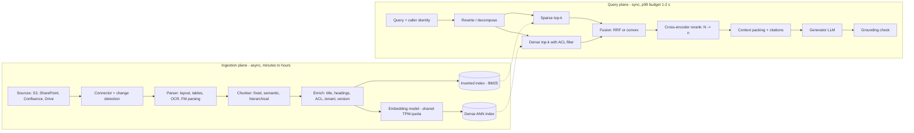

# Enterprise Retrieval-Augmented Generation Architecture

## TL;DR

- Enterprise RAG is two decoupled systems: an asynchronous ingestion plane (connect, parse, chunk, embed, index) and a synchronous query plane (rewrite, retrieve, fuse, rerank, pack, generate), and almost every production incident lives at a coupling point between them - embedding model version, ACL metadata freshness, or a shared embedding quota.
- Chunking is an irreversible information-loss decision made at ingestion time; chunk size trades retrieval precision against answer context, and changing it later means a full re-parse and re-embed of the corpus.
- Hybrid retrieval exists because dense bi-encoders and BM25 fail on disjoint query classes (paraphrase versus identifiers, codes, and rare terms); the fusion function, not either retriever, decides which failure you keep, and fused scores are ordinal and per-query, never thresholdable across queries.
- A cross-encoder reranker is the highest-leverage quality lever and the most expensive per-query component: its cost scales with candidates x (query + chunk) tokens, so the candidate depth N is a latency and dollar knob, not a free recall knob.
- Permission-aware retrieval is a recall problem disguised as a security problem: post-filtering an ANN top-k by ACL collapses to roughly k x selectivity results, so tenancy and ACL design must be decided with the index topology, not bolted onto the query.

## Mental Model



The ingestion plane is a batch pipeline whose output is two derived indexes plus a metadata store, and it can be minutes to days behind the source of truth.
The query plane is a latency-bound fan-out that reads those indexes, so it only ever sees the world as of the last successful sync, with the chunk boundaries, embedding model, and ACL snapshot that were in force at that moment.
Thinking of the indexes as materialized views of the source systems makes the failure modes obvious: staleness, view-definition drift (a new embedding model is a new view definition), and authorization that was evaluated at view-build time instead of read time.
Everything after fusion is a funnel that trades compute for precision: cheap recall-oriented retrieval over millions of chunks, expensive precision-oriented reranking over tens, and the most expensive step, generation, over a handful.

## Internals

### Control plane versus data plane

On AWS, `bedrock-agent` is the control plane (create knowledge base, data source, start ingestion job) and `bedrock-agent-runtime` is the data plane (`Retrieve`, `RetrieveAndGenerate`, `Rerank`), which is the same split described in [[17-Cloud-AI-Engineering/Volume_01_Cloud_Architecture_Principles/Chapter_04_Control_Plane_vs_Data_Plane_Separation|Control Plane vs Data Plane Separation]].
An ingestion job is control-plane-initiated but data-plane-heavy: it reads every changed object, calls a parser and an embedding model, and writes to the vector store, so it consumes the same model quotas the query path uses.
Amazon Bedrock now ships two knowledge base types (AWS What's New, as of 2026-10).
A Managed Knowledge Base, generally available since 2026-06-17, owns ingestion, storage, and retrieval, offers six native connectors (Amazon S3, SharePoint, Confluence, Google Drive, OneDrive, Web Crawler), and provides hybrid search, document ranking, and agentic retrieval (AWS What's New, as of 2026-10).
A customer-managed knowledge base keeps the older model, in which you bring the vector store: OpenSearch Serverless, OpenSearch managed clusters, Aurora PostgreSQL with pgvector, Amazon S3 Vectors, Neptune Analytics for GraphRAG, Pinecone, Redis Enterprise Cloud, or MongoDB Atlas (AWS Prescriptive Guidance as summarized by Atlan, as of 2026-10).
The Managed type uses AWS-managed internal storage only, so a requirement to co-locate vectors with an existing OpenSearch or Aurora estate forces the customer-managed type (AWS Builder Center community post, as of 2026-10).
On Google Cloud, Vertex AI was rebranded on 2026-04-22 as Gemini Enterprise Agent Platform, Vertex AI Search became Agent Search, Vertex AI Vector Search became Vector Search on Agent Platform, Vector Search 2.0 became Agent Retrieval, and RAG Engine kept its name (Google Cloud docs, as of 2026-10).
Agent Search is the managed end-to-end retrieval and answer system and exposes DIY grounding APIs (ranking, check grounding) usable from a custom pipeline (Google Cloud product page, as of 2026-10).
RAG Engine is the closer analogue of a customer-managed Bedrock KB, where you pick the corpus backend and own more of the pipeline.
Both vendors publish little about the internals of their managed retrieval stacks, so the rest of this section describes the mechanisms you must reason about regardless of who operates them.

### Parsing: where most quality is lost before retrieval starts

A PDF is a set of positioned glyphs, not a sequence of paragraphs, so text extraction must reconstruct reading order, detect multi-column layouts, and decide what a table cell belongs to.
Naive extraction serializes a table row-major without headers, which yields chunks such as "Q3 14 30 EU" that no embedding model can map back to "refund window in days by region".
Layout-aware and foundation-model parsers convert tables to Markdown or HTML with headers repeated, which costs model tokens per page at ingestion but is the single largest quality lever for document-heavy corpora.
Bedrock Knowledge Bases added foundation-model parsing alongside its default parser in 2024 (AWS ML blog, 2024), and the Managed type advertises multimodal parsing of documents, images, audio, and video (Atlan summary of AWS docs, as of 2026-10).
The operational trade-off is that FM parsing makes ingestion cost and duration proportional to page count times model latency, and it introduces a nondeterministic stage, so two ingestions of the same file can produce different chunks and therefore different retrieval results.

### Chunking mechanics

Bedrock default chunking splits content into chunks of approximately 300 tokens while honoring sentence boundaries (AWS docs, as of 2026-10).
Fixed-size chunking takes a maximum token count and an overlap percentage, and "no chunking" treats each document as one chunk, which is only viable if documents are already small or you pre-chunk them yourself (AWS docs, as of 2026-10).
Semantic chunking takes a maximum token count, a buffer size, and a breakpoint percentile threshold (AWS ML blog, as of 2026-10).
Mechanically, a semantic chunker embeds each sentence together with its buffer of neighbors, computes the cosine distance between consecutive windows, and cuts where the distance exceeds the chosen percentile of all distances in the document.
The non-obvious consequence is that semantic chunking performs one embedding call per sentence window during ingestion, so its ingestion embedding cost is a multiple of fixed-size chunking even though the stored vector count is similar.
Because the threshold is a percentile of the document's own distance distribution, every document is cut into roughly the same fraction of segments regardless of how topically uniform it is, which over-splits homogeneous documents and under-splits heterogeneous ones.
Hierarchical chunking stores small child chunks for matching and larger parent chunks for context, and at retrieval time child hits are replaced by their parent (AWS docs, as of 2026-10).
Because children that share a parent collapse into one parent, a request for `numberOfResults = 10` can return fewer than ten results, which silently shrinks the candidate set handed to a reranker or an evaluator (AWS docs via AWS Builder Center, as of 2026-10).
Custom chunking through a Lambda transformation step is available for pipelines that need domain-aware splitting, such as legal clause boundaries or code symbol boundaries (UNVERIFIED in this session).

The chunk-size trade-off has three forces.
Smaller chunks give sharper embeddings, because a bi-encoder compresses the whole chunk into one vector and averaging over many topics blurs the vector toward the corpus centroid.
Larger chunks preserve the context that makes a passage interpretable, such as the heading saying which product version a paragraph describes.
Every chunk you retrieve also costs generator input tokens and reranker compute, so chunk size multiplies directly into query-path cost.
Contextual chunk enrichment resolves part of the tension: prepend a short document-level context (title, section path, or an LLM-generated situating sentence) to each chunk before embedding and BM25 indexing.
Anthropic reported that contextual embeddings plus contextual BM25 reduced top-20 retrieval failures by 49 percent, and by 67 percent when combined with reranking, on their evaluation sets ([Anthropic, 2024](https://www.anthropic.com/news/contextual-retrieval)).
The cost is one LLM call per chunk at ingestion, which prompt caching of the shared document prefix makes affordable, and a re-enrichment every time the document changes.

### Sparse retrieval: BM25 and learned sparse

BM25 scores a document as a sum over query terms of IDF(t) x tf x (k1 + 1) / (tf + k1 x (1 - b + b x len / avglen)), with typical k1 near 1.2 and b near 0.75 ([Robertson and Zaragoza, 2009](https://dl.acm.org/doi/10.1561/1500000019)).
The IDF term is what makes BM25 indispensable in enterprise corpora: an error code, a part number, or a customer ID is rare, so a single exact match dominates the score.
Dense encoders tokenize "PN-88213" into subword fragments whose embedding is close to every other part number, so they rank all part numbers as near-equals; this is the canonical query class where dense-only RAG fails.
The BEIR benchmark showed that BM25 remains a strong zero-shot baseline and that many dense retrievers trained on MS MARCO underperform it out of domain ([Thakur et al., NeurIPS 2021 Datasets and Benchmarks](https://arxiv.org/abs/2104.08663)).
Learned sparse models such as SPLADE predict term weights and expansion terms over the vocabulary, keeping inverted-index serving while adding some semantic matching ([Formal et al., SIGIR 2021](https://arxiv.org/abs/2107.05720)).
BM25 scores are unbounded and query-dependent: a five-term query produces larger raw scores than a one-term query, which is the root of the fusion problem below.

### Dense retrieval: bi-encoders and ANN

A bi-encoder embeds query and chunk independently, so chunk vectors are computed once at ingestion and retrieval is a nearest-neighbor search ([Karpukhin et al., DPR, EMNLP 2020](https://arxiv.org/abs/2004.04906)).
Independence is both the scalability win and the quality ceiling: the model never sees query and chunk together, so it cannot model fine-grained interactions such as negation or which entity an attribute belongs to.
Serving uses approximate indexes such as HNSW ([Malkov and Yashunin](https://arxiv.org/abs/1603.09320)) or ScaNN-style anisotropic quantization ([Guo et al., ICML 2020](https://arxiv.org/abs/1908.10396)), covered in depth in [[17-Cloud-AI-Engineering/Volume_12_AI_Applications_MLOps_and_Data_Platforms/Chapter_01_Vector_Databases_and_Similarity_Search_on_Cloud|Vector Databases and Similarity Search on Cloud]].
Matryoshka-trained embeddings let you truncate vectors to a prefix dimension with graceful quality loss, which converts directly into index memory savings ([Kusupati et al., NeurIPS 2022](https://arxiv.org/abs/2205.13147)).
Cosine similarities from a given model occupy a narrow, model-specific band, so a raw similarity of 0.62 means "excellent" for one model and "noise" for another, and the band shifts again when you change models.
The embedding model is part of the index schema: vectors from two models, or two versions of one model, are not comparable, so a model upgrade is a full re-embed and a blue/green index cutover.

### Fusion: the mechanism the getting-started guides skip

Hybrid search must combine two ranked lists whose scores live in incompatible spaces, and there are two families of fusion functions.
Reciprocal Rank Fusion ignores scores and assigns each document the sum over lists of 1 / (k + rank), with k = 60 in the original paper ([Cormack, Clarke, and Buettcher, SIGIR 2009](https://plg.uwaterloo.ca/~gvcormac/cormacksigir09-rrf.pdf)).
With k = 60, rank 1 is worth 1/61 = 0.01639 and rank 5 is worth 1/65 = 0.01538, a difference of only about 6 percent.
A document at rank 3 in both lists scores 2/63 = 0.03175, which beats a document at rank 1 in one list and rank 10 in the other at 1/61 + 1/70 = 0.03068.
RRF therefore rewards consensus and flattens conviction: it cannot express that a BM25 exact match on a part number is decisive while the dense list is guessing.
Convex combination computes alpha x norm(dense) + (1 - alpha) x norm(sparse), where norm is usually min-max over the candidate set of that query.
Min-max normalization makes a document's fused score depend on which other documents were retrieved, so increasing k, adding a document to the corpus, or changing the filter can reorder the top results even when the two underlying scores of those results did not change.
Bruch, Gai, and Ingber analyzed both families and found that a tuned convex combination generally outperforms RRF in-domain, that RRF is sensitive to its k parameter, and that convex combination needs only a small labeled set to tune alpha ([Bruch et al., ACM TOIS 2023](https://arxiv.org/abs/2210.11934)).
The engineering rule is to start with RRF when you have no labeled queries, because it is scale-free and robust, and switch to a tuned convex combination once you have a few hundred judged queries per query class.
A managed hybrid search such as Bedrock `overrideSearchType = HYBRID` does not publish its fusion function or normalization (UNVERIFIED that no documentation exists), so treat returned scores as ordinal within a single response and never threshold on them across queries.
If you need a calibrated "nothing relevant found" decision, take it on the reranker score, which is computed per query-document pair and is far more stable across queries than any fused retrieval score.

### Cross-encoder reranking

A cross-encoder concatenates query and candidate into one sequence and runs full self-attention across both, producing a relevance score from the joint representation ([Nogueira and Cho, 2019](https://arxiv.org/abs/1901.04085)).
Joint attention lets the model resolve which entity a number belongs to, notice negation, and match a question to the sentence that answers it, which is exactly what a bi-encoder cannot do.
The price is that nothing can be precomputed: reranking N candidates of L_d tokens for a query of L_q tokens is N forward passes over (L_q + L_d) tokens, roughly 2 x P x N x (L_q + L_d) FLOPs for a P-parameter model.
For N = 50, L_d = 512, and L_q = 30, that is 27,100 tokens per query, about 200 times the tokens needed to embed the query itself.
Rerankers have a maximum input length, and a candidate longer than it is truncated, so a hierarchical parent chunk of 1,500 tokens may be scored on its first few hundred tokens while the answer sits at the end.
Late-interaction models such as ColBERT sit between the two designs by precomputing per-token document embeddings and doing a cheap MaxSim interaction at query time, trading index size for most of the cross-encoder quality ([Khattab and Zaharia, SIGIR 2020](https://arxiv.org/abs/2004.12832)).
On AWS, the Bedrock `Rerank` API and the `rerankingConfiguration` of `Retrieve` expose Amazon Rerank 1.0 and Cohere Rerank 3.5 (UNVERIFIED model list as of 2026-10), and the Managed Knowledge Base includes managed re-ranking at no separate charge (AWS Builder Center community post and Caylent, as of 2026-10).
On Google Cloud, the Ranking API in Agent Search scores records against a query and is usable from any pipeline (Google Cloud product page, as of 2026-10).

### Permission-aware retrieval: the post-filter collapse

Enterprise corpora have per-document ACLs, and the retriever must return only chunks the caller may read.
Post-filtering retrieves the ANN top-k and then drops unauthorized chunks, so if the caller can see a fraction s of the corpus and visibility is independent of similarity, the expected number of survivors is k x s.
At k = 100 and s = 0.01, the expected survivor count is one chunk, and at s = 0.001 the query usually returns nothing, while the user sees "I could not find that" for a document they own.
Visibility is rarely independent of similarity: a user's documents cluster in a team's vocabulary, which helps, but a popular corpus-wide topic attracts near neighbors from every other team, which makes it worse than k x s.
Pre-filtering applies the predicate during graph traversal, but on HNSW a restrictive filter disconnects the navigable graph, so recall drops or the engine falls back to an exact scan over the filtered subset, which is a latency cliff that appears only for small tenants or narrow ACLs.
Predicate-aware ANN designs such as Filtered-DiskANN (WWW 2023) and ACORN ([Patel et al., SIGMOD 2024](https://arxiv.org/abs/2403.04871)) exist precisely because neither naive strategy works across the full selectivity range.
The topology decision follows from selectivity: a large tenant with s above a few percent works with filtered search in a shared index, a long tail of small tenants is better served by exact search over a per-tenant partition, and a small number of very large tenants justify dedicated indexes.
The second dimension is freshness: if ACLs are copied into chunk metadata at ingestion, a revoked permission remains effective until the next sync touches that document, and an ACL-only change may not register as a content change at all.
The Bedrock Managed Knowledge Base applies document-level permissions from supported sources at retrieval time and excludes Web Crawler sources (Atlan summary of AWS docs, as of 2026-10), which moves authorization from view-build time to read time for those connectors.
For a customer-managed index, you own this problem, and the safe pattern is to filter on stable group identifiers resolved at query time from the identity provider rather than on user identifiers frozen at ingestion.

### Index lifecycle: sync, tombstones, and re-embedding

An incremental sync must detect adds, modifications, and deletions, and deletion is the case that matters for compliance, because a document deleted at the source keeps answering questions until its chunks are removed.
A modification that changes chunk boundaries invalidates every downstream chunk of that document, so chunk IDs must be derived from document ID plus position or content hash, and the writer must delete the old chunk set atomically with inserting the new one or readers will see duplicates.
Re-embedding with a new model requires building a second index, dual-writing during the build, evaluating both on a fixed query set, and switching an alias, which doubles storage and embedding spend for the migration window.
Bulk re-embedding and query-time embedding typically draw from the same per-account, per-region model throughput quota, so a full re-index can throttle live query embedding and turn an offline job into a user-facing outage.

### Agentic retrieval and context packing

Single-shot retrieval fails on multi-hop and comparative questions, such as comparing two policy versions, because no single chunk contains both halves of the evidence.
The Bedrock Managed Knowledge Base exposes `AgenticRetrieveStream`, which runs a foundation-model planning loop that decomposes the question, retrieves per sub-intent, judges sufficiency, and iterates (AWS ML blog, as of 2026-10).
The trade-off is multiple model calls per user query, which raises cost, latency, and quota consumption, so production systems route only complex queries to the agentic path.
After retrieval, context packing decides order and quantity, and order matters: language models use information at the start and end of a long context better than information in the middle ([Liu et al., TACL 2024](https://arxiv.org/abs/2307.03172)).
Place the highest-scoring reranked chunk first, deduplicate near-identical chunks from overlapping windows, and stop adding chunks when the marginal reranker score falls below a calibrated floor rather than at a fixed count.

## Numbers to Know

| Quantity | Value | Source |
| --- | --- | --- |
| Bedrock KB default chunk size | about 300 tokens, sentence-boundary aware | (AWS docs, as of 2026-10) |
| Bedrock semantic chunking parameters | max tokens, buffer size, breakpoint percentile threshold | (AWS ML blog, as of 2026-10) |
| Bedrock Managed KB GA date | 2026-06-17 | (AWS What's New, as of 2026-10) |
| Bedrock Managed KB launch Regions | us-east-1, us-west-2, Sydney, Tokyo, Dublin, Frankfurt, London, GovCloud (US-West) | (AWS What's New, as of 2026-10) |
| Bedrock Managed KB native connectors | 6: S3, SharePoint, Confluence, Google Drive, OneDrive, Web Crawler | (AWS What's New, as of 2026-10) |
| Bedrock Managed KB index storage | $5.00 per GB-month of indexed data | (AWS Builder Center community post and Caylent, as of 2026-10) |
| Bedrock Managed KB standard retrieval | $1.00 per 1,000 Retrieve calls | (AWS ML blog, as of 2026-10) |
| Bedrock Managed KB agentic retrieval, managed model | $4.00 per 1,000 agentic calls plus $1.00 per 1,000 underlying Retrieve calls | (AWS ML blog, as of 2026-10) |
| Bedrock Managed KB embeddings, parsing, re-ranking with managed models | no separate charge | (AWS Builder Center community post, as of 2026-10) |
| Bedrock GraphRAG (Neptune Analytics) source and default file limit | S3 only, 1,000 files per data source | (Atlan summary of AWS docs, as of 2026-10) |
| Agent Search Standard Edition | $1.50 per 1,000 queries | (Google Cloud pricing, as of 2026-10) |
| Agent Search Enterprise Edition (core generative answers) | $4.00 per 1,000 queries | (Google Cloud pricing, as of 2026-10) |
| Agent Search Advanced Generative Answers add-on | +$4.00 per 1,000 user input queries | (Google Cloud pricing, as of 2026-10) |
| Agent Search data indexed | $5.00 per GB-month, first 10 GB free | (Google Cloud pricing, as of 2026-10) |
| Agent Search free trial queries | first 10,000 queries | (Google Cloud pricing, as of 2026-10) |
| Agent Search configurable pricing recommended above | 15M queries per month, QPM subscription | (Google Cloud pricing, as of 2026-10) |
| Agent Search website data store storage accounting | 500 KiB per indexed page | (Google Cloud pricing, as of 2026-10) |
| Agent Search Ranking API | $1.00 per 1,000 requests | (CostBench summary of Google pricing, as of 2026-10; UNVERIFIED against primary page) |
| Cohere Rerank 3.5 on Bedrock | $2.00 per 1,000 queries | UNVERIFIED |
| Amazon Titan Text Embeddings V2 | 8,192 input tokens, 256/512/1024 dims, $0.02 per 1M tokens | UNVERIFIED |
| RRF constant | k = 60 | (Cormack et al., SIGIR 2009) |
| RRF credit, rank 1 vs rank 5 at k = 60 | 0.01639 vs 0.01538 | derived |
| Contextual retrieval failure reduction | 49 percent, 67 percent with reranking | (Anthropic, 2024) |
| Corpus poisoning efficacy | about 5 injected texts per target question reach about 90 percent attack success on million-scale corpora | (Zou et al., PoisonedRAG, USENIX Security 2025) |
| Post-filter expected survivors | k x selectivity, e.g. 100 x 0.01 = 1 | derived |
| Cross-encoder tokens per query | N x (L_q + L_d), e.g. 50 x 542 = 27,100 | derived |
| H100 SXM dense BF16 peak | about 989 TFLOP/s | (NVIDIA datasheet, stable spec) |

## AWS vs GCP Mechanism Parity

| Concern | AWS | Google Cloud | Critical difference |
| --- | --- | --- | --- |
| Fully managed RAG | Bedrock Managed Knowledge Base, GA 2026-06-17 | Agent Search on Gemini Enterprise Agent Platform (formerly Vertex AI Search) | Bedrock prices per Retrieve call plus indexed GB; Agent Search prices per query by edition plus indexed GB, with a capacity subscription above 15M queries per month |
| Bring-your-own-store RAG | Customer-managed Bedrock KB | RAG Engine on Agent Platform | Bedrock customer-managed supports eight store families including S3 Vectors and Neptune GraphRAG; RAG Engine backend list UNVERIFIED in this session |
| Vector store for custom stacks | OpenSearch, Aurora pgvector, S3 Vectors | Vector Search on Agent Platform, AlloyDB pgvector | See [[17-Cloud-AI-Engineering/Volume_12_AI_Applications_MLOps_and_Data_Platforms/Chapter_01_Vector_Databases_and_Similarity_Search_on_Cloud\|Vector Databases]] for ANN internals |
| Chunking controls | Default about 300 tokens, fixed, none, semantic, hierarchical, custom Lambda (UNVERIFIED) | Layout-parser chunking with configurable size (UNVERIFIED) | Bedrock hierarchical can return fewer results than requested |
| Hybrid search | `overrideSearchType = HYBRID` on supported stores, Managed KB built in | Built into Agent Search ranking | Neither publishes its fusion function |
| Reranking | Bedrock Rerank API, `rerankingConfiguration` in Retrieve; managed re-ranking free in Managed KB | Ranking API, usable standalone | Both callable from a custom pipeline; Bedrock reranker choice is a model ARN |
| Multi-hop retrieval | `AgenticRetrieveStream` in Managed KB | Generative answers tiers in Agent Search | Agentic path billed per planning call on AWS |
| Grounding verification | Bedrock Guardrails contextual grounding check (UNVERIFIED parameters) | Check Grounding API | Both are post-hoc classifiers, not proofs |
| Document ACLs | Managed KB applies source permissions at retrieval time for supported connectors | Agent Search ACL support for connected sources (UNVERIFIED scope) | Customer-managed stacks must implement filtering themselves |
| Private access | Interface VPC endpoints for `bedrock-agent-runtime` | VPC Service Controls perimeter around Agent Search APIs (UNVERIFIED service list) | AWS is a network path control; VPC SC is an API-level perimeter |
| Encryption | KMS customer managed keys for KB and stores | CMEK for data stores (UNVERIFIED regional coverage) | Key policy versus IAM on the key ring |
| Observability | CloudWatch namespace `AWS/Bedrock/KnowledgeBases` with Invocations, Throttles, TotalIterationCount | Cloud Monitoring and Cloud Logging | TotalIterationCount exposes agentic loop depth |

## Worked Example: Hybrid Fusion, ACL Collapse, and a Live Bedrock Retrieve

### Step 1 - offline lab (free, stdlib only)

The script below implements BM25, a deliberately crude dense stand-in (hashed character trigrams), RRF, min-max convex fusion, recall measurement, and the post-filter survivor calculation.
Swap `toy_embed` for a real embedding call to get real numbers; the fusion and evaluation code does not change.

```python
#!/usr/bin/env python3
"""rag_fusion_lab.py - offline hybrid-retrieval and ACL-filter lab (stdlib only).

Modes:
  python3 rag_fusion_lab.py                 # offline: BM25 + toy dense + RRF/convex fusion + post-filter math
  python3 rag_fusion_lab.py --bedrock KB_ID # live: Bedrock KB Retrieve with HYBRID + rerank (billable)
"""
import argparse, math, re, zlib
from collections import Counter, defaultdict

TOK = re.compile(r"[a-z0-9\-]+")

def tokens(s):
    return TOK.findall(s.lower())

class BM25:
    def __init__(self, docs, k1=1.2, b=0.75):
        self.k1, self.b = k1, b
        self.tf = [Counter(tokens(d)) for d in docs]
        self.len = [sum(t.values()) for t in self.tf]
        self.avg = sum(self.len) / len(self.len)
        df = Counter(w for t in self.tf for w in t)
        n = len(docs)
        self.idf = {w: math.log(1 + (n - c + 0.5) / (c + 0.5)) for w, c in df.items()}

    def score(self, q):
        out = []
        for i, tf in enumerate(self.tf):
            s = 0.0
            for w in tokens(q):
                if w in tf:
                    f = tf[w]
                    s += self.idf[w] * f * (self.k1 + 1) / (f + self.k1 * (1 - self.b + self.b * self.len[i] / self.avg))
            out.append(s)
        return out

def toy_embed(s, dim=256):
    # Stand-in for a dense encoder: hashed character trigrams, L2-normalised.
    # It captures fuzzy lexical overlap, not semantics; swap in a real model for real numbers.
    v = [0.0] * dim
    t = " " + s.lower() + " "
    for i in range(len(t) - 2):
        v[zlib.crc32(t[i:i + 3].encode()) % dim] += 1.0
    n = math.sqrt(sum(x * x for x in v)) or 1.0
    return [x / n for x in v]

def cosine_scores(q, embs):
    qv = toy_embed(q)
    return [sum(a * b for a, b in zip(qv, e)) for e in embs]

def ranked(scores):
    return sorted(range(len(scores)), key=lambda i: -scores[i])

def rrf(rank_lists, k=60, depth=50):
    fused = defaultdict(float)
    for rl in rank_lists:
        for r, doc in enumerate(rl[:depth], start=1):
            fused[doc] += 1.0 / (k + r)
    return sorted(fused, key=lambda d: -fused[d])

def convex(score_lists, alpha, depth=50):
    # Per-query min-max over the UNION candidate set: the fused score of a doc
    # depends on which other docs were retrieved - not comparable across queries.
    cands = set()
    for s in score_lists:
        cands.update(ranked(s)[:depth])
    fused = {}
    for d in cands:
        tot = 0.0
        for w, s in zip((alpha, 1 - alpha), score_lists):
            vals = [s[c] for c in cands]
            lo, hi = min(vals), max(vals)
            tot += w * ((s[d] - lo) / (hi - lo) if hi > lo else 0.0)
        fused[d] = tot
    return sorted(fused, key=lambda d: -fused[d])

def recall_at(rl, gold, k):
    return len(set(rl[:k]) & gold) / len(gold)

def post_filter_survivors(k_candidates, selectivity):
    # Expected docs left after a metadata/ACL post-filter on k ANN candidates,
    # assuming the filter is independent of similarity (often false - see chapter).
    return k_candidates * selectivity

def offline():
    corpus = [
        "Error E-4471 on the XR-200 controller means the coolant pump tripped its thermal fuse.",
        "If the controller overheats, check the pump and replace the fuse per section 9.",
        "Refund policy 2026: enterprise customers may request refunds within 30 days.",
        "Refund policy 2025: enterprise customers may request refunds within 14 days.",
        "The XR-300 controller supersedes the XR-200 and uses a different pump.",
        "Thermal protection trips when coolant flow drops below the rated minimum.",
        "Customers in the EU are entitled to statutory withdrawal rights for 14 days.",
        "Part number PN-88213 is the replacement thermal fuse for XR-series pumps.",
    ]
    queries = {
        "what does E-4471 mean": {0},
        "my controller is overheating what should I replace": {1, 7},
        "how long do enterprise customers have to ask for money back in 2026": {2},
        "PN-88213": {7},
    }
    bm = BM25(corpus)
    embs = [toy_embed(d) for d in corpus]
    agg = defaultdict(float)
    for q, gold in queries.items():
        s_sparse, s_dense = bm.score(q), cosine_scores(q, embs)
        r_sparse, r_dense = ranked(s_sparse), ranked(s_dense)
        for name, rl in (("bm25", r_sparse), ("dense", r_dense),
                         ("rrf60", rrf([r_sparse, r_dense])),
                         ("convex0.5", convex([s_sparse, s_dense], 0.5))):
            agg[name] += recall_at(rl, gold, 1) / len(queries)
    print("mean recall@1 over %d queries (toy corpus):" % len(queries))
    for k, v in sorted(agg.items(), key=lambda kv: -kv[1]):
        print("  %-10s %.2f" % (k, v))
    print("\nACL post-filter expected survivors from 100 ANN candidates:")
    for s in (0.5, 0.1, 0.01, 0.001):
        print("  selectivity %-6s -> %.1f docs" % (s, post_filter_survivors(100, s)))

def bedrock(kb_id, region, rerank_arn, tenant, search_type):
    import boto3
    rt = boto3.client("bedrock-agent-runtime", region_name=region)
    vcfg = {"numberOfResults": 50, "overrideSearchType": search_type,
            "filter": {"equals": {"key": "tenant_id", "value": tenant}}}
    if rerank_arn:
        vcfg["rerankingConfiguration"] = {
            "type": "BEDROCK_RERANKING_MODEL",
            "bedrockRerankingConfiguration": {
                "numberOfRerankedResults": 8,
                "modelConfiguration": {"modelArn": rerank_arn}}}
    resp = rt.retrieve(knowledgeBaseId=kb_id,
                       retrievalQuery={"text": "what does error E-4471 mean"},
                       retrievalConfiguration={"vectorSearchConfiguration": vcfg})
    for r in resp["retrievalResults"]:
        print("%.4f %s" % (r.get("score", 0.0), r["content"]["text"][:100].replace("\n", " ")))

if __name__ == "__main__":
    ap = argparse.ArgumentParser()
    ap.add_argument("--bedrock", metavar="KB_ID")
    ap.add_argument("--region", default="us-west-2")
    ap.add_argument("--rerank-arn", default="")
    ap.add_argument("--tenant", default="t-001")
    ap.add_argument("--search-type", default="HYBRID", choices=["HYBRID", "SEMANTIC"])
    a = ap.parse_args()
    if a.bedrock:
        bedrock(a.bedrock, a.region, a.rerank_arn, a.tenant, a.search_type)
    else:
        offline()
```

Deterministic output of the offline mode:

```text
mean recall@1 over 4 queries (toy corpus):
  dense      0.88
  rrf60      0.88
  convex0.5  0.88
  bm25       0.62

ACL post-filter expected survivors from 100 ANN candidates:
  selectivity 0.5    -> 50.0 docs
  selectivity 0.1    -> 10.0 docs
  selectivity 0.01   -> 1.0 docs
  selectivity 0.001  -> 0.1 docs
```

The toy numbers prove nothing about real models; the point of the lab is to own the evaluation loop, then replace each component with the production one and watch which query class moves.
Add your own judged queries per class (identifier, paraphrase, multi-hop, negation) and report recall per class, because a single averaged recall hides the class that regressed.

### Step 2 - live Bedrock Retrieve with hybrid search and reranking (billable)

Create a customer-managed knowledge base in the console with an S3 data source and either OpenSearch Serverless (hybrid capable) or S3 Vectors (semantic only, run with `--search-type SEMANTIC`); hybrid support per store is UNVERIFIED in this session.
Attach a tenant attribute by writing a sidecar metadata file next to each object, then sync and query.

```bash
set -euo pipefail
export AWS_REGION=us-west-2
export BUCKET="rag-lab-$(aws sts get-caller-identity --query Account --output text)"
aws s3 mb "s3://${BUCKET}"
printf 'Error E-4471 on the XR-200 controller means the coolant pump tripped its thermal fuse.\n' > e4471.txt
printf '{"metadataAttributes":{"tenant_id":"t-001"}}\n' > e4471.txt.metadata.json
aws s3 cp e4471.txt "s3://${BUCKET}/"
aws s3 cp e4471.txt.metadata.json "s3://${BUCKET}/"
# After creating the KB and data source in the console:
export KB_ID=XXXXXXXXXX DS_ID=YYYYYYYYYY
aws bedrock-agent start-ingestion-job --knowledge-base-id "$KB_ID" --data-source-id "$DS_ID"
aws bedrock-agent list-ingestion-jobs --knowledge-base-id "$KB_ID" --data-source-id "$DS_ID" \
  --query 'ingestionJobSummaries[0].status'
python3 rag_fusion_lab.py --bedrock "$KB_ID" --region "$AWS_REGION" --search-type HYBRID \
  --rerank-arn "arn:aws:bedrock:${AWS_REGION}::foundation-model/cohere.rerank-v3-5:0"
```

The reranker model ARN and the per-Region availability of rerank models are UNVERIFIED in this session; list available models with `aws bedrock list-foundation-models --region "$AWS_REGION"` before running.

### Step 3 - Google Cloud Ranking API on the same candidates (billable per request)

```bash
export PROJECT_ID=my-project
gcloud services enable discoveryengine.googleapis.com --project "$PROJECT_ID"
curl -s -X POST \
  -H "Authorization: Bearer $(gcloud auth print-access-token)" \
  -H "X-Goog-User-Project: ${PROJECT_ID}" \
  -H "Content-Type: application/json" \
  "https://discoveryengine.googleapis.com/v1/projects/${PROJECT_ID}/locations/global/rankingConfigs/default_ranking_config:rank" \
  -d '{"model":"semantic-ranker-default@latest","query":"what does error E-4471 mean","topN":3,
       "records":[{"id":"0","content":"Error E-4471 on the XR-200 controller means the coolant pump tripped its thermal fuse."},
                  {"id":"1","content":"If the controller overheats, check the pump and replace the fuse per section 9."},
                  {"id":"7","content":"Part number PN-88213 is the replacement thermal fuse for XR-series pumps."}]}'
```

The `semantic-ranker-default@latest` model alias is UNVERIFIED in this session; check the Ranking API reference for current model IDs.

### Step 4 - budget alarms

```bash
export ACCOUNT_ID=$(aws sts get-caller-identity --query Account --output text)
cat > budget.json <<'EOF'
{"BudgetName":"rag-lab","BudgetLimit":{"Amount":"25","Unit":"USD"},"TimeUnit":"MONTHLY","BudgetType":"COST"}
EOF
cat > notify.json <<'EOF'
[{"Notification":{"NotificationType":"ACTUAL","ComparisonOperator":"GREATER_THAN","Threshold":50,"ThresholdType":"PERCENTAGE"},
  "Subscribers":[{"SubscriptionType":"EMAIL","Address":"you@example.com"}]}]
EOF
aws budgets create-budget --account-id "$ACCOUNT_ID" --budget file://budget.json \
  --notifications-with-subscribers file://notify.json

gcloud billing budgets create --billing-account="$BILLING_ACCOUNT_ID" \
  --display-name="rag-lab" --budget-amount=25USD \
  --threshold-rule=percent=0.5 --threshold-rule=percent=0.9
```

### Step 5 - lab cost estimate

The offline lab costs nothing.
OpenSearch Serverless bills OCU-hours continuously from collection creation until deletion, whether or not you query it, so it dominates the lab bill; the per-OCU-hour rate and minimum OCU count are UNVERIFIED in this session, so read them from the pricing page before you start and keep the session to a few hours.
S3 Vectors avoids the always-on OCU charge at the cost of losing hybrid search in this lab.
Embedding one tiny document and issuing tens of Retrieve and Rerank calls costs cents at the list prices in Numbers to Know.
Twenty Ranking API requests cost about $0.02 at $1.00 per 1,000 requests.

### Step 6 - teardown

```bash
aws bedrock-agent delete-data-source --knowledge-base-id "$KB_ID" --data-source-id "$DS_ID"
aws bedrock-agent delete-knowledge-base --knowledge-base-id "$KB_ID"
# If the console quick-created an OpenSearch Serverless collection, delete it - it bills until deleted:
aws opensearchserverless list-collections --query 'collectionSummaries[].[name,id]' --output text
aws opensearchserverless delete-collection --id "<collection-id>"
aws s3 rb "s3://${BUCKET}" --force
aws budgets delete-budget --account-id "$ACCOUNT_ID" --budget-name rag-lab
gcloud services disable discoveryengine.googleapis.com --project "$PROJECT_ID"
gcloud billing budgets list --billing-account="$BILLING_ACCOUNT_ID"
gcloud billing budgets delete "<budget-id>" --billing-account="$BILLING_ACCOUNT_ID"
```

Deleting a knowledge base does not necessarily delete the vector store it points to, so verify the collection or index is gone in the store's own console.

### Capacity sizing: 2M-document enterprise corpus, 30M queries per month

Assume 2,000,000 documents averaging 4,000 extracted tokens, for 8.0B tokens of text, roughly 32 GB of extracted UTF-8 at about 4 bytes per token.
Chunking at 512 tokens with 10 percent overlap gives a stride of 460.8 tokens, so the corpus becomes 8.0e9 / 460.8 = 17.4M chunks and 17.4M x 512 = 8.9B tokens to embed.
At 1,024 float32 dimensions each vector is 4 KB, so raw vectors take 17.4M x 4 KB = 71 GB, before HNSW graph overhead of roughly 2 x M x 4 bytes per vector at layer 0, which is 2.2 GB at M = 16.
Int8 quantization or a 256-dimension Matryoshka prefix cuts vectors to about 18 GB, which moves a self-managed index from a memory-optimized cluster to a much smaller one; measure the recall loss on your judged set before taking it.
At an embedding price of $0.02 per 1M tokens (UNVERIFIED), one full embedding pass is 8,900 x $0.02 = about $178, which means re-embedding is cheap in dollars and expensive in quota, wall-clock time, and migration risk.
At 30M queries per month, average load is 30e6 / (30 x 86,400) = 11.6 QPS; plan for a peak-to-average ratio of at least 4, so about 50 QPS of peak retrieval.

Managed option A, Bedrock Managed KB, all standard retrieval: 30,000 x $1.00 = $30,000 per month in retrieval, with reranking and embeddings included.
If 20 percent of queries go agentic with an average of two underlying retrievals, the bill is 24M x $1/1,000 + 6M x $4/1,000 + 12M x $1/1,000 = $24,000 + $24,000 + $12,000 = $60,000 per month, so agentic routing doubles the retrieval bill at a one-in-five mix.
Managed option B, Agent Search Standard: (30M - 10,000) / 1,000 x $1.50 = $44,985 per month, or $119,960 on Enterprise Edition, and at this volume the configurable QPM subscription should be priced because the general pricing guidance targets workloads under 15M queries per month.
Storage on both is $5.00 per GB-month, and the bill depends on what "GB indexed" measures: if it is extracted text, 32 GB costs about $160 per month on Bedrock and $110 on Agent Search after the 10 GB free tier, but if it is source file bytes and the average PDF is 1 MB, 2 TB costs about $10,000 per month.
That 60x ambiguity is exactly why a pilot ingestion of a 1 percent sample with a billing export check is mandatory before committing a design.
Custom option C, self-managed hybrid stack: Cohere Rerank 3.5 at $2.00 per 1,000 queries (UNVERIFIED) alone is $60,000 per month at 30M queries, so a self-hosted reranker becomes attractive.
A self-hosted 0.5B-parameter cross-encoder at N = 50 costs 2 x 0.5e9 x 27,100 = 2.7e13 FLOPs per query, so 50 peak QPS needs 1.36 PFLOP/s, which at an assumed 40 percent utilization of an H100's 989 TFLOP/s dense BF16 is about 3.4 GPUs, or 4 to 6 with headroom and N+1 redundancy.
Halving N to 25 halves that fleet, and the right N is the smallest value at which recall@N of the first stage stops improving on your judged set.

## Failure Modes and Pitfalls

### Re-index starves the query path

A team upgrades the embedding model and launches a full re-ingestion in the production account.
The ingestion job and the query path draw from the same account-level model throughput quota, query embedding calls start receiving `ThrottlingException`, and retrieval fails for users while the offline job reports progress.
Mitigate by running bulk ingestion in a separate account or with dedicated throughput, rate-limiting the ingestion client to a fraction of quota, and alarming on the `Throttles` metric in the `AWS/Bedrock/KnowledgeBases` namespace (AWS Builder Center community post, as of 2026-10).

### ACL post-filter collapse for small tenants

Retrieval quality looks excellent in evaluation because the eval harness runs as an administrator who can see everything, so selectivity is 1.
Production users with s = 0.005 receive zero or one chunk and the generator answers from parametric memory or refuses.
Mitigate by running evaluations as synthetic users sampled across the selectivity distribution, and by alarming on the fraction of queries returning fewer than n chunks after filtering.

### Stale permissions and deleted-document resurrection

An employee loses access to an M&A folder, but the chunks still carry the old ACL metadata until the next sync, and an ACL-only change may not register as a content change.
A document deleted for legal reasons remains answerable until a sync processes the tombstone.
Mitigate with read-time authorization where the service supports it, query-time group resolution where it does not, and a deletion SLO measured from source deletion to index absence.

### Hierarchical chunking silently shrinks the candidate set

Requesting 20 results with hierarchical chunking returns 7 parents because children collapsed, and the reranker, configured to keep 8, now keeps everything, including low-relevance parents.
Mitigate by over-requesting at the retrieval layer and asserting on returned counts in integration tests.

### Score thresholding on fused scores

A team sets "answer only if top score > 0.5" on hybrid retrieval scores, and the threshold is meaningless because min-max normalization makes the top fused score close to 1.0 for every query that returns anything.
Mitigate by thresholding on reranker scores calibrated on a judged set, and by re-calibrating whenever the reranker model changes.

### Corpus poisoning and indirect prompt injection

Retrieved text is untrusted input that the generator treats as instructions if it can.
Greshake et al. demonstrated indirect prompt injection against LLM-integrated applications through retrieved content ([Greshake et al., AISec 2023](https://arxiv.org/abs/2302.12173)).
PoisonedRAG showed that injecting about five crafted texts per target question into a million-scale knowledge base can achieve about 90 percent attack success ([Zou et al., USENIX Security 2025](https://arxiv.org/abs/2402.07867)).
In August 2024, PromptArmor disclosed that Slack AI could be induced to exfiltrate data from private channels through instructions planted in a public channel that the retriever surfaced.
In June 2025, the EchoLeak vulnerability in Microsoft 365 Copilot (CVE-2025-32711) showed a zero-click path in which an attacker email retrieved as context caused data exfiltration.
Mitigations are covered in [[17-Cloud-AI-Engineering/Volume_12_AI_Applications_MLOps_and_Data_Platforms/Chapter_08_Cloud_Security_for_AI_Systems_Attacks_and_Defenses|Cloud Security for AI Systems]], and the RAG-specific ones are source allowlists for ingestion, provenance metadata on every chunk, and stripping or neutralizing active content such as Markdown images and links in generated output.

### Confidently wrong answers from stale or conflicting versions

When two policy versions coexist in the corpus, retrieval returns whichever is closer to the query wording, not whichever is current.
In Moffatt v. Air Canada (2024 BCCRT 149), a tribunal held the airline responsible for incorrect bereavement-fare guidance given by its website chatbot, which is the legal shape of this failure even though the system was not necessarily RAG.
Mitigate with effective-date and supersedes metadata, a default filter on current versions, and an explicit version-comparison path for queries that ask about history.

### Regional dependency on the managed retrieval service

The AWS us-east-1 event of 2025-10-19 to 2025-10-20 began with a race condition in DynamoDB's DNS management automation that left the regional endpoint without DNS records, and cascaded into many dependent services ([AWS post-event summary](https://aws.amazon.com/message/101925/)).
On 2025-06-12, a malformed policy update crashed Google Cloud's Service Control and caused a broad, multi-product outage across Google Cloud APIs (Google Cloud incident report).
A RAG system built on one region's managed retrieval inherits that region's blast radius, as discussed in [[17-Cloud-AI-Engineering/Volume_07_Reliability_and_SRE/Chapter_07_Anatomy_of_Major_Cloud_Outages|Anatomy of Major Cloud Outages]].
A statically stable design keeps a degraded path, such as a BM25-only index or a cached answer set for the top queries, that does not depend on the failed control or data plane.

### The seven failure points

Barnett et al. catalogued RAG failure points from three case studies, including missing content, missed top-ranked documents, content not in context after consolidation, not extracted, wrong format, incorrect specificity, and incomplete answers ([Barnett et al., CAIN 2024](https://arxiv.org/abs/2401.05856)).
The useful operational habit is to label each bad answer with one of these stages, because the fix for "not retrieved" (fusion, chunking) is unrelated to the fix for "retrieved but not used" (packing, prompt).

## Security and Cost Angles

### IAM scoping

The Bedrock KB service role needs read on exactly the source prefixes, invoke on exactly the embedding and parsing model ARNs, and write on exactly one vector index, and nothing broader.
Callers need `bedrock:Retrieve` scoped to specific knowledge base ARNs, and a multi-tenant application must never let the client choose the tenant filter value; the server derives it from the authenticated identity.
A metadata filter is an application-layer control, not an authorization boundary, so tenants with contractual isolation requirements belong in separate knowledge bases or separate accounts, as discussed in [[17-Cloud-AI-Engineering/Volume_05_Kubernetes_and_Platform_Engineering/Chapter_05_Multi_Tenancy_Isolation_and_Resource_Quotas|Multi-Tenancy, Isolation, and Resource Quotas]].
On Google Cloud, grant Agent Search roles at the data store or app level where supported and run retrieval as a dedicated service account through [[17-Cloud-AI-Engineering/Volume_08_Security_Identity_and_the_Data_Perimeter/Chapter_02_Workload_Identity_Federation|Workload Identity Federation]] rather than keys.
On the agentic path, the Managed KB supports Guardrails only with the BLOCK action, not MASK (AWS Builder Center community post, as of 2026-10), so PII masking must happen at ingestion or in the response pipeline.

### Encryption and the hidden copies

A RAG pipeline makes at least four copies of every document: the source, the extracted text, the chunk text stored next to each vector, and the generator prompt logs.
Each copy needs a key under your control, and the chunk text is often forgotten, which means a vector store is a plaintext replica of your most sensitive corpus.
Use customer managed KMS keys or CMEK on every store, and disable or encrypt model invocation logging that would capture retrieved chunks, following the envelope-encryption model in [[17-Cloud-AI-Engineering/Volume_08_Security_Identity_and_the_Data_Perimeter/Chapter_04_Encryption_Key_Hierarchies_and_Envelope_Encryption|Encryption Key Hierarchies and Envelope Encryption]].
Embeddings are not anonymization: embedding-inversion work recovers much of the input text from embeddings ([Morris et al., EMNLP 2023](https://arxiv.org/abs/2310.06816)), so treat vectors with the same classification as the source text.

### Private network boundaries

On AWS, route `bedrock-agent-runtime` traffic through interface VPC endpoints with endpoint policies restricting which knowledge bases can be called, and combine with SCPs as in [[17-Cloud-AI-Engineering/Volume_08_Security_Identity_and_the_Data_Perimeter/Chapter_06_Constructing_an_Impenetrable_Data_Perimeter|Constructing an Impenetrable Data Perimeter]].
On Google Cloud, place the Agent Search and model APIs inside a VPC Service Controls perimeter so a stolen token cannot read the corpus from outside, as in [[17-Cloud-AI-Engineering/Volume_03_GCP_Deep_Dive/Chapter_03_VPC_Service_Controls_Security_Perimeters|VPC Service Controls]].
Connectors to SaaS sources such as SharePoint require outbound credentials that are themselves high-value secrets, so store them in a secrets manager with rotation.

### Unit-economics levers

The dominant query-path costs are generation tokens and reranking, not vector search, so the first levers are fewer, better chunks in the prompt and a smaller rerank depth N.
Route by query class: identifier lookups can skip reranking and generation entirely, standard questions use single-shot retrieval, and only multi-hop questions use agentic retrieval, which on Bedrock costs at least five times a standard call ($4 planning plus at least $1 retrieval per 1,000, versus $1).
Cache retrieval results keyed by normalized query plus ACL fingerprint, never by query alone, or the cache becomes a cross-tenant leak.
Use prompt caching on the stable system prompt and instructions, as covered in [[17-Cloud-AI-Engineering/Volume_11_LLM_Serving_and_Inference_Systems_on_Cloud/Chapter_10_Claude_on_Bedrock_and_Vertex_AI|Claude on Bedrock and Vertex AI]], and push index-storage costs down with quantization only after measuring recall.
Attribute cost per tenant by tagging knowledge bases or logging tenant on every retrieval call, as in [[17-Cloud-AI-Engineering/Volume_09_FinOps_and_Cloud_Economics/Chapter_01_Cloud_Billing_Models_and_Unit_Cost_Allocation|Cloud Billing Models and Unit Cost Allocation]].

## Interview Questions and Model Answers

### Question 1 (L5 - Senior)

Why would you add BM25 to a dense-retrieval RAG system, and how would you combine the two result lists?

#### Model Answer

Dense bi-encoders handle paraphrase well but compress rare tokens such as error codes, SKUs, and names into subword fragments that are close to every similar token, so exact-identifier queries fail.
BM25's IDF weighting makes a single rare-term match dominate, which is exactly the complementary behavior, and BEIR showed BM25 is a strong zero-shot baseline that many dense models underperform out of domain.
To combine them, I start with Reciprocal Rank Fusion with k = 60 because it uses only ranks and needs no score calibration between an unbounded BM25 score and a bounded cosine.
I know RRF flattens conviction, since rank 1 and rank 5 differ by only about 6 percent in credit, so once I have a few hundred judged queries per class I evaluate a convex combination with per-query min-max normalization and a tuned alpha, which Bruch et al. found generally better in-domain.
I would report recall per query class, identifier versus paraphrase, because the averaged metric hides which class each fusion function sacrifices.
Finally, I would not threshold on fused scores, because they are ordinal within one query; any "no answer" decision goes on reranker scores.

#### Follow-up Interviewer Question

Your convex combination beats RRF offline, but after a corpus grows by 30 percent the top-1 for some queries changes even though those documents did not change; explain why.

### Question 2 (L5 - Senior)

How do you choose a chunking strategy for a corpus of 50,000 product manuals with tables and nested sections?

#### Model Answer

I first fix parsing, because table serialization without headers destroys more retrieval quality than any chunk-size choice, so I use a layout-aware or foundation-model parser that emits tables with repeated headers.
For manuals, hierarchical chunking fits: small children of a few hundred tokens give sharp embeddings for matching, and parents of a section give the generator enough context to know which model and version a step applies to.
I prepend the section path and product model to each chunk before embedding and BM25 indexing, which is the cheap version of contextual retrieval and fixes the "which product is this paragraph about" failure.
I am aware that on Bedrock hierarchical retrieval can return fewer results than requested because children collapse into parents, so I over-request and assert on counts.
I would avoid semantic chunking here because its percentile breakpoint cuts every manual into a similar number of segments regardless of structure and it costs extra embedding calls at ingestion, while the manuals already have explicit structure.
I would validate with a judged set across query classes and treat the chunking config as an index schema version, since changing it means a full re-ingestion.

#### Follow-up Interviewer Question

A third of the questions are answered by a single table cell; what changes in parsing, chunking, and retrieval for those?

### Question 3 (L6 - Staff)

Design permission-aware retrieval for a SaaS product with 40,000 tenants, where the largest tenant has 30 percent of all documents and the median tenant has 0.001 percent, and documents have per-user ACLs from SharePoint.

#### Model Answer

The core constraint is that post-filtering an ANN top-k returns about k x selectivity results, so a median tenant at s = 1e-5 would get nothing from a shared index with post-filter, and pre-filtered HNSW at that selectivity either loses recall from graph disconnection or falls back to an exact scan.
I therefore tier the topology by tenant size: the few very large tenants get dedicated indexes, mid-size tenants share an index with filtered search where s within the index is high enough, and the long tail lives in per-tenant partitions small enough that exact search is fast and has perfect recall.
Within a tenant, per-user ACLs are a second filter whose selectivity is usually high, so filtering on group identifiers in metadata works, but the group membership must be resolved at query time from the identity provider rather than frozen into chunks at ingestion.
I define two SLOs beyond latency: permission revocation propagation, measured from source change to retrieval denial, and deletion propagation, measured from source delete to index absence, and I alarm on queries that return fewer than n chunks after filtering.
The tenant filter value comes from the authenticated session server-side, never from the client, and caches are keyed by query plus ACL fingerprint.
For tenants with contractual isolation, I put them in separate knowledge bases or accounts, because a metadata filter is application logic, not an authorization boundary.
If I use the Bedrock Managed Knowledge Base, its retrieval-time application of source permissions for supported connectors removes the freshness problem for SharePoint, but I would still test it with synthetic users across the selectivity distribution, since evaluation as an administrator hides the collapse.
The trade-off I accept is operational complexity from three index tiers and a tenant-migration process when a tenant grows across a tier boundary.

#### Follow-up Interviewer Question

How do you migrate a tenant from the shared tier to a dedicated index without a window where its queries return partial results?

### Question 4 (L6 - Staff)

You must upgrade the embedding model for a 17M-chunk production knowledge base with no retrieval downtime and no quality regression.
Walk through the plan.

#### Model Answer

Vectors from different models are incomparable, so this is a new index, not an in-place update, and the plan is blue/green with an alias.
The dollar cost is small, about 8.9B tokens at a few cents per million tokens, but the real constraints are throughput quota and wall-clock time, so I run the bulk embedding in a separate account or with dedicated throughput to avoid throttling live query embedding, which shares the account quota.
During the build I dual-write: the ingestion pipeline sends every changed document to both indexes, and I record a high-water mark so the green index has no gap.
Before cutover I run the judged query set per class on both, plus shadow traffic in which a sample of live queries is executed against green and compared offline on rank overlap and reranker scores.
I also re-calibrate every threshold that touches retrieval or reranker scores, because the similarity band of the new model is different.
Cutover is an alias switch on the query path, the old index is kept warm for a rollback window, and both the query embedder and the index must switch atomically, since a new-model query against an old-model index returns plausible garbage rather than an error.
I would add an assertion that the query embedder model ID matches the index's recorded model ID on every request, which turns that silent failure into a loud one.

#### Follow-up Interviewer Question

Shadow results show recall improved on paraphrase queries but dropped 8 points on identifier queries; what do you do?

### Question 5 (L6 - Staff)

The product requires p99 time-to-first-token under 1.5 s.
Retrieval takes 120 ms p99, the generator's TTFT is 700 ms p99 for a 6,000-token prompt, and your reranker takes 25 ms per 10 candidates.
How do you set the reranking depth and context size?

#### Model Answer

I budget the path: 1,500 ms minus 120 ms retrieval minus 700 ms generator TTFT leaves about 680 ms, and after reserving 150 ms for query rewriting, network hops, and tail variance, about 500 ms remains for reranking.
At 25 ms per 10 candidates with batching, 500 ms would allow 200 candidates, but latency is not the only constraint, because reranker compute scales with N x (L_q + L_d) and dominates cost, so I choose N empirically as the smallest depth at which first-stage recall@N stops improving on the judged set, typically tens, not hundreds.
I would also check reranker truncation: if candidates are hierarchical parents longer than the model's input limit, I rerank children and then expand to parents, so the score reflects the passage that matched.
For context size, the 700 ms TTFT is for 6,000 prompt tokens and prefill grows with prompt length, so fewer, better chunks lower TTFT; I cut on a calibrated reranker-score floor rather than a fixed count, and place the best chunk first because of the lost-in-the-middle effect.
Prompt caching of the static system prompt reduces prefill for the fixed prefix, but retrieved chunks change per query and are not cacheable that way.
The trade-off is that a tighter N saves cost and latency but makes the system more sensitive to first-stage fusion quality, so I monitor first-stage recall separately from end-to-end answer quality.

#### Follow-up Interviewer Question

At peak, the reranker fleet saturates and p99 rerank latency triples; what is your load-shedding policy, and what quality do you give up?

### Question 6 (L6 - Staff)

How would you defend an enterprise RAG system against corpus poisoning and indirect prompt injection?

#### Model Answer

I treat every retrieved chunk as untrusted input, because PoisonedRAG showed about five crafted texts per target question can achieve about 90 percent attack success in a million-scale corpus, and EchoLeak and the Slack AI disclosure showed real exfiltration paths through retrieved content.
At ingestion I enforce source allowlists and provenance: every chunk carries its source system, author, and trust tier, and user-generated or external sources such as inbound email or web crawls go into a lower-trust tier that can be excluded per use case.
At retrieval I filter by trust tier for sensitive workflows and cap the share of context from any single low-trust source.
At generation I delimit retrieved content clearly, instruct the model that it is data, and, more importantly, remove exfiltration channels in the output: no auto-rendered Markdown images or links to non-allowlisted domains, and no tool calls with side effects driven by retrieved text without confirmation.
I add guardrails and grounding checks as detectors, knowing they are classifiers with false negatives, and I log provenance of every chunk used in every answer so incident response can find which document caused a bad output.
The key design point is that prompt-level defenses are probabilistic, while removing capabilities, such as outbound rendering and tool authority, is deterministic, so I spend most effort on the latter.

#### Follow-up Interviewer Question

A business unit insists on ingesting all inbound customer email into the same knowledge base used by an agent that can issue refunds; what do you approve and what do you refuse?

### Question 7 (L7+ - Principal)

The company wants a single RAG platform for 200 internal applications on AWS and Google Cloud at about 30M queries per month.
Would you build on Bedrock Managed Knowledge Base and Agent Search, or build a custom hybrid stack, and how do you decide?

#### Model Answer

I decide on four axes: quality controllability, unit economics at scale, isolation and data residency, and organizational cost to operate.
At 30M queries, Bedrock Managed KB standard retrieval is about $30,000 per month with reranking and embeddings included, rising to about $60,000 if a fifth of traffic goes agentic, while Agent Search Standard is about $45,000 and Enterprise about $120,000 at general pricing, with a QPM subscription that must be quoted at this volume.
A custom stack pays for vector and lexical serving, a reranker fleet, and a team; a hosted third-party reranker alone at $2 per 1,000 queries would be $60,000 per month, while a self-hosted cross-encoder at N = 50 needs only a handful of H100-class GPUs at peak, so the custom stack can win on unit cost but only if it is staffed.
The storage line is the hidden variable, since $5 per GB-month is either a few hundred dollars or ten thousand dollars depending on whether indexed GB means extracted text or source bytes, so I require a 1 percent pilot ingestion with billing export before any commitment.
On quality, managed services do not publish fusion or reranking internals, so when a query class regresses after a silent model update, I cannot fix it, only route around it; I mitigate by owning the evaluation harness, a judged set per class and per application, and running it continuously against whichever backend serves traffic.
My recommendation is a platform contract, not a backend: a retrieval API owned by the platform team with tenancy, ACL, provenance, evaluation, and cost attribution built in, with managed backends as the default for the long tail of applications and a custom hybrid stack for the few high-volume or high-precision applications where the economics or controllability justify it.
That keeps the switching cost at the platform boundary instead of inside 200 applications, and it lets me move an application between backends based on its own evaluation and cost data.
The risk I am accepting is two code paths to keep at parity, which I contain by making the evaluation harness the definition of parity.

#### Follow-up Interviewer Question

Six months in, AWS ships a managed reranker update and three applications regress by 10 points on their judged sets while others improve; what is the platform-level response?

### Question 8 (L7+ - Principal)

Define the SLOs and the degraded modes for a customer-facing RAG assistant, including what happens when the managed retrieval service in your primary region is down.

#### Model Answer

Availability and latency SLOs are necessary but insufficient, because a RAG system can return fast, well-formed, wrong answers, so I add quality SLIs: grounded-answer rate measured by a sampled grounding check, retrieval recall on a canary set of judged queries run every few minutes, and refusal rate, all broken down by query class.
I also define freshness SLOs for content, permission revocation, and deletion propagation, because staleness is a correctness and compliance failure, not a performance one.
For degraded modes I design static stability in advance: a BM25-only lexical index maintained by an independent pipeline in a second region, a cached answer set for the top few thousand queries refreshed daily, and a "search results only, no generated answer" mode that avoids presenting ungrounded generation.
When the managed retrieval service in the primary region fails, the gateway, not a human, switches to the secondary-region retrieval path or the lexical fallback based on health checks with hysteresis, and the UI tells the user answers may be less complete.
The 2025-10 us-east-1 event and the 2025-06 Google Cloud Service Control outage are the reference cases: both took out dependencies that many teams had not listed, so I require a dependency inventory that includes identity, DNS, and quota services, not just the retrieval endpoint.
The trade-off is cost: a second region doubles index storage and ingestion, so I scope the fallback to a lexical index and a cache rather than a full replica, and I accept lower answer quality during failover in exchange for not depending on the failed region.
Error budget burn on quality SLIs gates model, chunking, and reranker changes exactly as availability burn gates code deploys, which ties this to [[17-Cloud-AI-Engineering/Volume_07_Reliability_and_SRE/Chapter_01_SLIs_SLOs_and_Error_Budget_Engineering|SLIs, SLOs, and Error Budget Engineering]].

#### Follow-up Interviewer Question

Your grounded-answer SLI is itself computed by an LLM judge; how do you keep the measurement from drifting, and what do you page on?

## Further Reading

- [Lewis et al., Retrieval-Augmented Generation for Knowledge-Intensive NLP Tasks, NeurIPS 2020](https://arxiv.org/abs/2005.11401) - the paper that named the pattern and framed retrieval as a non-parametric memory for a generator.
- [Karpukhin et al., Dense Passage Retrieval, EMNLP 2020](https://arxiv.org/abs/2004.04906) - the bi-encoder design behind every managed embedding retriever and the source of its quality ceiling.
- [Robertson and Zaragoza, The Probabilistic Relevance Framework: BM25 and Beyond, 2009](https://dl.acm.org/doi/10.1561/1500000019) - the derivation of BM25 from first principles, needed to reason about why it wins on identifiers.
- [Cormack, Clarke, and Buettcher, Reciprocal Rank Fusion, SIGIR 2009](https://plg.uwaterloo.ca/~gvcormac/cormacksigir09-rrf.pdf) - the two-page origin of RRF and of the k = 60 constant.
- [Bruch, Gai, and Ingber, An Analysis of Fusion Functions for Hybrid Retrieval, ACM TOIS 2023](https://arxiv.org/abs/2210.11934) - the rigorous comparison of RRF and convex combination that should drive your fusion choice.
- [Nogueira and Cho, Passage Re-ranking with BERT, 2019](https://arxiv.org/abs/1901.04085) - the cross-encoder reranking result that every managed reranker descends from.
- [Khattab and Zaharia, ColBERT, SIGIR 2020](https://arxiv.org/abs/2004.12832) - late interaction as the middle point between bi-encoder cost and cross-encoder quality.
- [Thakur et al., BEIR, NeurIPS 2021 Datasets and Benchmarks](https://arxiv.org/abs/2104.08663) - the evidence that dense retrievers generalize worse than assumed and BM25 is a hard baseline.
- [Formal et al., SPLADE, SIGIR 2021](https://arxiv.org/abs/2107.05720) - learned sparse retrieval that keeps inverted-index serving economics.
- [Liu et al., Lost in the Middle, TACL 2024](https://arxiv.org/abs/2307.03172) - why chunk order in the prompt is a quality parameter.
- [Patel et al., ACORN, SIGMOD 2024](https://arxiv.org/abs/2403.04871) - predicate-aware HNSW, the research answer to the filtered-retrieval collapse.
- [Anthropic, Introducing Contextual Retrieval, 2024](https://www.anthropic.com/news/contextual-retrieval) - measured gains from chunk enrichment plus hybrid plus reranking, with a reproducible recipe.
- [Barnett et al., Seven Failure Points When Engineering a RAG System, CAIN 2024](https://arxiv.org/abs/2401.05856) - a practical taxonomy for labeling bad answers by pipeline stage.
- [Zou et al., PoisonedRAG, USENIX Security 2025](https://arxiv.org/abs/2402.07867) - quantifies how little poisoned content is needed to steer a RAG system.
- [Greshake et al., Indirect Prompt Injection, AISec 2023](https://arxiv.org/abs/2302.12173) - the threat model for retrieved content as an attack vector.
- [Edge et al., From Local to Global: A Graph RAG Approach, 2024](https://arxiv.org/abs/2404.16130) - the GraphRAG approach behind graph-augmented retrieval offerings such as Neptune Analytics in Bedrock KB.
- [AWS What's New: Amazon Bedrock Managed Knowledge Base is generally available, 2026-06](https://aws.amazon.com/about-aws/whats-new/2026/06/amazon-bedrock-managed-knowledge-base/) - the primary launch scope, connectors, and Regions.
- [AWS ML Blog: Agentic retrieval for Amazon Bedrock Managed Knowledge Base](https://aws.amazon.com/blogs/machine-learning/agentic-retrieval-for-amazon-bedrock-managed-knowledge-base/) - API choice between Retrieve and AgenticRetrieveStream and the pricing model.
- [AWS ML Blog: Advanced parsing, chunking, and query reformulation in Bedrock Knowledge Bases](https://aws.amazon.com/blogs/machine-learning/amazon-bedrock-knowledge-bases-now-supports-advanced-parsing-chunking-and-query-reformulation-giving-greater-control-of-accuracy-in-rag-based-applications/) - the semantic and hierarchical chunking parameters in detail.
- [AWS docs: Chunking and parsing with knowledge bases](https://docs.aws.amazon.com/sagemaker-unified-studio/latest/userguide/kb-chunking-parsing.html) - the authoritative chunking defaults.
- [Google Cloud: Agent Search pricing](https://cloud.google.com/generative-ai-app-builder/pricing) - editions, indexing price, and the configurable capacity model.
- [Google Cloud: Gemini Enterprise Agent Platform name changes](https://docs.cloud.google.com/gemini-enterprise-agent-platform/vertex-ai-name-changes) - the mapping from Vertex AI product names you will still see in code and older docs.
- Related chapters: [[17-Cloud-AI-Engineering/Volume_12_AI_Applications_MLOps_and_Data_Platforms/Chapter_03_Agent_Runtimes_and_Cloud_Execution_Environments|Agent Runtimes and Cloud Execution Environments]] for what consumes this retrieval layer, [[17-Cloud-AI-Engineering/Volume_12_AI_Applications_MLOps_and_Data_Platforms/Chapter_06_Model_Evaluation_Monitoring_and_Drift_Detection|Model Evaluation, Monitoring, and Drift Detection]] for the judged-set harness, [[17-Cloud-AI-Engineering/Volume_14_Staff_Plus_Interview_Arena/Chapter_03_Design_Billion_Scale_Enterprise_RAG|System Design: Billion-Scale Real-Time Enterprise RAG]] for the interview-scale design, and [[04-System-Design/05-Data-Stores/Elasticsearch-and-Apache-Solr|Elasticsearch and Apache Solr]] for inverted-index internals.
