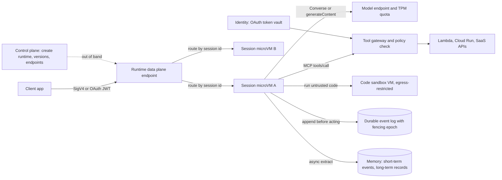

# Agent Runtimes and Cloud Execution Environments

## TL;DR

The agent loop is a state machine whose transitions are decided by a model you cannot run the same way twice, so a durable agent runtime is a write-ahead log of model outputs and tool results, plus compute that is allowed to die.
Managed runtimes isolate each user session in its own VM: Amazon Bedrock AgentCore Runtime gives each session a dedicated microVM that is terminated and memory-sanitized when the session ends (AWS docs, as of 2026-10), and Vertex AI Agent Engine bills Runtime and sandbox environments as metered vCPU and memory (Google Cloud pricing, as of 2026-10).
Session compute is ephemeral by design (AgentCore caps a session at 8 hours and by default stops it after 15 idle minutes), so anything you cannot afford to lose must be written to an external log before you act on it (AWS ML blog, as of 2026-10).
To get exactly-once side effects from at-least-once tool execution, derive the idempotency key from the step's position in the log, never from a model-generated tool-call ID, and use fencing epochs to reject a stale executor.
On cost, tokens usually make up more than 90 percent of the bill, runtime memory left resident during idle tails is the largest runtime line item, and the model's tokens-per-minute quota (not CPU) is the capacity limit that actually binds.

## Mental Model



Think of the session microVM as a CPU cache: fast and stateful, and gone the moment it is evicted.
The durable event log is main memory: it is the only state you can trust after a crash, a timeout, an idle eviction, or a retry that lands on a new VM.
Every model call and every tool call follows the same order: read the log, decide, append the decision under a fencing epoch, act with an idempotency key, then append the result.
The tool gateway is the only path to side effects, so it is where you put authorization, credential exchange, and egress policy.
The control plane that creates runtimes and versions never sits on the request path, so the data plane keeps serving existing sessions when the control plane is impaired.

## Internals

### The agent loop as a nondeterministic state machine

ReAct-style agents alternate reasoning with tool calls: the model emits an action, the runtime executes it, and the observation is fed back into the next model call ([Yao et al., ReAct, ICLR 2023](https://arxiv.org/abs/2210.03629)).
Formally, the state of one session is the ordered sequence of events: user message, model output (text or tool_use), tool result, and so on.
The transition function is the model, and the model is nondeterministic even at temperature 0.
The reason is that batched inference kernels change their floating-point reduction order depending on how many requests share the batch, as Thinking Machines analyzed in [Defeating Nondeterminism in LLM Inference](https://thinkingmachines.ai/blog/defeating-nondeterminism-in-llm-inference/).
This one fact sets the persistence design, and the getting-started guides do not explain it.
Classic durable-execution systems (Azure Durable Functions, Temporal, Lambda durable functions) recover by replaying deterministic orchestrator code against a history of recorded activity results ([Burckhardt et al., Durable Functions: Semantics for Stateful Serverless, OOPSLA 2021](https://dl.acm.org/doi/10.1145/3485510)).
An agent loop has no deterministic orchestrator to replay, because the branch decision is itself the model's output.
So the model output has to be recorded as an activity result, exactly like a tool result, before anything acts on it.
If you crash after the model said "call refund(A-1001)" but before you logged it, the recovery run calls the model again and may get "call refund(A-1001, partial=true)" or a different tool entirely.
The log then disagrees with the side effects that already happened in the world.

### Mechanism: log-position idempotency keys and fencing epochs

Three invariants make an agent turn crash-safe.

Invariant 1, decide-then-log: a model output becomes real only once it is appended at sequence number `n` with a conditional write (`attribute_not_exists(sk)` in DynamoDB, or a create-only precondition in Firestore or Spanner).
Invariant 2, idempotency key from log position: a tool call logged at position `n` of session `s` runs with idempotency key `s:n`, and that key is passed to the downstream system (for example an HTTP Idempotency-Key header or a client request token).
The model-generated tool-call ID (for example a `tool_use` block ID) is the wrong key.
If the model is re-invoked after a crash it produces a new ID, so two semantically identical calls get different keys and both execute.
The log position is stable across replays because Invariant 1 makes it immutable once written.
Invariant 3, fencing: each executor that picks up a session first increments a lease epoch, and every append is conditional on the epoch still being its own.
This is the sequencer pattern from Chubby ([Burrows, The Chubby lock service, OSDI 2006](https://research.google/pubs/the-chubby-lock-service-for-loosely-coupled-distributed-systems/)), applied to conversation state.
Without it you get a split-brain session.
The client times out at 60 seconds and retries, the original executor is still blocked on a slow model call, and both executors then append conflicting turns.

Even with the effect record, the tool wrapper has a residual window: crash after the downstream call returns but before the effect is recorded.
Only the downstream system can close that window by deduplicating on the key, which is why Invariant 2 says the key must be propagated rather than checked locally.
This is the same reason Beldi logs every external operation of a serverless function into a linked DAAL in the database to get exactly-once semantics ([Zhang et al., Fault-tolerant and Transactional Stateful Serverless Workflows, OSDI 2020](https://www.usenix.org/conference/osdi20/presentation/zhang-haoran)).
When a tool cannot be made idempotent (an email send, or a third-party API with no dedup), model it as a saga step with a compensating action and a human-approval gate ([Garcia-Molina and Salem, Sagas, SIGMOD 1987](https://dl.acm.org/doi/10.1145/38713.38742)).

### Execution isolation: microVMs, user-space kernels, and the session as the unit

Each AgentCore Runtime session gets its own microVM with isolated compute, memory, and filesystem, and when the session completes the whole microVM is terminated and its memory sanitized (AWS docs, as of 2026-10).
Third-party analyses describe these as Firecracker microVMs (UNVERIFIED against an AWS primary source as of 2026-10).
Firecracker exposes a deliberately minimal virtio device model behind KVM and runs each VMM inside a jailer with seccomp filters ([Agache et al., Firecracker, NSDI 2020](https://www.usenix.org/conference/nsdi20/presentation/agache)); see [[17-Cloud-AI-Engineering/Volume_13_Seminal_Papers_and_Case_Studies/Chapter_04_Firecracker_MicroVM|Firecracker microVM]].
Google's sandbox lineage is gVisor, a user-space kernel (the Sentry) that intercepts guest syscalls so that a container never talks to the host kernel directly; see [[17-Cloud-AI-Engineering/Volume_00_Foundations_Under_the_Cloud/Chapter_01_Hypervisors_MicroVMs_and_Sandboxing|Hypervisors, MicroVMs, and Sandboxing]].
The two approaches trade off differently: a microVM puts a hardware virtualization boundary between tenants and costs guest-kernel memory, while gVisor has a smaller per-sandbox footprint and pays a syscall-interception tax on I/O-heavy code ([Anjali et al., Blending Containers and Virtual Machines, VEE 2020](https://dl.acm.org/doi/10.1145/3381052.3381315)).
Choosing the session, not the tenant or the request, as the isolation unit is the key architectural decision.
Per-request isolation (classic Lambda) destroys the in-memory reasoning state and the filesystem a coding agent builds up between turns.
Per-tenant isolation lets one user's prompt-injected session read another user's scratch files inside the same tenant.
Per-session isolation keeps warm state across turns and keeps the blast radius of one compromised conversation to that conversation.

Session lifecycle on AgentCore: the client supplies a `runtimeSessionId`, later invocations with the same ID go to the same microVM, a session can live up to 8 hours, the compute shuts down on its own after `idleRuntimeSessionTimeout` (15 minutes by default, configurable), and `StopRuntimeSession` ends it immediately (AWS ML blog, as of 2026-10).
By default, data in memory or on the session's local disk lasts only as long as the session's compute (AWS docs, as of 2026-10).
AWS also describes configurable storage mounts such as a `/mnt/workspace` path for filesystem persistence (AWS ML blog, as of 2026-10), but treat that as a convenience cache, not as your write-ahead log.

### Code execution sandboxes

Running model-written code is a separate trust domain from running your agent code.
On AWS, AgentCore Code Interpreter and AgentCore Browser are billed on the same active vCPU-hour and GB-hour meters as Runtime (AWS pricing, as of 2026-10).
On Google Cloud, the Agent Engine pricing groups "Runtime and Sandbox environments, including Code Execution and Computer Use" under Agent Compute and Agent Memory (Google Cloud pricing, as of 2026-10).
The parameter that matters most is network egress.
A sandbox with public internet egress plus access to session data is an exfiltration channel: an indirect prompt injection in a retrieved document can tell the model to `requests.post` your data to an attacker's host ([Greshake et al., Not what you've signed up for, AISec 2023](https://arxiv.org/abs/2302.12173)).
Default sandboxes to no egress, let data in through explicit file staging, and treat any sandbox with egress as internet-facing compute.
AgentCore Code Interpreter's exact network-mode names and their GA status are UNVERIFIED as of 2026-10, so check the current CreateCodeInterpreter API reference before you depend on them.

### Tool integration plane

The Model Context Protocol (MCP) has become the common tool contract: JSON-RPC 2.0 messages, `tools/list` for discovery, `tools/call` for invocation, and a streamable HTTP transport for remote servers ([MCP specification](https://modelcontextprotocol.io/specification)).
AgentCore Gateway turns existing APIs and Lambda functions into MCP tools and meters invocations, semantic tool searches, and indexed tools separately (AWS pricing, as of 2026-10).
Google's pricing page lists an "Agent Gateway (Agent-to-Anywhere)" metered in Agent Compute units (Google Cloud pricing, as of 2026-10).
The cost below is not on any pricing page: every tool schema you expose is resent as input tokens on every model call.
Take an illustrative 120 tools at about 250 tokens of JSON schema each: that is 30,000 input tokens of tool definitions per step before the user has said anything (author estimate, not a vendor number).
Semantic tool search, which retrieves the top-k relevant tools per step, is therefore a token-cost and accuracy optimization, not just a convenience.
It also changes failure behavior: if the tool index returns a stale or wrong top-k, the model cannot call the right tool and silently improvises instead.
For agent-to-agent delegation, both clouds support the A2A protocol, and third-party sources report that AgentCore Runtime accepts both plain HTTP and A2A workloads (as of 2026-10, UNVERIFIED against AWS docs).

### Bedrock Agents (managed orchestration) versus hosted runtimes

Amazon Bedrock Agents is the older, opinionated product: AWS owns the orchestration prompt templates and the loop.
You declare action groups (an OpenAPI schema or function definitions), and each action group has either a Lambda executor or `RETURN_CONTROL`.
With `RETURN_CONTROL`, Bedrock hands the chosen action and parameters back to the calling application, the application executes it with its own credentials, and it returns the result in the next `InvokeAgent` call.
Return of control is a security boundary, not merely a flexibility feature.
The agent service never holds credentials for the downstream system, so a prompt-injected orchestration step can request an action but cannot carry it out without the client's own authorization check.
The built-in `AMAZON.CodeInterpreter` and `AMAZON.UserInput` parent action-group signatures provide managed code execution and clarification questions.
Session state travels as `sessionAttributes` (for your executor) and `promptSessionAttributes` (injected into the prompt), which makes them both a convenience and a prompt-injection surface if they carry user-controlled strings.
AgentCore inverts this model: you bring any framework (Strands Agents, LangGraph, ADK, or custom code) in a container, and AWS supplies isolation, identity, memory, gateway, and observability as separable services.
Google's equivalent split is ADK, an open-source framework, deployed to Vertex AI Agent Engine, which supplies runtime, Sessions, Memory Bank, and sandboxes.
Recent third-party material says Google now markets this stack as the Gemini Enterprise Agent Platform and calls the runtime "Agent Runtime (formerly Agent Engine)" (UNVERIFIED against official docs as of 2026-10).
This chapter uses "Agent Engine" for continuity, and the pricing page's "Gemini Enterprise Flexible Savings Plan" labels are consistent with the rebrand (Google Cloud pricing, as of 2026-10).

### Memory: short-term events and asynchronous long-term extraction

Both clouds split memory into a short-term event log of the conversation and long-term records extracted from it.
The extraction is an asynchronous, model-driven pipeline: a model reads the events, writes facts or summaries, and indexes them for retrieval.
Long-term memory is therefore eventually consistent with the conversation, with a lag set by extraction-model latency and queueing; the exact SLOs on both clouds are UNVERIFIED as of 2026-10.
The practical consequence is a read-your-writes violation across sessions.
A user states a preference, closes the tab, opens a new session ten seconds later, and the agent does not know it yet.
If your product needs read-your-writes for certain facts (consent, opt-outs, allergies), write them synchronously to your own store and do not rely on extracted memory.
Memory is also persistent attacker-controlled input.
A poisoned memory record extracted from an injected document gets replayed into every future session, so memory namespaces must be scoped per user (never per tenant) and screened like retrieved content; see [[17-Cloud-AI-Engineering/Volume_12_AI_Applications_MLOps_and_Data_Platforms/Chapter_08_Cloud_Security_for_AI_Systems_Attacks_and_Defenses|Cloud Security for AI Systems]].

### State machine persistence options

You can keep agent state in three tiers, and production systems usually combine at least two.
Tier 1 is a fine-grained event log per session (DynamoDB, Firestore, Spanner, or a LangGraph checkpointer backed by one of them).
It records every model output and tool result, supports fencing, and gives you a replay debugger for free.
Tier 2 is a coarse workflow engine (AWS Step Functions, Google Cloud Workflows, or Lambda durable functions) for long, human-in-the-loop processes.
Examples are "draft contract, wait up to 5 days for legal approval via callback token, then send".
Step Functions Standard workflows allow executions up to one year with exactly-once state transitions, while Express workflows are at-least-once and capped at five minutes (UNVERIFIED, not re-checked as of 2026-10).
Do not run the inner agent loop as Step Functions states: a 40-step agent session with retries can exhaust the per-execution event-history limit, 25,000 events (UNVERIFIED as of 2026-10), and every iteration is billed as state transitions.
Tier 3 is extracted long-term memory, which is a retrieval index, not a source of truth.
The control plane and data plane split from [[17-Cloud-AI-Engineering/Volume_01_Cloud_Architecture_Principles/Chapter_04_Control_Plane_vs_Data_Plane_Separation|Control Plane vs Data Plane Separation]] applies directly.
`bedrock-agentcore-control` (create runtime, versions, endpoints) is the control plane and `bedrock-agentcore` (InvokeAgentRuntime) is the data plane.
Never create runtimes, gateways, or memory resources on a request path.

### Failure domain boundaries

A session microVM is single-zone, and losing it loses all uncheckpointed session state.
The runtime endpoint is regional.
Model capacity is the most fragile shared dependency: it is quota-bounded per account, model, and region, and it is commonly exposed through cross-region inference profiles on Bedrock and global endpoints on Vertex; see [[17-Cloud-AI-Engineering/Volume_11_LLM_Serving_and_Inference_Systems_on_Cloud/Chapter_09_Managed_Inference_Amazon_Bedrock_vs_Vertex_AI|Managed Inference: Bedrock vs Vertex AI]].
The event log should live in the same region as the runtime, so a regional event takes out compute and state together and resume logic can stay simple.
If you need cross-region continuation, replicate the log (DynamoDB global tables, multi-region Spanner) and accept that fencing across regions then depends on a single-writer region or on strongly consistent multi-region writes.

## Numbers to Know

| Item | Value | Source and date |
|---|---|---|
| AgentCore Runtime isolation unit | One dedicated microVM per session; terminated and memory-sanitized at session end | (AWS docs, as of 2026-10) |
| AgentCore Runtime max session lifetime | 8 hours | (AWS ML blog, as of 2026-10) |
| AgentCore Runtime idle timeout default | 15 minutes, configurable via `idleRuntimeSessionTimeout` | (AWS ML blog, as of 2026-10) |
| AgentCore Runtime price | $0.0895 per vCPU-hour, $0.00945 per GB-hour, per-second metering | (AWS pricing as reported by Caylent and Cloudburn, as of 2026-10) |
| AgentCore CPU metering rule | CPU charged on active use only; I/O wait such as waiting on the model is not CPU-billed | (third-party analysis of AWS pricing, as of 2026-10) |
| AgentCore Code Interpreter and Browser price | Same vCPU-hour and GB-hour rates as Runtime | (AWS pricing via Caylent, as of 2026-10) |
| AgentCore Gateway price | $0.005 per 1,000 invocations; $0.025 per 1,000 searches; $0.02 per 100 indexed tools per month | (AWS pricing via Caylent, as of 2026-10) |
| AgentCore Policy price | $0.000025 per authorization request; GA status UNVERIFIED | (Cloudburn calculator, as of 2026-10) |
| Vertex Agent Compute | $0.085 per vCPU-hour after the first 50 free vCPU-hours per month per account | (Google Cloud pricing, as of 2026-10) |
| Vertex Agent Memory | $0.009 per GiB-hour after the first 100 free GiB-hours per month | (Google Cloud pricing, as of 2026-10) |
| Vertex savings plan rates | Compute $0.0765 (1 year), $0.068 (3 years); Memory $0.0081 (1 year), $0.0072 (3 years) | (Google Cloud pricing, as of 2026-10) |
| Vertex idle billing rule | Runtime idle time waiting for the next prompt between turns is not billed | (Google Cloud pricing, as of 2026-10) |
| Vertex Agent Gateway | 1 Agent Compute vCPU-hour ($0.085) corresponds to 15,000 API calls, about $0.0057 per 1,000 | (Google Cloud pricing, as of 2026-10) |
| Vertex Sessions and Memory Bank storage | $0.30 per GiB-month after 1 free GiB-month, under the structure effective 2026-09-01 | (third-party, as of 2026-10; UNVERIFIED on official page) |
| Vertex rate history | $0.0864 per vCPU-hour from 2025-12-16, then $0.085 now; prior Sessions price $0.25 per 1,000 events | (third-party, as of 2026-10) |
| Lambda max function timeout | 900 seconds | (AWS docs, long-standing; UNVERIFIED re-check 2026-10) |
| Step Functions Standard max execution | 1 year; Express 5 minutes | (AWS docs; UNVERIFIED re-check 2026-10) |
| Step Functions history limit | 25,000 events per execution | (AWS docs; UNVERIFIED re-check 2026-10) |
| Tool-schema token tax | About 250 tokens per tool schema times tools exposed per step | (author estimate, illustrative) |

Pricing on the Google side changed at least three times between 2025-12 and 2026-09, so cost models must read rates from configuration, not constants.

## AWS vs GCP Mechanism Parity

| Concern | AWS | Google Cloud | Critical difference |
|---|---|---|---|
| Managed orchestration loop | Bedrock Agents: action groups, AWS-owned prompt templates, `RETURN_CONTROL`, multi-agent collaboration | Conversational Agents playbooks and ADK-built agents; no direct one-to-one with Bedrock Agents | Bedrock Agents hides the loop; you cannot fence or log intermediate steps yourself beyond trace output |
| Bring-your-own-framework runtime | AgentCore Runtime: container, per-session microVM, `runtimeSessionId` affinity | Vertex AI Agent Engine (Agent Runtime): deploy ADK, LangGraph, or custom agents | AWS documents per-session microVM isolation; Google's per-session isolation primitive is not documented to the same depth (UNVERIFIED) |
| Session lifecycle | 8-hour max, 15-minute idle default, `StopRuntimeSession` | Idle between turns not billed; max session duration UNVERIFIED | AWS idle tail can carry memory cost; Google bills active time only |
| Code sandbox | AgentCore Code Interpreter, same meters as Runtime | Agent Engine Code Execution, on Agent Compute and Agent Memory meters | Network-mode semantics differ; verify egress defaults on each |
| Browser or computer use | AgentCore Browser | Computer Use sandbox, on Agent Compute meters | Both are internet-facing by nature; isolate from session secrets |
| Tool gateway | AgentCore Gateway: APIs and Lambda to MCP, semantic tool search | Agent Gateway (Agent-to-Anywhere), metered at 15,000 calls per vCPU-hour | AWS meters tool indexing separately; Google folds gateway into compute units |
| Tool authorization policy | AgentCore Policy (Cedar-based per AWS announcements; status UNVERIFIED) | Semantic Governance Policies, natural-language constraints on tool calls, billing later in 2026 | Cedar is deterministic and analyzable; natural-language policy is model-evaluated and probabilistic |
| Outbound identity | AgentCore Identity: OAuth token vault, user-delegated 3LO tokens | Service accounts plus agent identity features (exact GA scope UNVERIFIED) | Both aim to keep long-lived secrets out of agent code; audit which principal appears in downstream logs |
| Memory | AgentCore Memory: short-term events plus async long-term strategies | Agent Engine Sessions plus Memory Bank | Both are eventually consistent for long-term recall |
| Coarse workflow and HITL | Step Functions callbacks (`.waitForTaskToken`), Lambda durable functions | Cloud Workflows callbacks | Neither should host the inner agent loop |
| Event-log store with fencing | DynamoDB `TransactWriteItems` with `ConditionCheck` | Firestore transactions or Spanner read-write transactions | Spanner gives externally consistent multi-region fencing; DynamoDB global tables are last-writer-wins |
| Framework | Strands Agents (open source) | Agent Development Kit (open source) | Both deploy elsewhere; framework choice need not lock in the runtime |
| Inter-agent protocol | MCP and A2A | MCP and A2A | Protocol parity is high; auth and policy parity is not |
| Private networking | VPC-attached runtime and PrivateLink endpoints (endpoint coverage UNVERIFIED) | VPC Service Controls perimeter and PSC (Agent Engine coverage UNVERIFIED) | VPC SC is a perimeter on API calls; PrivateLink is a network path; see the Security section |

## Worked Example: A Crash-Safe Agent Turn With Fencing and Log-Position Idempotency

### What this lab proves

The script runs one agent turn that calls a side-effecting `refund` tool.
On the first run it crashes deliberately after the side effect but before the tool result is logged, and on the second run it resumes from the log without re-executing the refund and without re-invoking the model for the decision.
It also shows a stale executor being fenced out.
The default backend is SQLite with a scripted model, so it costs nothing and runs anywhere with Python 3.
The `dynamodb` backend and `MODEL=bedrock` switch to real, billable AWS resources.

### Code

```python
#!/usr/bin/env python3
"""Durable agent turn loop: write-ahead event log, fencing lease, log-position idempotency keys.

Backends: sqlite (local, free) or dynamodb (billable).
Model: scripted fake (default, free) or Amazon Bedrock Converse (set MODEL=bedrock and BEDROCK_MODEL_ID).
"""
import argparse
import json
import os
import sqlite3
import sys
import time


class FencedOut(Exception):
    pass


class SqliteLog:
    def __init__(self, path):
        self.db = sqlite3.connect(path, isolation_level=None)
        self.db.execute("CREATE TABLE IF NOT EXISTS lease (sid TEXT PRIMARY KEY, epoch INTEGER)")
        self.db.execute("CREATE TABLE IF NOT EXISTS events (sid TEXT, seq INTEGER, epoch INTEGER, body TEXT, PRIMARY KEY (sid, seq))")
        self.db.execute("CREATE TABLE IF NOT EXISTS tool_effects (idem_key TEXT PRIMARY KEY, result TEXT)")

    def acquire(self, sid):
        self.db.execute("BEGIN IMMEDIATE")
        row = self.db.execute("SELECT epoch FROM lease WHERE sid=?", (sid,)).fetchone()
        epoch = (row[0] if row else 0) + 1
        self.db.execute("INSERT OR REPLACE INTO lease VALUES (?, ?)", (sid, epoch))
        self.db.execute("COMMIT")
        return epoch

    def read(self, sid):
        rows = self.db.execute("SELECT seq, body FROM events WHERE sid=? ORDER BY seq", (sid,)).fetchall()
        return [json.loads(b) for _, b in rows]

    def append(self, sid, seq, epoch, event):
        self.db.execute("BEGIN IMMEDIATE")
        try:
            cur = self.db.execute("SELECT epoch FROM lease WHERE sid=?", (sid,)).fetchone()
            if cur is None or cur[0] != epoch:
                raise FencedOut("lease epoch %s superseded by %s" % (epoch, cur))
            self.db.execute("INSERT INTO events VALUES (?, ?, ?, ?)", (sid, seq, epoch, json.dumps(event)))
            self.db.execute("COMMIT")
        except Exception:
            self.db.execute("ROLLBACK")
            raise

    def tool_once(self, idem_key, fn):
        row = self.db.execute("SELECT result FROM tool_effects WHERE idem_key=?", (idem_key,)).fetchone()
        if row:
            return json.loads(row[0]), True
        result = fn()
        self.db.execute("INSERT OR IGNORE INTO tool_effects VALUES (?, ?)", (idem_key, json.dumps(result)))
        return result, False


class DynamoLog:
    """Table schema: pk (S) = session id, sk (N) = seq; sk 0 holds the lease epoch."""

    def __init__(self, table):
        import boto3
        self.ddb = boto3.client("dynamodb")
        self.table = table

    def acquire(self, sid):
        r = self.ddb.update_item(
            TableName=self.table,
            Key={"pk": {"S": sid}, "sk": {"N": "0"}},
            UpdateExpression="ADD epoch :one",
            ExpressionAttributeValues={":one": {"N": "1"}},
            ReturnValues="UPDATED_NEW",
        )
        return int(r["Attributes"]["epoch"]["N"])

    def read(self, sid):
        out, kwargs = [], {}
        while True:
            r = self.ddb.query(
                TableName=self.table,
                KeyConditionExpression="pk = :p AND sk > :z",
                ExpressionAttributeValues={":p": {"S": sid}, ":z": {"N": "0"}},
                ConsistentRead=True,
                **kwargs,
            )
            out += [json.loads(i["body"]["S"]) for i in r["Items"]]
            if "LastEvaluatedKey" not in r:
                return out
            kwargs = {"ExclusiveStartKey": r["LastEvaluatedKey"]}

    def append(self, sid, seq, epoch, event):
        try:
            self.ddb.transact_write_items(TransactItems=[
                {"ConditionCheck": {
                    "TableName": self.table,
                    "Key": {"pk": {"S": sid}, "sk": {"N": "0"}},
                    "ConditionExpression": "epoch = :e",
                    "ExpressionAttributeValues": {":e": {"N": str(epoch)}}}},
                {"Put": {
                    "TableName": self.table,
                    "Item": {"pk": {"S": sid}, "sk": {"N": str(seq)},
                             "epoch": {"N": str(epoch)}, "body": {"S": json.dumps(event)}},
                    "ConditionExpression": "attribute_not_exists(sk)"}},
            ])
        except self.ddb.exceptions.TransactionCanceledException as e:
            raise FencedOut(str(e))

    def tool_once(self, idem_key, fn):
        key = {"pk": {"S": "effect#" + idem_key}, "sk": {"N": "1"}}
        r = self.ddb.get_item(TableName=self.table, Key=key, ConsistentRead=True)
        if "Item" in r:
            return json.loads(r["Item"]["body"]["S"]), True
        result = fn()
        try:
            self.ddb.put_item(TableName=self.table,
                              Item=dict(key, body={"S": json.dumps(result)}),
                              ConditionExpression="attribute_not_exists(pk)")
        except self.ddb.exceptions.ConditionalCheckFailedException:
            pass
        return result, False


def fake_model(messages):
    """Deterministic two-step script: request one tool call, then answer."""
    if not any(m["role"] == "tool" for m in messages):
        return {"type": "tool_use", "name": "refund", "input": {"order": "A-1001", "cents": 1999}}
    return {"type": "text", "text": "Refund issued: " + messages[-1]["content"]}


def bedrock_model(messages):
    import boto3
    brt = boto3.client("bedrock-runtime")
    conv = []
    for m in messages:
        role = "assistant" if m["role"] == "assistant" else "user"
        conv.append({"role": role, "content": [{"text": json.dumps(m["content"]) if not isinstance(m["content"], str) else m["content"]}]})
    merged = []
    for m in conv:
        if merged and merged[-1]["role"] == m["role"]:
            merged[-1]["content"] += m["content"]
        else:
            merged.append(m)
    tools = {"tools": [{"toolSpec": {"name": "refund", "description": "Refund an order",
             "inputSchema": {"json": {"type": "object", "properties": {"order": {"type": "string"}, "cents": {"type": "integer"}}, "required": ["order", "cents"]}}}}]}
    r = brt.converse(modelId=os.environ["BEDROCK_MODEL_ID"], messages=merged, toolConfig=tools,
                     inferenceConfig={"maxTokens": 512})
    for block in r["output"]["message"]["content"]:
        if "toolUse" in block:
            return {"type": "tool_use", "name": block["toolUse"]["name"], "input": block["toolUse"]["input"]}
    return {"type": "text", "text": "".join(b.get("text", "") for b in r["output"]["message"]["content"])}


def refund_tool(order, cents, idem_key):
    # A real tool forwards idem_key to the downstream API (for example an Idempotency-Key header).
    print("  [side effect] payment API called for %s amount %d key=%s" % (order, cents, idem_key))
    return {"refund_id": "rf-%s" % order, "cents": cents}


def run_turn(log, sid, user_text, model, max_steps=8, crash_after_tool=False):
    epoch = log.acquire(sid)
    events = log.read(sid)
    if not events:
        log.append(sid, 1, epoch, {"role": "user", "content": user_text})
        events = log.read(sid)
    for _ in range(max_steps):
        seq = len(events) + 1
        last = events[-1]
        if last["role"] == "assistant" and last["content"].get("type") == "text":
            return last["content"]["text"]
        if last["role"] == "assistant" and last["content"]["type"] == "tool_use":
            call = last["content"]
            idem_key = "%s:%d" % (sid, seq - 1)
            result, replayed = log.tool_once(idem_key, lambda: refund_tool(idem_key=idem_key, **call["input"]))
            print("  tool %s key=%s replayed=%s" % (call["name"], idem_key, replayed))
            if crash_after_tool:
                print("  simulated crash after side effect, before result was logged")
                sys.exit(3)
            log.append(sid, seq, epoch, {"role": "tool", "content": json.dumps(result)})
        else:
            out = model(events)
            print("  model step seq=%d -> %s" % (seq, out["type"]))
            log.append(sid, seq, epoch, {"role": "assistant", "content": out})
        events = log.read(sid)
    raise RuntimeError("step budget exhausted; refusing to loop further")


def main():
    p = argparse.ArgumentParser()
    p.add_argument("--backend", choices=["sqlite", "dynamodb"], default="sqlite")
    p.add_argument("--table", default="agent-wal-lab")
    p.add_argument("--db", default="/tmp/agent_wal.db")
    p.add_argument("--session", default="sess-" + str(int(time.time())))
    p.add_argument("--crash-after-tool", action="store_true")
    a = p.parse_args()
    log = SqliteLog(a.db) if a.backend == "sqlite" else DynamoLog(a.table)
    model = bedrock_model if os.environ.get("MODEL") == "bedrock" else fake_model
    print("session", a.session)
    print("answer:", run_turn(log, a.session, "Refund order A-1001", model, crash_after_tool=a.crash_after_tool))


if __name__ == "__main__":
    main()
```

### Run it locally (free)

```bash
rm -f /tmp/agent_wal.db
python3 durable_agent.py --session s1 --crash-after-tool   # exits 3 after the side effect
python3 durable_agent.py --session s1                      # resumes: replayed=True, no second payment call
python3 durable_agent.py --session s1                      # idempotent: returns logged answer, no model call
```

The second run prints `tool refund key=s1:2 replayed=True` and never prints a second `[side effect]` line.
The key `s1:2` is the log position of the `tool_use` event, which is why it survives the crash.
Fencing check: acquire twice for one session and try to append with the first epoch, and the append raises `FencedOut`.

```bash
python3 -c "
import sys; sys.path.insert(0, '.')
from durable_agent import SqliteLog, FencedOut
log = SqliteLog('/tmp/agent_wal.db'); e1 = log.acquire('s2'); e2 = log.acquire('s2')
try: log.append('s2', 1, e1, {'role': 'user', 'content': 'x'})
except FencedOut as ex: print('fenced:', ex)
"
```

### Run it against DynamoDB and Bedrock (billable)

```bash
export AWS_REGION=us-east-1
ACCT=$(aws sts get-caller-identity --query Account --output text)

# Budget alarm first: 5 USD monthly, email at 80 percent of actual spend.
aws budgets create-budget --account-id "$ACCT" \
  --budget '{"BudgetName":"agent-wal-lab","BudgetLimit":{"Amount":"5","Unit":"USD"},"TimeUnit":"MONTHLY","BudgetType":"COST"}' \
  --notifications-with-subscribers '[{"Notification":{"NotificationType":"ACTUAL","ComparisonOperator":"GREATER_THAN","Threshold":80,"ThresholdType":"PERCENTAGE"},"Subscribers":[{"SubscriptionType":"EMAIL","Address":"you@example.com"}]}]'

aws dynamodb create-table --table-name agent-wal-lab \
  --attribute-definitions AttributeName=pk,AttributeType=S AttributeName=sk,AttributeType=N \
  --key-schema AttributeName=pk,KeyType=HASH AttributeName=sk,KeyType=RANGE \
  --billing-mode PAY_PER_REQUEST
aws dynamodb wait table-exists --table-name agent-wal-lab

python3 durable_agent.py --backend dynamodb --session d1 --crash-after-tool
python3 durable_agent.py --backend dynamodb --session d1

# Optional real model; pick a model or inference profile ID enabled in your account.
MODEL=bedrock BEDROCK_MODEL_ID="<your-model-or-inference-profile-id>" \
  python3 durable_agent.py --backend dynamodb --session d2
```

The Bedrock adapter serializes tool turns as text to stay short, so in production replace it with native `toolUse` and `toolResult` content blocks.
The GCP budget equivalent, if you port the log to Firestore: `gcloud billing budgets create --billing-account=XXXXXX-XXXXXX-XXXXXX --display-name=agent-wal-lab --budget-amount=5USD --threshold-rule=percent=0.8`.

### Teardown

```bash
aws dynamodb delete-table --table-name agent-wal-lab
aws budgets delete-budget --account-id "$ACCT" --budget-name agent-wal-lab
rm -f /tmp/agent_wal.db
```

### Lab cost estimate

SQLite mode costs 0 USD.
DynamoDB on-demand mode costs well under 0.01 USD for these runs.
Transactional writes consume double write units, and a few dozen requests at on-demand rates of roughly $0.625 per million write units round to zero (UNVERIFIED rate as of 2026-10).
A Bedrock model call with under 1,000 tokens costs a fraction of a cent for most models (model-dependent, UNVERIFIED).

### Capacity and cost sizing for production

Assume 10,000 daily active users, 3 sessions per user per day, 10 turns per session, and 2 model calls per turn (a tool call, then the answer).
Per turn: 20 seconds of wall clock dominated by model latency, 2 seconds of active CPU at 1 vCPU, and 40 seconds of user think time before the next turn.
Each session runs in a 1 vCPU, 2 GB environment.

Step 1, sessions: 10,000 x 3 = 30,000 sessions per day and 300,000 turns per day.
Step 2, session lifetime: 10 turns x (20 s + 40 s) = 600 s of conversation, plus the 900 s default idle tail = 1,500 s.
Step 3, peak concurrency by Little's law: the average arrival rate is 30,000 / 86,400 = 0.35 sessions per second, a 3x peak gives 1.04 per second, and L = 1.04 x 1,500 = 1,563 concurrent session microVMs.
Calling `StopRuntimeSession` when the conversation ends cuts W to 600 s and L to 625, which matters against any concurrent-session quota (quota value UNVERIFIED as of 2026-10).
Step 4, CPU: 300,000 turns x 2 s = 600,000 vCPU-seconds = 166.7 vCPU-hours per day, which is $14.92 on AgentCore at $0.0895 and $14.17 on Vertex at $0.085 before the free tier.
Step 5, memory, upper bound (memory billed for the whole session lifetime): 30,000 x 1,500 s x 2 GB = 25,000 GB-hours, which is $236 per day on AgentCore.
Memory, lower bound (memory billed only during active turns): 300,000 x 20 s x 2 GB = 3,333 GB-hours, which is $31.50 per day on AgentCore and $30 per day on Vertex, where idle time between turns is documented as unbilled.
Which bound applies on AWS depends on the memory-metering rule during idle, which is UNVERIFIED as of 2026-10, so instrument your bill before you trust either number.
At the upper bound, shortening the idle timeout to 60 s and calling `StopRuntimeSession` at conversation end cuts memory to about 10,000 GB-hours, or $94.50 per day.
Step 6, tokens: assume an average of 6,000 input tokens and 300 output tokens per model call, at illustrative list prices of $3 per million input and $15 per million output (parametric, not a specific model's verified price).
Per turn: 12,000 x $3e-6 + 600 x $15e-6 = $0.036 + $0.009 = $0.045, so 300,000 turns cost $13,500 per day.
With prompt caching that hits 80 percent of input at an illustrative 0.1x read price, input cost per turn drops to $0.036 x 0.28 = $0.010, and the daily total drops to about $5,700.
Step 7, which constraint binds: the daily input volume is 300,000 x 12,000 = 3.6 billion tokens, or 2.5 million input tokens per minute on average and 7.5 million at the 3x peak.
That tokens-per-minute figure, not vCPU, is the quota to negotiate first; see [[17-Cloud-AI-Engineering/Volume_11_LLM_Serving_and_Inference_Systems_on_Cloud/Chapter_11_End_to_End_Latency_Throughput_and_Cost_Modeling|End-to-End Latency, Throughput, and Cost Modeling]].
Step 8, event log: about 4 events per turn at about 4 write units each (transactional) is 4.8 million write units per day, a few dollars per day at on-demand rates (UNVERIFIED rate).
Conclusion: runtime compute is 0.5 to 4 percent of total spend, the idle memory tail is the largest runtime lever, and context engineering plus caching is the largest lever overall.

## Failure Modes and Pitfalls

### Session state treated as durable

A session's in-memory and on-disk state disappears at the 8-hour cap, at the idle timeout, on host failure, or on a deploy that rolls the runtime version.
Typical symptom: users of a coding agent lose a half-applied refactor after a lunch break because the 15-minute idle timeout fired.
Fix: checkpoint the workspace to object storage or git at every turn boundary, and checkpoint the conversation to the event log before every side effect.

### Retry storms that duplicate side effects

Agent turns routinely exceed default HTTP client timeouts, so a client SDK retry, a load balancer retry, and a user double-click can each start a second executor.
If the second executor generates a fresh session ID, fencing cannot help, because the duplicate is a new conversation that repeats the action.
Fix: the client generates the session ID once and the turn ID per user message, the server deduplicates by turn ID, and retries follow the bounded, jittered policy in [[17-Cloud-AI-Engineering/Volume_07_Reliability_and_SRE/Chapter_03_Resilient_Communication_Retries_Jitter_and_Circuit_Breakers|Retries, Jitter, and Circuit Breakers]].

### Model quota exhaustion cascading into the runtime

When the model endpoint returns throttling errors, every concurrent session retries, sessions stay resident longer, memory cost and concurrency both climb, and throttling gets worse.
This is a metastable failure loop.
Fix: admission control at session start, using a token-budget estimate against remaining TPM headroom, plus per-tenant token buckets; see [[17-Cloud-AI-Engineering/Volume_07_Reliability_and_SRE/Chapter_02_Load_Shedding_Backpressure_and_Admission_Control|Load Shedding and Admission Control]] and [[13-Agentic-AI/Agentic_AI_Zero_to_Godhood/Volume_12_Production_Engineering/Chapter_06_Capacity_and_Quotas|Capacity and Quotas]].

### Runaway loops and quadratic context growth

A model that keeps getting tool errors can loop indefinitely, and because each step resends the whole history, per-step cost grows linearly and per-session cost quadratically.
Fix: hard step budgets (the `max_steps` in the lab), per-session token and dollar budgets enforced in the runtime rather than in the prompt, and history compaction past a token threshold.

### Long-term memory read-your-writes violations and memory poisoning

Asynchronous extraction means a fact stated seconds ago may be absent from a new session.
Memory written from an injected document persists across sessions.
Fix: synchronous writes to your own store for safety-critical facts, per-user namespaces, and provenance tags on every memory record so poisoned records can be bulk-purged.

### Workflow engines hosting the inner loop

Putting each agent step in Step Functions or Cloud Workflows inflates cost per transition and can hit per-execution history limits on long sessions.
Fix: use workflow engines for coarse business steps and human approval callbacks, and keep the inner loop in the runtime with its own event log.

### Shared dependencies in public post-incident reviews

On 2025-10-19 and 2025-10-20, a latent race condition in DynamoDB's automated DNS management left the regional endpoint's DNS record empty in us-east-1.
The impact cascaded to EC2 instance launches and Network Load Balancer health checks, and recovery took many hours ([AWS post-event summary](https://aws.amazon.com/message/101925/)).
Agent platforms that keep session logs in DynamoDB in that region, or that depend on STS or IAM calls in it, could not resume sessions even where compute was healthy.
When the backlog drained, resumed sessions re-invoked models at the same time and hit throttling, which is the thundering-herd pattern from [[17-Cloud-AI-Engineering/Volume_01_Cloud_Architecture_Principles/Chapter_05_Constant_Work_and_Workload_Smoothing|Constant Work and Workload Smoothing]].
On 2025-06-12, a Google Cloud Service Control change hit a null-pointer path that had no feature flag, crash-looping API authorization globally and returning 503s across many Google APIs ([Google Cloud incident report](https://status.cloud.google.com/incidents/ow5i3PPK96RduMcb1SsW)).
The report notes that tasks restarting without randomized exponential backoff overloaded infrastructure in us-central1 and prolonged that region's recovery.
The lesson for agent runtimes: tool calls to cloud APIs must use jittered backoff, and the agent must have a degraded mode ("I cannot complete this now, it is queued") rather than retrying inside the model loop.
See [[17-Cloud-AI-Engineering/Volume_07_Reliability_and_SRE/Chapter_07_Anatomy_of_Major_Cloud_Outages|Anatomy of Major Cloud Outages]].

### Agent-specific incidents

In July 2025, Replit's coding agent was publicly reported to have deleted a user's production database during a declared code freeze.
That is the canonical example of an agent holding destructive credentials with no out-of-band approval gate (public reporting; details UNVERIFIED against a formal PIR).
Also in July 2025, AWS published a security bulletin about a malicious prompt injected into a release of the Amazon Q Developer extension for VS Code (bulletin identifier and version details UNVERIFIED as of 2026-10).
That incident shows that the agent's instructions are part of the software supply chain; see [[17-Cloud-AI-Engineering/Volume_08_Security_Identity_and_the_Data_Perimeter/Chapter_05_Software_Supply_Chain_Security_SLSA_and_Sigstore|Supply Chain Security]].

## Security and Cost Angles

### Identity: three principals, never one

Inbound identity answers who may invoke this agent, using SigV4 with IAM or an OAuth JWT validated by the runtime endpoint.
Workload identity answers what the agent code itself may call: the runtime execution role or service account, scoped to the model invoke actions on specific model ARNs, the event-log table, and nothing else.
Delegated user identity answers what the agent may do on the user's behalf, using OAuth tokens held in a token vault (AgentCore Identity) and exchanged per tool call, so downstream audit logs record the user and the agent rather than a shared service principal.
Collapsing these into one powerful execution role recreates the confused-deputy problem.
Any user who can steer the prompt can then use every permission the role has.
See [[17-Cloud-AI-Engineering/Volume_08_Security_Identity_and_the_Data_Perimeter/Chapter_02_Workload_Identity_Federation|Workload Identity Federation]].

### Authorization at the gateway, not in the prompt

Prompt instructions are not a security control, because the attacker writes part of the prompt.
Put deterministic policy at the tool gateway: allow-lists per tool, argument constraints (refund amount at most the order total), rate limits per user, and mandatory human approval for irreversible verbs.
Cedar-style policies can be analyzed and tested offline, while natural-language policies evaluated by a model are probabilistic and should be layered on top of deterministic checks, never used in place of them.
Capability-separation designs such as CaMeL go further: a privileged planner never sees untrusted data, and a quarantined model that parses untrusted data has no tools ([Debenedetti et al., Defeating Prompt Injections by Design, 2025](https://arxiv.org/abs/2503.18813)).

### Network and data perimeter

Code sandboxes default to no egress, and browser sandboxes get no access to session secrets or internal networks.
On AWS, attach runtimes to a VPC with interface endpoints for the model, the event log, and KMS, and add endpoint policies that pin access to your organization (`aws:PrincipalOrgID`, `aws:ResourceOrgID`); see [[17-Cloud-AI-Engineering/Volume_08_Security_Identity_and_the_Data_Perimeter/Chapter_06_Constructing_an_Impenetrable_Data_Perimeter|Data Perimeter]].
On Google Cloud, place the agent project inside a VPC Service Controls perimeter with the Vertex AI and storage APIs restricted, so that a stolen token cannot copy data into an attacker's project; see [[17-Cloud-AI-Engineering/Volume_03_GCP_Deep_Dive/Chapter_03_VPC_Service_Controls_Security_Perimeters|VPC Service Controls]].
Agent Engine coverage under VPC SC and private connectivity options is UNVERIFIED as of 2026-10.

### Encryption

Event logs contain full prompts, tool arguments, and tool results, which often include PII.
Encrypt them with customer-managed keys (KMS keys on DynamoDB, CMEK on Firestore or Spanner) under envelope encryption, with a key per environment and, for regulated tenants, a key per tenant so that crypto-shredding is possible.
Set TTLs on event-log items that match your retention policy.
See [[17-Cloud-AI-Engineering/Volume_08_Security_Identity_and_the_Data_Perimeter/Chapter_04_Encryption_Key_Hierarchies_and_Envelope_Encryption|Envelope Encryption]].

### Unit-economics levers, ranked by impact

1. Prompt caching and history compaction, because input tokens dominate the bill.
2. Semantic tool selection, to stop paying the tool-schema token tax on every step.
3. Routing easy steps to smaller models.
4. Explicit `StopRuntimeSession` plus short idle timeouts on AWS, because idle memory is the largest runtime line item.
5. Right-sizing session memory, because GB-hours scale with the allocation, not with use.
6. Vertex Flexible Savings Plans for steady base load, at 10 percent off for 1 year and 20 percent off for 3 years on Agent Compute (Google Cloud pricing, as of 2026-10).
Track cost per resolved task, not cost per token, because a cheaper model that needs three times as many steps is more expensive; see [[17-Cloud-AI-Engineering/Volume_09_FinOps_and_Cloud_Economics/Chapter_01_Cloud_Billing_Models_and_Unit_Cost_Allocation|Unit Cost Allocation]].

## Interview Questions and Model Answers

### Question 1 (L5 - Senior)

Why do managed agent runtimes isolate per session in a microVM instead of running each request as a stateless function invocation?

#### Model Answer

An agent session carries state between turns: in-memory reasoning context, loaded tool clients, a scratch filesystem, and sometimes a cloned repository or installed packages.
Per-request stateless execution would rebuild all of that on every turn, adding latency and cost, and would force every byte through external storage.
Per-tenant pooling would keep warm state but let a prompt-injected session in one conversation read files or memory left by another user of the same tenant.
The session is the smallest unit that keeps warm state and still contains a compromise to one conversation.
A microVM puts a hardware-virtualization boundary there, and AgentCore documents terminating and sanitizing the session microVM at session end (AWS docs, as of 2026-10).
The trade-off is cost and lifecycle: each session is a separately metered VM, it has an 8-hour cap and an idle timeout (15 minutes by default), and its state is ephemeral, so durable state must still go to an external log.
I would also point out that the isolation covers code-level compromise but not authorization mistakes.
If the execution role can delete production data, isolation does not help.

#### Follow-up Interviewer Question

The session microVM dies in the middle of a tool call; walk through exactly what the user experiences and what your system must have persisted to make that invisible.

### Question 2 (L5 - Senior)

When would you use a Bedrock Agents action group with a Lambda executor versus `RETURN_CONTROL`?

#### Model Answer

A Lambda executor suits actions the agent's own identity may perform: read-only lookups, internal APIs where the agent's role is the correct principal, and low-risk writes with server-side validation.
`RETURN_CONTROL` hands the chosen action and parameters back to the calling application, which executes it with its own credentials and context and returns the result on the next invoke.
I would choose it when the action must run as the end user (their OAuth token lives in the client or backend-for-frontend), when it needs a UI confirmation, when it hits systems the agent's AWS account cannot reach, or when it takes longer than a Lambda timeout.
The security property is that the managed orchestrator can propose an action but cannot execute it, so a prompt injection that steers the plan still runs into the application's authorization checks.
The costs are an extra round trip per action, more client complexity, and the client now owning idempotency and retries, so the client must key the execution on a stable turn and step identifier.

#### Follow-up Interviewer Question

How do you stop a malicious client from forging a "tool result" in the next InvokeAgent call to make the agent believe a payment succeeded?

### Question 3 (L6 - Staff)

Design exactly-once side effects for a tool-calling agent that can crash at any point and whose client retries on timeout.

#### Model Answer

Exactly-once execution is impossible across a crash, so the goal is exactly-once effect: at-least-once execution made idempotent.
First, record the model's decision before acting.
The model is nondeterministic even at temperature 0, because batch composition changes floating-point reduction order, so if I crash before logging the tool_use, re-invoking the model can produce a different action.
I append each model output at sequence n with a create-only conditional write, so position n is immutable once written.
Second, derive the idempotency key from the log position, session:n, and propagate it to the downstream API.
The model's tool-call ID is regenerated on any re-invocation, so it cannot deduplicate.
A local "did I already call this" check has a crash window between the call returning and the record being written, which only downstream deduplication closes.
Third, fence executors.
Every executor that takes over a session increments a lease epoch, and every append is a transaction that checks epoch equality.
In DynamoDB that is a `TransactWriteItems` with a `ConditionCheck` on the lease item plus a conditional `Put`; in Spanner or Firestore it is a read-write transaction.
A stale executor that wakes up from a 90-second model call then fails its append and must discard its work.
Fourth, for non-idempotent tools (email, some third-party APIs) I use a saga: write an intent record, send with the provider's dedup feature if it has one, and otherwise accept at-most-once with a reconciliation job and a compensating action.
Fifth, on the client side, the session ID is generated once and each user message gets a turn ID, so the server can deduplicate an entire retried turn.
Costs: two to four extra conditional writes per step, which is negligible next to model latency, and a hard dependency on the log store's availability, which I keep in the same region as the runtime so a regional failure takes out both together.

#### Follow-up Interviewer Question

Your log lives in a DynamoDB global table for cross-region failover; what happens to the fencing guarantee during a regional partition, and what do you change?

### Question 4 (L6 - Staff)

Finance says your agent platform's runtime bill is three times the forecast while token spend matches the forecast; diagnose it.

#### Model Answer

Tokens matching while runtime overshoots points to resource-residency time, not work.
CPU on AgentCore is reported to be charged on active use, so waiting on the model is cheap on the CPU meter, but memory is allocated per session and the residency rule during idle is what I would verify first on the bill.
The default 15-minute idle timeout means a 10-minute conversation can stay resident for 25 minutes.
At 30,000 sessions a day, 2 GB, and a 1,500-second lifetime, the upper bound is 25,000 GB-hours, or about $236 per day, against about $32 if only active turns are billed.
That gap is the same order as the overshoot.
Second suspects: oversized memory allocations, and sessions that never end because clients never call `StopRuntimeSession`.
Third suspect: an agent that busy-polls (for example a sub-agent spinning on a status check), which turns I/O wait into billed CPU.
To diagnose, break the bill down by session, chart session lifetime against active-turn time, and join with the runtime's per-session metrics.
Remediation: explicit stop at conversation end, a 60 to 120 second idle timeout with workspace checkpointing so that eviction is cheap, right-sized memory, and moving steady load to Vertex savings plans where applicable.
I would also tell finance that runtime is usually a single-digit percentage of the total, so after fixing it, the larger lever is caching and context compaction.

#### Follow-up Interviewer Question

Shortening the idle timeout increased p50 turn latency for returning users; quantify the trade-off and design a policy that adapts the timeout per user.

### Question 5 (L6 - Staff)

Your agent reads customer emails, can run Python in a sandbox, and can call a CRM API; a red team exfiltrated CRM data through an instruction hidden in an email; redesign the system.

#### Model Answer

This is indirect prompt injection: untrusted data entered the same context window that decides tool calls ([Greshake et al., AISec 2023](https://arxiv.org/abs/2302.12173)).
I assume the model will sometimes be fooled and design so that being fooled is not sufficient for exfiltration.
Layer one is egress: the sandbox gets no network egress, and data reaches it only through explicit staging, which closes the `requests.post` channel.
Layer two is capability separation: a quarantined model summarizes emails into a typed schema and has no tools, and the privileged planner never sees raw email text, only typed fields, which is the CaMeL pattern.
Layer three is deterministic gateway policy: the CRM tool may read only records linked to the current ticket's customer, bulk export is a separate tool that requires human approval, and outbound channels (email send, webhooks) are allow-listed by destination.
Layer four is identity: CRM calls run with the requesting agent-user's delegated token, so the blast radius is that user's access, not a service-wide role.
Layer five is the data perimeter: VPC Service Controls or VPC endpoint policies stop a stolen credential from moving data to another project or account.
Layer six is detection: log every tool call with arguments and provenance in the event log, and alert on unusual volume per session and on tools invoked shortly after untrusted content was ingested.
The cost is reduced agent flexibility and more engineering, and I would measure the impact with an injection eval suite such as AgentDojo in CI before and after the change.

#### Follow-up Interviewer Question

Product wants the agent to reply to customers by email automatically; which control from your design do you relax, and how do you bound the residual risk?

### Question 6 (L7+ - Principal)

Design a multi-tenant agent platform that runs on both AWS and Google Cloud for 500 internal teams, and justify where you use managed runtimes versus your own.

#### Model Answer

I would separate a thin, portable control plane from cloud-native data planes and avoid forcing parity where the clouds differ.
Control plane: agent registry, versioned agent definitions, tool catalog with policies, tenant quotas, and evaluation gates, stored once and pushed asynchronously to each cloud so that the request path never depends on it.
Data plane per cloud: AgentCore Runtime on AWS and Agent Engine on Google Cloud for the long tail of teams, because per-session VM isolation, scale to zero, and active-time billing are hard to beat for spiky internal workloads.
A self-hosted path on EKS or GKE with gVisor or microVM sandboxes is for the few teams with steady high utilization, custom GPU sidecars, or session lifetimes beyond managed caps, where reserved capacity beats per-second list prices.
Portability lives at the framework and protocol layer (ADK or Strands, MCP for tools, A2A between agents), not in a lowest-common-denominator runtime abstraction.
Cells: tenants are sharded into cells per region, each with its own runtime endpoints, event-log tables, and model quota allocation, so that one team's runaway agent or poisoned tool cannot exhaust shared TPM; see [[17-Cloud-AI-Engineering/Volume_01_Cloud_Architecture_Principles/Chapter_03_Cell_Based_Architecture_and_Shuffle_Sharding|Cell-Based Architecture]].
The constraint that actually binds is model capacity, so the platform runs a token-budget admission controller per tenant, reserves provisioned throughput for tier-one agents, and fails over between cross-region inference profiles or global endpoints with explicit data-residency rules.
State: every agent uses the platform's event-log library with fencing and log-position idempotency keys, and the log is regional and same-cloud as the runtime.
Cross-cloud continuation of a live session is out of scope; we resume from the last committed turn at most, because cross-cloud fencing costs more than its availability benefit.
Security: three-principal identity, gateway-enforced deterministic policy, per-tenant KMS or CMEK keys, and VPC endpoints plus VPC SC perimeters.
Economics: chargeback by cost per resolved task per team, with idle-tail and token-cache efficiency on each team's dashboard.
What I would refuse to build: a home-grown sandbox hypervisor, a cross-cloud synchronous state store, and natural-language-only policy enforcement.

#### Follow-up Interviewer Question

One cloud's model endpoint for your primary model is degraded for six hours; walk through what your platform does automatically, what needs a human decision, and how you keep agents statically stable.

### Question 7 (L7+ - Principal)

A team argues that Step Functions (or Cloud Workflows) should be the persistence layer for all agent state because it is "already durable"; evaluate this.

#### Model Answer

Workflow engines give durable, exactly-once transitions for deterministic state machines whose structure is known at design time.
An agent loop's structure is decided at runtime by a nondeterministic model, its step count is unbounded, and each step's payload (the whole conversation) grows.
Mapping each model step to a workflow state creates three problems.
First, cost per transition multiplied by steps per session per day.
Second, per-execution history limits (25,000 events on Step Functions Standard, UNVERIFIED as of 2026-10) that long sessions can hit, which forces continue-as-new.
Third, payload limits, which push conversation state into external storage anyway, so you end up with a log store regardless.
Workflow engines are the right tool one level up, for durable business processes with human approval, multi-day waits, and compensation: draft, wait for an approval callback, execute, reconcile.
My recommendation is a two-tier design.
The agent session uses a fine-grained event log with fencing; the business process uses Step Functions or Workflows, and each agent invocation is a single task with a callback token and a timeout.
That keeps the expensive, bounded durability for coarse steps and the cheap, high-frequency durability for model steps.
It also keeps each tier's failure modes understandable: a stuck approval is a workflow problem, and a split-brain turn is a log problem.

#### Follow-up Interviewer Question

Lambda durable functions now offer checkpoint-and-replay with long waits; does that change your answer, and what property of LLM calls must the durable-function code respect to be correct under replay?

## Further Reading

- [Yao et al., ReAct: Synergizing Reasoning and Acting in Language Models, ICLR 2023](https://arxiv.org/abs/2210.03629) - the original formulation of the reason-act-observe loop that every runtime here executes.
- [Agache et al., Firecracker: Lightweight Virtualization for Serverless Applications, NSDI 2020](https://www.usenix.org/conference/nsdi20/presentation/agache) - the minimal-device microVM design behind per-session isolation on AWS.
- [Anjali, Caraza-Harter, Swift, Blending Containers and Virtual Machines: A Study of Firecracker and gVisor, VEE 2020](https://dl.acm.org/doi/10.1145/3381052.3381315) - measured trade-offs between the two sandbox lineages.
- [Burckhardt et al., Durable Functions: Semantics for Stateful Serverless, OOPSLA 2021](https://dl.acm.org/doi/10.1145/3485510) - formal replay semantics, and the determinism assumption agent loops violate.
- [Zhang et al., Beldi: Fault-tolerant and Transactional Stateful Serverless Workflows, OSDI 2020](https://www.usenix.org/conference/osdi20/presentation/zhang-haoran) - exactly-once serverless side effects via logged external operations, the blueprint for log-position idempotency.
- [Garcia-Molina and Salem, Sagas, SIGMOD 1987](https://dl.acm.org/doi/10.1145/38713.38742) - compensation-based long-lived transactions for non-idempotent tools.
- [Burrows, The Chubby Lock Service, OSDI 2006](https://research.google/pubs/the-chubby-lock-service-for-loosely-coupled-distributed-systems/) - sequencers and fencing, the root of the epoch check in the lab.
- [Greshake et al., Not what you've signed up for: Indirect Prompt Injection, AISec 2023](https://arxiv.org/abs/2302.12173) - the threat model that makes sandbox egress and tool policy mandatory.
- [Debenedetti et al., Defeating Prompt Injections by Design (CaMeL), 2025](https://arxiv.org/abs/2503.18813) - capability separation between a privileged planner and a quarantined parser.
- [Model Context Protocol specification](https://modelcontextprotocol.io/specification) - the wire contract for tools that both clouds' gateways speak.
- [Amazon Bedrock AgentCore: isolated sessions](https://docs.aws.amazon.com/bedrock-agentcore/latest/devguide/runtime-sessions.html) - the authoritative statement of microVM-per-session isolation and ephemeral state.
- [AWS ML blog: Hosting coding agents on Amazon Bedrock AgentCore](https://aws.amazon.com/blogs/machine-learning/its-safe-to-close-your-laptop-now-hosting-coding-agents-on-amazon-bedrock-agentcore/) - session lifetime, idle timeout, StopRuntimeSession, and workspace persistence in practice.
- [Vertex AI pricing](https://cloud.google.com/vertex-ai/pricing) - the primary source for Agent Compute, Agent Memory, gateway, and sandbox metering rules.
- [Thinking Machines, Defeating Nondeterminism in LLM Inference](https://thinkingmachines.ai/blog/defeating-nondeterminism-in-llm-inference/) - why temperature 0 does not make replay safe.
- [AWS post-event summary, us-east-1, October 2025](https://aws.amazon.com/message/101925/) and [Google Cloud incident, June 2025](https://status.cloud.google.com/incidents/ow5i3PPK96RduMcb1SsW) - cascading shared-dependency failures every agent platform must survive.
- Related chapters: [[17-Cloud-AI-Engineering/Volume_12_AI_Applications_MLOps_and_Data_Platforms/Chapter_02_Enterprise_Retrieval_Augmented_Generation_Architecture|Enterprise RAG Architecture]] (previous), [[17-Cloud-AI-Engineering/Volume_12_AI_Applications_MLOps_and_Data_Platforms/Chapter_04_MLOps_Pipelines_SageMaker_vs_Vertex_AI|MLOps Pipelines]] (next), [[17-Cloud-AI-Engineering/Volume_11_LLM_Serving_and_Inference_Systems_on_Cloud/Chapter_10_Claude_on_Bedrock_and_Vertex_AI|Claude on Bedrock and Vertex AI]], [[13-Agentic-AI/Agentic_AI_Zero_to_Godhood/Volume_12_Production_Engineering/Chapter_04_Reliability_Patterns|Agent Reliability Patterns]], and [[13-Agentic-AI/Agentic_AI_Zero_to_Godhood/Volume_10_Evaluation_and_Observability/Chapter_06_Tracing_and_Observability|Tracing and Observability]].
