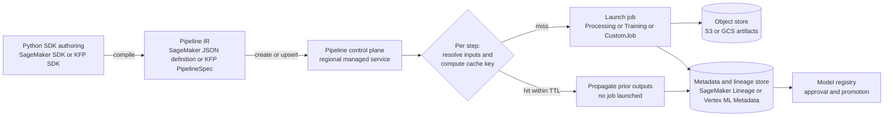

# MLOps Pipelines: SageMaker vs Vertex AI Pipelines

## TL;DR

A managed ML pipeline service is a DAG interpreter that turns a compiled graph into calls against job APIs, plus a metadata store that records what ran, on which inputs, and what it produced.
Step caching is memoization keyed on how a step is *declared* (string references to images, URIs, and parameters), not on the bytes it reads, so caching is only correct if every input reference is immutable.
SageMaker Pipelines builds its cache key from a fixed per-step-type list of job-request attributes, and Vertex AI Pipelines builds its key from Kubeflow Pipelines (KFP) input parameters, input artifact identities, output specs, and the container spec.
Lineage (who produced which artifact) and caching (can I skip this step) are separate concerns that both services store separately from the artifact bytes, so an S3 or GCS lifecycle rule can delete outputs that a cache entry still points to.
The orchestrator is rarely the bottleneck or the main cost; job-launch quotas, API throttling, accelerator capacity, and wasted recomputation are, so the main levers are parallelism caps, content-addressed inputs, and cache time-to-live (TTL) set below artifact retention.

## Mental Model



Think of a pipeline service as a build system for models, not a cron job with extra steps.
The SDK is the build file, the compiled IR is the build graph, each step is a build rule whose action is a remote job, and the cache is a table that maps a rule's declared inputs to the outputs of an earlier successful run.
The artifact bytes live in S3 or GCS, while the record of how they were produced lives in a separate metadata plane, and nothing transactionally ties those two together.
Most production surprises come from that gap: the cache thinks an output exists when it is gone, or thinks an input is unchanged when only its bytes changed under the same name.

## Internals

### Four planes, not one service

The authoring plane is client-side Python: the SageMaker Python SDK (`sagemaker.workflow`) or the KFP SDK v2 (`kfp.dsl`), which build an in-memory graph and serialize it.
The orchestration control plane is a regional managed service that stores the definition, accepts `StartPipelineExecution` or `PipelineJob` creation, walks the DAG, and decides which steps are ready.
The step data plane is the set of ordinary jobs the orchestrator launches for you: SageMaker Processing, Training, Tuning, Transform, and EMR jobs on AWS, and Vertex AI CustomJobs (containers) on Google Cloud.
The metadata plane records artifacts, executions, and their links: SageMaker ML Lineage Tracking entities on AWS and Vertex ML Metadata, which is built on the open-source ML Metadata (MLMD) library from TFX, on Google Cloud.
These planes fail independently.
A job-API brownout stalls every pipeline even when the orchestrator is healthy, and a metadata write failure can leave a completed job with no lineage record.
This is the same control plane versus data plane split covered in [[17-Cloud-AI-Engineering/Volume_01_Cloud_Architecture_Principles/Chapter_04_Control_Plane_vs_Data_Plane_Separation|Control Plane vs Data Plane Separation]].

### The intermediate representation is the contract

SageMaker Pipelines stores a JSON pipeline definition containing `Parameters`, `Steps`, and per-step `Arguments` that are almost exactly the request body of the underlying job API (for example `CreateProcessingJob` or `CreateTrainingJob`).
Values that are not known until runtime are written as expressions: `Get` property references such as `Steps.Train.Properties.ModelArtifacts.S3ModelArtifacts`, `Std:Join` string concatenation, `JsonGet` reads from property files, and execution variables.
The orchestrator resolves those expressions just before it issues each job request, so the cache key is computed over the *resolved* request attributes.
The SDK turns its parameters into these job attributes, so whether changing an SDK argument busts the cache depends on which job attribute it ends up in (SageMaker Python SDK docs, as of 2026-10).

KFP v2 compiles to a `PipelineSpec` (YAML or JSON) that names components, their input and output definitions (parameters and typed artifacts), executor container specs, and a DAG of tasks with data dependencies.
Vertex AI Pipelines runs this IR directly, and so does open-source KFP on Kubernetes, which is why the same compiled file can, in principle, move between Vertex and a self-hosted Kubeflow cluster.
The SageMaker JSON format has no open-source executor, so a SageMaker pipeline definition is portable only within SageMaker.

### How one step executes

On SageMaker, the control plane evaluates `DependsOn` and data dependencies, resolves property references from upstream step outputs, checks the cache if `CacheConfig.Enabled` is true, and otherwise calls the job API with the pipeline's IAM role.
It then polls the job to a terminal state and exposes the job's describe-response fields as properties for downstream steps.
Retries are declared per step through retry policies keyed on exception classes such as throttling, service faults, capacity errors, and resource limits (UNVERIFIED exact enum names in this revision).
`ParallelismConfiguration.MaxParallelExecutionSteps` caps how many steps in one execution run at the same time, which is the main defense against self-inflicted API throttling and quota exhaustion when you fan out.

In KFP v2, each task is split into a driver and an executor.
The driver resolves upstream outputs and parameters, computes the cache fingerprint, looks up the cache, and either records a cached execution or emits the executor's runtime spec.
The executor is the user container wrapped by a launcher binary, which stages input artifacts, runs the user command, uploads output artifacts to the pipeline root, and records outputs in metadata.
On open-source KFP running on Argo Workflows the driver and executor are visible as separate pods, while on Vertex the same protocol is hidden behind managed CustomJobs (KFP architecture; UNVERIFIED for Vertex's internal implementation).
The cache decision is made before any compute is requested, so a cache hit costs no accelerator capacity and no container image pull.

### Step caching is memoization over declared references

This mechanism is the one getting-started guides skip, and it matters more than anything else in this chapter.
Mokhov, Mitchell, and Peyton Jones ("Build Systems a la Carte", ICFP 2018) separate *verifying traces*, which record hashes of a rule's inputs and rerun when they change, from *constructive traces*, which also store the outputs so a hit can be served from a shared cache.
Both pipeline services implement constructive traces, but the "hash" they record covers the step's declaration rather than the content of what the step reads.

SageMaker documents the exact attributes per step type.
For a Processing step the key is `AppSpecification`, `Environment`, and `ProcessingInputs` (AWS docs, as of 2026-10).
For a Training step it includes `AlgorithmSpecification`, `CheckpointConfig`, `DebugHookConfig`, `DebugRuleConfigurations`, `Environment`, `HyperParameters`, and `InputDataConfig`, plus any further attributes in the current documentation (AWS docs, as of 2026-10).
A step does not rerun when you change an attribute that is not on its list (AWS docs, as of 2026-10).
A hit reuses only successful runs, picks the most recent successful run inside the `ExpireAfter` window, and the window is an ISO 8601 duration (AWS docs, as of 2026-10).

Three consequences follow, and none of them appears in the quick-start guides.
First, code is content-addressed but data and images are not.
The SDK hashes a local script and puts the hash in the S3 path of the uploaded code, so editing the script changes the `ProcessingInputs` or `InputDataConfig` URI and forces a rerun (SageMaker Python SDK docs, as of 2026-10).
An `ImageUri` ending in `:latest` is only a string, so rebuilding and pushing the image under the same tag produces a cache hit on the old run's outputs, which is a documented field failure on AWS re:Post.
An S3 data URI that you overwrite in place is also only a string, so new bytes behind an unchanged prefix produce a stale hit.
Second, output location is not part of the Processing key.
If you change `ProcessingOutputConfig` destinations, a hit hands downstream steps the *old* run's output URIs, so consumers must always read the upstream step's properties and never a hard-coded path.
Third, the cache index and the artifact bytes have independent lifetimes.
A 30-day `ExpireAfter` combined with a 7-day S3 lifecycle expiration on the pipeline bucket gives you hits that point at deleted objects, and the failure shows up one step later as a 404 inside a downstream job.

Vertex AI Pipelines defines the key as the step's inputs (parameter values and input artifact IDs), its output definitions, and its component specification (image, command, arguments, environment variables, and their order), with caching on by default (Google Cloud docs, UNVERIFIED in this revision).
Only pipelines with the same pipeline name share cache entries (Google Cloud docs, UNVERIFIED in this revision).
The input artifact is identified by its metadata-store ID, not by a digest of its bytes.
That is where KFP's `dsl.importer` matters.
With `reimport=False` the importer reuses an existing artifact with the same URI, so the artifact ID stays the same and the downstream step keeps hitting the cache even after you overwrite the object.
With `reimport=True` every run mints a new artifact ID, so downstream steps miss every time, even when the bytes are identical.
Neither setting gives content-correct caching; the fix is to make the URI itself content-addressed (a version ID or hash in the path), so that a change in identity always means a change in content.

The same idea goes back further.
Nectar (Gunda et al., OSDI 2010) cached datacenter computations keyed on program and input fingerprints and treated derived datasets as recomputable from lineage.
The RDD paper (Zaharia et al., NSDI 2012) made lineage the recovery mechanism itself.
Pipeline services use lineage for audit, not for recomputation, and their fingerprints are shallower than Nectar's.

### Lineage and metadata data model

MLMD models the world as Artifacts (typed, with URIs and properties), Executions (runs of a component), Events (input or output edges between an execution and an artifact), and Contexts (groupings such as a pipeline or a run), linked by Attributions and Associations.
Vertex ML Metadata exposes this model as a regional, per-project metadata store, and Vertex AI Pipelines writes into it automatically.
This means that on Vertex the lineage graph and the cache index sit in the same system: the driver's cache lookup is a query for a prior execution with a matching fingerprint (KFP design; UNVERIFIED as a statement about Vertex internals).

SageMaker ML Lineage Tracking models Artifacts, Actions, and Contexts joined by typed Associations (`ContributedTo`, `AssociatedWith`, `DerivedFrom`, `Produced`).
SageMaker creates these entities automatically for jobs, model packages, and endpoints.
The `QueryLineage` API walks the graph from start ARNs in a given direction to a maximum depth, optionally with filters and edges (UNVERIFIED parameter names in this revision).
AWS does not document the Pipelines cache index as backed by lineage entities, so deleting lineage entities should not be assumed to invalidate the cache, and the reverse is also true.

Lineage is only as complete as the paths that write to it.
Any step that reads or writes data outside a declared artifact, such as a Lambda step that copies files, a training script that pulls an extra file from S3, or a feature lookup at train time, creates an edge the graph never sees.
TFX (Baylor et al., KDD 2017) and Sculley et al. (NeurIPS 2015) both treat hidden data dependencies as a main source of ML technical debt, and an incomplete lineage graph is that same debt made concrete.

### Model registry as the promotion boundary

The pipeline should end at the registry, not at an endpoint.
SageMaker Model Registry stores Model Packages in Model Package Groups with an approval status (`PendingManualApproval`, `Approved`, `Rejected`), and status changes emit EventBridge events that a separate deployment pipeline consumes.
Vertex AI Model Registry stores model versions with aliases, and deployment automation promotes a version by moving an alias or by deploying a specific version to an endpoint.
Separating training from deployment this way lets the deployment side use canaries and rollback ([[17-Cloud-AI-Engineering/Volume_06_Infrastructure_as_Code_and_Delivery/Chapter_06_Progressive_Delivery_and_Deployment_Pipelines|Progressive Delivery and Deployment Pipelines]]) without touching the training DAG.

### Failure domains and idempotency

Both orchestrators are regional services, and a pipeline's steps run in the same region as the pipeline.
A pipeline that reads training data from another region pays cross-region egress on every cache miss and fails when that other region is impaired.
Job launches must be idempotent because the orchestrator can retry after a timeout whose outcome it does not know.
The AWS Builders' Library article on idempotent APIs explains the client-token pattern, and SageMaker job names, which must be unique per account and region, act as the natural idempotency key for launches.
A step whose job writes to an external system (a database, a feature store, a ticket) is not covered by step caching or by job-name idempotency, so it needs its own idempotency key that is derived from the execution ID.

## Numbers to Know

| Quantity | Value | Source |
|---|---|---|
| SageMaker cache TTL format | ISO 8601 duration; year, month, week, day, hour, or minute units | (AWS docs, as of 2026-10) |
| SageMaker cache reuse rule | Only successful runs; the most recent successful match inside TTL wins | (AWS docs, as of 2026-10) |
| SageMaker Processing cache key | `AppSpecification`, `Environment`, `ProcessingInputs` | (AWS docs, as of 2026-10) |
| SageMaker Training cache key (partial) | `AlgorithmSpecification`, `CheckpointConfig`, `DebugHookConfig`, `DebugRuleConfigurations`, `Environment`, `HyperParameters`, `InputDataConfig`, and more | (AWS docs, as of 2026-10) |
| SageMaker code-change detection | Local code file hashed into its S3 upload path | (SageMaker Python SDK v2 docs, as of 2026-10) |
| SageMaker default `CacheConfig` | Caching off unless `enable_caching=True` | (SageMaker Python SDK v2 docs, as of 2026-10) |
| Vertex AI Pipelines default caching | On by default; override per run with `enable_caching` or per task | UNVERIFIED (Google Cloud docs, not re-checked 2026-10) |
| Vertex cache sharing scope | Same pipeline name only | UNVERIFIED (Google Cloud docs, not re-checked 2026-10) |
| Vertex AI Pipelines orchestration fee | Per-run fee, historically USD 0.03 per run, plus underlying compute | UNVERIFIED |
| SageMaker Pipelines orchestration fee | No separate charge; pay for jobs, storage, and other resources used | UNVERIFIED |
| Parallel training jobs per HPO tuning job | 10 per a 2021 re:Post answer; current value may differ | UNVERIFIED (re:Post, 2021) |
| SageMaker managed job start overhead | Minutes per job for provisioning and image pull (rule of thumb) | UNVERIFIED |
| Metadata growth, 300 runs per night at 5 steps | About 45,000 executions per month, about 540,000 per year | Derived in this chapter |

Treat every UNVERIFIED row as a placeholder to confirm against the current pricing and quotas pages before you use it in a design review.
For cross-cutting numbers, see [[17-Cloud-AI-Engineering/Volume_14_Staff_Plus_Interview_Arena/Chapter_06_Cloud_AI_Numbers_Every_Staff_Engineer_Must_Know|Cloud AI Numbers Every Staff Engineer Must Know]] and [[17-Cloud-AI-Engineering/Appendices/Appendix_C_Limits_Quotas_and_Thresholds_Matrix|Appendix C]].

## AWS vs GCP Mechanism Parity

| Dimension | SageMaker Pipelines | Vertex AI Pipelines | Critical difference |
|---|---|---|---|
| Authoring | SageMaker Python SDK `sagemaker.workflow`, including `@step` for plain Python functions | KFP SDK v2 `kfp.dsl`, also runs TFX pipelines | KFP is open source; the SageMaker SDK targets one service |
| Compiled IR | SageMaker JSON pipeline definition; step arguments mirror job API requests | KFP `PipelineSpec` YAML or JSON | KFP IR is portable to self-hosted Kubeflow |
| Step substrate | Processing, Training, Tuning, Transform, EMR, Lambda, Callback, Condition, and other step types | Containerized components run as CustomJobs, plus Google Cloud pipeline components that call other services | SageMaker steps are typed job requests; Vertex steps are mostly arbitrary containers |
| Runtime expressions | `Get` property references, `Std:Join`, `JsonGet`, execution variables | Task output references and pipeline parameters resolved by the driver | Both resolve before the cache key is computed |
| Cache key | Fixed per-step-type list of resolved request attributes | Input parameter values, input artifact IDs, output definitions, container spec (UNVERIFIED) | SageMaker keys on URIs; Vertex keys on metadata artifact identity |
| Cache default and TTL | Off by default; `ExpireAfter` TTL per step | On by default; no documented TTL (UNVERIFIED) | A cache that is on by default with no TTL needs explicit invalidation discipline |
| Cache scope | Prior runs of the same step of the current pipeline | Pipelines with the same name (UNVERIFIED) | Renaming a pipeline is an accidental cache reset on Vertex |
| Lineage store | SageMaker ML Lineage Tracking: Artifacts, Actions, Contexts, Associations | Vertex ML Metadata (MLMD): Artifacts, Executions, Contexts, Events | On Vertex, cache and lineage share a store |
| Lineage query | `QueryLineage` graph traversal from ARNs | Metadata store lineage subgraph queries and filters | Both are regional and per account or project |
| Partial re-run | Selective execution: rerun chosen steps and reuse a source execution's other outputs | Re-submit with caching; failed tasks rerun, cached ones are skipped | Selective execution is explicit; Vertex relies on cache semantics |
| Fan-out | Separate steps or the `@step` pattern, capped by `MaxParallelExecutionSteps` | `dsl.ParallelFor` with a `parallelism` cap | Both caps protect quotas, not just cost |
| Retries | Per-step retry policies by exception class | Per-task `set_retry` | Retry multiplies cost on deterministic failures |
| Scheduling and triggers | EventBridge rules and Scheduler targeting a pipeline | Vertex AI Pipelines schedules API, or Cloud Scheduler | Both are external to the DAG engine on AWS; Vertex has a native scheduler |
| Registry handoff | Model Package Groups, approval status, EventBridge events | Model Registry versions and aliases | AWS uses an approval state machine; GCP uses alias pointers |
| Identity | Pipeline `RoleArn` plus per-job execution roles; caller needs `iam:PassRole` | Run `service_account`; caller needs `iam.serviceAccounts.actAs` | Both are confused-deputy surfaces |
| Network | Per-job `NetworkConfig` (VPC, network isolation), SageMaker API interface endpoints | Run `network` (VPC peering), VPC Service Controls perimeter | VPC SC covers the control plane APIs; AWS uses endpoint policies plus SCPs |
| Encryption | Per-job KMS keys for volumes and outputs | `encryption_spec_key_name` CMEK on the run | GCP sets CMEK once per run; AWS sets keys per job argument |
| Local testing | `LocalPipelineSession` runs steps in local containers | Local execution of KFP components (SDK feature; UNVERIFIED maturity) | Neither reproduces managed IAM and network behavior |

See also [[17-Cloud-AI-Engineering/Volume_04_AWS_vs_GCP_Translation/Chapter_06_AI_and_ML_Platform_Translation|AI and ML Platform Translation]] for the broader SageMaker to Vertex mapping.

## Worked Example: Proving Cache Unsoundness and Fixing It With Content Addressing

### Goal

Build a one-step pipeline on each cloud, run it twice to observe a cache hit, overwrite the input bytes in place to observe a stale hit, and then switch to a content-addressed input path to observe a correct miss.

### Cost estimate

SageMaker side: three Processing runs on `ml.m5.large`, each a few minutes, at an illustrative list price of about USD 0.12 per hour, total under USD 0.10 (UNVERIFIED price; check the SageMaker AI pricing page for your region).
Vertex side: three pipeline runs of one small component at the per-run fee plus a few minutes of default component compute, total under USD 0.50 (UNVERIFIED price).
Storage: a few kilobytes in S3 and GCS, effectively zero.
Set a USD 5 budget alarm on each cloud before you start.

### Budget alarms

```bash
# AWS: monthly cost budget with an 80 percent actual-spend email alert
ACCOUNT_ID=$(aws sts get-caller-identity --query Account --output text)
aws budgets create-budget --account-id "$ACCOUNT_ID" \
  --budget '{"BudgetName":"mlops-cache-lab","BudgetLimit":{"Amount":"5","Unit":"USD"},"TimeUnit":"MONTHLY","BudgetType":"COST"}' \
  --notifications-with-subscribers '[{"Notification":{"NotificationType":"ACTUAL","ComparisonOperator":"GREATER_THAN","Threshold":80,"ThresholdType":"PERCENTAGE"},"Subscribers":[{"SubscriptionType":"EMAIL","Address":"you@example.com"}]}]'

# GCP: billing budget with 50 and 90 percent thresholds
gcloud billing budgets create --billing-account="$BILLING_ACCOUNT_ID" \
  --display-name="mlops-cache-lab" --budget-amount=5USD \
  --threshold-rule=percent=0.5 --threshold-rule=percent=0.9
```

### AWS: SageMaker Pipelines

Prerequisites: an S3 bucket, a SageMaker execution role whose ARN is in `SM_ROLE_ARN`, and `pip install "sagemaker>=2.200,<3" boto3`.
The pin to the 2.x line is deliberate because the module paths used below are the 2.x paths.

```python
# preprocess.py - runs inside the SageMaker Processing container
import csv, json, os, hashlib
src = "/opt/ml/processing/input/train.csv"
rows = list(csv.reader(open(src)))
digest = hashlib.sha256(open(src, "rb").read()).hexdigest()
os.makedirs("/opt/ml/processing/output", exist_ok=True)
json.dump({"rows": len(rows), "sha256": digest}, open("/opt/ml/processing/output/stats.json", "w"))
print("rows", len(rows), "sha256", digest)
```

```python
# sm_lab.py
import os, sys, time, boto3, hashlib
from sagemaker.workflow.pipeline_context import PipelineSession
from sagemaker.workflow.pipeline import Pipeline
from sagemaker.workflow.parameters import ParameterString
from sagemaker.workflow.functions import Join
from sagemaker.workflow.steps import ProcessingStep, CacheConfig
from sagemaker.sklearn.processing import SKLearnProcessor
from sagemaker.processing import ProcessingInput, ProcessingOutput

bucket, role = os.environ["LAB_BUCKET"], os.environ["SM_ROLE_ARN"]
mode = sys.argv[1]  # "mutable" or "addressed"
s3, sm = boto3.client("s3"), boto3.client("sagemaker")

def put_data(content: bytes) -> str:
    if mode == "mutable":
        key = "data/current/train.csv"  # same URI every time: unsound cache key
    else:
        key = f"data/{hashlib.sha256(content).hexdigest()[:16]}/train.csv"  # content-addressed
    s3.put_object(Bucket=bucket, Key=key, Body=content)
    return key.split("/")[1]

session = PipelineSession()
data_version = ParameterString(name="DataVersion", default_value="current")
proc = SKLearnProcessor(framework_version="1.2-1", role=role, instance_type="ml.m5.large",
                        instance_count=1, sagemaker_session=session)
step = ProcessingStep(
    name="Stats",
    step_args=proc.run(
        code="preprocess.py",
        inputs=[ProcessingInput(
            source=Join(on="/", values=[f"s3://{bucket}/data", data_version, "train.csv"]),
            destination="/opt/ml/processing/input")],
        outputs=[ProcessingOutput(source="/opt/ml/processing/output")]),
    cache_config=CacheConfig(enable_caching=True, expire_after="P1D"))
pipe = Pipeline(name=f"mlops-cache-lab-{mode}", parameters=[data_version], steps=[step],
                sagemaker_session=session)
pipe.upsert(role_arn=role)

def run(content: bytes):
    version = put_data(content)
    ex = pipe.start(parameters={"DataVersion": version})
    ex.wait(delay=15, max_attempts=120)
    for st in sm.list_pipeline_execution_steps(PipelineExecutionArn=ex.arn)["PipelineExecutionSteps"]:
        hit = st.get("CacheHitResult", {}).get("SourcePipelineExecutionArn")
        print(st["StepName"], st["StepStatus"], "CACHE HIT from " + hit if hit else "EXECUTED")

run(b"a,1\nb,2\n")          # 1: executes
run(b"a,1\nb,2\n")          # 2: cache hit in both modes (correct)
run(b"a,1\nb,2\nc,3\n")     # 3: mutable -> stale CACHE HIT (wrong); addressed -> EXECUTED (correct)
```

Run `python sm_lab.py mutable` and then `python sm_lab.py addressed`, and compare the third line of output from each.
In mutable mode the third run reports a cache hit even though the CSV gained a row, because `ProcessingInputs` holds the same URI string.
In addressed mode the URI contains the content hash, so the resolved `ProcessingInputs` value changes and the step reruns.

### GCP: Vertex AI Pipelines

Prerequisites: a GCS bucket in the same region, a service account with Vertex AI user and bucket object permissions in `VERTEX_SA`, and `pip install "kfp>=2,<3" google-cloud-aiplatform`.

```python
# vertex_lab.py
import os, sys, hashlib
from kfp import dsl, compiler
from google.cloud import aiplatform, storage

project, region = os.environ["GCP_PROJECT"], os.environ["GCP_REGION"]
bucket_name, sa = os.environ["LAB_GCS_BUCKET"], os.environ["VERTEX_SA"]
mode = sys.argv[1]  # "mutable" or "addressed"

@dsl.component(base_image="python:3.11-slim")
def stats(data: dsl.Input[dsl.Dataset], metrics: dsl.Output[dsl.Metrics]):
    import hashlib
    raw = open(data.path, "rb").read()
    metrics.log_metric("rows", raw.count(b"\n"))
    metrics.log_metric("sha256_prefix", int(hashlib.sha256(raw).hexdigest()[:8], 16))

@dsl.pipeline(name=f"mlops-cache-lab-{mode}")
def lab(data_uri: str):
    imp = dsl.importer(artifact_uri=data_uri, artifact_class=dsl.Dataset, reimport=False)
    stats(data=imp.output)

compiler.Compiler().compile(lab, "lab.yaml")
aiplatform.init(project=project, location=region, staging_bucket=f"gs://{bucket_name}")
bkt = storage.Client(project=project).bucket(bucket_name)

def run(content: bytes):
    key = "data/current/train.csv" if mode == "mutable" else \
          f"data/{hashlib.sha256(content).hexdigest()[:16]}/train.csv"
    bkt.blob(key).upload_from_string(content)
    job = aiplatform.PipelineJob(display_name=f"lab-{mode}", template_path="lab.yaml",
                                 pipeline_root=f"gs://{bucket_name}/root",
                                 parameter_values={"data_uri": f"gs://{bucket_name}/{key}"},
                                 enable_caching=True)
    job.run(sync=True, service_account=sa)
    for t in job.task_details:
        ex_state = getattr(getattr(t, "execution", None), "state", None)
        print(t.task_name, t.state, ex_state)

run(b"a,1\nb,2\n")
run(b"a,1\nb,2\n")
run(b"a,1\nb,2\nc,3\n")
```

The expected result follows from the documented cache key: in mutable mode, `reimport=False` resolves the same URI to the same artifact ID, so `stats` reports a cached execution state on run 3 despite the new bytes.
In addressed mode, the new URI produces a new artifact and a new key, so `stats` executes.
Record the observed states; if your result differs, the cache key definition has changed, and that is worth a note in the batch report.

### Teardown

```bash
aws sagemaker delete-pipeline --pipeline-name mlops-cache-lab-mutable
aws sagemaker delete-pipeline --pipeline-name mlops-cache-lab-addressed
aws s3 rm "s3://$LAB_BUCKET" --recursive && aws s3 rb "s3://$LAB_BUCKET"
SM_DEFAULT_BUCKET="sagemaker-${AWS_REGION:-us-east-1}-${ACCOUNT_ID}"
aws s3 rm "s3://${SM_DEFAULT_BUCKET}" --recursive 2>/dev/null && aws s3 rb "s3://${SM_DEFAULT_BUCKET}" 2>/dev/null || true
aws budgets delete-budget --account-id "$ACCOUNT_ID" --budget-name mlops-cache-lab
python -c "from google.cloud import aiplatform as a; a.init(project='$GCP_PROJECT', location='$GCP_REGION'); [j.delete() for j in a.PipelineJob.list(filter='display_name=\"lab-mutable\" OR display_name=\"lab-addressed\"')]"
gcloud storage rm -r "gs://$LAB_GCS_BUCKET"
gcloud billing budgets list --billing-account="$BILLING_ACCOUNT_ID" --filter="displayName=mlops-cache-lab" --format="value(name)" | xargs -I{} gcloud billing budgets delete {} --quiet
```

Lineage entities SageMaker created automatically for the Processing jobs remain as metadata.
They have no meaningful storage charge, but a regulated account should still delete them during teardown.

### Capacity sizing: nightly per-tenant retraining

Scenario: 300 tenant models retrain nightly in an 8-hour window, and each pipeline runs Preprocess (20 min on CPU), Train (60 min on one GPU instance), Evaluate (10 min on CPU), Condition, and Register.
Step 1, uncached GPU demand: 300 trains times 1 hour gives 300 GPU instance-hours per night.
Step 2, concurrency: an 8-hour window with 60-minute trains needs at least 300 / 8 = 38 concurrent trains, and allowing 20 percent for provisioning overhead and retries gives a planned 46, so request a training-instance quota of at least 48 and set `MaxParallelExecutionSteps` and the tenant-level concurrency to match.
Step 3, job launch rate: 300 pipelines times 3 job-backed steps gives 900 job launches per night, which is trivial on average but arrives as a burst if every pipeline starts at 00:00, so stagger start times with jitter across the first hour to keep `Create*Job` calls under API throttling limits.
Step 4, caching: if 60 percent of tenants have no new data on a given night and the data path is content-addressed, all three steps hit the cache for those tenants, and GPU demand falls from 300 to 120 instance-hours.
Step 5, cost with a placeholder GPU price G per hour: uncached is 300G per night, cached is 120G per night, and the monthly saving is 30 times 180G, which is 5,400G; at an illustrative G of USD 1.50 that is USD 8,100 per month (UNVERIFIED price).
Step 6, orchestration fee on Vertex at the historical per-run fee: 300 runs times 30 nights times USD 0.03 is USD 270 per month, which cached runs still incur, and which is small next to compute (UNVERIFIED fee).
Step 7, metadata growth: 300 runs times about 5 executions per run is about 1,500 executions per night, about 45,000 per month, and about 540,000 per year, plus about twice as many artifacts and events, so lineage queries must use filters and depth limits.
Spot and preemptible training can cut G further with checkpoint-aware retries, as covered in [[17-Cloud-AI-Engineering/Volume_09_FinOps_and_Cloud_Economics/Chapter_03_Spot_Economics_and_Interruption_Handling|Spot Economics and Interruption Handling]].

## Failure Modes and Pitfalls

### Stale cache hits from mutable references

Overwriting `s3://.../current/` or `gs://.../latest/`, deploying images by `:latest`, or importing with `reimport=False` all give cache hits on outdated computation.
The symptom is a model whose evaluation metrics do not move after a data refresh, and it is invisible unless you log input content digests.
The fix is content-addressed data paths, S3 object versions or GCS generations recorded as parameters, and images referenced by `@sha256:` digest.

### Cache poisoning by a successful but wrong run

Caching reuses any successful run, so a buggy preprocessing release that exits 0 is served to every later run inside the TTL (AWS docs, as of 2026-10).
Rolling back the code fixes it only if the rollback changes a key attribute, which a hashed code path does, but an environment-driven bug behind an unchanged image tag does not.
Keep a `CacheBuster` pipeline parameter that is wired into every step's environment so an operator can invalidate the cache in one run without editing step definitions.

### Cache entries pointing at deleted artifacts

Cache metadata and object-store lifecycle rules are not coordinated, so a hit can propagate URIs to objects that a lifecycle rule has already deleted.
Set `ExpireAfter` well below the shortest lifecycle expiration on pipeline output prefixes, and on Vertex, where no TTL is documented, either never expire the pipeline root or disable caching for runs older than its retention.

### Downstream reads from hard-coded paths

Because SageMaker Processing output configuration is not in the cache key, a hit returns the old run's output URIs.
A downstream step that reads a hard-coded `s3://bucket/run-${date}/` path instead of the upstream property reference reads empty or old data.

### Fan-out storms and quota exhaustion

Launching hundreds of training steps at once hits account instance quotas and job-API throttling, as reported on AWS re:Post when users fanned out dozens of parallel training steps.
Retry policies on throttling errors without a concurrency cap turn this into a retry storm that keeps the account throttled for every other team.
Cap concurrency at the pipeline, cap tenants per wave, and use full-jitter backoff, as covered in [[17-Cloud-AI-Engineering/Volume_07_Reliability_and_SRE/Chapter_03_Resilient_Communication_Retries_Jitter_and_Circuit_Breakers|Retries, Jitter, and Circuit Breakers]].

### Accelerator capacity as a hidden dependency

A pipeline that is correct and cached still stalls when the region has no GPU capacity, and capacity errors look like transient failures to naive retry logic.
Treat capacity as a reserved, scheduled resource with fallback instance types, not as something the orchestrator will find for you; see [[17-Cloud-AI-Engineering/Volume_10_AI_Infrastructure_on_Cloud/Chapter_08_Fault_Tolerance_and_Fleet_Resiliency_at_Scale|Fault Tolerance and Fleet Resiliency at Scale]].

### Regional control plane dependency

The AWS summary of the December 7, 2021 us-east-1 event describes congestion in the internal network that impaired control plane APIs while many data planes kept running, which is exactly the shape that stalls job-launching orchestrators ([AWS summary](https://aws.amazon.com/message/12721/)).
The AWS us-east-1 event of October 2025, triggered by a DynamoDB DNS failure, similarly broke control plane workflows across many dependent services (UNVERIFIED detail in this revision).
Google Cloud's June 2025 incident, caused by a Service Control policy change, returned errors from many Google Cloud APIs at once (UNVERIFIED detail in this revision).
The lesson is static stability: serving must never depend on the training pipeline's control plane, and the last approved model must stay deployable without the pipeline running ([[17-Cloud-AI-Engineering/Volume_01_Cloud_Architecture_Principles/Chapter_02_Regions_Zones_and_Static_Stability|Regions, Zones, and Static Stability]]).

### Lineage gaps from side channels

Lambda steps, callback steps, and scripts that fetch extra inputs at runtime create provenance the metadata store never records.
In an audit or a data-deletion request, those gaps make "which models touched this dataset" unanswerable.

### Renaming pipelines on Vertex

If the cache is scoped by pipeline name, renaming a pipeline for cosmetic reasons silently disables caching and can multiply nightly compute (UNVERIFIED scope rule).

## Security and Cost Angles

### IAM scoping

On AWS, three identities matter: the caller who starts the pipeline, the pipeline `RoleArn` that SageMaker assumes to create jobs, and the per-job execution roles that the jobs run as.
The pipeline role needs `iam:PassRole` on exactly the job roles it uses, restricted with an `iam:PassedToService` condition for `sagemaker.amazonaws.com`, and no wildcard on `Resource`.
Without that restriction, anyone who can edit a pipeline definition can pass a highly privileged role to an arbitrary container, which is a classic confused-deputy escalation.
On Google Cloud, the run's `service_account` is the identity of every component container, and the caller needs `iam.serviceAccounts.actAs` on it, so give each pipeline family its own service account instead of the Compute Engine default service account.
See [[17-Cloud-AI-Engineering/Volume_02_AWS_Deep_Dive/Chapter_01_IAM_Policy_Evaluation_Engine|IAM Policy Evaluation Engine]] and [[17-Cloud-AI-Engineering/Volume_03_GCP_Deep_Dive/Chapter_02_Cloud_IAM_Roles_Policies_and_Conditions|Cloud IAM: Roles, Policies, and Conditions]].

### Encryption key hierarchy

Pipeline outputs are training data derivatives and model weights, and both are sensitive.
On AWS, set `VolumeKmsKeyId` and output `KmsKeyId` on every job, enforce default bucket encryption with SSE-KMS and S3 Bucket Keys to cut KMS request volume, and deny unencrypted `PutObject` in the bucket policy.
On Google Cloud, set `encryption_spec_key_name` on the `PipelineJob` so the run's resources use CMEK, and use CMEK on the pipeline-root bucket as well.
Envelope encryption details are in [[17-Cloud-AI-Engineering/Volume_08_Security_Identity_and_the_Data_Perimeter/Chapter_04_Encryption_Key_Hierarchies_and_Envelope_Encryption|Encryption Key Hierarchies and Envelope Encryption]].

### Private network boundaries

On AWS, run jobs in private subnets with `NetworkConfig`, enable network isolation for jobs that need no egress, and reach SageMaker, S3, ECR, CloudWatch, and STS through VPC endpoints with endpoint policies scoped to your organization.
On Google Cloud, put the Vertex AI and Cloud Storage APIs inside a VPC Service Controls perimeter and use the run's `network` parameter so components reach private services over peering.
A pipeline is an exfiltration channel by design, because it runs arbitrary containers with data-read permissions, so the perimeter matters more than for a typical service ([[17-Cloud-AI-Engineering/Volume_08_Security_Identity_and_the_Data_Perimeter/Chapter_06_Constructing_an_Impenetrable_Data_Perimeter|Constructing an Impenetrable Data Perimeter]]).

### Supply chain

Digest-pinned images serve both correct caching and supply-chain integrity, and admission-time signature verification of component images closes the loop ([[17-Cloud-AI-Engineering/Volume_08_Security_Identity_and_the_Data_Perimeter/Chapter_05_Software_Supply_Chain_Security_SLSA_and_Sigstore|Software Supply Chain Security]]).
The lineage graph is the provenance record an SLSA-style attestation for a model needs, so complete lineage is also a security control.

### Unit-economics levers

Compute dominates: content-addressed caching, Spot or preemptible training with checkpointing, and right-sized CPU steps are the main levers.
Orchestration fees are second-order but scale linearly with run count, so on Vertex, collapsing many tiny scheduled runs into fewer runs with `ParallelFor` reduces per-run overhead (UNVERIFIED fee model).
Each cache miss on cross-region input pays egress again, so co-locate data and pipelines ([[17-Cloud-AI-Engineering/Volume_09_FinOps_and_Cloud_Economics/Chapter_04_Network_Egress_Economics_and_Optimization|Network Egress Economics]]).
Tag every job with pipeline name, execution ID, and tenant, so that billing export to BigQuery or AWS Cost and Usage Reports attributes cost per model ([[17-Cloud-AI-Engineering/Volume_09_FinOps_and_Cloud_Economics/Chapter_01_Cloud_Billing_Models_and_Unit_Cost_Allocation|Cloud Billing Models and Unit Cost Allocation]]).

## Interview Questions and Model Answers

### Question 1 (L5 - Senior)

A teammate fixed a bug in a custom training container, pushed it as `trainer:latest`, and reran the SageMaker pipeline, but the training step finished in seconds and the model did not change; explain what happened and how you prevent it.

#### Model Answer

The training step had caching enabled, and SageMaker computes the training cache key from resolved request attributes such as `AlgorithmSpecification`, which holds the image URI as a string.
The string `trainer:latest` did not change, hyperparameters and input channels did not change, and a successful run existed inside the `ExpireAfter` window, so the orchestrator propagated that run's outputs without launching a job.
The step "finishing in seconds" is the tell, and `ListPipelineExecutionSteps` would have shown a `CacheHitResult` with the source execution ARN.
The immediate fix is to rerun with caching disabled for that step, or with a cache-buster parameter wired into the step environment.
The durable fix is to have CI resolve the pushed tag to its `@sha256:` digest and inject the digest-qualified URI into the pipeline definition, so any image change changes the key.
I would also add a check in CI that rejects pipeline definitions that contain mutable tags.
The general principle is that caching is only sound when every referenced input is immutable, and the same applies to data URIs.

#### Follow-up Interviewer Question

The same thing happens with the input dataset because the data team overwrites `s3://lake/features/current/` nightly; how do you fix it without asking the data team to change their writer?

### Question 2 (L5 - Senior)

Compare how SageMaker Pipelines and Vertex AI Pipelines decide that a step is a cache hit, and name one situation where the same logical change produces a hit on one platform and a miss on the other.

#### Model Answer

SageMaker uses a documented, per-step-type list of resolved job-request attributes, for example `AppSpecification`, `Environment`, and `ProcessingInputs` for Processing, and it considers only successful runs inside an explicit TTL, picking the most recent.
Vertex uses the KFP interface: input parameter values, input artifact IDs from ML Metadata, output definitions, and the full container spec, with caching on by default and no TTL that I would rely on.
One divergence is changing a command-line argument that is not an environment variable.
On Vertex, arguments are part of the container spec, so the change is a miss.
On SageMaker Processing, container arguments live under `AppSpecification`, which is also in the key, so this one matches, which shows you must check per field.
A real divergence is the output destination.
On SageMaker Processing, output configuration is not in the key, so changing only the output prefix is a hit that returns the old URIs.
On Vertex, output definitions are in the key, but the output URI is generated under the pipeline root, so changing the pipeline root alone is likely still a hit (UNVERIFIED nuance), and I would confirm it empirically.
A second divergence is data identity: SageMaker keys on the S3 URI string, while Vertex keys on artifact ID, so `reimport=True` on an importer causes a miss on every run even with identical bytes, which has no SageMaker equivalent.

#### Follow-up Interviewer Question

Which of those two designs makes it easier to build content-correct caching as a platform team, and why?

### Question 3 (L6 - Staff)

Design the caching and reproducibility contract for a company-wide training platform serving 40 teams on SageMaker Pipelines, where the requirements are that caching must never return stale results and any model must be reproducible from its registry entry.

#### Model Answer

I would make immutability a platform invariant instead of a convention, because the services' cache keys are built on references.
First, all data inputs enter through a resolution step at the start of each pipeline that converts a logical dataset name into an immutable physical URI: either a content-hash prefix written by a snapshot job, or an S3 object version recorded as a parameter, or a table snapshot ID if the source is a lakehouse.
Every downstream step consumes only that resolved URI, so the cache key changes if and only if the content changes.
Second, the platform's pipeline-construction library rewrites image references to digests at compile time and fails the build on mutable tags.
Code is already content-addressed by the SDK's hashed upload path, so editing a script is covered.
Third, any nondeterminism that matters, such as random seeds, library versions, and the base image, must be either in the image digest or in hyperparameters, so that it is part of the key.
Fourth, cache TTL is centrally set below the artifact bucket's lifecycle retention, and I would assert that relationship in a policy-as-code check on the infrastructure repository.
Fifth, for reproducibility, the registration step writes the resolved input URIs, image digests, code hash, hyperparameters, and pipeline execution ARN into the model package metadata, which also lands in lineage.
Reproduction is then "start the pipeline with these parameters, caching disabled", and the platform runs a periodic reproduction audit on a sample of models, comparing evaluation metrics within tolerance.
The trade-offs are storage growth from immutable snapshots, mitigated by deduplicating on content hash and by lifecycle rules on unreferenced snapshots, and a few minutes added to each pipeline for the resolution step.
I would also give teams an escape hatch, a cache-buster parameter that is audited, because eventually someone will need to force reruns during an incident.

#### Follow-up Interviewer Question

Your lifecycle rule deletes unreferenced snapshots, but how do you define "referenced" safely when cache entries, lineage edges, and registry entries all live in different stores?

### Question 4 (L6 - Staff)

A model in production makes a harmful prediction, and legal asks within 24 hours which training datasets, code versions, and upstream pipelines contributed to that specific model version, on both AWS and Google Cloud deployments; walk through how you answer and what usually breaks.

#### Model Answer

On AWS I start from the endpoint, go to its model, then its model package, and call `QueryLineage` upstream from the model package ARN, traversing `DerivedFrom` and `ContributedTo` edges to the training job, its input artifacts, and the processing jobs that produced those.
On Google Cloud I start from the Vertex Model Registry version, find the producing pipeline run, and query the ML Metadata lineage subgraph for the model artifact to get executions and their input artifacts.
In both cases, cache hits complicate the walk, because a cached step's outputs were produced by an earlier execution, so the lineage I need may sit in a different pipeline run from the one that registered the model.
I make sure the traversal follows the cache source, which SageMaker exposes as the source execution ARN on the cached step.
What usually breaks is completeness, not the query.
Side-channel reads inside training scripts, Lambda steps that copy data, and feature lookups at train time do not appear as artifacts.
Another break is a mutable URI: lineage says `s3://lake/current/`, but the bytes at that path today are not the bytes used then.
A third is retention: lineage survives while the referenced objects or job logs have been deleted.
So my answer to legal is a lineage graph plus an explicit statement of confidence, and my remediation is to make side channels structurally impossible: network isolation on training jobs, all inputs declared as artifacts, and content-addressed URIs so that a lineage entry pins exact bytes.
Proactively, I would run a nightly job that exports lineage for every newly registered model into an immutable store, so the answer does not depend on interactive queries during an incident.

#### Follow-up Interviewer Question

A data subject requests erasure under privacy law; how do you use the same graph to find every model that must be retrained, and what does that do to your caches?

### Question 5 (L6 - Staff)

Nightly, 300 tenant pipelines each fan out to training on GPU instances, and last night half of them failed with throttling and resource-limit errors after retries; diagnose the dynamics and redesign.

#### Model Answer

The pattern is a synchronized burst: every pipeline starts at 00:00, each launches jobs as soon as its preprocessing finishes, and preprocessing durations are similar, so training launches cluster into a narrow window.
Job-creation APIs throttle, retry policies fire, and without jitter the retries re-synchronize, while successful launches consume the GPU instance quota so later launches get resource-limit errors that are not transient.
Retrying resource-limit errors is wasted work, and retrying throttling without backoff amplifies the overload, so the retry policy made it worse.
The redesign has four parts.
Admission: stagger pipeline start times with random jitter across the first hour, and put a platform-level concurrency budget in front of training so that the number of in-flight training jobs is at most the instance quota minus headroom for ad hoc work.
Per pipeline: set `MaxParallelExecutionSteps` and treat retries by error class, with exponential backoff and full jitter for throttling, bounded retries for capacity errors with a fallback instance type, and no retry for resource-limit errors, which instead wait for admission.
Capacity: size the quota from the math, 300 one-hour trains in an 8-hour window needs about 38 concurrent jobs, plus 20 percent headroom gives about 46, and reserve that capacity if the region is tight.
Work reduction: with content-addressed inputs, tenants with no new data hit the cache and never touch the GPU queue, which in our data removes about 60 percent of training.
I would add SLOs on window completion and alerts on admission queue depth, so we see saturation before the window is missed.

#### Follow-up Interviewer Question

Would you move the admission controller into an external queue such as SQS or Pub/Sub, or keep it inside the pipeline service, and what failure mode does each choice introduce?

### Question 6 (L7+ - Principal)

Your company runs training on both AWS and Google Cloud after an acquisition, and leadership wants one MLOps pipeline standard; choose between SageMaker Pipelines, Vertex AI Pipelines, and self-hosted KFP or Argo on Kubernetes, and defend the decision.

#### Model Answer

I would standardize the contracts, not the orchestrator: a single artifact and lineage schema, immutable input resolution, digest-pinned components, and a registry-centered promotion model.
On the engine, KFP's `PipelineSpec` is the only IR with both a managed runner (Vertex) and an open-source runner (self-hosted Kubeflow on EKS or GKE), so authoring in KFP keeps a credible path to running the same graph on both clouds.
The cost of self-hosting on AWS is real: you take on an API server, a metadata database, a workflow controller, upgrades, multi-tenancy, and on-call for a stateful control plane, and you lose SageMaker's managed job primitives unless components call SageMaker jobs, which reintroduces AWS-specific code.
The alternative is to run SageMaker Pipelines on AWS and Vertex on Google Cloud natively, with a thin internal SDK that compiles one Python definition to both IRs.
That buys managed reliability on both sides at the cost of maintaining a compiler and accepting semantic differences in caching, retries, and conditions, which will leak.
My decision depends on where the gravity is.
If most training and the platform team sit on one cloud, I run that cloud's managed service as the primary and treat the other as a reduced-scope target with mostly portable containers, because the orchestrator is a small fraction of total cost and risk.
I do not mandate a single engine across clouds when the data does not move, because cross-cloud data movement costs more in egress and governance than duplicated orchestration does.
What I insist on everywhere is the lineage export: both clouds export to a common provenance store in a shared schema derived from MLMD concepts, because audit, erasure, and incident response are cross-cloud questions even when compute is not.
I would revisit the decision based on measured signals: the share of pipelines that are cross-cloud, platform on-call load, and time-to-onboard a new team.

#### Follow-up Interviewer Question

The acquired team argues that SageMaker's `@step` decorator is far more productive than KFP components for data scientists; how do you weigh developer productivity against the portability argument you just made?

### Question 7 (L7+ - Principal)

Argue for or against this statement: "Step caching should be disabled by default in our ML platform because it causes more incidents than it saves money."

#### Model Answer

I would argue against disabling it globally, but I agree that the default configuration is dangerous.
Incidents come from unsound keys, meaning mutable references, and from lifetime mismatches, meaning TTL longer than artifact retention, not from memoization as such.
Disabling caching turns a correctness problem into a cost and latency problem: in a fleet where most nights bring no new data for most tenants, it more than doubles GPU spend and makes partial re-runs after failures slower, which pushes engineers toward ad hoc manual re-runs that have no lineage at all.
The correct position is that caching is allowed only where the platform can prove soundness.
That means steps whose inputs all pass an immutability check (content-addressed URIs, digest-pinned images, hashed code) are cacheable, and steps with external side effects or unverifiable inputs are forced to be uncacheable.
TTL is derived from retention, never set by hand, and invalidation is a first-class audited operation.
The metric that settles the debate is "stale-hit incidents per thousand cached steps" next to "GPU hours saved", and if the platform cannot measure stale hits, for example by logging input content digests inside each step and comparing them on hits, then it is not ready to cache and the skeptics are right for now.
This is the build-systems lesson: Bazel-style caching works because inputs are content-addressed, and ML platforms that skip that requirement inherit its failure modes.

#### Follow-up Interviewer Question

How would you detect a stale cache hit automatically and cheaply at runtime, given that a hit by definition launches no job?

## Further Reading

- [SageMaker AI: Turn on step caching](https://docs.aws.amazon.com/sagemaker/latest/dg/pipelines-caching-enabling.html) - the authoritative `CacheConfig` and `ExpireAfter` semantics.
- [SageMaker developer guide: Caching pipeline steps (archived source)](https://github.com/awsdocs/amazon-sagemaker-developer-guide/blob/master/doc_source/pipelines-caching.md) - the per-step-type default cache key attribute lists and reuse rules.
- [SageMaker Python SDK: Model Building Pipeline](https://sagemaker.readthedocs.io/en/v2.240.0/amazon_sagemaker_model_building_pipeline.html) - how SDK parameters map to job attributes and how code is hashed into S3 paths.
- [AWS re:Post: step cached despite a changed image](https://repost.aws/questions/QUTyX8EmfWRT-kyywTXZl0zg/how-to-update-a-pipeline-step-and-ensure-if-runs-even-if-cached) - a field report of the mutable-tag stale-hit failure.
- [SageMaker ML Lineage Tracking](https://docs.aws.amazon.com/sagemaker/latest/dg/lineage-tracking.html) - the entity and association model behind `QueryLineage`.
- [Vertex AI Pipelines introduction](https://cloud.google.com/vertex-ai/docs/pipelines/introduction) - the managed KFP and TFX runner, including caching and run configuration.
- [Vertex ML Metadata introduction](https://cloud.google.com/vertex-ai/docs/ml-metadata/introduction) - the artifact, execution, context, and event model as exposed by Vertex.
- [Google ML Metadata (MLMD)](https://github.com/google/ml-metadata) - the open-source metadata library and schema that Vertex ML Metadata builds on.
- [Kubeflow Pipelines documentation](https://www.kubeflow.org/docs/components/pipelines/) - the KFP v2 IR, components, importer, caching, and the driver and launcher architecture.
- Baylor et al., "TFX: A TensorFlow-Based Production-Scale Machine Learning Platform", KDD 2017 ([DOI](https://doi.org/10.1145/3097983.3098021)) - the origin of component-plus-metadata pipeline design at Google.
- Sculley et al., ["Hidden Technical Debt in Machine Learning Systems"](https://papers.nips.cc/paper/5656-hidden-technical-debt-in-machine-learning-systems), NeurIPS 2015 - why undeclared data dependencies and pipeline jungles are the real risk.
- Mokhov, Mitchell, and Peyton Jones, "Build Systems a la Carte", ICFP 2018 ([DOI](https://doi.org/10.1145/3236774)) - the theory of verifying versus constructive traces that explains pipeline caching soundness.
- Gunda et al., "Nectar: Automatic Management of Data and Computation in Datacenters", OSDI 2010 - fingerprint-keyed computation caching and lineage-based regeneration, a decade before ML pipelines.
- Zaharia et al., ["Resilient Distributed Datasets"](https://www.usenix.org/conference/nsdi12/technical-sessions/presentation/zaharia), NSDI 2012 - lineage as a recovery mechanism rather than only as audit.
- [AWS Builders' Library: Making retries safe with idempotent APIs](https://aws.amazon.com/builders-library/making-retries-safe-with-idempotent-APIs/) - the idempotency discipline that job-launching orchestrators depend on.
- [AWS summary of the December 2021 us-east-1 event](https://aws.amazon.com/message/12721/) - a control plane impairment that shows why serving must not depend on the pipeline control plane.
- Previous chapter: [[17-Cloud-AI-Engineering/Volume_12_AI_Applications_MLOps_and_Data_Platforms/Chapter_03_Agent_Runtimes_and_Cloud_Execution_Environments|Agent Runtimes and Cloud Execution Environments]].
- Next chapter: [[17-Cloud-AI-Engineering/Volume_12_AI_Applications_MLOps_and_Data_Platforms/Chapter_05_Feature_Stores_and_Real_Time_Data_Serving|Feature Stores and Real-Time Data Serving]], where point-in-time correctness is the same immutability problem applied to features.
- Related: [[17-Cloud-AI-Engineering/Volume_12_AI_Applications_MLOps_and_Data_Platforms/Chapter_06_Model_Evaluation_Monitoring_and_Drift_Detection|Model Evaluation, Monitoring, and Drift Detection]] and [[04-System-Design/07-Infrastructure-and-Orchestration/Kubernetes-Architecture|Kubernetes Architecture]] for the self-hosted KFP substrate.
