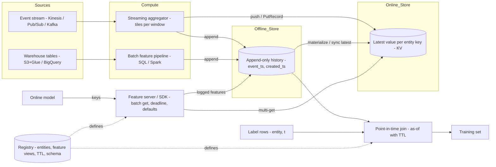

# Feature Stores and Real-Time Data Serving

## TL;DR

A feature store has two stores behind one set of feature definitions: an offline store that keeps the full history and feeds point-in-time-correct training sets, and an online store that keeps only the latest value per key and answers point lookups in milliseconds.
The point-in-time join is an as-of range join: for each label row (entity, t), it takes the newest feature row with event_time <= t, optionally also requiring event_time >= t - TTL. It leaks future data whenever a feature row's availability time is later than its event time, which is what backfills and late corrections produce.
The three systems disagree about which store is the source of truth. In SageMaker Feature Store the online write is synchronous and the offline copy follows asynchronously. In Vertex AI Feature Store, BigQuery is the truth and the online store follows on a sync schedule. In Feast, the offline store is the truth and materialization or push copies data to the online store.
Online p99 is set by fan-out more than by single-key latency. A request that reads k feature views is only as fast as the slowest of k reads, so batch the keys, co-locate them, and set a hard deadline with default values as the fallback.
Cost is a write-path and pricing-model problem. Request-priced online stores (SageMaker on-demand, DynamoDB) win at low or spiky QPS. Node-priced stores (Bigtable, ElastiCache) win at high steady QPS. Streaming features that rewrite every key every few seconds usually cost more than all the reads combined.

## Mental Model



Think of the offline store as a bitemporal log and the online store as a materialized view of that log at "now".
The registry is the contract that makes the training-time query (log as of t) and the serving-time read (view as of now) compute the same function.
Every serious failure in this domain comes from one of two things: the log and the view drift apart (training-serving skew), or the training query looks at the log using a different notion of time than the server had (leakage).
The data plane is the online multi-get path and the append path.
The control plane is the registry, the materialization scheduler, and the sync jobs, and it must be allowed to fail without stopping online reads.

## Internals

### The three planes of a feature store

The registry is a small, rarely written metadata store holding entities (join keys), feature views (a source, a schema, a TTL), and on-demand transformations.
In Feast the registry is a protobuf blob in a file on S3 or GCS, or rows in a SQL database, and clients cache it with a configurable TTL. Clients therefore keep serving with a stale schema after `feast apply` until the cache refreshes.
The offline store is a columnar warehouse table, or a set of tables, that keeps every version of every feature row.
The online store is a key-value store keyed by a serialized entity key, holding the latest value of each feature plus its event timestamp.
The materialization path copies "latest as of now" from offline to online. It is a batch job in Feast (`feast materialize-incremental`), a scheduled or continuous sync in Vertex AI, and an internal replication stream in SageMaker that runs in the reverse direction, from online to offline.

### Direction of truth: the parity point that matters

SageMaker Feature Store, now part of the Amazon SageMaker AI service family, takes writes through `PutRecord` on the `sagemaker-featurestore-runtime` endpoint.
The online store is updated synchronously.
The offline store is filled asynchronously as Parquet files in S3, registered in the AWS Glue Data Catalog in either Glue table format or Apache Iceberg format.
The offline table carries system columns (`write_time`, `api_invocation_time`, `is_deleted`) alongside your `EventTime` and `RecordIdentifier` features, so the offline table is a change log rather than a snapshot (UNVERIFIED for the exact replication lag window).
Vertex AI Feature Store, now documented under the Gemini Enterprise Agent Platform name after the Cloud Next 2026 rebrand, inverts this. You keep feature data in BigQuery tables or views, the service acts as a metadata layer over them, and online stores are filled by syncing feature views from BigQuery (Google Cloud docs, as of 2026-10).
A `FeatureGroup` must point at a BigQuery table or view with at least one entity ID column and a column named `feature_timestamp`, and by default the source is treated as a sparse time series (Google Cloud REST reference, as of 2026-10).
There is no separate offline copy: training data comes from BigQuery queries, so offline point-in-time correctness is your SQL's responsibility (Google Cloud docs, as of 2026-10).
Feast is source-agnostic, but its default model is offline-first: batch sources are authoritative, and online state comes from materialization or from `push` sources that write streaming values to the online store, the offline store, or both.
The consequence: in SageMaker the offline store lags the online store, so a training job launched right after a burst of writes is missing the newest rows. In Vertex AI and Feast batch mode the online store lags the offline store by up to one sync interval, so an online model reads features staler than the ones it was trained on.

### Point-in-time join: the mechanism

Input: a label (entity) dataframe of rows (entity_key, t_label, label), and feature views each holding rows (entity_key, event_ts, created_ts, features).
For each label row and each feature view, the join must pick the feature row with the largest event_ts such that event_ts <= t_label and, when a TTL is set, event_ts >= t_label - TTL.
If no row qualifies, the features are null, which is exactly what the online store would have returned once TTL expiry dropped the stale value.
Feast's warehouse implementations (BigQuery, Redshift, Snowflake) compile this into SQL with four stages.
Stage 1 uploads the entity dataframe to a temporary table and gives each row a surrogate `entity_row_unique_id`.
Stage 2 prunes each feature source to the window [min(t_label) - TTL, max(t_label)], which is what keeps the join from scanning all history.
Stage 3 is a range join on the join keys with `feature.event_ts <= entity.t_label AND feature.event_ts >= entity.t_label - TTL`.
Stage 4 deduplicates with `ROW_NUMBER() OVER (PARTITION BY entity_row_unique_id ORDER BY event_ts DESC, created_ts DESC) = 1`, then left-joins the winners back to the entity table.
The cost hides in stage 3. A range join emits one intermediate row for every feature row inside the window of every label row, so a key with L labels and F feature versions in the window produces up to L x F rows before deduplication.
A user with 10,000 labels and per-minute feature updates under a 7-day TTL produces 10,000 x 10,080, about 1e8 intermediate rows, for one key.
In BigQuery that becomes shuffle bytes and slot time. In Athena it often hits the query's memory limit, and the query fails rather than running slowly.
Engines with a native as-of join (DuckDB `ASOF JOIN`, Snowflake `ASOF JOIN`, pandas `merge_asof`, kdb+) sort both sides by (key, time) and do a single merge pass in O((L + F) log) time, and never materialize the cross product.
The practical fix on engines without as-of support is to bucket time: join on (key, date bucket) as an equality first, then range-filter inside the bucket.

### The bitemporal leak that getting-started guides do not mention

Each feature row has two times: event_ts, when the fact was true in the world, and availability time, when the row actually reached a store the online path could read.
Feast uses `created_timestamp` only as a tiebreak among rows with equal event_ts, not as a filter, and SageMaker's `DatasetBuilder` point-in-time join keys on `EventTime` (UNVERIFIED for every SDK major version).
Now suppose a data engineer backfills a corrected `chargeback_count_30d` on March 10 for event_ts March 1.
A label at March 5 will join to the corrected value in training. The online model on March 5 saw the uncorrected value, because the correction did not exist yet.
Offline metrics then look better than production, and the gap is invisible in the usual monitoring because both sides individually look healthy.
The correct join is bitemporal: event_ts <= t_label AND availability_ts <= t_label - serving_lag, where serving_lag covers materialization delay.
In SageMaker the offline log already records `api_invocation_time`, so you can write that predicate yourself in Athena or Spark.
In Feast and Vertex AI you need to land an ingestion-time column yourself, for example a BigQuery column populated from `CURRENT_TIMESTAMP()` at write time, and add it to the join.
The serving-lag term is the one teams forget most often. With hourly scheduled sync, a value computed at 10:05 is not readable online until the 11:00 sync finishes, so a training row at 10:30 must not see it.
The strongest guarantee comes from not reconstructing at all: log the exact feature vector the server returned with each prediction ID and train on the logs. Training and serving then cannot differ, at the cost of waiting for labels to accumulate on new features.

### Online store layouts

Feast's Redis online store, as implemented in its source (verify against your version), stores one Redis hash per (project, entity key).
Hash fields are a murmur3 hash of `feature_view:feature_name` mapping to a serialized `ValueProto`, plus a `_ts:feature_view` field holding the event timestamp.
A read for n entities across k feature views becomes one pipelined `HMGET` per entity, so latency is one network round trip plus Redis's single-threaded service time for the whole batch.
On write, Feast reads the existing `_ts` field and skips the write if the stored timestamp is newer or equal. That gives last-writer-wins by event time rather than by arrival order, which is what makes out-of-order backfills safe for the online view.
Feast's DynamoDB online store uses one table per feature view, keyed by the serialized entity key, and reads with `BatchGetItem`. DynamoDB caps that call at 100 items and 16 MB per request (AWS docs, long-standing limit), so large entity batches split into parallel calls and pay tail latency for each.
Vertex AI Bigtable online serving writes each feature view's latest values into a Bigtable-backed store sized by autoscaling bounds (`min_node_count`, `max_node_count`, `cpu_utilization_target`) (Google Cloud docs, as of 2026-10).
Bigtable keeps rows sorted lexicographically by row key, as described in the 2006 OSDI Bigtable paper, so sequential or timestamp-prefixed entity IDs concentrate load on a single tablet server. Entity IDs should be hashed or reversed before they become keys.
See [[17-Cloud-AI-Engineering/Volume_03_GCP_Deep_Dive/Chapter_11_Cloud_Bigtable_LSM_Storage_and_Tablet_Serving|Cloud Bigtable internals]] and [[17-Cloud-AI-Engineering/Volume_02_AWS_Deep_Dive/Chapter_10_Amazon_DynamoDB_Architecture_and_Partitioning|DynamoDB partitioning]] for the tablet-split and partition-split dynamics underneath.

### Null semantics: a silent skew source in Vertex AI

By default, Vertex AI Feature Store serves only the latest non-null value of each feature: if the latest value is null it serves the most recent non-null historical value, and it serves null only if no such value exists (Google Cloud docs, as of 2026-10).
To serve true latest values including nulls, you must register the source as a feature group with `dense` set to true, use Bigtable online serving, and use scheduled sync (Google Cloud docs, as of 2026-10).
If your training SQL takes the latest row, nulls included, and serving uses the default sparse semantics, a feature that legitimately reset to null (a deleted payment method, an expired session) trains as null and serves as its stale old value.

### Streaming aggregations and tiling

Window features such as "sum of amount over the last 24 hours, updated continuously" cannot be stored naively. Recomputing the window on every event is O(window) work, and writing every intermediate value is O(events) writes.
Production systems (Airbnb Chronon, Uber Michelangelo's streaming path) precompute partial aggregates per fixed tile, for example 5-minute buckets, write tiles keyed by (entity, tile_start), and at read time merge the tiles covering the window with the raw events in the still-open head tile.
Read cost becomes O(window / tile) small reads or one range scan, write cost becomes one update per tile per entity, and the same tile algebra replayed over the offline log gives point-in-time-correct training values. That replay is the property that removes streaming skew.
The trade-off is staleness at the window's trailing edge, up to one tile width, plus the need for invertible or mergeable aggregates (sum, count, min, max, HyperLogLog), which excludes exact percentiles.

### Freshness modes in Vertex AI

Scheduled sync refreshes on a cron and works with any online serving type. Continuous sync refreshes when the BigQuery source changes, but only when the store uses Bigtable online serving, the feature view is built from feature groups and features, and the BigQuery source sits in a supported region (Google Cloud docs, as of 2026-10).
Optimized online serving is deprecated: from May 17, 2026 it receives only critical patches, and on February 17, 2027 its APIs stop working (Google Cloud docs, as of 2026-10).
Vertex AI Feature Store (Legacy) was marked deprecated in the February 17, 2026 release notes (Google Cloud release notes, as of 2026-10).
Bigtable online serving does not manage embeddings, so embedding retrieval moves to Vector Search (Google Cloud docs, as of 2026-10).
Fetching feature values for a set of entities in one Bigtable online serving call is marked Preview (Google Cloud docs, as of 2026-10).

### Tail latency under fan-out

Dean and Barroso's "The Tail at Scale" (CACM 2013) is the governing math: if each of k independent sub-requests has probability p of exceeding a threshold, the request exceeds it with probability 1 - (1 - p)^k.
With k = 5 feature views and a per-call p99 of 5 ms, about 4.9% of requests exceed 5 ms, so the per-call p99 becomes roughly the request-level p95.
Two levers fix this, in order of preference. First, reduce k: co-locate the features one model needs under a single key, or use one batch call. Second, use hedged or tied requests against replicas, which only make sense on stores whose reads are idempotent and cheap.
The AWS Builders' Library article on timeouts, retries, and backoff with jitter adds the rule: set the timeout from a measured latency percentile of the dependency, and retry at most once inside the request deadline.

## Numbers to Know

| Item | Value | Source and status |
|---|---|---|
| Vertex AI Optimized online serving - feature freeze | 2026-05-17 | (Google Cloud docs, as of 2026-10) |
| Vertex AI Optimized online serving - API sunset | 2027-02-17 | (Google Cloud docs, as of 2026-10) |
| Vertex AI Feature Store (Legacy) - deprecated | 2026-02-17 | (Google Cloud release notes, as of 2026-10) |
| Vertex AI Feature Store (Legacy) - full sunset | 2027-02-17 | Third-party report, UNVERIFIED |
| Vertex AI Bigtable online serving data scale | "order of terabytes" | (Google Cloud docs, as of 2026-10) |
| Vertex AI online store autoscaling knobs | min nodes, max nodes, CPU target (doc example 1-3 nodes, 50%) | (Google Cloud docs, as of 2026-10) |
| Vertex AI online serving type change after creation | Not allowed | (Google Cloud docs, as of 2026-10) |
| DynamoDB `BatchGetItem` per call | 100 items, 16 MB | (AWS docs, long-standing limit) UNVERIFIED this cycle |
| DynamoDB max item size | 400 KB | (AWS docs, long-standing limit) UNVERIFIED this cycle |
| DynamoDB per-partition throughput | 3,000 RCU / 1,000 WCU | (DynamoDB docs and USENIX ATC 2022 paper) UNVERIFIED this cycle |
| SageMaker Feature Store max record size | about 350 KB | UNVERIFIED |
| SageMaker online read unit / write unit size | 4 KB read, 1 KB write | UNVERIFIED |
| SageMaker on-demand online pricing (us-east-1) | about $0.25 per million reads, about $1.25 per million writes, about $0.45 per GB-month | UNVERIFIED - check the pricing page before quoting |
| SageMaker offline store replication lag | minutes, often quoted as within about 15 minutes | UNVERIFIED |
| Bigtable SSD node point-read planning throughput | about 10,000 rows/s per node at 1 KB | UNVERIFIED planning figure; benchmark your own workload |
| Bigtable SSD node list price (us-central1) | about $0.65 per node-hour | UNVERIFIED |
| Vertex AI Bigtable online serving node price | P_node, likely above raw Bigtable | UNVERIFIED - read the Vertex AI pricing page |
| Fan-out tail amplification | 1 - (1 - p)^k | Dean and Barroso, CACM 2013 |

## AWS vs GCP Mechanism Parity

| Dimension | SageMaker Feature Store (AWS) | Vertex AI Feature Store (GCP) | Feast (self-managed, either cloud) |
|---|---|---|---|
| Source of truth | Online write via `PutRecord`, offline filled asynchronously | BigQuery table or view | Offline batch source; push sources for streaming |
| Offline store | S3 Parquet, Glue or Iceberg table, queried with Athena or Spark | BigQuery itself, no copy | BigQuery, Redshift, Snowflake, Spark, DuckDB/file, and others |
| Offline semantics | Append-only change log with `write_time`, `api_invocation_time`, `is_deleted` | Whatever your table holds; feature groups need `feature_timestamp` | Feature rows with event_ts and optional created_ts |
| Online store | Standard tier (managed KV) or InMemory tier | Bigtable online serving (Optimized deprecated) | Redis, DynamoDB, Bigtable, Postgres, SQLite, Cassandra, and others |
| Online pricing model | Request units on-demand, or provisioned throughput, plus storage (UNVERIFIED details) | Node-hours plus sync processing (UNVERIFIED details) | Pricing of the underlying store |
| Freshness path | Synchronous online write | Scheduled cron sync, or continuous sync with constraints | Scheduled materialization, or `push` |
| Out-of-order writes | Online keeps the latest EventTime record (UNVERIFIED) | Latest by `feature_timestamp` at sync | Redis store skips older event_ts writes |
| Null handling | Value stored as written | Default serves latest non-null; `dense=true` to serve nulls | Value stored as written |
| TTL | Online `TtlDuration` per feature group | No per-row online TTL; freshness set by sync | Feature view `ttl`, applied at read and in PIT joins |
| PIT join tool | SDK `DatasetBuilder` over Athena (UNVERIFIED for SDK v3) | Your BigQuery SQL | `get_historical_features` |
| Embeddings | InMemory tier vector type (UNVERIFIED) | Vector Search (Bigtable serving has no embeddings) | Vector-capable online stores (version dependent) |
| Private access | VPC interface endpoint for featurestore-runtime (UNVERIFIED name) | VPC Service Controls; PSC endpoints were for Optimized only | Your VPC, your store's private endpoints |
| Encryption | KMS key for online store and S3 offline | CMEK on online store (`encryption_spec`) | Store-native |
| Regional failure | Regional; no built-in multi-region replication | Regional; online store is regional | Whatever you build |

## Worked Example: Leakage-Safe Point-in-Time Join, Online Store Sizing, and Two Cloud Labs

### Step 1 - Reproduce the bitemporal leak locally (no cloud cost)

```python
# pit_join.py - requires pandas>=1.1. Run: python pit_join.py
import pandas as pd

ts = pd.Timestamp
features = pd.DataFrame({
    "user_id":    ["u1", "u1", "u1"],
    "event_ts":   [ts("2026-03-01"), ts("2026-03-04"), ts("2026-03-01")],
    # created_ts = when the row became visible to the online path
    "created_ts": [ts("2026-03-01 01:00"), ts("2026-03-04 01:00"), ts("2026-03-10")],
    "chargebacks_30d": [0, 1, 3],   # last row is a backfilled correction
}).sort_values("event_ts")

labels = pd.DataFrame({
    "user_id": ["u1", "u1"],
    "label_ts": [ts("2026-03-05"), ts("2026-03-12")],
    "is_fraud": [0, 1],
}).sort_values("label_ts")

TTL = pd.Timedelta(days=7)
SERVING_LAG = pd.Timedelta(hours=1)   # materialization delay

def naive_pit(lbl, feat):
    # Event-time only: what most tutorials and default SDK joins do.
    # Ties on event_ts are broken by created_ts, so the correction wins.
    f = feat.sort_values(["event_ts", "created_ts"])
    f = f.drop_duplicates(["user_id", "event_ts"], keep="last")
    return pd.merge_asof(lbl, f, left_on="label_ts", right_on="event_ts",
                         by="user_id", direction="backward", tolerance=TTL)

def bitemporal_pit(lbl, feat):
    # Evaluate each label against the rows that were visible at label_ts - lag.
    out = []
    for _, row in lbl.iterrows():
        cutoff = row.label_ts - SERVING_LAG
        visible = feat[(feat.user_id == row.user_id) & (feat.created_ts <= cutoff)
                       & (feat.event_ts <= row.label_ts)
                       & (feat.event_ts >= row.label_ts - TTL)]
        best = visible.sort_values(["event_ts", "created_ts"]).tail(1)
        val = best.chargebacks_30d.iloc[0] if len(best) else None
        out.append({**row.to_dict(), "chargebacks_30d": val})
    return pd.DataFrame(out)

print("naive:\n", naive_pit(labels, features)"label_ts", "chargebacks_30d")
print("bitemporal:\n", bitemporal_pit(labels, features)"label_ts", "chargebacks_30d")
# For label_ts=2026-03-05 the naive join returns 1 (correct by luck), but if the
# backfill had event_ts 2026-03-04 it would return 3, a value the online model never saw.
# Change the third event_ts to 2026-03-04 and rerun to watch the leak appear.
```

The per-row loop is O(L x F) and only for teaching. In production, express the same predicate in SQL and bucket by date so the range join stays bounded.

### Step 2 - Back-of-the-envelope online store sizing

Scenario: card-fraud scoring at 20,000 peak QPS and 8,000 average QPS.
Each prediction reads three entities (user about 800 B, merchant about 400 B, device about 200 B), so 3 point reads per request.
Streaming updates write user features 5,000 times per second on average, about 1 KB each.
The keyspace is 50 M users, 5 M merchants, and 80 M devices, about 60 GB of latest values.

```python
# sizing.py - prices are parameters; replace with current list prices (UNVERIFIED defaults).
SEC_MONTH = 30 * 24 * 3600          # 2,592,000
HOURS_MONTH = 730

avg_qps, peak_qps, reads_per_req = 8_000, 20_000, 3
writes_avg, writes_peak = 5_000, 12_000
storage_gb = 60

# Request-priced store (SageMaker on-demand style)
c_read_per_m, c_write_per_m, c_gb = 0.25, 1.25, 0.45     # UNVERIFIED
reads_m = avg_qps * reads_per_req * SEC_MONTH / 1e6
writes_m = writes_avg * SEC_MONTH / 1e6
req_cost = reads_m * c_read_per_m + writes_m * c_write_per_m + storage_gb * c_gb

# Node-priced store (Bigtable online serving style)
ops_per_node, cpu_target, p_node = 10_000, 0.5, 0.65     # UNVERIFIED planning values
peak_nodes = -(-(peak_qps * reads_per_req + writes_peak) // int(ops_per_node * cpu_target))
avg_nodes = -(-(avg_qps * reads_per_req + writes_avg) // int(ops_per_node * cpu_target))
node_cost = avg_nodes * p_node * HOURS_MONTH   # assumes autoscaler tracks average

print(f"reads/month   = {reads_m:,.0f} M, writes/month = {writes_m:,.0f} M")
print(f"request-priced = ${req_cost:,.0f}/month (writes = ${writes_m*c_write_per_m:,.0f})")
print(f"node-priced    = ${node_cost:,.0f}/month ({avg_nodes} avg nodes, {peak_nodes} peak)")
```

Walking through the arithmetic:
Reads are 8,000 x 3 x 2,592,000 = 62.2 billion per month, which is $15,552 at $0.25 per million.
Writes are 5,000 x 2,592,000 = 12.96 billion per month, which is $16,200 at $1.25 per million, more than all the reads.
Storage at 60 GB is about $27 and does not matter.
On the node-priced side, average load is 24,000 + 5,000 = 29,000 ops/s, which at 5,000 effective ops per node (10,000 x 0.5 CPU target) is 6 nodes, about $2,847 per month at $0.65 per node-hour. Peak needs 15 nodes.
The crossover: node pricing wins once sustained ops/s exceed roughly (p_node x 730 x 1e6) / (SEC_MONTH x c_blended x ops_per_node x u). That works out to a few thousand ops/s at these placeholder prices.
The biggest saving is not the pricing model. It is write coalescing: buffer per key for one tile width and write only when a value changes enough to move the model score. Cutting writes 10x saves about $14,500 per month in the request-priced case.

### Step 3 - AWS lab: SageMaker Feature Store (estimated cost under $1 for one hour)

```bash
#!/usr/bin/env bash
# Prereqs: AWS CLI v2, python3 with boto3, an IAM role ARN that SageMaker can assume
# with S3 write to the bucket and Glue catalog permissions for the offline store.
set -euo pipefail
export AWS_REGION=us-east-1
ACCT=$(aws sts get-caller-identity --query Account --output text)
BUCKET="fs-lab-${ACCT}-${AWS_REGION}"
ROLE_ARN="${ROLE_ARN:?set ROLE_ARN to a SageMaker execution role}"

# Budget alarm: email at 50% of $10/month.
aws budgets create-budget --account-id "$ACCT" \
  --budget '{"BudgetName":"fs-lab","BudgetLimit":{"Amount":"10","Unit":"USD"},"TimeUnit":"MONTHLY","BudgetType":"COST"}' \
  --notifications-with-subscribers '[{"Notification":{"NotificationType":"ACTUAL","ComparisonOperator":"GREATER_THAN","Threshold":50,"ThresholdType":"PERCENTAGE"},"Subscribers":[{"SubscriptionType":"EMAIL","Address":"you@example.com"}]}]'

aws s3 mb "s3://${BUCKET}"
```

```python
# sm_fs_lab.py - run: BUCKET=... ROLE_ARN=... python sm_fs_lab.py
import os, time, boto3
region = os.environ.get("AWS_REGION", "us-east-1")
sm = boto3.client("sagemaker", region_name=region)
rt = boto3.client("sagemaker-featurestore-runtime", region_name=region)
FG = "fs-lab-user"

sm.create_feature_group(
    FeatureGroupName=FG,
    RecordIdentifierFeatureName="user_id",
    EventTimeFeatureName="event_time",
    FeatureDefinitions=[
        {"FeatureName": "user_id", "FeatureType": "String"},
        {"FeatureName": "event_time", "FeatureType": "String"},
        {"FeatureName": "txn_count_1h", "FeatureType": "Integral"},
        {"FeatureName": "amount_sum_24h", "FeatureType": "Fractional"},
    ],
    OnlineStoreConfig={"EnableOnlineStore": True, "StorageType": "Standard",
                       "TtlDuration": {"Unit": "Hours", "Value": 48}},
    OfflineStoreConfig={"S3StorageConfig": {"S3Uri": f"s3://{os.environ['BUCKET']}/offline"},
                        "TableFormat": "Iceberg"},
    ThroughputConfig={"ThroughputMode": "OnDemand"},
    RoleArn=os.environ["ROLE_ARN"],
)
while sm.describe_feature_group(FeatureGroupName=FG)["FeatureGroupStatus"] == "Creating":
    time.sleep(10)

def put(uid, et, cnt, amt):
    rt.put_record(FeatureGroupName=FG, Record=[
        {"FeatureName": "user_id", "ValueAsString": uid},
        {"FeatureName": "event_time", "ValueAsString": et},
        {"FeatureName": "txn_count_1h", "ValueAsString": str(cnt)},
        {"FeatureName": "amount_sum_24h", "ValueAsString": str(amt)}])

put("u1", "2026-10-20T10:00:00Z", 3, 120.0)
put("u1", "2026-10-20T09:00:00Z", 9, 999.0)   # older event time, arrives later
t0 = time.perf_counter()
print(rt.get_record(FeatureGroupName=FG, RecordIdentifierValueAsString="u1")["Record"])
print(f"GetRecord client-observed latency: {(time.perf_counter()-t0)*1000:.1f} ms")
print(rt.batch_get_record(Identifiers=[{"FeatureGroupName": FG,
      "RecordIdentifiersValueAsString": ["u1", "u2"]}]))
# Expected: online shows the 10:00 record; the offline Iceberg table later shows both rows.
```

Teardown (run all of it, since the offline S3 data and the Glue table outlive the feature group):

```bash
aws sagemaker delete-feature-group --feature-group-name fs-lab-user --region us-east-1
aws s3 rb "s3://${BUCKET}" --force
aws budgets delete-budget --account-id "$ACCT" --budget-name fs-lab
# Then drop the Glue database/table that the feature group registered, if it remains.
```

### Step 4 - GCP lab: Vertex AI Feature Store with Bigtable online serving (estimate: one online node, roughly $1 per hour, UNVERIFIED)

```hcl
# main.tf - OpenTofu/Terraform with hashicorp/google provider. tofu init && tofu apply
variable "project" {}
variable "region" { default = "us-central1" }
provider "google" { project = var.project, region = var.region }

resource "google_bigquery_dataset" "fs" {
  dataset_id                 = "fs_lab"
  location                   = "US"
  delete_contents_on_destroy = true
}

resource "google_bigquery_table" "user_features" {
  dataset_id          = google_bigquery_dataset.fs.dataset_id
  table_id            = "user_features"
  deletion_protection = false
  time_partitioning {
    type  = "DAY"
    field = "feature_timestamp"
  }
  clustering = ["user_id"]
  schema = jsonencode([
    { name = "user_id", type = "STRING", mode = "REQUIRED" },
    { name = "feature_timestamp", type = "TIMESTAMP", mode = "REQUIRED" },
    { name = "ingested_at", type = "TIMESTAMP", mode = "REQUIRED" },
    { name = "txn_count_1h", type = "INT64" },
    { name = "amount_sum_24h", type = "FLOAT64" }
  ])
}

resource "google_vertex_ai_feature_group" "fg" {
  name   = "user_fg"
  region = var.region
  big_query {
    big_query_source {
      input_uri = "bq://${var.project}.${google_bigquery_dataset.fs.dataset_id}.${google_bigquery_table.user_features.table_id}"
    }
    entity_id_columns = ["user_id"]
  }
}

resource "google_vertex_ai_feature_group_feature" "f" {
  for_each            = toset(["txn_count_1h", "amount_sum_24h"])
  name                = each.key
  region              = var.region
  feature_group       = google_vertex_ai_feature_group.fg.name
  version_column_name = each.key
}

resource "google_vertex_ai_feature_online_store" "os" {
  name          = "fs_lab_online"
  region        = var.region
  force_destroy = true
  bigtable {
    auto_scaling {
      min_node_count         = 1
      max_node_count         = 2
      cpu_utilization_target = 50
    }
  }
}

resource "google_vertex_ai_feature_online_store_featureview" "fv" {
  name                 = "user_fv"
  region               = var.region
  feature_online_store = google_vertex_ai_feature_online_store.os.name
  sync_config { cron = "0 * * * *" }
  feature_registry_source {
    feature_groups {
      feature_group_id = google_vertex_ai_feature_group.fg.name
      feature_ids      = [for f in google_vertex_ai_feature_group_feature.f : f.name]
    }
  }
}
```

```bash
# Budget alert at 50% and 90% of $25.
gcloud billing budgets create --billing-account="$BILLING_ACCOUNT" \
  --display-name="fs-lab" --budget-amount=25USD \
  --threshold-rule=percent=0.5 --threshold-rule=percent=0.9

# Seed a row, then trigger a sync instead of waiting for the cron.
bq query --use_legacy_sql=false \
 "INSERT fs_lab.user_features VALUES ('u1', CURRENT_TIMESTAMP(), CURRENT_TIMESTAMP(), 3, 120.0)"
```

```python
# fetch.py - pip install google-cloud-aiplatform; run after a sync completes.
from google.cloud import aiplatform_v1 as v1
project, region = "YOUR_PROJECT", "us-central1"
client = v1.FeatureOnlineStoreServiceClient(
    client_options={"api_endpoint": f"{region}-aiplatform.googleapis.com"})
fv = (f"projects/{project}/locations/{region}/featureOnlineStores/"
      f"fs_lab_online/featureViews/user_fv")
resp = client.fetch_feature_values(request=v1.FetchFeatureValuesRequest(
    feature_view=fv, data_key=v1.FeatureViewDataKey(key="u1")))
print(resp)
```

Teardown, because the online store bills node-hours whether or not you send it traffic:

```bash
tofu destroy -auto-approve -var project="$PROJECT"
gcloud billing budgets list --billing-account="$BILLING_ACCOUNT" --filter="displayName=fs-lab" --format="value(name)" \
  | xargs -r -I{} gcloud billing budgets delete {} --quiet
```

## Failure Modes and Pitfalls

### Training-serving skew from divergent code paths

The classic failure, described in Sculley et al.'s "Hidden Technical Debt in Machine Learning Systems" (NeurIPS 2015) and in Google's TFX paper (KDD 2017), is that features are computed once in SQL for training and again in service code for serving.
Feature stores reduce this but do not remove it. On-demand transformations that run in Python at serving time and in SQL at training time are two implementations again.
Detection: log served feature vectors, join them to offline-recomputed values for the same (entity, timestamp), and alert on per-feature mismatch rates. That pipeline is the subject of [[17-Cloud-AI-Engineering/Volume_12_AI_Applications_MLOps_and_Data_Platforms/Chapter_06_Model_Evaluation_Monitoring_and_Drift_Detection|Model Evaluation, Monitoring, and Drift Detection]].

### Leakage from backfills and from the serving lag

Covered in Internals.
The production symptom: offline AUC jumps after a "data quality fix", the online metrics stay flat, and nobody connects the two because the fix shipped weeks before the model.
Guardrails: require an availability-time column in every feature source, reject training jobs whose join omits it, and keep a few seconds-to-hours `SERVING_LAG` constant per feature view in the registry.

### Range-join blowups

A point-in-time join over a heavy-tailed entity distribution, such as bots or test accounts with millions of events, either fails on memory or runs for hours.
Mitigations: cap labels per entity, bucket the join by date, prefer engines with native as-of joins, and keep TTLs tight, since the TTL is literally the width of the range join.

### Hot keys and hot tablets

DynamoDB partitions have per-partition throughput ceilings, and Bigtable tablets are served by one node each, so a single popular merchant or a "null" sentinel user ID read by every guest-checkout request saturates one partition while the rest of the cluster idles.
DynamoDB adaptive capacity and split-for-heat (described in the 2022 USENIX ATC DynamoDB paper) help with sustained skew but do not split a single hot item.
Fixes: cache hot keys in-process with short TTLs, replicate hot rows under salted keys, and never use a constant placeholder as an entity key.

### Write amplification from streaming features

Writing every intermediate value of a sliding-window aggregate multiplies writes per event by the number of windows and entities touched.
On request-priced stores this shows up first on the bill. On node-priced stores it shows up as compaction pressure and read p99 regressions on Bigtable, because LSM compaction competes with point reads.

### Control-plane coupling during regional incidents

On 2025-10-20, a race condition in DynamoDB's automated DNS management left the regional endpoint in us-east-1 with an empty DNS record, and dependent AWS services failed for hours ([AWS PIR](https://aws.amazon.com/message/101925/)).
Any online feature store built on DynamoDB, including Feast's DynamoDB store, had no data plane in that window.
The 2015-09-20 DynamoDB metadata service event in us-east-1 ([AWS PIR](https://aws.amazon.com/message/5467D2/)) showed the same pattern through a different mechanism: a metadata dependency saturated, retries amplified the load, and the storage servers took themselves out of service.
On 2025-06-12, a null-pointer crash in Google's Service Control, triggered by a globally replicated quota policy, failed API requests across many Google Cloud products ([Google Cloud incident report](https://status.cloud.google.com/incidents/ow5i3PPK96RduMcb1SsW)). That is a reminder that a managed feature-serving API sits behind a shared API admission layer you do not control.
The 2020-11-25 Kinesis event in us-east-1 ([AWS PIR](https://aws.amazon.com/message/11201/)) hit streaming feature pipelines directly: when the ingestion stream stops, online values freeze and quietly go stale. TTLs must turn "stale" into "missing" rather than serve hours-old fraud signals.
Design response: models must have a degraded mode with explicit default features, and the serving path must survive the loss of the feature store, as argued in [[17-Cloud-AI-Engineering/Volume_01_Cloud_Architecture_Principles/Chapter_02_Regions_Zones_and_Static_Stability|Regions, Zones, and Static Stability]].

### Retry storms on the online path

Feature reads sit inside a request with a deadline of tens of milliseconds.
Client SDK default retries with long backoff (common in AWS SDKs and Google client libraries) can exceed the whole request budget, and multiplied across a fleet they turn a brief store brownout into an overload.
Set an explicit per-call timeout, allow at most one retry inside the deadline, and use a token-bucket retry budget, per [[17-Cloud-AI-Engineering/Volume_07_Reliability_and_SRE/Chapter_03_Resilient_Communication_Retries_Jitter_and_Circuit_Breakers|Retries, Jitter, and Circuit Breakers]].

### Product-lifecycle traps

Teams on Vertex AI Optimized online serving or Feature Store (Legacy) are on deprecated paths with a February 2027 sunset. Because the serving type of an online store cannot be changed after creation, migration means building a new store, dual-reading, comparing results, and cutting over.
On SageMaker, the offline store in Glue format collects many small Parquet files under high-frequency `PutRecord` traffic, which slows Athena PIT queries. The Iceberg table format plus periodic compaction is the mitigation (UNVERIFIED that compaction is automatic; plan to run it).

### Registry and schema drift

Feast clients cache the registry, so a schema change pushed with `feast apply` reaches serving pods at different times.
Treat feature views as versioned, append-only contracts: add `user_fv_v2` and never mutate `user_fv` in place.

## Security and Cost Angles

### IAM scoping

On AWS, separate the writer role (`sagemaker:PutRecord`, `sagemaker:DeleteRecord`) from the reader role (`sagemaker:GetRecord`, `sagemaker:BatchGetRecord`), each scoped to specific feature-group ARNs. The inference service should never be able to write features.
The offline store is S3 plus Glue, so the effective read surface for training data is the S3 bucket policy, the Glue catalog, and AWS Lake Formation permissions. Feature-group IAM alone does not protect the history.
On GCP, the feature group's service agent needs BigQuery read access (`bigquery.dataViewer`) on the source (Google Cloud REST reference, as of 2026-10). That grant lets the service read the whole source table, so isolate feature sources in their own datasets rather than granting access to a shared raw dataset.
Grant online read permissions on the feature online store resource to the serving identity through workload identity, per [[17-Cloud-AI-Engineering/Volume_08_Security_Identity_and_the_Data_Perimeter/Chapter_02_Workload_Identity_Federation|Workload Identity Federation]].

### Encryption

SageMaker lets you set a KMS key for the online store and an S3 KMS key for the offline store. With customer-managed keys, every online read and write sits behind KMS, so a disabled key or a broken key policy is an online outage, not just an audit finding.
Vertex AI online stores accept a CMEK key through `encryption_spec.kms_key_name`, with additional Cloud KMS costs (Google Cloud docs, as of 2026-10).
Key hierarchy design lives in [[17-Cloud-AI-Engineering/Volume_08_Security_Identity_and_the_Data_Perimeter/Chapter_04_Encryption_Key_Hierarchies_and_Envelope_Encryption|Encryption Key Hierarchies and Envelope Encryption]].

### Network perimeter

On AWS, reach the featurestore-runtime API through an interface VPC endpoint with an endpoint policy restricted to your feature-group ARNs (UNVERIFIED endpoint service name; check the PrivateLink service list).
On GCP, put `aiplatform.googleapis.com`, `bigquery.googleapis.com`, and `bigtable.googleapis.com` inside the same VPC Service Controls perimeter, so that a compromised notebook cannot copy BigQuery feature history to an outside project; see [[17-Cloud-AI-Engineering/Volume_03_GCP_Deep_Dive/Chapter_03_VPC_Service_Controls_Security_Perimeters|VPC Service Controls]].
Feature stores collect PII by design (user IDs, location, spend). Treat the offline store as a regulated data lake, with row-level deletion workflows: SageMaker `DeleteRecord` with hard delete, and BigQuery DML deletes followed by a resync.

### Unit-economics levers

1. Coalesce streaming writes per key per tile, which is usually the largest single lever.
2. Choose request-priced or node-priced stores by sustained ops/s, not by peak.
3. Partition and cluster BigQuery sources on `feature_timestamp` and the entity ID, because every Vertex AI sync and every PIT join scans them.
4. Keep TTLs tight, since TTL width drives both PIT-join cost and online storage.
5. Batch online reads into one call per request.
6. Do not put features in the online store that only the batch-scoring path uses.

Cost-per-prediction framing: online feature cost per 1,000 predictions = (reads per request x read price + amortized writes) x 1,000, which you then compare against the model inference cost per 1,000 predictions from [[17-Cloud-AI-Engineering/Volume_09_FinOps_and_Cloud_Economics/Chapter_05_GPU_and_TPU_Unit_Economics|GPU and TPU Unit Economics]].

## Interview Questions and Model Answers

### Question 1 (L5 - Senior)

Explain what a point-in-time join computes, why a plain join on entity ID leaks, and what the feature view TTL does inside the join.

#### Model Answer

Each training example is an observation (entity, t) with a label, and the model must see the features as they existed at t, because that is all the online model will ever see.
A plain join on entity ID attaches the current, or arbitrary, feature row, which can include information produced after t, such as a chargeback count that already includes the fraud being predicted.
The point-in-time join picks, per label row and per feature view, the latest feature row with event_ts <= t. This is an as-of join.
The TTL adds a lower bound, event_ts >= t - TTL, so a feature older than the TTL comes back null, matching the online store, where it would have expired.
Without that lower bound, training sees a two-month-old value that serving would have dropped, which is skew in the other direction.
Mechanically, warehouse implementations prune the source to [min t - TTL, max t], range-join on key and time, and deduplicate with a window function ordered by event_ts and then created_ts.
The cost scales with labels-per-key times feature-versions-per-key inside the TTL window, so the TTL is also a cost knob.

#### Follow-up Interviewer Question

Your PIT join takes six hours and fails on 1% of runs. Which entities do you look at first, and what are two structural changes to the query?

### Question 2 (L5 - Senior)

The fraud model has a 30 ms p99 budget for feature retrieval and calls five feature views on DynamoDB. The p99 of each call is 6 ms, but the end-to-end retrieval p99 is 25 ms. Explain why, and fix it.

#### Model Answer

With five independent calls, the probability that at least one exceeds its own p99 is 1 - 0.99^5, about 4.9%, so the request-level p99 sits far out on the single-call tail distribution, not at 6 ms.
If the calls run serially it is worse: latencies add, and five times the median already eats most of the budget.
First fix: issue the reads in parallel, or better, as one `BatchGetItem` or `BatchGetRecord`, which removes four round trips and the per-call queuing.
Second fix: co-locate the features for one model under one key per entity, ideally one feature view per model and entity type, which cuts k structurally.
Third fix: set a per-call timeout near the measured p99 with at most one hedged retry inside the deadline. On timeout, substitute declared default values and flag the prediction as degraded, rather than failing the transaction.
Fourth: verify the cause is not a hot key. If one merchant ID dominates, an in-process cache with a seconds-long TTL removes most of the tail.
I would confirm all of this with client-side histograms per feature view, since server-side DynamoDB latency metrics do not include connection setup or SDK retries.

#### Follow-up Interviewer Question

Hedging doubles some reads. How do you bound the extra cost and avoid hedges amplifying an incident?

### Question 3 (L6 - Staff)

Offline AUC improved by four points after a data platform team backfilled corrected chargeback features, but online precision did not move. Diagnose this and design the systemic fix.

#### Model Answer

This is the bitemporal leak.
The backfill wrote rows whose event_ts is in the past but whose availability time is the backfill date. Event-time-only PIT joins in Feast and most SDK helpers let training rows before the backfill see corrected values the online model never had.
To confirm, rerun the training-set generation with an added predicate, availability_ts <= t_label - serving_lag, and check that the AUC gain collapses.
Systemic fix, part 1: every feature source carries an ingestion or availability timestamp. On SageMaker this is `api_invocation_time` in the offline log. On BigQuery it is a column we populate at write time, because BigQuery does not keep one per row for us.
Part 2: the registry stores a serving_lag per feature view, derived from its sync cadence: one hour for hourly Vertex AI scheduled sync, about zero for push.
Part 3: the platform's training-set API applies the bitemporal predicate by default, and opting out requires an explicit flag that shows up in model lineage.
Part 4: for high-stakes models, train on logged served features where possible, which makes leakage structurally impossible.
Trade-off: bitemporal joins reduce effective training data right after a correction, and corrected history is often genuinely better for label quality. Some teams therefore train on corrected features and accept a measured offline-online gap, but that should be a deliberate, measured choice.

#### Follow-up Interviewer Question

The backfill fixed a bug that also existed online, and the online pipeline is now fixed too. When is training on the corrected history the right call?

### Question 4 (L6 - Staff)

You must choose an online store for 30,000 sustained reads per second and 5,000 writes per second, with a 99.95% availability target. Compare SageMaker Feature Store on-demand, Vertex AI Bigtable online serving, and Feast on ElastiCache or Bigtable, quantitatively and operationally.

#### Model Answer

Start with the cost structure, not features.
Request-priced: 30,000 reads/s is about 77.8 billion reads per month and 5,000 writes/s is about 13 billion writes per month. At placeholder prices of $0.25 and $1.25 per million, that is about $19,400 plus $16,200, so about $36k per month, dominated by writes.
Node-priced: about 35,000 ops/s at about 5,000 effective ops per node at 50% CPU is about 7 nodes. At roughly $0.65 per node-hour that is about $3.3k per month for raw Bigtable, plus whatever the Vertex AI managed premium is. I would get the real per-node-hour price from the pricing page before committing.
So at sustained high QPS, node-priced wins by an order of magnitude. Request pricing wins for spiky, low-average workloads, or many small feature groups that would each need a minimum node.
Operationally: SageMaker gives synchronous online writes and an automatic offline log, so freshness is immediate and the offline lag is minutes.
Vertex AI makes BigQuery the truth, so freshness depends on sync. Continuous sync only works with Bigtable serving, registry-based feature views, and supported regions. And Optimized serving is deprecated, so I would not take a dependency on it.
Feast on self-managed stores gives the most control, including tiled streaming aggregates and cross-cloud portability, at the cost of owning upgrades, the registry, and on-call.
Availability: all three are regional, so 99.95% needs a static fallback. That means default features, plus optionally a second-region replica fed by the same stream, because no managed option replicates multi-region for us.
I would also try to cut the write rate before choosing, because coalescing to 500 writes/s changes the request-priced math substantially.

#### Follow-up Interviewer Question

Finance wants a single cost-per-1,000-predictions number for the business case. Which assumptions in that number are most fragile, and how do you instrument them?

### Question 5 (L6 - Staff)

A Vertex AI feature `active_payment_method_id` is null for 3% of users in the training SQL but almost never null when served online. What is happening, and how do you fix it without breaking other models?

#### Model Answer

Vertex AI Feature Store's default semantics serve the latest non-null value of a feature, falling back to older non-null history, and serve null only when no non-null value exists.
When a user deletes their payment method, the source table gets a newer row with null, training (latest row) sees null, and online serving returns the old method ID. That is systematic skew concentrated on exactly the users who matter for churn or fraud.
The fix for this feature is a feature group with `dense=true` plus scheduled sync on Bigtable online serving, which serves true latest values including nulls.
Because semantics are set per feature group and per feature view, I would create a new dense feature group and a new feature view for the affected features rather than changing the existing one in place. Then I would migrate models one at a time, comparing served vectors against offline recomputation.
Continuous sync is not compatible with the dense, null-serving setup per the documented requirements, so this feature takes a freshness hit. For a payment-method change that is usually acceptable. If it is not, the feature belongs on a push path outside BigQuery sync.
Longer term, the platform should encode null semantics in the registry and generate both the training SQL and the serving configuration from the same declaration.

#### Follow-up Interviewer Question

How would you detect this class of skew automatically across hundreds of features, before a data scientist notices it?

### Question 6 (L7+ - Principal)

Design the feature-serving layer for a payments company running on AWS, so that a full-day regional outage of DynamoDB, like the us-east-1 event of October 2025, does not stop authorizations, while keeping fraud loss bounded.

#### Model Answer

First, decide what the business needs: authorizations must continue, fraud decisions may degrade, and loss must be bounded by policy rather than by luck.
Tier the features. Tier A is a small set of slow-moving, high-value features (account age, historical chargeback rate, device reputation) that change daily. Tier B is streaming velocity features that change per second.
For Tier A, keep a statically stable copy that does not depend on any regional control plane at read time: an in-memory snapshot in each scoring pod loaded from S3, versioned and refreshed hourly. Reads are local memory lookups, and a DynamoDB outage only stops the refresh.
For Tier B, the primary is the online store in-region, plus a second-region replica fed from the same event stream so the regions are independently computed rather than replicated. That avoids depending on cross-region replication of the store that is failing.
The scoring service has three explicit modes: full, tier-A-only, and rules-only. Each mode has its own model, trained offline on that feature subset with the same PIT pipeline, so degraded predictions are calibrated rather than garbage.
Mode switching is driven by data-plane health signals in the scoring pods (timeout rates per feature view), not by a central control plane, and it uses hysteresis to avoid flapping.
Loss is bounded by risk policy attached to each mode: lower approval limits, step-up authentication, and velocity caps enforced in an in-memory token bucket per card.
We rehearse it: quarterly game days that black-hole the online store and measure approval rate, fraud rate, and p99 in each mode.
Costs: duplicate stream compute in the second region, a snapshot pipeline, and three models to maintain. These are justified against the revenue of a day of declined authorizations.
What I reject: synchronous cross-region reads on the hot path (latency and correlated failure) and hiding degradation (models silently getting defaults without the calibrated fallback model).

#### Follow-up Interviewer Question

The tier-A snapshot is 40 GB and the pods have 16 GB of memory. What changes, and what new failure modes appear?

### Question 7 (L7+ - Principal)

Your organization runs 200 models on Vertex AI Feature Store, some on Optimized online serving and some on Legacy, and the CTO asks whether to migrate to Bigtable online serving, to Feast, or to a home-grown store. Frame the decision and the migration.

#### Model Answer

The deadline is fixed: Optimized online serving stops getting new features in May 2026 and its APIs sunset in February 2027, and Legacy is deprecated, so doing nothing is not an option.
Decision criteria, in order: correctness of training-serving contracts, migration risk, run cost at our QPS, team capacity to operate a stateful store, and lock-in.
Bigtable online serving is the lowest-risk move. It keeps BigQuery as the truth, supports continuous sync, and is a managed regional store. The losses are embeddings management, which moves to Vector Search, and Optimized's latency profile, so we must benchmark p99 for our top 10 models before committing.
Feast buys portability and control, including tiled streaming aggregates and bitemporal joins we implement ourselves, but we take on registry operations, version upgrades, and the online store's on-call. That is only worth it if multi-cloud or streaming freshness is a strategic requirement, not a hedge.
Home-grown is justified only if feature serving is a competitive differentiator at our scale, which is rarely true for 200 models.
Migration mechanics: the online serving type cannot be changed in place, so for each model we build a parallel Bigtable store and feature views from the same BigQuery sources, then shadow-read in the serving path and diff values and latencies per feature.
We cut over by model criticality, with a per-model rollback flag, and delete old stores only after a full traffic cycle, including month-end batch peaks.
The platform deliverable is not "a new store". It is a registry-generated contract, with null semantics, serving lag, and TTL declared once, so the next product deprecation is a configuration change rather than a two-year program.

#### Follow-up Interviewer Question

Shadow reads show 0.3% of values differing between the old and new stores for one high-revenue model. How do you decide whether that is a bug, a semantic difference, or acceptable noise?

## Further Reading

- [Dean and Barroso, "The Tail at Scale," CACM 2013](https://research.google/pubs/the-tail-at-scale/) - the math and techniques (hedged and tied requests) behind fan-out p99 on the online read path.
- [Sculley et al., "Hidden Technical Debt in Machine Learning Systems," NeurIPS 2015](https://papers.nips.cc/paper/5656-hidden-technical-debt-in-machine-learning-systems) - names training-serving skew and pipeline jungles, the problems feature stores exist to address.
- [Baylor et al., "TFX: A TensorFlow-Based Production-Scale Machine Learning Platform," KDD 2017](https://research.google/pubs/tfx-a-tensorflow-based-production-scale-machine-learning-platform/) - Google's production treatment of skew detection and data validation.
- [Chang et al., "Bigtable: A Distributed Storage System for Structured Data," OSDI 2006](https://research.google/pubs/bigtable-a-distributed-storage-system-for-structured-data/) - the sorted-row-key and tablet model behind Vertex AI Bigtable online serving and its hot-key behavior.
- [Elhemali et al., "Amazon DynamoDB: A Scalable, Predictably Performant, and Fully Managed NoSQL Database Service," USENIX ATC 2022](https://www.usenix.org/conference/atc22/presentation/elhemali) - partitioning, adaptive capacity, and split-for-heat underneath DynamoDB-backed online stores.
- [Uber Engineering, "Meet Michelangelo: Uber's Machine Learning Platform"](https://www.uber.com/blog/michelangelo-machine-learning-platform/) - the original public description of a shared offline/online feature store.
- [Feast documentation](https://docs.feast.dev/) - registry, offline and online store, materialization, and point-in-time join semantics in the reference open-source implementation.
- [Feast source code](https://github.com/feast-dev/feast) - read the Redis and DynamoDB online stores and the BigQuery offline store SQL templates to see the mechanisms in this chapter.
- [Airbnb Chronon](https://github.com/airbnb/chronon) - open-source implementation of tiled streaming aggregations with point-in-time-correct backfills.
- [Vertex AI Feature Store overview](https://docs.cloud.google.com/vertex-ai/docs/featurestore/latest/overview) - BigQuery-as-truth data model, feature groups, and offline serving.
- [Vertex AI Feature Store online serving types](https://docs.cloud.google.com/gemini-enterprise-agent-platform/machine-learning/featurestore/latest/online-serving-types) - Bigtable versus Optimized serving, null semantics, and the deprecation schedule.
- [Amazon SageMaker Feature Store developer guide](https://docs.aws.amazon.com/sagemaker/latest/dg/feature-store.html) - online tiers, offline store formats, TTL, and the runtime API.
- [AWS Builders' Library, "Timeouts, retries, and backoff with jitter"](https://aws.amazon.com/builders-library/timeouts-retries-and-backoff-with-jitter/) - how to size deadlines and retry budgets on the online feature path.
- [AWS PIR for the October 2025 us-east-1 DynamoDB event](https://aws.amazon.com/message/101925/) - a real regional failure of the store most AWS online feature stores depend on.
- Related chapters: [[17-Cloud-AI-Engineering/Volume_12_AI_Applications_MLOps_and_Data_Platforms/Chapter_04_MLOps_Pipelines_SageMaker_vs_Vertex_AI|MLOps Pipelines]], [[17-Cloud-AI-Engineering/Volume_03_GCP_Deep_Dive/Chapter_13_BigQuery_Dremel_Capacitor_and_Slot_Orchestration|BigQuery internals]], [[17-Cloud-AI-Engineering/Volume_14_Staff_Plus_Interview_Arena/Chapter_04_Design_Global_Real_Time_Feature_Store|System Design: Global Real-Time Feature Store]], [[04-System-Design/05-Data-Stores/Redis-Architecture|Redis Architecture]].
