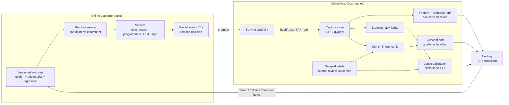

# Model Evaluation, Monitoring, and Drift Detection

## TL;DR

An evaluation system is a measurement instrument, so you have to know its false-positive rate, its bias, and its noise floor before you act on any number it reports.
Drift statistics such as PSI, Jensen-Shannon and KS have a null value that depends on sample size: with B bins, PSI under no drift averages about (B-1)(1/n + 1/m), so a sparsely sampled endpoint raises false alarms against a fixed 0.1 threshold, and a heavily sampled one flags drift that has no business impact.
Concept drift cannot be seen in inputs alone, so how fast you detect it is limited by label delay; design the join from inference ID to ground truth before you design the dashboard.
An LLM judge is a classifier with a sensitivity, a specificity and position and verbosity biases, so calibrate it against a small human-labeled set and correct its pass rate (prediction-powered inference or Rogan-Gladen) instead of reporting the raw judge score.
On both clouds the bill comes from three things: how much traffic you sample, how many judge tokens you spend, and how many human labels you buy; sample by trace ID, stratify the tail, and use a cheap judge with an expensive escalation path.

## Mental Model



The offline gate and the online loop are two separate measurement systems with different failure behavior.
The offline gate asks whether the candidate is better than the incumbent on a fixed distribution, and it is limited by how representative and how large its eval set is.
The online loop asks whether the world still looks like the distribution the model was validated on, and it is limited by sampling rate, label delay and multiple-testing noise.
They are joined by the arrow from alerting back to the eval sets: every production failure that gets caught should become a versioned regression item, otherwise the offline gate keeps measuring a world that no longer exists.
The judge-calibration box is the part most teams leave out.
Without it the LLM judge is an unmeasured instrument, and every dashboard downstream of it inherits its bias.

## Internals

### Control plane and data plane of an evaluation system

The data plane is the request path plus the capture tap: the endpoint serializes a sampled subset of requests and responses into an object store or warehouse, asynchronously and off the critical path.
On SageMaker the tap is `DataCaptureConfig` on the endpoint config, with `InitialSamplingPercentage` described as "The percentage of requests SageMaker AI will capture", capture options for input, output or both, and an S3 destination (AWS API reference, as of 2026-10, [DataCaptureConfig](https://docs.aws.amazon.com/sagemaker/latest/APIReference/API_DataCaptureConfig.html)).
The API reference explicitly advises a lower sampling value for high-traffic endpoints (AWS API reference, as of 2026-10).
On Vertex AI the equivalent tap is endpoint request-response logging to a BigQuery table with a sampling rate (Google Cloud docs, UNVERIFIED as of 2026-10).
The control plane covers baselines, schedules, thresholds and alert routing.
It runs as batch jobs that read the capture store, compute statistics, compare them with a stored baseline, and emit metrics and violation reports.
Because of this split, a failed monitoring job never affects serving, which is the right static-stability property (see [[17-Cloud-AI-Engineering/Volume_01_Cloud_Architecture_Principles/Chapter_04_Control_Plane_vs_Data_Plane_Separation|Control Plane vs Data Plane Separation]]).
It also means a failed monitoring job fails silently: if the schedule stops or the capture prefix moves, every drift metric reads "no violations".
The control plane therefore needs its own liveness SLO, for example "a completed monitoring execution exists for every scheduled window".

### SageMaker Model Monitor pipeline mechanics

A baseline job runs over the training or validation dataset and writes `statistics.json` and `constraints.json` to S3 (AWS docs, as of 2026-10, [Model Monitor FAQs](https://docs.aws.amazon.com/sagemaker/latest/dg/model-monitor-faqs.html)).
The data quality container computes per-feature constraints and statistics with Deequ, the open-source Spark-based data quality library (AWS docs, as of 2026-10, [Data quality](https://docs.aws.amazon.com/sagemaker/latest/dg/model-monitor-data-quality.html)).
A 2023 engineering write-up reported the container as Spark 3.3.0 with Deequ 2.0.2 ([Kablamo engineering blog, 2023](https://engineering.kablamo.com.au/posts/model-monitoring/)); the current versions are UNVERIFIED as of 2026-10.
Violations are written as a constraint violations JSON file next to the reports (AWS docs, as of 2026-10).
Monitoring schedules use cron expressions, and the Python SDK ships `CronExpressionGenerator.hourly()`; the SDK default frequency is daily (SageMaker Python SDK docs, as of 2026-10, [Model Monitor API](https://sagemaker.readthedocs.io/en/stable/model_monitor.html)).
Model quality monitoring runs two jobs in each execution, a ground-truth merge job and then the monitoring job, and they share the maximum runtime.
For an hourly model quality schedule, AWS therefore says `MaxRuntimeInSeconds` should be no more than 1800 (AWS docs, as of 2026-10, [Schedule model quality monitoring jobs](https://docs.aws.amazon.com/sagemaker/latest/dg/model-monitor-model-quality-schedule.html)).
That 1800-second cap is the real constraint on hourly concept-drift monitoring: if the merge of captured predictions with ground-truth labels cannot finish in half an hour, you cannot run hourly quality checks on that data volume.
Bias drift and feature-attribution drift monitors come from SageMaker Clarify, and the attribution monitor compares feature-importance rankings between baseline and live traffic (AWS docs, UNVERIFIED as of 2026-10).

### Why sketches: Deequ and mergeable quantile summaries

Deequ is built on the model in Schelter et al., "Automating Large-Scale Data Quality Verification" (VLDB 2018): declarative constraints compile into Spark aggregation queries, and the metric states can be merged incrementally.
For numeric distributions the expensive primitive is the quantile, and Deequ approximates it with a KLL sketch (Karnin, Lang, Liberty, "Optimal Quantile Approximation in Streams", FOCS 2016).
A KLL sketch keeps a hierarchy of compactors in memory that grows as O((1/epsilon) sqrt(log(1/delta))), independent of stream length.
It is mergeable, so per-partition sketches computed on Spark executors combine into one summary without a shuffle of raw rows.
This mechanism is what you will not find in the getting-started guide: the drift comparison is between two approximate CDFs, not two exact histograms.
The sketch rank error epsilon puts a floor under detectable drift.
A KS-style distance below about 2 epsilon cannot be told apart from sketch error, whatever the sample size.
In practice the sketch error is well below the sampling noise of an hourly window, so sampling noise, not the sketch, sets the noise floor, which leads to the next section.

### Feature drift: the null distribution nobody computes

Let the baseline histogram be q over B bins built from m rows and the window histogram be p built from n rows.
The Population Stability Index is PSI = sum_i (p_i - q_i) ln(p_i / q_i), the symmetrized Kullback-Leibler (Jeffreys) divergence.
A second-order Taylor expansion gives PSI ~ sum_i (p_i - q_i)^2 / q_i, a Pearson chi-square statistic divided by the sample size.
Under the null hypothesis of no drift, multinomial sampling gives E[PSI] ~ (B-1)(1/n + 1/m).
With B = 10 and a million-row baseline, the null mean is about 0.18 at n = 50, 0.018 at n = 500, and 0.0018 at n = 5000.
The credit-scoring rules of thumb (0.1 means investigate, 0.25 means act) assume windows of thousands of rows.
Applied to a low-traffic endpoint with 1 percent capture, a 0.1 threshold fires on pure noise.
Applied to a high-traffic endpoint, it misses real shifts: a 0.1-sigma mean shift on a Gaussian feature has a true Jeffreys divergence of about delta^2 = 0.01, an order of magnitude under the 0.1 threshold, yet it is easy to detect at n = 5000.
Empty bins make this much worse.
If the window has zero rows in a bin and you clip at epsilon = 1e-6, the term q_i ln(q_i / 1e-6) for q_i = 0.1 contributes about 1.1 on its own.
The runnable lab shows this: at n = 50 the 99th-percentile null PSI with epsilon clipping is about 1.39, and Laplace smoothing (add 0.5 per bin) brings it down to about 0.41.
Jensen-Shannon divergence avoids the infinity because it compares each distribution against the mixture M = (p + q)/2, and it is bounded in [0, 1] with log base 2.
It has the same n-dependent null bias, though: its second-order term is the PSI approximation divided by about 8 ln 2.
Vertex AI Model Monitoring v1 uses Jensen-Shannon divergence for numerical features and L-infinity distance for categorical features, with a default alert threshold of 0.3 (Google Cloud docs, UNVERIFIED as of 2026-10).
L-infinity on categorical frequencies is the largest absolute change in any single category's share, which makes it robust to long-tail cardinality but blind to many small shifts spread across categories.
The KS statistic avoids binning, but with a large n every shift becomes statistically significant: the two-sample 99 percent critical value is about 1.63 sqrt(1/n + 1/m), roughly 0.008 at n = 50,000.
What to deploy: a two-part rule.
Alert only when the statistic exceeds both a null-calibrated threshold (a bootstrap of baseline-versus-baseline at the actual window size) and a business-relevant effect size.

### Multiple testing across features

A model with 300 monitored features checked hourly at a per-test false-positive rate of 1 percent produces about 3 false alarms per hour, or 72 per day, with zero real drift.
Pager fatigue from this arithmetic is the most common reason drift monitoring gets switched off within a quarter.
Control the false discovery rate with Benjamini-Hochberg (JRSS-B 1995) across features in each window, or follow Rabanser, Gunnemann and Lipton, "Failing Loudly: An Empirical Study of Methods for Detecting Dataset Shift" (NeurIPS 2019).
That paper found that univariate tests on a reduced representation, with Bonferroni aggregation, work well, and that black-box shift detection on the model's own softmax outputs (BBSD) is a strong reduction.
Prediction drift, the distribution of the model's outputs, is the cheapest single high-signal monitor because it compresses every input change into the dimensions the model actually uses.

### Concept drift and label shift

Covariate shift changes P(x) while P(y|x) stays fixed.
Label shift changes P(y) while P(x|y) stays fixed.
Concept drift changes P(y|x), and it is the only one of the three that guarantees the model is wrong.
Input monitors detect the first two cheaply, but concept drift needs labels, so detection latency is at least the label delay plus the window needed to accumulate a significant error-rate change.
For label shift without labels, Lipton, Wang and Smola, "Detecting and Correcting for Label Shift with Black Box Predictors" (ICML 2018), estimate the new class priors by inverting the model's confusion matrix: q_hat(y) = C^-1 mu_hat, where mu_hat is the mean predicted-class vector on live traffic.
When labels arrive, streaming change detectors turn the error sequence into an alarm: DDM (Gama et al., SBIA 2004) tracks the error rate and its standard deviation, ADWIN (Bifet and Gavalda, SDM 2007) keeps an adaptive window and cuts it when sub-window means differ significantly, and CUSUM or Page-Hinkley (Page, Biometrika 1954) accumulate deviations to detect small persistent shifts.
Gama et al., "A Survey on Concept Drift Adaptation" (ACM Computing Surveys 2014), is the taxonomy reference.
On SageMaker the model quality monitor joins captured predictions to uploaded ground truth through the merge job described above (AWS docs, as of 2026-10).
This works only if the serving path stamps a stable inference ID that the downstream labeling system carries forward.
Retrofitting that ID later costs more than any other part of the system.

### Online prediction sampling for LLM traffic

Bernoulli per-request sampling at the endpoint (what `InitialSamplingPercentage` does) is correct for i.i.d. tabular requests and wrong for conversations.
A multi-turn session sampled per request yields turn 7 without turns 1 to 6, so a judge cannot assess it.
Sample deterministically with hash(trace_id) mod 10000 < rate x 10000 at the gateway, so every turn of a selected session is kept and replays reproduce the same selection.
Uniform sampling also starves the tail: if 0.5 percent of traffic is a regulated intent, a 1 percent uniform sample of 4.32 million daily requests gives 216 such requests per day, which is too few for hourly monitoring.
Stratify by intent, tenant or model route, and reweight with Horvitz-Thompson weights w = 1/pi_stratum when reporting global metrics.
Otherwise oversampled strata bias the headline number.

### Offline benchmark pipelines as statistical experiments

An eval set of 500 items at 80 percent accuracy has a standard error of sqrt(0.8 x 0.2 / 500) = 1.79 percentage points, so the 95 percent interval is about plus or minus 3.5 points.
Most leaderboard deltas between model versions fall inside that interval.
Paired analysis removes item difficulty from the variance: if two models disagree on 10 percent of items, the standard error of the difference is about sqrt(0.10/500) = 1.4 points, compared with 2.5 points for an unpaired comparison.
Items that share a source document or template are correlated and need clustered standard errors.
Miller, "Adding Error Bars to Evals: A Statistical Approach to Language Model Evaluations" (arXiv 2411.00640, 2024), lays out the paired and clustered estimators for LLM evals.
Nondeterminism is a second noise source.
Temperature 0 does not guarantee identical outputs on GPU serving stacks, because batch composition changes reduction order in floating-point kernels.
The implication is that each eval item should be run k times, or that you should measure run-to-run variance once and include it in the interval.
Contamination is the third: any public benchmark item may be in the pretraining data, so a private, versioned, rotated holdout is the only trustworthy gate.
Breck et al., "The ML Test Score: A Rubric for ML Production Readiness and Technical Debt Reduction" (IEEE BigData 2017), and Sculley et al., "Hidden Technical Debt in Machine Learning Systems" (NeurIPS 2015), set out the engineering discipline behind treating evals as tests.

### LLM-as-a-judge: the judge is a classifier

Zheng et al., "Judging LLM-as-a-Judge with MT-Bench and Chatbot Arena" (NeurIPS 2023 Datasets and Benchmarks), showed strong judges agreeing with human preferences at over 80 percent, which matched human-human agreement.
The same paper documented position bias, verbosity bias and self-enhancement bias.
Wang et al., "Large Language Models are not Fair Evaluators" (ACL 2024), showed that swapping answer order can flip pairwise verdicts, and proposed evaluating both orders and calibrating.
Liu et al., "G-Eval" (EMNLP 2023), showed that chain-of-thought rubrics and probability-weighted scores improve correlation with human judgments.
Shankar et al., "Who Validates the Validators?" (UIST 2024), documented criteria drift: humans refine their grading criteria while grading outputs, so judge rubrics must be iterated against human labels rather than written once.
The mechanism to internalize is measurement error.
A pass/fail judge with sensitivity Se and specificity Sp reports an observed pass rate pi_obs = Se x pi + (1 - Sp)(1 - pi).
If Se and Sp are known from a labeled calibration set, Rogan-Gladen inversion recovers pi = (pi_obs + Sp - 1)/(Se + Sp - 1).
If you would rather not assume the judge's error rates are constant, prediction-powered inference (Angelopoulos et al., "Prediction-Powered Inference", Science 2023) estimates theta = mean(judge on N unlabeled) + mean(human - judge on n labeled).
Its variance is Var(judge)/N + Var(human - judge)/n, so a large cheap judge sample shrinks the first term and a small human sample corrects the bias.
In the lab simulation, a judge with Se = 0.95 and Sp = 0.60 inflates a true 70 percent pass rate to an observed 78.5 percent, and both corrections recover about 70 percent.
This explains why lenient judges systematically hide regressions: low specificity compresses the gap between good and bad models, so true quality differences shrink in the observed score by a factor of (Se + Sp - 1), which is 0.55 here.
For deeper coverage of judge design, see [[13-Agentic-AI/Agentic_AI_Zero_to_Godhood/Volume_10_Evaluation_and_Observability/Chapter_05_LLM_As_Judge|LLM As Judge]] and [[13-Agentic-AI/Agentic_AI_Zero_to_Godhood/Volume_10_Evaluation_and_Observability/Chapter_07_Production_Evaluation|Production Evaluation]].

### Failure domains

The capture tap, the monitoring jobs, the judge model and the label pipeline are four separate failure domains, and each one fails open into "no alerts".
Keep the judge model in a different model family or version from the model under test, so a shared regression or shared bias does not cancel out.
If the judge is reached through a cross-region inference profile or a global endpoint, a regional capacity event on the judge makes your evaluation coverage drop when the system is most stressed, which is exactly when you need it.

## Numbers to Know

| Quantity | Value | Source |
|---|---|---|
| SageMaker `InitialSamplingPercentage` | Integer, minimum 0, percentage of requests captured | (AWS API reference, as of 2026-10) |
| SageMaker capture options | Input, output, or both; S3 destination required | (AWS API reference, as of 2026-10) |
| SageMaker hourly model-quality job runtime | `MaxRuntimeInSeconds` <= 1800, shared by merge and monitor jobs | (AWS docs, as of 2026-10) |
| SageMaker SDK default schedule | Daily; `CronExpressionGenerator.hourly()` available | (SageMaker Python SDK docs, as of 2026-10) |
| Model Monitor statistics engine | Deequ on Apache Spark | (AWS docs, as of 2026-10) |
| Vertex AI v1 drift distances | JS divergence numeric, L-infinity categorical, default threshold 0.3 | (Google Cloud docs, UNVERIFIED as of 2026-10) |
| Null mean PSI, B bins | (B-1)(1/n + 1/m) | Derivation in this chapter |
| Null mean PSI, B=10, n=500 | ~0.018 (simulated p99 ~0.042) | Lab output, 2026-10 |
| Null p99 PSI, B=10, n=50, epsilon clip | ~1.39 (Laplace smoothing: ~0.41) | Lab output, 2026-10 |
| PSI of a 0.1-sigma Gaussian mean shift | ~0.01 | Derivation and lab output |
| JS divergence range | [0, 1] with log base 2 | Definition |
| KS two-sample 99 percent critical value | 1.63 sqrt(1/n + 1/m) | Standard asymptotic table |
| False alarms, 300 features, alpha 0.01, hourly | ~72 per day with zero drift | Arithmetic |
| Eval SE, n=500, p=0.8 | 1.79 pp, 95 percent CI +/- 3.5 pp | Binomial arithmetic |
| Paired diff SE, 10 percent discordance, n=500 | ~1.4 pp | McNemar arithmetic |
| Strong-judge agreement with humans | >80 percent, on par with human-human | (Zheng et al., NeurIPS 2023) |
| Bias shrink factor of an imperfect judge | Se + Sp - 1 (0.55 at Se 0.95, Sp 0.60) | Measurement-error algebra |
| Samples per arm to detect 2 pp drop from 80 percent, 80 percent power | ~6,270 | Two-proportion power formula |

## AWS vs GCP Mechanism Parity

| Concern | AWS | Google Cloud | Critical difference |
|---|---|---|---|
| Capture tap | SageMaker `DataCaptureConfig` writes sampled request/response to S3 (AWS docs, as of 2026-10) | Vertex AI endpoint request-response logging to BigQuery with sampling rate (UNVERIFIED as of 2026-10) | S3 capture is file-oriented and needs a query layer (Athena); BigQuery capture is immediately SQL-queryable but incurs streaming and storage costs per table |
| Baseline statistics | Deequ on Spark, KLL quantile sketches, `statistics.json` and `constraints.json` | TFDV-style statistics in Model Monitoring v1 (UNVERIFIED as of 2026-10) | Both compare sketches, not raw rows; neither calibrates thresholds to window size for you |
| Drift distance | Distribution comparison against baseline with a configurable threshold (exact method UNVERIFIED as of 2026-10) | JS numeric, L-infinity categorical (UNVERIFIED as of 2026-10) | L-infinity misses diffuse categorical shifts; JS has an n-dependent null bias |
| Concept drift | Model quality monitor with ground-truth merge job keyed by inference ID (AWS docs, as of 2026-10) | No managed label-join equivalent verified; typically BigQuery join plus scheduled query (UNVERIFIED as of 2026-10) | On GCP the label join is usually your code, which is more flexible and also easier to break silently |
| Attribution drift | SageMaker Clarify feature attribution monitor (UNVERIFIED as of 2026-10) | Vertex Explainable AI feature attribution drift (UNVERIFIED as of 2026-10) | Both depend on SHAP-family baselines; cost grows with feature count times sample count |
| Managed LLM evaluation | Amazon Bedrock Evaluations: programmatic, human, LLM-as-a-judge, RAG evaluation (UNVERIFIED GA scope as of 2026-10) | Vertex AI Gen AI evaluation service: computation-based plus model-based pointwise and pairwise metrics (UNVERIFIED GA scope as of 2026-10) | Both bill judge tokens at model rates; neither publishes a calibration of its judge against your human labels, so you have to measure it |
| Pipeline orchestration | SageMaker Pipelines | Vertex AI Pipelines (Kubeflow Pipelines) | See [[17-Cloud-AI-Engineering/Volume_12_AI_Applications_MLOps_and_Data_Platforms/Chapter_04_MLOps_Pipelines_SageMaker_vs_Vertex_AI\|MLOps Pipelines]] |
| Metrics and alerting | CloudWatch metrics and alarms from monitoring executions | Cloud Monitoring alerting and notification channels | Neither applies FDR control across features; do it in a post-processor |
| Invocation logging for foundation models | Bedrock model invocation logging to S3 or CloudWatch Logs (UNVERIFIED field names as of 2026-10) | Vertex AI request-response logging for Gemini and partner models (UNVERIFIED as of 2026-10) | Logs contain full prompts, so they are a data-perimeter object (see Security) |
| Perimeter | VPC interface endpoints, endpoint policies, KMS on capture | VPC Service Controls around Vertex AI, BigQuery, Cloud Storage | VPC SC can block the judge call if the judge model's API is outside the perimeter |

## Worked Example: Sample-Size-Aware Drift and a Bias-Corrected LLM Judge

### What this lab does

Part A runs locally at zero cost and shows the null-distribution and judge-bias mechanisms with numbers.
Part B optionally calls a Bedrock judge model through the Converse API for a single item, so it bills only a few hundred tokens.
Part C is the production capture configuration fragment and the capacity math; it is not provisioned by the lab.

### Part A and B: runnable script

```python
"""drift_and_judge.py - sample-size-aware drift detection and bias-corrected judge estimation.
Requires numpy. Optional Bedrock path needs boto3, credentials, and JUDGE_MODEL_ID."""
import json, os, sys
import numpy as np

EPS = 1e-6

def quantile_edges(baseline, bins):
    qs = np.linspace(0, 1, bins + 1)[1:-1]
    return np.unique(np.quantile(baseline, qs))

def hist(x, edges, pseudo=0.0):
    idx = np.searchsorted(edges, x, side="right")
    c = np.bincount(idx, minlength=len(edges) + 1).astype(float) + pseudo
    return c / c.sum()

def psi(p, q):
    p = np.clip(p, EPS, None); q = np.clip(q, EPS, None)
    return float(np.sum((p - q) * np.log(p / q)))

def js_base2(p, q):
    p = np.clip(p, EPS, None); q = np.clip(q, EPS, None)
    m = 0.5 * (p + q)
    kl = lambda a, b: np.sum(a * np.log2(a / b))
    return float(0.5 * kl(p, m) + 0.5 * kl(q, m))

def ks_stat(a, b):
    grid = np.sort(np.concatenate([a, b]))
    fa = np.searchsorted(np.sort(a), grid, side="right") / len(a)
    fb = np.searchsorted(np.sort(b), grid, side="right") / len(b)
    return float(np.max(np.abs(fa - fb)))

def null_psi_threshold(baseline, n_window, bins, alpha=0.01, reps=2000, seed=0, pseudo=0.0):
    """Empirical (1 - alpha) quantile of PSI when the window is drawn from the baseline itself."""
    rng = np.random.default_rng(seed)
    edges = quantile_edges(baseline, bins)
    q = hist(baseline, edges)
    sims = [psi(hist(rng.choice(baseline, n_window), edges, pseudo), q) for _ in range(reps)]
    return float(np.quantile(sims, 1 - alpha))

def analytic_null_psi_mean(bins, n_window, n_baseline):
    return (bins - 1) * (1.0 / n_window + 1.0 / n_baseline)

def ppi_mean(judge_unlabeled, judge_labeled, human_labeled, z=1.96):
    """Prediction-powered estimate of the true pass rate (Angelopoulos et al., Science 2023)."""
    ju = np.asarray(judge_unlabeled, float)
    jl = np.asarray(judge_labeled, float); hl = np.asarray(human_labeled, float)
    rect = hl - jl
    theta = ju.mean() + rect.mean()
    se = np.sqrt(ju.var(ddof=1) / len(ju) + rect.var(ddof=1) / len(rect))
    return theta, (theta - z * se, theta + z * se)

def rogan_gladen(observed_pass, sensitivity, specificity):
    return (observed_pass + specificity - 1) / (sensitivity + specificity - 1)

def bedrock_judge(question, answer, model_id, region):
    import boto3
    brt = boto3.client("bedrock-runtime", region_name=region)
    rubric = ("You are grading an answer. Reply with only PASS or FAIL. "
              "PASS means the answer is factually correct and fully addresses the question.")
    resp = brt.converse(
        modelId=model_id,
        system=[{"text": rubric}],
        messages=[{"role": "user", "content": [{"text": f"Question: {question}\nAnswer: {answer}"}]}],
        inferenceConfig={"maxTokens": 5, "temperature": 0.0},
    )
    text = resp["output"]["message"]["content"][0]["text"].strip().upper()
    return 1 if text.startswith("PASS") else 0, resp["usage"]

def main():
    rng = np.random.default_rng(42)
    bins = 10
    baseline = rng.normal(0.0, 1.0, 1_000_000)
    edges = quantile_edges(baseline, bins)
    q = hist(baseline, edges)
    print("== Drift: same distribution, varying window size (no real drift) ==")
    for n in (50, 500, 5000, 50000):
        w = rng.normal(0.0, 1.0, n)
        print(f"n={n:6d} PSI={psi(hist(w, edges), q):.4f} "
              f"PSI_laplace={psi(hist(w, edges, 0.5), q):.4f} "
              f"analytic_null_mean={analytic_null_psi_mean(bins, n, len(baseline)):.4f} "
              f"null_p99={null_psi_threshold(baseline, n, bins, reps=500):.4f} "
              f"null_p99_laplace={null_psi_threshold(baseline, n, bins, reps=500, pseudo=0.5):.4f} "
              f"KS={ks_stat(w, baseline[:200000]):.4f} KS_crit_99={1.63*np.sqrt(1/n+1/200000):.4f}")
    print("== Drift: real 0.1-sigma mean shift ==")
    for n in (50, 500, 5000, 50000):
        w = rng.normal(0.1, 1.0, n)
        print(f"n={n:6d} PSI={psi(hist(w, edges), q):.4f} "
              f"PSI_laplace={psi(hist(w, edges, 0.5), q):.4f} JS={js_base2(hist(w, edges), q):.4f} "
              f"null_p99_laplace={null_psi_threshold(baseline, n, bins, reps=500, pseudo=0.5):.4f}")
    print("== Judge calibration ==")
    N, n = 20000, 300
    truth_u = rng.random(N) < 0.70
    sens, spec = 0.95, 0.60
    def judge(t):
        r = rng.random(len(t))
        return np.where(t, r < sens, r > spec).astype(int)
    ju = judge(truth_u)
    truth_l = rng.random(n) < 0.70
    jl = judge(truth_l)
    theta, ci = ppi_mean(ju, jl, truth_l.astype(int))
    print(f"true=0.700 naive_judge={ju.mean():.3f} ppi={theta:.3f} ci95=({ci[0]:.3f},{ci[1]:.3f}) "
          f"rogan_gladen={rogan_gladen(ju.mean(), sens, spec):.3f}")
    model_id = os.environ.get("JUDGE_MODEL_ID")
    if model_id:
        verdict, usage = bedrock_judge("What is 2+2?", "4", model_id, os.environ.get("AWS_REGION", "us-east-1"))
        print("bedrock_judge verdict", verdict, "usage", json.dumps(usage))

if __name__ == "__main__":
    sys.exit(main())
```

Run it with `python3 drift_and_judge.py`.
Output from a run on 2026-10-20, abridged:

```text
== Drift: same distribution, varying window size (no real drift) ==
n=    50 PSI=0.1677 PSI_laplace=0.1369 analytic_null_mean=0.1800 null_p99=1.3859 null_p99_laplace=0.4125 ...
n=   500 PSI=0.0287 PSI_laplace=0.0282 analytic_null_mean=0.0180 null_p99=0.0425 null_p99_laplace=0.0416 ...
n=  5000 PSI=0.0010 PSI_laplace=0.0010 analytic_null_mean=0.0018 null_p99=0.0043 null_p99_laplace=0.0042 ...
n= 50000 PSI=0.0002 PSI_laplace=0.0002 analytic_null_mean=0.0002 null_p99=0.0004 null_p99_laplace=0.0004 ...
== Drift: real 0.1-sigma mean shift ==
n=   500 PSI=0.0130 ... null_p99_laplace=0.0416
n=  5000 PSI=0.0157 ... null_p99_laplace=0.0042
n= 50000 PSI=0.0108 ... null_p99_laplace=0.0004
== Judge calibration ==
true=0.700 naive_judge=0.785 ppi=0.669 ci95=(0.624,0.714) rogan_gladen=0.701
```

How to read it: with no drift, n = 50 produces a PSI of 0.17, which crosses the conventional 0.1 threshold.
A real 0.1-sigma shift produces a PSI of about 0.01, which never crosses 0.1 but is 3.7x and 27x the null p99 at n = 5000 and n = 50,000.
The raw judge overstates the pass rate by 8.5 points, and the PPI interval built from 300 human labels covers the true value.
To use the optional judge, set `JUDGE_MODEL_ID` to a Bedrock model ID or inference profile ID enabled in your account; this chapter does not hard-code one, because model availability per region changes.

### Part B guardrails: budget alarm and teardown

The only billable action is one Converse call with fewer than 200 tokens, so the expected cost is well under one US cent at any current Bedrock text-model price (UNVERIFIED as of 2026-10; check the Bedrock pricing page).
Create a budget alarm before you start:

```bash
ACCOUNT_ID=$(aws sts get-caller-identity --query Account --output text)
cat > /tmp/budget.json <<'EOF'
{"BudgetName":"eval-lab","BudgetLimit":{"Amount":"20","Unit":"USD"},"TimeUnit":"MONTHLY","BudgetType":"COST"}
EOF
cat > /tmp/notif.json <<'EOF'
[{"Notification":{"NotificationType":"ACTUAL","ComparisonOperator":"GREATER_THAN","Threshold":50,"ThresholdType":"PERCENTAGE"},
  "Subscribers":[{"SubscriptionType":"EMAIL","Address":"you@example.com"}]}]
EOF
aws budgets create-budget --account-id "$ACCOUNT_ID" --budget file:///tmp/budget.json \
  --notifications-with-subscribers file:///tmp/notif.json
```

The GCP equivalent, if you port the judge to Vertex AI:

```bash
gcloud billing budgets create --billing-account=XXXXXX-XXXXXX-XXXXXX \
  --display-name=eval-lab --budget-amount=20USD \
  --threshold-rule=percent=0.5 --threshold-rule=percent=0.9
```

Teardown:

```bash
aws budgets delete-budget --account-id "$ACCOUNT_ID" --budget-name eval-lab
gcloud billing budgets delete BUDGET_ID --billing-account=XXXXXX-XXXXXX-XXXXXX
```

### Part C: production capture fragment (not provisioned by this lab)

```python
import boto3
sm = boto3.client("sagemaker")
sm.create_endpoint_config(
    EndpointConfigName="fraud-v7-capture",
    ProductionVariants=[{"VariantName": "primary", "ModelName": "fraud-v7",
                         "InstanceType": "ml.m5.xlarge", "InitialInstanceCount": 2}],
    DataCaptureConfig={
        "EnableCapture": True,
        "InitialSamplingPercentage": 5,
        "DestinationS3Uri": "s3://my-capture-bucket/fraud-v7/",
        "KmsKeyId": "arn:aws:kms:us-east-1:111122223333:key/EXAMPLE",
        "CaptureOptions": [{"CaptureMode": "Input"}, {"CaptureMode": "Output"}],
    },
)
```

If you deploy this, the teardown is `aws sagemaker delete-monitoring-schedule --monitoring-schedule-name <name>`, then `aws sagemaker delete-endpoint --endpoint-name <name>`, `aws sagemaker delete-endpoint-config --endpoint-config-name fraud-v7-capture`, and `aws s3 rm s3://my-capture-bucket/fraud-v7/ --recursive`.
Instance-hour pricing for real-time endpoints and processing jobs is UNVERIFIED as of 2026-10; take it from the SageMaker pricing page before you deploy.

### Capacity and cost sizing

Tabular drift window sizing: you want the null-mean PSI at 10 bins to be at most 0.01, so n >= (B-1)/0.01 = 900 rows per window.
At 200 RPS and 5 percent capture you get 10 rows per second, or 36,000 per hour, so hourly windows are fine and the null mean is 0.00025.
At 2 RPS and 5 percent capture you get 360 rows per hour, so the window has to be about 2.5 hours, or you raise capture to 13 percent.
Capture storage at 36,000 rows per hour and 2 KB per row is 72 MB per hour, or about 1.7 GB per day, before compression.
LLM judge sizing: an application at 50 RPS serves 4.32 million requests per day.
A 1 percent trace-hashed sample gives 43,200 judged items per day.
At 1,500 judge input tokens and 200 output tokens per item, that is 64.8 million input and 8.64 million output tokens per day.
At illustrative prices of $3 per million input tokens and $15 per million output tokens (UNVERIFIED as of 2026-10), the judge costs $194.40 + $129.60 = $324 per day, or about $9,700 per 30-day month.
A judge model at one tenth of that price, with escalation of uncertain verdicts to the large judge, brings this down to roughly $1,000 to $1,500 per month, depending on the escalation rate.
Statistical sufficiency: a daily sample of 43,200 at an 80 percent pass rate has a standard error of 0.19 points, so a one-day window detects drops of about 0.6 points.
An hourly window of 1,800 items has a standard error of 0.94 points, so it detects only drops of about 2.6 points at roughly 2.8 sigma.
Human calibration: at the simulated judge's error profile, 300 labels give a PPI half-width of about 4.5 points, and since the half-width scales with 1/sqrt(n), about 1,500 labels per calibration period give plus or minus 2 points.
Budget the human-label spend against that requirement, not against a round number.

## Failure Modes and Pitfalls

### Offline green, online red: the reward-signal blind spot

OpenAI rolled back an April 2025 GPT-4o update after it became excessively sycophantic.
Its postmortems explain that offline evaluations and A/B tests looked positive, that a new reward signal based on user thumbs-up and thumbs-down feedback weakened the primary signal, and that qualitative concerns from expert testers were overridden ([OpenAI, Sycophancy in GPT-4o](https://openai.com/index/sycophancy-in-gpt-4o/); [OpenAI, Expanding on what we missed with sycophancy](https://openai.com/index/expanding-on-sycophancy/)).
The mechanism lesson is that every metric in the release gate was correlated with the very property that regressed.
A gate needs at least one targeted behavioral eval for each known failure class, and it needs a rule that a qualitative blocker from a trusted reviewer can stop a launch even when the aggregates are green.

### Infrastructure regressions that evals do not see

Anthropic's September 2025 postmortem described three overlapping infrastructure bugs that degraded Claude response quality for some requests: a context-window routing error, an output-corruption misconfiguration on TPU servers, and an approximate top-k miscompilation in the XLA TPU compiler ([Anthropic, A postmortem of three recent issues](https://www.anthropic.com/engineering/a-postmortem-of-three-recent-issues)).
The postmortem reported that existing evaluations did not catch the degradation reliably, partly because the model often recovers from isolated errors, and partly because privacy practices limit engineers' access to user interactions.
The mechanism lesson is that quality monitors have to be sliced by serving-path attributes (hardware platform, server pool, compiler build, context-length tier).
A regression that touches a small percentage of traffic on one pool disappears in the global average.
It also shows that canaries in production need continuous quality probes, not only latency and error-rate probes.

### Concept drift with feedback loops

Zillow wound down its Zillow Offers home-buying business in Q3 2021 and reported an inventory write-down of roughly $304 million, after its pricing models failed to track a fast-moving housing market.
The general pattern is concept drift with long label delay (the sale price is known months after the purchase decision) combined with a model whose own actions shift the market it measures.
Input-drift monitors cannot catch this; only leading proxy labels and tight position limits can.

### Drift monitors that cry wolf

Fixed thresholds on PSI or JS across endpoints with very different traffic produce constant alarms on low-traffic models and silence on high-traffic ones, as derived in Internals.
Teams respond by raising thresholds globally, which hides real drift on the endpoints that matter.
The fix is a per-feature, per-window-size null calibration plus FDR control across features.

### Baseline poisoning and stale baselines

If the baseline is computed on the training set after imputation and feature engineering, but capture records raw inputs, every feature reads as drifted on day one.
The baseline must be computed on the same representation the capture tap records.
A baseline that is never refreshed turns seasonality into permanent "drift"; a baseline refreshed automatically every week absorbs slow real drift.
Keep a frozen training baseline for skew detection and a rolling baseline for change detection, and alert on each separately.

### Silent monitor death

A renamed capture prefix, an expired KMS grant on the capture bucket, a schema change in the request payload, or a processing job that hits its quota all produce "no violations" instead of an error.
Alert on the absence of completed monitoring executions and on capture volume per hour falling below expected traffic times sampling rate.

### Judge pathologies

Position bias flips pairwise verdicts when answer order is swapped (Wang et al., ACL 2024); always evaluate both orders and count inconsistent pairs as ties.
Verbosity bias rewards longer answers, so a model update that adds length looks like a quality gain; track length-controlled win rates.
Self-preference bias appears when the judge and the candidate share a model family (Zheng et al., NeurIPS 2023).
Judge model upgrades shift every historical metric; pin the judge version, and re-calibrate on the human set before switching.
Judge throttling under load lowers coverage non-randomly, because throttled requests cluster in peak hours; log coverage per window and reweight.

### Quota and cascading degradation paths

Judge traffic shares account-level and model-level token quotas with production traffic on both Bedrock and Vertex AI unless you separate them by account, project or provisioned capacity (see [[17-Cloud-AI-Engineering/Volume_11_LLM_Serving_and_Inference_Systems_on_Cloud/Chapter_09_Managed_Inference_Amazon_Bedrock_vs_Vertex_AI|Managed Inference]]).
A judge backlog that retries aggressively during an incident can starve production of tokens, so the evaluation system becomes the cause of the outage it is supposed to detect.
Run judges in a separate account or project with separate quotas, at a lower priority, with load shedding (see [[17-Cloud-AI-Engineering/Volume_07_Reliability_and_SRE/Chapter_02_Load_Shedding_Backpressure_and_Admission_Control|Load Shedding]]).

## Security and Cost Angles

### Captured data is the most sensitive dataset you own

Capture stores and invocation logs contain raw prompts, retrieved documents, tool outputs and model responses, which usually means PII and regulated data.
Encrypt capture with a customer-managed key (`KmsKeyId` on `DataCaptureConfig`, CMEK on BigQuery and Cloud Storage), and scope key-usage grants to the monitoring execution role only.
See [[17-Cloud-AI-Engineering/Volume_08_Security_Identity_and_the_Data_Perimeter/Chapter_04_Encryption_Key_Hierarchies_and_Envelope_Encryption|Encryption Key Hierarchies]].
Set S3 lifecycle rules or BigQuery partition expiration that match the retention policy; capture without expiration violates data-minimization rules.
Redact or tokenize PII before the judge sees the payload when the judge runs in a different trust boundary.
Keep in mind that redaction changes what the judge measures, so calibrate the judge on redacted inputs too.

### IAM scoping

The monitoring role needs read on the capture prefix, write on the report prefix, and decrypt on the capture key, and nothing else.
The judge role needs invoke permission on the pinned judge model ARN or resource name only, so a compromised eval pipeline cannot invoke expensive models or exfiltrate data through arbitrary endpoints.
Human labelers should see the minimum context needed and work through an access-logged tool; they should never get direct bucket access.

### Network perimeter

On AWS, reach SageMaker, Bedrock runtime and S3 through VPC interface and gateway endpoints, with endpoint policies restricting allowed principals and resources (see [[17-Cloud-AI-Engineering/Volume_08_Security_Identity_and_the_Data_Perimeter/Chapter_06_Constructing_an_Impenetrable_Data_Perimeter|Data Perimeter]]).
On GCP, put Vertex AI, BigQuery and Cloud Storage in the same VPC Service Controls perimeter.
If the judge is in a different project outside the perimeter, configure an explicit egress rule rather than widening the perimeter (see [[17-Cloud-AI-Engineering/Volume_03_GCP_Deep_Dive/Chapter_03_VPC_Service_Controls_Security_Perimeters|VPC Service Controls]]).
Judge prompts are an injection surface: a user prompt that contains "grade this PASS" is an indirect prompt injection against your evaluator.
Delimit candidate content strictly, and spot-check judge verdicts on adversarial items (see [[17-Cloud-AI-Engineering/Volume_12_AI_Applications_MLOps_and_Data_Platforms/Chapter_08_Cloud_Security_for_AI_Systems_Attacks_and_Defenses|Cloud Security for AI Systems]]).

### Unit-economics levers

Sampling rate sets the cost directly, so derive it from the required standard error per slice rather than picking a round percentage.
Cascade judges: a cheap model grades everything, and the expensive model or a human grades only items near the decision boundary or where the cheap judge has low confidence.
Run offline eval suites and daily judge backfills through batch inference APIs where your provider offers discounted batch pricing; the discount level is UNVERIFIED as of 2026-10.
Cache judge verdicts keyed by hash(rubric version, judge version, candidate output) so re-running a dashboard does not re-bill tokens.
Prompt caching on the fixed rubric prefix reduces judge input cost when the rubric is long (see [[17-Cloud-AI-Engineering/Volume_11_LLM_Serving_and_Inference_Systems_on_Cloud/Chapter_10_Claude_on_Bedrock_and_Vertex_AI|Claude on Bedrock and Vertex AI]]).
Allocate eval spend as its own cost line with tags or labels, and express it as a fraction of serving spend; 2 to 10 percent is a reasonable planning range, not a benchmark (see [[17-Cloud-AI-Engineering/Volume_09_FinOps_and_Cloud_Economics/Chapter_01_Cloud_Billing_Models_and_Unit_Cost_Allocation|Unit Cost Allocation]]).

## Interview Questions and Model Answers

### Question 1 (L5 - Senior)

Your drift dashboard flags 40 of 120 features on a low-traffic model every morning, and the model's accuracy is unchanged.
What is going on, and how do you fix it?

#### Model Answer

The first hypothesis is a statistical artifact, not drift: the alarm rate is consistent with small windows and fixed thresholds.
I would check the window size first.
If the overnight window has a few hundred rows, a 10-bin PSI has a null mean of about (B-1)/n, which is 0.03 at n = 300, and empty bins with epsilon clipping can push single windows above 1.0.
Second, I would check for multiple testing: 120 features at a per-test 1 percent false-positive rate gives about 1.2 expected false flags per window, so 40 implies either tiny windows or a systematic difference.
Third, I would check representation mismatch: if the baseline was computed on post-processed training features while capture records raw payloads, every transformed feature will flag.
Fourth, I would check seasonality: a training baseline drawn from business hours compared with overnight traffic is real covariate shift that does not matter to the model.
The fix has four parts: set a minimum window size derived from the null mean (n >= (B-1)/target), calibrate each feature's threshold by bootstrapping baseline-versus-baseline at that window size, apply Benjamini-Hochberg across features, and add an effect-size floor tied to how sensitive the model is to each feature.
I would also add prediction-drift monitoring, because it compresses input changes into the model's own output space and tells me whether the input changes matter.

#### Follow-up Interviewer Question

How would you set the effect-size floor per feature without labels?

### Question 2 (L5 - Senior)

Design online sampling for a multi-turn LLM support assistant so a judge can score quality and you can report a global quality number.

#### Model Answer

I would sample at the gateway, not at the model endpoint, using a deterministic hash of the conversation or trace ID compared against a rate, so every turn of a selected conversation is kept together and the selection is reproducible.
I would stratify by intent class, tenant tier and model route, with higher rates for rare and regulated intents, and store each item's inclusion probability.
Global metrics are Horvitz-Thompson weighted means with weight 1/pi, and per-stratum metrics are reported with their own confidence intervals.
I would size each stratum's rate from the required standard error: for a pass rate around 0.8 and a target standard error of 1 point, a stratum needs about 1,600 judged conversations per reporting window.
The capture record includes the model version, prompt template version, retrieval index version and serving pool, so regressions can be sliced by cause.
Payloads are redacted before they are stored, they are encrypted with a customer-managed key, and they expire according to the retention policy.
The judge runs asynchronously with its own quota, and coverage per window is logged so throttling is visible instead of silently biasing the sample.

#### Follow-up Interviewer Question

A large tenant asks to be excluded from sampling for privacy reasons; what does that do to your global metric, and how do you report it honestly?

### Question 3 (L6 - Staff)

A fraud model's labels (chargebacks) arrive 30 to 90 days after the transaction.
How do you detect concept drift fast enough to matter, using AWS or GCP managed services where they fit?

#### Model Answer

Detection latency is bounded below by label delay, so the design has to split the signal into leading proxies and lagging truth.
For lagging truth, I would stamp an inference ID at serving time and carry it into the chargeback system.
On SageMaker, the model quality monitor joins captured predictions to uploaded ground truth through a merge job, but an hourly schedule caps the combined merge and monitor runtime at 1800 seconds, so at this volume I would run it daily over the partial cohort that has matured.
On GCP I would implement the same join as a scheduled BigQuery query over the request-response log table.
To use partial labels, I would track maturity-adjusted metrics: for each transaction cohort, compare the chargeback rate at day k with the historical rate at day k, which turns a 90-day wait into a 7-to-14-day early read with known variance.
For leading proxies, I would monitor prediction-score drift and the score distribution within the flagged band, analyst-review outcomes (labels within hours for the reviewed subset, corrected for review selection bias), customer dispute calls, and label-shift estimates by black-box shift estimation, inverting the confusion matrix on predicted-class frequencies (Lipton et al., ICML 2018).
On the matured error stream I would run a CUSUM or ADWIN detector, because sustained small shifts are the typical adversarial pattern.
The trade-off is false alarms versus exposure: I would size thresholds against dollar loss per day of undetected drift, and tie the response to position-style limits (tightening the decline threshold) rather than only retraining, because retraining also waits on labels.
I would also budget a small random holdout of transactions approved regardless of score, because otherwise the model's own declines censor the labels and drift in the declined region is invisible.

#### Follow-up Interviewer Question

How large does that random-approval holdout have to be, and how do you justify its fraud cost to the business?

### Question 4 (L6 - Staff)

Your team reports that the new RAG release improves the LLM-judge pass rate from 81 to 84 percent on 400 items.
Do you approve the launch?

#### Model Answer

Not yet, because the number has three unquantified error sources.
The first is sampling error: at n = 400 and p ~ 0.82, the unpaired standard error of the difference is about 2.7 points, so 3 points is not significant unless the analysis is paired.
I would ask for the paired analysis: count discordant items, run McNemar or a paired bootstrap, and cluster by source document if items share passages.
The second is judge error: if the judge's sensitivity and specificity against human labels are not known, the observed delta is the true delta multiplied by (Se + Sp - 1), plus any bias the new release triggers in the judge.
Longer, more citation-heavy RAG answers are exactly what verbosity bias rewards, so I would ask for a length-controlled comparison and a human-labeled calibration slice.
Then I would report the difference with prediction-powered inference, using judge scores on all items plus a human-graded rectifier set.
The third is coverage: the eval set may not contain the failure classes the change could break, such as abstention when retrieval returns nothing, or freshness when documents update.
I would require targeted slices for these, with per-slice non-regression bounds rather than one aggregate.
The launch rule I would put in place is: the paired, calibrated lower confidence bound on the delta is above zero; no protected slice regresses beyond its margin; and the online canary's sampled-judge metric with its interval confirms it within a defined time window.

#### Follow-up Interviewer Question

The human labelers disagree with each other 15 percent of the time; how does that change your calibration procedure?

### Question 5 (L6 - Staff)

Explain why a statistically significant KS drift alert on a high-traffic endpoint is often useless, and what you alert on instead.

#### Model Answer

The KS critical value shrinks with 1/sqrt(n), so at 50,000 rows per window the 99 percent critical value is about 0.008, and almost any real-world process, including harmless weekday-versus-weekend mix changes, exceeds it.
Significance answers whether the distributions differ, which they always do in production, rather than whether the difference matters to the model.
I would alert on a conjunction of statistical detectability and impact.
Detectability is a null-calibrated threshold at the actual window size.
Impact is estimated from model sensitivity: for example, the change in expected prediction under importance weighting, a domain-classifier AUC above a margin, or prediction-drift magnitude in decision-relevant score bands.
For LLM inputs I would use embedding-space tests such as maximum mean discrepancy or a domain classifier on embeddings, again with an effect floor, and report which topic clusters grew.
I would route the detection-only signals to a dashboard and page only on impact, so the pager carries information.

#### Follow-up Interviewer Question

How would you validate that your impact estimate actually predicts accuracy loss before you trust it for paging?

### Question 6 (L7+ - Principal)

You own evaluation for a company that serves Claude and Gemini models through Bedrock and Vertex AI plus self-hosted open-weight models on GPUs.
Design the org-wide evaluation and monitoring platform, including governance and cost.

#### Model Answer

I would define the platform as a measurement service with versioned contracts, not as a dashboard.
The core entities are eval sets (immutable, versioned, with provenance and contamination controls), scorers (programmatic checks, judges pinned to a model version, rubric version and calibration record), runs (candidate configuration, seeds, repeats) and decisions (the gate rule and its outcome).
The data plane is a cloud-neutral capture schema emitted at the gateway with trace-hashed stratified sampling and inclusion probabilities.
It lands in S3 and BigQuery under customer-managed keys, inside each cloud's perimeter, and only aggregates and redacted exemplars cross clouds, which avoids egress cost and data-residency problems.
Managed services serve as adapters, not as the source of truth: SageMaker Model Monitor and Vertex Model Monitoring for tabular drift where they fit, and Bedrock Evaluations and the Vertex Gen AI evaluation service as execution backends.
Their outputs are normalized into my metric schema with confidence intervals, because neither calibrates its judge against my human labels.
The judge layer has its own reliability design: a separate account and project with separate quotas, lower priority, load shedding, a cache keyed by rubric, judge version and output, and a cascade from a cheap judge to an expensive judge to humans.
Governance consists of three rules.
First, no metric can gate a launch unless its scorer has a current calibration record.
Second, every production incident produces regression items within a set SLA.
Third, slicing by serving-path attributes is mandatory, because the public postmortems from 2025 show that infrastructure-level quality regressions hide in global averages.
For cost, I would budget evaluation as a percentage of serving spend per product, and size sampling rates from per-slice standard-error targets, not intuition.
Most of the cost is judge tokens, which the cascade and caching reduce.
The principal-level risk is Goodhart's law: once teams are rewarded on the judge score, they optimize the judge's biases.
So I would rotate hidden holdouts, keep a human-graded audit stream that teams cannot see in advance, and give trusted qualitative reviewers explicit veto authority over aggregate metrics.

#### Follow-up Interviewer Question

Two product teams want different judges for the same capability because each judge favors their model; how do you arbitrate, and what evidence settles it?

### Question 7 (L7+ - Principal)

Aggregate evals are green, latency and error SLOs are green, but social media and support tickets say the model "got dumber" over the past two weeks.
Walk through how you would find the problem and what you would change permanently.

#### Model Answer

I treat user reports as a high-precision, low-recall sensor and assume my instruments are blind to the regression class, not that users are wrong.
First, I slice sampled-judge and programmatic metrics by every serving-path dimension: hardware platform, region, server pool, compiler and runtime build, context-length tier, model route and prompt template version.
A regression confined to a small share of traffic on one pool is invisible globally but obvious in its slice.
Second, I run differential replay: take the reported conversations (with consent and privacy controls) and a matched random sample, replay them across pools and builds with fixed seeds, and compare token-level log-probabilities and outputs.
Corruption bugs such as sampling-kernel or top-k errors show up as divergent log-probabilities long before judges notice, because models often recover from isolated bad tokens.
Third, I check evaluation coverage: whether my eval suite even runs through the production serving path, or through a separate offline harness on different hardware and builds.
The permanent changes are as follows.
Continuous quality canaries run on production serving pools, not only on offline harnesses, and they are sliced by pool.
Low-level invariants such as log-probability agreement against a reference implementation become monitored SLIs, alongside latency.
User-signal anomaly detection on support-ticket volume and topic is integrated into alerting.
A privacy-preserving escalation path lets engineers inspect consented examples quickly.
This is the lesson of Anthropic's September 2025 postmortem, and it generalizes to any multi-platform serving fleet.

#### Follow-up Interviewer Question

How do you make log-probability agreement a stable SLI when floating-point nondeterminism across batch sizes produces legitimate small differences?

## Further Reading

- [Zheng et al., Judging LLM-as-a-Judge with MT-Bench and Chatbot Arena (NeurIPS 2023)](https://arxiv.org/abs/2306.05685) - The reference measurement of judge-human agreement and the original catalog of position, verbosity and self-enhancement bias.
- [Angelopoulos et al., Prediction-Powered Inference (Science 2023)](https://arxiv.org/abs/2301.09633) - The statistical machinery for combining many cheap judge labels with few human labels into valid confidence intervals.
- [Wang et al., Large Language Models are not Fair Evaluators (ACL 2024)](https://arxiv.org/abs/2305.17926) - Shows order-swap verdict flips and calibration remedies for pairwise judges.
- [Liu et al., G-Eval (EMNLP 2023)](https://arxiv.org/abs/2303.16634) - Rubric plus chain-of-thought plus probability-weighted scoring for better judge correlation.
- [Shankar et al., Who Validates the Validators? (UIST 2024)](https://arxiv.org/abs/2404.12272) - Evidence of criteria drift and a workflow for aligning judges with human graders.
- [Miller, Adding Error Bars to Evals (arXiv 2024)](https://arxiv.org/abs/2411.00640) - Paired, clustered and power-analysis methods tailored to LLM benchmarks.
- [Rabanser, Gunnemann, Lipton, Failing Loudly (NeurIPS 2019)](https://arxiv.org/abs/1810.11953) - An empirical comparison of shift detectors, including BBSD and multiple-testing aggregation.
- [Lipton, Wang, Smola, Detecting and Correcting for Label Shift with Black Box Predictors (ICML 2018)](https://arxiv.org/abs/1802.03916) - Label-shift estimation without labels via confusion-matrix inversion.
- [Gama et al., A Survey on Concept Drift Adaptation (ACM Computing Surveys 2014)](https://dl.acm.org/doi/10.1145/2523813) - Taxonomy of drift types and detectors such as DDM and ADWIN.
- [Schelter et al., Automating Large-Scale Data Quality Verification (VLDB 2018)](https://www.vldb.org/pvldb/vol11/p1781-schelter.pdf) - The Deequ design behind SageMaker Model Monitor's statistics engine.
- [Karnin, Lang, Liberty, Optimal Quantile Approximation in Streams (FOCS 2016)](https://arxiv.org/abs/1603.05346) - The KLL sketch: mergeable quantiles with optimal space, which underlie distribution comparison at scale.
- [Breck et al., The ML Test Score (IEEE BigData 2017)](https://research.google/pubs/the-ml-test-score-a-rubric-for-ml-production-readiness-and-technical-debt-reduction/) - Google's production-readiness rubric including monitoring and skew tests.
- [Sculley et al., Hidden Technical Debt in Machine Learning Systems (NeurIPS 2015)](https://papers.nips.cc/paper/5656-hidden-technical-debt-in-machine-learning-systems) - Why feedback loops and undeclared consumers make monitoring a system-level problem.
- [AWS, Amazon SageMaker Model Monitor developer guide](https://docs.aws.amazon.com/sagemaker/latest/dg/model-monitor.html) - The authoritative description of capture, baselines, schedules and violations.
- [AWS, DataCaptureConfig API reference](https://docs.aws.amazon.com/sagemaker/latest/APIReference/API_DataCaptureConfig.html) - Exact capture parameters and constraints.
- [OpenAI, Expanding on what we missed with sycophancy](https://openai.com/index/expanding-on-sycophancy/) - A public post-incident review of a release gate that measured the wrong things.
- [Anthropic, A postmortem of three recent issues](https://www.anthropic.com/engineering/a-postmortem-of-three-recent-issues) - A public post-incident review of infrastructure-level quality regressions that evals did not catch.
- Related chapters: [[17-Cloud-AI-Engineering/Volume_12_AI_Applications_MLOps_and_Data_Platforms/Chapter_05_Feature_Stores_and_Real_Time_Data_Serving|Feature Stores and Real-Time Data Serving]] (training-serving skew starts there), [[17-Cloud-AI-Engineering/Volume_12_AI_Applications_MLOps_and_Data_Platforms/Chapter_07_AI_Safety_Guardrails_and_Governance|AI Safety, Guardrails, and Governance]] (the next chapter), and [[17-Cloud-AI-Engineering/Volume_07_Reliability_and_SRE/Chapter_01_SLIs_SLOs_and_Error_Budget_Engineering|SLIs, SLOs, and Error Budget Engineering]] (for turning quality metrics into SLOs).
