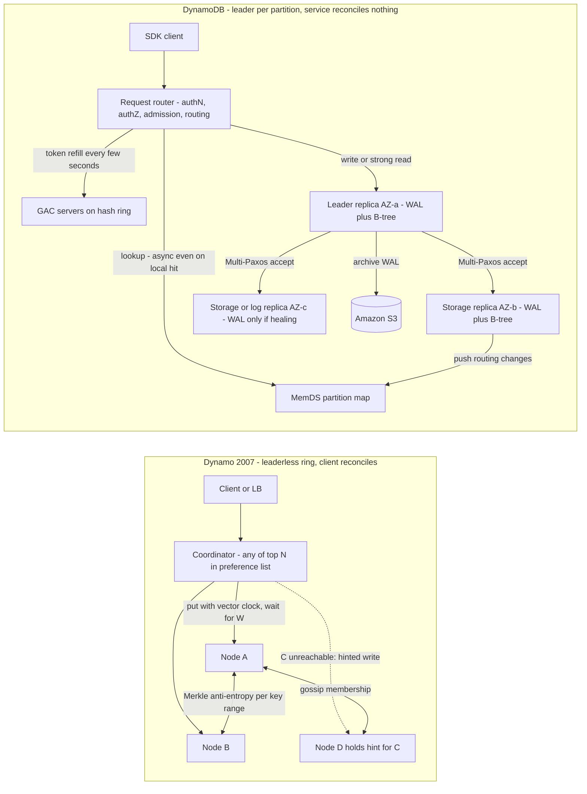

# Dynamo (2007) and DynamoDB (2022 USENIX ATC)

## TL;DR

Dynamo (SOSP 2007) was a leaderless, single-tenant key-value store built on consistent hashing, sloppy quorums, hinted handoff, vector clocks, and Merkle-tree anti-entropy, so that writes stayed available even when replicas disagreed.
DynamoDB (ATC 2022 paper, service launched 2012) kept Dynamo's incremental scalability and dropped its leaderless replication: each key range is a partition backed by a Multi-Paxos replication group with a leased leader, and that leader serves all writes and strongly consistent reads.
Durability and availability come from quorum persistence of the write-ahead log (WAL) across three AZs, plus two extra layers: WAL-only "log replicas" that heal a degraded group in seconds instead of minutes, and continuous WAL archival to S3.
Predictability is the product, and DynamoDB gets it with control mechanisms rather than raw speed: global admission control (GAC) uses token vending, partitions split based on consumption, and the MemDS metadata cache does constant work so a cold cache cannot cause a 400x surge.
The hard invariant you cannot design around is per-partition throughput (3,000 RCU and 1,000 WCU) (AWS docs, as of 2026-10).
A single hot item cannot be split, so key design is still your job even though the service is "serverless".

## Mental Model



In Dynamo, every node is a peer and any of the top N nodes for a key can coordinate a write.
Conflicts are allowed to happen and are carried forward as sibling versions, and the application merges them on read.
Availability is maximized, and correctness is pushed out to every client team.
DynamoDB inverts the split: each partition has exactly one leader that orders writes, so no siblings can exist.
The fleet around the storage nodes (routers, admission control, metadata) is built to keep latency flat whether caches are warm or cold and whether load is uniform or skewed.
The line between the two designs is the line between "the system never refuses a write" and "the system never surprises you".
DynamoDB accepts a small loss of write availability during leader failover in exchange for single-copy semantics and predictable p99.

## Internals

### Part I - Dynamo (DeCandia et al., SOSP 2007)

#### Requirements that shaped every mechanism

Dynamo was built for internal Amazon services, starting with the shopping cart, where refusing an "add to cart" write directly cost revenue.
The SLA target was stated at the 99.9th percentile, not the mean, with a 300 ms bound for a reference workload, because tail latency is what customers experience at retail scale (Dynamo paper, SOSP 2007).
The environment was assumed to be trusted and non-Byzantine, objects were small (typically under 1 MB), and each service ran its own Dynamo instance.
That last assumption explains much of the later history.

#### Partitioning: consistent hashing and the three strategies

Keys are hashed with MD5 into a 128-bit ring.
Each physical node owns many virtual nodes (tokens), which spreads load and lets heterogeneous hardware take proportional shares; see [[08-Distinguished-Engineering/02-Distributed-Systems-Internals/Consistent-Hash-Ring|Consistent Hash Ring]].
The detail that getting-started material always skips is that the paper evaluated three partitioning strategies.
The first coupled two decisions: random tokens defined both data placement and the partition boundaries.
Bootstrapping a node then meant scanning neighbors' local stores to find the keys in its new ranges.
Merkle trees had to be recomputed whenever ranges shifted, and archiving the key space was awkward.
Strategy 3 fixed this by dividing the hash space into Q equal-sized fixed partitions, with each of S nodes holding Q/S of them.
Once partition boundaries are fixed and only ownership moves, a partition becomes a unit of transfer (a file), its Merkle tree is stable, and membership metadata shrinks.
This split between the data partition and the node is the conceptual ancestor of DynamoDB's partitions and of every "move shards, not keys" system since.

#### Replication and the preference list

Each key is stored on its coordinator node and the next N-1 distinct physical nodes clockwise, and that set is the preference list.
The list deliberately skips virtual nodes that land on an already chosen physical host, and it contains more than N entries so failures can be routed around.
In production, nodes were spread across data centers.

#### Versioning with vector clocks

Every put creates a new immutable version tagged with a vector clock, a list of (node, counter) pairs.
If one version's clock dominates another's, the system discards the older version itself (syntactic reconciliation).
If the clocks are concurrent, both versions are kept as siblings and returned to the client on get, and the application merges them (semantic reconciliation).
The cart merge is a set union, which is why deleted items can reappear: a delete in one branch loses to an add in a concurrent branch.
To bound metadata, the clock is truncated by evicting the oldest pair once a size threshold is crossed.
That can, in theory, make descendants look concurrent and leave behind spurious siblings.
Over a 24-hour production window, the paper measured that the vast majority of requests (about 99.94%) saw exactly one version (Dynamo paper, SOSP 2007).

#### Quorums, sloppy quorums, and hinted handoff

Reads wait for R responses and writes wait for W acknowledgements, from the first N healthy nodes in the preference list.
R + W > N gives a quorum-like intersection, and a common configuration was (N, R, W) = (3, 2, 2) (Dynamo paper, SOSP 2007).
The word that matters is "healthy".
If a home replica is unreachable, the write goes to the next node on the ring, which stores it in a separate local table along with a hint naming the intended owner.
When the owner returns, the hint is replayed (hinted handoff).
The quorum is sloppy because the W nodes that acked need not be the N home nodes.
A later read quorum of home nodes can therefore miss the write entirely, even though R + W > N.
Dynamo's R + W > N is a statement about latency and probable freshness, not a linearizability guarantee.

#### Permanent failures: Merkle-tree anti-entropy

For divergence that hints cannot fix, each node keeps a Merkle tree per key range it hosts.
Two replicas compare tree roots and then descend only into subtrees whose hashes differ, so the data they exchange is proportional to the divergence rather than to the data set.

#### Membership and failure detection

Membership changes are explicit operator actions, and they spread by gossip, with seed nodes preventing logical partitions of the ring.
Failure detection is local and per-peer: node A treats B as failed if B does not answer A's messages, and A routes around it.
No global consensus on liveness exists.
That is cheap, but it means two clients can hold different views of who is alive.

#### Pluggable local storage

The local persistence engine was pluggable, with Berkeley DB and MySQL among the options, chosen per service by object-size profile (Dynamo paper, SOSP 2007).

#### Why Dynamo did not become the product

Dynamo worked, but every team operated its own installation, tuned its own (N, R, W), and wrote its own reconciliation logic.
The ATC 2022 paper describes the move to DynamoDB as combining Dynamo's incremental scalability and predictability with SimpleDB's managed, multi-tenant operational model.
The lesson for platform builders is that a design which pushes correctness to clients does not survive becoming a multi-tenant service.

### Part II - DynamoDB (Elhemali et al., USENIX ATC 2022)

#### Service decomposition

The paper names four core services: the metadata service, the request routing service, the storage nodes, and autoadmin, plus supporting fleets such as GAC and MemDS ([ATC 2022 paper](https://www.usenix.org/system/files/atc22-elhemali.pdf)).
Request routers authenticate and authorize each request, apply admission control, and forward it to the storage node that hosts the key.
Transactional requests go through transaction coordinators that run two-phase commit, while non-transactional requests go straight to storage ([Vanlightly analysis](https://jack-vanlightly.com/analyses/2023/11/14/amazon-dynamodb-asds-chapter-1)).
Autoadmin is the control plane: it handles partition health, splits, table and index creation, and re-replication.
DynamoDB uses DynamoDB for its own storage: the metadata nodes run the same storage software as the customer-facing storage nodes ([Vig, InfoQ talk](https://www.infoq.com/presentations/dynamodb-scale-aws/)).

#### Partition replication group: the data plane

A table is split into partitions, and each partition holds a disjoint, contiguous range of the hashed partition-key space.
Each partition is replicated across three AZs, and the replicas form a replication group that uses Multi-Paxos for leader election and consensus.
The write path works as follows:

1. The router sends the write to the leader.
2. The leader generates a WAL record and sends it to its peers.
3. The write is acknowledged to the client once a quorum of peers has persisted the record to their local WALs.

Only the leader serves writes and strongly consistent reads, and any replica can serve an eventually consistent read.
This is why a strongly consistent read costs twice the RCU of an eventually consistent read: it must land on one specific replica (the leader) rather than any of three.
A storage replica holds both the WAL and a B-tree of key-value data, so DynamoDB is a B-tree-plus-WAL engine, not an LSM.

#### Leader leases and gray-failure-aware elections

The leader holds a lease that it renews periodically.
Any replica can trigger an election when it suspects the leader has failed, but a newly elected leader does not serve until the previous leader's lease has expired.
That rule rules out two leaders serving strongly consistent reads at the same time.
The subtle mechanism is the handling of gray failures, where a follower loses its path to the leader but the leader is healthy for everyone else.
Before proposing an election, the would-be challenger asks the other replicas whether they can still reach the leader.
If they report a healthy leader, the follower drops its attempt.
That prevents a flaky link on one host from triggering a failover cascade that costs availability for the whole partition.
Elections are cheap in Paxos, but every one of them causes a window of write unavailability, so avoiding needless elections is an availability feature.

#### Log replicas: decoupling durability from data copies

Getting-started guides never mention this mechanism, and it is the key to DynamoDB's failure-recovery numbers.
A replication group can contain log replicas that persist only recent WAL entries and hold no B-tree; the paper likens them to Paxos acceptors ([ATC 2022 paper](https://www.usenix.org/system/files/atc22-elhemali.pdf)).
Rebuilding a full storage replica takes minutes, because the process copies the B-tree and the WAL.
So when the leader detects an unhealthy storage replica, it immediately adds a log replica to the group ([Murat Demirbas notes](http://muratbuffalo.blogspot.com/2022/07/amazon-dynamodb-scalable-predictably.html)).
Consider the quorum math.
With 3 members and 1 lost, a group still has a 2-of-2 write quorum, so one more failure halts writes and any new write lives on only two disks.
Adding a WAL-only member restores a 3-member group within seconds: writes again tolerate one failure, and every acknowledged write is again on two of three persistent logs.
The expensive B-tree rebuild then proceeds in the background without being on the durability critical path.
It also avoids loading the surviving peers with a snapshot copy at the moment they are already carrying extra load.
Durability is a property of the log, not of the materialized data.
That idea is taken to its extreme in [[17-Cloud-AI-Engineering/Volume_13_Seminal_Papers_and_Case_Studies/Chapter_02_Amazon_Aurora|Amazon Aurora (2017 SIGMOD)]], where storage nodes receive only redo log.

#### Durability below the replication group

WAL segments are periodically archived to S3, which provides a second, independent durability layer and is the substrate for point-in-time recovery.
The paper also describes three further safeguards (summarized from the paper, wording not verified line by line this session):

- end-to-end checksums on log entries, messages, and archived files;
- background verification that archived state matches the live replicas;
- formal specification of the core replication protocol in TLA+.

#### Partitioning and splits

A partition splits when it grows past a size threshold or when its consumed throughput crosses a threshold (split for consumption).
For consumption splits, the split point is chosen from the observed key-access distribution, not from the midpoint of the key range.
A split does not help in two cases.
The first is a single hot item: the item is the smallest unit, and the docs state that one item can get at most the partition maximum of 3,000 RCU and 1,000 WCU ([AWS docs](https://docs.aws.amazon.com/amazondynamodb/latest/developerguide/burst-adaptive-capacity.html), as of 2026-10).
The second is sequential access across the key range, where the hot spot moves into the newly split child.
Without an LSI, an item collection (one partition key, many sort keys) can be split by sort key.
With an LSI it cannot, because an LSI must be co-located with its base item collection (AWS docs, as of 2026-10).

#### Throughput control: from static allocation to GAC

The original provisioned model divided table throughput evenly across partitions, so each partition got table RCU/WCU divided by the partition count.
That produced throughput dilution: a size-driven split halved each child's allowance even though the hot keys had not changed, and customers saw throttling below their provisioned table rate.
The fixes came in layers, each fixing the previous layer's limitation:

1. Bursting let a partition draw on its own unused capacity, with up to 300 seconds of unused throughput retained, provided the node had spare capacity (AWS docs, as of 2026-10).
2. Adaptive capacity raised the allowance of throttled partitions, but only after throttling had already happened ([ATC 2022 paper](https://cdn.amazon.science/33/9d/b77f13fe49a798ece85cf3f9be6d/amazon-dynamodb-a-scalable-predictably-performant-and-fully-managed-nosql-database-service.pdf)).
3. Global admission control replaced adaptive capacity by separating admission from partition placement entirely.

GAC works by token vending.
Each request router keeps local, time-limited token buckets and deducts tokens as requests arrive.
When a router runs out, through consumption or expiry, it asks GAC for more, at intervals of a few seconds.
GAC servers sit on an independent hash ring, hold only ephemeral state computed from router reports, and can be restarted without affecting the service.
A GAC server estimates global consumption from those reports and vends the router its share of the next interval's tokens ([ATC 2022 paper](https://www.usenix.org/system/files/atc22-elhemali.pdf)).
Partition-level token buckets stay in place as a last line of defense on each storage node, so a partition can never exceed what its node can physically serve.
Storage nodes also balance proactively: each node watches the total throughput of the replicas it hosts and moves replicas off when it nears capacity.
This is a noisy-neighbor control, because DynamoDB is multi-tenant and a partition from another customer's table may share your node.
On-demand billing, launched in 2018, sits on top of this machinery: capacity is derived from observed consumption instead of declared ahead of time.

#### Metadata routing: MemDS and constant work

This is the second mechanism you will not find in a getting-started guide.
Originally, a request router that saw a table for the first time downloaded the table's entire routing map and cached it, and the hit rate was about 99.75% ([Amazon Science, 10 years of DynamoDB](https://www.amazon.science/blog/lessons-learned-from-10-years-of-dynamodb)).
On a miss, the router went straight to the metadata table.
A cold fleet, for example after a mass router restart, therefore drove metadata load from 0.25% of requests to 100%, a 400x step change ([Brooker](https://brooker.co.za/blog/2022/07/12/dynamodb.html)).
That is the textbook trigger for a metastable failure, where the system cannot recover even after the trigger is removed.
The redesign has three parts.
First, MemDS is a horizontally scaled in-memory store that holds all routing metadata compressed.
It uses a "Perkle" structure, a Patricia-tree and Merkle-tree hybrid ([notes](https://distributed-computing-musings.com/2022/07/paper-notes-amazon-dynamodb-a-scalable-predictably-performant-and-fully-managed-nosql-database-service/)), and storage nodes push routing changes into it.
Second, routers cache only the partitions they actually touch rather than whole tables.
Third, every router request goes to MemDS, asynchronously on a local hit and synchronously on a miss ([mydistributed.systems](https://www.mydistributed.systems/2022/10/dynamodb-ten-years-later.html)).
MemDS therefore sees the same load whether router caches are warm or cold, and the fallback path is exercised continuously instead of only during an incident.
The design deliberately spends more steady-state work in exchange for removing the bimodal mode, which is the constant-work pattern from [[17-Cloud-AI-Engineering/Volume_01_Cloud_Architecture_Principles/Chapter_05_Constant_Work_and_Workload_Smoothing|Constant Work and Workload Smoothing]].
Stale routing is safe because the storage node remains the authority.
If a router sends a request to a node that no longer owns the partition, the node rejects it and the router refreshes its entry.

#### Dependency isolation

Request routers call IAM and KMS for every request's authentication and encryption context.
They cache those results and refresh them asynchronously, so a short dependency outage degrades freshness rather than availability ([notes](https://distributed-computing-musings.com/2022/07/paper-notes-amazon-dynamodb-a-scalable-predictably-performant-and-fully-managed-nosql-database-service/)).
The paper states design availability targets of 99.99% for Regional tables and 99.999% for global tables ([notes quoting the paper](https://hemantkgupta.medium.com/insights-from-paper-part-ii-amazon-dynamodb-a-scalable-predictably-performant-and-fully-162fbc0ced93)).

### Part III - What changed and why

| Concern | Dynamo 2007 | DynamoDB 2022 | Why it changed |
|---|---|---|---|
| Replica ordering | Leaderless; any of top N coordinates | One leased Multi-Paxos leader per partition | Siblings and client merges do not scale to a multi-tenant service |
| Consistency | Eventual; siblings via vector clocks | Strong (leader) or eventual (any replica) per read | Customers want to choose consistency per read, not per cluster |
| Temporary failure | Sloppy quorum plus hinted handoff | Quorum on fixed group plus log replica healing | Hints break quorum intersection; log replicas keep it intact |
| Permanent failure | Merkle anti-entropy between peers | Re-replication by autoadmin, S3 WAL archive | Repair should be a control-plane task, not peer gossip |
| Membership | Gossip, local failure detection | Authoritative metadata plus MemDS, storage-node push | Clients need one routing truth |
| Partitioning | Q fixed hash partitions (Strategy 3) | Key-range partitions split on size and consumption | Hot spots, not just data size, must drive splits |
| Admission | None (single tenant) | GAC token vending plus partition buckets | Multi-tenant fairness and predictable throttling |
| Operations | Per-team install and tuning | Fully managed, regional multi-tenant fleet | Operational burden was the real failure mode |

### Disaggregation: how far DynamoDB goes, and where it stops

DynamoDB separates routing, admission, metadata, and long-term durability (S3) from the storage nodes, but the storage replica still bundles compute with its own local B-tree.
Moving a partition therefore means copying data, which is why log replicas exist.
Bigtable takes the opposite approach: tablet servers hold no durable data, because SSTables and commit logs live on Colossus.
Reassigning a tablet is a metadata operation that needs no data copy; see [[17-Cloud-AI-Engineering/Volume_13_Seminal_Papers_and_Case_Studies/Chapter_08_Google_Bigtable|Google Bigtable (2006 OSDI)]] and [[17-Cloud-AI-Engineering/Volume_13_Seminal_Papers_and_Case_Studies/Chapter_09_GFS_and_Colossus|GFS and Colossus]].
Aurora sits between the two by separating log-applying storage from the SQL engine, which is the next chapter.
Each option sets a different cost of moving load: DynamoDB copies data in the background, Bigtable reassigns tablets in seconds but pays a remote-storage hop on cache misses, and Aurora keeps writers stateless with respect to durability.

## Numbers to Know

| Quantity | Value | Source |
|---|---|---|
| Max item size (names plus values) | 400 KB | (AWS docs, as of 2026-10) |
| RCU definition | 1 strongly consistent or 2 eventually consistent reads/s, item up to 4 KB | (AWS docs, as of 2026-10) |
| WCU definition | 1 write/s, item up to 1 KB | (AWS docs, as of 2026-10) |
| Per-partition (and per-item) ceiling | 3,000 RCU and 1,000 WCU | (AWS docs, as of 2026-10) |
| Burst retention | Up to 300 s of unused capacity | (AWS docs, as of 2026-10) |
| Query/Scan page | 1 MB per page | (AWS docs, as of 2026-10) |
| Partition key length | 1 to 2,048 bytes | (AWS docs, as of 2026-10) |
| Sort key length | 1 to 1,024 bytes | (AWS docs, as of 2026-10) |
| Initial tables per Region | 2,500 (adjustable) | (AWS docs, as of 2026-10) |
| Default per-table throughput quota | 40,000 RCU and 40,000 WCU (adjustable) | (third-party summaries of AWS quotas, UNVERIFIED as of 2026-10) |
| Partition size before size split | About 10 GB | (third-party analyses, not in current AWS docs, UNVERIFIED) |
| Replicas per partition | 3, across AZs | (ATC 2022 paper) |
| Router routing-cache hit rate, legacy design | About 99.75%, so a cold cache meant 400x metadata load | (Amazon Science blog, 2022) |
| GAC token refill interval | A few seconds | (ATC 2022 paper) |
| Storage replica rebuild | Minutes; log replica added immediately | (ATC 2022 paper) |
| Design availability | 99.99% Regional, 99.999% global tables | (ATC 2022 paper) |
| Typical service-side latency | Low single-digit ms for 1 KB item | (ATC 2022 paper) |
| Dynamo SLA target | 99.9th percentile, 300 ms | (Dynamo paper, SOSP 2007) |
| Dynamo common quorum | (N, R, W) = (3, 2, 2) | (Dynamo paper, SOSP 2007) |
| On-demand write price | $0.625 per million WRU, us-east-1 | (AWS pricing after 2024-11 reduction, UNVERIFIED as of 2026-10) |
| On-demand read price | $0.125 per million RRU, us-east-1 | (AWS pricing after 2024-11 reduction, UNVERIFIED as of 2026-10) |
| Provisioned prices | $0.00065 per WCU-hour, $0.00013 per RCU-hour, us-east-1 | (AWS pricing page, UNVERIFIED as of 2026-10) |
| Standard table storage | $0.25 per GB-month, us-east-1 | (AWS pricing page, UNVERIFIED as of 2026-10) |
| Transaction size | Up to 100 actions, 4 MB aggregate | (AWS docs, UNVERIFIED as of 2026-10) |

## AWS vs GCP Mechanism Parity

Google Cloud has no single DynamoDB equivalent.
The closest mechanisms are split across Bigtable (wide-column key-range store), Firestore (document store on Spanner-class infrastructure), and Spanner (Paxos-replicated relational store).

| Mechanism | AWS DynamoDB | GCP Bigtable | GCP Spanner / Firestore | Critical difference |
|---|---|---|---|---|
| Data unit | Partition (hashed key range) | Tablet (lexicographic row range) | Split (key range) | DynamoDB hashes the partition key, so range scans are only within one item collection; Bigtable and Spanner keep global key order |
| Replication within a Region | 3 replicas, Multi-Paxos per partition | No per-tablet replicas; durability from Colossus | Paxos group per split across zones | Bigtable treats durability as a storage-layer concern; DynamoDB and Spanner treat it as a consensus-layer concern |
| Leader | Leased leader per partition | One tablet server serves a tablet | Leased Paxos leader per split, TrueTime-bounded | Spanner leader leases rely on TrueTime; DynamoDB leases rely on lease-expiry waits |
| Failure recovery | Log replica in seconds, B-tree rebuild in minutes | Tablet reassignment without data copy | New Paxos member catch-up | Bigtable recovery is metadata-only; DynamoDB must copy data |
| Strong reads | ConsistentRead at leader, 2x RCU | Strongly consistent within one cluster | External consistency by default | Bigtable multi-cluster replication is eventually consistent (Google Cloud docs, UNVERIFIED as of 2026-10) |
| Hot-key response | Split for consumption; single item capped at 1,000 WCU | Tablet split and rebalance; a single row stays on one node | Load-based splitting | All three: one key has a hard ceiling; fix it with schema design |
| Admission control | GAC token vending plus partition buckets | Node-count capacity, no per-request units | Compute capacity (nodes or processing units) | DynamoDB sells requests; Bigtable and Spanner sell provisioned servers |
| Metadata routing | Routers plus MemDS, constant work | Client library caches tablet locations from metadata tablets | Client and Spanner frontends route by directory | Bigtable's 3-level location hierarchy is the classic cache-plus-metadata design (Bigtable paper, OSDI 2006) |
| Multi-region | Global tables: MREC last-writer-wins, or MRSC | Replicated clusters, eventual, last-writer-wins on conflicts | Multi-region configs, synchronous | DynamoDB MRSC status and constraints: UNVERIFIED as of 2026-10 |
| Transactions | TransactWriteItems/TransactGetItems via coordinators, 2PC | Single-row atomicity only | Full ACID, 2PC over Paxos groups | Bigtable has no multi-row transactions |
| Private access | Gateway VPC endpoint; interface endpoints | Private Google Access, VPC SC perimeter | Private Google Access, VPC SC | GCP uses perimeters at the API layer; AWS uses endpoint policies plus SCP/RCP conditions |
| Encryption at rest | AWS owned, AWS managed, or customer managed KMS key | Google default or CMEK via Cloud KMS | Google default or CMEK | Revoking a CMEK makes data inaccessible on both clouds; timing differs (UNVERIFIED) |

Interviewers often probe the "Critical difference" column by asking why Bigtable can rebalance a hot tablet in seconds while DynamoDB needs log replicas.
The answer is disaggregation: Bigtable never moves bytes to move ownership, and DynamoDB does.

## Worked Example: Hitting the Per-Item Ceiling and Sizing a Production Table

### What this lab demonstrates

The lab provisions one on-demand table with a customer managed KMS key, point-in-time recovery, and an account budget alarm.
A Python load generator then measures three things:

1. A single hot item saturates around the documented 1,000 WCU ceiling and throttles, regardless of table capacity.
2. Spreading the same load across random keys scales past that ceiling until it hits the table-level cap you configure.
3. Conditional writes give optimistic concurrency, which is DynamoDB's replacement for Dynamo's vector-clock siblings.

Run it from AWS CloudShell or an EC2 instance in the same Region.
From a laptop, round-trip latency caps a 48-thread Python client well below 1,000 writes/s, and the experiment shows nothing.

### Terraform

```hcl
# main.tf - Chapter 13.01 lab. Billable. Teardown: terraform destroy -var alert_email=you@example.com
terraform {
  required_version = ">= 1.6"
  required_providers {
    aws = {
      source  = "hashicorp/aws"
      version = ">= 5.60"
    }
  }
}

variable "region" {
  type    = string
  default = "us-east-1"
}

variable "alert_email" {
  type = string
}

provider "aws" {
  region = var.region
}

resource "aws_kms_key" "ddb" {
  description             = "ch13-01 DynamoDB lab CMK"
  deletion_window_in_days = 7
  enable_key_rotation     = true
}

resource "aws_dynamodb_table" "lab" {
  name         = "ch13-01-lab"
  billing_mode = "PAY_PER_REQUEST"
  hash_key     = "pk"
  range_key    = "sk"

  attribute {
    name = "pk"
    type = "S"
  }

  attribute {
    name = "sk"
    type = "S"
  }

  # Cost guardrail: caps on-demand table throughput so a runaway loop cannot bill unbounded.
  on_demand_throughput {
    max_read_request_units  = 2000
    max_write_request_units = 2000
  }

  point_in_time_recovery {
    enabled = true
  }

  server_side_encryption {
    enabled     = true
    kms_key_arn = aws_kms_key.ddb.arn
  }

  deletion_protection_enabled = false

  tags = {
    lab = "ch13-01"
  }
}

resource "aws_budgets_budget" "lab" {
  name         = "ch13-01-lab-budget"
  budget_type  = "COST"
  limit_amount = "5"
  limit_unit   = "USD"
  time_unit    = "MONTHLY"

  notification {
    comparison_operator        = "GREATER_THAN"
    threshold                  = 80
    threshold_type             = "PERCENTAGE"
    notification_type          = "ACTUAL"
    subscriber_email_addresses = [var.alert_email]
  }
}

output "table_name" {
  value = aws_dynamodb_table.lab.name
}
```

Apply with `terraform init && terraform apply -var alert_email=you@example.com`.
The budget is account-wide, which keeps the snippet free of the cost-allocation-tag activation that a tag-filtered budget would need.

### Load generator (Python, boto3)

```python
# hotkey_lab.py - run: TABLE=ch13-01-lab AWS_REGION=us-east-1 python3 hotkey_lab.py
import os
import time
import uuid
from concurrent.futures import ThreadPoolExecutor

import boto3
from botocore.config import Config
from botocore.exceptions import ClientError

TABLE = os.environ.get("TABLE", "ch13-01-lab")
REGION = os.environ.get("AWS_REGION", "us-east-1")
THROTTLE_CODES = {
    "ProvisionedThroughputExceededException",
    "ThrottlingException",
    "RequestLimitExceeded",
}

# max_attempts=1 disables SDK retries so throttles are visible instead of hidden as latency.
cfg = Config(region_name=REGION,
             retries={"max_attempts": 1, "mode": "standard"},
             max_pool_connections=64)
ddb = boto3.client("dynamodb", config=cfg)  # clients are thread-safe; resources are not
PAD = "x" * 900  # keeps each item under 1 KB so one put costs exactly 1 WRU


def worker(mode, deadline):
    ok = throttled = other = 0
    while time.time() < deadline:
        pk = "HOT" if mode == "hot" else uuid.uuid4().hex
        try:
            ddb.put_item(TableName=TABLE,
                         Item={"pk": {"S": pk}, "sk": {"S": "0"}, "pad": {"S": PAD}})
            ok += 1
        except ClientError as e:
            if e.response["Error"]["Code"] in THROTTLE_CODES:
                throttled += 1
            else:
                other += 1
    return ok, throttled, other


def run(mode, seconds=60, threads=48):
    deadline = time.time() + seconds
    with ThreadPoolExecutor(max_workers=threads) as pool:
        results = list(pool.map(lambda _: worker(mode, deadline), range(threads)))
    ok = sum(r[0] for r in results)
    thr = sum(r[1] for r in results)
    oth = sum(r[2] for r in results)
    print(f"{mode:6s} ok/s={ok / seconds:8.1f} throttled/s={thr / seconds:8.1f} other={oth}")


def occ_withdraw(amount=10, attempts=5):
    key = {"pk": {"S": "acct#1"}, "sk": {"S": "balance"}}
    ddb.put_item(TableName=TABLE,
                 Item={**key, "v": {"N": "0"}, "bal": {"N": "100"}},
                 ConditionExpression="attribute_not_exists(pk)") if False else None
    for _ in range(attempts):
        cur = ddb.get_item(TableName=TABLE, Key=key, ConsistentRead=True).get("Item")
        if cur is None:
            ddb.put_item(TableName=TABLE, Item={**key, "v": {"N": "0"}, "bal": {"N": "100"}},
                         ConditionExpression="attribute_not_exists(pk)")
            continue
        v = int(cur["v"]["N"])
        try:
            ddb.update_item(
                TableName=TABLE, Key=key,
                UpdateExpression="SET bal = bal - :d, v = :nv",
                ConditionExpression="v = :v AND bal >= :d",
                ExpressionAttributeValues={":d": {"N": str(amount)},
                                           ":v": {"N": str(v)},
                                           ":nv": {"N": str(v + 1)}})
            print(f"withdraw committed at version {v + 1}")
            return
        except ClientError as e:
            if e.response["Error"]["Code"] != "ConditionalCheckFailedException":
                raise
    print("gave up after conflicts")


if __name__ == "__main__":
    run("hot")
    run("spread")
    occ_withdraw()
```

The `occ_withdraw` function reads with `ConsistentRead=True`, which routes to the leader, and then commits only if the version is unchanged.
This is linearizable compare-and-set on one item, which Dynamo could not offer because two coordinators could accept concurrent writes.
The expected results below are derived from documented limits and were not measured for this chapter.

- `hot` should plateau near 1,000 ok/s with a sustained throttle rate once burst capacity is drained, because the item cannot be split.
- `spread` should climb past 1,000 ok/s until it approaches the 2,000 WRU/s table cap set in Terraform, at which point table-level throttling appears.

To see the hot key named in CloudWatch, optionally enable Contributor Insights, which bills separately (pricing UNVERIFIED as of 2026-10).
Enable it with `aws dynamodb update-contributor-insights --table-name ch13-01-lab --contributor-insights-action ENABLE`, and turn it off with `--contributor-insights-action DISABLE` before teardown.

### Lab cost estimate

Two 60-second runs at no more than about 2,000 writes/s consume no more than about 250,000 WRU, roughly $0.16 at $0.625 per million WRU (UNVERIFIED as of 2026-10).
Storage for a few thousand 1 KB items and PITR on a near-empty table is a fraction of a cent.
A customer managed KMS key costs about $1 per month prorated, plus per-request charges for the table-key operations (UNVERIFIED as of 2026-10).
The expected total is under $2 if you tear down the same day.

### Teardown

```bash
terraform destroy -var alert_email=you@example.com
```

The KMS key enters a 7-day pending-deletion window, and `aws kms cancel-key-deletion` can reverse it during that window.

### Capacity sizing: a production order-events table

The workload has the following shape:

- 50,000 writes/s of 2.5 KB items;
- 200,000 eventually consistent reads/s of 6 KB items;
- 4 TB stored;
- a target provisioned utilization of 70% under auto scaling.

Step 1 converts the workload to capacity units.
Each write costs ceil(2.5 / 1) = 3 WCU, so writes need 150,000 WCU.
Each 6 KB strongly consistent read would cost ceil(6 / 4) = 2 RCU, and an eventually consistent read costs half, so 1 RCU, and reads need 200,000 RCU.

Step 2 computes the minimum partition count from each constraint.
Writes need 150,000 / 1,000 = 150 partitions.
Reads need 200,000 / 3,000 = 67 partitions.
Storage needs 4,000 GB / 10 GB = 400 partitions, using the UNVERIFIED 10 GB figure.
Storage dominates, so expect at least 400 partitions, and splits are invisible to you except through their effect on throttling.

Step 3 bounds the hottest key, and this is the step most candidates miss.
A single key's ceiling is 1,000 WCU absolute, so a key can absorb at most 1,000 / 3 = 333 writes/s of this item size.
As a share of traffic, that is 333 / 50,000 = 0.67% of all writes.
Any entity that can exceed 0.67% of write volume, such as a celebrity seller, a global counter, or a "latest" pointer, must be write-sharded, for example with suffixes `pk#0..pk#k-1` and scatter-gather reads, or aggregated upstream.
More partitions do not move this bound at all.

Step 4 prices on-demand, using 730 hours per month and the UNVERIFIED prices above.
Writes: 50,000 x 3,600 x 730 x 3 WRU = 3.942e11 WRU, x $0.625e-6 = $246,375.
Reads: 200,000 x 3,600 x 730 x 1 RRU = 5.256e11 RRU, x $0.125e-6 = $65,700.
Storage: 4,000 GB x $0.25 = $1,000.
The on-demand total is about $313,000 per month.

Step 5 prices provisioned capacity at 70% utilization.
WCU: 150,000 / 0.7 = 214,286, x $0.00065 x 730 = $101,679.
RCU: 200,000 / 0.7 = 285,714, x $0.00013 x 730 = $27,114.
With storage, the provisioned total is about $129,800 per month, roughly 2.4x cheaper than on-demand.

Step 6 finds the break-even utilization.
One provisioned WCU-hour ($0.00065) buys 3,600 writes, and the same 3,600 writes cost $0.00225 on-demand.
Provisioned therefore wins whenever average utilization of provisioned capacity exceeds 0.00065 / 0.00225 = 28.9%.
The read side gives the same ratio (0.00013 / 0.00045), so the rule of thumb is that on-demand pays off only for traffic with a peak-to-average ratio above about 3.5, or for unknown traffic.

Step 7 covers what the bill hides.
Every write is persisted to three replica WALs and archived to S3, and you pay once for it.
That bundling is the reason a self-managed Cassandra cluster at RF=3 looks cheaper per node and often is not cheaper per durable write once operators are counted; see [[04-System-Design/05-Data-Stores/Apache-Cassandra|Apache Cassandra]].

## Failure Modes and Pitfalls

### Hot item throttling that capacity cannot fix

Symptoms are `ProvisionedThroughputExceededException` on a table whose consumed capacity is far below its provisioned or on-demand level.
The cause is one item or one LSI-bound item collection exceeding the 1,000 WCU or 3,000 RCU per-partition ceiling, which split for consumption cannot fix by design.
Monotonic keys, such as timestamps or auto-increment IDs as partition keys, defeat splits differently: the hot spot moves to the newest child after each split.
The fix is schema work: write sharding, hashing a high-cardinality attribute into the key, or buffering counters with a stream aggregator.

### Retry amplification during throttling

Throttles are retryable, and SDK retries with exponential backoff turn a 2x overload into a much larger offered load if clients also add application-level retries.
Use a single retry layer, the SDK adaptive or standard mode with a client-side token bucket, and full jitter, as described in [[17-Cloud-AI-Engineering/Volume_07_Reliability_and_SRE/Chapter_03_Resilient_Communication_Retries_Jitter_and_Circuit_Breakers|Retries, Jitter, and Circuit Breakers]].

### GSI back-pressure throttling the base table

GSIs are updated asynchronously, but if a GSI cannot absorb the write rate, DynamoDB throttles writes to the base table to keep the index from falling arbitrarily behind (AWS docs, UNVERIFIED as of 2026-10).
A low-cardinality GSI partition key, for example `status = "PENDING"`, therefore throttles your main write path.
Treat each GSI as a separate table with its own hot-key analysis.

### Cache-driven metastability (the MemDS lesson)

Any routing or metadata cache with a 99%+ hit rate hides a backend sized for 1% of traffic.
A mass restart, a deploy that clears caches, or a key-space change exposes the backend to the full load, and retries keep it collapsed after the trigger is gone.
DynamoDB's fix, constant work to MemDS, generalizes: either size the backend for 100% miss, or make the cache's backend load independent of hit rate.
See [[17-Cloud-AI-Engineering/Volume_01_Cloud_Architecture_Principles/Chapter_05_Constant_Work_and_Workload_Smoothing|Constant Work and Workload Smoothing]].

### PIR: DynamoDB us-east-1, September 2015 (metadata service overload)

AWS's public summary described storage servers that timed out retrieving their partition membership data from the metadata service.
Those servers marked themselves unavailable and retried, and the combined load overwhelmed the metadata service, increasing error rates for DynamoDB and dependent services.
The summary pointed to growth in membership data, linked to adoption of Global Secondary Indexes, which had pushed lookup latency close to the timeout (AWS PIR, details UNVERIFIED this session).
The structure is a timeout set near the p100 of a growing payload, with retries that amplify load on a shared dependency.
The redesign of metadata serving in the ATC paper reads as the long-term answer.

### PIR: AWS us-east-1, October 19-20, 2025 (DNS automation race)

AWS's post-event summary attributed the initial DynamoDB impact to a latent race condition in DynamoDB's automated DNS management.
Two independent enactors applying DNS plans interleaved badly, and a cleanup step removed the active plan.
That left an empty DNS record for the Regional DynamoDB endpoint, and the system needed manual repair.
The DynamoDB outage then cascaded: EC2 instance-launch and network-propagation workflows that depend on DynamoDB fell behind and recovered slowly after DNS was fixed (AWS post-event summary, details UNVERIFIED this session).
Two lessons follow.
First, the data plane was healthy but unreachable, so control-plane automation for endpoints is part of the data plane's availability budget.
Second, internal services built on DynamoDB inherit its Regional blast radius unless they are statically stable; see [[17-Cloud-AI-Engineering/Volume_01_Cloud_Architecture_Principles/Chapter_02_Regions_Zones_and_Static_Stability|Static Stability]] and [[17-Cloud-AI-Engineering/Volume_07_Reliability_and_SRE/Chapter_07_Anatomy_of_Major_Cloud_Outages|Anatomy of Major Cloud Outages]].

### Dynamo-style anomalies in Dynamo descendants

Teams running Cassandra, Riak-style, or other leaderless stores still face the 2007 anomalies:

- deleted data resurrects when a replica misses a tombstone and anti-entropy runs after the tombstone was garbage-collected;
- sibling counts explode under concurrent writers;
- sloppy-quorum reads miss hinted writes.

The fix is policy, not configuration: bound tombstone grace periods to below the repair interval, and never treat R + W > N as linearizable.

### Global tables last-writer-wins

Multi-Region eventually consistent global tables resolve concurrent writes with last-writer-wins, so a concurrent update in another Region can silently lose (AWS docs, UNVERIFIED as of 2026-10).
Read-modify-write patterns such as counters and balances must either be homed in one Region per key or use the strongly consistent multi-Region mode where available (status UNVERIFIED as of 2026-10).

### Item size and scan cost traps

Attribute names count toward the 400 KB item size, so verbose names inflate every RCU and WCU (AWS docs, as of 2026-10).
Scans read in 1 MB pages and consume read capacity for every item examined, not only for the items returned after filtering.

## Security and Cost Angles

### IAM scoping

Use the `dynamodb:LeadingKeys` condition key so a tenant principal can touch only items whose partition key equals its identity, which gives row-level isolation without per-tenant tables.
Use `dynamodb:Attributes` together with `dynamodb:Select` to restrict which attributes a principal can read or write.
Deny `dynamodb:Scan` and `dynamodb:DeleteTable` for application roles, and deny table deletion through SCPs on production OUs; see [[17-Cloud-AI-Engineering/Volume_02_AWS_Deep_Dive/Chapter_01_IAM_Policy_Evaluation_Engine|IAM Policy Evaluation Engine]].
Enable `deletion_protection_enabled` on production tables so a single mistaken API call cannot delete them.

### Network boundary

A gateway VPC endpoint for DynamoDB routes traffic through VPC route tables to the Regional endpoint with no internet path and no hourly endpoint charge (AWS docs, UNVERIFIED as of 2026-10).
Attach an endpoint policy that allows only your organization's tables.
On the resource side, condition on `aws:SourceVpce` or `aws:SourceVpc` through resource-based table policies or identity policies, so stolen credentials do not work from outside the VPC.
On Google Cloud, the equivalent boundary for Bigtable and Spanner is a VPC Service Controls perimeter; see [[17-Cloud-AI-Engineering/Volume_03_GCP_Deep_Dive/Chapter_03_VPC_Service_Controls_Security_Perimeters|VPC Service Controls]] and [[17-Cloud-AI-Engineering/Volume_08_Security_Identity_and_the_Data_Perimeter/Chapter_06_Constructing_an_Impenetrable_Data_Perimeter|Data Perimeter]].

### Encryption key hierarchy

DynamoDB encrypts at rest with envelope encryption, using one of three key options for the top-level key: an AWS owned key, an AWS managed key, or a customer managed key.
The KMS key protects a per-table key, which in turn protects data keys.
Request routers cache the decrypted key material for a bounded period, so a KMS brownout does not immediately fail reads (cache duration UNVERIFIED as of 2026-10).
The trade-off with a customer managed key is control versus availability coupling.
Disabling the key or revoking its grant makes the table inaccessible after the cache expires, which is the intended crypto-shredding lever and also a self-inflicted outage risk if key policies are edited carelessly.
See [[17-Cloud-AI-Engineering/Volume_08_Security_Identity_and_the_Data_Perimeter/Chapter_04_Encryption_Key_Hierarchies_and_Envelope_Encryption|Envelope Encryption]].

### Unit-economics levers

1. Choose provisioned capacity with auto scaling above about 29% sustained utilization, and on-demand below it, using the break-even derived in the Worked Example.
2. Shrink items: shorter attribute names, compressed blobs, and large payloads moved to S3 with a pointer cut WCU linearly at the 1 KB boundary and RCU at the 4 KB boundary.
3. Prefer eventually consistent reads wherever read-your-writes is not required, because they cost half and can be served by any of three replicas.
4. Project only needed attributes into GSIs, because every GSI multiplies write cost.
5. Use TTL for expiry, because TTL deletes do not consume write capacity (AWS docs, UNVERIFIED as of 2026-10).
6. Consider the Standard-Infrequent Access table class for storage-dominated tables, which trades lower storage price for higher per-request price (ratio UNVERIFIED as of 2026-10).
7. Cap on-demand tables with maximum throughput settings, as in the lab, so a bug cannot bill without limit.

## Interview Questions and Model Answers

### Question 1 (L5 - Senior)

Dynamo used (N, R, W) = (3, 2, 2), so R + W > N.
Why can a client still read stale data, and what would you change to prevent it?

#### Model Answer

R + W > N guarantees intersection only if both quorums are drawn from the same fixed set of N replicas.
Dynamo's sloppy quorum draws them from the first N healthy nodes in the preference list.
Suppose home replica C is unreachable from the coordinator.
The write lands on A, B, and a fallback D that holds a hint for C, and the coordinator returns after W = 2 acks, say from A and D.
B may have the write in flight or lose it.
C recovers before D replays its hint, so a read can be served by B and C, neither of which has the write.
Intersection fails without any quorum rule being broken.
Even with strict quorums, concurrent writes through different coordinators produce sibling versions, and without a single writer there is no linearization point.
Clock truncation and the lack of read repair on every read leave further windows.
There are two ways to prevent stale reads.
One is strict quorums with no fallback, which sacrifices write availability during failures, exactly what Dynamo was built to avoid.
The other is the DynamoDB approach: one leased leader per partition orders all writes, a write is durable when a majority of the fixed group persists the WAL record, and strong reads go to the leader.
The cost is a short write-unavailability window during leader failover, plus doubled RCU for strong reads, because only one replica can serve them.
I would pick per workload: carts and session state tolerate siblings, while balances and inventory need a single writer.

#### Follow-up Interviewer Question

Leader-based strong reads require the leader to know it is still the leader; what prevents a deposed leader from serving a stale strongly consistent read during a partition?

### Question 2 (L5 - Senior)

A DynamoDB on-demand table consuming 8,000 WCU across the table starts throwing `ProvisionedThroughputExceededException` on 3% of writes.
Walk me through diagnosis and remediation.

#### Model Answer

First I check whether this is table-level or partition-level throttling.
Table consumption at 8,000 WCU is far below any on-demand ceiling I configured, and below twice the previous peak, so this is almost certainly a hot partition or a hot item.
I enable CloudWatch Contributor Insights to find the most-accessed and most-throttled keys.
I also check the WriteThrottleEvents metric on each GSI, because GSI back-pressure throttles base-table writes and looks identical from the client.
If one key dominates, the math is absolute: a single item cannot exceed 1,000 WCU, so 1 KB items cap at 1,000 writes/s, and 3 KB items at about 333 writes/s.
Split for consumption cannot help, because an item cannot be split.
If the hot spot is a monotonically increasing key such as a time bucket, splits do not help either, because the newest child inherits the heat.
For remediation, write-shard the hot key into k suffixes, where k is at least peak writes times WCU per write divided by about 800, to leave headroom below 1,000.
Reads then scatter-gather across k shards, or a stream aggregator materializes a combined view.
If the key is a counter, buffer increments in the application or an aggregator and flush them periodically.
If it is a GSI, redesign the GSI key to raise its cardinality.
In parallel, I make sure the client uses the SDK's single retry layer with jitter, so the 3% does not become 10% through amplification.

#### Follow-up Interviewer Question

The hot key is a single item that must be read with strong consistency at 5,000 reads/s; what are your options, and what does each cost in consistency or money?

### Question 3 (L6 - Staff)

Explain DynamoDB log replicas.
Quantify the durability and availability exposure they close, and say when this pattern is the wrong choice for a system you are designing.

#### Model Answer

A replication group normally holds three storage replicas, each with a WAL and a B-tree, in three AZs.
A write commits when a majority persists the WAL record.
When one storage replica fails, the group still commits writes, but only with 2-of-2, so a second failure halts writes for the partition.
New writes in that window are on two disks rather than on two of three, so a single disk loss among the survivors leaves them on one copy.
Rebuilding a full storage replica takes minutes, because it copies the B-tree and the WAL, and the copy loads the survivors.
A log replica restores a three-member group within seconds, because it only needs to start accepting new WAL records; it is a Paxos acceptor without state machine application.
The exposure window shrinks from the rebuild time to roughly the detection time plus the membership change.
At fleet scale this matters, because the probability of a correlated second failure inside the window scales linearly with the window length multiplied by millions of partitions.
The full rebuild continues in the background, off the commit critical path.
Two caveats apply.
A log replica cannot serve reads, so eventual-read capacity drops by a third until the rebuild completes.
It also cannot become a leader that serves reads without first catching up a B-tree.
The pattern is wrong in three cases.
The first is when storage is already disaggregated, as in Bigtable on Colossus, where ownership moves without data copies and witnesses add nothing.
The second is when the failure domain of the witness pool correlates with the failed replica's, for example if the log replica lands in the same AZ, because then durability is illusory.
The third is when the state machine is small enough to copy in seconds, where the extra membership complexity is not worth it.
I would also insist on formal specification of the membership change, since joint consensus and reconfiguration are where Paxos implementations historically break; DynamoDB specified its replication protocol in TLA+.

#### Follow-up Interviewer Question

How would you place log replicas to preserve AZ independence when the failed replica's AZ is itself degraded, and what does that do to commit latency?

### Question 4 (L6 - Staff)

Your routing tier caches a partition map with a 99.75% hit rate.
Leadership asks why you want to spend more on the metadata backend when "the cache handles it".
Make the case and specify the design.

#### Model Answer

The cache does not reduce the capacity the backend needs; it hides it.
Steady-state backend load is 0.25% of requests, but a cold-fleet event (mass deploy, AZ recovery, cache format change) demands 100%, a 400x step.
No autoscaler reacts to a step that size, so the backend saturates.
Timeouts trigger retries, retries add load, and the system stays down after the trigger has passed, which is a metastable failure.
DynamoDB experienced exactly this mode and redesigned around MemDS.
The design has four parts.
First, the authoritative store pushes routing changes into a horizontally scaled in-memory tier sized for 100% of request lookups.
Second, routers cache only the entries they use.
Third, every request issues a lookup to the in-memory tier, asynchronously on a local hit so latency is unaffected, and synchronously on a miss.
Fourth, staleness is made safe by having storage nodes reject misrouted requests, which triggers a refresh.
Backend load then becomes a constant function of request rate, not of hit rate, so there is no bimodal mode left to fall into, and the fallback path is exercised every second instead of once a year.
The cost is real: the in-memory tier is sized for full traffic, perhaps tens of servers that would otherwise not exist.
The return is removing a failure mode that takes down the whole Region rather than one tenant.
I would quantify it as the expected cost of one Region-wide routing outage per N years against the yearly cost of the fleet, and in my experience that comparison is not close for a shared data plane.

#### Follow-up Interviewer Question

The constant-work tier itself fails; how do routers behave so that its failure degrades only freshness, and what is the maximum staleness you would tolerate before failing closed?

### Question 5 (L6 - Staff)

Design table-level admission control for a multi-tenant key-value service with thousands of stateless request routers, where a tenant's traffic can be arbitrarily skewed across partitions.
Compare your design with DynamoDB's GAC.

#### Model Answer

The requirement is that a tenant can consume its full table rate even if all of it targets a few partitions, while no partition or node is overloaded.
Coupling admission to partitions, by dividing table rate by partition count, fails both goals: throughput is diluted on splits and skew is not absorbed.
So I separate the two layers.
The table-level budget lives in a sharded token service: servers on a consistent-hash ring, each owning some tables' buckets, with no durable state.
Routers hold short-lived leases of tokens per table, deduct them locally on each request, and report consumption and request more when tokens run low or expire.
The token server estimates global demand from those reports and grants each router a share of the next interval proportional to its recent demand.
Leases expire within seconds, so a router that dies or partitions away cannot strand budget for long.
Node-level and partition-level buckets stay on storage nodes as a hard physical-safety limit, and admission control never overrides them.
That is DynamoDB's GAC: routers keep local, time-limited token buckets, refill from GAC every few seconds, and GAC servers on an independent hash ring can be restarted without impact.
The trade-offs are three.
First, there is allocation error within one interval, so short over-admission is possible, bounded by the lease size times the number of routers; I size leases so that bound stays within node burst headroom.
Second, a token server failure means routers must degrade gracefully, by continuing at their last granted rate for a bounded time rather than failing closed.
Third, admission control does not fix hot items, so the partition bucket still throttles a single key at its physical ceiling, and I surface that as a distinct throttle reason so tenants know it is a schema problem, not a quota problem.

#### Follow-up Interviewer Question

A tenant runs a scan that consumes its full table budget and starves its own latency-sensitive point reads; do you add priority classes inside one table's budget, and how do you keep the token protocol simple?

### Question 6 (L7+ - Principal)

The October 2025 us-east-1 event began with DynamoDB's Regional endpoint DNS record becoming empty, and it cascaded into EC2 control-plane workflows that depend on DynamoDB.
As the principal for an internal platform that stores its control-plane state in DynamoDB, what do you change?

#### Model Answer

I treat the public account of the event as directional and note that its exact sequence is UNVERIFIED here.
The structural lesson does not depend on those details.
The storage fleet was fine, but the name resolution path to it was produced by automation, and that automation is part of the data plane's availability.
For my platform I separate three things.
The first is static stability of the data plane.
Anything that serves customer requests must keep working on cached control state if the control-plane store is unreachable, so hosts keep running with their last known configuration, credentials, and routing.
I verify that with game days that block the DynamoDB endpoint at the VPC level for an hour.
The second is dependency direction.
If my control plane writes to DynamoDB and DynamoDB's own recovery depends on my control plane directly or transitively, I have a circular dependency that will deadlock recovery.
I map that graph explicitly, as in [[17-Cloud-AI-Engineering/Volume_01_Cloud_Architecture_Principles/Chapter_02_Regions_Zones_and_Static_Stability|Static Stability]].
The third is recovery shape.
After the store returns, a backlog of reconciliation work can collapse the control plane through congestion, so I build admission control and work prioritization into the reconcilers, rate-limiting catch-up and processing the newest desired state rather than replaying history.
On the automation itself, I apply the same rules I would demand of DynamoDB's DNS system:

- appliers must use compare-and-set on a plan generation number, so an older plan can never overwrite a newer one;
- cleanup must never delete the generation that is currently active;
- an empty or drastically shrunk record set must be rejected as an invariant violation, not applied.

Finally, I quantify the decision about multi-Region control-plane state, such as global tables or a Spanner-class store, against the consistency it costs.
Last-writer-wins on control-plane state is often worse than an outage, so I would home each cell's state in one Region and make cells independent, rather than make one control plane global.

#### Follow-up Interviewer Question

Your cell-per-Region design means a Regional DynamoDB failure still takes down that Region's cells; what is the RTO for evacuating customers to another Region, and what state must be pre-replicated to make it possible?

### Question 7 (L7+ - Principal)

A team proposes building a new internal metadata store as a leaderless Dynamo-style system on local NVMe "for availability", instead of using DynamoDB or a Paxos-based store.
How do you evaluate the proposal?

#### Model Answer

I evaluate it on four axes: the semantics the consumers need, failure-mode cost, operational burden, and unit cost.
On semantics: if any consumer does read-modify-write, such as leases, counters, ownership, or configuration generations, a leaderless store forces either application-level conflict resolution or a lost-update risk.
Metadata stores almost always need compare-and-set, which requires a single writer per key.
On availability, the claimed advantage is write availability during partitions.
A Multi-Paxos group across three AZs already survives one AZ loss without losing write availability, so the leaderless design wins only in minority-side partitions.
There, a leaderless store accepts writes that will later conflict.
For metadata, accepting conflicting writes on the minority side is usually the wrong answer.
On operations, Dynamo's history is the evidence.
Every team ran its own installation, tuned quorums, wrote reconciliation logic, and handled tombstone resurrection, repair scheduling, and hinted-handoff storms during recovery.
DynamoDB exists because that burden did not scale, and a new internal system rebuilds that burden with fewer engineers.
On cost, I compare fully loaded cost per durable write, including three-AZ replication, backups, PITR, on-call, and repair tooling, against the managed price.
At under about 29% utilization, on-demand pricing is also hard to beat with provisioned NVMe fleets.
I would approve a custom store only with evidence of a hard requirement the managed options cannot meet, such as sub-millisecond p99 on local NVMe for a latency-critical path.
Even then I would push for a leader-based design with log-structured witnesses rather than leaderless replication, and require a TLA+ specification of the replication and membership protocol before production.

#### Follow-up Interviewer Question

The team's real requirement turns out to be 2 million writes/s of 200-byte heartbeats with 30-second TTL; does that change your answer, and what design would you pick?

### Question 8 (L6 - Staff)

Why did DynamoDB's original throughput model throttle customers below their provisioned rate, and what does that history teach about designing quotas in any partitioned system?

#### Model Answer

Originally, table throughput was divided evenly across partitions, and each partition enforced its own share.
Two effects followed.
First, skew: a table provisioned at 10,000 WCU over 10 partitions throttled at 1,000 WCU on a hot partition while the other nine sat idle, so the customer saw throttling at a fraction of the rate they paid for.
Second, dilution: a split for size doubled the partition count without changing hot keys, halving each partition's share, so growing data reduced usable throughput.
The fixes were layered.
Bursting banked up to 300 seconds of unused capacity per partition, but helped only with short spikes and only if the node had headroom.
Adaptive capacity raised throttled partitions' allowances, but reactively, after customers had already been throttled.
GAC ended the coupling by enforcing table rate at routers through token vending, while partition buckets remained purely as physical protection.
The general lesson: a quota defined over a logical entity must not be enforced by dividing it among physical shards, because shard count changes for reasons unrelated to demand.
Enforce logical quotas where traffic converges (routers or gateways), enforce physical limits where resources live (nodes), and keep the two signals distinguishable to customers.
The same mistake appears in LLM gateways that split a tenant's tokens-per-minute evenly across model replicas.
The fix is the same: global token vending with leases.

#### Follow-up Interviewer Question

How would you design the throttle response so that a client can tell table-quota throttling from hot-partition throttling, and what should each client do differently?

## Further Reading

- [Dynamo: Amazon's Highly Available Key-value Store (SOSP 2007)](https://www.allthingsdistributed.com/files/amazon-dynamo-sosp2007.pdf) - The source for sloppy quorums, hinted handoff, vector clocks, and the three partitioning strategies; read Section 6 for production lessons.
- [Amazon DynamoDB: A Scalable, Predictably Performant, and Fully Managed NoSQL Database Service (USENIX ATC 2022)](https://www.usenix.org/system/files/atc22-elhemali.pdf) - The primary source for replication groups, log replicas, GAC, MemDS, and the throughput-model evolution.
- [USENIX ATC 2022 presentation page](https://www.usenix.org/conference/atc22/presentation/elhemali) - The talk recording and slides, useful for the authors' emphasis on predictability over efficiency.
- [Lessons learned from 10 years of DynamoDB (Amazon Science)](https://www.amazon.science/blog/lessons-learned-from-10-years-of-dynamodb) - The authors' own account of the 99.75% hit-rate cache problem and the constant-work redesign.
- [Marc Brooker: The DynamoDB paper](https://brooker.co.za/blog/2022/07/12/dynamodb.html) - Connects MemDS to metastability and constant work from someone who builds these systems.
- [Akshat Vig: DynamoDB at scale (InfoQ)](https://www.infoq.com/presentations/dynamodb-scale-aws/) - A DynamoDB engineer's talk covering metadata caching, admission control, and DynamoDB storing its own metadata.
- [Jack Vanlightly: Amazon DynamoDB analysis](https://jack-vanlightly.com/analyses/2023/11/14/amazon-dynamodb-asds-chapter-1) - A structured component-by-component reconstruction including transaction coordinators and GAC.
- [mydistributed.systems: DynamoDB ten years later](https://www.mydistributed.systems/2022/10/dynamodb-ten-years-later.html) - A clear comparison of Dynamo leaderless replication against DynamoDB Multi-Paxos and the MemDS request flow.
- [Murat Demirbas: paper review](http://muratbuffalo.blogspot.com/2022/07/amazon-dynamodb-scalable-predictably.html) - A distributed-systems researcher's reading of the replication and healing mechanics.
- [Distributed Transactions at Scale in Amazon DynamoDB (USENIX ATC 2023)](https://www.usenix.org/conference/atc23/presentation/idziorek) - The follow-on paper on timestamp-ordered transactions without MVCC (link UNVERIFIED this session).
- [Metastable Failures in Distributed Systems (HotOS 2021)](https://sigops.org/s/conferences/hotos/2021/papers/hotos21-s11-bronson.pdf) - The formal framing of the cache-collapse failure mode that MemDS was designed to eliminate (link UNVERIFIED this session).
- [[17-Cloud-AI-Engineering/Volume_02_AWS_Deep_Dive/Chapter_10_Amazon_DynamoDB_Architecture_and_Partitioning|Amazon DynamoDB: Architecture and Partitioning]] - The service-level companion to this paper chapter.
- [[17-Cloud-AI-Engineering/Volume_13_Seminal_Papers_and_Case_Studies/Chapter_02_Amazon_Aurora|Amazon Aurora (2017 SIGMOD)]] - The next step on log-as-durability: storage that consumes only redo.
- [[17-Cloud-AI-Engineering/Volume_13_Seminal_Papers_and_Case_Studies/Chapter_06_Google_Spanner|Google Spanner (2012 OSDI)]] - The GCP counterpart for Paxos-per-split replication with external consistency.
- [[08-Distinguished-Engineering/02-Distributed-Systems-Internals/Raft-Consensus|Raft Consensus]] - A refresher on leader-based log replication semantics that DynamoDB's Multi-Paxos groups share.
