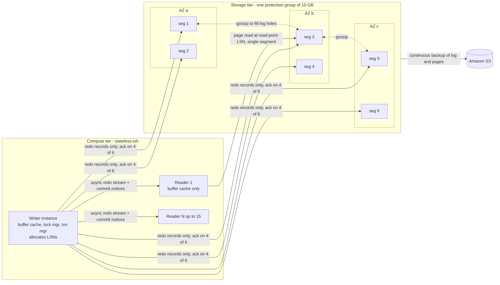

# Amazon Aurora (2017 SIGMOD)

## TL;DR

Aurora sends only redo log records from the database engine to a separate, multi-tenant storage fleet, and that fleet turns those records into data pages in the background, so writing a page never puts a page on the network.
The volume is split into 10 GB segments, each copied 6 times across 3 AZs (2 per AZ), with a write quorum of 4/6 and a read quorum of 3/6, so it survives losing a whole AZ plus one more node (AZ+1).
Commits, reads, and replica updates need no 2PC, no Paxos round, and no quorum read on the normal path, because the single writer hands out log sequence numbers (LSNs) and tracks durability locally through the VCL, CPL, and VDL markers.
Crash recovery is spread out and runs in the background: the new writer works out the VDL from a read quorum, cuts off everything above it under a new volume epoch, and goes live while undo of uncommitted work continues online.
The cost of the design is a single-writer ceiling, commit latency set by the 4th-fastest of 6 cross-AZ acks, and an I/O-metered bill that can exceed compute unless you model when Standard or I/O-Optimized is cheaper.

## Mental Model



Think of Aurora as a database engine whose bottom half was cut off and turned into a distributed log service that also replays the log.
The engine still owns everything that needs one ordering point: locking, MVCC, transaction state, and LSN allocation.
Storage owns everything that can run in parallel and in the background: durability, page materialization, garbage collection, checksum scrubbing, and backup.
The only thing on the synchronous path is "persist this redo record and ack", and that path is a quorum write, not a chain or primary-backup protocol, so one slow node or one slow AZ is ignored instead of waited on.
Readers share the same volume, so a replica is a cache kept warm by the writer's log stream, not a second copy of the data.

## Internals

### 1. The problem Aurora was solving: network I/O amplification

The 2017 paper argues that in a cloud database the bottleneck moves from compute and disk to the network between the database tier and the storage tier ([Verbitski et al., SIGMOD 2017](https://www.amazon.science/publications/amazon-aurora-design-considerations-for-high-throughput-cloud-native-relational-databases)).
The baseline it measures against is MySQL with synchronous mirroring of EBS volumes across AZs.
In that setup one user write turns into several separate network writes: the InnoDB redo log, the binlog, the modified data pages, the double-write buffer that guards against torn pages, and metadata files, each mirrored, and several of them serialized one after another.
Each of those writes is a full page or a full log block, even when the logical change is a few bytes.
Aurora's answer is to send only redo records, which are small, idempotent physiological deltas, and to make storage responsible for building pages.
In the paper's 30-minute SysBench write-only test on a 100 GB dataset, Aurora completed about 35x more transactions than mirrored MySQL (27,378,000 vs 780,000) and used about 7.7x fewer I/Os per transaction (0.95 vs 7.39), even though every write goes to six copies (paper, 2017).
The lesson for staff engineers is that the design goal was "fewer and smaller bytes on the synchronous path".
Lower per-operation latency came as a result of that goal, not as the goal itself.

### 2. Segments, protection groups, and the AZ+1 argument

The volume is a set of protection groups (PGs) joined end to end.
Each PG is made of six 10 GB segments, two in each of three AZs.
Segments are stored on a fleet of storage hosts with locally attached SSDs.
The quorum parameters are V = 6 votes, Vw = 4, and Vr = 3, which meet Gifford's two rules for quorum overlap: Vr + Vw > V (3 + 4 > 6), so every read quorum overlaps the latest write, and Vw > V/2 (4 > 3), so any two write quorums overlap.
The paper explains why three copies are not enough.
With 3 copies and a 2/3 quorum, losing one AZ leaves you one background failure away from losing quorum, and at large scale some background failure is always happening somewhere.
With 6 copies and 4/6, losing an AZ (2 copies) leaves 4, which is still a write quorum.
Losing an AZ plus one more node leaves 3, which is still a read quorum, so no data is lost and the PG can be rebuilt.
The second half of the argument is about how fast segments get repaired.
Durability depends on mean time to failure (MTTF) compared with mean time to repair (MTTR), and you can make MTTR small by keeping the unit of repair small.
The paper says a 10 GB segment can be rebuilt in about 10 seconds over a 10 Gbps link, which checks out: 10 GB x 8 bit / 10 Gbps = 8 s.
Two independent failures inside one 10-second window in the same PG are very rare.
Small segments also make heat management and patching easy: you can mark a segment bad on purpose and let the system re-replicate it, which turns OS patching and hot-spot moves into the same code path as failure repair.
Compare the April 2011 US-East EBS event, where a network change caused a "re-mirroring storm": many volumes searched for new replicas at once and used up spare capacity ([AWS PIR, 2011](https://aws.amazon.com/message/65648/)).
Small, fast, throttled repair units are the structural answer to that failure class, and the EBS control plane redesign is the subject of [[17-Cloud-AI-Engineering/Volume_13_Seminal_Papers_and_Case_Studies/Chapter_03_Physalia_EBS_Control_Plane|the next chapter, Physalia]].

### 3. The log is the database: what actually crosses the wire

The writer sends redo records to the six segments of the PG that owns the page being changed.
Data pages are never written from the writer.
Checkpoints, page eviction writes, the double-write buffer, and background page flushing all disappear from the engine.
A page in storage is the newest materialized image plus a chain of redo records not yet applied.
Storage can materialize the page on demand when it is read, or ahead of time in the background.
Background materialization is a way to save space and lower read latency; correctness does not depend on it.
This is why the paper says the log is the database: the durable log is the source of truth, and the pages are a cache of the log that storage keeps up to date.

### 4. Storage node pipeline: only two steps are synchronous

The paper describes the steps a storage node runs on each record.
1. Receive the log record and add it to an in-memory queue.
2. Persist the record on disk and acknowledge it to the writer.
3. Sort the records and find gaps in the log, since some batches may have been lost in transit.
4. Gossip with the other segments of the PG to fill those gaps.
5. Merge log records into new data page versions.
6. Periodically stage log and new pages to Amazon S3 for backup.
7. Periodically garbage-collect old page versions.
8. Periodically check page CRCs to catch silent corruption.
Only steps 1 and 2 are on the foreground path, and both are append-only.
Steps 3 to 8 can be slowed down by storage when foreground load is high, so the storage fleet absorbs bursts by delaying background work rather than by delaying acks.
The trade-off is that a long burst builds up unapplied redo chains.
Once the background backlog grows, reads of pages with long chains get slower, so a read-latency spike after a write storm is expected behavior, not a bug.

### 5. LSN bookkeeping: the mechanism most guides skip

The writer is the only node that hands out LSNs, which increase monotonically.
That single ordering point is what lets Aurora avoid distributed consensus.
The engine tracks several markers locally.
- SCL (Segment Complete LSN): each segment's highest LSN below which it holds every record that belongs to it. Segments advance SCL by gossiping and report it in their acks.
- PGCL (Protection Group Complete LSN): the point below which a write quorum of the PG has every record.
- VCL (Volume Complete LSN): the highest LSN below which every record in the volume has reached a write quorum in its PG.
- CPL (Consistency Point LSN): the engine marks the last record of each mini-transaction (MTR) as a CPL. An MTR is an atomic group of page changes, such as a B-tree split.
- VDL (Volume Durable LSN): the highest CPL that is less than or equal to VCL. This is the database's true durable, consistent point.
- LAL (LSN Allocation Limit): the writer will not hand out an LSN greater than VDL + LAL. The paper set LAL to 10 million (paper, 2017).
LAL is the important mechanism.
It is a backpressure valve that limits how far the writer can run ahead of durable storage.
If storage slows down, VDL stalls, the writer reaches VDL + LAL, and new writes block inside the engine.
In production this shows up as write threads stuck in log-related waits while the instance's CPU is idle.
Recovery cost is bounded because at most LAL LSNs can be in flight above VDL.

### 6. Writes, commits, and reads without consensus

Writes: the writer sends each batch of redo to the six segments of the target PG and counts acks per record.
When 4 of 6 have acked, the record counts toward PGCL, VCL, and VDL.
Because each AZ holds exactly 2 segments, any 4 acks must come from at least two AZs.
The writer's own AZ can supply at most 2, so every commit needs at least two acks from another AZ.
In practice commit latency is the 4th-fastest of six storage RTTs.
A whole slow AZ is ignored, but one slow node in each of two remote AZs is not.
Commits: a worker thread that reaches COMMIT records the transaction's commit LSN, puts the transaction on a wait list, and moves on to other work.
A separate thread sends commit acknowledgments to clients for every waiting transaction whose commit LSN is less than or equal to VDL.
No worker thread is blocked per commit, so group commit happens naturally and the system is never tied up waiting.
There is no 2PC because one PG never needs to agree with another; the writer orders all records and VDL is a local calculation.
Reads: Aurora does not do quorum reads in the normal path.
When it reads a page from storage, the engine sets a read point equal to the current VDL.
Because the engine tracks every segment's SCL from acks, it knows which segments are complete up to that read point.
It sends the read to one such segment, usually the fastest.
Quorum reads happen only during recovery, when the engine has lost its local state.
Buffer cache rule: the engine evicts a page only when the page's newest change is at or below VDL.
That makes every change in an evicted page durable, and a later cache miss can safely ask storage for the page as of the current VDL.
This rule replaces the "write the dirty page before evicting it" rule of a traditional engine.

### 7. Read replicas sharing one volume

Up to 15 readers mount the same storage volume.
The writer also streams its redo records and commit notices to every reader.
A reader applies a record only if the target page is already in its buffer cache.
Otherwise it discards the record, because storage will serve the correct version on a later miss.
Two rules protect consistency on readers.
First, a reader applies only records with LSN less than or equal to the writer's VDL.
Second, a reader applies all records of one MTR atomically, so it never shows a half-finished B-tree split.
Each reader has its own read view anchored to a VDL and runs MVCC on top of it.
Readers add no write load to storage and do not hold copies of the data, so adding a reader is a matter of minutes and costs only compute.
The paper reported Aurora replica lag in single-digit milliseconds at up to 10,000 writes per second, against seconds to minutes for MySQL binlog replicas at the same rates (paper, 2017).
The current AWS figure is "usually much less than 100 milliseconds" (AWS Prescriptive Guidance, as of 2026-10).
Lag is not zero, so replicas do not give read-your-writes.

### 8. Crash recovery and volume epochs

A traditional engine replays redo from the last checkpoint before it can open the database, so recovery time grows with checkpoint distance.
In Aurora, redo application is always running on the storage side, spread across segments and done in parallel.
On restart the writer has lost its in-memory LSN state, so it contacts a read quorum of every PG to rebuild SCLs.
From those it computes VCL and VDL.
It then truncates every record above VDL.
The truncation is written durably under a new volume epoch, and storage nodes reject requests that carry an older epoch.
That epoch is the fencing token that stops a "zombie" old writer, for example one cut off by a partition, from writing after a new writer has taken over.
Undo for transactions that were in flight at crash time runs online after the database is open, so time to availability depends on how fast the quorum metadata scan runs, not on log volume.

### 9. Membership changes and quorum sets (SIGMOD 2018)

The follow-up paper explains how Aurora changes which segments belong to a PG without stopping I/O and without a consensus protocol ([Verbitski et al., SIGMOD 2018](https://dl.acm.org/doi/10.1145/3183713.3196937)).
Suppose segment F of ABCDEF looks unhealthy.
The writer bumps the membership epoch and moves to a two-configuration state.
In that state a write must reach 4/6 of ABCDEF AND 4/6 of ABCDEG, while a read may use 3/6 of ABCDEF OR 3/6 of ABCDEG.
If F comes back, the change rolls back to ABCDEF; if G catches up through hydration and gossip, it rolls forward to ABCDEG.
Each step is a single epoch increment that is fenced at storage, and I/O continues throughout.
If another segment fails during the change, the protocol stacks another configuration rather than blocking.
This is one of the paper's main ideas: build quorum sets as Boolean expressions over memberships and use epochs as fences, and you get safe reconfiguration without running Paxos or Raft for each change (compare [[08-Distinguished-Engineering/02-Distributed-Systems-Internals/Raft-Consensus|Raft joint consensus]]).

### 10. Full segments vs tail segments: the cost trick most people never hear about

Six full copies of every page would make storage cost six times the logical size.
The 2018 paper describes a mixed design: in each PG, three full segments hold both redo and materialized pages, and three tail segments hold only redo.
The write quorum becomes 4/6 of any segments OR 3/3 of the full segments.
The read quorum becomes 3/6 of any segments AND 1/3 of the full segments.
Durability of each committed record is still 6-way quorum-based, because redo is the source of truth, while page storage costs about 3x instead of 6x.
Repair also gets cheaper, because a tail segment only needs to rebuild its log.
Whether the current fleet still uses exactly this layout is not documented publicly (UNVERIFIED).
The idea to take away is that durability for the log and storage for the pages can use different replication factors.

### 11. Control plane vs data plane

The data plane is the writer-to-storage redo path, the storage-to-storage gossip path, and the reader log stream.
The control plane is instance provisioning, failover orchestration, cluster endpoint DNS updates, segment placement, and PG membership.
A writer failure is a control-plane event: it promotes a reader by promotion tier, and the promoted reader runs the recovery in section 8 and then takes over the cluster endpoint record.
Storage repair is also control-plane work, but the quorum protocol keeps it off the critical path.
The static-stability lesson from [[17-Cloud-AI-Engineering/Volume_01_Cloud_Architecture_Principles/Chapter_02_Regions_Zones_and_Static_Stability|Regions, Zones, and Static Stability]] applies directly here.
An AZ loss needs no control-plane action to keep committing, because 4 segments survive.
Losing the writer's AZ does need a control-plane action (promotion), so pre-provisioned readers in other AZs are the static-stability lever.

### 12. Lineage and peers

Aurora started the "log is the database" family of disaggregated OLTP engines.
Microsoft's Socrates (SIGMOD 2019) separates log, compute, page servers, and long-term storage into four tiers.
Huawei Taurus (SIGMOD 2020) and Alibaba PolarDB Serverless (SIGMOD 2021) push disaggregation further into memory.
Google's AlloyDB uses the same core idea for PostgreSQL: WAL is written to a low-latency log store, and a log processing service replays it into blocks ([AlloyDB docs](https://cloud.google.com/alloydb/docs/overview)).
Aurora DSQL drops the single-writer assumption completely and is covered in [[17-Cloud-AI-Engineering/Volume_02_AWS_Deep_Dive/Chapter_12_Aurora_DSQL_Multi_Region_Active_Active_SQL|Aurora DSQL]].
For product-level operations of today's Aurora, see [[17-Cloud-AI-Engineering/Volume_02_AWS_Deep_Dive/Chapter_11_Amazon_Aurora_Log_Is_The_Database|Amazon Aurora: Log-Is-The-Database]].

## Numbers to Know

| Quantity | Value | Source |
|---|---|---|
| Segment size | 10 GB | (Verbitski et al., SIGMOD 2017) |
| Copies per protection group | 6, two per AZ across 3 AZs | (SIGMOD 2017) |
| Write / read quorum | 4 of 6 / 3 of 6 | (SIGMOD 2017) |
| Fault tolerance | Writes survive AZ loss; reads and data survive AZ + 1 | (SIGMOD 2017) |
| Segment repair time | About 10 s on a 10 Gbps link | (SIGMOD 2017) |
| LSN Allocation Limit (LAL) | 10 million LSNs above VDL | (SIGMOD 2017) |
| Mirrored MySQL vs Aurora, SysBench write-only 30 min | 780K vs 27.378M txns; 7.39 vs 0.95 I/O per txn | (SIGMOD 2017) |
| Full vs tail segments per PG | 3 full + 3 tail; write 4/6 any OR 3/3 full | (Verbitski et al., SIGMOD 2018) |
| Max cluster volume | 256 TiB (raised from 128 TiB in 2025) | (AWS docs, as of 2026-10) |
| PGs in a full 256 TiB volume | About 26,214 PGs, about 157K segments (derived: 256 x 1024 / 10) | (derived from AWS docs + SIGMOD 2017) |
| Throughput vs stock engines | Up to 6x stock MySQL and up to 6x stock PostgreSQL | (AWS docs, as of 2026-10) |
| In-Region Aurora Replicas | Up to 15; lag usually much less than 100 ms | (AWS Prescriptive Guidance, as of 2026-10) |
| Cross-Region Aurora Replica lag | Typically a few seconds | (AWS Prescriptive Guidance, as of 2026-10) |
| Global Database replication lag | Typically less than 1 s | (AWS Prescriptive Guidance, as of 2026-10) |
| Writer failover | Typically completes within 30 s; RDS Proxy reduces failover time by up to 66% | (AWS Aurora FAQ, as of 2026-10) |
| Aurora Standard storage / I/O, us-east-1 | $0.10 per GB-month / $0.20 per million requests | (AWS pricing as reported by Vantage and CloudZero, as of 2026-10) |
| Aurora I/O-Optimized storage / I/O | $0.225 per GB-month / I/O included; instances about 30% higher | (AWS pricing as reported by Bytebase, as of 2026-10) |
| Serverless v2 ACU-hour, us-east-1 | $0.12 Standard / $0.156 I/O-Optimized | (AWS pricing as reported by usage.ai, as of 2026-10) |
| Backup storage | First 100% of cluster size free; then $0.021 per GB-month | (AWS pricing as reported by CloudZero, as of 2026-10) |

## AWS vs GCP Mechanism Parity

| Dimension | AWS: Aurora (provisioned or Serverless v2) | GCP: AlloyDB for PostgreSQL | Critical difference |
|---|---|---|---|
| Disaggregation point | Engine sends redo only; storage builds pages | Engine writes WAL to a log store; log processing service builds blocks | Same core idea; Aurora's quorum mechanics are published in peer-reviewed papers, AlloyDB's mainly in product blogs |
| Synchronous durability | 4/6 quorum across 3 AZs, 2 per AZ | Regional, multi-zone durable log storage; exact replication protocol not published (UNVERIFIED) | You can reason about Aurora tail latency from first principles (4th-fastest of 6); for AlloyDB you have to measure it |
| Page materialization | Storage nodes merge redo in the background, slowed under load | LPS replays WAL into blocks asynchronously | Both can see read-latency spikes after write bursts when replay falls behind |
| Writer model | Single writer per cluster; horizontal writes only through Aurora Limitless (PostgreSQL) or DSQL | Single primary per cluster | Neither is multi-writer; GCP's multi-writer SQL answer is Spanner, see [[17-Cloud-AI-Engineering/Volume_03_GCP_Deep_Dive/Chapter_10_Cloud_Spanner_TrueTime_and_External_Consistency\|Cloud Spanner]] |
| Writer HA | Promote a reader by promotion tier; typically within 30 s | Primary has a standby in another zone; failover time not verified (UNVERIFIED) | Aurora's failover target is also a read-serving replica; idle standby cost is lower if readers are already sized for promotion |
| Read scaling | Up to 15 readers on the shared volume, fed by the redo stream | Read pool instances on shared storage; max node count UNVERIFIED | Both avoid copying data per replica |
| Cross-region | Global Database, storage-level replication, typically less than 1 s lag | Cross-region secondary clusters | Aurora ships at the storage layer, so it does not use the writer's CPU |
| Fencing a stale writer | Volume epoch checked at every storage node | Not published (UNVERIFIED) | Epoch fencing is an explicit, documented design element in Aurora |
| I/O billing | Standard meters I/O; I/O-Optimized bundles it | No per-I/O charge (UNVERIFIED) | Aurora needs an explicit Standard vs I/O-Optimized decision |
| Deep design docs | SIGMOD 2017 and SIGMOD 2018 papers | Architecture blogs and docs | Interviewers expect Aurora quorum math, not AlloyDB internals |

For the full translation matrix see [[17-Cloud-AI-Engineering/Volume_04_AWS_vs_GCP_Translation/Chapter_04_Storage_and_Database_Translation|Storage and Database Translation]] and [[17-Cloud-AI-Engineering/Volume_03_GCP_Deep_Dive/Chapter_12_AlloyDB_for_PostgreSQL_Disaggregated_Architecture|AlloyDB for PostgreSQL]].

## Worked Example: Measure Writer Failover and Model Quorum Exposure

### Goal

Deploy a two-instance Aurora PostgreSQL Serverless v2 cluster.
Run a probe that writes continuously through the RDS Data API (so no VPC networking setup is needed).
Force a writer failover and measure the write-unavailability window from the client's point of view.
Then work through the quorum-exposure and I/O-billing calculations by hand.

### Cost estimate

Idle: 2 instances x 0.5 ACU x $0.12 per ACU-hour = $0.12 per hour (pricing as reported, as of 2026-10).
Under probe load with a ceiling of 2 ACU each: 2 x 2 x $0.12 = $0.48 per hour worst case.
Storage and I/O for a few thousand probe rows cost well under $0.10.
Secrets Manager (managed master password) and Data API request charges are small for a 4-hour lab, but their exact rates were not verified (UNVERIFIED).
Budget for under $3 for a 4-hour lab, and set the alarm below at $10.

### Budget alarm (create before `apply`)

```bash
ACCOUNT_ID=$(aws sts get-caller-identity --query Account --output text)
aws budgets create-budget --account-id "$ACCOUNT_ID" \
  --budget '{"BudgetName":"aurora-lab","BudgetLimit":{"Amount":"10","Unit":"USD"},"TimeUnit":"MONTHLY","BudgetType":"COST"}' \
  --notifications-with-subscribers '[{"Notification":{"NotificationType":"ACTUAL","ComparisonOperator":"GREATER_THAN","Threshold":80,"ThresholdType":"PERCENTAGE"},"Subscribers":[{"SubscriptionType":"EMAIL","Address":"you@example.com"}]}]'
```

### OpenTofu / Terraform

```hcl
# main.tf - Aurora PostgreSQL Serverless v2, writer + reader, Data API enabled.
terraform {
  required_providers {
    aws = { source = "hashicorp/aws", version = ">= 5.40" }
  }
}

variable "region" {
  type    = string
  default = "us-east-1"
}

provider "aws" {
  region = var.region
}

data "aws_vpc" "default" {
  default = true
}

data "aws_subnets" "default" {
  filter {
    name   = "vpc-id"
    values = [data.aws_vpc.default.id]
  }
}

resource "aws_db_subnet_group" "lab" {
  name       = "aurora-lab"
  subnet_ids = data.aws_subnets.default.ids
}

resource "aws_rds_cluster" "lab" {
  cluster_identifier          = "aurora-lab"
  engine                      = "aurora-postgresql"
  engine_mode                 = "provisioned"
  database_name               = "lab"
  master_username             = "labadmin"
  manage_master_user_password = true
  db_subnet_group_name        = aws_db_subnet_group.lab.name
  storage_encrypted           = true
  enable_http_endpoint        = true
  backup_retention_period     = 1
  skip_final_snapshot         = true
  deletion_protection         = false

  serverlessv2_scaling_configuration {
    min_capacity = 0.5
    max_capacity = 2
  }
}

resource "aws_rds_cluster_instance" "node" {
  count              = 2
  identifier         = "aurora-lab-${count.index}"
  cluster_identifier = aws_rds_cluster.lab.id
  engine             = aws_rds_cluster.lab.engine
  instance_class     = "db.serverless"
  promotion_tier     = count.index
}

output "cluster_arn" {
  value = aws_rds_cluster.lab.arn
}

output "secret_arn" {
  value = aws_rds_cluster.lab.master_user_secret[0].secret_arn
}
```

```bash
tofu init && tofu apply -auto-approve
export CLUSTER_ARN=$(tofu output -raw cluster_arn)
export SECRET_ARN=$(tofu output -raw secret_arn)
```

### Failover probe (Python, boto3)

```python
# probe.py - measures client-visible write unavailability during a forced failover.
import os
import threading
import time

import boto3
from botocore.exceptions import ClientError

REGION = os.environ.get("AWS_REGION", "us-east-1")
CLUSTER_ARN = os.environ["CLUSTER_ARN"]
SECRET_ARN = os.environ["SECRET_ARN"]
CLUSTER_ID = "aurora-lab"

data = boto3.client("rds-data", region_name=REGION)
rds = boto3.client("rds", region_name=REGION)


def sql(stmt):
    return data.execute_statement(
        resourceArn=CLUSTER_ARN, secretArn=SECRET_ARN, database="lab", sql=stmt
    )


sql("CREATE TABLE IF NOT EXISTS probe (id bigserial PRIMARY KEY, ts timestamptz DEFAULT now())")

stop = threading.Event()
last_ok = time.monotonic()
max_gap = 0.0
errors = 0


def writer_loop():
    global last_ok, max_gap, errors
    while not stop.is_set():
        try:
            sql("INSERT INTO probe DEFAULT VALUES")
            now = time.monotonic()
            max_gap = max(max_gap, now - last_ok)
            last_ok = now
        except ClientError as exc:
            errors += 1
            code = exc.response["Error"]["Code"]
            print(f"{time.strftime('%H:%M:%S')} write failed: {code}")
        time.sleep(0.2)


t = threading.Thread(target=writer_loop, daemon=True)
t.start()
time.sleep(20)

members = rds.describe_db_clusters(DBClusterIdentifier=CLUSTER_ID)["DBClusters"][0]["DBClusterMembers"]
writer = next(m["DBInstanceIdentifier"] for m in members if m["IsClusterWriter"])
print(f"current writer: {writer}; forcing failover")
rds.failover_db_cluster(DBClusterIdentifier=CLUSTER_ID)

time.sleep(120)
stop.set()
t.join()

members = rds.describe_db_clusters(DBClusterIdentifier=CLUSTER_ID)["DBClusters"][0]["DBClusterMembers"]
new_writer = next(m["DBInstanceIdentifier"] for m in members if m["IsClusterWriter"])
print(f"new writer: {new_writer}")
print(f"max client-visible write gap: {max_gap:.1f} s, failed calls: {errors}")
```

```bash
python3 probe.py
aws rds describe-events --source-identifier aurora-lab --source-type db-cluster \
  --duration 30 --query 'Events[].[Date,Message]' --output table
```

Compare the probe's measured gap with the RDS event timeline.
The difference is time the client spends on its own retries and endpoint re-resolution, which is the part you control.
The Data API adds per-call overhead, so direct-driver gaps with a failover-aware driver or RDS Proxy will differ.
Repeat the run with `aws rds failover-db-cluster --db-cluster-identifier aurora-lab --target-db-instance-identifier aurora-lab-0` to fail back.

### Teardown (exact)

```bash
tofu destroy -auto-approve
aws rds describe-db-clusters --db-cluster-identifier aurora-lab 2>&1 | grep -q DBClusterNotFoundFault && echo "cluster gone"
aws rds describe-db-cluster-automated-backups --db-cluster-identifier aurora-lab
aws secretsmanager list-secrets --query "SecretList[?contains(Name,'aurora-lab')].Name"
aws budgets delete-budget --account-id "$ACCOUNT_ID" --budget-name aurora-lab
```

### Back-of-the-envelope 1: quorum exposure during an AZ outage

Assume every segment fails independently at f = 1e-3 per hour, which is deliberately pessimistic, and is repaired in r = 10 s = 1/360 h.
The probability that a given segment is down at a random moment is p = f x r = 2.8e-6.
With all three AZs healthy, losing write quorum needs 3 of 6 down: about C(6,3) p^3 = 4.3e-16 per PG, which rounds to zero.
Now lose AZ c, leaving 4 segments.
Writes need all 4, so any one more failure stops writes on that PG: about 4p = 1.1e-5 per PG at a random moment.
A full 256 TiB volume has about 26,214 PGs, so the expected number of write-stalled PGs at any moment during the AZ outage is about 26,214 x 1.1e-5 = 0.29.
The insight is that during a long AZ outage on a very large volume, short per-PG write stalls are likely unless the system rebuilds the missing segments in the surviving AZs, which the 2018 membership protocol lets it do without blocking.
Read quorum (3 of the 4 survivors) is lost only if 2 more fail: about 6p^2 = 4.6e-11 per PG, so data stays readable.
Smaller volumes have proportionally fewer PGs and lower exposure, which is a good reason to split very large monoliths.

### Back-of-the-envelope 2: redo bandwidth and the I/O bill

Workload: 20,000 write transactions per second, about 2 KB of redo per transaction.
Redo rate: 20,000 x 2 KB = 41 MB/s.
Network fan-out from the writer: 6 x 41 MB/s = 246 MB/s, about 2.0 Gbps, which fits easily within the network bandwidth of a large instance.
Billed write I/Os, assuming 4 KB billing units after batching (UNVERIFIED unit size): 41 MB/s / 4 KB is about 10,000 I/O per second, about 2.6e10 per month, about $5,184 per month at $0.20 per million.
Break-even for I/O-Optimized: with monthly instance spend C_inst and storage S GB, I/O-Optimized wins when C_io > 0.30 x C_inst + 0.125 x S.
With C_inst = $2,000 (illustrative) and S = 2,000 GB, break-even is $850 per month of I/O, about 4.25e9 I/Os per month, about 1,640 I/O per second averaged.
The example workload is about 6x past break-even, so I/O-Optimized is clearly cheaper here.

## Failure Modes and Pitfalls

### Client-side DNS pinning after failover

On failover the cluster endpoint CNAME is moved to the promoted instance, and client resolvers or runtime caches can delay noticing the change ([AWS blog, Improve application availability on Amazon Aurora](https://www.amazonaws.cn/en/blog-selection/improve-application-availability-on-amazon-aurora/)).
JVM `networkaddress.cache.ttl` defaults, connection pools that never re-resolve, and pools that keep connections to the demoted writer (now read-only) turn a 30-second storage-level event into minutes of `read-only transaction` errors.
Mitigations: RDS Proxy (up to 66% faster failover per the AWS FAQ, as of 2026-10), a failover-aware driver such as the AWS Advanced JDBC Wrapper, a short DNS TTL in the runtime, and pool validation that runs a read-only check.

### Promoting a cold or undersized reader

Promotion tier decides which reader wins.
If the tier-0 reader is a smaller class, or has served a different working set, the new writer starts with a cold buffer cache and every miss becomes a storage read, so p99 jumps right after failover.
Size the tier-0 reader the same as the writer, and on Aurora PostgreSQL consider cluster cache management, which keeps a designated reader's cache warm.

### Long-running reads on replicas holding back cleanup on the writer

Readers share the volume and its undo or version history, so an old read view on any reader can stop the writer from purging old row versions.
On Aurora MySQL this shows up as a growing history list length on the writer, slower writes, and larger undo, caused by an analytics query running on a reader.
The general lesson: in a shared-storage design, readers are not isolated from the writer's garbage collection.
Put long analytic scans on clones or zero-ETL targets, not on OLTP readers.

### LAL backpressure that looks like an engine bug

When storage slows down (a gray-failing node in each of two AZs, or a background-work backlog), VDL stops moving, the writer reaches VDL + LAL, and commits stall while CPU sits idle.
Teams often misdiagnose this as locking.
Correlate commit-latency spikes with storage-side metrics before adding instance size.

### Cross-AZ tail latency set by order statistics

Commit latency is the 4th-fastest of six acks, with at least two acks from outside the writer's AZ.
One slow AZ is hidden, but a gray failure that adds latency to one node in each of two remote AZs is not.
p99 commit latency is driven by tail behavior of the inter-AZ network, so alert on p99, not just the mean.

### I/O bill shock on Aurora Standard

Full scans, missing indexes, and cache-thrashing working sets turn into billed read I/O.
OLTP fleets on Standard often find I/O is the largest line item ([CloudZero, as of 2026-10](https://www.cloudzero.com/blog/aws-aurora-pricing/)).
Monitor `VolumeReadIOPs` and `VolumeWriteIOPs` and run the break-even formula above every quarter.

### Correlated repair storms

The 2011 EBS event showed that when many replicas lose their peers at once, simultaneous re-replication can use up spare capacity and slow recovery for everyone ([AWS PIR, 2011](https://aws.amazon.com/message/65648/)).
Aurora's 10 GB segments and throttled background repair are the structural defense, but the lesson carries over to anything you build on top: throttle and spread out bulk repair, and keep capacity in reserve.

### Single-writer ceiling

Every write in a cluster goes through one engine's lock manager and LSN allocator.
You can scale reads by adding instances, but writes only by moving to a larger instance class until you shard (Aurora Limitless for PostgreSQL, application sharding, or DSQL).
Plan the move before the writer is the largest available class, because re-sharding under load is a quarter-long project, not an incident fix.

## Security and Cost Angles

### Identity and access

Separate control-plane IAM (`rds:CreateDBCluster`, `rds:FailoverDBCluster`, `rds:ModifyDBCluster`) from data-plane access.
Scope `rds:FailoverDBCluster` tightly, because it is effectively a production-availability button.
Use IAM database authentication or Secrets Manager-managed master credentials (`manage_master_user_password`), so no long-lived passwords live in code.
For the Data API, grant `rds-data:ExecuteStatement` on the cluster ARN plus `secretsmanager:GetSecretValue` on only that secret.
Workload identity patterns are covered in [[17-Cloud-AI-Engineering/Volume_08_Security_Identity_and_the_Data_Perimeter/Chapter_02_Workload_Identity_Federation|Workload Identity Federation]].

### Encryption key hierarchy

Storage encryption uses a KMS key chosen at cluster creation, with envelope encryption: KMS protects a data key, and data keys encrypt segments, backups, snapshots, and replicas.
You cannot change the key in place on an existing cluster; a key change means snapshot, copy with the new key, and restore, so pick a customer-managed key on day one if compliance may ever require one.
Enforce TLS in transit with `rds.force_ssl` on Aurora PostgreSQL or `require_secure_transport` on Aurora MySQL.
See [[17-Cloud-AI-Engineering/Volume_08_Security_Identity_and_the_Data_Perimeter/Chapter_04_Encryption_Key_Hierarchies_and_Envelope_Encryption|Encryption Key Hierarchies]].

### Network boundaries

Keep instances in private subnets with `publicly_accessible = false`, and reach the control and Data API planes through interface VPC endpoints.
On GCP, AlloyDB uses private service access or Private Service Connect, with VPC Service Controls perimeters around the API, see [[17-Cloud-AI-Engineering/Volume_03_GCP_Deep_Dive/Chapter_03_VPC_Service_Controls_Security_Perimeters|VPC Service Controls]].

### Unit-economics levers

Choose Standard vs I/O-Optimized with the break-even formula, not by gut feel.
Serverless v2 suits spiky or dev fleets, but steady-state ACU-hours cost more than an equivalent provisioned Graviton instance, so pin baseline load on provisioned capacity.
Fast clones are copy-on-write at the storage layer, so analytics and test environments pay only for pages that change, which is cheaper than full restores.
Readers cost compute only, not storage, so the right count is decided by read load and failover policy, not by data size.
Global Database adds charges for replicated write I/O and inter-Region transfer, so model it as a per-GB-of-redo cost.
Egress mechanics are in [[17-Cloud-AI-Engineering/Volume_09_FinOps_and_Cloud_Economics/Chapter_04_Network_Egress_Economics_and_Optimization|Network Egress Economics]].

## Interview Questions and Model Answers

### Question 1 (L5 - Senior)

Why does Aurora keep six copies across three AZs instead of three copies, and why 4/6 for writes and 3/6 for reads?

#### Model Answer

The design target is AZ+1: survive losing a whole AZ plus one unrelated node at the same time, because at fleet scale some background node failure is always in progress.
With three copies (one per AZ) and a 2/3 quorum, an AZ outage leaves two copies, and one more failure loses quorum and possibly data.
With six copies, two per AZ, losing an AZ leaves four, which is exactly a 4/6 write quorum, so writes continue.
Losing one more node leaves three, which is a 3/6 read quorum, so data is still readable and the PG can be rebuilt.
The quorum sizes satisfy Vr + Vw > V, so every read quorum overlaps the latest write, and Vw > V/2, so two conflicting writes cannot both succeed.
The second half of the answer is MTTR: segments are 10 GB, so repair takes about 10 seconds at 10 Gbps, and the chance of a second failure in the same PG within that window is tiny.
The cost is a 6x write fan-out on the network, which is acceptable only because Aurora sends small redo records instead of pages.

#### Follow-up Interviewer Question

During a long AZ outage, what happens to write availability for a single PG, and how does the system get back to a comfortable margin?

### Question 2 (L5 - Senior)

What does the Aurora writer actually send to storage, and why does that reduce I/O compared with MySQL on mirrored block storage?

#### Model Answer

The writer sends only redo log records, which are deltas against specific pages, tagged with LSNs and grouped into mini-transactions.
It never writes data pages, never runs checkpoints that flush dirty pages, and has no double-write buffer, because the storage service builds pages from the log.
Mirrored MySQL writes redo, binlog, full data pages, double-write copies, and metadata, each mirrored, with several of those writes serialized.
The paper measured 7.39 I/Os per transaction for mirrored MySQL against 0.95 for Aurora, and about 35x more completed transactions in the same 30-minute run.
The deeper point is that page writes are both large and on the synchronous path in a traditional design, while Aurora's synchronous path is only append-and-ack of small records.
The cost is that storage now has to do the work of the redo engine, so a write burst can leave long unapplied redo chains and slow reads until background merging catches up.

#### Follow-up Interviewer Question

Where did the checkpoint go, and what limits how much unapplied redo can build up before reads suffer?

### Question 3 (L6 - Staff)

Walk through how a commit is acknowledged in Aurora without two-phase commit or a consensus round, and explain VCL, CPL, VDL, and LAL.

#### Model Answer

The writer is the only node that hands out LSNs, so the log has one total order without any agreement protocol.
Each redo record goes to the six segments of its PG, and the writer counts acks per record.
VCL is the highest LSN below which every record has reached a 4/6 quorum in its PG.
The engine tags the last record of every mini-transaction as a CPL, and VDL is the highest CPL at or below VCL, which is the newest consistent, durable point.
On COMMIT, the worker thread records the commit LSN and moves on.
A separate thread sends commit acks for every waiting transaction whose commit LSN is at or below VDL, which gives group commit and never blocks a worker.
No 2PC is needed because PGs do not have to agree with each other: durability is the writer's local calculation over acks, and the order comes from the writer's LSN counter.
LAL caps how far the writer can run ahead: no LSN above VDL + LAL (10 million in the paper) is handed out, which provides backpressure and limits recovery work.
The weak points are the single-writer assumption, which is safe only because epochs fence any old writer, and the fact that commit latency is the 4th-fastest ack, at least two of them cross-AZ.
On restart the writer rebuilds this state from a read quorum of each PG and truncates everything above the recomputed VDL under a new epoch.

#### Follow-up Interviewer Question

A network partition leaves the old writer alive and still sending redo after a new writer has been promoted. Exactly what prevents corruption, and at which layer is it enforced?

### Question 4 (L6 - Staff)

Aurora readers share the writer's storage volume. How do they stay consistent, why are they not read-your-writes, and how would you design an application that needs read-your-writes?

#### Model Answer

The writer streams redo and commit information to every reader.
A reader applies a record only if the page is already in its cache, and otherwise drops it, because a later miss will fetch the right version from storage.
It applies only records at or below the writer's VDL, and applies each mini-transaction atomically, so it never sees a half-finished structural change.
Each reader query runs under a read view anchored to the VDL the reader knows about, with normal MVCC on top.
The stream is asynchronous, so a reader can be behind the writer, usually well under 100 ms (AWS guidance, as of 2026-10), but that lag is never guaranteed to be zero.
For read-your-writes I would route a session's reads to the writer for a short window after it writes, or carry a commit marker from the write and route to a reader only once its replay has passed it (UNVERIFIED that the engine exposes a per-reader LSN suitable for this).
The trade-off is writer load against staleness, and the dangerous design is assuming that low average lag means you can read your own write from a replica; under write bursts or reader CPU saturation the lag tail grows.
I would also guard against long reader transactions that block writer purge, since a shared volume means shared garbage-collection constraints.

#### Follow-up Interviewer Question

Your reader lag p99 jumps from 20 ms to 4 s during a nightly batch job. List the hypotheses in order of likelihood and the metric that confirms or rules out each one.

### Question 5 (L6 - Staff)

You run a 3 TB Aurora PostgreSQL cluster on Standard with a $9,000/month bill, of which $5,500 is I/O. Should you switch to I/O-Optimized, and what else would you do?

#### Model Answer

First split the bill: $5,500 I/O, storage about 3,000 GB x $0.10 = $300, and the rest, about $3,200, is instances (prices as reported for us-east-1, as of 2026-10).
I/O-Optimized removes I/O charges, adds about 30% to instance cost (about $960), and raises storage to $0.225 per GB-month (an extra $375).
New bill is about $3,200 x 1.3 + 3,000 x 0.225 = $4,160 + $675 = $4,835, saving about 46%.
The formula is: switch when C_io > 0.30 x C_inst + 0.125 x S, here $5,500 > $960 + $375.
Before switching I would find the source of the I/O, because high read I/O often means a working set larger than the buffer cache or missing indexes, and fixing that lowers latency as well as cost.
I would also check whether a larger instance class with more memory, plus I/O-Optimized, beats the current class, since more cache hits mean fewer storage reads.
Commitment discounts apply to the instance portion, so I would make the storage-configuration decision first and buy reservations afterward.
The risk is the reverse case: a workload whose I/O later drops sharply then pays the premium forever, so I would schedule a quarterly review.

#### Follow-up Interviewer Question

How does Global Database or Serverless v2 change this calculation?

### Question 6 (L6 - Staff)

Explain how Aurora changes PG membership, for example replacing a failing segment, without a consensus protocol and without stopping I/O.

#### Model Answer

The 2018 paper uses quorum sets plus epochs.
To replace F in ABCDEF with G, the writer increments the membership epoch and enters a dual configuration.
Writes must reach 4/6 of ABCDEF and 4/6 of ABCDEG, and reads may use 3/6 of either.
While G is being filled from peers, writes stay safe under both configurations, so whichever configuration wins, every committed record has a quorum.
If F recovers, the writer moves back to ABCDEF with another epoch increment; if G catches up, it moves forward to ABCDEG.
Storage nodes reject requests that carry a stale epoch, so this works without a leader election: the single writer is the only node proposing changes, and epochs fence everyone else.
If a second failure happens mid-change, the writer stacks another configuration instead of blocking.
The cost is a stricter write condition during the change, which raises commit latency slightly while the dual configuration is active.
The comparison to make is Raft joint consensus: same safety idea, but Aurora uses its existing single-writer authority and does not need a separate replicated state machine.

#### Follow-up Interviewer Question

Why would this approach not work for a multi-writer database, and what would you need to add?

### Question 7 (L7+ - Principal)

Aurora stores pages on only three of six segments (full vs tail segments). Derive the quorum rules that keep durability and correctness, and give your view on whether it is a good trade.

#### Model Answer

The 2018 paper splits each PG into three full segments (redo plus pages) and three tail segments (redo only).
Durability of a committed record only needs the log to be quorum-durable, because pages can be rebuilt from the log.
So the write rule is 4/6 of any segment or 3/3 of the full segments: in both cases at least four or three copies hold the redo, and the second branch covers the case where tail segments are lost.
The read rule is 3/6 of any segment and at least 1/3 of the full segments: the 3/6 part overlaps every write quorum, and the full-segment part ensures there is a node that can actually serve or build the page.
Page storage drops from 6x to 3x, and repair of a tail segment copies only log, which shortens MTTR for half the segments.
The trade-off is that page-serving capacity sits on three nodes, not six, so a hot page or a failed full segment has fewer fallback copies, and a lost full segment means rebuilding pages, which is slower than copying log.
I think it is a good trade because it separates the two jobs of a replica: durability for the log and serving capacity for pages, each sized on its own.
It is the same pattern as erasure coding cold data while keeping hot data replicated, applied inside a single PG.
I would also note that public docs do not say whether today's fleet uses exactly this layout, so in production I would treat it as a design principle, not a guaranteed property.

#### Follow-up Interviewer Question

How would you change the quorum rules if you wanted to survive the loss of an AZ that contained two of the three full segments?

### Question 8 (L7+ - Principal)

A product team wants a multi-region active-active relational database for an AI feature store and points to Aurora. How do you frame the decision across Aurora, Aurora Global Database, Aurora DSQL, AlloyDB, and Spanner?

#### Model Answer

First separate the requirements: write locality, consistency guarantees across regions, failover RPO and RTO, write throughput ceiling, and SQL feature compatibility.
Aurora (single region) gives single-writer ACID with a cross-AZ quorum and roughly 30-second failover, which is the right baseline if writes can live in one region.
Aurora Global Database adds secondary regions with storage-level replication, typically less than 1 s lag, but there is still one write region, so it is a DR and read-locality tool, not active-active.
Aurora DSQL is the AWS option for active-active multi-region SQL, with a different concurrency model and a PostgreSQL-compatible subset, so I would check feature fit before committing.
On GCP, AlloyDB is the analog of Aurora (single primary, disaggregated storage), and Spanner is the analog of DSQL, with TrueTime-based external consistency and multi-region writes.
For a feature store the access pattern usually matters more than SQL: online reads at single-digit milliseconds per key with heavy fan-out are a key-value pattern, so I would push back toward DynamoDB or Bigtable for online serving and keep the relational system for offline features and metadata.
If they truly need cross-region transactional writes, the cost is commit latency of at least one inter-region quorum round trip, which you cannot avoid with any engine.
I would also do the static-stability analysis: with Global Database, promotion is a control-plane action, while a consensus-replicated system keeps writing as long as a majority of regions survive.
My recommendation would follow from the RPO requirement: if they need RPO = 0 across regions, single-writer Aurora with async replication cannot provide it.

#### Follow-up Interviewer Question

Quantify the commit latency a user in Frankfurt sees under Global Database with a us-east-1 writer versus a multi-region consensus database with a quorum spanning us-east-1, us-east-2, and eu-central-1.

## Further Reading

- [Verbitski et al., Amazon Aurora: Design Considerations for High Throughput Cloud-Native Relational Databases, SIGMOD 2017](https://www.amazon.science/publications/amazon-aurora-design-considerations-for-high-throughput-cloud-native-relational-databases) - The primary source for segments, the 4/6 quorum, the storage-node pipeline, and the VCL/CPL/VDL/LAL bookkeeping.
- [Verbitski et al., Amazon Aurora: On Avoiding Distributed Consensus for I/Os, Commits, and Membership Changes, SIGMOD 2018](https://dl.acm.org/doi/10.1145/3183713.3196937) - Explains epochs, quorum sets, non-blocking membership changes, and the full/tail segment design.
- [Werner Vogels, Weekend Reading on the Aurora SIGMOD paper](https://www.allthingsdistributed.com/2017/05/amazon-aurora-design-considerations.html) - The CTO's framing of why AWS built a new storage engine instead of tuning MySQL on EBS.
- [Aurora team wins the 2019 ACM SIGMOD Systems Award](https://www.allthingsdistributed.com/2019/07/aurora-sigmod-award.html) - Background on why the academic community considers this design a landmark.
- [What is Amazon Aurora? (AWS docs)](https://docs.aws.amazon.com/AmazonRDS/latest/AuroraUserGuide/CHAP_AuroraOverview.html) - Current limits, including the 256 TiB volume maximum and throughput claims.
- [Comparing Amazon Aurora replication solutions (AWS Prescriptive Guidance)](https://docs.aws.amazon.com/prescriptive-guidance/latest/aurora-replication-options/compare-solutions.html) - Official lag and replica-count figures for Aurora Replicas, cross-Region replicas, and Global Database.
- [Aurora FAQ: Availability and Durability](https://docs.aws.amazon.com/rds/latest/auroraextendedcontent/aurora-faq-availability-and-durability.html) - Official failover-time claims and RDS Proxy guidance.
- [Summary of the Amazon EC2 and Amazon RDS Service Disruption, April 2011](https://aws.amazon.com/message/65648/) - The re-mirroring storm PIR, the clearest public example of why small repair units and throttled recovery matter.
- [AlloyDB for PostgreSQL overview (Google Cloud docs)](https://cloud.google.com/alloydb/docs/overview) - Starting point for the closest GCP mechanism to Aurora.
- [[17-Cloud-AI-Engineering/Volume_13_Seminal_Papers_and_Case_Studies/Chapter_01_Dynamo_and_DynamoDB|Previous chapter: Dynamo and DynamoDB]] - Contrasts leaderless sloppy quorums with Aurora's single-writer strict quorums.
- [[17-Cloud-AI-Engineering/Volume_13_Seminal_Papers_and_Case_Studies/Chapter_03_Physalia_EBS_Control_Plane|Next chapter: Physalia]] - The EBS control plane redesign that responds to the same correlated-failure lessons.
- [[04-System-Design/05-Data-Stores/MySQL-and-InnoDB|MySQL and InnoDB]] and [[04-System-Design/05-Data-Stores/PostgreSQL-Architecture|PostgreSQL Architecture]] - The engine internals (redo, double-write, WAL, checkpoints) that Aurora removes or relocates.
