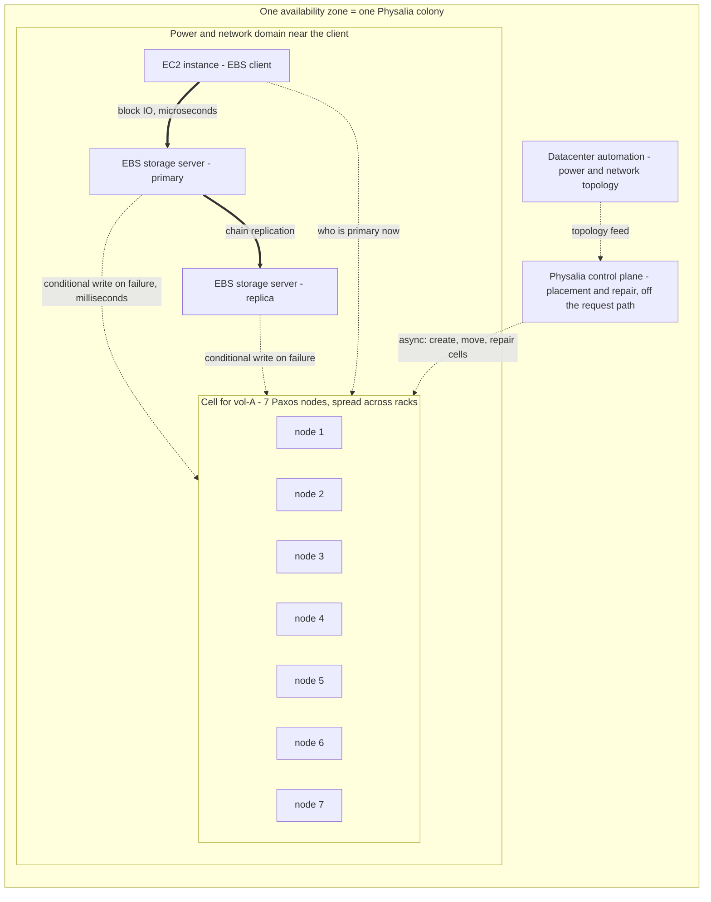

# Physalia: Millions of Distributed Databases (2020 NSDI)

## TL;DR

Physalia is the configuration master for Amazon EBS chain replication, described in the NSDI 2020 paper "Millions of Tiny Databases" by Brooker, Chen, and Ping. It is a transactional key-value store split into millions of small Paxos cells, usually one cell per volume or per small set of volumes.
In the EBS installation each cell runs Paxos over seven nodes, and each node is shared by many cells. A colony is the set of cells and nodes that serves one availability zone.
The goal is not to be available to every client. The goal is to be available to the three parties that need a given key - the EC2 instance, the primary, and the replica - by placing each cell near them in the power and network topology.
Blast radius is limited in three ways. Cells never coordinate with each other. Each node holds a different mix of cells, so a poison-pill transaction kills at most one cell. Physalia's own control plane is a separate system and is not on the request path.
The cost is that durability now depends on correct local Paxos persistence across dirty reboots, because data is kept local instead of spread across datacenters. Placement, deployment, and repair also become hard problems that the operator has to keep solving.

## Mental Model



The EBS data path and the configuration path run on different time scales.
Block IO goes from the instance to the primary and is chain-replicated to the replica at microsecond scale. The configuration master is consulted only when that chain breaks.
The paper's availability rule is short: a volume can serve IO if the instance can reach both storage servers, or if it can reach one storage server plus the configuration master ([Brooker et al., NSDI 2020](https://www.usenix.org/system/files/nsdi20-paper-brooker.pdf)).
So Physalia matters almost only on bad days, and its availability has to be judged on those days, from where the affected clients sit.
That is the reason for millions of tiny local databases instead of one large global one. Each cell only needs to survive the failures its own client survives. A failure that takes out a cell together with its client costs nothing, because the client is gone anyway.

## Internals

### The problem Physalia solves: an authority for chain reconfiguration

Each EBS volume in the paper's model is held by two storage servers: a primary and a replica ([Brooker et al., NSDI 2020](https://www.usenix.org/system/files/nsdi20-paper-brooker.pdf)).
Writes go to the primary and are chain-replicated to the replica before they are acknowledged.
This is the chain replication pattern (van Renesse and Schneider, OSDI 2004). The data path needs no consensus, but an external configuration master must decide who is in the chain.
As Murat Demirbas summarises it, consensus is needed only when a fault occurs and the chain has to be reconfigured, and Physalia is that "configuration box" ([Demirbas, 2020](http://muratbuffalo.blogspot.com/2020/03/millions-of-tiny-databases.html)).

Here is the failure sequence that makes the configuration master necessary.
1. The primary and replica lose contact. One side may be dead, or a partition may sit between them.
2. If both sides keep accepting writes alone, the two copies diverge. The volume has split-brain and a client can read back data that was never acknowledged.
3. Before serving writes without its peer, a storage server must therefore win a strongly consistent decision that it is now the authoritative copy for a new configuration.
4. That decision is a conditional write in the volume's Physalia cell. Physalia offers "strict serializable reads, writes and conditional writes" within a partition key ([Demirbas, 2020](http://muratbuffalo.blogspot.com/2020/03/millions-of-tiny-databases.html)). If both servers race, at most one compare-and-set succeeds.
5. The instance then asks the cell who the current primary is, and the winner recruits a new replica to restore two copies.

The paper says this work is latency-critical because "volume IO is blocked until it is complete". It must be strongly consistent because any eventual consistency would make the replication protocol incorrect. And it is "most critical at the most challenging time: during large-scale failures" ([Brooker et al., NSDI 2020](https://www.usenix.org/system/files/nsdi20-paper-brooker.pdf)).
The paper's Figure 1 labels the data replication path "high bandwidth, microseconds count" and the configuration path "low bandwidth, milliseconds count" ([Brooker et al., NSDI 2020](https://assets.amazon.science/c4/11/de2606884b63bf4d95190a3c2390/millions-of-tiny-databases.pdf)).

### Why not one database: the 2011 lesson

The design traces back to the April 2011 us-east-1 EBS event.
At 12:47 AM PDT on April 21, a network change in one availability zone disconnected both the primary and secondary EBS networks at once, leaving the affected nodes isolated from each other ([AWS PIR](https://aws.amazon.com/message/65648/)).
Storage nodes that had lost their mirrors began re-mirroring at the same time, the cluster used up its spare capacity, and slow "create volume" calls with long timeouts backed up into a regional thread pool. That thread starvation spread errors to EBS APIs in other zones ([AWS PIR](https://aws.amazon.com/message/65648/)).
The Physalia paper quotes the PIR directly: as re-mirroring negotiations with the control plane grew and retries piled up, "the load caused a brown out of the EBS control plane and again affected EBS APIs across the Region". The authors state that this "failure vector was the inspiration behind Physalia's design goal of limiting the blast radius of failures" ([Brooker et al., NSDI 2020](https://assets.amazon.science/c4/11/de2606884b63bf4d95190a3c2390/millions-of-tiny-databases.pdf)).
The lesson is that a shared configuration authority turns a zonal data-plane failure into a regional control-plane failure. Failure-driven load concentrates on the shared resource exactly when the data plane is already degraded.

The CAP framing in the paper follows from this.
A single strongly consistent database cannot stay available to clients on the minority side of a partition.
Physalia does not beat CAP. It changes which clients need to be on the majority side.
In the paper's words, "we do not require all keys to be available to all clients"; each key needs to be available at only three points in the network ([Colyer, quoting the paper](https://blog.acolyer.org/2020/03/04/millions-of-tiny-databases/)).
If those three points and a majority of the key's cell are in the same partition, the partition does not hurt that key.

### Colony, cell, node

A Physalia installation is a **colony**, and it is made of many **cells**.
Cells run on a mesh of **nodes**. Each node runs on a single server, and one node can take part in many cells ([Colyer, 2020](https://blog.acolyer.org/2020/03/04/millions-of-tiny-databases/)).
Each cell manages the data for a single partition key, runs a Paxos-based state machine, and does not coordinate with other cells ([Brooker et al., NSDI 2020](https://www.usenix.org/system/files/nsdi20-paper-brooker.pdf)).
The NSDI slides describe a cell as a replicated state machine that holds the configuration for "one volume, or small set of volumes", with a key-value API and strict serializable transactions ([NSDI slides](https://www.usenix.org/sites/default/files/conference/protected-files/nsdi20_slides_brooker.pdf)).
Each EBS volume gets a unique partition key when it is created, and all operations for that volume happen within that key ([Demirbas, 2020](http://muratbuffalo.blogspot.com/2020/03/millions-of-tiny-databases.html)).
One installation was designed to "support an entire EBS availability zone" ([Brooker et al., NSDI 2020](https://assets.amazon.science/c4/11/de2606884b63bf4d95190a3c2390/millions-of-tiny-databases.pdf)). Because the colony is scoped to a zone, its largest possible blast radius is aligned with the AZ failure domain covered in [[17-Cloud-AI-Engineering/Volume_01_Cloud_Architecture_Principles/Chapter_02_Regions_Zones_and_Static_Stability|Regions, Zones, and Static Stability]].

The authors considered sharing infrastructure across cells, for example a shared coordination layer. They rejected it because it was "at odds with our focus on blast radius". They chose "to keep our cells completely independent, and implement the control plane as a separate system" ([Brooker et al., NSDI 2020](https://assets.amazon.science/c4/11/de2606884b63bf4d95190a3c2390/millions-of-tiny-databases.pdf)).
This is the cell-based architecture of [[17-Cloud-AI-Engineering/Volume_01_Cloud_Architecture_Principles/Chapter_03_Cell_Based_Architecture_and_Shuffle_Sharding|Cell-Based Architecture and Shuffle Sharding]] taken to its limit: the cell count is close to the key count.

### Data model: misuse resistance

Within a partition key, Physalia offers a transactional store with a typed key-value schema ([Demirbas, 2020](http://muratbuffalo.blogspot.com/2020/03/millions-of-tiny-databases.html)).
The authors say the data model was meant to be "easy to use correctly". They borrowed the idea of *misuse resistance* from cryptography, citing GCM-SIV, whose primitives are designed to stay safe when misused ([Brooker et al., NSDI 2020](https://assets.amazon.science/c4/11/de2606884b63bf4d95190a3c2390/millions-of-tiny-databases.pdf)).
For engineers this means the API is deliberately narrow. Transactions stay within one partition key, so no client can write a cross-cell transaction that would couple the failure fates of two cells.
Cross-key atomicity is given up on purpose, and the client protocol (EBS replication) is designed so it never needs it.

### Physalia's flavour of Paxos

Each cell is "a straightforward consensus-based distributed state machine" running a custom Paxos implementation ([Brooker et al., NSDI 2020](https://assets.amazon.science/c4/11/de2606884b63bf4d95190a3c2390/millions-of-tiny-databases.pdf)).
Batch sizes and pipeline depths are "kept small, to keep per-item work well bounded and ensure short time-to-recovery in the event of node or network failure" ([Brooker et al., NSDI 2020](https://assets.amazon.science/c4/11/de2606884b63bf4d95190a3c2390/millions-of-tiny-databases.pdf)).
Locality creates a durability problem that most cloud consensus systems avoid. They spread replicas across datacenters, so correlated outages across all replicas are rare. Physalia keeps replicas close to the client, so the authors needed "extra care in implementation and testing" to make Paxos safe "even across dirty reboots" ([Brooker et al., NSDI 2020](https://www.usenix.org/system/files/nsdi20-paper-brooker.pdf)).

In concrete terms, a Paxos acceptor must durably record its promised ballot and any accepted value before it replies.
If a power event reboots all seven co-located acceptors and any one of them acknowledged a write it had not really persisted, a later ballot can choose a different value for the same slot. That is silent loss of a committed configuration, which would let two storage servers each believe they are primary.
With geographic spreading, the fsync path is a performance concern. With locality, it is a safety concern.

#### Why seven

The paper lists four factors behind the cell size of seven ([Brooker et al., NSDI 2020](https://www.usenix.org/system/files/nsdi20-paper-brooker.pdf)):
- **Durability** improves exponentially with cell size. Seven replicas means each piece of data is durable to at least four disks, which the paper puts at "around 5000x higher" than the 2-replication used for volume data.
- **Latency:** cell size barely changes mean latency, but larger cells have lower high percentiles because a majority quorum can ignore slow members, such as nodes in a GC pause.
- **Availability** depends on which failures are expected. The paper's Figure 4 shows cell size as a trade-off between tolerating large correlated failures and tolerating random ones.
- **Resources:** Paxos needs O(cell size) communication, and every member keeps a copy of the data.

This chapter adds the arithmetic behind the availability point. With independent per-node unavailability p and majority quorum q = floor(n/2)+1, cell unavailability is sum over k from n-q+1 to n of C(n,k) p^k (1-p)^(n-k).
At p = 0.01 this gives about 3.0e-4 for n=3, 9.9e-6 for n=5, 3.4e-7 for n=7, and 1.2e-8 for n=9. These values come from the worked example script.
Each step from n to n+2 buys roughly 30x for independent failures. Against a correlated failure that covers a majority of a cell's members, more members do not help at all.
That is why placement matters more than cell size.

### Placement: maximise availability as seen by the client

When a cell is created, the control plane uses "its knowledge of the power and network topology of the datacenter (discovered from AWS's datacenter automation systems)" to choose its nodes ([paper, as quoted by ApproachAI](https://approachai.com/gewuzhiyong/millions-of-tiny-databases)).
Two goals pull against each other. Nodes should be close to their clients, so that distant failures do not break the cell. They should also be diverse enough that small local failures do not break it either ([Demirbas, 2020](http://muratbuffalo.blogspot.com/2020/03/millions-of-tiny-databases.html)).
In the paper's words, fewer network devices between Physalia and its clients means fewer chances for a partition between them, simply because there is less to go wrong ([Colyer, 2020](https://blog.acolyer.org/2020/03/04/millions-of-tiny-databases/)).
In the EBS deployment Physalia runs on many nodes spread widely across the datacenter, which gives the control plane more placement options ([Brooker et al., NSDI 2020](https://www.cs.purdue.edu/homes/csjgwang/CloudNativeDB/PhysaliaNSDI20.pdf)).

#### Deeper mechanism 1: conditional availability and fate-sharing

Getting-started material treats availability as a single number per service. Physalia instead optimises a conditional probability: P(the cell has a reachable quorum | the client is alive).
That changes which failures count.
If a cell is co-located with its client and a row-level power event kills both, the cell's "unavailability" costs nothing, because no living client needed it.
If a cell is spread across the whole AZ, the same event kills cells whose clients are still alive elsewhere. Those clients are then stuck if their storage chain also broke.
The worked example simulates this in a model AZ of 4 rows, 80 racks, and 800 hosts.
With row-local, rack-diverse placement, a whole row losing power wipes out 24.6% of cells in absolute terms. Yet the share of living clients that are impaired is 0.17%, the same as a monolithic cluster, and all of it is data-plane loss that no configuration store could fix.
With random AZ-wide placement, only 6.9% of cells die, but 0.76% of living clients are impaired, about 4.5x worse.
Under a single-row network partition, row-local placement leaves 0.67% of clients impaired. The monolithic 7-node cluster leaves 6.97% impaired, about 10x worse, because every client inside the minority row loses the only cluster.
Losing more cells in absolute terms while delivering better availability to the clients that matter is the core idea of the paper.

#### Deeper mechanism 2: copysets versus mix diversity (poison pills)

Physalia "tries to ensure that each node contains a different mix of cells, which reduces the probability of correlated failure due to load or poison pill transitions" ([Demirbas, 2020](http://muratbuffalo.blogspot.com/2020/03/millions-of-tiny-databases.html)).
A poison pill is an input that deterministically crashes every replica that processes it. In a replicated state machine, every member processes the same log, so a poison transition kills all members of its cell at once.
The goal, as one summary paraphrases the paper, is that if "a poisonous transition crashes the node software on each node in the cell, only that cell should be lost" ([ApproachAI summary](https://approachai.com/gewuzhiyong/millions-of-tiny-databases)).
Here is a tension that interviewers rarely expect candidates to know.
The Copysets work (Cidon et al., USENIX ATC 2013) shows that random replica placement maximises the number of distinct replica groups, and so maximises the chance that some group loses all its members under simultaneous random failures. Their recommendation for durability is to use *few* fixed groups.
Physalia's poison-pill defence pushes the other way: many distinct groups, so that killing one group's nodes rarely takes a quorum of any other group.
The worked example measures this directly. A poison pill under copyset-style placement (40 fixed groups) takes down an average of 2.5% of all cells. Under randomised mixes it takes down only the victim cell, 0.005% of cells.
Physalia can lean towards diversity because seven replicas already give it a large durability margin. That margin pays for the extra exposure to correlated loss that diversity brings.

#### Deeper mechanism 3: placement constrains deployment

This section is the chapter's own analysis. It is not a procedure described in the paper.
Say a colony has 1,000,000 cells of 7 on 2,000 nodes. Each node then holds about 3,500 cells and shares a cell with about 21,000 node-slots drawn from 1,999 peers. The chance that two given nodes share *no* cell is about e^-10.5, roughly 3e-5.
So the co-membership graph is effectively complete. A deployment rule of "never touch two members of any cell at once" collapses into a one-node-at-a-time rollout, which at 2,000 nodes is operationally impossible.
The fix is to make placement and deployment agree on a topology unit. If placement allows at most two members of a cell per rack, then deploying one rack at a time takes at most two of seven members offline. That leaves five, still above the quorum of four, with one more failure tolerated.
If cells are confined to one network domain (rows in the model), racks in different rows can be deployed in parallel because their cell sets do not overlap.
The paper says its goals "required careful attention in the design of the data model, replication mechanism, cluster management and even operational and deployment procedures" ([Brooker et al., NSDI 2020](https://assets.amazon.science/c4/11/de2606884b63bf4d95190a3c2390/millions-of-tiny-databases.pdf)). The exact EBS deployment unit is UNVERIFIED.

### Reconfiguration and pipeline depth

Physalia also reconfigures its own cells, for example to replace failed nodes or to move a cell closer to a client that has moved ([Demirbas, 2020](http://muratbuffalo.blogspot.com/2020/03/millions-of-tiny-databases.html)).
In classic multi-Paxos, membership can be stored in the replicated log itself. Lamport's "Paxos Made Simple" describes a configuration change at slot i taking effect at slot i+alpha, where alpha is the bound on how many instances may be in flight at once.
This chapter infers that Physalia's small pipeline depths keep that window short, so a reconfiguration takes effect quickly and per-item work stays bounded during recovery. That link is an inference, and the exact reconfiguration protocol is UNVERIFIED.
Keep three separate things in mind. The *control plane* decides that a cell should move. The *cell* commits the membership change through its own consensus. Clients find the new membership through discovery. Each layer can fail on its own, and the data path should depend only on the cell.

### Physalia's own control plane and static stability

Physalia separates control and data planes at two levels.
Physalia as a whole is EBS's configuration master, and it has its own control plane: placement, cell creation, and repair. That control plane runs as a separate system ([Brooker et al., NSDI 2020](https://assets.amazon.science/c4/11/de2606884b63bf4d95190a3c2390/millions-of-tiny-databases.pdf)).
Because cells are independent and keep serving without the control plane, a control-plane outage stops placement improvements but does not stop failovers. This is the static stability property covered in [[17-Cloud-AI-Engineering/Volume_01_Cloud_Architecture_Principles/Chapter_04_Control_Plane_vs_Data_Plane_Separation|Control Plane vs Data Plane Separation]].
The cost is drift. With the control plane down, node failures go unrepaired, so cells slowly lose redundancy and locality. The repair backlog after recovery must be rate-limited so it does not cause its own storm.

### Lineage and comparison

Physalia sits in the same family as Chubby (OSDI 2006) and ZooKeeper, which are external coordination services for replicated systems. See [[04-System-Design/05-Data-Stores/Apache-ZooKeeper|Apache ZooKeeper]] and [[08-Distinguished-Engineering/02-Distributed-Systems-Internals/Raft-Consensus|Raft Consensus]].
It differs from them by turning the number of independent consensus groups into a design dimension of its own, and by making placement relative to the client part of the correctness and availability argument.
Alibaba's FAST 2024 EBS retrospective describes Physalia as small cells, each running Paxos on seven nodes for a group of virtual disks. Alibaba took a different route, a two-level "Federated BlockManager" with a CentralManager for coordination, after finding that "regional events become more frequent" once segment migration was introduced ([Zhang et al., FAST 2024](https://www.usenix.org/system/files/fast24-zhang-weidong.pdf)).
Comparing the two systems shows the trade-off. A hierarchical manager is simpler to reason about, but it brings back a shared coordinator that Physalia avoids on purpose.

## Numbers to Know

| Quantity | Value | Source and date |
|---|---|---|
| Paxos cell size in EBS installation | 7 nodes | (Brooker et al., NSDI 2020) |
| Majority quorum and failures tolerated per cell | 4 of 7; tolerates 3 member failures | Derived from cell size |
| Minimum disks holding each committed item | at least 4 | (Brooker et al., NSDI 2020) |
| Durability vs 2-replication of volume data | about 5000x higher | (Brooker et al., NSDI 2020) |
| Volume data replication in the paper's model | 2 copies (primary + replica) | (Brooker et al., NSDI 2020) |
| Paxos communication cost | O(cell size) per operation | (Brooker et al., NSDI 2020) |
| Scope of one colony | one EBS availability zone | (Brooker et al., NSDI 2020) |
| Parties that need a given key | 3: instance, primary, replica | (Brooker et al., NSDI 2020) |
| Project start | 2013 | (Brooker et al., NSDI 2020) |
| Data path vs config path time scale | microseconds vs milliseconds | (Brooker et al., NSDI 2020, Figure 1) |
| Cell unavailability, independent p=0.01 | n=3: 3.0e-4; n=5: 9.9e-6; n=7: 3.4e-7; n=9: 1.2e-8 | Computed in worked example |
| Client impairment, one-row partition | monolithic-7: 6.97%; row-local cells: 0.67% | Simulation in worked example (model AZ, seed 7) |
| Client impairment, one-row power loss | random-7: 0.76%; row-local: 0.17% (24.6% of cells lost) | Simulation in worked example |
| Poison-pill blast, mean share of cells lost | monolithic: 100%; copyset-40: 2.5%; diverse mix: 0.005% | Simulation in worked example |
| 2011 trigger time | 12:47 AM PDT, 2011-04-21, one us-east-1 AZ | (AWS PIR 65648) |
| 2011 cross-zone effect | two periods of high EBS API errors across the whole US East Region | (AWS PIR 65648) |
| EBS gp3 storage list price, us-east-1 | USD 0.08 per GB-month | UNVERIFIED (not re-checked this batch) |

## AWS vs GCP Mechanism Parity

Google has not published a Physalia-equivalent paper for Persistent Disk or Hyperdisk. Everything on the GCP side of the block-storage rows is therefore either a public product behaviour or an explicit gap.

| Mechanism | AWS | Google Cloud | Critical difference |
|---|---|---|---|
| Configuration master for block-volume replication | Physalia: per-volume Paxos cells, 7 nodes, AZ-scoped colony (Brooker et al., NSDI 2020) | Persistent Disk and Hyperdisk control-plane internals not publicly documented | No primary-source basis for comparing internal blast radius; do not claim parity in interviews |
| Volume replication failure domain | EBS volume replicated within one AZ, UNVERIFIED (not re-checked this batch) | Zonal PD within one zone; Regional PD replicates synchronously across two zones, UNVERIFIED (not re-checked this batch) | GCP exposes a cross-zone synchronous block product; on AWS, cross-AZ durability is an application or snapshot concern |
| Failover authority under partition | Storage server wins a conditional write in its cell before serving alone | Regional PD failover via force-attach to an instance in the other zone, UNVERIFIED (not re-checked this batch) | AWS automates in-AZ failover inside the service; the GCP cross-zone path involves an operator or automation action |
| General coordination and lock service | No public internal equivalent; customers build on DynamoDB conditional writes | Chubby: coarse-grained lock service, a cell of typically five replicas (Burrows, OSDI 2006) | Chubby is a few large shared cells per datacenter; Physalia is millions of tiny per-key cells |
| Per-shard consensus in managed databases | DynamoDB: Paxos replication groups per partition (USENIX ATC 2022) | Spanner: Paxos group per split, plus TrueTime (OSDI 2012) | Both shard consensus by key, but optimise for global reachability, not client-relative locality |
| Topology-aware placement | Physalia placement from datacenter power and network topology (Brooker et al., NSDI 2020) | Borg spreads tasks across failure domains such as machines and racks (Verma et al., EuroSys 2015) | Borg spreads for job availability; Physalia trades spread against nearness to a specific client |
| Blast-radius discipline | Cells, shuffle sharding, AZ independence (AWS Builders' Library) | Zonal and regional isolation in Google Cloud Architecture Framework | AWS has published the most detailed per-key cell design; Google has published comparatively less on block-storage control planes |
| Alternative published hyperscaler design | n/a | n/a (Alibaba EBS: two-level Federated BlockManager, FAST 2024) | A hierarchical coordinator is simpler to operate but reintroduces a shared component |

For broader translation of these services, see [[17-Cloud-AI-Engineering/Volume_04_AWS_vs_GCP_Translation/Chapter_04_Storage_and_Database_Translation|Storage and Database Translation]] and [[17-Cloud-AI-Engineering/Volume_02_AWS_Deep_Dive/Chapter_09_Elastic_Block_Store_and_Network_Storage|Elastic Block Store and Network Storage]].

## Worked Example: Simulating Cell Placement, Blast Radius, and Failover-Burst Capacity

### Cost, budget, and teardown

The main artifact is a standard-library Python simulation that runs locally and provisions no cloud resources, so it costs USD 0.
The optional observation step uses only read-only describe and list calls and creates nothing billable, so no budget alarm is needed.
Teardown is `rm -rf /tmp/physalia`.

### Artifact: blast_radius_sim.py

```python
#!/usr/bin/env python3
"""Monte Carlo model of Physalia-style cell placement vs a monolithic config store.

Stdlib only. Models one availability zone as rows -> racks -> hosts.
Each volume has an instance host, a primary host and a replica host.
A volume is available for IO (paper, Figure 1) if the instance can reach
both storage servers, or one storage server plus a quorum of its config cell.
"""
import argparse
import random
from math import comb

ROWS, RACKS_PER_ROW, HOSTS_PER_RACK = 4, 20, 10
CELL = 7
QUORUM = CELL // 2 + 1


def host(row, rack, h):
    return (row, rack, h)


ALL_HOSTS = [host(r, k, h) for r in range(ROWS)
             for k in range(RACKS_PER_ROW) for h in range(HOSTS_PER_RACK)]


def rand_host_in_row(rng, row):
    return host(row, rng.randrange(RACKS_PER_ROW), rng.randrange(HOSTS_PER_RACK))


def make_volumes(rng, n, same_row_p):
    vols = []
    for _ in range(n):
        inst = rng.choice(ALL_HOSTS)
        def server():
            if rng.random() < same_row_p:
                return rand_host_in_row(rng, inst[0])
            return rng.choice(ALL_HOSTS)
        vols.append((inst, server(), server()))
    return vols


def place_monolithic(rng, vols):
    # One cluster for every key, spread for "classic" HA: >=1 node per row.
    nodes = [rand_host_in_row(rng, r % ROWS) for r in range(CELL)]
    return [nodes for _ in vols]


def place_random(rng, vols):
    return [rng.sample(ALL_HOSTS, CELL) for _ in vols]


def place_local_diverse(rng, vols, max_per_rack=2):
    cells = []
    for inst, _, _ in vols:
        row, chosen, per_rack = inst[0], set(), {}
        while len(chosen) < CELL:
            h = rand_host_in_row(rng, row)
            if h in chosen or per_rack.get(h[1], 0) >= max_per_rack:
                continue
            chosen.add(h)
            per_rack[h[1]] = per_rack.get(h[1], 0) + 1
        cells.append(list(chosen))
    return cells


def place_copyset(rng, vols, groups=40):
    # Few fixed 7-node groups (copyset style): good vs random loss, bad vs poison.
    fixed = [rng.sample(ALL_HOSTS, CELL) for _ in range(groups)]
    return [rng.choice(fixed) for _ in vols]


def impaired(vols, cells, up, reach):
    bad = 0
    live = 0
    for (inst, p, r), cell in zip(vols, cells):
        if not up(inst):
            continue  # client is down too: config availability is moot
        live += 1
        ok_p = up(p) and reach(inst, p)
        ok_r = up(r) and reach(inst, r)
        if ok_p and ok_r:
            continue
        q = sum(1 for n in cell if up(n) and reach(inst, n))
        if (ok_p or ok_r) and q >= QUORUM:
            continue
        bad += 1
    return bad / max(live, 1)


def scenario_row_partition(vols, cells):
    iso = 0
    up = lambda h: True
    reach = lambda a, b: (a[0] == iso) == (b[0] == iso)
    return impaired(vols, cells, up, reach)


def scenario_rack_power(vols, cells):
    dead = (1, 7)
    up = lambda h: (h[0], h[1]) != dead
    reach = lambda a, b: True
    return impaired(vols, cells, up, reach)


def scenario_row_power(vols, cells):
    up = lambda h: h[0] != 0
    client_view = impaired(vols, cells, up, lambda a, b: True)
    lost = sum(1 for c in cells if sum(1 for n in c if up(n)) < QUORUM) / len(cells)
    return client_view, lost


def scenario_random_loss(rng, vols, cells, p):
    down = {h for h in ALL_HOSTS if rng.random() < p}
    return impaired(vols, cells, lambda h: h not in down, lambda a, b: True)


def poison_blast(rng, cells, trials=200):
    # A poison transition crashes every node of one cell; count other cells losing quorum.
    worst, total = 0.0, 0.0
    for _ in range(trials):
        victim = set(rng.choice(cells))
        lost = sum(1 for c in cells if len(victim.intersection(c)) >= QUORUM)
        frac = lost / len(cells)
        worst, total = max(worst, frac), total + frac
    return total / trials, worst


def analytic_cell_unavail(n, p):
    q = n // 2 + 1
    return sum(comb(n, k) * p**k * (1 - p)**(n - k) for k in range(n - q + 1, n + 1))


def main():
    ap = argparse.ArgumentParser()
    ap.add_argument("--volumes", type=int, default=20000)
    ap.add_argument("--same-row-p", type=float, default=0.8)
    ap.add_argument("--seed", type=int, default=7)
    a = ap.parse_args()
    rng = random.Random(a.seed)
    vols = make_volumes(rng, a.volumes, a.same_row_p)
    policies = {
        "monolithic-7": place_monolithic(rng, vols),
        "random-7": place_random(rng, vols),
        "copyset-7": place_copyset(rng, vols),
        "local-diverse-7": place_local_diverse(rng, vols),
    }
    print("Independent-failure cell unavailability (analytic):")
    for n in (3, 5, 7, 9):
        print(f"  n={n} p=0.01 -> {analytic_cell_unavail(n, 0.01):.2e}")
    print(f"\n{'policy':<16}{'row-part':>10}{'rack-pwr':>10}{'row-pwr':>10}"
          f"{'cells-lost':>11}{'1%-loss':>9}{'poison-mean':>13}{'poison-max':>12}")
    for name, cells in policies.items():
        rp = scenario_row_partition(vols, cells)
        rk = scenario_rack_power(vols, cells)
        wp, wl = scenario_row_power(vols, cells)
        rl = scenario_random_loss(random.Random(a.seed + 1), vols, cells, 0.01)
        pm, px = poison_blast(random.Random(a.seed + 2), cells)
        print(f"{name:<16}{rp:>10.4f}{rk:>10.4f}{wp:>10.4f}{wl:>11.4f}"
              f"{rl:>9.4f}{pm:>13.5f}{px:>12.5f}")


if __name__ == "__main__":
    main()
```

Run it with `python3 /tmp/physalia/blast_radius_sim.py`. It completes in about six seconds on one core.

Verified output with the default seed:

```text
Independent-failure cell unavailability (analytic):
  n=3 p=0.01 -> 2.98e-04
  n=5 p=0.01 -> 9.85e-06
  n=7 p=0.01 -> 3.42e-07
  n=9 p=0.01 -> 1.22e-08

policy            row-part  rack-pwr   row-pwr cells-lost  1%-loss  poison-mean  poison-max
monolithic-7        0.0697    0.0004    0.0017     0.0000   0.0000      1.00000     1.00000
random-7            0.0694    0.0004    0.0076     0.0687   0.0000      0.00005     0.00005
copyset-7           0.0696    0.0004    0.0066     0.0526   0.0000      0.02517     0.02730
local-diverse-7     0.0067    0.0004    0.0017     0.2464   0.0000      0.00005     0.00010
```

### Reading the output

The model's assumptions are its own and are not EBS facts. It has 4 rows of 20 racks of 10 hosts. Each storage server lands in the instance's row with probability 0.8. Row-local cells allow at most two members per rack.

- **row-part:** Under a one-row network partition, the monolithic cluster has only 2 of its 7 nodes inside the isolated row. Every client in that row whose chain was split loses failover. Row-local cells cut impairment about 10x.
- **The 0.67% floor:** The residual for row-local cells is data-plane loss, cases where both storage servers sit across the partition from the instance. A configuration store cannot fix this, which matches the Figure 1 availability rule.
- **row-pwr and cells-lost:** Row-local placement loses the most cells in absolute terms (24.6%) and still ties for the best client-relative availability. This is the fate-sharing argument as a number.
- **poison:** Monolithic placement turns one poison pill into a total outage. Copyset placement turns it into 2.5% of the colony. Diverse mixes contain it to roughly the victim cell.
- **1%-loss:** Independent failures do not separate the policies at n=7, which shows how lopsided the cell-size choice is: correlated failure dominates.

### Back-of-the-envelope colony sizing

All inputs below are illustrative assumptions, not published EBS figures.

1. Volumes per AZ: V = 1,000,000, with one cell per volume.
2. Memberships: 7 x 1,000,000 = 7,000,000.
3. Nodes: N = 2,000, so each node holds 3,500 cells.
4. State: 4 KiB per cell gives 3,500 x 4 KiB, about 14 MiB per node, and about 27 GiB across the colony including all 7 copies. Storage is trivial; the hard parts are fsync rate and placement.
5. Failure burst: a row-level event forces failover on 5% of volumes, so 50,000 volumes.
6. Each failover takes two conditional writes (claim primacy, then register the new replica), so 100,000 transactions.
7. Each transaction is accepted by 7 nodes, so 700,000 acceptor operations, or 350 per node across 2,000 nodes.
8. At an assumed 2,000 durable accepts per second per node, the burst clears in about 0.2 seconds of acceptor work, spread across 100,000 independent leaders.
9. Compare a single monolithic leader at an assumed 10,000 transactions per second with batching. The same burst takes 10 seconds of serialised work.
10. Retries make the monolithic case worse. If storage servers time out after 1 second and retry, the offered load multiplies during those 10 seconds, which is the 2011 mechanism. See [[17-Cloud-AI-Engineering/Volume_07_Reliability_and_SRE/Chapter_03_Resilient_Communication_Retries_Jitter_and_Circuit_Breakers|Retries, Jitter, and Circuit Breakers]].
11. The scaling unit is the number of independent consensus groups, not the size of any one leader. Aggregate failover capacity grows with the number of cells and nodes.

### Optional: observing the customer-visible surface (read-only, no billable resources)

```python
# List EBS volumes whose status is not "ok" (read-only DescribeVolumeStatus).
import boto3

ec2 = boto3.client("ec2", region_name="us-east-1")
for page in ec2.get_paginator("describe_volume_status").paginate():
    for v in page["VolumeStatuses"]:
        status = v["VolumeStatus"]["Status"]
        if status != "ok":
            events = [e.get("EventType") for e in v.get("Events", [])]
            print(v["VolumeId"], v["AvailabilityZone"], status, events)
```

```bash
# GCP: list disks and their status (read-only).
gcloud compute disks list --format="table(name,zone.basename(),status)"
```

Neither API exposes Physalia or its GCP counterpart. They show only the result, impaired or IO-disabled volumes, so alarms should be keyed on volume status per AZ rather than on any assumption about internals.

## Failure Modes and Pitfalls

### Regional amplification through a shared configuration authority

The 2011 event is the reference case. Zonal re-mirroring load reached a regional control plane through a shared thread pool and long timeouts, and caused errors across the region ([AWS PIR](https://aws.amazon.com/message/65648/)).
Physalia's colony-per-AZ and independent-cell design removes the shared choke point for *configuration*.
Any remaining shared dependency brings the failure mode back, for example a regional discovery service, a regional authentication path, or a shared logging pipeline that cells block on.
For mitigation, audit every synchronous call a cell or its clients make during failover, and require each dependency to be zonal or statically stable. See [[17-Cloud-AI-Engineering/Volume_07_Reliability_and_SRE/Chapter_07_Anatomy_of_Major_Cloud_Outages|Anatomy of Major Cloud Outages]].

### Poison-pill transitions

A deterministic bug triggered by a specific log entry crashes every member of the cell that applies it, and each restart replays the same entry, so the cell crash-loops.
Diverse mixes stop the spread to other cells, as the simulation shows, but they do not save the victim cell.
The victim needs an operator path, such as skipping or quarantining the entry under a reviewed procedure, plus input validation in the state machine so malformed transitions are rejected before they are proposed.
Copyset-style placement makes poison pills much worse. Do not adopt copysets for consensus metadata without modelling this.

### Placement drift and repair storms

Node replacements and client migrations slowly wear down locality and diversity. A cell can end up with three members in one rack, or far from a client that live-migrated.
When the control plane comes back from an outage, a backlog of repairs can saturate nodes with snapshot and catch-up traffic during a period of already reduced redundancy.
Rate-limit repairs per node and per rack, and order them by how close each cell is to losing quorum.

### Durability violations after dirty reboots

Because cells are local, a facility power event can reboot all seven members together.
Any acceptor that acknowledges before its write reaches stable media, for example behind a volatile disk write cache, can break Paxos safety. Only that same correlated event will expose it.
The paper calls this out as the reason for "extra care in implementation and testing" ([Brooker et al., NSDI 2020](https://www.usenix.org/system/files/nsdi20-paper-brooker.pdf)).
Test with fault-injected power loss, not just process kills. See [[17-Cloud-AI-Engineering/Volume_07_Reliability_and_SRE/Chapter_05_Chaos_Engineering_and_Game_Days|Chaos Engineering and Game Days]].

### Deployment coupling through co-membership

A rollout that ignores cell membership can take a quorum of many cells offline at once. Because the co-membership graph is near-complete, this is likely, not a corner case.
Deploy by the same topology unit that placement limits, and gate each wave on per-cell quorum health.
See [[17-Cloud-AI-Engineering/Volume_06_Infrastructure_as_Code_and_Delivery/Chapter_06_Progressive_Delivery_and_Deployment_Pipelines|Progressive Delivery and Deployment Pipelines]].

### Metastable failover loops

If failover attempts time out and retry faster than cells can commit, offered load stays high even after the trigger is gone. This is the metastable failure pattern described by Bronson et al. (HotOS 2021).
Cells with small batches and bounded pipelines limit per-cell queueing. Clients still need jittered backoff and a cap on concurrent failovers per storage server.

### Lease and control-plane congestion in adjacent systems

AWS's October 2025 us-east-1 post-incident summary describes a DynamoDB DNS automation race followed by congestive collapse in an EC2 component that manages host leases. These specifics are UNVERIFIED (not re-checked this batch).
The lesson carries over to Physalia-like designs. Any layer that must re-establish state for many keys after a dependency recovers needs bounded, prioritised recovery work, or recovery itself becomes the outage.

### Treating a zonal service as regional

EBS volumes are zonal, so Physalia's blast-radius guarantees are zonal too. An application with one volume in one AZ still has an AZ-sized single point of failure.
Design for AZ loss with snapshots, replication, or a multi-AZ data layer, as in [[17-Cloud-AI-Engineering/Volume_07_Reliability_and_SRE/Chapter_04_Disaster_Recovery_Tiers_and_RTO_RPO_Engineering|Disaster Recovery Tiers and RTO/RPO Engineering]].

## Security and Cost Angles

### Authorisation is per partition key

In a Physalia-like design, a storage server should only be able to write the keys of the volumes it hosts. Otherwise a compromised or buggy server could claim primacy for any volume and cause deliberate split-brain.
Bind caller identity to partition keys in the cell's authorisation check, using mutually authenticated channels, so a single compromised host cannot spread its effect beyond its own cells. This is a design recommendation, not a documented EBS mechanism.
For customers, scope `ec2:AttachVolume`, `ec2:DetachVolume`, and snapshot actions with IAM conditions on tags and resource ARNs. Detach-and-attach is the customer-facing path to a volume's data. See [[17-Cloud-AI-Engineering/Volume_02_AWS_Deep_Dive/Chapter_01_IAM_Policy_Evaluation_Engine|IAM Policy Evaluation Engine]].

### Key hierarchy

EBS encryption uses KMS-based envelope encryption. Configuration metadata that controls which server serves a volume must be integrity-protected, but it does not need to hold plaintext data keys.
Keep wrapped data keys separate from replication-authority metadata. Compromising the authority store should then give an attacker availability-attack power at most, not confidentiality-attack power.
See [[17-Cloud-AI-Engineering/Volume_08_Security_Identity_and_the_Data_Perimeter/Chapter_04_Encryption_Key_Hierarchies_and_Envelope_Encryption|Encryption Key Hierarchies and Envelope Encryption]].

### Network boundary

Cells sit on the internal datacenter network next to their clients. Isolate them from tenant networks completely, the way Nitro offloads keep storage traffic separate from guest-visible networking.
See [[17-Cloud-AI-Engineering/Volume_02_AWS_Deep_Dive/Chapter_04_EC2_Nitro_Architecture_and_Graviton|EC2, Nitro Architecture, and Graviton]].

### Unit economics

The authors wanted Physalia to be "easy and cheap to operate, contributing negligibly to the cost of our dataplane" ([Brooker et al., NSDI 2020](https://assets.amazon.science/c4/11/de2606884b63bf4d95190a3c2390/millions-of-tiny-databases.pdf)).
Seven-way replication is affordable because each cell's state is tiny and its transaction rate is low. The paper notes the "relatively small transaction rate" when it discusses resource cost.
The real cost drivers are fsync-bound acceptor throughput sized for the *burst*, spare node capacity for placement flexibility, and the engineering cost of placement, deployment, and testing.
If you copy this pattern for your own tenants, cost it as (cells per node) x (memory and log per cell) plus burst headroom. Sizing for steady state hides the bad-day requirement.

## Interview Questions and Model Answers

### Question 1 (L5 - Senior)

Walk through what happens when an EBS primary loses contact with its replica, and explain where Physalia sits in that sequence.

#### Model Answer

In steady state, writes go from the instance to the primary, are chain-replicated to the replica, and are acknowledged. No consensus is involved, so the data path stays at microsecond scale.
When the link fails, neither server can tell whether its peer is dead or partitioned. If both kept accepting writes, the copies would diverge.
So a server that wants to continue alone must win a conditional write in the volume's Physalia cell, recording a new configuration in which it is the authority.
That write is strict serializable within the volume's partition key. If both sides race, only one compare-and-set wins, and the loser must stop serving.
The instance asks the cell for the current configuration and connects to the winner, and the winner recruits a new replica to get back to two copies.
Per the paper's Figure 1, the volume stays available if the instance can reach both servers, or one server plus Physalia. Physalia's availability therefore only matters when part of the data plane has already failed.
That conditional requirement drives the whole design: the store has to be available on the bad day, from where the affected client sits.

#### Follow-up Interviewer Question

What breaks if the cell is eventually consistent instead of strict serializable, and how would you detect it in production?

### Question 2 (L5 - Senior)

Why did EBS choose seven nodes per cell instead of the more common three or five?

#### Model Answer

The paper gives four factors: durability, tail latency, availability, and resource cost.
Seven replicas means each item is on at least four disks, which the paper puts at about 5000x the durability of the 2-copy volume data.
This matters more than usual because cells are local, so geographic spread cannot protect against correlated loss.
Larger quorums barely move mean latency, but they improve the tail, because the leader only needs the fastest four of seven and can ignore a member in a GC pause.
For independent failures at p=0.01, unavailability drops from about 3e-4 at n=3 to 1e-5 at n=5 to 3e-7 at n=7.
The limit is correlated failure. If one rack holds four members, size does not help, which is why placement constraints such as a cap on members per rack matter as much as n.
The cost is O(n) messages per write and n copies, which is acceptable because cell state and transaction rates are small.
Going to nine would buy about 30x more independent-failure margin, but it would raise fsync and message load during bursts, and it would make it harder to keep the cell close to the client and diverse at the same time.

#### Follow-up Interviewer Question

How does the per-rack placement cap interact with the cell size, and what cap would you pick for n=7?

### Question 3 (L6 - Staff)

A colleague says Physalia "beats CAP because it is both consistent and available under partitions". Evaluate that claim.

#### Model Answer

The claim is wrong as stated, but it points at something real.
CAP says a linearizable store cannot serve every client on every side of a partition. Physalia still cannot serve a client that ends up on the minority side of its own cell.
What Physalia changes is the availability objective. It does not ask for availability to all clients; it asks for availability to the three parties that need each key, conditional on those parties being alive.
It then uses placement to make the minority side and the client's side unlikely to be different places. Cells sit close to their clients, so partitions that split a client from its cell are rare compared with partitions that take out both.
In the simulation, a one-row partition impairs about 7% of clients with a monolithic 7-node cluster and about 0.7% with row-local cells, and that remainder is data-plane loss that no store could fix.
The precise statement is that Physalia is CP per key and gets high practical availability by matching the shape of likely partitions to the shape of its consensus groups.
The trade-off is honest: a client that moves far from its cell, or a partition shape the placement did not anticipate, gets ordinary CP behaviour.

#### Follow-up Interviewer Question

Which operational events cause clients to drift away from their cells, and how would you measure the resulting loss of availability before an incident shows it?

### Question 4 (L6 - Staff)

Design the placement objective for a Physalia-like store. Why is spreading cells uniformly across the AZ worse than it sounds?

#### Model Answer

The objective is to maximise P(cell quorum reachable | client alive and client needs the cell), summed over keys, under constraints on per-node load and per-topology-unit membership.
Uniform spreading maximises *unconditional* availability against small failures. But it puts members on far-away network paths, so a partition or power event that leaves the client alive can still take its quorum away.
Local placement makes the cell share fate with the client. A large event kills both, which costs nothing, and small events are absorbed by diversity within the local domain, such as at most two members per rack.
In the simulation, a row power loss removes 24.6% of row-local cells and only 6.9% of random cells. Yet impaired living clients are 0.17% with local placement against 0.76% with random placement.
There is a second objective that is easy to miss: each node should hold a *different mix* of cells. That limits poison-pill and load correlation, and it pulls against copyset-style grouping, which would reduce random-loss durability risk.
The deliverable is a scoring function over candidate node sets with hard constraints for quorum safety, soft terms for locality and mix entropy, and a continuous re-placement loop rate-limited by repair cost.

#### Follow-up Interviewer Question

Your placement engine depends on a topology feed from datacenter automation; what happens when that feed is stale or wrong, and how do you make placement safe in that case?

### Question 5 (L6 - Staff)

You own deployments for a colony of 2,000 nodes and about one million cells. Design the rollout so a bad build cannot take down any cell.

#### Model Answer

First, do the co-membership arithmetic. At about 3,500 cells per node with random mixes, almost every pair of nodes shares a cell, so the rule "never touch two members of any cell" degenerates into one node at a time.
The way out is to make placement and deployment agree on a topology unit. If placement guarantees at most two members per rack, a rack-at-a-time rollout takes at most two of seven members of any cell offline. Five remain, quorum is four, and one extra failure is still tolerated.
If cells are confined to one network domain, racks in different domains have disjoint cell sets and can be deployed in parallel.
Each wave is gated on per-cell health: no cell below five healthy members, Paxos commit latency within bounds, and no crash loops. The bake time must be long enough to hit rare transition types.
Poison-pill builds are the main risk. A new version that crashes on a particular transition crashes only the two upgraded members in each affected cell, so nothing is lost, and the wave's crash signal triggers automatic rollback.
Last, the deployment system itself must not be a synchronous dependency of cells. If it fails mid-wave, the colony must stay stable with mixed versions, which requires wire and log compatibility in both directions.

#### Follow-up Interviewer Question

How do you handle a log-format change that the old version cannot read, given that mixed-version cells are unavoidable during the rollout?

### Question 6 (L7+ - Principal)

You are asked to build the coordination store for a 50,000-accelerator training and inference fleet, covering job membership, rendezvous, checkpoint manifests, and serving-replica leases. Where does the Physalia pattern apply, and where should you refuse it?

#### Model Answer

Start by classifying keys by who needs them and when.
Checkpoint manifests and job-membership epochs for a training job are needed by that job's hosts and the scheduler. That fits Physalia well: one cell per job, placed within the job's network domain, such as the same spine block or the same TPU slice neighbourhood. A fabric partition that isolates the job then also isolates its cell, and the job can still commit a membership epoch for its surviving side if that side holds the quorum.
Conditional writes on a monotonic epoch give fencing. A restarted rank or a zombie host with an old epoch cannot overwrite a newer checkpoint manifest, which is the split-brain problem in ML form.
Serving-replica leases for a model are needed by routers across zones, so cells local to one zone are the wrong shape. Use zonal cells with cross-zone static stability: routers keep serving the last known-good set if the lease store is unreachable.
Global quota and fair-share state is read by everyone and has no locality, so per-key cells add complexity without availability gain. Use a regional store such as Spanner or DynamoDB with caching and a fail-static policy.
Size for the bad-day burst. A spine failure that forces 500 jobs to re-form spreads across 500 cells. With a single etcd, the same burst would serialise behind one leader and stall the very restarts you care about.
Refuse the pattern when a single team cannot fund the placement engine, power-loss testing, and deployment discipline. Without those, a small number of well-run regional clusters with bulkheads beats a million poorly placed cells.

#### Follow-up Interviewer Question

How would you prove to yourself, before production, that your per-job cells survive the fabric failures you actually see, rather than the ones you modelled?

### Question 7 (L7+ - Principal)

Run a pre-mortem: assume a regional EBS-style outage happens despite Physalia. What are the most likely paths, and what would you change?

#### Model Answer

Physalia removes the shared configuration choke point, so a regional outage has to come from something it does not cover.
Path one is a shared synchronous dependency in the failover path, such as authentication, discovery, a metrics agent that blocks on a full disk, or DNS. The fix is a dependency audit that requires each failover-path dependency to be zonal or fail-static, enforced by game days that cut each dependency.
Path two is a correlated software fault: a build or configuration push that reaches many colonies at once. The fix is deploying colonies AZ by AZ with long bakes, which treats each colony like a cell at the next level up.
Path three is metastable recovery. After a large event, repair of the data plane and re-placement of cells compete for the same nodes and network, and retries keep the overload going. The fix is admission control on repair work, failover concurrency limits per storage server, and jittered backoff.
Path four is a hidden durability bug that only a facility-wide power loss reveals, because locality correlates all members. The fix is fault injection at the power-loss level and checking that on-disk persistence obeys the fsync contract.
Path five is the customer layer. Customers who built single-AZ architectures turn a contained zonal event into their own outage. That is a design and education problem, not a Physalia problem.
The meta-lesson is that blast-radius containment works recursively. Every layer above the cell, including colony, region, and deployment pipeline, needs the same independence argument, or the containment below it is wasted.

#### Follow-up Interviewer Question

Which of these paths could your current monitoring detect before customer impact, and which would you only learn about from the PIR?

### Question 8 (L7+ - Principal)

On Google Cloud you cannot see the Persistent Disk control plane. A customer asks you to get Physalia-like blast-radius properties for their own replicated service built on GCP primitives. What do you build?

#### Model Answer

First, state the limit. Google has not published PD or Hyperdisk control-plane internals, so I would not assume their internal blast radius. I would design the application's own configuration authority.
I would partition the configuration by the unit that fails together with its clients, which on GCP is the zone, and run a small consensus group per zone or per tenant shard. Spanner, by contrast, gives one global strongly consistent namespace that is excellent for cross-key transactions but is a single logical dependency.
Concretely, use per-zone etcd or Raft groups, or zonal Bigtable rows with conditional mutations, for leader and epoch records. Clients cache the last known-good configuration and fail static if the store is unreachable.
For cross-zone block durability, Regional PD replicates synchronously across two zones, but failover needs an attach action. The authority deciding which instance attaches must itself survive the zone loss. It cannot live only in the failed zone, and it cannot be a manual runbook if the RTO is minutes.
I would test with zone-level fault injection and measure client-relative availability per partition shape, the same metric as the simulation, rather than store uptime.
The trade-off is more operational surface: multiple small consensus groups, placement logic, and version skew. The customer should take that on only if their bad-day availability requirement exceeds what a well-run regional store with caching provides.

#### Follow-up Interviewer Question

How would you fence a zombie writer in the failed zone that comes back after the failover, if its local configuration cache still says it is primary?

## Further Reading

- [Millions of Tiny Databases, NSDI 2020 presentation page](https://www.usenix.org/conference/nsdi20/presentation/brooker-physalia) - The primary source, with talk video; read sections 2 and 3 on cell design and placement twice.
- [Millions of Tiny Databases, full paper PDF](https://www.usenix.org/system/files/nsdi20-paper-brooker.pdf) - Figure 1's availability rule and Figure 4's cell-size trade-off are the two diagrams to memorise.
- [NSDI 2020 slides](https://www.usenix.org/sites/default/files/conference/protected-files/nsdi20_slides_brooker.pdf) - A compressed view of the "infrequent, short, small" blast-radius framing and the cell abstraction.
- [Marc Brooker, Physalia: Millions of Tiny Databases (blog)](https://brooker.co.za/blog/2020/02/17/physalia.html) - The author's own framing of why the team wanted millions of databases instead of one.
- [Summary of the Amazon EC2 and Amazon RDS Service Disruption in the US East Region (2011 PIR)](https://aws.amazon.com/message/65648/) - The outage that motivated Physalia; trace the re-mirroring storm and the regional thread-pool starvation.
- [Adrian Colyer, The Morning Paper: Millions of tiny databases](https://blog.acolyer.org/2020/03/04/millions-of-tiny-databases/) - A careful walkthrough of placement and bulkhead reasoning, with useful extracts.
- [Murat Demirbas, Millions of tiny databases (review)](http://muratbuffalo.blogspot.com/2020/03/millions-of-tiny-databases.html) - A distributed-systems researcher's reading that places Physalia as the configuration box for chain replication.
- [Zhang et al., What's the Story in EBS Glory, FAST 2024](https://www.usenix.org/system/files/fast24-zhang-weidong.pdf) - Alibaba's EBS evolution; the best published counterpoint to Physalia's design choices.
- [AWS Builders' Library: Static stability using Availability Zones](https://aws.amazon.com/builders-library/static-stability-using-availability-zones/) - The principle that lets Physalia cells keep serving when their control plane is down.
- [AWS Builders' Library: Workload isolation using shuffle-sharding](https://aws.amazon.com/builders-library/workload-isolation-using-shuffle-sharding/) - The combinatorics behind "different mix per node" poison-pill containment.
- van Renesse and Schneider, "Chain Replication for Supporting High Throughput and Availability", OSDI 2004 - The replication protocol whose configuration master Physalia implements.
- Chandra, Griesemer, and Redstone, "Paxos Made Live", PODC 2007 - The production-consensus engineering genre that Physalia explicitly follows.
- Cidon et al., "Copysets: Reducing the Frequency of Data Loss in Cloud Storage", USENIX ATC 2013 - The opposing placement argument; read it to understand what diverse mixes cost.
- Bronson et al., "Metastable Failures in Distributed Systems", HotOS 2021 - A model for the retry-driven failover storms that Physalia's bounded per-cell work is built to resist.
- Burrows, "The Chubby lock service for loosely-coupled distributed systems", OSDI 2006 - Google's coarse-grained coordination service; contrast its few large cells with Physalia's millions of small ones.
- Marc Brooker, "High Availability for Bad Days" (guest lecture, May 2020) - The author's longer explanation of availability conditioned on failure.
- Related chapters: [[17-Cloud-AI-Engineering/Volume_13_Seminal_Papers_and_Case_Studies/Chapter_02_Amazon_Aurora|Amazon Aurora (2017 SIGMOD)]], [[17-Cloud-AI-Engineering/Volume_13_Seminal_Papers_and_Case_Studies/Chapter_04_Firecracker_MicroVM|Firecracker: Lightweight Virtualization (2020 NSDI)]], [[17-Cloud-AI-Engineering/Volume_13_Seminal_Papers_and_Case_Studies/Chapter_01_Dynamo_and_DynamoDB|Dynamo and DynamoDB]], [[17-Cloud-AI-Engineering/Volume_01_Cloud_Architecture_Principles/Chapter_05_Constant_Work_and_Workload_Smoothing|Constant Work and Workload Smoothing]], [[17-Cloud-AI-Engineering/Volume_10_AI_Infrastructure_on_Cloud/Chapter_08_Fault_Tolerance_and_Fleet_Resiliency_at_Scale|Fault Tolerance and Fleet Resiliency at Scale]].
