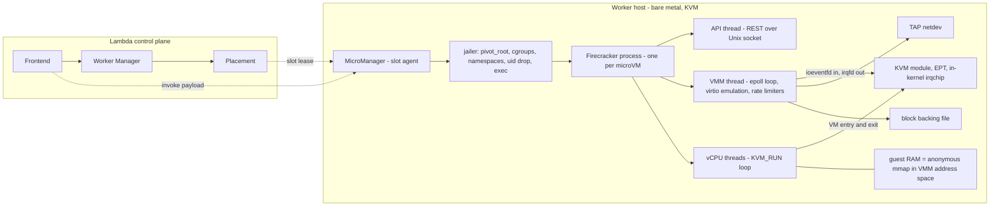

# Firecracker: Lightweight Virtualization (2020 NSDI)

## TL;DR

Firecracker is a KVM-based VMM written in Rust that gives each serverless tenant a real guest kernel, so a function needs a kernel escape and then a VMM escape before it reaches the host, while keeping the process small enough to pack thousands per host.
It boots fast because it removes things rather than optimizing them: no BIOS, no PCI in the 2020 design, a handful of virtio-mmio devices plus a serial port and a minimal i8042, and a kernel loaded directly at its entry point.
The documented number is <= 125 ms from `InstanceStart` to guest `/sbin/init`, and <= 5 MiB of VMM overhead; the widely quoted "~5 ms" applies to snapshot restore (as little as 4 ms), not to cold boot.
Memory overcommit works because guest RAM is an anonymous, lazily faulted host mapping, but guest pages only flow one way (once touched they stay resident until the VMM discards them), so density depends on each guest's high-water mark and on how correlated tenants are, not on configured size.
The jailer (chroot or pivot_root, cgroups, namespaces, privilege drop) plus per-thread seccomp is the second wall, and operating it in production means handling snapshot uniqueness, CPU-feature portability, side channels, and the support window of each release.

## Mental Model



Think of a Firecracker microVM as an ordinary Linux process whose memory happens to be the guest's physical RAM and whose threads happen to execute guest instructions via `KVM_RUN`.
The hardware boundary (VMX or SVM plus EPT/NPT, and the ARM equivalents) isolates guest code from host memory, while the only host code a guest can drive directly is the narrow device emulation in the VMM thread.
That process is wrapped by the jailer and seccomp, so the host kernel attack surface left after a VMM compromise is a small allowlist of syscalls inside an empty chroot.
Everything above the process (placement, routing, slot leasing) is control plane and lives off-host, which is why a single worker can churn microVMs at high rates without a central bottleneck.
See [[17-Cloud-AI-Engineering/Volume_00_Foundations_Under_the_Cloud/Chapter_01_Hypervisors_MicroVMs_and_Sandboxing|Hypervisors, MicroVMs, and Sandboxing]] for the broader isolation taxonomy and [[17-Cloud-AI-Engineering/Volume_02_AWS_Deep_Dive/Chapter_05_Serverless_Compute_and_Lambda_Internals|Serverless Compute and Lambda Internals]] for the Lambda service built on top.

## Internals

### The problem the paper set out to solve

The paper is [Agache et al., "Firecracker: Lightweight Virtualization for Serverless Applications", NSDI 2020, pp. 419-434](https://www.usenix.org/conference/nsdi20/presentation/agache).
It states that public serverless providers cannot accept the usual trade-off between strong isolation and minimal overhead, and it describes Firecracker in production in both Lambda and Fargate ([NSDI 2020 paper](https://www.usenix.org/system/files/nsdi20-paper-agache.pdf)).
The requirements it lists are strong isolation against privilege escalation and side channels, thousands of functions per machine, near-native performance, unmodified Linux binaries, fast start and teardown, and soft allocation, meaning each function uses only what it needs up to its limit ([Morning Paper summary, 2020](https://blog.acolyer.org/2020/03/02/firecracker/)).
The isolation options it compares are containers (one shared host kernel, so the whole Linux syscall surface is the boundary), language VMs (cannot run arbitrary binaries), and full virtualization with QEMU (strong boundary, but a large device model and high per-VM overhead).
Firecracker started as a branch of Google's crosvm, removed more than half of that code, and ended up with 96% fewer lines than QEMU, with no BIOS and no PCI ([NSDI 2020 slides](https://www.usenix.org/sites/default/files/conference/protected-files/nsdi20_slides_agache.pdf)).

### KVM integration: what the VMM actually does

Firecracker opens `/dev/kvm`, creates a VM file descriptor, and allocates guest RAM as anonymous memory in its own address space.
It registers that range with KVM as a user memory region, which lets KVM translate guest-physical to host-virtual addresses and fill the EPT on demand.
Guest RAM is ordinary pageable process memory to the host, and that single fact is the basis of the memory overcommit story below.
Firecracker does not run firmware.
It writes the guest kernel image into guest memory, fills the architectural boot structures (on x86 the Linux boot protocol zero page and an e820 map), sets the vCPU registers so execution begins at the kernel entry point, and appends `virtio_mmio.device=` parameters to the kernel command line so the guest discovers devices without enumerating a bus.
Release v1.17.0 added booting compressed bzImage kernels on x86_64 alongside the uncompressed ELF vmlinux it has always supported ([Firecracker releases, as of 2026-10](https://github.com/firecracker-microvm/firecracker/releases)).
Each vCPU is a host thread that loops on `KVM_RUN`.
Most guest execution, including guest page faults inside already-mapped EPT ranges, never leaves the CPU's guest mode.
A VM exit to user space only happens when the guest touches something KVM cannot handle in-kernel, which in Firecracker is mostly MMIO to a virtio device's configuration registers.

### The data path: why notifications skip the VMM's vCPU thread

This mechanism is not covered in the getting-started guide, and it explains both Firecracker's latency profile and its CPU accounting.
A virtio driver in the guest places descriptors in a ring in guest memory and then writes the queue index to the device's `QueueNotify` MMIO register.
Firecracker registers that register address with KVM as an ioeventfd, so KVM completes the trapping write in the kernel by signaling an eventfd, and the vCPU thread re-enters the guest without a round trip to user space.
The VMM thread sleeps in `epoll` on those eventfds, wakes, walks the descriptor chain in guest memory, applies the device's rate limiter, and performs the host I/O: a `read` or `write` on the TAP fd for net, or file I/O against the backing file for block.
Completion goes the other way: the VMM writes used-ring entries into guest memory and signals an irqfd, and KVM injects the interrupt through the in-kernel interrupt controller.
Three consequences follow.
First, device emulation for a microVM is serialized through its VMM thread, so a single noisy device or a slow backing file adds latency to every other device in that microVM.
Second, emulation CPU is charged to the Firecracker process's cgroup, not to the guest's vCPU time, so a host CPU plan has to budget the VMM thread separately from vCPUs.
Third, block writes land in the host page cache unless the backing file is opened for direct I/O, which matters for both durability semantics and host memory accounting.
The paper's evaluation reported weaker block I/O throughput than QEMU at high queue depth, which it attributed to the serial block emulation of the time (UNVERIFIED - exact figures not re-checked).

### The minimal device model

The device set is virtio-net, virtio-block, virtio-vsock, a serial console, and a minimal i8042 controller that exists mainly so the guest can request a reset; later releases added virtio-balloon, an entropy device, and virtio-mem memory hotplug ([Firecracker memory hotplug doc, as of 2026-10](https://github.com/firecracker-microvm/firecracker/blob/main/docs/memory-hotplug.md)).
Each device is a parser for guest-controlled data structures, so each device is attack surface, and writing them in Rust removes the memory-safety bug classes that dominate the QEMU CVE history.
Rust does not prevent logic bugs in descriptor-chain validation, which is why the device count matters as much as the language.
Each net and block device takes an optional rate limiter with two token buckets, one for bandwidth and one for operations, each with a size, a refill time, and an optional one-time burst, and the VMM thread enforces these before it does host I/O.
The microVM metadata service (MMDS) is emulated inside the VMM's network path so the host can pass configuration to the guest without real network plumbing ([Firecracker site](https://firecracker-microvm.github.io/)).
Release v1.17.0 added virtio device reset, transparent huge pages for guest memory via `madvise(MADV_HUGEPAGE)`, and official support for 6.18 guest kernels ([Firecracker releases, as of 2026-10](https://github.com/firecracker-microvm/firecracker/releases)).

### Process and thread architecture, and the jailer

One Firecracker process runs one microVM, which makes the failure domain of a VMM crash exactly one tenant sandbox.
Inside it there is an API thread serving REST over a Unix socket, a VMM thread for device emulation, and one thread per vCPU, each with its own seccomp filter ([Firecracker README mirror](https://github.com/chroot-dev/firecracker)).
In production the jailer starts Firecracker: it sets up the resources that need privilege, such as cgroups and the chroot, drops privileges, and `exec()`s into the Firecracker binary, which from then on can only reach resources that were copied or passed in ([Firecracker design doc](https://github.com/firecracker-microvm/firecracker/blob/main/docs/design.md)).
The jailer builds `<chroot_base>/<exec_file_name>/<id>/root`, copies the binary there, writes the PID into cgroup controllers, chowns `/dev/kvm` and `/dev/net/tun` to the target uid:gid, and execs Firecracker with `--id`, `--api-sock`, and seccomp settings ([jailer doc mirror](https://gitee.com/xydong/firecracker/blob/master/docs/jailer.md)).
The current jailer uses `pivot_root`, supports both cgroup v1 and v2, and always creates a mount namespace, with optional PID and network namespaces (DeepWiki source analysis, as of 2026-10, secondary source).
Release v1.17.0 fixed a TOCTOU race in the aarch64 jailer when setting ownership of CPU cache files copied into the chroot ([Firecracker releases, as of 2026-10](https://github.com/firecracker-microvm/firecracker/releases)), a reminder that the jailer is itself privileged code that needs a patch cadence.

### Memory overcommit: the one-way page ratchet

This is the second mechanism that rarely appears in tutorials.
When a guest first touches a guest-physical page, the EPT has no entry, KVM takes an EPT violation, resolves the host virtual address in the VMM's anonymous mapping, and the host kernel allocates a zeroed page.
From then on the page is resident in the Firecracker process, and nothing in the guest's own memory management returns it: when the guest frees memory, it goes onto the guest's free list, and the host still sees a dirty anonymous page.
Host-resident memory per microVM is therefore roughly the VMM overhead plus the guest's high-water mark of touched pages, and the guest page cache pushes that mark up toward the configured size over time.
Soft allocation therefore works well for short-lived sandboxes, which die before they ratchet up, and needs active reclaim for long-lived ones.
Firecracker's reclaim tools are the virtio-balloon device, where the guest pins free pages and the VMM discards them from the host, plus free page reporting in newer releases, and virtio-mem, where whole blocks are unplugged.
The balloon API exposes `amount_mib`, `deflate_on_oom`, and `stats_polling_interval_s`, and with `deflate_on_oom` set the guest takes pages back from the balloon instead of invoking its OOM killer ([Firecracker ballooning doc, as of 2026-10](https://github.com/firecracker-microvm/firecracker/blob/main/docs/ballooning.md)).
The same document warns that the balloon depends on the guest driver behaving correctly, so it is a density tool, not a security boundary, and a hard cap must still come from the host cgroup and the configured memory size.
A practical rule follows: a correctly sized host overcommits on the distribution of guest high-water marks across tenants, and it keeps the right to kill idle sandboxes as its last resort, which Lambda has because execution environments are disposable by contract.

### Snapshots: restore cost is O(device state), not O(RAM)

A full snapshot writes vCPU registers, device state, and KVM state into a small state file, and guest RAM into a separate memory file.
On load, `backend_type: File` maps the memory file so the host kernel resolves page faults from it, and `backend_type: Uffd` hands a userfaultfd to an external process that serves each fault ([Firecracker snapshot docs, as of 2026-10](https://github.com/firecracker-microvm/firecracker/blob/main/docs/snapshotting/snapshot-support.md)).
Because the mapping is lazy, the restore call returns after restoring state, not after reading RAM, and Marc Brooker reports restores in as little as 4 ms, about 10 ms for a full decent-sized Linux system ([Brooker, 2022-11](https://brooker.co.za/blog/2022/11/29/snapstart.html)).
The cost has not gone away; it has moved into first-touch page faults during the first invocation, which is why the working set of a restored guest decides its post-restore tail latency.
With a private file mapping, many clones of the same snapshot on one host share the host page cache pages of the memory file until a clone writes a page, so clones get copy-on-write deduplication without KSM.
The uffd path lets a platform stream memory from a remote store, but then every guest page fault becomes a network request on the critical path of a parked vCPU.
On 5.10 hosts the uffd object comes from the `userfaultfd` syscall and on 6.1 hosts from `/dev/userfaultfd`, which the jailer exposes inside the jail when present ([Firecracker uffd doc, as of 2026-10](https://github.com/firecracker-microvm/firecracker/blob/main/docs/snapshotting/handling-page-faults-on-snapshot-resume.md)).
The uffd handler must also process `UFFD_EVENT_REMOVE` for ballooned or hot-unplugged ranges, otherwise it can fault stale snapshot contents into memory the guest expects to be zero ([Firecracker memory hotplug doc](https://github.com/firecracker-microvm/firecracker/blob/main/docs/memory-hotplug.md)).
Clones break assumptions about uniqueness: identical memory means identical PRNG state, and [Brooker et al., "Restoring Uniqueness in MicroVM Snapshots", arXiv 2021](https://arxiv.org/abs/2102.12892) proposes `MADV_WIPEONSUSPEND` and SysGenId as interfaces that let software know it has been cloned.

### Lambda integration and the control plane boundary

The paper places Firecracker inside Lambda: a Frontend accepts invokes, a Worker Manager routes them to warm slots, a Placement service leases new slots on workers, and a per-worker MicroManager drives Firecracker processes (paper Section 4; component names from memory, UNVERIFIED wording).
The worker data plane keeps serving warm slots when placement is impaired, which is the static stability pattern from [[17-Cloud-AI-Engineering/Volume_01_Cloud_Architecture_Principles/Chapter_02_Regions_Zones_and_Static_Stability|Regions, Zones, and Static Stability]].
Cold starts depend on the control plane, so control plane incidents show up as failed scale-up, not as failed warm invokes.
Later papers extend the design: [On-demand Container Loading in AWS Lambda (USENIX ATC 2023)](https://www.usenix.org/conference/atc23/presentation/brooker) describes a chunked, deduplicated, cached image pipeline that supports 10 GiB images while scaling to 15,000 new containers per second for a single customer with start-up as low as 50 ms.
That design rests on sparsity: Harter et al. found that on average only about 6.5% of container data is read, which makes on-demand loading roughly 15x cheaper than full downloads ([Brooker, 2023-05](https://brooker.co.za/blog/2023/05/23/snapshot-loading/)).

### Where Firecracker sits in 2026

The current release is v1.17 (2026-09-10), v1.16 (2026-06-03) is still supported, and the policy supports the last two minor releases for up to one year and any minor release for at least six months ([Firecracker release policy, as of 2026-10](https://github.com/firecracker-microvm/firecracker/blob/main/docs/RELEASE_POLICY.md)).
AWS announced AWS Lambda MicroVMs on 2026-06-22 as a primitive for stateful, isolated sandboxes for user- or AI-generated code, with direct lifecycle control ([AWS News Blog, 2026-06](https://aws.amazon.com/blogs/aws/run-isolated-sandboxes-with-full-lifecycle-control-aws-lambda-introduces-microvms/)); its GA or preview status by region is UNVERIFIED.
Bedrock AgentCore gives each agent session its own microVM for up to 8 hours and destroys it when the session ends ([Brooker, "Seven Years of Firecracker", 2025-09](https://brooker.co.za/blog/2025/09/18/firecracker.html)).
Outside AWS, Perplexity open-sourced SPACE, which runs each agent task in its own Firecracker microVM and keeps credentials and egress policy outside the guest ([MarkTechPost, 2026-10](https://www.marktechpost.com/2026/10/16/perplexity-open-sources-space-firecracker-microvm-sandbox-ai-agents/)).
The agent-runtime implications are covered in [[17-Cloud-AI-Engineering/Volume_12_AI_Applications_MLOps_and_Data_Platforms/Chapter_03_Agent_Runtimes_and_Cloud_Execution_Environments|Agent Runtimes and Cloud Execution Environments]].

## Numbers to Know

| Quantity | Value | Source and date |
|---|---|---|
| Boot, `InstanceStart` to guest `/sbin/init` | <= 125 ms, serial console off, minimal kernel and rootfs, CI-enforced | Firecracker SPECIFICATION.md as summarized by [Miget](https://miget.com/blog/cloud-hypervisor-vs-firecracker) and [Firecracker site](https://firecracker-microvm.github.io/) (as of 2026-10) |
| VMM memory overhead | <= 5 MiB for 1 vCPU and 128 MiB guest; can exceed with many vsock connections | Firecracker SPECIFICATION.md via [Miget](https://miget.com/blog/cloud-hypervisor-vs-firecracker) (as of 2026-10) |
| MicroVM creation rate | up to 150 per second per host | [NSDI 2020 paper](https://www.usenix.org/system/files/nsdi20-paper-agache.pdf) (2020) |
| Snapshot restore | as little as 4 ms; about 10 ms for a full Linux system | [Brooker blog](https://brooker.co.za/blog/2022/11/29/snapstart.html) (2022-11) |
| Code size vs QEMU | 96% fewer lines; branch of crosvm with >50% removed | [NSDI 2020 slides](https://www.usenix.org/sites/default/files/conference/protected-files/nsdi20_slides_agache.pdf) (2020) |
| Per-VM memory overhead, paper benchmark | about 3 MB Firecracker vs about 131 MB QEMU | NSDI 2020 paper Section 5 (UNVERIFIED) |
| Default microVM shape | 1 vCPU, 128 MiB | Firecracker v1.17.0 README via [KitPloit mirror](https://kitploit.com/en/posts/github-firecracker-microvm-firecracker-v1170) (as of 2026-10) |
| Latest release | v1.17.0, released 2026-09-10, min end of support 2027-03-10 | [Release policy](https://github.com/firecracker-microvm/firecracker/blob/main/docs/RELEASE_POLICY.md) (as of 2026-10) |
| Support window | last two minors for up to 1 year; any minor >= 6 months | [Release policy](https://github.com/firecracker-microvm/firecracker/blob/main/docs/RELEASE_POLICY.md) (as of 2026-10) |
| Host kernels in uffd docs | 5.10 and 6.1 | [uffd doc](https://github.com/firecracker-microvm/firecracker/blob/main/docs/snapshotting/handling-page-faults-on-snapshot-resume.md) (as of 2026-10) |
| Lambda scale-up | up to 15,000 new containers per second, single customer; start-up as low as 50 ms | [ATC 2023](https://www.usenix.org/system/files/atc23-brooker.pdf) (2023) |
| Lambda package limits | 250 MB zip; 10 GiB container image | [ATC 2023](https://www.usenix.org/system/files/atc23-brooker.pdf) (2023) |
| Container bytes read at start | about 6.5% on average | [Brooker blog citing Harter et al.](https://brooker.co.za/blog/2023/05/23/snapshot-loading/) (2023-05) |
| Package download at 25 Gb/s | 250 MB in about 80 ms; warm routing typically < 10 ms | [Uniqueness paper](https://ar5iv.labs.arxiv.org/html/2102.12892) (2021) |
| AgentCore session microVM lifetime | up to 8 hours | [Brooker blog](https://brooker.co.za/blog/2025/09/18/firecracker.html) (2025-09) |
| Lambda memory range and CPU scaling | 128 MB to 10,240 MB; 1,769 MB = 1 vCPU equivalent | AWS Lambda docs (as of 2026-10, UNVERIFIED) |
| Lambda x86 compute price | USD 0.0000166667 per GB-second, USD 0.20 per 1M requests, us-east-1 | AWS Lambda pricing (as of 2026-10, UNVERIFIED) |
| EC2 c6g.metal on-demand | about USD 2.176 per hour, 64 vCPU, 128 GiB, us-east-1 | AWS EC2 pricing (as of 2026-10, UNVERIFIED) |
| GCE n2-standard-4 on-demand | about USD 0.19 per hour, us-central1 | Google Cloud pricing (as of 2026-10, UNVERIFIED) |

## AWS vs GCP Mechanism Parity

| Dimension | AWS | Google Cloud | Critical difference |
|---|---|---|---|
| First-party serverless sandbox | Firecracker microVM per execution environment in Lambda; Fargate per 2020 paper | gVisor user-space kernel for Cloud Run first-generation and GKE Sandbox ([gVisor docs](https://gvisor.dev/docs/)) | Firecracker trusts KVM plus a guest kernel; gVisor reimplements Linux syscalls in a Go Sentry, so compatibility gaps show up as unsupported syscalls rather than as guest kernel tax |
| Second-generation serverless | Lambda MicroVMs for stateful sandboxes (announced 2026-06, status UNVERIFIED) | Cloud Run second-generation execution environment with full Linux compatibility; underlying VMM not publicly documented (UNVERIFIED) | Only AWS publishes its VMM source and design paper |
| Snapshot-based cold start | Lambda SnapStart built on Firecracker snapshot and clone | No public VM-snapshot cold-start primitive for Cloud Run (UNVERIFIED) | SnapStart moves init cost to deploy time and requires uniqueness hygiene |
| Customer-run VMM | Firecracker on `.metal` instances; nested virtualization on EC2 (UNVERIFIED) | Firecracker on GCE with `--enable-nested-virtualization` on Intel machine series | Nested virt adds a second exit layer and distorts latency, so it is fine for labs and risky for density benchmarks |
| Host offload under the VMM | Nitro cards and Nitro hypervisor - [[17-Cloud-AI-Engineering/Volume_02_AWS_Deep_Dive/Chapter_04_EC2_Nitro_Architecture_and_Graviton\|EC2, Nitro and Graviton]] | Titanium offload - [[17-Cloud-AI-Engineering/Volume_03_GCP_Deep_Dive/Chapter_06_Compute_Engine_and_Titanium_Architecture\|Compute Engine and Titanium]] | On metal, Firecracker's virtio I/O runs on host CPU; Nitro handles the host's own VPC and EBS |
| Isolation layering | KVM boundary, Rust VMM, jailer, seccomp, cgroups | gVisor Sentry, Gofer file proxy, host seccomp, namespaces | gVisor reduces host syscalls; Firecracker exposes a full kernel to the guest but a tiny host surface |
| Memory elasticity | Balloon, free page reporting, virtio-mem; one process per VM | gVisor sandboxes allocate from host memory directly with no guest kernel ratchet | gVisor has no double page cache; Firecracker pays guest page cache plus host page cache |
| Agent sandboxes | AgentCore Runtime microVM per session; Lambda MicroVMs | GKE Sandbox with gVisor; Kubernetes agent-sandbox integration (UNVERIFIED) | Choose by threat model and syscall compatibility, not by brand |
| Kubernetes integration | Kata Containers or firecracker-containerd on EKS self-managed nodes | GKE Sandbox RuntimeClass `gvisor` - [[17-Cloud-AI-Engineering/Volume_03_GCP_Deep_Dive/Chapter_07_GKE_Deep_Dive_Standard_vs_Autopilot\|GKE Deep Dive]] | GKE ships a managed sandbox runtime; EKS requires you to operate one |

## Worked Example: Boot, Balloon, Snapshot, and Restore a MicroVM, then Size a Host

### Step 1 - Capacity model (runs anywhere, no cloud resources)

The model treats each tenant's host-resident footprint as VMM overhead plus its guest high-water mark, and it adds a correlation term because tenants running the same code ratchet together.

```python
#!/usr/bin/env python3
"""Back-of-the-envelope microVM density and cost model (ASCII only).

Host-resident footprint of microVM i:
    R_i = vmm_overhead + high_water_touched_pages_i - ballooned_i
Treat high-water marks as random variables with mean mu, stddev sigma,
and pairwise correlation rho. For N VMs:
    mean = N * (mu + o),  var = N * sigma^2 * (1 + (N - 1) * rho)
Pick the largest N whose mean + z * stddev fits in usable host RAM.
"""
import math
import argparse


def max_vms_overcommit(usable_mib, mu, sigma, overhead, z, rho):
    n = 0
    while True:
        m = n + 1
        need = m * (mu + overhead) + z * sigma * math.sqrt(m * (1 + (m - 1) * rho))
        if need > usable_mib:
            return n
        n = m


def main():
    p = argparse.ArgumentParser()
    p.add_argument("--host-ram-gib", type=float, default=128.0)
    p.add_argument("--host-reserved-gib", type=float, default=8.0)
    p.add_argument("--host-vcpus", type=int, default=64)
    p.add_argument("--host-usd-per-hour", type=float, default=2.176)
    p.add_argument("--vm-config-mib", type=float, default=1024.0)
    p.add_argument("--touched-mean-mib", type=float, default=300.0)
    p.add_argument("--touched-stddev-mib", type=float, default=150.0)
    p.add_argument("--vmm-overhead-mib", type=float, default=5.0)
    p.add_argument("--z", type=float, default=4.0)
    p.add_argument("--rho", type=float, default=0.0)
    p.add_argument("--cpu-duty-cycle", type=float, default=0.15)
    p.add_argument("--mib-per-vcpu", type=float, default=1769.0)
    p.add_argument("--lambda-usd-per-gb-s", type=float, default=0.0000166667)
    a = p.parse_args()

    usable = (a.host_ram_gib - a.host_reserved_gib) * 1024.0
    n_hard = int(usable // (a.vm_config_mib + a.vmm_overhead_mib))
    n_mem = max_vms_overcommit(usable, a.touched_mean_mib, a.touched_stddev_mib,
                               a.vmm_overhead_mib, a.z, a.rho)
    vcpu_share = a.vm_config_mib / a.mib_per_vcpu
    n_cpu = int(a.host_vcpus / (vcpu_share * a.cpu_duty_cycle))
    n = min(n_mem, n_cpu)
    ratio = n * a.vm_config_mib / usable
    print("usable host RAM (MiB)           : %.0f" % usable)
    print("N without overcommit            : %d" % n_hard)
    print("N memory-bound (z=%.1f, rho=%.2f): %d" % (a.z, a.rho, n_mem))
    print("N cpu-bound (duty %.2f)         : %d" % (a.cpu_duty_cycle, n_cpu))
    print("N chosen                        : %d" % n)
    print("memory overcommit ratio         : %.2fx" % ratio)
    print("USD per microVM-hour (full pack): %.5f" % (a.host_usd_per_hour / n))
    lam = a.lambda_usd_per_gb_s * (a.vm_config_mib / 1024.0) * 3600.0
    print("Lambda-equivalent USD per hour  : %.5f" % lam)
    print("break-even busy fraction        : %.3f" % (a.host_usd_per_hour / (n * lam)))


if __name__ == "__main__":
    main()
```

Run it as `python3 fc_density.py`, then `python3 fc_density.py --rho 0.3`, then `python3 fc_density.py --rho 1.0`.
The defaults describe a 64 vCPU, 128 GiB arm64 metal host at about USD 2.176 per hour (UNVERIFIED price), 8 GiB reserved for the host, 1 GiB configured guests, a mean high-water mark of 300 MiB with 150 MiB standard deviation, a 5 MiB VMM overhead, and a z of 4.

| rho | N memory-bound | Overcommit ratio | USD per microVM-hour | Break-even busy fraction vs Lambda |
|---|---|---|---|---|
| 0.00 | 365 | 3.04x | 0.00596 | 0.099 |
| 0.05 | 276 | 2.30x | 0.00788 | 0.131 |
| 0.30 | 193 | 1.61x | 0.01127 | 0.188 |
| 1.00 | 135 | 1.12x | 0.01612 | 0.269 |

Without overcommit the host fits 119 guests (122,880 / 1,029).
With independent tenants the sqrt(N) term is small, and density roughly tracks 122,880 / 305, minus a few dozen VMs of safety margin.
Even a 5% correlation removes a quarter of that density, because the variance term grows like N^2 * rho instead of N.
Spreading one tenant's sandboxes across many hosts is therefore a memory-safety decision as well as a blast-radius decision, and it pairs with [[17-Cloud-AI-Engineering/Volume_01_Cloud_Architecture_Principles/Chapter_03_Cell_Based_Architecture_and_Shuffle_Sharding|Cell-Based Architecture and Shuffle Sharding]].
CPU is not binding here: each 1 GiB guest gets about 0.58 vCPU, and at a 15% duty cycle the host could carry 737 guests before vCPU run queues saturate, ignoring VMM-thread emulation cost.
The break-even column compares a fully packed self-managed host with paying Lambda only for busy GB-seconds, and it excludes request fees, idle headroom, and the engineering cost of operating the fleet, so it flatters self-hosting.

### Step 2 - Lab on Google Cloud (nested virtualization, cheapest path)

Cost estimate: an n2-standard-4 at about USD 0.19 per hour (UNVERIFIED) plus a 30 GB balanced disk comes to under USD 1 for a two-hour session.

```bash
#!/usr/bin/env bash
set -euo pipefail
PROJECT="${PROJECT:?set PROJECT}"
ZONE="${ZONE:-us-central1-a}"
BILLING_ACCOUNT="${BILLING_ACCOUNT:?set BILLING_ACCOUNT, e.g. 000000-000000-000000}"

# Budget alarm first: alerts at 50, 90, and 100 percent of USD 10.
gcloud billing budgets create \
  --billing-account="${BILLING_ACCOUNT}" \
  --display-name="fc-lab-budget" \
  --budget-amount=10USD \
  --threshold-rule=percent=0.5 \
  --threshold-rule=percent=0.9 \
  --threshold-rule=percent=1.0

# Nested virtualization requires an Intel-based machine series such as N2.
gcloud compute instances create fc-lab \
  --project="${PROJECT}" --zone="${ZONE}" \
  --machine-type=n2-standard-4 \
  --enable-nested-virtualization \
  --image-family=ubuntu-2204-lts --image-project=ubuntu-os-cloud \
  --boot-disk-size=30GB

gcloud compute ssh fc-lab --project="${PROJECT}" --zone="${ZONE}" \
  --command='ls -l /dev/kvm && grep -cw vmx /proc/cpuinfo'
```

If the org policy constraint `compute.disableNestedVirtualization` is enforced, instance creation fails, and the fix is a project-level policy exception, not a different flag.

### Step 2 (alternative) - Lab on AWS (bare metal, production-faithful)

Cost estimate: c6g.metal at about USD 2.176 per hour (UNVERIFIED) for two hours is about USD 4.40 plus a few cents of gp3; fetch the live price with `aws pricing get-products --region us-east-1 --service-code AmazonEC2 --filters Type=TERM_MATCH,Field=instanceType,Value=c6g.metal Type=TERM_MATCH,Field=location,Value="US East (N. Virginia)" Type=TERM_MATCH,Field=operatingSystem,Value=Linux Type=TERM_MATCH,Field=tenancy,Value=Shared Type=TERM_MATCH,Field=preInstalledSw,Value=NA Type=TERM_MATCH,Field=capacitystatus,Value=Used`.

```bash
#!/usr/bin/env bash
set -euo pipefail
ACCOUNT_ID="$(aws sts get-caller-identity --query Account --output text)"
EMAIL="${EMAIL:?set EMAIL for budget alerts}"
KEY_NAME="${KEY_NAME:?set an existing EC2 key pair name}"
SUBNET_ID="${SUBNET_ID:?set a subnet with SSH access}"

aws budgets create-budget --account-id "${ACCOUNT_ID}" \
  --budget '{"BudgetName":"fc-lab","BudgetLimit":{"Amount":"20","Unit":"USD"},"TimeUnit":"MONTHLY","BudgetType":"COST"}' \
  --notifications-with-subscribers "[{\"Notification\":{\"NotificationType\":\"ACTUAL\",\"ComparisonOperator\":\"GREATER_THAN\",\"Threshold\":50,\"ThresholdType\":\"PERCENTAGE\"},\"Subscribers\":[{\"SubscriptionType\":\"EMAIL\",\"Address\":\"${EMAIL}\"}]}]"

AMI="$(aws ssm get-parameter --name /aws/service/ami-amazon-linux-latest/al2023-ami-kernel-6.1-arm64 --query Parameter.Value --output text)"
aws ec2 run-instances --image-id "${AMI}" --instance-type c6g.metal \
  --key-name "${KEY_NAME}" --subnet-id "${SUBNET_ID}" \
  --block-device-mappings '[{"DeviceName":"/dev/xvda","Ebs":{"VolumeSize":30,"VolumeType":"gp3"}}]' \
  --tag-specifications 'ResourceType=instance,Tags=[{Key=Name,Value=fc-lab}]' \
  --query 'Instances[0].InstanceId' --output text
```

### Step 3 - Boot, balloon, snapshot, restore (run on the lab host)

Get a guest kernel and ext4 rootfs that match your release by following `docs/getting-started.md` in the Firecracker repository, then export their paths as `KERNEL` and `ROOTFS`.

```bash
#!/usr/bin/env bash
# fc-lab.sh - boot, balloon, snapshot, and restore one microVM; prints timings and host RSS.
set -euo pipefail
FC_VERSION="${FC_VERSION:-v1.17.0}"
ARCH="$(uname -m)"
WORK="${WORK:-$HOME/fclab}"
KERNEL="${KERNEL:?path to guest kernel}"
ROOTFS="${ROOTFS:?path to ext4 rootfs}"
MEM_MIB="${MEM_MIB:-1024}"
SOCK1="${WORK}/fc1.sock"
SOCK2="${WORK}/fc2.sock"
mkdir -p "${WORK}" && cd "${WORK}"

[ -w /dev/kvm ] || sudo setfacl -m "u:${USER}:rw" /dev/kvm

if [ ! -x ./firecracker ]; then
  curl -fsSL -o fc.tgz \
    "https://github.com/firecracker-microvm/firecracker/releases/download/${FC_VERSION}/firecracker-${FC_VERSION}-${ARCH}.tgz"
  tar -xzf fc.tgz
  cp "release-${FC_VERSION}-${ARCH}/firecracker-${FC_VERSION}-${ARCH}" ./firecracker
fi

api() {
  local sock="$1" method="$2" path="$3" body="${4:-}"
  if [ -n "${body}" ]; then
    curl -fsS --unix-socket "${sock}" -X "${method}" "http://localhost${path}" \
      -H 'Content-Type: application/json' -d "${body}"
  else
    curl -fsS --unix-socket "${sock}" -X "${method}" "http://localhost${path}"
  fi
}
wait_sock() { local i=0; while [ ! -S "$1" ]; do i=$((i+1)); [ "$i" -gt 300 ] && exit 1; sleep 0.01; done; }
now_ms() { date +%s%3N; }
rss_kib() { ps -o rss= -p "$1" | tr -d ' '; }

rm -f "${SOCK1}" "${SOCK2}" vm.snap vm.mem
./firecracker --api-sock "${SOCK1}" > fc1.log 2>&1 &
PID1=$!
wait_sock "${SOCK1}"

api "${SOCK1}" PUT /machine-config "{\"vcpu_count\": 2, \"mem_size_mib\": ${MEM_MIB}}"
api "${SOCK1}" PUT /boot-source "{\"kernel_image_path\": \"${KERNEL}\", \"boot_args\": \"console=ttyS0 reboot=k panic=1 pci=off\"}"
api "${SOCK1}" PUT /drives/rootfs "{\"drive_id\": \"rootfs\", \"path_on_host\": \"${ROOTFS}\", \"is_root_device\": true, \"is_read_only\": false}"
api "${SOCK1}" PUT /balloon '{"amount_mib": 0, "deflate_on_oom": true, "stats_polling_interval_s": 1}'

T0=$(now_ms); api "${SOCK1}" PUT /actions '{"action_type": "InstanceStart"}'; T1=$(now_ms)
echo "InstanceStart returned in $((T1 - T0)) ms; guest boot continues, see fc1.log"
sleep 5
echo "host RSS after boot: $(rss_kib "${PID1}") KiB for a ${MEM_MIB} MiB guest"
api "${SOCK1}" GET /balloon/statistics; echo

api "${SOCK1}" PATCH /balloon '{"amount_mib": 512}'
sleep 3
echo "host RSS with 512 MiB balloon: $(rss_kib "${PID1}") KiB"
api "${SOCK1}" PATCH /balloon '{"amount_mib": 0}'

api "${SOCK1}" PATCH /vm '{"state": "Paused"}'
api "${SOCK1}" PUT /snapshot/create "{\"snapshot_type\": \"Full\", \"snapshot_path\": \"${WORK}/vm.snap\", \"mem_file_path\": \"${WORK}/vm.mem\"}"
kill "${PID1}"; wait "${PID1}" 2>/dev/null || true
ls -l vm.snap vm.mem

./firecracker --api-sock "${SOCK2}" > fc2.log 2>&1 &
PID2=$!
wait_sock "${SOCK2}"
T2=$(now_ms)
api "${SOCK2}" PUT /snapshot/load "{\"snapshot_path\": \"${WORK}/vm.snap\", \"mem_backend\": {\"backend_type\": \"File\", \"backend_path\": \"${WORK}/vm.mem\"}, \"resume_vm\": true}"
T3=$(now_ms)
echo "snapshot load and resume returned in $((T3 - T2)) ms"
echo "host RSS right after restore: $(rss_kib "${PID2}") KiB"
sleep 5
echo "host RSS 5 s after restore: $(rss_kib "${PID2}") KiB"
kill "${PID2}"; wait "${PID2}" 2>/dev/null || true
```

What to observe: `vm.mem` is the full configured size while `vm.snap` is small, and right after restore the RSS is far below the guest size because the memory file is mapped lazily.
The balloon effect only shows in RSS if the guest had touched the pages the balloon takes, so fill the guest page cache first (for example `cat` a large file inside the guest) to see the ratchet and its reclaim.
On a nested-virtualization host, every exit is reflected through the L0 hypervisor, so treat measured boot and restore times as upper bounds, not as Firecracker's numbers.

### Step 4 - Teardown (exact commands)

```bash
# Google Cloud
PROJECT="${PROJECT:-$(gcloud config get-value project 2>/dev/null)}"
ZONE="${ZONE:-us-central1-a}"
BILLING_ACCOUNT="${BILLING_ACCOUNT:-$(gcloud billing projects describe "$PROJECT" --format='value(billingAccountName)' 2>/dev/null | sed 's|billingAccounts/||')}"
gcloud compute instances delete fc-lab --project="${PROJECT}" --zone="${ZONE}" --quiet
if [ -n "${BILLING_ACCOUNT}" ]; then
  gcloud billing budgets list --billing-account="${BILLING_ACCOUNT}" --filter='displayName=fc-lab-budget' --format='value(name)' \
    | xargs -r -n1 gcloud billing budgets delete --quiet
fi

# AWS
ACCOUNT_ID="${ACCOUNT_ID:-$(aws sts get-caller-identity --query Account --output text 2>/dev/null)}"
IID="$(aws ec2 describe-instances --filters Name=tag:Name,Values=fc-lab Name=instance-state-name,Values=running,stopped --query 'Reservations[].Instances[].InstanceId' --output text)"
[ -n "${IID}" ] && aws ec2 terminate-instances --instance-ids ${IID}
[ -n "${ACCOUNT_ID}" ] && aws budgets delete-budget --account-id "${ACCOUNT_ID}" --budget-name fc-lab
```

## Failure Modes and Pitfalls

### Memory ratchet leading to host OOM

Long-lived guests fill their page cache, host RSS converges on configured size, and an overcommitted host that was safe at hour one becomes unsafe by hour twelve.
The host OOM killer then picks a Firecracker process, which kills a tenant's whole VM, not one process inside it.
Mitigations are balloon or free page reporting driven by guest statistics, per-VM memory cgroup limits slightly above configured size, a cap on sandbox lifetime, and admission control that places by measured RSS plus headroom rather than by configured size.

### Correlated working sets collapse overcommit

A popular tenant deploys new code, every sandbox loads the same larger dependency set within a minute, and the variance term in the model jumps from sqrt(N) to N.
At rho = 0.3 the same host safely holds 193 guests instead of 365, so a host packed for independent tenants is overcommitted by almost 2x the moment tenants correlate.
Spread each tenant across hosts, cap the share of any host one tenant may hold, and keep a reclaim action (kill idle warm sandboxes) that runs faster than memory grows.

### Snapshot clones are not unique

Restored clones share PRNG state, UUID generator state, TLS session keys cached in memory, and any in-memory tokens, so two clones can emit identical "random" values ([Uniqueness paper, 2021](https://arxiv.org/abs/2102.12892)).
Software that relies on `rdrand` or reseeds after a clone signal is safe; software that seeded a userspace PRNG during init is not ([Brooker, 2022-11](https://brooker.co.za/blog/2022/11/29/snapstart.html)).
Clones also restore TCP connections that the peer has already timed out or that now exist twice, so reconnect logic must run in a post-restore hook.

### Page-fault storms and remote-store stalls after restore

With a uffd backend serving pages from a remote store, every first touch parks a vCPU until the handler answers, and the guest cannot time out the stall.
A slow store becomes guest soft-lockup warnings, clock jumps, and missed heartbeats, not clean errors.
Prefetching the recorded working set and serving from a host-local cache before going remote (the approach evaluated in REAP, ASPLOS 2021, UNVERIFIED) turns thousands of serial faults into one bulk read.

### CPU feature mismatch across host generations

A snapshot taken on a host that exposes newer instructions can crash or misbehave when restored on an older host, because guest libraries pick code paths based on CPUID at init time.
Firecracker's CPU templates (static and custom) normalize the CPUID and MSR view so a snapshot stays portable across a defined set of host types (Firecracker docs, UNVERIFIED for the current template list).

### Side channels and host configuration

The paper treats microarchitectural side channels as part of the threat model, and Firecracker's production host guidance covers SMT, kernel page-table isolation, and memory deduplication (Firecracker prod-host-setup doc; exact recommendations UNVERIFIED).
Enabling KSM to increase density brings back cross-tenant page-sharing timing channels that hardware virtualization otherwise closes.

### Control plane dependency during regional events

The 2023-06-13 Lambda event in us-east-1 was traced to the Frontend capacity management subsystem, so invokes failed even though the worker microVMs were healthy ([AWS PIR](https://aws.amazon.com/message/061323/); details UNVERIFIED).
In the 2025-10 us-east-1 event, a DynamoDB DNS failure spread into services that need control-plane state to launch new capacity ([AWS PIR](https://aws.amazon.com/message/101925/); details UNVERIFIED).
The general lesson is in [[17-Cloud-AI-Engineering/Volume_07_Reliability_and_SRE/Chapter_07_Anatomy_of_Major_Cloud_Outages|Anatomy of Major Cloud Outages]]: warm sandboxes are statically stable, while cold starts, snapshot fetches, and placement are not.

### Operational pitfalls in self-hosted fleets

Running Firecracker without the jailer in production removes the second wall, and the API socket becomes a full-control endpoint for anyone who can reach it.
VMM overhead grows beyond 5 MiB with many vsock connections ([Miget summary of SPECIFICATION.md](https://miget.com/blog/cloud-hypervisor-vs-firecracker)), so agent platforms that multiplex tool calls over vsock should measure it rather than assume it.
The 125 ms figure ends at guest init and leaves out jailer setup, TAP creation, IP allocation, and application start, which third-party measurements put at 100 to 300 ms more on a cold path ([Particula, as of 2026-10](https://particula.tech/blog/firecracker-vs-libkrun-boot-time-memory-sizing), secondary source).
Fleets pinned to an old minor version lose security patches when the six-month to one-year support window closes ([Release policy](https://github.com/firecracker-microvm/firecracker/blob/main/docs/RELEASE_POLICY.md)).

## Security and Cost Angles

### Trust boundaries and IAM scoping

Treat the guest as hostile: any credential injected into the microVM (a Lambda execution role's temporary credentials, an agent's API token) belongs to the tenant code and to anything that compromises it.
Scope execution roles to the single function and resource ARNs it needs, and use resource policies or SCPs as backstops per [[17-Cloud-AI-Engineering/Volume_02_AWS_Deep_Dive/Chapter_01_IAM_Policy_Evaluation_Engine|IAM Policy Evaluation Engine]].
For AI-agent sandboxes, keep long-lived credentials and egress policy outside the VM and have a host-side proxy add short-lived credentials, the pattern SPACE uses ([MarkTechPost, 2026-10](https://www.marktechpost.com/2026/10/16/perplexity-open-sources-space-firecracker-microvm-sandbox-ai-agents/)); see [[17-Cloud-AI-Engineering/Volume_12_AI_Applications_MLOps_and_Data_Platforms/Chapter_08_Cloud_Security_for_AI_Systems_Attacks_and_Defenses|Cloud Security for AI Systems]].
On a self-managed fleet, the Firecracker API socket is a root-equivalent control channel for its VM, so put it in the jail, restrict it to the orchestrator uid, and never forward it over the network.

### Encryption of snapshot and memory artifacts

A memory file holds everything the guest had in RAM, including decrypted secrets and private keys, so a snapshot store needs the same data classification as a secrets store.
Encrypt snapshot objects with envelope encryption under a per-tenant KMS key (AWS KMS or Cloud KMS) so that revoking a tenant's key makes its stored snapshots unreadable, following [[17-Cloud-AI-Engineering/Volume_08_Security_Identity_and_the_Data_Perimeter/Chapter_04_Encryption_Key_Hierarchies_and_Envelope_Encryption|Encryption Key Hierarchies and Envelope Encryption]].
Wipe secrets before snapshot (or regenerate them after restore with a clone-generation signal) so the stored image contains no live credentials.

### Network perimeter

Self-hosted microVM networking is a TAP device per VM, so host iptables or nftables rules, not VPC security groups, are the per-tenant firewall, and the host's own ENI or NIC must reach only the endpoints the platform needs.
Reach cloud APIs from the host through VPC interface endpoints on AWS or Private Google Access and VPC Service Controls on GCP, so a guest that escapes its network policy still cannot exfiltrate to arbitrary storage buckets; see [[17-Cloud-AI-Engineering/Volume_08_Security_Identity_and_the_Data_Perimeter/Chapter_06_Constructing_an_Impenetrable_Data_Perimeter|Constructing an Impenetrable Data Perimeter]].
Block guest access to the host's instance metadata endpoint at the TAP layer, otherwise a guest can borrow the host's instance role.

### Unit-economics levers

Density is the dominant lever: the model shows cost per microVM-hour moving from USD 0.016 to USD 0.006 as overcommit goes from 1.1x to 3x on the same host.
Snapshot restore turns minutes of per-sandbox language-runtime init into one init at deploy time, which saves both latency and the billed init CPU across thousands of cold starts.
Arm64 metal hosts lower USD per vCPU, and Firecracker supports aarch64, but snapshots are architecture-specific, so a mixed fleet doubles snapshot storage and build pipelines.
Short sandbox lifetimes cost nothing in hardware and save real memory, because they reset the ratchet before page cache fills the guest.
For fleet-level commitment strategy see [[17-Cloud-AI-Engineering/Volume_09_FinOps_and_Cloud_Economics/Chapter_02_Commitment_Discounts_Savings_Plans_vs_CUDs|Commitment Discounts]].

## Interview Questions and Model Answers

### Question 1 (L5 - Senior)

Why did AWS write a new VMM for Lambda rather than use containers with seccomp or QEMU with KVM?

#### Model Answer

The threat model is arbitrary customer Linux binaries from mutually untrusting tenants on shared hardware, at thousands of tenants per host.
With containers, the boundary is the host kernel's full syscall and filesystem surface, and seccomp tight enough to shrink it meaningfully breaks the "run unmodified binaries" requirement.
With QEMU, KVM provides the hardware boundary, but QEMU's large device model (legacy devices, PCI, firmware) is the attack surface a guest can drive, and its per-VM memory and startup costs defeat the density and cold-start goals.
Firecracker keeps the KVM boundary and shrinks the host-side surface: a few virtio-mmio devices written in Rust, no BIOS, no PCI in the original design, and a jailer plus per-thread seccomp so that a VMM compromise lands in an empty chroot with a minimal syscall allowlist.
The costs are real: every tenant pays for a guest kernel and a second page cache, virtio emulation runs on host CPU in one VMM thread, device features such as GPU passthrough are absent, and the fleet must run on bare metal or nested virtualization.
The trade is worth it because the serverless workload profile (small, short-lived, Linux-only, network and block I/O only) lets AWS drop exactly the features that make general VMMs large.

#### Follow-up Interviewer Question

An attacker has code execution in the Firecracker VMM thread of one microVM; enumerate what they can and cannot touch, and which control stops each step.

### Question 2 (L5 - Senior)

Trace a single 4 KiB write from a guest process to the host for a Firecracker virtio-block device, and name the latency and accounting consequences.

#### Model Answer

The guest's block layer builds a virtio request (header, data buffer, status byte) as a descriptor chain in guest memory and publishes it in the available ring.
The driver writes `QueueNotify` on the device's MMIO window, which traps; because Firecracker registered an ioeventfd for that address, KVM completes the write in the kernel by signaling an eventfd, and the vCPU goes back into the guest without a user-space exit.
The VMM thread wakes from `epoll`, reads the chain directly from guest memory (it is mapped in its own address space), checks the device's bandwidth and ops token buckets, and if allowed issues the write against the backing file.
It writes the status, updates the used ring, and signals an irqfd, so KVM injects the completion interrupt.
Consequences: the work is serialized per microVM in the VMM thread, so block and net requests queue behind each other; that CPU is charged to the Firecracker process cgroup, not the guest's vCPU quota; a buffered backing file means the write is acknowledged once it reaches the host page cache, so a host crash can lose it unless the platform flushes or uses direct I/O; and the rate limiter is the only thing preventing one tenant from saturating a shared NVMe device.

#### Follow-up Interviewer Question

If you move this device to an io_uring-based async engine, which latency improves, which failure semantics change, and what new host kernel attack surface do you accept?

### Question 3 (L6 - Staff)

You run a self-managed microVM fleet for untrusted code and leadership wants 3x memory overcommit; design the memory system and tell me where it breaks.

#### Model Answer

Start from mechanism: guest RAM is a lazily faulted anonymous mapping, so a VM costs its touched-page high-water mark plus about 5 MiB, and pages go back to the host only when the VMM discards them through balloon, free page reporting, or virtio-mem.
I would place by measured high-water marks, not configured size, using mean plus z standard deviations with an explicit correlation term, because the variance of correlated tenants grows with N squared.
With independent tenants at a 300 MiB mean on a 120 GiB usable host the model supports 3x, but at 0.3 correlation it supports 1.6x, so the 3x target depends on anti-affinity that caps any one tenant's share of a host.
Reclaim comes in layers: free page reporting all the time, balloon inflation driven by guest stats for idle VMs, per-VM cgroup memory limits as the hard cap, and when the host crosses a pressure threshold, killing the oldest idle sandboxes, which is only acceptable because sandboxes are disposable by contract.
I would not use host swap because it adds unbounded latency and writes tenant memory to disk, and I would not use KSM because cross-tenant deduplication reopens timing side channels.
It breaks when the reclaim rate is slower than the growth rate (a tenant-wide deploy), when long-lived sandboxes ratchet to full size, or when the kill policy hits sandboxes that hold state the customer believed was durable.
The metrics I would alert on are host-level available memory with a burn-rate rule, per-tenant aggregate RSS per host, and balloon target versus actual size, since a lagging balloon means a guest driver is not cooperating.

#### Follow-up Interviewer Question

A single tenant now runs 40% of a host's sandboxes and all of them load a 2 GiB model at the same minute; walk me through the first 90 seconds and what your system does at each step.

### Question 4 (L6 - Staff)

Product says "Firecracker starts in 5 ms, so our sandbox API should promise 10 ms p99 cold start"; respond with a latency budget.

#### Model Answer

There are three different numbers in play.
The VMM boot specification is <= 125 ms from `InstanceStart` to guest init with a minimal kernel and rootfs, and snapshot restore can be as low as 4 ms for a tiny guest and about 10 ms for a full Linux system.
Neither number includes the platform path: authorization and placement, jailer setup with cgroups and namespaces, TAP and IP allocation, fetching the rootfs or snapshot to the host, and reaching the point where the guest application can serve its first request.
After restore, latency moves into page faults: a guest that touches 200 MiB on first request faults that much from local disk or, worse, from a remote store through uffd, and those faults are serial per vCPU.
So I would offer a tiered SLO: a pre-warmed pool with a p99 in the low tens of milliseconds, a snapshot restore from a host-local cache with a p99 bounded by the recorded working-set size divided by local read bandwidth plus restore time, and a remote-snapshot path with an SLO set by store tail latency.
To make 10 ms p99 real, I would keep a warm pool sized by arrival rate times restore time, pre-fault or prefetch the recorded working set, pin jailer and network setup into the pool ahead of time, and enforce uniqueness hooks after restore so clones do not share RNG state.

#### Follow-up Interviewer Question

How do you size the warm pool so it meets the SLO during a 10x burst without paying for 10x idle memory, and what happens to the SLO when the pool runs out?

### Question 5 (L6 - Staff)

Design snapshot distribution so that any host in a region can restore any tenant's snapshot quickly and safely.

#### Model Answer

I would split the snapshot into a small device-state file and a large memory image, then chunk the memory image into content-addressed blocks so common base layers (kernel, runtime, shared libraries) deduplicate across tenants, the same idea ATC 2023 applied to container images.
Hosts restore with a uffd handler that serves faults from a host-local NVMe cache, then from an AZ-local cache tier, then from regional object storage, and a recorded working-set manifest is prefetched as one bulk read at restore time.
Portability needs CPU templates so every snapshot is taken against a normalized CPUID view that all target host generations support, plus architecture-specific images for x86 and arm64.
Security needs per-tenant envelope encryption of chunks, with deduplication limited to chunks derived from public base images, because deduplicating private chunks across tenants leaks equality information; decryption happens on the host inside the trusted handler.
Correctness needs the handler to process remove events for ballooned ranges, post-restore uniqueness hooks, and a vCPU stall watchdog so a slow cache tier is detected as an infrastructure fault instead of guest soft lockups.
The main failure mode is a correlated cache miss after a popular tenant deploys, so I would push new snapshots to AZ caches before switching traffic, which is a constant-work pattern from [[17-Cloud-AI-Engineering/Volume_01_Cloud_Architecture_Principles/Chapter_05_Constant_Work_and_Workload_Smoothing|Constant Work and Workload Smoothing]].

#### Follow-up Interviewer Question

Your regional object store has a 30-second p99 brownout; describe exactly what guests, handlers, and the control plane experience, and which component should shed load first.

### Question 6 (L7+ - Principal)

You must build a multi-tenant AI-agent code-execution platform on both AWS and Google Cloud; choose the isolation technology per cloud and defend it to a security review and a CFO.

#### Model Answer

The threat model is adversarial code that an LLM generates under prompt injection, so I assume every sandbox is hostile and the risks are host escape, credential theft, and data exfiltration through egress.
On AWS I would choose between Lambda MicroVMs or AgentCore Runtime (managed microVM per session, with Firecracker's KVM boundary and AWS's operational ownership) and self-managed Firecracker on metal when I need custom images, GPUs nearby, or specific networking, and I would check the GA status of the managed options per region before committing.
On Google Cloud the first-party option is gVisor through GKE Sandbox, which removes the guest kernel tax and double page cache but has syscall compatibility gaps and different performance for syscall-heavy tools; for kernel-level fidelity I would run Firecracker on GCE with nested virtualization only after measuring the nested-exit overhead on my workloads.
Across both, credentials and egress policy stay outside the guest in a host-side proxy, per-session sandboxes are destroyed at session end, and every sandbox runs under a per-tenant key and a per-tenant network policy.
For the CFO, the cost drivers are memory density and idle time: per-session microVMs with short lifetimes keep the ratchet low, the break-even against managed per-second billing sits around 10 to 25% busy fraction in my model depending on tenant correlation, and anything below that favors managed sandboxes because they absorb idle capacity.
I would not standardize on one isolation technology across both clouds just for symmetry; I would standardize the sandbox API, policy model, and telemetry, and let the backend differ, accepting two security reviews in exchange for not running nested virtualization in production.

#### Follow-up Interviewer Question

A red team shows that 11 of 54 runs bypassed your egress controls through HTTPS; which layer failed and how do you change the architecture rather than the rule set?

### Question 7 (L7+ - Principal)

Should Firecracker add GPU passthrough so the same sandbox model covers LLM tool use with local inference?

#### Model Answer

GPU passthrough means VFIO, PCI device assignment, and an IOMMU, and each one conflicts with a core Firecracker property.
VFIO pins all guest memory because the device can DMA into any guest-physical page at any time, which removes lazy faulting, balloon reclaim, and overcommit, so a GPU sandbox costs its full configured RAM from the first second.
Device state lives in GPU memory and firmware that the VMM cannot capture, so snapshot and clone stop working, and GPU initialization adds startup time far above the 125 ms boot budget.
The attack surface moves into the PCI emulation, the IOMMU configuration, and GPU firmware, which are far larger than the virtio device set Rust was meant to keep small.
My recommendation is to keep the general Firecracker fleet GPU-free and serve inference from a separate GPU tier behind a network API with per-tenant quotas, as in [[17-Cloud-AI-Engineering/Volume_14_Staff_Plus_Interview_Arena/Chapter_01_Design_Multi_Tenant_LLM_Inference_Platform|Multi-Tenant LLM Inference Platform]].
If a product truly needs a tenant-owned GPU, I would use whole-host or whole-GPU dedicated VMs with a VMM built for device assignment, priced as dedicated capacity, rather than weaken the density and snapshot properties of the main fleet.
Firecracker's current device-assignment roadmap is UNVERIFIED, so I would check upstream before stating its position as fact.

#### Follow-up Interviewer Question

If confidential-computing GPUs with attested device memory encryption become standard, which parts of this argument still hold and which do you retract?

## Further Reading

- [Firecracker: Lightweight Virtualization for Serverless Applications, NSDI 2020](https://www.usenix.org/conference/nsdi20/presentation/agache) - the primary source for the design goals, isolation comparison, and Lambda integration.
- [NSDI 2020 paper PDF](https://www.usenix.org/system/files/nsdi20-paper-agache.pdf) - read Sections 3 to 5 for the device model, Lambda architecture, and the overhead and boot evaluations.
- [NSDI 2020 slides](https://www.usenix.org/sites/default/files/conference/protected-files/nsdi20_slides_agache.pdf) - the crosvm lineage and code-size reduction on one slide.
- [Restoring Uniqueness in MicroVM Snapshots, arXiv 2021](https://arxiv.org/abs/2102.12892) - required reading before you ship any snapshot-and-clone system.
- [On-demand Container Loading in AWS Lambda, USENIX ATC 2023](https://www.usenix.org/conference/atc23/presentation/brooker) - how Lambda feeds microVMs with chunked, deduplicated, cached images at 15,000 starts per second.
- [Brooker, Lambda SnapStart and snapshots as a tool for system builders](https://brooker.co.za/blog/2022/11/29/snapstart.html) - restore latencies and the clone-uniqueness problem in a designer's words.
- [Brooker, Seven Years of Firecracker](https://brooker.co.za/blog/2025/09/18/firecracker.html) - how the same VMM now underpins agent sessions.
- [Firecracker design doc](https://github.com/firecracker-microvm/firecracker/blob/main/docs/design.md) - the thread model, jailer, and seccomp from the maintainers.
- [Firecracker snapshot support](https://github.com/firecracker-microvm/firecracker/blob/main/docs/snapshotting/snapshot-support.md) and [page-fault handling on resume](https://github.com/firecracker-microvm/firecracker/blob/main/docs/snapshotting/handling-page-faults-on-snapshot-resume.md) - the File versus Uffd backends and their edge cases.
- [Firecracker ballooning](https://github.com/firecracker-microvm/firecracker/blob/main/docs/ballooning.md) and [memory hotplug](https://github.com/firecracker-microvm/firecracker/blob/main/docs/memory-hotplug.md) - the reclaim mechanisms behind soft allocation, with their security caveats.
- [Firecracker release policy](https://github.com/firecracker-microvm/firecracker/blob/main/docs/RELEASE_POLICY.md) - the support windows your patch cadence must respect.
- [Linux KVM API documentation](https://docs.kernel.org/virt/kvm/api.html) - the ioctls behind memory regions, ioeventfd, irqfd, and `KVM_RUN`.
- [Linux userfaultfd documentation](https://docs.kernel.org/admin-guide/mm/userfaultfd.html) - the kernel contract every uffd snapshot handler depends on.
- [gVisor documentation](https://gvisor.dev/docs/) - the Google Cloud design point to compare against.
- REAP: Benchmarking, Analysis, and Optimization of Serverless Function Snapshots, ASPLOS 2021 (UNVERIFIED citation details) - working-set record and prefetch for snapshot restore.
- Blending Containers and Virtual Machines: A Study of Firecracker and gVisor, VEE 2020 (UNVERIFIED citation details) - an independent measurement of where each sandbox spends host kernel time.
- Related chapters: [[17-Cloud-AI-Engineering/Volume_13_Seminal_Papers_and_Case_Studies/Chapter_03_Physalia_EBS_Control_Plane|Physalia (previous)]], [[17-Cloud-AI-Engineering/Volume_13_Seminal_Papers_and_Case_Studies/Chapter_05_Amazon_S3_ShardStore_Formal_Methods|ShardStore (next)]], [[17-Cloud-AI-Engineering/Volume_03_GCP_Deep_Dive/Chapter_08_Cloud_Run_and_Serverless_Container_Execution|Cloud Run and Serverless Container Execution]], [[17-Cloud-AI-Engineering/Volume_11_LLM_Serving_and_Inference_Systems_on_Cloud/Chapter_08_Cloud_GPU_Autoscaling_and_Cold_Start_Mitigation|Cloud GPU Autoscaling and Cold-Start Mitigation]], [[15-Technical-Whitepapers/06-Defensive-Security-and-Hardening/Container-and-Microservice-Security|Container and Microservice Security]].
