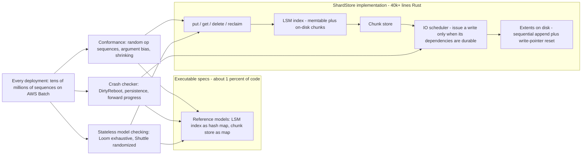

# Validating Amazon S3 ShardStore with Formal Methods (2021 SOSP)

## TL;DR

ShardStore is the Rust key-value storage node under Amazon S3, with more than 40,000 lines of code ([Bornholt et al., SOSP 2021](https://dl.acm.org/doi/10.1145/3477132.3483540), as of 2026-10). It uses an LSM index, append-only extents and a soft-updates dependency graph instead of a single write-ahead log.
The specification is a set of executable reference models written in Rust that are about 1% of the implementation's size. The model for the whole LSM tree is a hash map, and the same models serve as unit-test mocks, so they cannot quietly fall out of date.
Correctness is split into three properties, each checked by the cheapest tool that works: sequential conformance by property-based testing, crash consistency by refinement against a weaker model, and concurrency by stateless model checking with Loom (exhaustive and slow) or Shuttle (randomized and fast).
Crash consistency has two halves. Persistence means a dependency that reports itself durable must be readable after a crash. Forward progress means every dependency becomes durable after a clean shutdown. You need both, because a dependency that never resolves satisfies persistence trivially.
The trade-off is explicit: the team accepts weaker guarantees than full verification in exchange for checks that ordinary engineers maintain and that run on every deployment. The paper reports 16 issues stopped before production. Performance, availability, resource exhaustion and hardware faults are out of scope.

## Mental Model



The core idea is that the specification is just another, much simpler implementation of the same interface, and it lives in the same repository as the real code.
Every checker does the same thing: it drives the implementation and the model with the same inputs and compares what it observes.
The checkers differ only in which nondeterminism they control.
Property-based testing controls the operation sequence.
The crash checker controls which in-flight IOs reach the media before power is lost.
The model checker controls thread interleavings.
Each source of nondeterminism is attacked separately with a tool sized to it. That is why the approach scales to a codebase that a full team changes every week, where a one-off proof would go stale within a quarter.

## Internals

### Where ShardStore sits in S3: data plane, control plane, failure domain

S3's storage nodes are key-value stores holding shards of object data, and the control plane replicates those shards across multiple nodes for durability ([Bornholt et al., SOSP 2021](https://jamesbornholt.com/papers/shardstore-sosp21.pdf)).
S3's metadata subsystem maps customer requests to shard identifiers. ShardStore only sees keys (shard IDs) and values (shard bytes), so it is a pure data-plane component.
The talk slides gave S3's scale at the time as over 100 trillion objects ([SOSP 2021 slides](https://jamesbornholt.com/papers/shardstore-sosp21.slides.pdf), as of 2021-10).
ShardStore is API-compatible with the storage node software it replaces. Requests can be served by either implementation, which made a gradual fleet rollout possible ([The Stack, quoting the paper](https://www.thestack.technology/aws-shardstore-s3/), as of 2026-10).

The paper's argument for crash consistency is operational, not about customer durability.
Cross-node replicas already provide the eleven-nines durability design goal.
The real risk is cost. A crash that loses a whole node's data turns into a flood of repair traffic and IO load across the fleet, and a node that recovers into an unexpected state may need a human operator.
So the failure domain ShardStore defends is "one node rebooted", and the property it guarantees is that a reboot stays a reboot and never becomes a rebuild.
For how the layers above ShardStore provide strong consistency, see [[17-Cloud-AI-Engineering/Volume_02_AWS_Deep_Dive/Chapter_08_S3_Deep_Dive_Consistency_and_ShardStore|S3 Deep Dive: Consistency and ShardStore]].

### On-disk layout: extents, chunks, the LSM index, and the superblock

An extent is a contiguous region of physical storage, and a typical disk has tens of thousands of them ([Amazon Science blog](https://www.amazon.science/blog/aws-team-wins-best-paper-award-for-work-on-automated-reasoning), as of 2021-11).
Writes inside an extent are strictly sequential, tracked by a write pointer that marks the next valid write position.
All persistent data is stored as chunks, including the backing storage for the LSM tree itself.
A chunk store abstraction maps chunks onto extents.
Object data lives outside the LSM tree, which holds only key-to-chunk-locator mappings, and this cuts write amplification compared with storing values inline.
To delete a chunk from the middle of an extent, the store copies the extent's remaining live chunks to other extents and then resets the write pointer. The extent becomes empty and reusable.
That append-plus-reset contract is the same one zoned and shingled media expose (this is an analogy, not a claim about S3 hardware). It lets one code path serve "diverse storage media", which the paper names as a design goal.

There is no single global log. ShardStore spreads shard data across extents so it can place data by expected heat and access pattern, for example to cut seek latency on hard disks.
That placement freedom is exactly what makes crash consistency hard. A put touches a data extent, an LSM chunk in another extent, and the metadata that records where the current LSM tree lives. No single append orders all three.

### Crash consistency without a WAL: the soft-updates dependency graph

ShardStore uses a crash consistency protocol inspired by soft updates (Ganger and Patt, OSDI 1994; Ganger, McKusick, Soules and Patt, ACM TOCS 2000).
Every mutating API call returns a `Dependency` value, which callers can query to learn whether the write is durable.
A put has three ordered steps: write the chunked data to an extent, write the index entry into the LSM tree, then make the metadata point at the new LSM state. Each step depends on the one before it becoming durable ([Satarin, Formal Methods at Amazon S3](https://asatarin.github.io/talks/2022-02-formal-methods-at-amazon-S3.pdf), as of 2022-02).
The IO scheduler enforces the graph at issue time: it sends a write to the device only after every write it depends on has been acknowledged as durable.
So every crash state of the disk is consistent by construction, and no write has to be paid for twice the way it is in a WAL.

The cost moves somewhere else. The dependency rules are spread through the codebase as code, not data, and one missing edge is a latent data-loss bug that no ordinary test will ever hit.
Later work from the same group, DepSynth (ECOOP 2023), synthesizes soft-updates dependency rules automatically. It was demonstrated on a 1,200-line Racket reimplementation of a ShardStore-like system ([Bornholt et al., DepSynth](https://jamesbornholt.com/papers/depsynth-ecoop23.pdf)).
The paper also notes that production ShardStore does not use a dependency-rule language: its dependencies are built in the Rust code itself.

### Reference models as specifications

A reference model defines the allowed sequential, crash-free behavior of one component, written in Rust next to the implementation.
The models are about 1% of the implementation's size. The model for the LSM tree is a hash map: it is easy to audit and has no performance concerns ([Bornholt et al.](https://jamesbornholt.com/papers/shardstore-sosp21.pdf)).
The models are reused as mocks in ShardStore's unit tests, so an engineer who adds a feature has to update the specification to get their own tests passing.
That reuse is a socio-technical mechanism, not a technical one. It ties the specification's upkeep cost to work engineers already do, which is why the models did not become stale expert-only artifacts.
All property definitions and test harnesses together are 12% of the ShardStore codebase.

### Conformance checking: property-based testing as refinement

The functional property is that the implementation refines the model: for any sequence of API calls, every observable result of the implementation is one the model allows.
The harness generates random operation sequences, applies them to both, and compares results after each step. On a mismatch, it shrinks the sequence to a minimal reproducer. This is QuickCheck-style property-based testing (Claessen and Hughes, ICFP 2000) used as a refinement checker.
Three refinements make it effective on a storage engine.

Argument bias: pure random arguments almost never collide on a key, so overwrite, delete-then-read and reclaim-of-live-data paths go unexercised.
The paper biases argument selection toward problematic cases, but its guideline is to default to random selection and add bias only with quantitative evidence that it helps ([Satarin deck](https://speakerdeck.com/asatarin/formal-methods-at-amazon-s3)).
The lab in this chapter measures the effect. On an injected overwrite bug, shrinking the key space from 1,000 keys to 3 cuts the median cases-to-detection from 234 to 3, about 78x (measured with `bias.py` below, 30 seeds, as of 2026-10).

Coverage as an effectiveness metric: code coverage reports show where generated sequences never reach. Coverage is the feedback loop that tells you when the bias is wrong.

Failure injection: fail-stop crashes go to the crash checker. Disk IO errors are injected, and the check against the model is relaxed so that an operation that saw an IO error may fail but must not corrupt other state. Resource exhaustion is explicitly out of scope for property-based testing.

### Crash consistency checking: DirtyReboot and a weaker model

Crash checking extends the operation alphabet with `DirtyReboot` (crash and recover) and `IndexFlush` (force the LSM to persist).
A dirty reboot chooses which pending IOs reached the media. The implementation then runs its real recovery code, and the harness checks two properties against the model.
Persistence: if an operation's dependency reported it persisted before the crash, it must be readable after the crash, unless a later persisted operation superseded it.
Forward progress: after a non-crashing shutdown, every operation's dependency must report itself persistent.
Forward progress is the half most people miss when they design this from scratch. A `Dependency` whose `is_persistent()` always returns false satisfies persistence vacuously, so without forward progress the specification would accept a store that never acknowledges durability.
The paper deliberately says nothing about how strong a dependency must be beyond these two properties. That leaves the implementation free to batch and reorder.

The crash-state space is chosen at component granularity: which whole IOs completed.
The team also tried block-level crash states, where a multi-block write can tear. These runs were slower and did not uncover new bugs. The paper still reports an issue that showed up only when a crash lost the second page of a write, and the conformance checker found and minimized it automatically.
The lesson is to model crashes at the atomicity unit the device actually guarantees, and to move to finer units only when there is evidence they find bugs the coarse ones miss.

### Concurrency checking: linearizability via stateless model checking

ShardStore runs API requests concurrently with background tasks such as garbage collection, LSM compaction and flushes.
The concurrency property is linearizability (Herlihy and Wing, TOPLAS 1990) with respect to the sequential reference model. Every concurrent history must be explainable by some sequential order of the operations, each taking effect atomically between its invocation and its response.
Hand-written harnesses spawn a few threads doing API operations and background work, then check linearizability or targeted invariants.
Loom does sound stateless model checking: it explores all interleavings up to a bound, which is complete but grows exponentially with the number of steps.
Shuttle, which the team built and open-sourced, explores interleavings randomly and with probabilistic algorithms, giving up soundness for scale ([awslabs/shuttle](https://github.com/awslabs/shuttle), Apache 2.0).
Even a small ShardStore test involves tens of thousands of atomic steps, and the largest involve over a million ([The Stack, quoting the paper](https://www.thestack.technology/aws-shardstore-s3/)).

### Deep mechanism: why the run count is what it is (PCT arithmetic)

Shuttle offers a uniformly random scheduler and a PCT scheduler. PCT is Probabilistic Concurrency Testing (Burckhardt, Kothari, Musuvathi and Nagarakatte, ASPLOS 2010).
PCT assigns random thread priorities and inserts d-1 random priority-change points. For a program with n threads and k steps, it finds any bug of depth d with probability at least `p = 1 / (n * k^(d-1))` per run.
Bug depth is the number of ordering constraints that must hold at once for the bug to show. Most real concurrency bugs have depth 1 or 2.
The number of runs needed for confidence c is `N = ln(1/(1-c)) / p`.

With n = 4 threads, k = 10,000 steps, d = 2 and c = 0.99: p = 2.5e-5, so N = 4.605 / 2.5e-5, about 184,000 runs.
With k = 1,000,000 steps, as in ShardStore's largest tests: p = 2.5e-7, so N is about 18.4 million runs.
With d = 3 and k = 10,000: p = 2.5e-9, so N is about 1.8 billion runs, which is out of reach.

Three operational rules follow, and none of them are in any getting-started guide.
First, the paper's practice of running tens of millions of random sequences before every deployment is the right order of magnitude for depth-2 bugs in the largest harnesses, and too few for depth-3 bugs.
Second, harness step count k is the main cost lever, because it enters the bound as k^(d-1). Small, focused harnesses with a few threads and a few operations each find deep bugs that large "realistic" harnesses statistically cannot.
Third, a clean Shuttle run is a probabilistic statement about bounded-depth bugs, not a proof. That is why the paper also uses Loom for sound exhaustive checking of small critical components.

### Deep mechanism: extent reset is an on-disk use-after-free

This subsection is the author's analysis of the layout the paper describes, not a bug the paper reports.
Reclaiming an extent has three steps: copy the live chunks to new extents, update the LSM index to point at the new locations, then reset the old extent's write pointer.
If the reset reaches the media, or is merely visible to new appends, before the index update that removes the last reference is durable, then a crash can recover an index that points into an extent that now holds different data.
That is a use-after-free in the disk address space. Unlike a memory use-after-free, it survives reboots and propagates through replication repair if nothing detects it.
The defenses are an extra dependency edge (the reset depends on the durable index update) plus a self-identifying chunk format, so recovery can reject a locator whose target bytes do not match.
This is exactly the kind of property that the crash checker with a `Reclaim` operation and argument bias toward reclaiming hot extents is built to probe. It is also why a missing edge stays silent under every non-crash test.

### Lineage and where this sits among verification approaches

Full verification of storage systems exists. FSCQ (Chen et al., SOSP 2015) proved crash safety in Coq using Crash Hoare Logic, and Yggdrasil (Sigurbjarnarson et al., OSDI 2016) used push-button crash refinement with an SMT solver.
Both verify systems built for verification. They are not fast-moving production codebases with full-time feature teams.
Black-box crash testing went the other way. ALICE (Pillai et al., OSDI 2014) found crash vulnerabilities across widely used applications by exploring file system reordering, and CrashMonkey (Mohan et al., OSDI 2018) did bounded black-box crash testing of Linux file systems.
ShardStore takes the middle path. It writes white-box executable specifications and uses automated, unsound-but-scalable checking, and it accepts weaker guarantees so that future engineers can validate their own changes without a formal-methods expert.
That positioning matches AWS's broader practice described in [Systems Correctness Practices at AWS](https://dl.acm.org/doi/10.1145/3729175) (CACM 2025). That survey calls ShardStore AWS's most notable example of property-based testing and also describes deterministic simulation testing used across AWS.

## Numbers to Know

| Quantity | Value | Source and date |
|---|---|---|
| ShardStore implementation size | Over 40,000 lines of Rust | Bornholt et al., SOSP 2021 (as of 2026-10) |
| Reference model size | About 1% of implementation code | Bornholt et al., SOSP 2021 (as of 2026-10) |
| Property definitions plus harnesses | 12% of codebase | Bornholt et al., SOSP 2021 (as of 2026-10) |
| Issues prevented from reaching production | 16, including crash-consistency and concurrency bugs | Bornholt et al., SOSP 2021 (as of 2026-10) |
| Concurrency test size | Tens of thousands of atomic steps typical, over 1 million largest | Bornholt et al., via The Stack (as of 2026-10) |
| Pre-deployment random sequences | Tens of millions per deployment | Bornholt et al., via The Stack (as of 2026-10) |
| Pre-deployment scenarios | Hundreds of millions, run on AWS Batch, for every deployment | Amazon Science blog (as of 2021-11) |
| Extents per disk | Tens of thousands | Amazon Science blog (as of 2021-11) |
| S3 objects stored | Over 100 trillion | SOSP 2021 talk slides (as of 2021-10); current figure UNVERIFIED |
| S3 durability design goal | Eleven nines | Bornholt et al., SOSP 2021 (as of 2026-10) |
| PCT detection bound | p >= 1/(n k^(d-1)) per run | Burckhardt et al., ASPLOS 2010 |
| Runs for 99% on depth-2 bug, n=4, k=1e6 | About 18.4 million | Derived from PCT bound (this chapter, 2026-10) |
| Argument bias effect on overwrite bug | Median 3 cases (3 keys) vs 234 cases (1,000 keys) | Measured, `bias.py`, 30 seeds (this chapter, 2026-10) |
| Toy harness throughput | About 16,000 histories per second per core | Measured, `shardlab.py`, sandbox x86 core (this chapter, 2026-10) |
| S3 Standard storage list price, us-east-1, first 50 TB | 0.023 USD per GB-month | AWS pricing page (UNVERIFIED, as of 2026-10) |
| GCS Standard storage list price, us-central1 | 0.020 USD per GB-month | Google Cloud pricing page (UNVERIFIED, as of 2026-10) |

## AWS vs GCP Mechanism Parity

Google has not published a ShardStore-equivalent paper on how it validates its storage servers (to the author's knowledge, as of 2026-10). The GCP column below therefore separates public mechanisms from what is not publicly documented, and does not guess.

| Dimension | AWS (S3 / ShardStore) | Google Cloud (GCS / Colossus) | Critical difference |
|---|---|---|---|
| Storage node software | ShardStore: Rust LSM index plus append-only extents, soft-updates ordering (SOSP 2021) | Colossus D file servers under Curators and Custodians ([Google Cloud blog, 2021](https://cloud.google.com/blog/products/storage-data-transfer/a-peek-behind-colossus-googles-file-system)); node-level crash protocol not publicly documented | AWS has published its node-level crash-consistency design; Google has published its metadata architecture |
| Metadata path | S3 metadata subsystem maps keys to shard IDs; ShardStore sees only shards | Curators keep file metadata in Bigtable (Google blog, 2021) | Both separate metadata scaling from byte storage; see [[17-Cloud-AI-Engineering/Volume_03_GCP_Deep_Dive/Chapter_09_Cloud_Storage_and_Colossus_Filesystem\|Cloud Storage and Colossus]] |
| Published validation method | Reference models plus PBT, crash refinement, Loom/Shuttle (SOSP 2021, best paper) | No peer-reviewed equivalent for Colossus node validation (as of 2026-10) | Interviewers can probe AWS's method directly; for GCP, reason from first principles |
| Open-source concurrency tooling | Shuttle (randomized and PCT), Kani bounded model checker for Rust | ThreadSanitizer and the Go race detector built on it, which detect races dynamically | Shuttle controls the schedule (systematic); TSan observes one schedule (detection) |
| Open-source fuzzing | Property-based testing in Rust ecosystems | ClusterFuzz and OSS-Fuzz | PBT checks semantics against a model; coverage fuzzing mainly finds crashes and sanitizer violations unless you add an oracle |
| Design-level formal methods | TLA+ since at least 2011 (Newcombe et al., CACM 2015), P language, Zelkova for IAM policies | Not publicly documented at comparable breadth for storage | Prior AWS publications make AWS's portfolio easier to cite |
| Customer-visible consistency | Strong read-after-write for all S3 objects since 2020-12 | Strong consistency for object reads after writes and for listings (Google Cloud docs, UNVERIFIED as of 2026-10) | Node-level crash consistency underpins both; neither exposes node internals |
| Customer-visible durability design | Eleven nines | Eleven nines (Google Cloud docs, UNVERIFIED as of 2026-10) | Same headline number; it comes from cross-node redundancy, not node crash consistency |
| Repair cost containment | Crash consistency keeps a reboot from becoming a full-node re-replication | Background repair by Custodians (Google blog, 2021) | Node-level correctness directly sets fleet repair bandwidth on both clouds |

## Worked Example: A ShardStore-Style Crash-Consistency Checker in 240 Lines

### What you build

`shardlab.py` is a stdlib-only Python model of the ShardStore write path. A put appends a data chunk to an extent. A flush writes an index chunk that depends on the data chunks, then a superblock write that depends on the index chunk and on the previous superblock write.
A `Disk` class enforces the soft-updates rule at issue time and completes in-flight IOs in any order. On crash it keeps a random subset of in-flight writes and drops everything not yet issued.
The harness checks refinement against a dict, persistence after `crash`, and forward progress after `clean_reboot`, then shrinks any failure with greedy delta debugging.
The `--buggy` flag removes one dependency edge (superblock on index).
While drafting this lab, the harness caught a bug in the author's own first version: superblock overwrites were missing write-after-write ordering, so an older superblock write could land after a newer one. The checker shrank that case to 7 operations within 3 random cases. That is the paper's experience in miniature.

```python
#!/usr/bin/env python3
"""shardlab.py - toy ShardStore-style KV node checked against a reference model.

Stdlib only (Python 3.8+). Run:
  python3 shardlab.py                       correct store, expect PASS
  python3 shardlab.py --buggy               missing dependency edge, expect FAIL + shrunk trace
  python3 shardlab.py --seed 7 --cases 500000   one worker of a scaled-out run
"""
import random
import sys

KEYS = ["k0", "k1", "k2"]          # argument bias: few keys => many overwrites and collisions


class Disk:
    """Pages become durable only when the IO scheduler issues them and the device completes them."""

    def __init__(self):
        self.durable = {}            # addr -> value, survives crashes
        self.pending = []            # [(write_id, addr, value, deps)] not yet issued
        self.inflight = []           # issued to device, may or may not be durable at crash time
        self.done = set()            # write_ids known durable
        self.next_id = 0

    def submit(self, addr, value, deps):
        wid = self.next_id
        self.next_id += 1
        self.pending.append((wid, addr, value, frozenset(deps)))
        return wid

    def schedule(self):
        # Soft-updates rule: issue a write only after every dependency is durable.
        ready = [w for w in self.pending if w[3] <= self.done]
        self.pending = [w for w in self.pending if not (w[3] <= self.done)]
        self.inflight.extend(ready)

    def complete(self, rng, n):
        self.schedule()
        rng.shuffle(self.inflight)   # device completes in arbitrary order
        for wid, addr, value, _ in self.inflight[:n]:
            self.durable[addr] = value
            self.done.add(wid)
        self.inflight = self.inflight[n:]

    def drain(self, rng):
        while self.pending or self.inflight:
            self.complete(rng, len(self.inflight) + 1)

    def crash(self, rng):
        # Unissued writes are lost; any subset of in-flight writes may have reached media.
        for wid, addr, value, _ in self.inflight:
            if rng.random() < 0.5:
                self.durable[addr] = value
                self.done.add(wid)
        self.pending, self.inflight = [], []


class Store:
    """Data chunks appended to extents, index chunks hold key->addr maps, superblock points at newest index."""

    def __init__(self, disk, buggy=False):
        self.disk, self.buggy = disk, buggy
        self.recover()

    def recover(self):
        self.wp = max([a for a in self.disk.durable if isinstance(a, int)] + [-1]) + 1
        sb = self.disk.durable.get("superblock")
        self.index = dict(self.disk.durable.get(sb, {})) if sb is not None else {}
        if sb is not None and sb not in self.disk.durable:
            raise AssertionError("superblock points at missing index chunk %r" % (sb,))
        self.memtable, self.unflushed = {}, set()
        self.last_sb = None          # superblock overwrites must stay ordered (write-after-write)

    def put(self, key, value):
        addr = self.wp
        self.wp += 1
        wid = self.disk.submit(addr, value, deps=())
        self.memtable[key] = addr
        self.unflushed.add(wid)
        return wid

    def get(self, key):
        addr = self.memtable.get(key, self.index.get(key))
        return None if addr is None else self.disk.durable.get(addr, ("VOLATILE", addr))

    def flush(self):
        if not self.memtable:
            return None
        self.index.update(self.memtable)
        idx_addr = ("index", self.disk.next_id)
        idx_wid = self.disk.submit(idx_addr, dict(self.index), deps=self.unflushed)
        sb_deps = () if self.buggy else (idx_wid,)          # BUG: superblock may overtake its index
        if self.last_sb is not None:
            sb_deps = tuple(sb_deps) + (self.last_sb,)
        sb_wid = self.disk.submit("superblock", idx_addr, deps=sb_deps)
        self.last_sb = sb_wid
        self.memtable, self.unflushed = {}, set()
        return sb_wid


class Dep:
    """Dependency returned to callers: persistent once the covering superblock write is durable."""

    def __init__(self, disk):
        self.disk, self.sb_wid = disk, None

    def is_persistent(self):
        return self.sb_wid is not None and self.sb_wid in self.disk.done


def run(ops, buggy, seed):
    rng = random.Random(seed)
    disk = Disk()
    store = Store(disk, buggy)
    model = {}                 # reference model: a dict (the spec of the whole LSM is a hash map)
    history = {k: [None] for k in KEYS}     # values a key may legally hold after a crash
    deps = {}                  # key -> (Dep, value) of most recent put
    waiting = []               # Deps not yet bound to a superblock write
    for op in ops:
        kind = op[0]
        if kind == "put":
            _, k, v = op
            store.put(k, v)
            d = Dep(disk)
            waiting.append(d)
            deps[k] = (d, v)
            model[k] = v
            history[k].append(v)
        elif kind == "get":
            k = op[1]
            got = store.get(k)
            if isinstance(got, tuple):          # read served from not-yet-durable buffer
                got = model.get(k)
            assert got == model.get(k), "get(%s)=%r model=%r" % (k, got, model.get(k))
        elif kind == "flush":
            sb = store.flush()
            if sb is not None:
                for d in waiting:
                    d.sb_wid = sb
                waiting = []
        elif kind == "io":
            disk.complete(rng, op[1])
        elif kind == "crash":
            disk.crash(rng)
            store = Store(disk, buggy)          # recovery
            waiting = []
            for k in KEYS:
                got = store.get(k)
                d_v = deps.get(k)
                if d_v and d_v[0].is_persistent():
                    # persistence: a persisted dependency must be readable (latest persisted value wins)
                    assert got in history[k][history[k].index(d_v[1]):], \
                        "lost persisted write %s=%r, got %r" % (k, d_v[1], got)
                else:
                    assert got in history[k], "invented value %s=%r" % (k, got)
                model[k] = got
                history[k] = [got]
                deps.pop(k, None)
        elif kind == "clean_reboot":
            sb = store.flush()
            if sb is not None:
                for d in waiting:
                    d.sb_wid = sb
                waiting = []
            disk.drain(rng)
            # forward progress: after a clean shutdown every dependency is persistent
            for k, (d, _) in deps.items():
                assert d.is_persistent(), "forward progress violated for %s" % k
            store = Store(disk, buggy)
            for k in KEYS:
                assert store.get(k) == model.get(k), "clean reboot lost %s" % k


def gen_ops(rng, n):
    ops = []
    for i in range(n):
        r = rng.random()
        if r < 0.35:
            ops.append(("put", rng.choice(KEYS), i))
        elif r < 0.50:
            ops.append(("get", rng.choice(KEYS)))
        elif r < 0.65:
            ops.append(("flush",))
        elif r < 0.85:
            ops.append(("io", rng.randint(1, 3)))
        elif r < 0.95:
            ops.append(("crash",))
        else:
            ops.append(("clean_reboot",))
    return ops


def fails(ops, buggy, seed):
    try:
        run(ops, buggy, seed)
        return None
    except AssertionError as e:
        return str(e)


def shrink(ops, buggy, seed):
    """Greedy delta-debugging: drop chunks of ops while the failure still reproduces."""
    chunk = max(1, len(ops) // 2)
    while chunk >= 1:
        i, changed = 0, False
        while i < len(ops):
            cand = ops[:i] + ops[i + chunk:]
            if cand and fails(cand, buggy, seed):
                ops, changed = cand, True
            else:
                i += chunk
        if not changed:
            chunk //= 2
    return ops


def main():
    args = sys.argv[1:]
    buggy = "--buggy" in args
    opt = lambda name, default: int(args[args.index(name) + 1]) if name in args else default
    cases = opt("--cases", 20000)
    master = random.Random(opt("--seed", 2021))
    for case in range(cases):
        seed = master.randrange(1 << 30)
        ops = gen_ops(random.Random(seed), master.randint(5, 40))
        err = fails(ops, buggy, seed)
        if err:
            small = shrink(ops, buggy, seed)
            print("FAIL after %d cases: %s" % (case + 1, fails(small, buggy, seed)))
            print("seed=%d original_len=%d shrunk_len=%d" % (seed, len(ops), len(small)))
            for op in small:
                print("  ", op)
            return 1
    print("PASS: %d random histories, crash + forward-progress properties hold" % cases)
    return 0


if __name__ == "__main__":
    sys.exit(main())
```

### Step 1: run locally (cost 0 USD)

```bash
python3 shardlab.py
# PASS: 20000 random histories, crash + forward-progress properties hold
python3 shardlab.py --buggy
# FAIL after 3 cases: superblock points at missing index chunk ('index', 1)
# seed=74435493 original_len=33 shrunk_len=4
#    ('put', 'k0', 20)
#    ('flush',)
#    ('io', 2)
#    ('crash',)
```

Read the shrunk trace as a story. The flush submits the data, index and superblock writes. The `io` step completes two of them, and without the edge the superblock can be one of the two. The crash then leaves a superblock pointing at an index chunk that never reached the media.
A real node in that state would refuse to boot or would serve wrong data. That is the "manual operator intervention" outcome the paper says crash consistency exists to prevent.

### Step 2: measure argument bias

```python
#!/usr/bin/env python3
"""bias.py - measure how argument bias changes cases-to-detection for an overwrite bug."""
import random
import statistics
import shardlab as S


def flush_stale_wins(self):
    # Injected bug: on merge, the old index entry beats the newer memtable entry.
    if not self.memtable:
        return None
    merged = dict(self.memtable)
    merged.update(self.index)
    self.index = merged
    idx_addr = ("index", self.disk.next_id)
    idx = self.disk.submit(idx_addr, dict(self.index), deps=self.unflushed)
    deps = (idx,) + ((self.last_sb,) if self.last_sb is not None else ())
    self.last_sb = self.disk.submit("superblock", idx_addr, deps=deps)
    self.memtable, self.unflushed = {}, set()
    return self.last_sb


def cases_to_detect(master_seed, limit=5000):
    m = random.Random(master_seed)
    for c in range(limit):
        seed = m.randrange(1 << 30)
        if S.fails(S.gen_ops(random.Random(seed), m.randint(5, 40)), False, seed):
            return c + 1
    return limit


S.Store.flush = flush_stale_wins
for nkeys in (3, 30, 1000):
    S.KEYS[:] = ["k%d" % i for i in range(nkeys)]
    runs = [cases_to_detect(s) for s in range(30)]
    print("keys=%4d  median=%6.1f  max=%5d" % (nkeys, statistics.median(runs), max(runs)))
```

Measured output (as of 2026-10):

```text
keys=   3  median=   3.0  max=   23
keys=  30  median=   8.0  max=   62
keys=1000  median= 234.0  max= 1421
```

A second experiment, not shown, injected the two structural ordering bugs (the missing index edge and the missing superblock write-after-write edge). Key-space size barely changed detection: medians were about 5 and about 13 cases at both 3 and 100 keys.
That is the paper's guideline in numbers. Bias helps only for bugs whose trigger needs argument collisions, so measure before you bias, because over-biasing starves other paths.

### Step 3: optional scale-out on one spot VM (billable)

Cost estimate: one 16-vCPU compute-optimized spot VM for 15 minutes, hard-capped at 2 hours. Even at on-demand rates of roughly 0.7 to 0.8 USD per hour for c7i.4xlarge or n2-standard-16 (UNVERIFIED, as of 2026-10), the worst case is under 2 USD.
The VM has no SSH ingress and needs no internet access. It prints results to the serial console, which you read through the API.

Build the startup script once:

```bash
cat > userdata.sh <<EOF
#!/bin/bash
mkdir -p /opt/shardlab && cd /opt/shardlab
echo '$(base64 -w0 shardlab.py)' | base64 -d > shardlab.py
shutdown -h +120
N=\$(nproc)
for i in \$(seq 1 \$N); do python3 shardlab.py --seed \$i --cases 6250000 > out.\$i 2>&1 & done
wait
grep -h -E 'PASS|FAIL' out.* | sort | uniq -c > /dev/console
if grep -q FAIL out.*; then echo SHARDLAB_RESULT=FAIL > /dev/console; else echo SHARDLAB_RESULT=PASS > /dev/console; fi
shutdown -h +10
EOF
```

AWS: budget alarm, launch, read, teardown.

```bash
ACCT=$(aws sts get-caller-identity --query Account --output text)
aws budgets create-budget --account-id "$ACCT" \
  --budget '{"BudgetName":"shardlab","BudgetLimit":{"Amount":"10","Unit":"USD"},"TimeUnit":"MONTHLY","BudgetType":"COST"}' \
  --notifications-with-subscribers '[{"Notification":{"NotificationType":"ACTUAL","ComparisonOperator":"GREATER_THAN","Threshold":50,"ThresholdType":"PERCENTAGE"},"Subscribers":[{"SubscriptionType":"EMAIL","Address":"you@example.com"}]}]'

IID=$(aws ec2 run-instances --region us-east-1 \
  --image-id resolve:ssm:/aws/service/ami-amazon-linux-latest/al2023-ami-kernel-default-x86_64 \
  --instance-type c7i.4xlarge \
  --instance-market-options 'MarketType=spot,SpotOptions={SpotInstanceType=one-time,InstanceInterruptionBehavior=terminate}' \
  --instance-initiated-shutdown-behavior terminate \
  --user-data file://userdata.sh \
  --tag-specifications 'ResourceType=instance,Tags=[{Key=Name,Value=shardlab}]' \
  --query 'Instances[0].InstanceId' --output text)

aws ec2 get-console-output --region us-east-1 --instance-id "$IID" --latest --output text | grep -E 'SHARDLAB|PASS|FAIL'

# Teardown (run even if the instance already self-terminated)
aws ec2 terminate-instances --region us-east-1 --instance-ids "$IID"
aws budgets delete-budget --account-id "$ACCT" --budget-name shardlab
```

Google Cloud: budget alarm, launch, read, teardown.

```bash
BILLING=XXXXXX-XXXXXX-XXXXXX
gcloud billing budgets create --billing-account="$BILLING" --display-name=shardlab \
  --budget-amount=10USD --threshold-rule=percent=0.5 --threshold-rule=percent=0.9

gcloud compute instances create shardlab --zone=us-central1-a \
  --machine-type=n2-standard-16 --provisioning-model=SPOT \
  --instance-termination-action=DELETE --max-run-duration=2h \
  --image-family=debian-12 --image-project=debian-cloud --no-address \
  --metadata-from-file=startup-script=userdata.sh

gcloud compute instances get-serial-port-output shardlab --zone=us-central1-a | grep -E 'SHARDLAB|PASS|FAIL'

# Teardown: a guest shutdown only STOPS the VM, so delete it explicitly
gcloud compute instances delete shardlab --zone=us-central1-a --quiet
gcloud billing budgets list --billing-account="$BILLING" --filter='displayName=shardlab' --format='value(name)' \
  | xargs -I{} gcloud billing budgets delete {} --quiet
```

### Step 4: capacity and cost sizing for a production validation gate

Inputs: the target is 100 million scenarios per deployment, matching the "hundreds of millions" order of magnitude AWS reports. The mean cost of a production-grade harness case is assumed to be 20 ms of single-core time, which is about 300x the toy's 61 microseconds and reflects real IO-path code and larger states (assumption).
Compute: 1e8 cases x 0.020 s = 2.0e6 core-seconds = about 556 vCPU-hours per deployment.
Wall clock: to fit the gate in 30 minutes you need 556 / 0.5 = about 1,112 concurrent vCPUs, or 70 instances of 16 vCPUs.
Cost: at an assumed 0.04 USD per vCPU-hour on demand (UNVERIFIED, as of 2026-10), one gate costs about 22 USD. At 20 deployments a day that is about 450 USD a day before spot discounts.
Compare the cost of the failure it prevents. Take a hypothetical 1 PB storage node with data in a hypothetical RS(10,4) erasure code. Losing the node means reconstructing 1 PB, which reads about 10 PB from peers because each lost fragment needs k = 10 surviving fragments.
At 100 Gbps of aggregate repair bandwidth dedicated to that node, 10 PB takes 10e15 x 8 / 100e9 = 800,000 s, about 9.3 days of fleet repair load. One avoided crash-consistency bug in a rollout wave pays for years of gates.
The PCT arithmetic caps the gate's value. 1e8 runs buys 99% confidence for depth-2 bugs up to about k = 5e6 steps with 4 threads, and essentially nothing for depth-3 bugs in large harnesses. Spend the budget on many small harnesses, not one big one.

## Failure Modes and Pitfalls

### Missing dependency edges are silent until a crash lands in the window

A soft-updates design holds its correctness in an implicit graph spread across the codebase.
Drop one edge and every non-crash test still passes, because device queues usually complete in submission order. The bug appears only when a power loss or kernel panic hits the microseconds-to-milliseconds window in which the device reorders.
At fleet scale that window is hit often. Many thousands of nodes times routine reboots, deployments and hardware faults turns a one-in-a-billion interleaving into a weekly event.
Mitigation: crash refinement checking with an IO completion order you control, as in the lab, plus forward-progress checks so that over-constraining the graph is also caught.

### Write-after-write on overwritten metadata

Any fixed-location structure that is rewritten, such as a superblock, a manifest pointer or an extent write-pointer record, needs its versions ordered.
Device-level reordering of two writes to the same logical location can make an older version the durable one.
This lab's own first draft had this bug. The harness found it within 3 random cases and shrank it to 7 operations.

### IO error handling is a crash-consistency problem in disguise

PostgreSQL's 2018 "fsyncgate" showed that after a failed fsync, Linux may mark dirty pages clean, so retrying fsync reports success while the data is gone. Rebello et al. (USENIX ATC 2020, "Can Applications Recover from fsync Failures?") found that widely used applications mishandle this.
ShardStore's harness injects disk IO errors and relaxes the model check: the failed operation may fail, but no other state may change. That is the right specification, because "retry and assume success" is the classic wrong one.

### The specification can be wrong in the same way as the code

Refinement checking proves agreement, not intent.
If the author of the reference model and the author of the implementation share a misunderstanding, for example about whether a delete must be durable before it is acknowledged, both agree and the checker stays quiet.
Mitigations: keep the models small enough for review by someone other than the feature author, which is the point of the 1% figure, and state the crash properties in terms of the public `Dependency` contract instead of internal states.

### Out-of-scope classes that will still page you

The paper excludes performance, availability and resource exhaustion from its checks.
Hardware faults sit below the abstraction entirely. Google's "Cores that don't count" (Hochschild et al., HotOS 2021) and Meta's "Silent Data Corruptions at Scale" (Dixit et al., 2021) document CPUs that compute wrong answers silently, and no software refinement check catches a core that miscomputes a checksum.
Defense in depth: end-to-end checksums from client to media, background scrubbing, and replication across failure domains. See [[17-Cloud-AI-Engineering/Volume_10_AI_Infrastructure_on_Cloud/Chapter_08_Fault_Tolerance_and_Fleet_Resiliency_at_Scale|Fault Tolerance and Fleet Resiliency at Scale]].

### Control-plane concurrency bugs: public post-incident reviews

On 2025-10-19 and 2025-10-20, a latent race condition in DynamoDB's automated DNS management in us-east-1 left the regional endpoint with an empty DNS record. Dependent AWS services were impaired for many hours ([AWS PIR](https://aws.amazon.com/message/101925/)).
The bug class is the one Shuttle targets: two automation actors interleaving so that a delayed one applies a stale plan and cleanup removes the live one. It lived in operational automation, not in a storage engine, which is why model-checked harnesses should cover control-plane workflows as well as data structures.
The 2017-02-28 S3 us-east-1 outage began when a command input removed more capacity than intended. The index and placement subsystems then needed full restarts that had not been exercised at that scale in years ([AWS PIR](https://aws.amazon.com/message/41926/)).
Its lesson for this chapter: recovery paths are code too, and a recovery path that runs once every few years is effectively untested unless a checker exercises it on every build, as `DirtyReboot` does for ShardStore's.
Google Cloud's 2025-06-12 incident report describes a new Service Control quota-policy code path that was not behind a feature flag. A policy with blank fields triggered a null-pointer crash loop across regions, and restarts without randomized backoff overloaded the backing Spanner tables.
For defect elimination, an unflagged path reached global production without a test that generated the malformed input. That is exactly the input-space coverage that property-based generation of policy records would provide.
For deeper incident analysis, see [[17-Cloud-AI-Engineering/Volume_07_Reliability_and_SRE/Chapter_07_Anatomy_of_Major_Cloud_Outages|Anatomy of Major Cloud Outages]].

### Validation-pipeline pitfalls

Flaky seeds: if the harness reads wall-clock time, global RNGs or real thread scheduling, failures do not reproduce and engineers learn to ignore red builds. Every source of nondeterminism must come from a seed the harness records.
Shrinker-hostile generators: generators that encode state in opaque integers shrink badly. Generate operation sequences, as the paper and the lab do, so that deleting operations is always a valid shrink step.
Gate erosion: when the validation gate is slow, teams shorten it under deadline pressure. Budget the gate as a capacity line item with the arithmetic above, so that cutting it is a visible risk decision and not a quiet edit to a config file.

## Security and Cost Angles

### IAM and isolation for validation fleets

The validation fleet runs untrusted-by-default code: every pull request's build.
On AWS, run AWS Batch or EC2 in a dedicated validation account. Its job role grants only `s3:PutObject` to a single failure-artifact prefix and `logs:PutLogEvents`, and a service control policy denies everything else, including any production data access. See [[17-Cloud-AI-Engineering/Volume_02_AWS_Deep_Dive/Chapter_02_AWS_Organizations_and_Account_Governance|AWS Organizations and Account Governance]].
On Google Cloud, use a dedicated project with a service account holding only `roles/storage.objectCreator` on the artifact bucket, inside a VPC Service Controls perimeter so a compromised build cannot exfiltrate to other projects. See [[17-Cloud-AI-Engineering/Volume_03_GCP_Deep_Dive/Chapter_03_VPC_Service_Controls_Security_Perimeters|VPC Service Controls]].
Failing seeds and shrunk traces from a storage engine can embed fragments of test fixtures. Encrypt artifact buckets with a customer-managed KMS key whose key policy allows only the validation and triage roles. See [[17-Cloud-AI-Engineering/Volume_08_Security_Identity_and_the_Data_Perimeter/Chapter_04_Encryption_Key_Hierarchies_and_Envelope_Encryption|Encryption Key Hierarchies and Envelope Encryption]].

### Parsers of on-disk formats are an attack and corruption surface

Recovery code deserializes bytes from media that may be torn, bit-rotted, or written by an older or buggy software version.
Treat every on-disk decoder as parsing hostile input: bounds-check every length, refuse rather than panic, and fuzz the decoder independently of the store.
The paper notes that localized properties such as undefined behavior and bounds checking are checked with specialized tools. That is the right decomposition, because these properties are local to a function and suit bounded model checkers such as Kani, unlike the global refinement checks.

### Unit economics

The gate costs on the order of tens of dollars per deployment at the assumed rates above, which is small next to one full-node repair event.
Spot capacity fits this workload ideally: cases are independent, a preempted worker loses at most one case, and a seed-range partition makes resumption trivial. See [[17-Cloud-AI-Engineering/Volume_09_FinOps_and_Cloud_Economics/Chapter_03_Spot_Economics_and_Interruption_Handling|Spot Economics and Interruption Handling]].
The larger economic lever is engineering time. Because models double as mocks, the marginal cost of specifying a new feature is close to zero, which is how non-experts kept extending the checks after the original authors moved on.

## Interview Questions and Model Answers

### Question 1 (L5 - Senior)

ShardStore's reference model for its LSM tree is a hash map. Why is that a sufficient specification, and what stops the model from drifting away from the implementation over time?

#### Model Answer

At the API boundary an LSM tree is a map from keys to the latest value. Memtables, levels, compaction and bloom filters exist only for performance and are invisible to callers.
So the specification of "what a correct LSM returns" really is a hash map. Anything the LSM returns that a hash map would not, given the same operation sequence, is a bug.
The model is small, about 1% of the implementation's size across ShardStore. That makes it reviewable by someone other than the feature author, which is the main defense against a specification that shares the author's misconceptions.
Drift is prevented structurally, not by discipline: the same models serve as mock implementations in ShardStore's unit tests.
An engineer adding a feature must update the model to make their own unit tests pass, so the specification evolves in the same commit as the code.
The model deliberately leaves out implementation failure modes such as IO errors and resource exhaustion. Those are handled by relaxing the comparison, not by complicating the model.
The trade-off: the model only constrains observable behavior, so it cannot catch a correct-but-slow implementation or one that leaks space. Those need separate checks.

#### Follow-up Interviewer Question

How would the model and the comparison change when you add a `delete` that is acknowledged before it is durable?

### Question 2 (L5 - Senior)

Why does ShardStore use a soft-updates dependency graph instead of a write-ahead log, and what operational risk does that choice create?

#### Model Answer

ShardStore places shard data across many extents to optimize for heat and seek patterns, and it reclaims space by evacuating extents and resetting their write pointers.
A single WAL would serialize all mutations through one log, write every byte twice, and fight the placement freedom the design exists to provide.
With soft updates, each write carries dependencies, and the IO scheduler issues a write only after its dependencies are durable. Every crash state is consistent without a second copy of the data.
The risk is that correctness now lives in a graph scattered through the code.
A missing edge, for example a superblock that can become durable before the index chunk it points to, passes every test in which the device completes in order. It shows up only when a crash hits the reorder window, and at fleet scale that happens regularly.
That is why the crash checker controls IO completion order and checks both persistence and forward progress after `DirtyReboot`.
It is also why later research (DepSynth, ECOOP 2023) synthesizes dependency rules instead of trusting humans to write them.

#### Follow-up Interviewer Question

Which single edge in an extent-reclamation path would you test first, and what would the shrunk failing trace look like?

### Question 3 (L6 - Staff)

You are designing the crash-consistency checker for a new storage engine. Which crash states do you enumerate, which properties do you check, and why is "persistence" alone an insufficient specification?

#### Model Answer

Start from the device's real atomicity contract. If the device guarantees whole-IO atomicity, or the format makes torn writes detectable through checksums and self-identifying headers, enumerate crash states as "which subset of issued-but-unacknowledged IOs became durable" and drop everything not yet issued.
ShardStore found that block-level crash states were slower and found no new bugs. Go finer only with evidence. Torn multi-page writes still matter, and the paper reports an issue that needed a crash losing only the second page of a write.
Add crash operations to the random sequence generator, so that crashes land after arbitrary histories of puts, flushes, reclaims and partial IO completion, and run real recovery code after each crash.
Check refinement against a weakened model. After a crash, each key may hold any value from its recent history, unless its latest dependency was reported persistent. In that case it must hold that value or a later persisted one.
Persistence alone is insufficient because it is vacuously satisfied by a store that never reports anything as persistent. A dependency that never resolves breaks no persistence check.
Forward progress closes the gap: after a clean shutdown every dependency must report persistent. That rules out over-constrained graphs and deadlocked flush paths.
I would also check recovery idempotence (crash during recovery, then recover again), because recovery code runs rarely in production and is exactly the path the 2017 S3 PIR shows going stale.
Operationally, every failure must be replayable from a recorded seed and shrunk automatically. Without that, crash bugs become unreproducible tickets that people learn to close.

#### Follow-up Interviewer Question

How do you keep the post-crash model weak enough to avoid false positives without making it so permissive that it accepts lost writes?

### Question 4 (L6 - Staff)

Compare Loom and Shuttle, and size how many Shuttle runs you need before each deployment. What does a clean run actually tell you?

#### Model Answer

Both are stateless model checkers for Rust. They replace the concurrency primitives so the harness controls scheduling.
Loom explores interleavings exhaustively up to bounds. It is sound within those bounds but grows exponentially, so it works only for small harnesses on critical primitives.
Shuttle samples schedules with a random or PCT scheduler. It gives up soundness for scale, which suits ShardStore-sized harnesses with tens of thousands to over a million atomic steps.
For sizing I use PCT's guarantee: per-run detection probability of at least 1/(n k^(d-1)) for n threads, k steps and bug depth d.
With 4 threads and 10,000 steps, a depth-2 bug needs about 184,000 runs for 99% confidence. At a million steps it needs about 18 million, which matches the "tens of millions of sequences per deployment" practice.
A depth-3 bug in a 10,000-step harness needs about 1.8 billion runs, so the real lever is harness design, not more compute. Write many small harnesses with 2 to 3 threads and few operations, because k enters as k^(d-1).
A clean run means "no depth-at-most-2 bug reachable in this harness with probability above roughly 99%". It says nothing about schedules the harness cannot express, such as a background task the harness never spawns.
So I pair Shuttle with Loom on the smallest critical components, and I track which background tasks each harness spawns as a coverage metric.

#### Follow-up Interviewer Question

Your Shuttle failure reproduces on one seed but not after you add a log line. What happened, and how do you make failures robust to instrumentation?

### Question 5 (L6 - Staff)

How do you know your property-based tests are effective, rather than just green?

#### Model Answer

Green only means the generators did not find a bug, which is also what a broken generator produces.
I use three signals.
Code coverage over generated sequences shows regions no sequence reaches. ShardStore uses coverage this way to find blind spots.
Bug injection measures cases-to-detection for known defect classes. In this chapter's lab, an overwrite bug is caught in a median of 3 cases with 3 keys and 234 cases with 1,000 keys, while structural ordering bugs are insensitive to key count.
That data drives argument bias. Following the paper's rule, bias only where measurement shows benefit, because bias starves other paths.
Third, I check the regression corpus: every production or pre-production bug becomes a seed or targeted generator, so the suite does not forget.
I also budget the gate explicitly. For example, 100 million cases at 20 ms is about 556 vCPU-hours, or about 1,100 vCPUs to finish in 30 minutes, so cutting it under pressure becomes a visible decision.
Finally, I track the false-positive rate. A checker that cries wolf gets disabled, and that is the most common way formal-methods programs die.

#### Follow-up Interviewer Question

A new feature adds a background tiering task that moves chunks between media types. What do you add to the generators, the model and the coverage targets?

### Question 6 (L7+ - Principal)

You run durability engineering for an object store. Justify a lightweight formal methods program to leadership, explain where it stops, and decide what to verify with heavier tools such as TLA+ or proofs.

#### Model Answer

Frame it in fleet economics, not correctness abstractions.
Node-level crash consistency does not protect customer durability directly. Cross-node redundancy does that.
What it protects is repair cost and operator load. Turning one node's reboot into a rebuild of a hypothetical 1 PB node under a 10-of-14 erasure code means reading about 10 PB from peers, about 9 days at 100 Gbps of dedicated repair bandwidth. A correlated bug in a rollout wave multiplies that across many nodes at once and puts redundancy margins at risk.
Against that, the validation gate costs tens of dollars per deployment in compute, and the specification costs little because models double as mocks.
ShardStore's record is 16 issues stopped before production, with harnesses at 12% of the codebase and models at 1%. That ratio is the benchmark.
Where it stops: it checks the code against an executable specification. It does not check that the specification is right, that the protocol across nodes is right, that performance is acceptable, or that hardware computes correctly.
So I would layer it.
Distributed protocols, such as replication, membership and the metadata consistency protocol, get design-level model checking in TLA+ or P before code exists, because protocol bugs are cheapest to kill on paper and are invisible to single-node harnesses.
Small, stable, high-blast-radius kernels, such as checksum routines, on-disk decoders and authorization logic, get bounded model checking or proofs.
Fast-moving node code gets the ShardStore treatment: reference models, PBT, crash refinement and Shuttle on every deployment.
Hardware faults get end-to-end checksums and scrubbing, because no software proof covers a mercurial core.
I would also extend the method to operational automation. The 2025 DynamoDB DNS race shows that control-plane workflows contain exactly the interleaving bugs these tools find.
The organizational design matters as much as the tools: formal-methods experts build the harness frameworks and then hand ownership to the feature team, which is how ShardStore's checks outlived their authors.

#### Follow-up Interviewer Question

The feature team wants to skip the gate for a "config-only" change that alters flush batching thresholds. What do you decide, and what evidence would change your mind?

### Question 7 (L7+ - Principal)

How would you roll out a ground-up storage-node rewrite like ShardStore across a fleet holding hundreds of trillions of objects, and how does pre-deployment validation interact with the rollout design?

#### Model Answer

The precondition is API compatibility. ShardStore can serve the same requests as the old node software, so the control plane can mix implementations per node and per shard without either side knowing.
That lets the rollout be shard-granular and reversible. New writes land on new-implementation nodes in small cohorts, replicas on old nodes keep durability independent of the new code, and the control plane can re-replicate away from a cohort if it misbehaves.
Pre-deployment validation shrinks the likely defect space. The rollout catches what validation cannot: performance cliffs, resource exhaustion, hardware interactions and specification errors.
So the cohort plan must ensure that no shard has more than one replica on the new implementation until confidence is high. A correlated software bug then costs at most one replica per shard, which the existing repair path absorbs.
I would grow cohorts by failure domain, one AZ slice at a time, with automatic halts on repair-traffic anomalies, checksum mismatches in background scrubbing, and recovery-time regressions after routine reboots.
Every production anomaly flows back into the generators as a regression seed, closing the loop between rollout and validation.
The validation gate itself runs on every build, so a mid-rollout fix gets the same scrutiny as the original code. Without that, emergency patches become the least-tested code in the fleet.

#### Follow-up Interviewer Question

Halfway through rollout, scrubbing finds a rare checksum mismatch only on new-implementation nodes, and the validation suite is green. Walk through your first 48 hours.

## Further Reading

- [Bornholt et al., "Using Lightweight Formal Methods to Validate a Key-Value Storage Node in Amazon S3", SOSP 2021](https://dl.acm.org/doi/10.1145/3477132.3483540) - the primary source and SOSP best paper; read sections 4 to 6 on conformance, crash and concurrency checking twice.
- [Author PDF, slides and poster](https://jamesbornholt.com/papers/shardstore-sosp21.pdf) - free copy of the paper; the slides compress the decomposition into one page.
- [Amazon Science, "AWS team wins best-paper award for work on automated reasoning"](https://www.amazon.science/blog/aws-team-wins-best-paper-award-for-work-on-automated-reasoning) - the clearest explanation of extents, write pointers and reclamation, plus the per-deployment AWS Batch validation practice.
- [awslabs/shuttle](https://github.com/awslabs/shuttle) - the randomized concurrency checker built for ShardStore; read its scheduler implementations to understand PCT in practice.
- [tokio-rs/loom](https://github.com/tokio-rs/loom) - the sound bounded model checker ShardStore uses for small critical components.
- [Brooker and Desai et al., "Systems Correctness Practices at Amazon Web Services", CACM 2025](https://dl.acm.org/doi/10.1145/3729175) - places ShardStore within AWS's full portfolio, from proofs to deterministic simulation.
- [Newcombe et al., "How Amazon Web Services Uses Formal Methods", CACM 2015](https://dl.acm.org/doi/10.1145/2699417) - the TLA+ predecessor that explains why design-level checking comes before code-level checking.
- [Bornholt et al., "Synthesizing Soft Updates Dependency Rules" (DepSynth), ECOOP 2023](https://jamesbornholt.com/papers/depsynth-ecoop23.pdf) - automates the hardest part of soft updates, using a ShardStore-like system as the case study.
- Ganger, McKusick, Soules and Patt, "Soft Updates: A Solution to the Metadata Update Problem in File Systems", ACM TOCS 2000 - the original ordering-based crash consistency protocol ShardStore adapts.
- Burckhardt, Kothari, Musuvathi and Nagarakatte, "A Randomized Scheduler with Probabilistic Guarantees of Finding Bugs", ASPLOS 2010 - the PCT bound that drives run-count sizing.
- [Pillai et al., "All File Systems Are Not Created Equal", OSDI 2014](https://www.usenix.org/conference/osdi14/technical-sessions/presentation/pillai) - shows how often real applications get crash consistency wrong on top of real file systems.
- Bornholt et al., "Specifying and Checking File System Crash-Consistency Models", ASPLOS 2016 - the first author's earlier formalization of crash-consistency models, the intellectual root of the DirtyReboot checks.
- [Satarin, "Formal Methods at Amazon S3" talk](https://asatarin.github.io/talks/2022-02-formal-methods-at-amazon-s3/) - an independent walkthrough that is useful for checking your own reading of the paper.
- [Google Cloud blog, "A peek behind Colossus, Google's file system"](https://cloud.google.com/blog/products/storage-data-transfer/a-peek-behind-colossus-googles-file-system) - the public GCP-side architecture for comparison with ShardStore's node design.
- Related chapters: [[17-Cloud-AI-Engineering/Volume_13_Seminal_Papers_and_Case_Studies/Chapter_04_Firecracker_MicroVM|Firecracker (previous case study)]], [[17-Cloud-AI-Engineering/Volume_13_Seminal_Papers_and_Case_Studies/Chapter_06_Google_Spanner|Google Spanner (next case study)]], [[17-Cloud-AI-Engineering/Volume_13_Seminal_Papers_and_Case_Studies/Chapter_03_Physalia_EBS_Control_Plane|Physalia]], [[17-Cloud-AI-Engineering/Volume_07_Reliability_and_SRE/Chapter_05_Chaos_Engineering_and_Game_Days|Chaos Engineering and Game Days]], and [[08-Distinguished-Engineering/02-Distributed-Systems-Internals/Raft-Consensus|Raft Consensus]].
