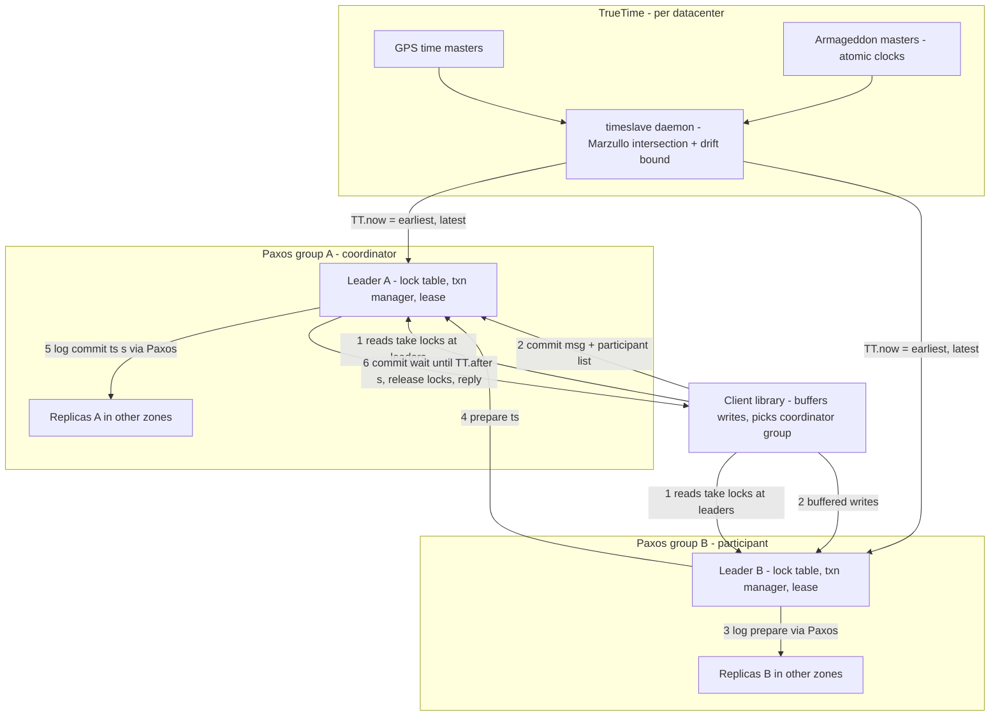

# Google Spanner: Globally-Distributed Database (2012 OSDI)

## TL;DR

Spanner gives each transaction a commit timestamp, and real time can only go forward past it.
This works because TrueTime returns an interval `[earliest, latest]` that always contains true time, not a single point.
The commit-wait rule (hold locks until `TT.now().earliest > s`) is what makes the timestamp order match real-time order, which is external consistency.
Data is split into shards, and each shard is a Paxos group with a long-lived, lease-holding leader that runs a two-phase-locking (2PL) lock table.
A transaction that spans shards runs two-phase commit (2PC) across Paxos groups, so the 2PC "participants" are replicated state machines that stay available.
The price is visible in three places.
First, locks are held through commit wait, so the write rate on a single hot row is capped.
Second, if the clock uncertainty (epsilon) grows, Spanner gets slower but never becomes incorrect.
Third, transactions that are prepared but not yet committed block snapshot reads on the replicas of their shards.

## Mental Model



Think of Spanner as many small Paxos-replicated databases, one per shard.
A leader in each group serializes conflicting writes with ordinary pessimistic locks.
What turns this collection into one externally consistent database is a single global ordering signal: a commit timestamp drawn from a clock whose error is bounded and published.
The leader does not trust its clock to be correct.
It trusts the clock's stated error bound, and it waits out that bound before anyone can see the write.
That waiting, not any message exchange, is why transaction T2, which starts after T1 is acknowledged, always gets a larger timestamp, even when the two run on different continents with no shared message path.

## Internals

### Deployment hierarchy and the data plane

A Spanner deployment is a *universe* made of *zones*.
A zone is both the unit of administrative deployment and the unit of physical isolation, and a datacenter can hold more than one zone (Corbett et al., OSDI 2012).
Each zone has one *zonemaster*, which assigns data to servers.
It has many *spanservers*, which serve data to clients, and *location proxies*, which clients use to find the spanserver for their data.
Above the zones, a *universe master* gives a debugging and status console.
A *placement driver* moves data between zones on a timescale of minutes, driven by replication constraints and load.
Each spanserver serves between 100 and 1000 *tablets*.
A tablet is a bag of mappings `(key:string, timestamp:int64) -> string`.
Spanner is therefore a multi-version store at the storage layer, not a single-version store with multi-version concurrency control (MVCC) added on top.
Tablet state lives in B-tree-like files plus a write-ahead log on Colossus, the successor to the Google File System (see [[17-Cloud-AI-Engineering/Volume_13_Seminal_Papers_and_Case_Studies/Chapter_09_GFS_and_Colossus|GFS and Colossus]]).
So Paxos replicates the log at the database layer, and Colossus separately protects durability at the file layer.

### Paxos groups, leader leases, and the lease-disjointness invariant

Every tablet has its own Paxos state machine, and the replicas of a tablet together form a *Paxos group*.
Writes must start Paxos at the leader.
Reads can be served directly from any replica that is "sufficiently up to date", a term defined precisely below under safe time.
Leaders are long-lived and hold time-based leases, 10 seconds by default.
A replica grants a lease vote and promises not to vote for another leader until the lease expires.
A leader extends its lease by sending lease votes along with successful writes.
The mechanism a getting-started guide never shows is the *disjointness invariant*: for each Paxos group, the lease intervals of any two leaders do not overlap in absolute time.
Spanner uses TrueTime to enforce it.
Let `s_max` be the largest timestamp a leader has ever assigned.
Before giving up leadership, the leader must wait until `TT.after(s_max)` is true.
That rule is what lets timestamps stay monotonic within a group across leader changes without any extra coordination.
Read [[08-Distinguished-Engineering/02-Distributed-Systems-Internals/Raft-Consensus|Raft Consensus]] next to this section.
Raft's leader-lease read optimization makes the same bet on bounded clock drift, but implicitly, while Spanner makes the bound explicit and measurable.

On top of Paxos, each leader runs two more components.
The *lock table* implements two-phase locking with *wound-wait* deadlock avoidance: an older transaction wounds (aborts) a younger lock holder, while a younger one waits for an older holder.
The *transaction manager* handles distributed transactions; the leader whose group takes part in a transaction is the *participant leader*.
Locks live only at the leader and are never replicated through Paxos.
Losing the leader therefore loses the locks, and in-flight read-write transactions on that group abort.
That is cheaper than replicating lock state, and safe, because nothing reaches durable storage without a Paxos-logged commit.

### Directories, splits, and placement

The paper's unit of placement is the *directory*: a set of contiguous keys that share a common prefix.
All data in a directory has the same replication configuration.
Data moves between Paxos groups one directory at a time, in the background, using a mechanism the paper calls *Movedir*.
In Cloud Spanner this surfaces as *splits*, plus *interleaved tables*, which store child rows physically next to their parent row.
Interleaving is not a cosmetic schema feature.
It is how you keep a parent and its children inside one split.
A transaction touching both then stays a single-group transaction and skips 2PC entirely.
The production quotas page also documents a pre-splitting API, which lets you create split points ahead of a known load spike instead of waiting for load-based splitting (Google Cloud docs, as of 2026-10).

### TrueTime: implementation and how the error bound is built

The API is three calls.
`TT.now()` returns an interval `[earliest, latest]`.
`TT.after(t)` is true if `t` has definitely passed.
`TT.before(t)` is true if `t` has definitely not arrived.
Epsilon is half the width of the interval.
The guarantee is that true time at the moment `TT.now()` is called lies inside the returned interval.
Google's later product documentation restates the property operationally.
If one `TT.now()` call finishes before another begins, even on a different machine, the second call's `latest` is later than the first call's `earliest` (Google Cloud Spanner Omni docs, as of 2026-10).

Each datacenter runs several *time masters*.
Most have GPS receivers with dedicated antennas.
The rest, called *Armageddon masters*, have atomic clocks.
The two kinds are deliberately chosen because they fail in unrelated ways.
GPS fails through antenna and receiver faults, local radio interference, and spoofing.
Atomic clocks fail through slow frequency drift.
Masters compare their time against each other, and a master whose local clock disagrees too much evicts itself.
On every machine, a *timeslave daemon* polls several masters, some in its own datacenter and some farther away, so one bad master cannot capture it.
It then applies a variant of Marzullo's interval-intersection algorithm to detect and reject masters that are lying.
Between polls, the daemon widens epsilon by a conservatively applied worst-case local drift of 200 microseconds per second.
With a 30-second poll interval, that alone adds up to 6 ms between polls.
On top of that comes the communication delay to the time masters.
In the 2012 paper, the resulting epsilon followed a sawtooth between roughly 1 and 7 ms and averaged about 4 ms (Corbett et al., OSDI 2012).
The paper also notes that overloaded machines and network links can cause local epsilon spikes.
That matters operationally: TrueTime uncertainty is a local, per-machine quantity, so one sick host can degrade one Paxos leader without affecting the rest of the fleet.

### The four operation types and their timestamps

Spanner supports four kinds of operation:
- Read-write transactions use pessimistic locking and get a commit timestamp from the leader.
- Read-only transactions are declared up front, take no locks, and read at a timestamp the system chooses.
- Snapshot reads at a timestamp the client chooses take no locks.
- Snapshot reads with a staleness bound let the system choose a timestamp within that bound.

Read-only transactions and snapshot reads can run on any replica that has caught up to the read timestamp.
That is why stale reads in a multi-region configuration can be served entirely within one region.

### Start rule, commit-wait rule, and the proof

For a read-write transaction `Ti` with commit timestamp `si`, the coordinator leader applies two rules.
*Start rule*: `si` is no less than `TT.now().latest`, computed after the commit request arrives at the coordinator.
*Commit-wait rule*: no replica, and no client, may see data committed by `Ti` until `TT.after(si)` is true.
External consistency follows in one chain.
Suppose T1's commit finishes in absolute time before T2's commit request arrives.
Then `s1 < t_abs(commit_1)` by commit wait, `t_abs(commit_1) < t_abs(arrive_2)` by the assumption, `t_abs(arrive_2) <= s2` by the start rule, and so `s1 < s2`.
That is linearizability, in the sense of Herlihy and Wing, applied to whole transactions.
Spanner calls it external consistency; it is the same property as strict serializability.

### Hidden mechanism 1: what commit wait actually costs

Assume a stable epsilon.
At assignment, `s = TT.now().latest`, which is roughly `t_abs + epsilon`.
The wait ends once `TT.now().earliest > s`, which is roughly once `t_abs' - epsilon > t_abs + epsilon`.
So the raw wait is about `2 * epsilon` measured from timestamp assignment, which matches the paper's statement that the expected wait is at least twice the mean epsilon.
In practice the wait overlaps with the Paxos write.
Google's own walk-through of the commit sequence has six steps:
1. Choose the commit timestamp as `TT.now().latest`.
2. Send the Paxos proposals and wait for a quorum.
3. Commit wait.
4. Send the Paxos commit messages.
5. Release the locks.
6. Notify the client.

Because the timestamp is fixed in step 1 and the wait happens in step 3, the wait runs in parallel with the quorum round trip (Google Cloud blog, "Strict Serializability and External Consistency in Spanner").
The Spanner Omni TrueTime documentation states the consequence directly.
TrueTime uncertainty does not add commit latency as long as it is smaller than the Paxos round-trip latency (Google Cloud docs, as of 2026-10).
Our derivation gives the slightly stricter condition that the wait is fully hidden only when the Paxos round trip is at least `2 * epsilon`.

There is a second-order effect most users miss: locks are released only after commit wait (step 5 after step 3).
The time a lock on a hot row is held is therefore roughly `client read RTT + max(Paxos quorum RTT, 2 * epsilon) + commit-message handling`.
Transactions that conflict on one key are fully serialized behind that lock.
So one key's ceiling is about `1 / lock_hold_time` transactions per second, however many nodes you buy.
If epsilon spikes from 1 ms to 20 ms on a leader, latency on that group rises a little.
Throughput on a hot key, however, drops by an order of magnitude.
This failure path shows up as a throughput collapse, not as a latency alert.

### Two-phase commit over Paxos groups

The client drives a multi-group transaction.
It buffers all writes locally, so reads inside a paper-era transaction do not see that transaction's own buffered writes.
It sends reads to the leaders of the groups involved, and those reads take read locks.
When ready to commit, the client picks one group as coordinator.
It sends the commit message to the coordinator leader, along with the coordinator's identity and the buffered writes for each participant.
Having the client send each group's writes straight to that group means the data crosses the wide-area network once instead of twice.

Each non-coordinator participant leader then does four things:
1. Acquires write locks.
2. Chooses a prepare timestamp larger than any timestamp it has already assigned.
3. Logs a prepare record through Paxos.
4. Sends its prepare timestamp to the coordinator.

The coordinator also acquires write locks, but skips the prepare phase.
It chooses a commit timestamp `s` that satisfies three conditions:
- `s` is at least every participant's prepare timestamp.
- `s` is greater than `TT.now().latest` at the moment the coordinator received the commit message.
- `s` is greater than any timestamp the coordinator has assigned before.

It logs the commit record through Paxos, or an abort if a participant did not prepare.
It then performs commit wait and sends `s` to the client and all participants.
Each participant logs the outcome through Paxos, applies the writes at `s`, and releases its locks.
Classic 2PC blocks if the coordinator dies after participants have prepared.
Here the coordinator and the participants are each a Paxos group, so a leader crash leads to re-election (bounded by the lease) rather than a stuck participant waiting for a human.
2PC's blocking window is reduced to a leader failover window; it is not removed.

### Hidden mechanism 2: safe time and why prepared transactions stall reads elsewhere

Every replica tracks a *safe time*, `t_safe = min(t_paxos_safe, t_TM_safe)`.
A replica can serve a snapshot read at timestamp `t` only if `t <= t_safe`.
`t_paxos_safe` is the timestamp of the highest Paxos write the replica has applied.
Writes arrive in timestamp order, so no write at or below that time will ever show up later.
`t_TM_safe` is infinite when the group has no prepared-but-uncommitted transactions.
Otherwise, it is the minimum over those transactions of `s_prepare - 1`.
The reason: a prepared transaction's eventual commit timestamp is unknown, except that it will be at least its prepare timestamp.

This creates a cross-transaction interaction.
Suppose a 2PC whose coordinator sits on another continent has prepared on group B.
Until that coordinator's commit arrives, every replica of group B refuses snapshot reads above that prepare timestamp.
In the basic scheme, this applies even to keys the prepared transaction never touched.
The paper describes the fix as a refinement: keep a finer-grained map from key ranges to prepare timestamps inside the lock table, so unrelated reads are not held back.
There is a mirror-image problem for an idle group.
With no writes, `t_paxos_safe` never advances, so a read at "now" would block.
The paper's fix is a `MinNextTS` promise from the leader, advanced periodically even without writes, with 8 seconds as the stated default.
In the worst case, an idle group's followers can then only serve reads at timestamps about that old.
In production, this is why a "strong read from the nearest replica" in a non-leader region needs one round trip to the leader to confirm the replica is caught up.
A bounded-staleness read can be answered purely locally.

### Read-only transactions and scope

A read-only transaction must declare its *scope*, the set of keys it will read, so Spanner can work out which Paxos groups are involved.
If the scope fits in one group with no prepared transactions, the leader can use `LastTS()`, the timestamp of the last committed write on that group.
That timestamp is sufficient, and it avoids waiting.
If the scope spans groups, Spanner uses `s_read = TT.now().latest`.
That is always correct, but it may have to wait for `t_safe` to catch up on the replicas it reads.
Schema changes use the same machinery.
A schema change gets a timestamp in the future.
Reads and writes at earlier timestamps proceed normally.
Operations at later timestamps block behind it, which avoids taking a global lock across millions of groups.

### From paper to product

The 2012 paper describes a semi-relational system serving Google's F1 advertising backend (Shute et al., VLDB 2013).
"Spanner: Becoming a SQL System" (Bacon et al., SIGMOD 2017) documents how it became a full SQL engine with distributed query execution.
Cloud Spanner exposes three replica roles:
- Read-write replicas vote in Paxos and can lead.
- Read-only replicas do not vote and serve stale or strong reads.
- Witness replicas vote, and so help form quorums, but do not serve reads.

Multi-region configurations also have a *default leader region*, where Paxos leaders are placed by preference, which fixes where write latency is paid.
Today, dual-region and multi-region configurations require the Enterprise Plus edition (Google Cloud docs, as of 2026-10).
Eric Brewer's 2017 paper "Spanner, TrueTime and the CAP Theorem" frames Spanner as technically CP (consistent and partition-tolerant, giving up availability during a partition).
He argues it is effectively CA (consistent and available) because Google's private network makes partitions rare relative to other causes of downtime (UNVERIFIED: exact incident-cause percentages).
For the GCP product view, see [[17-Cloud-AI-Engineering/Volume_03_GCP_Deep_Dive/Chapter_10_Cloud_Spanner_TrueTime_and_External_Consistency|Cloud Spanner: TrueTime and External Consistency]].
For AWS's answer to the same problem, see [[17-Cloud-AI-Engineering/Volume_02_AWS_Deep_Dive/Chapter_12_Aurora_DSQL_Multi_Region_Active_Active_SQL|Aurora DSQL]].

## Numbers to Know

| Quantity | Value | Source |
| --- | --- | --- |
| TrueTime epsilon, 2012 | Sawtooth about 1 to 7 ms, mean about 4 ms | Corbett et al., OSDI 2012 |
| timeslave poll interval | 30 s | Corbett et al., OSDI 2012 |
| Assumed worst-case local drift | 200 microseconds per second | Corbett et al., OSDI 2012 |
| Expected commit wait | At least 2 x mean epsilon, overlapped with Paxos | Corbett et al., OSDI 2012; Google Cloud blog |
| Default Paxos leader lease | 10 s | Corbett et al., OSDI 2012 |
| Tablets per spanserver | 100 to 1000 | Corbett et al., OSDI 2012 |
| Idle-group MinNextTS advance | 8 s default | Corbett et al., OSDI 2012 |
| Compute unit | 1 node = 1000 processing units (PU) | Google Cloud pricing, as of 2026-10 |
| Storage per compute | 1024 GiB per 100 PU below 1 node; 10 TiB per node at 1 node and above | Google Cloud docs, as of 2026-10 |
| Commit size limit | 100 MiB, including indexes and change streams | Google Cloud docs, as of 2026-10 |
| Mutations per commit, Mutation API | 80,000, including indexes | Google Cloud docs, as of 2026-10 |
| Mutations per DML statement | 80,000, enforced per statement since 2026-08-11 | Google Cloud release notes, as of 2026-10 |
| Mutation limit history | 20,000 to 40,000 (2022-09), to 80,000 (2023-12) | Google Cloud release notes, as of 2026-10 |
| Non-commit request size | 10 MiB | Google Cloud docs, as of 2026-10 |
| Concurrent reads per session | 100 | Google Cloud docs, as of 2026-10 |
| Pre-split points per API request | 100; 10 per minute per node; 200 per day per node | Google Cloud docs, as of 2026-10 |
| Standard edition compute | From $0.030 per 100 PU per hour per replica | Google Cloud pricing, as of 2026-10 |
| Enterprise edition compute | From $0.041 per 100 PU per hour per replica | Google Cloud pricing, as of 2026-10 |
| Enterprise Plus edition compute | From $0.057 per 100 PU per hour per replica | Google Cloud pricing, as of 2026-10 |
| Data Boost | From $0.00117 per serverless PU per hour | Google Cloud pricing, as of 2026-10 |
| Availability SLA | 99.99% Standard and Enterprise (regional); up to 99.999% Enterprise Plus (dual-region, multi-region) | Google Cloud docs, as of 2026-10 |
| Aurora DSQL | GA 2025-05-27; designed for 99.99% single-Region and 99.999% multi-Region | AWS What's New, as of 2026-10 |
| DynamoDB global tables strong consistency (MRSC) | GA 2025-06-30, RPO zero | AWS What's New, as of 2026-10 |
| Amazon Time Sync, PTP hardware clock | About 20 microseconds in-guest clock error bound | AWS talk at WSTS 2025, as of 2026-10 |
| Amazon Time Sync, NTP | About 80 microseconds in-guest clock error bound | AWS talk at WSTS 2025, as of 2026-10 |
| Aurora DSQL transaction and connection caps | 5 min max transaction; 60 min max connection | AWS re:Invent DEV308 summary, as of 2026-10 (secondary source) |

A sanity check on pricing: a regional Standard configuration has three read-write replicas, so one node costs `10 x $0.030 x 3 = $0.90` per hour, about $657 per 730-hour month.
That matches third-party summaries of regional node-hour pricing.
"Starting at" prices vary by region, so check the pricing page for your region before committing a budget.

## AWS vs GCP Mechanism Parity

| Dimension | Google Spanner | AWS (Aurora DSQL, DynamoDB MRSC) |
| --- | --- | --- |
| Time source | TrueTime: GPS plus atomic-clock masters per datacenter, timeslave with Marzullo intersection | Amazon Time Sync: GPS-disciplined reference clocks in the Nitro System, exposed as NTP and as a PTP hardware clock |
| Clock error exposure | Internal `TT.now()` interval; not a customer API on Cloud Spanner | Open-source ClockBound returns a timestamp plus error bound to any EC2 workload |
| Typical uncertainty | About 1 to 7 ms in 2012; Google says it is hidden when smaller than the Paxos RTT | About 20 microseconds (PHC) or 80 microseconds (NTP) in-guest (AWS, 2025) |
| Concurrency control | Pessimistic 2PL with wound-wait at Paxos leaders | Aurora DSQL is optimistic: conflicts are checked at commit by adjudicators |
| Ordering primitive | Commit timestamp plus commit wait gives external consistency | Hybrid of physical time and logical ordering (AWS DSQL clocks blog) |
| Replication unit | Paxos group per split; leader lease 10 s | DSQL: journal and storage replicas across AZs; multi-Region uses peered Regions plus a witness (UNVERIFIED topology details) |
| Cross-shard transactions | 2PC over Paxos groups, client-driven, coordinator skips prepare | DSQL: commit through adjudicator and journal, no client-held locks |
| Hot-key behavior | Serialized by lock hold time, including commit wait | Under OCC, conflicting commits abort and the client retries; heavy contention means abort storms |
| Reads | Strong reads anywhere (may cost a leader round trip); bounded-staleness reads served locally | DSQL reads served locally at a snapshot timestamp |
| SQL dialect | GoogleSQL and PostgreSQL interface | PostgreSQL-compatible subset |
| Availability design | Up to 99.999% (Enterprise Plus multi-region) | Up to 99.999% multi-Region (DSQL, DynamoDB global tables) |
| Pricing model | Provisioned PU per replica per hour, plus storage; serverless Data Boost for analytics | DSQL is serverless and billed per usage; DynamoDB is billed per request or provisioned capacity |
| Transaction limits | 80,000 mutations, 100 MiB per commit | DSQL: 5 min transaction cap, per-transaction row-modification cap (secondary source) |
| Maturity | Paper 2012; production at Google for over a decade | DSQL GA 2025-05; DynamoDB MRSC GA 2025-06 |

The deep difference is not the clock hardware.
Spanner uses time to place a pessimistic, lock-based system in a global order.
Aurora DSQL uses time to give optimistic transactions a consistent snapshot and commit order without client-visible locks.
So Spanner degrades under contention through waiting.
DSQL degrades through aborts that clients must retry with backoff (see [[17-Cloud-AI-Engineering/Volume_07_Reliability_and_SRE/Chapter_03_Resilient_Communication_Retries_Jitter_and_Circuit_Breakers|Retries, Jitter, and Circuit Breakers]]).
CockroachDB is the open-source data point between the two.
It uses hybrid logical clocks with a configured maximum clock offset instead of hardware-bounded TrueTime, and handles uncertainty with read restarts rather than commit wait (see [[04-System-Design/05-Data-Stores/CockroachDB-Distributed-SQL|CockroachDB]]).

## Worked Example: Measuring Commit Wait, Stale Reads, and Hot-Row Ceilings on a 100-PU Instance

### Cost estimate and budget alarm

The lab uses one regional Standard instance at 100 PU.
Compute costs `1 x $0.030 x 3 replicas = $0.09` per hour (Google Cloud pricing, as of 2026-10).
A three-hour lab costs about $0.27 in compute; storage for a few thousand rows is negligible.
Set a $10 budget with alerts anyway, because a forgotten instance costs about $66 per month.

```bash
# Prerequisites: gcloud authenticated, billing enabled, Spanner API enabled.
export PROJECT_ID="your-project-id"
export BILLING_ACCOUNT="000000-000000-000000"
export INSTANCE="spanner-lab"
export DATABASE="ledger"
export CONFIG="regional-us-central1"

gcloud config set project "$PROJECT_ID"
gcloud services enable spanner.googleapis.com billingbudgets.googleapis.com

# Budget alarm at 50%, 90%, 100% of $10, scoped to this project.
gcloud billing budgets create \
  --billing-account="$BILLING_ACCOUNT" \
  --display-name="spanner-lab-budget" \
  --budget-amount=10USD \
  --filter-projects="projects/$PROJECT_ID" \
  --threshold-rule=percent=0.5 \
  --threshold-rule=percent=0.9 \
  --threshold-rule=percent=1.0

# Smallest billable instance: 100 processing units, Standard edition, regional.
gcloud spanner instances create "$INSTANCE" \
  --config="$CONFIG" \
  --description="Spanner OSDI lab" \
  --processing-units=100 \
  --edition=STANDARD

gcloud spanner databases create "$DATABASE" \
  --instance="$INSTANCE" \
  --ddl='CREATE TABLE Accounts (AccountId STRING(36) NOT NULL, Balance INT64 NOT NULL, UpdatedAt TIMESTAMP NOT NULL OPTIONS (allow_commit_timestamp=true)) PRIMARY KEY (AccountId)'
```

### Lab script

```python
# spanner_lab.py - requires: pip install google-cloud-spanner
# Measures (1) read-write commit latency, (2) strong vs stale read latency,
# (3) hot-row contention: attempts per successful commit under concurrency.
import datetime
import os
import statistics
import threading
import time
import uuid
from concurrent.futures import ThreadPoolExecutor

from google.cloud import spanner
from google.cloud.spanner_v1 import param_types

PROJECT = os.environ["PROJECT_ID"]
INSTANCE = os.environ.get("INSTANCE", "spanner-lab")
DATABASE = os.environ.get("DATABASE", "ledger")

client = spanner.Client(project=PROJECT)
db = client.instance(INSTANCE).database(DATABASE)

# Random UUIDv4 keys spread writes across splits; sequential keys would hotspot.
accounts = [str(uuid.uuid4()) for _ in range(200)]
with db.batch() as batch:
    batch.insert(
        table="Accounts",
        columns=("AccountId", "Balance", "UpdatedAt"),
        values=[(a, 1_000_000, spanner.COMMIT_TIMESTAMP) for a in accounts],
    )
print("seed commit timestamp:", batch.committed)

attempts = 0
attempts_lock = threading.Lock()


def transfer(txn, src, dst, amount):
    # This function may run several times if Spanner returns ABORTED.
    # Never put non-idempotent side effects (emails, payments) in here.
    global attempts
    with attempts_lock:
        attempts += 1
    rows = list(txn.execute_sql(
        "SELECT AccountId, Balance FROM Accounts WHERE AccountId IN UNNEST(@ids)",
        params={"ids": [src, dst]},
        param_types={"ids": param_types.Array(param_types.STRING)},
    ))
    bal = {r[0]: r[1] for r in rows}
    txn.update(
        table="Accounts",
        columns=("AccountId", "Balance", "UpdatedAt"),
        values=[
            (src, bal[src] - amount, spanner.COMMIT_TIMESTAMP),
            (dst, bal[dst] + amount, spanner.COMMIT_TIMESTAMP),
        ],
    )


def timed_transfer(src, dst):
    t0 = time.perf_counter()
    db.run_in_transaction(transfer, src, dst, 1)
    return (time.perf_counter() - t0) * 1000.0


def pct(samples, p):
    s = sorted(samples)
    return s[min(len(s) - 1, int(p / 100.0 * len(s)))]


# 1) Uncontended read-write latency: random disjoint account pairs.
lat = [timed_transfer(accounts[2 * i], accounts[2 * i + 1]) for i in range(50)]
print(f"RW txn ms: p50={statistics.median(lat):.1f} p99={pct(lat, 99):.1f}")

# 2) Strong vs 10-second stale single-row reads.
def read_ms(snapshot_kwargs):
    out = []
    for a in accounts[:50]:
        t0 = time.perf_counter()
        with db.snapshot(**snapshot_kwargs) as snap:
            list(snap.execute_sql(
                "SELECT Balance FROM Accounts WHERE AccountId = @id",
                params={"id": a}, param_types={"id": param_types.STRING}))
        out.append((time.perf_counter() - t0) * 1000.0)
    return out

strong = read_ms({})
stale = read_ms({"exact_staleness": datetime.timedelta(seconds=10)})
print(f"strong read ms p50={statistics.median(strong):.1f}  "
      f"stale read ms p50={statistics.median(stale):.1f}")

# 3) Hot-row contention: 8 threads all debit the same source account.
attempts = 0
hot_src = accounts[0]
t0 = time.perf_counter()
with ThreadPoolExecutor(max_workers=8) as pool:
    list(pool.map(lambda i: timed_transfer(hot_src, accounts[1 + (i % 199)]), range(200)))
elapsed = time.perf_counter() - t0
print(f"hot row: {200 / elapsed:.0f} commits/s, attempts per commit = {attempts / 200:.2f}")
```

Run it with `PROJECT_ID=... python spanner_lab.py` from a VM in `us-central1`, so that the client round trip does not dominate the measurement.
What to expect, as an estimate rather than a published figure:
- The uncontended read-write p50 is a few milliseconds, because the Paxos quorum spans zones within one region and commit wait hides behind it.
- Stale and strong reads are close in a regional configuration, because every replica is nearby.
- On a multi-region instance read from a non-leader region, the stale read avoids a round trip to the leader region and the gap becomes large.
- The hot-row test reports attempts per commit above 1.0, because wound-wait aborts younger transactions.
- Its commits per second plateau at about `1 / lock_hold_time` no matter how many threads you add.

### Teardown

```bash
gcloud spanner instances delete "$INSTANCE" --quiet
BUDGET_ID=$(gcloud billing budgets list --billing-account="$BILLING_ACCOUNT" \
  --filter="displayName=spanner-lab-budget" --format="value(name)")
gcloud billing budgets delete "$BUDGET_ID" --billing-account="$BILLING_ACCOUNT" --quiet
```

### Back-of-the-envelope capacity and cost sizing

Example workload:
- A payments ledger with 30 TiB of data.
- A peak of 8,000 read-write transactions per second and 60,000 point reads per second.
- A customer requirement for zero recovery point objective (RPO) under the loss of a region.

Step 1, storage floor: 30 TiB / 10 TiB per node = 3 nodes minimum (Google Cloud docs, as of 2026-10).
Step 2, throughput: run a load test at your target CPU utilization and measure per-node capacity.
For illustration only, assume the test shows 1,000 read-write transactions per second per node and 10,000 point reads per second per node.
These are not Google-published figures.
Both kinds of work consume the same CPU, so they add: `8,000 / 1,000 + 60,000 / 10,000 = 14 nodes`.
Step 3, regional Standard cost: `14 nodes x $0.90/h x 730 h = $9,198` per month for compute.
Step 4, zero RPO across regions requires dual-region or multi-region, which means Enterprise Plus.
At $0.057 per 100 PU per replica-hour, one node costs `$0.57 x R` per hour, where R is the number of billed replicas in the chosen configuration.
With R = 5: `14 x $2.85 x 730 = $29,127` per month, about 3.2 times the regional bill, before storage and network.
Whether witness replicas count toward R is UNVERIFIED; check the configuration's pricing line.
Step 5, the hot-row ceiling.
Suppose the leader region's nearest voting replica is in another region with about 25 ms round-trip time (RTT), a physics-based estimate.
Lock hold time is then at least about 25 ms plus client round trips, so a single hot account sustains about 30 to 40 serialized debits per second.
If the merchant settlement account takes 500 debits per second, no number of nodes fixes that.
You must split that account into N sub-ledger rows, or batch the debits into fewer transactions.
Step 6, place the default leader region in the region that hosts the write-heavy application tier.
The client-to-leader round trip is spent inside the lock hold time.

## Failure Modes and Pitfalls

### Monotonic keys create a single-leader hotspot

Primary keys that increase over time put every insert into the last split, and therefore onto a single Paxos leader.
Examples are timestamps, auto-incremented IDs, and Snowflake-style IDs whose high bits are time.
Load-based splitting cannot help, because the hot spot moves with the key.
Use UUIDv4 keys, or hash-prefixed or bit-reversed keys, and accept that range scans over time then need a secondary index (which can hotspot in the same way).

### Side effects inside retried transaction functions

Client libraries retry `ABORTED` transactions automatically by re-running your function, which is exactly what the lab's attempt counter shows.
Any side effect inside that function runs once per attempt, not once per commit: an HTTP call, a message publish, an in-memory counter.
Under contention, wound-wait makes this common rather than rare.
The lab's attempts per commit above 1.0 is that duplication rate.

### Mutation API writes are invisible to reads in the same transaction

With the Mutation API, writes are buffered on the client until commit, as in the paper's design.
A read later in the same transaction returns the pre-transaction value.
DML statements behave differently, and mixing the two styles inside one transaction is a source of subtle logic bugs.

### Mutation and commit limits on bulk operations

A large `DELETE` or backfill fails once it exceeds 80,000 mutations or 100 MiB, and index entries count against the mutation limit (Google Cloud docs, as of 2026-10).
Since 2026-08-11, the DML limit is enforced per statement rather than across the whole transaction (Google Cloud release notes, as of 2026-10).
Transactions that previously failed may now succeed and hold locks much longer.
Use Partitioned DML for table-wide changes, which gives up atomicity across the whole table in exchange for not holding a giant lock set.

### Epsilon spikes become throughput collapses

TrueTime fails safe.
When the timeslave cannot reach time masters, epsilon grows by the drift bound, 200 microseconds per second in the paper.
Commit wait grows, while correctness is preserved.
The paper notes that overloaded machines and links cause local epsilon spikes.
Because locks are held through commit wait, the visible symptom is a throughput collapse on hot keys of one group, not a cluster-wide latency alert.
The same reasoning applies if you build on ClockBound on AWS.
Treat a failure to read the clock's error bound as "uncertainty is unbounded" and stop issuing timestamps.
Never fall back to the raw system clock.

### Leap seconds and time stepping

Clock-dependent systems break when time steps or repeats.
Cloudflare's DNS outage on 2017-01-01 came from code that assumed time never goes backwards, which broke when the leap second was inserted (UNVERIFIED: recalled from Cloudflare's public post-mortem, not re-checked this session).
Google and AWS time services smear leap seconds over a long window instead of stepping the clock.
If you mix smeared and non-smeared time sources in one fleet, the two can disagree by up to the full smear offset.
That breaks any assumption of an error bound below 1 second.

### Leader loss and lease-bounded unavailability

If a Paxos leader dies, its group cannot accept writes until a new leader is elected and the old lease has provably expired.
With the paper's 10-second default lease, a hard failure costs up to about 10 seconds of write unavailability for that group, plus aborts for every in-flight read-write transaction whose locks lived on that leader.
Design client deadlines and retry budgets around a group failover of several seconds, not milliseconds.

### Prepared transactions stall snapshot reads on a group

A cross-region 2PC whose coordinator is slow, or partitioned away, holds `t_TM_safe` down on every participant group.
Followers then cannot serve snapshot reads newer than the prepare timestamp, and in the unrefined scheme that includes keys the transaction never touched.
Long multi-group read-write transactions therefore hurt read latency for unrelated tenants of the same splits, a noisy-neighbor path that is invisible in per-query metrics.

### Analytics on the transactional path

Large analytical scans on provisioned compute compete for CPU with transactional traffic.
They also push the instance toward its CPU ceiling, which inflates commit latency for every client.
Route this work to Data Boost or to exports, not to the serving instance.
For the broader cascading-failure patterns these issues feed into, see [[17-Cloud-AI-Engineering/Volume_07_Reliability_and_SRE/Chapter_07_Anatomy_of_Major_Cloud_Outages|Anatomy of Major Cloud Outages]].

## Security and Cost Angles

### Identity and access

Scope application identities to database-level roles such as `roles/spanner.databaseUser` or `roles/spanner.databaseReader`, never instance-level admin roles.
Use Spanner's fine-grained access control (database roles granted to IAM principals) when one database serves several services with different table-level rights.
Run workloads with Workload Identity Federation instead of service account keys (see [[17-Cloud-AI-Engineering/Volume_08_Security_Identity_and_the_Data_Perimeter/Chapter_02_Workload_Identity_Federation|Workload Identity Federation]]).

### Encryption

Data is encrypted at rest by default.
Customer-managed encryption keys (CMEK) through Cloud KMS add a key you can revoke.
For a multi-region instance, CMEK keys must exist in the relevant regions, which means KMS key availability becomes part of the database's availability.
Treat the KMS key ring as a Tier 0 dependency in your disaster recovery plan (see [[17-Cloud-AI-Engineering/Volume_08_Security_Identity_and_the_Data_Perimeter/Chapter_04_Encryption_Key_Hierarchies_and_Envelope_Encryption|Envelope Encryption]]).

### Network perimeter

Put `spanner.googleapis.com` inside a VPC Service Controls perimeter.
Then a stolen credential cannot export data to a project outside the perimeter (see [[17-Cloud-AI-Engineering/Volume_03_GCP_Deep_Dive/Chapter_03_VPC_Service_Controls_Security_Perimeters|VPC Service Controls]]).
Reach the API through Private Google Access or Private Service Connect endpoints, so traffic from private workloads never needs a public egress path.

### The AWS equivalents

Aurora DSQL's GA launch added AWS PrivateLink, AWS KMS customer managed keys, CloudTrail, and AWS Backup integration (AWS What's New, 2025-05-27).
Scope DSQL connection rights through IAM, and keep cross-Region traffic on PrivateLink endpoints.

### Cost levers

Below 1 node, compute is billed in 100-PU steps.
Start small and scale on measured CPU, not on storage, unless storage is the binding constraint at 1024 GiB per 100 PU.
Pick the cheapest edition that meets your availability need.
Regional Standard costs $0.030 per 100 PU per replica-hour, against $0.057 for Enterprise Plus.
That gap is 1.9x per replica-hour before counting the extra replicas.
Buying multi-region "just in case" is the single largest Spanner overspend pattern.
Enterprise includes managed autoscaling, and committed use discounts apply to compute (Google Cloud pricing, as of 2026-10).
Interleave child tables to cut 2PC.
Fewer multi-group transactions means less CPU and fewer lock-hold milliseconds per business operation.
Every secondary index multiplies mutations and can turn a single-group write into a multi-group 2PC.
Audit indexes the way you would audit cross-AZ traffic.
Use row deletion policies (TTL) instead of batch deletes that consume serving CPU.
Move analytics to Data Boost at $0.00117 per serverless PU-hour, so OLAP spikes never force you to provision for peak OLTP plus OLAP.
For commitment strategy, see [[17-Cloud-AI-Engineering/Volume_09_FinOps_and_Cloud_Economics/Chapter_02_Commitment_Discounts_Savings_Plans_vs_CUDs|Savings Plans vs CUDs]].

## Interview Questions and Model Answers

### Question 1 (L5 - Senior)

Explain TrueTime and prove why commit wait gives external consistency.

#### Model Answer

TrueTime does not return a time; it returns an interval `[earliest, latest]` guaranteed to contain true absolute time.
The bound comes from GPS and atomic-clock masters, plus a per-machine drift allowance that grows between polls.
The coordinator assigns commit timestamp `s >= TT.now().latest` when the commit request arrives, so `s` is at or after the true arrival time.
It then waits until `TT.after(s)` before releasing locks or acknowledging, so by the time anyone sees the commit, true time has passed `s`.
Now take T2, which arrives after T1 was acknowledged.
T2's timestamp is at least true time when T2 arrived, which is after T1's acknowledgement, which is after `s1`.
So `s2 > s1`, and timestamp order matches real-time order: that is external consistency.
The cost is waiting about `2 * epsilon` from timestamp assignment, but that wait overlaps the Paxos quorum round trip, so it is usually hidden.
The design choice worth naming is that Spanner trusts the error bound, not the clock.
A wrong bound breaks correctness, while a wide bound only costs latency.

#### Follow-up Interviewer Question

What breaks if a machine's real drift exceeds the assumed 200 microseconds per second, and how does Spanner defend against it?

### Question 2 (L5 - Senior)

A team's Spanner insert rate plateaus at a few thousand rows per second, even though the instance has 20 nodes at 15% CPU, and the primary key is `(event_time, event_id)`.
Diagnose and fix it.

#### Model Answer

The key starts with a value that increases over time, so every insert lands in the last split, which has one Paxos leader on one server.
The other 19 nodes sit idle.
Load-based splitting cannot help, because the hot range moves forward faster than splits help.
Low aggregate CPU combined with high latency on one split is the signature.
The key visualizer would show a bright diagonal line.
The fix is to make the leading key column well distributed.
Options are a UUIDv4, a hash prefix such as `shard_id = hash(event_id) % N`, or a bit-reversed sequence.
Then add a secondary index on `event_time` only if time-range queries need it.
That index is itself monotonic and can hotspot, so prefix it with the shard id and fan out the range query N ways.
I would also check that the inserts are batched into mutation groups well under the 80,000-mutation limit, and that the client runs in the leader region.

#### Follow-up Interviewer Question

How would you choose N for the shard prefix, and what does it cost readers?

### Question 3 (L6 - Staff)

A payments team wants Spanner multi-region for a ledger where one merchant settlement account receives 500 debits per second at peak.
Will it work?

#### Model Answer

Aggregate throughput is a node-count problem; the settlement account is a lock problem, and only the second one is binding here.
Spanner takes an exclusive lock on the account row at the Paxos leader and holds it until after commit wait.
Lock hold time is therefore at least the client's read round trip, plus the quorum round trip to the nearest other voting region, plus commit handling.
With about 25 ms between voting regions, that is 30 to 40 ms or more.
So that one row serializes at about 25 to 35 transactions per second, more than an order of magnitude below 500.
Adding nodes does nothing, because the lock is per row, not per node.
I would change the data model.
First option: split the settlement account into, say, 32 sub-account rows chosen by hash of the payment id, and add them up when reading the balance.
That raises the ceiling about 32 times, at the cost of a more expensive, multi-row balance read.
Second option: send the debits through a queue into a single writer that applies them in batches of about 50 per transaction.
That gives about 1,500 debits per second at the same lock rate, at the cost of latency and of exactly-once handling.
I would also place the default leader region next to the write tier, to remove a cross-region client round trip from the lock hold time.
A regional instance would cut lock hold time by about 10 times, but that trades away zero RPO under region loss, which the business must decide on explicitly.
Finally, I would model the failure case.
During a leader failover, that account sees several seconds of aborts, so the upstream queue must absorb about 500 times the failover seconds of backlog.

#### Follow-up Interviewer Question

How does the same workload behave on Aurora DSQL, which uses optimistic concurrency, and which system would you choose?

### Question 4 (L6 - Staff)

Users in Tokyo complain that "strong reads" against your `nam-eur-asia`-style multi-region Spanner instance take over 100 ms, while stale reads take about 5 ms.
Explain the mechanism and the options.

#### Model Answer

A replica can serve a read at timestamp `t` only if `t <= t_safe`.
`t_safe` advances with Paxos writes from the leader, and is held down by any transactions that are prepared but not yet committed.
A strong read needs a timestamp at least as recent as the latest commit, so the Tokyo replica must confirm with the leader, which in this setup is in the default leader region in North America, that it has caught up.
That costs a trans-Pacific round trip, plus any wait for prepared 2PC transactions on the touched groups to resolve.
A stale read at `now - 10s` is almost always below the local `t_safe`, so it is served with zero wide-area hops.
My first move is to classify each read path by its real consistency need.
Product catalogs and user profiles shown to the user who wrote them can use bounded staleness, or the client's last commit timestamp as the read timestamp.
That gives read-your-writes without a global strong read.
For reads that truly need strong consistency, the options all move write latency or availability.
- Move the default leader region closer to Tokyo, which hurts American writers.
- Use geo-partitioning so Asian rows lead in Asia, if the data partitions by geography.
- Use a regional instance in Asia for Asian-homed data, which gives up multi-region RPO for that data.

I would quantify all of this with real round-trip times before choosing.
I would also check for long multi-group read-write transactions, because their prepared state inflates strong-read latency even for keys they never touched.

#### Follow-up Interviewer Question

How exactly would you implement "read-your-writes via the commit timestamp" in the client, and what breaks if the client's session moves between regions?

### Question 5 (L6 - Staff)

Monitoring shows a 20-times throughput drop on one Spanner database's hottest table while median latency rose only modestly.
CPU is flat.
What is your hypothesis tree?

#### Model Answer

Flat CPU with collapsing throughput points to waiting, not computing.
In Spanner, waiting comes from three places: lock waits, commit wait, and safe-time waits.
Lock waits first.
A new code path may hold transactions open longer, for example by making a remote call inside the transaction or by expanding the read set.
Under wound-wait, that raises the abort-and-retry rate, which client-side attempts per commit would reveal.
Commit wait second.
If epsilon on the affected leaders grew, perhaps because of host overload or problems reaching the time masters, lock hold time grows by up to `2 * epsilon`.
Hot-key throughput falls in inverse proportion, while the median over all keys barely moves, because most keys are not contended.
That matches the symptom exactly.
Safe-time waits third.
A slow cross-region 2PC could be holding `t_TM_safe` down and stalling snapshot reads.
Lock-wait and transaction statistics separate the first hypothesis from the other two.
If lock stats are clean and the hot keys all sit in the same groups, suspect the group, and therefore the leader host, rather than the workload.
Cloud Spanner does not expose epsilon to customers, so on the managed service I would escalate with evidence: the affected split ranges and timing.
On a self-built system on ClockBound, I would alert directly on the clock error bound.
The general lesson is to alert on per-key or per-split throughput and abort rate, not only on aggregate latency percentiles.

#### Follow-up Interviewer Question

Design an SLI (service level indicator) that would have caught this before customers did, without exposing per-key cardinality explosions in your metrics backend.

### Question 6 (L7+ - Principal)

Your company is AWS-only, and leadership asks whether to build a Spanner-like database on EC2 using Amazon Time Sync and ClockBound, or adopt Aurora DSQL.
Argue it.

#### Model Answer

First, separate the time problem from the database problem.
AWS now publishes in-guest clock error bounds of about 20 microseconds with the PTP hardware clock and about 80 microseconds with NTP (AWS talk, 2025).
That is at least 10 times tighter than TrueTime's 2012 range of 1 to 7 ms.
So commit wait, at `2 * epsilon`, would be under 200 microseconds and would hide inside any cross-AZ Paxos round trip.
The time primitive is therefore no longer what is missing.
What is missing is everything Spanner built on top of it, each piece a multi-year effort:
- Paxos groups with lease-disjointness tied to the clock bound.
- A lock table with wound-wait.
- 2PC across groups with safe-time tracking, including the prepared-transaction refinement and the idle-group MinNextTS promise.
- Automatic splitting and placement.
- Online schema change at future timestamps.
- A SQL layer with restartable distributed queries.
- A validation discipline in the spirit of ShardStore's formal methods (see [[17-Cloud-AI-Engineering/Volume_13_Seminal_Papers_and_Case_Studies/Chapter_05_Amazon_S3_ShardStore_Formal_Methods|ShardStore]]).

Building it also creates new operational failure domains.
Clock-bound unavailability must stop timestamp issuance.
Leap-second smear must be consistent across the whole fleet.
Instance types without hardware-clock support must be kept out of the fleet; the June 2026 Precision Time Placement Groups launch shows that support is still instance-type-specific.
Aurora DSQL already uses Time Sync for ordering and is designed for 99.999% multi-Region availability.
It became GA in May 2025.
Its constraints are real, though: optimistic concurrency, a cap on transaction duration, a PostgreSQL-compatible subset, and young operational history.
My recommendation: adopt DSQL for new, low-contention, microservice-shaped workloads.
Keep high-contention ledgers on a single-writer design or on Aurora PostgreSQL with a careful disaster recovery tier.
Fund an in-house build only if the database is the product, or the contention profile needs pessimistic locking at a scale DSQL demonstrably cannot handle in a load test.
The costs that decide this are people-years and correctness risk, not EC2 hours.
I would frame the decision with a 12-month exit criterion and a contention benchmark run against both options.

#### Follow-up Interviewer Question

Which single correctness invariant would you formally verify first in the self-built option, and how would you test it against real clock faults?

### Question 7 (L7+ - Principal)

Is Spanner a counterexample to CAP?
Defend a precise answer to a skeptical CTO who has heard Google sell "five nines with strong consistency".

#### Model Answer

No.
During a real partition that isolates a Paxos leader from its quorum, the minority side cannot accept writes.
Strong reads that need the leader also block, so Spanner chooses consistency over availability on the minority side and is CP.
The claim, which Brewer makes in his 2017 paper, is that these partitions are rare enough that measured availability exceeds 99.999%.
Two things make them rare.
Google runs the network end to end with redundant paths, so partitions are a small share of incidents next to operator error, bugs, and user error.
And quorum placement keeps a majority reachable through any single zone or region loss.
So "effectively CA" is an empirical statement about one operator's failure distribution, not a theorem.
It does not carry over to a self-hosted clone on a network you do not control.
For the CTO I would turn this into contract terms.
The SLA applies to Enterprise Plus multi-region configurations, at up to 99.999%, while regional configurations are 99.99% (Google Cloud docs, as of 2026-10).
Our application's availability is that SLA multiplied by our own dependencies: KMS, IAM, the network to Google, and our serving tier.
That product usually lands well below five nines unless each of those dependencies is also designed to stay statically stable.
Then I would ask what we gain.
The real value is zero RPO and no failover runbook for region loss, which removes a whole class of human-error incidents.
That is often worth more than the theoretical availability number.

#### Follow-up Interviewer Question

Model the availability of a five-replica configuration with four voting read-write replicas across two regions plus one witness in a third, under independent region failure at 99.95%.
Where does the model break?

### Question 8 (L7+ - Principal)

You run a multi-tenant SaaS on one large Spanner instance.
One tenant's nightly job issues long read-write transactions that span many splits, and other tenants see intermittent read-latency spikes.
Explain the coupling and design the fix at platform level.

#### Model Answer

The coupling runs through two shared resources: leader locks and safe time.
Each multi-split transaction prepares on many Paxos groups.
While it is prepared, `t_TM_safe` on those groups is held at its prepare timestamp.
Follower replicas then cannot serve snapshot reads newer than that, and in the unrefined scheme that applies even to other tenants' keys in the same splits.
The transaction's write locks also add wound-wait aborts for any tenant touching neighboring rows.
CPU-based isolation does not help, because the cost is waiting, not CPU.
Platform-level fixes, in order of leverage:
1. Make tenant data colocated and separable.
Use the tenant id as the leading key column, with interleaved child tables, so a tenant's transactions stay single-group where possible and its splits are mostly its own.
2. Ban long multi-split read-write transactions in the platform API.
Batch jobs must use Partitioned DML, or chunked transactions with idempotent per-chunk commits, under a size budget well below the 80,000-mutation limit.
3. Move bulk reads to Data Boost, so tenant analytics never touch serving replicas.
4. For the top tenants by write volume, use cell-style isolation: separate databases or instances, chosen by a placement service (see [[17-Cloud-AI-Engineering/Volume_01_Cloud_Architecture_Principles/Chapter_03_Cell_Based_Architecture_and_Shuffle_Sharding|Cell-Based Architecture]]).
5. Measure the problem with per-tenant transaction duration and split-fanout SLIs, with admission control that slows batch jobs when lock-wait statistics climb.

The trade-off is cost and operational surface: more databases mean more fixed PU minimums and more schema rollout targets.
I would put the cell boundary at the point where per-tenant revenue justifies a dedicated 100-PU floor.

#### Follow-up Interviewer Question

How would you migrate a large tenant out to its own instance with zero downtime and no lost or duplicated writes, using Spanner's timestamps?

## Further Reading

- [Spanner: Google's Globally-Distributed Database, OSDI 2012](https://www.usenix.org/system/files/conference/osdi12/osdi12-final-16.pdf) - The primary source for TrueTime, commit wait, safe time, leader-lease disjointness, and 2PC over Paxos; read Sections 3 and 4 twice.
- [Spanner, ACM TOCS 2013 version (course mirror)](https://www.cs.cornell.edu/courses/cs5414/2017fa/papers/Spanner.pdf) - The journal version with minor corrections and additions, useful for checking details against the OSDI text.
- [Strict Serializability and External Consistency in Spanner (Google Cloud blog)](https://cloud.google.com/blog/products/databases/strict-serializability-and-external-consistency-in-spanner) - Google's step-by-step commit sequence, showing that commit wait overlaps the Paxos quorum.
- [TrueTime and external consistency (Spanner Omni docs)](https://docs.cloud.google.com/spanner-omni/true-time-external-consistency) - The current statement of the TrueTime guarantee and of when uncertainty adds latency.
- [Spanner, TrueTime and the CAP Theorem (Brewer, 2017)](https://research.google/pubs/spanner-truetime-and-the-cap-theorem/) - The authoritative argument for why Spanner is CP but effectively CA, grounded in incident data.
- [Spanner: Becoming a SQL System (SIGMOD 2017)](https://research.google/pubs/spanner-becoming-a-sql-system/) - How the 2012 key-value-with-transactions system became a distributed SQL engine.
- [F1: A Distributed SQL Database That Scales (VLDB 2013)](http://www.vldb.org/pvldb/vol6/p1068-shute.pdf) - The first production customer, and why hierarchical schemas and interleaving exist.
- [Paxos Made Simple (Lamport)](https://lamport.azurewebsites.net/pubs/paxos-simple.pdf) - The consensus core under every Spanner group.
- [Linearizability (Herlihy and Wing, TOPLAS 1990)](https://doi.org/10.1145/78969.78972) - The formal definition that external consistency extends to transactions.
- [Spanner quotas and limits](https://docs.cloud.google.com/spanner/quotas) - Current mutation, commit-size, storage-per-node, and pre-split limits; check before every design review.
- [Spanner editions overview](https://docs.cloud.google.com/spanner/docs/editions-overview) - Which configurations and SLAs require which edition.
- [Spanner instance configurations](https://docs.cloud.google.com/spanner/docs/instance-configurations) - Replica roles, leader regions, and dual-region versus multi-region topologies.
- [Aurora DSQL Part 5: how the service uses clocks (AWS Database Blog)](https://aws.amazon.com/blogs/database/everything-you-dont-need-to-know-about-amazon-aurora-dsql-part-5-how-the-service-uses-clocks/) - AWS's design that uses physical time with optimistic concurrency, the closest AWS counterpart to TrueTime.
- [Amazon Time Sync microsecond-accurate time launch](https://aws.amazon.com/about-aws/whats-new/2023/11/amazon-time-sync-service-microsecond-accurate-time/) - Where AWS's hardware reference clocks started.
- [ClockBound and microsecond time on AWS (WSTS 2025 slides)](https://wsts.atis.org/wp-content/uploads/2025/04/WSTS25_DemocratizingandScalingAccurateTimeforDistributedApplications_LevinsonRidoux_Final.pdf) - Published in-guest error bounds and the ClockBound interval API, which works like `TT.now()` on EC2.
- [DynamoDB global tables multi-Region strong consistency GA](https://aws.amazon.com/about-aws/whats-new/2025/06/amazon-dynamo-db-global-tables-multi-region-strong-consistency-generally-available/) - The key-value counterpart for RPO-zero multi-Region designs.
- [Living Without Atomic Clocks (Cockroach Labs)](https://www.cockroachlabs.com/blog/living-without-atomic-clocks/) - How a Spanner-inspired system copes without hardware-bounded uncertainty, and what that costs.
- Related chapters: [[17-Cloud-AI-Engineering/Volume_03_GCP_Deep_Dive/Chapter_10_Cloud_Spanner_TrueTime_and_External_Consistency|Cloud Spanner deep dive]], [[17-Cloud-AI-Engineering/Volume_04_AWS_vs_GCP_Translation/Chapter_04_Storage_and_Database_Translation|Storage and Database Translation]], [[17-Cloud-AI-Engineering/Volume_14_Staff_Plus_Interview_Arena/Chapter_05_Design_Multi_Region_Active_Active_API|Multi-Region Active-Active API]], and next, [[17-Cloud-AI-Engineering/Volume_13_Seminal_Papers_and_Case_Studies/Chapter_07_Google_Borg_and_Omega|Google Borg and Omega]].
