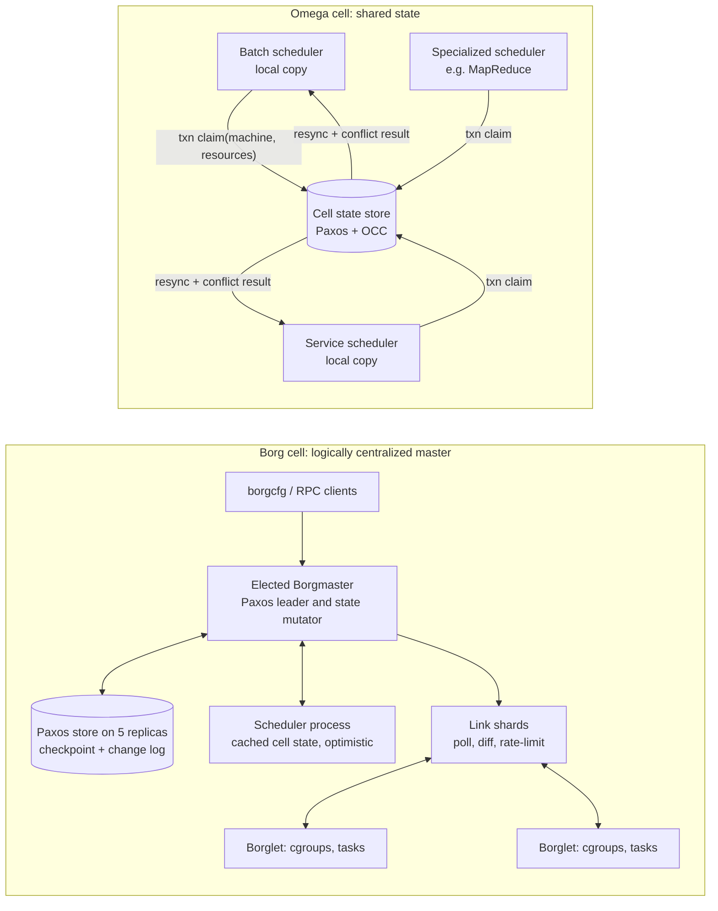

# Google Borg (2015 EuroSys) and Omega (2013 EuroSys)

## TL;DR

Borg runs a cell of about 10k machines from one logical Borgmaster, which is replicated five ways over Paxos. The Borglets keep running their tasks when the master is down, so a control-plane outage stops changes but does not stop serving.
Borg gets high utilization from three mechanisms working together: priority bands with preemption, quota tied to a priority level, and reclaiming resources that are reserved but unused. Splitting prod and non-prod onto separate machines would cost about 20-30% more machines in the median cell.
Omega replaces the single scheduler with several schedulers that share full cell state and commit lock-free optimistic transactions. Two choices decide whether that works or livelocks: how finely conflicts are detected, and whether a transaction commits incrementally or as a whole gang.
Kubernetes took Omega's shared-state, optimistic-concurrency API and Borg's allocs (now pods), labels, and IP-per-pod. But Kubernetes pod binding does not check resources, so the final resource-conflict check happens in kubelet admission, on the data plane.
Big-gang AI jobs break naive optimistic scheduling, because the chance of a gang committing with no conflict falls exponentially with gang size. Capacity has to be reserved or admitted first (quota-based admission such as Kueue, or capacity reservations) and placed second.

## Mental Model



Both designs separate two things: where the truth lives, and where decisions are made.
In Borg, the truth is the Borgmaster's Paxos-replicated state. The scheduler is a separate process that decides against a slightly stale cached copy and sends assignments back, and the master can reject them.
In Omega, the same pattern becomes the whole architecture. The store is passive and only enforces optimistic concurrency, and every scheduler is a peer that reads all of the state, decides, and races to commit.
The data plane (Borglets and their cgroup containers) is deliberately ignorant of who decided. It keeps running whatever it was last told to run, which is what makes the control plane safe to lose for minutes.
Kubernetes sits between the two. The API server is a store with semantic validation. The schedulers are peers in the Omega style. The kubelet is the Borglet that enforces the final fit.

## Internals

### Lineage and why the papers matter together

The ACM Queue retrospective lists the lineage (Burns et al., ACM Queue 2016).
Borg merged two earlier systems, Babysitter for long-running services and the Global Work Queue for batch. Sharing machines between the two only became safe once Linux cgroups existed, and Google upstreamed much of that container code.
Omega was a clean-slate redesign. All of its state lives in a Paxos-based store, and many peer components access that store directly.
Kubernetes was built from the lessons of both, and it is the substrate that GKE and EKS sell today.
Read the Borg paper (Verma et al., EuroSys 2015) for the workload model, the isolation design, and the utilization data. Read the Omega paper (Schwarzkopf et al., EuroSys 2013) for the taxonomy of scheduler architectures and the cost of optimistic concurrency.

### Workload model: jobs, tasks, allocs, priority, quota

A Borg job is a named set of identical tasks. It carries hard or soft constraints such as processor architecture, OS version, or an external IP.
An alloc is a reserved set of resources on one machine that one or more tasks can share. An alloc set is the job-level version.
Allocs became Kubernetes pods. The Borg paper lists Borglet -> kubelet, alloc -> pod, and Borg containers -> Docker-style containers.
Every job has a priority, and Borg groups priorities into non-overlapping bands: monitoring, production, batch, and best effort (also called testing or free) (Borg paper 2015).
Higher priority can preempt lower priority, with one deliberate exception. Within the production band, Borg does not allow preemption, which prevents preemption cascades where task A evicts B, B evicts C, and so on down the chain.
Quota is admission control, not scheduling. It is a vector of resources (CPU, RAM, disk) at a given priority for a period of time, usually months.
Production quota is limited to what the cell can actually deliver. Quota at lower priorities is oversold, and every user effectively has unlimited quota at priority zero. That quota is often hard to use because the cell is oversubscribed.
The consequence is that Borg's admission check ("is this job within quota at this priority?") is separate from placement ("is there a machine?"). A job can pass admission and still sit pending.
Borg Name Service writes each task's hostname and port into Chubby. Kubernetes later replaced the shared machine IP plus allocated port with one IP per pod (Burns et al. 2016).

### Control plane: Borgmaster, Paxos, checkpoints, Fauxmaster

The Borgmaster is one logical process replicated five times. Each replica keeps most of the cell state in memory and also writes it to a Paxos-based store on the replicas' local disks.
One elected master is the Paxos leader and the only state mutator. In the paper, failover typically takes about 10 seconds and can take up to a minute in a large cell while in-memory state is rebuilt (Borg paper 2015).
Checkpoints are a periodic snapshot plus a change log.
Fauxmaster is the same Borgmaster code fed from a checkpoint with stub Borglets. Google used it to debug, to plan capacity ("how many new jobs of this type fit?"), and to sanity-check config changes before production.
Communication with machines is pull-based and flow-controlled. The master polls each Borglet every few seconds.
Link shards, stateless pieces of the Borgmaster replicas, each handle a subset of Borglets. They collapse full-state reports into diffs before they reach the elected master.
If a Borglet misses several polls, the master marks the machine down and reschedules its tasks. If the Borglet comes back, the master tells it to kill duplicate tasks.
The direction of polling is the important design choice. The master controls its own inbound load, so a recovering fleet cannot stampede it. This is the constant-work idea from [[17-Cloud-AI-Engineering/Volume_01_Cloud_Architecture_Principles/Chapter_05_Constant_Work_and_Workload_Smoothing|Constant Work and Workload Smoothing]].
Borglets keep running tasks during a master outage, so the data plane is statically stable in the sense of [[17-Cloud-AI-Engineering/Volume_01_Cloud_Architecture_Principles/Chapter_02_Regions_Zones_and_Static_Stability|Regions, Zones, and Static Stability]].

### Scheduling: feasibility, scoring, preemption, and the scalability tricks

New tasks go into a pending queue. The scheduler scans the queue from high to low priority and round-robins across users within a priority. That keeps one huge job from blocking everyone behind it.
Placement has two phases.
Feasibility checking finds machines that meet the constraints and have enough resources, counting resources held by lower-priority tasks that could be evicted.
Scoring then ranks the feasible machines. It considers four things:
- the number and priority of tasks that would have to be preempted;
- whether the machine already has the task's packages;
- spreading across failure and power domains;
- mixing high and low priority on one machine, so that high-priority tasks can grow during a load spike.
Borg moved from E-PVM, which spreads load and fragments the cell, past pure best fit, which packs tightly and hurts bursty tasks. It settled on a hybrid that minimizes stranded resources, meaning resources that cannot be used because another dimension on the same machine is exhausted.
If the chosen machine lacks room, Borg preempts tasks from lowest to highest priority until the new task fits. The preempted tasks go back on the pending queue.
Three tricks make this tractable at cell scale (Borg paper 2015):
- Score caching: feasibility results and scores are reused until the machine or task changes, ignoring small changes in resource levels.
- Equivalence classes: tasks in a job usually have identical requirements, so the scheduler scores only one task per class.
- Relaxed randomization: the scheduler examines machines in random order until it has enough feasible candidates, then picks the best among them, instead of scoring the whole cell.
The paper reports that, with these tricks, scheduling an entire cell from scratch took a few hundred seconds. With them disabled it had not finished after more than three days. A normal online pass over the pending queue finishes in under half a second.
Borg's scheduler is already optimistic. It works on a cached copy of cell state, sends assignments to the master, and the master rejects any based on stale state. The paper itself compares this to Omega.

### Omega: the taxonomy and shared-state optimistic concurrency

Omega classifies cluster schedulers into three architectures.
- Monolithic: one scheduler, possibly with several code paths. Policy changes are hard to ship, and a slow decision blocks every job behind it.
- Two-level, as in Mesos: a central allocator offers subsets of resources to framework schedulers. Each framework sees only its offer, and offers effectively lock resources (pessimistic concurrency).
- Shared-state: each scheduler gets the whole cell state and claims resources through optimistic transactions.
In Omega, each scheduler keeps a private, frequently refreshed copy of cell state. It decides against that copy and then commits an atomic transaction to the shared master copy. When two transactions conflict, at most one succeeds.
Two knobs determine how much conflict hurts:
- Conflict detection granularity. Coarse-grained detection rejects the claim if anything on the machine changed since the snapshot, using a per-machine sequence number. Fine-grained detection rejects only if the specific resources requested are no longer available.
- Commit semantics. An incremental transaction commits every non-conflicting task and retries the rest. An all-or-nothing transaction implements gang scheduling and retries everything if any part conflicts.
In the paper's simulations, fine-grained detection with incremental commits keeps interference manageable even with a slow service scheduler. Coarse detection and gang semantics multiply the conflict rate.
Omega modeled decision time as t_decision = t_job + t_task x tasks_per_job. Its lightweight simulator used baseline values of about 0.1 s per job and 5 ms per task.
Omega used two simulators:
- A lightweight simulator driven by synthetic distributions fitted to Google workloads.
- A high-fidelity simulator that replays production traces using Google's real scheduling logic.
The service-versus-batch split is the core motivation. Most jobs are short batch jobs, but most resources go to long-running service jobs.
A slow, careful service scheduler therefore must not block the fast batch path. Shared state removes that head-of-line blocking because each scheduler has its own queue.
The trade-off is that common policy has to be enforced by convention rather than code. Schedulers must agree on a common priority scale for preemption and on rules for how fair-share resources are divided, because no central arbiter enforces them.
Omega put the semantics in client libraries. The ACM Queue retrospective says the Omega store only held passive state and enforced optimistic concurrency, so all logic lived in the clients. Kubernetes moved semantic validation back into a central API server and kept the peer controllers.

### Isolation: what the cgroup boundary actually enforces

Borg tasks run in cgroup-based containers. For external code such as App Engine and Google Compute Engine, Borg adds VMs and security sandboxing; the paper describes GCE VMs as running as Borg tasks.
Borg classifies resources as compressible or non-compressible.
- CPU and disk I/O bandwidth are compressible. Under contention the Borglet throttles them, favoring latency-sensitive (LS) tasks over batch.
- Memory and disk space are non-compressible. When a machine runs out, the Borglet kills tasks from lowest to highest priority.
Borg extended the kernel's CFS scheduler in three ways:
- per-cgroup load history;
- letting LS tasks preempt batch tasks;
- shortening the scheduling quantum when several LS tasks are runnable on the same CPU.
Some LS tasks reserve whole physical cores.
Kubernetes inherited this split. CPU limits are enforced by CFS throttling, and memory limits are enforced by the OOM killer. QoS classes (Guaranteed, Burstable, BestEffort) decide eviction order when a node is under pressure.
For accelerators, the key fact is that GPU HBM is non-compressible and is not managed by cgroups at all. Two tenants sharing a GPU without MIG or another hardware partition have no Borg-style memory isolation. This is why GPU fleets mostly allocate whole devices.
Performance interference that cgroups cannot see is a separate problem: last-level cache, memory bandwidth, and hyperthread siblings. Google addressed it with CPI2 (Zhang et al., EuroSys 2013), which detects victims through cycles-per-instruction outliers and throttles the antagonist.
Heracles (Lo et al., ISCA 2015) is a feedback controller that co-locates batch work with latency-critical services while protecting their SLOs.
For the hypervisor and sandbox layer beneath all of this, see [[17-Cloud-AI-Engineering/Volume_00_Foundations_Under_the_Cloud/Chapter_01_Hypervisors_MicroVMs_and_Sandboxing|Hypervisors, MicroVMs, and Sandboxing]].

### Utilization: reservation decay and cell compaction

Each task has a limit, which is what it asked for, and a reservation, which is Borg's estimate of what it will use.
The Borgmaster recomputes reservations every few seconds from fine-grained usage measured by the Borglet. A new task starts with reservation equal to its limit. After about 300 s, the reservation decays toward actual usage plus a safety margin.
Prod tasks are scheduled against limits, so they are never starved by reclaimed capacity. Non-prod tasks are scheduled against reservations, which lets them run in the gap between limits and actual usage.
In the median cell, about 20% of the workload runs in reclaimed resources (Borg paper 2015).
When Borg tested more aggressive reclamation settings, out-of-memory events increased. That is the direct price of overcommitting a non-compressible resource.
Borg measured utilization policies with cell compaction: remove machines until the workload no longer fits.
By that measure, segregating prod and non-prod into separate pools would need 20-30% more machines in the median cell. Splitting cells into smaller ones also costs machines. Rounding requests up to coarse buckets would need 30-50% more resources in the median case.
The 2019 trace follow-up (Tirmazi et al., EuroSys 2020) covers 8 Borg cells for May 2019 and compares them with the single-cell 2011 trace (CMU PDF of the paper, as of 2026-10).
It reports that alloc sets are used for resource-heavy workloads and that automatic vertical scaling is widely deployed. The vertical scaler is described in Autopilot (Rzadca et al., EuroSys 2020).

### The mechanism the getting-started guides skip: where conflict detection actually lives in Kubernetes

kube-scheduler is a Borg-style scheduler running inside an Omega-style system.
It keeps an informer-fed cache of nodes and pods. When it picks a node, it immediately "assumes" the pod into its local cache, so the next decision sees the pod's resources as used, and then sends the Binding asynchronously.
The API server's Binding subresource only checks that the pod is not already bound. It does not check whether the node has room, because the store has no resource-level view.
So when two schedulers share a node pool (different `schedulerName` values, a custom batch scheduler next to the default one, or a misconfigured second replica without leader election), the store does no fine-grained conflict detection at commit.
The conflict check moves to the data plane. The kubelet runs admission against its own view of allocated resources and rejects a pod that does not fit; the pod ends in phase Failed with reasons like `OutOfcpu` or `OutOfmemory`.
In Omega terms, Kubernetes has commit-time detection only for "already bound" and delegates resource conflicts to the Borglet-equivalent, after the commit.
The operational consequence is that running two schedulers over the same nodes produces bursts of Failed pods. A controller then recreates those pods, and the system thrashes under contention.
The safe patterns are to give each scheduler a disjoint node set using taints and node selectors, or to run one scheduler with several profiles.
A second inherited mechanism is the `percentageOfNodesToScore` setting. It is Borg's relaxed randomization: the scheduler stops filtering once it has found enough feasible nodes.
The adaptive default starts at 50%, decreases as the cluster grows, and has a floor of 5% (Kubernetes scheduler performance-tuning docs, UNVERIFIED as of 2026-10).
A third mechanism is that Kubernetes priority has no production-band rule. Any higher PriorityClass value can preempt any lower one, so the cascade protection Borg had is gone unless you add it. Two ways to add it:
- give production-tier classes `preemptionPolicy: Never`;
- use ResourceQuota with a `PriorityClass` scope selector, which recreates Borg's quota-at-priority by capping how much of each band a namespace may request.

### Consensus and store placement on today's managed control planes

Borg's Paxos store held a whole cell of about 10k machines, and the managed Kubernetes providers have hit the same limit at higher node counts.
For its 100,000-node ultra-scale clusters, Amazon EKS re-engineered the etcd layer. AWS describes offloading consensus and using an in-memory store, and says well-assigned static partitions were enough at that scale (AWS Containers blog, 2025-07).
On the GKE side, Google's 130,000-node experimental cluster offloaded cluster state to Spanner, which shards API objects horizontally (InfoQ, 2025-12; Google Cloud blog, 2025-11).
These are the Omega and Borg paths again: keep the API semantics, and replace the single consensus log underneath with something that partitions.
For the consensus background, see [[08-Distinguished-Engineering/02-Distributed-Systems-Internals/Raft-Consensus|Raft Consensus]] and [[17-Cloud-AI-Engineering/Volume_13_Seminal_Papers_and_Case_Studies/Chapter_06_Google_Spanner|Google Spanner]].

## Numbers to Know

| Quantity | Value | Source |
| --- | --- | --- |
| Borg cell size | Median about 10k machines, up to tens of thousands | Borg paper (EuroSys 2015) |
| Borgmaster replication | 5 replicas, Paxos-based store, one elected master | Borg paper (EuroSys 2015) |
| Borgmaster failover | About 10 s typical, up to about 1 min in a big cell | Borg paper (EuroSys 2015) |
| Borgmaster availability | About 99.99% in practice | Borg paper (EuroSys 2015) |
| Task arrival rate | Several cells above 10,000 tasks per minute (~167/s) | Borg paper (EuroSys 2015) |
| Busy Borgmaster footprint | 10-14 CPU cores, up to about 50 GiB RAM | Borg paper (EuroSys 2015), UNVERIFIED exact figures |
| Full-cell reschedule | A few hundred seconds with optimizations, more than 3 days without | Borg paper (EuroSys 2015) |
| Online scheduling pass | Under 0.5 s per pass over the pending queue | Borg paper (EuroSys 2015) |
| Median task startup | About 25 s, of which package installation is about 80% | Borg paper (EuroSys 2015), UNVERIFIED exact split |
| Workload in reclaimed resources | About 20% in the median cell | Borg paper (EuroSys 2015) |
| Cost of prod/non-prod segregation | 20-30% more machines in the median cell | Borg paper (EuroSys 2015) |
| Cost of coarse request bucketing | 30-50% more resources in the median case | Borg paper (EuroSys 2015), UNVERIFIED exact range |
| Reservation decay start | About 300 s after task start | Borg paper (EuroSys 2015) |
| Omega simulator baselines | t_job about 0.1 s, t_task about 5 ms | Omega paper (EuroSys 2013), UNVERIFIED exact values |
| 2019 Borg trace | 8 cells, May 2019 | Tirmazi et al. (EuroSys 2020) |
| GKE Standard nodes per cluster | 65,000 (beyond 5,000 needs extra requirements and may need Customer Care) | (Google Cloud docs, as of 2026-10) |
| GKE Autopilot nodes per cluster | 5,000 | (Google Cloud docs, as of 2026-10) |
| GKE nodes per node pool | 1,000 per zone, 2,000 TPU nodes per zone on recent versions | (Google Cloud docs, as of 2026-10) |
| GKE large-cluster mode | Clusters of more than 15,000 nodes, up to 65,000, need Dataplane V2 scale-optimized mode, which disables network policy enforcement | (Google Cloud docs, as of 2026-10) |
| GKE experimental scale | 130,000-node cluster run in experimental mode | (Google Cloud blog, 2025-11) |
| EKS nodes per cluster | Up to 100,000 with ultra-scale clusters | (AWS What's New, 2025-07) |
| EKS scheduler throughput at 100k nodes | About 500 pods/s with tuned scheduler plugins | (AWS Containers blog, 2025-07) |
| Upstream Kubernetes tested limits | 5,000 nodes, 110 pods per node, 150,000 pods | (Kubernetes docs, UNVERIFIED as of 2026-10) |
| PriorityClass user range | Up to 1,000,000,000; system classes at 2,000,000,000 and 2,000,001,000 | (Kubernetes docs, UNVERIFIED as of 2026-10) |
| Spot reclaim notice | EC2 Spot 2 min; Compute Engine Spot VMs about 30 s | (AWS and Google Cloud docs, UNVERIFIED as of 2026-10) |
| Managed control plane fee | EKS standard support and GKE cluster fee, both about USD 0.10 per cluster-hour | (AWS and Google Cloud pricing, UNVERIFIED as of 2026-10) |

## AWS vs GCP Mechanism Parity

| Mechanism | Borg / Omega (Google internal) | AWS | Google Cloud | Critical difference |
| --- | --- | --- | --- | --- |
| Unit of failure and scheduling | Cell, about 10k machines, one Borgmaster | EKS cluster (regional control plane), up to 100k nodes in ultra-scale mode | GKE cluster (zonal or regional), up to 65k nodes | Customers pick their own cell size, and a huge cluster is a huge blast radius, see [[17-Cloud-AI-Engineering/Volume_01_Cloud_Architecture_Principles/Chapter_03_Cell_Based_Architecture_and_Shuffle_Sharding\|Cell-Based Architecture]] |
| Control-plane store | Paxos store inside Borgmaster; Omega: passive Paxos store with OCC | etcd (Raft); ultra-scale clusters offload consensus and run in memory (AWS blog 2025-07) | etcd; experimental 130k cluster used Spanner-backed state (InfoQ 2025-12) | Both clouds hit the single-Raft-log limit and moved to partitioned stores |
| Optimistic concurrency | Omega transactions, fine or coarse detection | Kubernetes resourceVersion compare-and-swap; ECS scheduler described as shared-state OCC (Vogels 2015, UNVERIFIED) | Kubernetes resourceVersion compare-and-swap | Kubernetes Binding has no resource-level conflict check, so kubelet admission does it |
| Placement scheduler | Borg scheduler with feasibility, scoring, relaxed randomization | kube-scheduler; Karpenter provisions nodes | kube-scheduler; Cluster Autoscaler and node auto-provisioning; Autopilot | Node provisioning is a second control loop Borg never had, because Borg machines were fixed |
| Priority and preemption | Bands; no preemption inside the production band | PriorityClass; EC2 Spot as cloud-level reclaimable tier | PriorityClass; Spot VMs as reclaimable tier | Kubernetes has no band rule, so you must add cascade protection yourself |
| Quota at priority | Quota vector per priority, oversold at low priority | ResourceQuota with PriorityClass scope; Kueue; SageMaker HyperPod task governance (UNVERIFIED) | ResourceQuota with PriorityClass scope; Kueue; Dynamic Workload Scheduler (UNVERIFIED GA scope) | Kueue admits whole workloads before pods exist, which removes gang conflicts |
| Gang scheduling | Omega all-or-nothing transactions | Kueue, Volcano, or Slurm on HyperPod | Kueue, JobSet, TPU slices placed as a unit | Gang placement needs reservation first, otherwise it livelocks under contention |
| Resource reclamation | Reservation decays toward usage plus a margin; non-prod uses the gap | Requests vs limits, QoS eviction, Karpenter consolidation | Requests vs limits, QoS eviction, Autopilot right-sizing, VPA | Kubernetes requests do not decay; reclamation needs VPA or Autopilot-style tooling |
| Isolation boundary | cgroups for first-party code; VMs and sandboxes for third-party | Nitro VMs; Firecracker microVMs for Fargate and Lambda | Compute Engine VMs; GKE Sandbox (gVisor) | Hostile multi-tenancy requires a VM or user-space-kernel boundary, see [[17-Cloud-AI-Engineering/Volume_13_Seminal_Papers_and_Case_Studies/Chapter_04_Firecracker_MicroVM\|Firecracker]] |
| Naming | BNS records in Chubby | CoreDNS, Cloud Map | CoreDNS or kube-dns, Cloud DNS | IP-per-pod replaced IP:port naming |
| What-if simulation | Fauxmaster runs real master code on a checkpoint | No managed equivalent; open-source KWOK and scheduler simulators | No managed equivalent; same open-source tools | Most teams skip capacity what-ifs, and Borg made them routine |

## Worked Example: Simulating Omega OCC, Then Observing Kubernetes Preemption and Quota-at-Priority on GKE and EKS

### Part A - Omega shared-state simulator (runs locally, cost USD 0)

The script below models two schedulers sharing one cell. The batch scheduler takes 0.1 s per job; the service scheduler's per-job decision time is the variable under test.
Each scheduler snapshots the cell, spends t_job + t_task x n seconds deciding, then commits an optimistic transaction. Conflict detection is fine or coarse, and commits are incremental or gang.

```python
#!/usr/bin/env python3
"""Omega-style shared-state scheduling simulator (ASCII only, stdlib only)."""
import argparse, heapq, random

class Cell:
    def __init__(self, n_machines, cap):
        self.free = [cap] * n_machines
        self.seq = [0] * n_machines          # per-machine version for coarse checks
    def snapshot(self):
        return list(self.free), list(self.seq)

def place(snapshot_free, sizes, rng, policy):
    free = list(snapshot_free)
    order = list(range(len(free)))
    if policy == "random":
        rng.shuffle(order)                   # randomized first fit
    else:
        order.sort(key=lambda m: free[m])    # deterministic best fit, identical across schedulers
    out = []
    for s in sizes:
        chosen = -1
        for m in order:
            if free[m] >= s:
                chosen = m
                break
        out.append(chosen)
        if chosen >= 0:
            free[chosen] -= s
            if policy == "bestfit":
                order.sort(key=lambda m: free[m])
    return out

def run(a):
    rng = random.Random(a.seed)
    cell = Cell(a.machines, 1.0)
    ev, cnt = [], [0]
    def push(t, kind, payload):
        cnt[0] += 1
        heapq.heappush(ev, (t, cnt[0], kind, payload))
    kinds = {
        "batch":   dict(rate=a.batch_rate, tasks=10, dur=120.0,  size=(0.02, 0.10), t_job=a.batch_tjob),
        "service": dict(rate=a.svc_rate,   tasks=20, dur=3000.0, size=(0.05, 0.20), t_job=a.svc_tjob),
    }
    queues = {k: [] for k in kinds}
    busy = {k: False for k in kinds}
    busy_time = {k: 0.0 for k in kinds}
    stats = {k: dict(txns=0, conflicted=0, ok=0, retried=0) for k in kinds}
    for k, p in kinds.items():
        push(rng.expovariate(p["rate"]), "arrive", k)

    def start(k, t):
        if busy[k] or not queues[k]:
            return
        job = queues[k].pop(0)
        snap_free, snap_seq = cell.snapshot()
        dt = kinds[k]["t_job"] + a.t_task * len(job["sizes"])
        choice = place(snap_free, job["sizes"], rng, a.policy)
        busy[k] = True
        busy_time[k] += dt
        push(t + dt, "commit", (k, job, choice, snap_seq))

    while ev:
        t, _, kind, payload = heapq.heappop(ev)
        if t > a.horizon:
            break
        if kind == "arrive":
            k = payload; p = kinds[k]
            n = max(1, int(rng.expovariate(1.0 / p["tasks"])))
            queues[k].append(dict(sizes=[rng.uniform(*p["size"]) for _ in range(n)]))
            push(t + rng.expovariate(p["rate"]), "arrive", k)
            start(k, t)
        elif kind == "finish":
            m, s = payload
            cell.free[m] += s; cell.seq[m] += 1
        elif kind == "commit":
            k, job, choice, snap_seq = payload
            st = stats[k]; st["txns"] += 1
            ok, bad = [], []
            for s, m in zip(job["sizes"], choice):
                if m < 0:
                    bad.append(s); continue          # no feasible machine in snapshot
                conflict = (cell.seq[m] != snap_seq[m]) if a.detect == "coarse" else (cell.free[m] < s)
                if conflict: bad.append(s)
                else: ok.append((s, m))
            if bad: st["conflicted"] += 1
            if a.txn == "gang" and bad:
                st["retried"] += len(job["sizes"])
                queues[k].insert(0, job)             # whole gang retries
            else:
                for s, m in ok:
                    cell.free[m] -= s; cell.seq[m] += 1
                    push(t + rng.expovariate(1.0 / kinds[k]["dur"]), "finish", (m, s))
                st["ok"] += len(ok); st["retried"] += len(bad)
                if bad:
                    job["sizes"] = bad
                    queues[k].insert(0, job)         # only conflicting tasks retry
            busy[k] = False
            start(k, t)

    print("policy=%s detect=%s txn=%s svc_tjob=%.1fs util_end=%.2f" %
          (a.policy, a.detect, a.txn, a.svc_tjob, 1.0 - sum(cell.free) / len(cell.free)))
    for k in kinds:
        st = stats[k]
        frac = st["conflicted"] / st["txns"] if st["txns"] else 0.0
        print("  %-7s busy=%.2f txns=%d conflict_frac=%.3f tasks_ok=%d tasks_retried=%d queue=%d" %
              (k, min(1.0, busy_time[k] / a.horizon), st["txns"], frac, st["ok"], st["retried"], len(queues[k])))

if __name__ == "__main__":
    ap = argparse.ArgumentParser()
    ap.add_argument("--machines", type=int, default=200)
    ap.add_argument("--horizon", type=float, default=7200.0)
    ap.add_argument("--batch-rate", type=float, default=1.5)
    ap.add_argument("--svc-rate", type=float, default=0.01)
    ap.add_argument("--batch-tjob", type=float, default=0.1)
    ap.add_argument("--svc-tjob", type=float, default=1.0)
    ap.add_argument("--t-task", type=float, default=0.005)
    ap.add_argument("--detect", choices=["fine", "coarse"], default="fine")
    ap.add_argument("--txn", choices=["incremental", "gang"], default="incremental")
    ap.add_argument("--policy", choices=["random", "bestfit"], default="random")
    ap.add_argument("--seed", type=int, default=7)
    run(ap.parse_args())
```

Run it with:

```bash
for tj in 0.1 1 10 30; do python3 omega_sim.py --svc-tjob "$tj"; done
for d in fine coarse; do for x in incremental gang; do python3 omega_sim.py --svc-tjob 10 --detect "$d" --txn "$x"; done; done
python3 omega_sim.py --svc-tjob 10 --policy bestfit
```

Measured output on 200 machines over a two-hour simulated horizon, seed 7, at about 75-85% cell utilization (this lab run, 2026-10):

| Configuration (service t_job) | Service conflict fraction | Service scheduler busy | Service tasks retried | Outcome |
| --- | --- | --- | --- | --- |
| fine, incremental, random, 0.1 s | 0.000 | 0.00 | 0 | No interference |
| fine, incremental, random, 1 s | 0.029 | 0.01 | 13 | Negligible |
| fine, incremental, random, 10 s | 0.469 | 0.23 | 312 | Conflicts common, still keeps up |
| fine, incremental, random, 30 s | 0.562 | 0.60 | 393 | Busy, nearing saturation |
| fine, gang, random, 10 s | 0.729 | 0.38 | 7,295 | Gang retries waste work |
| coarse, incremental, random, 10 s | 0.806 | 0.43 | 1,425 | Batch also starts conflicting (0.032) |
| coarse, gang, random, 10 s | 0.994 | 0.94 | 28,262 | Livelock: 14 service tasks placed, 65 jobs queued |
| fine, incremental, bestfit, 10 s | 0.919 | 0.94 | 1,999 | Herding on identical scoring, queue of 26 |

Four lessons follow, matching Omega's qualitative findings.
First, the fast batch scheduler barely notices the slow service scheduler. Removing head-of-line blocking is the main benefit of shared state.
Second, conflict cost grows with decision time, because a longer decision means a staler snapshot.
Third, coarse detection combined with gang commits is the failure corner: work is redone forever and almost nothing commits.
Fourth, schedulers that score identically and deterministically herd onto the same "best" machines. Randomization, as in Borg's relaxed randomization or Kubernetes node sampling, is a correctness-adjacent feature for optimistic schedulers, not just a speed trick.

### Part B - Back-of-the-envelope: when OCC breaks for AI gangs

Model a cell of M machines where competing schedulers commit placements at rate r tasks per second, and a transaction takes D seconds to decide.
During D, about r x D machines are touched. The per-task coarse-conflict probability is therefore p_c ~ r x D / M.
With fine-grained detection, a touch causes a conflict only if it made the target machine infeasible, with probability q. So p_f ~ q x p_c.
A gang of k tasks commits cleanly with probability (1 - p)^k ~ exp(-k x p).
Plug in Borg-scale numbers: r = 10,000 tasks/min ~ 167/s, D = 5 s, M = 10,000. Then about 833 machines are touched and p_c ~ 0.083.
A 20-task service job with coarse detection commits cleanly with probability 0.917^20 ~ 0.18, so 82% of its transactions conflict.
With fine detection and q = 0.1, p_f ~ 0.0083. The clean-commit probability becomes 0.85, and an incremental commit retries only about 0.17 tasks on average.
Now take a 2,000-node GPU training gang under the same fine-grained regime. It commits cleanly with probability exp(-2000 x 0.0083) ~ 5.6e-8, which is effectively never.
The rule: for gangs, take capacity out of the contended pool first (quota admission, a reserved node pool, or a capacity reservation), then place inside it with no competitors.
Binding throughput is a separate constraint. At the roughly 500 pods/s AWS reported for 100k-node EKS (AWS blog, 2025-07), binding 16,000 pods takes about 32 s and 65,000 pods about 130 s. Any partial gang holds accelerators idle during that window.
Preemption cost is the third constraint. With 30-minute checkpoints, a preempted 1,024-GPU job loses about 15 minutes of work on average, or 1,024 x 0.25 = 256 GPU-hours per preemption, plus restart time. See [[17-Cloud-AI-Engineering/Volume_10_AI_Infrastructure_on_Cloud/Chapter_06_High_Throughput_Checkpointing_to_Object_Storage|High-Throughput Checkpointing]].
Segregation cost is the fourth. Applying Borg's 20-30% prod/non-prod segregation penalty to a 1,000-node accelerator fleet at an assumed USD 50 per node-hour (an illustrative assumption, not a list price), 250 extra nodes cost about 250 x 50 x 730 ~ USD 9.1M per month. That is the economic case for co-location with preemption.

### Part C - GKE lab: priority bands, preemption, PDB violation, quota-at-priority

Estimated cost: two `e2-standard-2` nodes plus the zonal cluster fee for about one hour. That should be well under USD 1, and the GKE free tier credit may cover the cluster fee (Google Cloud pricing, UNVERIFIED as of 2026-10).

```bash
set -euo pipefail
export PROJECT_ID="$(gcloud config get-value project)"
export BILLING_ACCOUNT="000000-000000-000000"   # replace with your billing account id
export ZONE="us-central1-a"
export CLUSTER="borg-omega-lab"

# Budget alarm first (alerts at 50% and 100% of USD 5).
gcloud billing budgets create \
  --billing-account="$BILLING_ACCOUNT" \
  --display-name="borg-omega-lab-budget" \
  --budget-amount=5USD \
  --threshold-rule=percent=0.5 \
  --threshold-rule=percent=1.0 \
  --filter-projects="projects/$PROJECT_ID"

# Fixed-size cell: no autoscaling, so contention must resolve by preemption.
gcloud container clusters create "$CLUSTER" \
  --zone "$ZONE" --num-nodes 2 --machine-type e2-standard-2 \
  --disk-size 30 --labels lab=borg-omega
gcloud container clusters get-credentials "$CLUSTER" --zone "$ZONE"
```

```yaml
# lab.yaml - Borg bands mapped onto PriorityClasses, plus quota-at-priority.
apiVersion: v1
kind: Namespace
metadata: {name: lab}
---
apiVersion: scheduling.k8s.io/v1
kind: PriorityClass
metadata: {name: lab-batch}
value: 100
preemptionPolicy: PreemptLowerPriority
globalDefault: false
description: "Borg batch band analogue."
---
apiVersion: scheduling.k8s.io/v1
kind: PriorityClass
metadata: {name: lab-prod}
value: 100000
preemptionPolicy: PreemptLowerPriority
globalDefault: false
description: "Borg production band analogue."
---
apiVersion: scheduling.k8s.io/v1
kind: PriorityClass
metadata: {name: lab-prod-nonpreempting}
value: 100000
preemptionPolicy: Never
globalDefault: false
description: "High priority in the queue, but never evicts anyone."
---
apiVersion: v1
kind: ResourceQuota
metadata: {name: prod-band-quota, namespace: lab}
spec:
  hard: {requests.cpu: "2"}
  scopeSelector:
    matchExpressions:
    - {operator: In, scopeName: PriorityClass, values: ["lab-prod"]}
---
apiVersion: policy/v1
kind: PodDisruptionBudget
metadata: {name: batch-pdb, namespace: lab}
spec:
  maxUnavailable: 1
  selector: {matchLabels: {app: batch}}
---
apiVersion: apps/v1
kind: Deployment
metadata: {name: batch, namespace: lab}
spec:
  replicas: 8
  selector: {matchLabels: {app: batch}}
  template:
    metadata: {labels: {app: batch}}
    spec:
      priorityClassName: lab-batch
      terminationGracePeriodSeconds: 5
      containers:
      - name: pause
        image: registry.k8s.io/pause:3.9
        resources: {requests: {cpu: 450m, memory: 128Mi}}
```

```yaml
# prod.yaml - two prod tasks that cannot fit without evicting batch.
apiVersion: apps/v1
kind: Deployment
metadata: {name: prod, namespace: lab}
spec:
  replicas: 2
  selector: {matchLabels: {app: prod}}
  template:
    metadata: {labels: {app: prod}}
    spec:
      priorityClassName: lab-prod
      containers:
      - name: pause
        image: registry.k8s.io/pause:3.9
        resources: {requests: {cpu: 900m, memory: 128Mi}}
```

```bash
kubectl apply -f lab.yaml
kubectl -n lab rollout status deploy/batch --timeout=60s || true   # some batch pods stay Pending: the cell is full
kubectl apply -f prod.yaml
sleep 20
kubectl -n lab get pods -o custom-columns=NAME:.metadata.name,PRIO:.spec.priority,NODE:.spec.nodeName,NOMINATED:.status.nominatedNodeName,PHASE:.status.phase
kubectl -n lab get events --sort-by=.lastTimestamp | grep -E "Preempted|FailedScheduling|Killing" || true

# Expect: batch pods evicted even though the PDB allows only one disruption.
# The PDB is honored only on a best-effort basis during preemption.
kubectl -n lab get pdb batch-pdb

# Quota-at-priority: a third 900m prod replica exceeds the 2-CPU prod-band quota.
kubectl -n lab scale deploy/prod --replicas=3
sleep 5
kubectl -n lab get events --sort-by=.lastTimestamp | grep -i "exceeded quota" || true

# Non-preempting high priority: stays Pending instead of evicting.
kubectl -n lab run np --image=registry.k8s.io/pause:3.9 \
  --overrides='{"spec":{"priorityClassName":"lab-prod-nonpreempting","containers":[{"name":"np","image":"registry.k8s.io/pause:3.9","resources":{"requests":{"cpu":"900m"}}}]}}'
sleep 10
kubectl -n lab get pod np -o wide
```

Teardown (run all of it):

```bash
gcloud container clusters delete "$CLUSTER" --zone "$ZONE" --quiet
BUDGET_ID="$(gcloud billing budgets list --billing-account="$BILLING_ACCOUNT" \
  --filter='displayName=borg-omega-lab-budget' --format='value(name)')"
gcloud billing budgets delete "$BUDGET_ID" --billing-account="$BILLING_ACCOUNT" --quiet
```

### Part D - EKS parity run

Estimated cost: EKS control plane plus two `t3.medium` nodes, plus the single NAT gateway that `eksctl` creates by default, for about one hour. That is roughly USD 0.30-0.50 (AWS pricing, UNVERIFIED as of 2026-10).

```bash
set -euo pipefail
export AWS_REGION="us-east-1"
export ACCOUNT_ID="$(aws sts get-caller-identity --query Account --output text)"

aws budgets create-budget --account-id "$ACCOUNT_ID" \
  --budget '{"BudgetName":"borg-omega-lab","BudgetLimit":{"Amount":"5","Unit":"USD"},"TimeUnit":"MONTHLY","BudgetType":"COST"}' \
  --notifications-with-subscribers '[{"Notification":{"NotificationType":"ACTUAL","ComparisonOperator":"GREATER_THAN","Threshold":50,"ThresholdType":"PERCENTAGE"},"Subscribers":[{"SubscriptionType":"EMAIL","Address":"you@example.com"}]}]'

eksctl create cluster --name borg-omega-lab --region "$AWS_REGION" \
  --nodes 2 --nodes-min 2 --nodes-max 2 --node-type t3.medium
kubectl apply -f lab.yaml && kubectl apply -f prod.yaml
# Re-run the same observation commands as Part C.

# Teardown:
eksctl delete cluster --name borg-omega-lab --region "$AWS_REGION" --wait
aws budgets delete-budget --account-id "$ACCOUNT_ID" --budget-name borg-omega-lab
```

The semantics are identical on both clouds because they come from upstream kube-scheduler. What differs is how much CPU each node has free after system pods, since GKE and EKS run different system DaemonSets, so the number of batch pods evicted will differ.

## Failure Modes and Pitfalls

### Cluster manager evicts its own dependencies

In the 2019-06-02 Google Cloud network incident, Google's account says a configuration change intended for a small number of servers in one region was applied across several neighboring regions. Cluster management automation then stopped network control-plane jobs during what it treated as a maintenance event, and the affected regions lost more than half of their network capacity (Google Cloud blog "An update on Sunday's service disruption", 2019-06, UNVERIFIED mechanism detail).
The general pattern: when the scheduler hosts the control plane of something the scheduler itself depends on, a maintenance or eviction policy can delete the system's own recovery path.
Mitigations:
- Pin critical control planes to non-preemptible bands with `preemptionPolicy: Never` or a dedicated node pool.
- Put a scope limit on maintenance automation, the equivalent of a per-job disruption limit.
- Rehearse with a Fauxmaster-style dry run.

### Control-plane overload propagating to the data plane

OpenAI's 2024-12-11 incident started with a new telemetry service whose per-node API calls overwhelmed Kubernetes API servers in large clusters. Kubernetes-based DNS service discovery then failed, and the data plane went down with the control plane (OpenAI status postmortem, 2024-12, UNVERIFIED details).
Borg's answer is structural. Link shards rate-limit and diff all node traffic, the master polls rather than being pushed, and Borglets keep running with no master.
In Kubernetes, the equivalents are:
- API Priority and Fairness;
- watch-cache sizing;
- NodeLocal DNSCache, so name resolution survives API server loss;
- treating any per-node DaemonSet that makes LIST calls as a control-plane load test.
See [[17-Cloud-AI-Engineering/Volume_01_Cloud_Architecture_Principles/Chapter_04_Control_Plane_vs_Data_Plane_Separation|Control Plane vs Data Plane Separation]].

### Fleet-wide correlated software failure defeats failure-domain spreading

Datadog's 2023-03-08 outage followed an automatic OS security update. It restarted a networking component on a large fraction of Kubernetes nodes at once, and the restart removed routes the CNI depended on (Datadog postmortem, 2023-03, UNVERIFIED details).
Borg spreads tasks across machines, racks, and power domains, but spreading does nothing when the correlated failure is a software version installed everywhere.
The mitigation is to treat node OS updates as deployments: canary them by cell and by zone, and rate-limit them the way Borg rate-limits task disruptions.

### Label and selector drift during upgrades

Reddit's 2023 Pi Day outage followed a Kubernetes upgrade that dropped a deprecated control-plane node label. Networking components selected nodes by that label, and cluster networking failed as a result (Reddit engineering postmortem, 2023-03, UNVERIFIED details).
Borg's lesson that jobs should not be the only grouping mechanism is why labels exist. The cost is that labels are a loosely typed API, and any selector is a hidden dependency.

### Preemption cascades and priority inversion

Kubernetes lets any higher value preempt any lower one. Without band discipline, a mid-priority burst can evict low-priority work that then preempts something even lower, and a large training job can be evicted by a spike of small inference pods.
The scheduler honors PodDisruptionBudgets only on a best-effort basis during preemption. The lab shows it violating a PDB when no other set of victims exists.
Graceful termination delays the preemptor. The pod gets `nominatedNodeName`, and a different, even higher-priority pod may take the freed space first.

### Multiple schedulers over shared nodes

Because Binding does not check resources, two schedulers with overlapping node sets can double-book. The result is pods Failed with `OutOfcpu` or `OutOfmemory`, recreated by their controllers, failing again under contention.
Give each scheduler disjoint nodes, or run one scheduler binary with several profiles.

### Overcommit of non-compressible resources

Borg saw more OOM kills when it reclaimed resources more aggressively. On Kubernetes, the same thing happens when memory limits sit well above requests on dense nodes.
For GPUs it is worse. HBM is not cgroup-managed, so co-locating two inference servers on one device without MIG means one tenant's growing KV cache causes allocation failures in the other.

### Quota without preemption order, and preemption without quota

Quota-at-priority without a defined preemption order produces jobs that pass admission and then pend forever.
Preemption without quota lets a single team grab the whole cell by declaring high priority. Bind PriorityClass usage to namespaces through scoped ResourceQuota, and restrict who can create PriorityClasses at all.

### Large-gang livelock

The Part B math applies directly. An all-or-nothing placement of thousands of pods into a contended pool, with no reservation, either never completes or holds partial capacity idle while it waits.
Use Kueue admission with all-or-nothing readiness (`waitForPodsReady`), dedicated node pools, or cloud capacity reservations. See [[17-Cloud-AI-Engineering/Volume_14_Staff_Plus_Interview_Arena/Chapter_02_Design_Distributed_GPU_Cluster_Scheduler|Design a Distributed GPU Cluster Scheduler]].

## Security and Cost Angles

### Isolation and IAM scoping

Borg's split is the one to copy. cgroups are a resource boundary, not a security boundary for hostile code, so Google used VMs and sandboxes for third-party workloads.
On GKE, use GKE Sandbox (gVisor) or separate node pools for untrusted pods. On EKS, use Fargate (Firecracker microVMs) or dedicated node groups.
PriorityClass is cluster-scoped. Granting `create` on `priorityclasses` is effectively granting the right to evict anyone, so restrict it through Kubernetes RBAC to the platform team.
Combine scoped ResourceQuota per namespace and per PriorityClass so that tenants can only use the bands they paid for. This is Borg's quota-at-priority, and it is explained further in [[17-Cloud-AI-Engineering/Volume_05_Kubernetes_and_Platform_Engineering/Chapter_05_Multi_Tenancy_Isolation_and_Resource_Quotas|Multi-Tenancy, Isolation, and Resource Quotas]].
Workload identity should be per Kubernetes service account (EKS Pod Identity or IRSA on AWS, GKE Workload Identity Federation on Google Cloud), never node-wide, so a preempted-and-rescheduled pod cannot pick up another tenant's node credentials. See [[17-Cloud-AI-Engineering/Volume_08_Security_Identity_and_the_Data_Perimeter/Chapter_02_Workload_Identity_Federation|Workload Identity Federation]].
Encrypt Kubernetes Secrets in etcd with a KMS-backed envelope key: AWS KMS on EKS, or Cloud KMS application-layer secrets encryption on GKE.
Keep the control-plane endpoint private, using private endpoints or Private Service Connect, so the scheduler's state store is not internet-reachable.

### Unit economics levers

Co-location beats segregation. Borg's 20-30% segregation penalty is the size of the prize for running batch and evaluation work in the slack around serving fleets, with batch preemptible.
Reclamation needs a feedback loop. Kubernetes requests do not decay, so without VPA, Autopilot right-sizing, or a recommender, the gap between limit and usage is simply paid for.
The Autopilot paper reports that autoscaled jobs ran with much less slack than manually configured ones, roughly halving it (Rzadca et al., EuroSys 2020, UNVERIFIED exact percentages).
Spot is the cloud's version of the best-effort band. Put preemption-tolerant, checkpointed work on EC2 Spot or Compute Engine Spot VMs, and size checkpoint intervals so that expected lost work per interruption is below the discount. See [[17-Cloud-AI-Engineering/Volume_09_FinOps_and_Cloud_Economics/Chapter_03_Spot_Economics_and_Interruption_Handling|Spot Economics and Interruption Handling]].
Cell size is a cost and risk dial. Larger cells pack better, as Borg measured, but every extra node in one cluster enlarges the blast radius of a single control-plane failure. Pick the size from the cost of an outage, not from the packing gain alone.

## Interview Questions and Model Answers

### Question 1 (L5 - Senior)

The Borgmaster's elected leader crashes during peak traffic. Walk through what keeps serving, what stops, and how long recovery takes.

#### Model Answer

The data plane keeps serving. Borglets continue to run every task they were last told to run, and naming records already written to Chubby still resolve, so steady-state user traffic is unaffected.
What stops is change. New jobs, updates, rescheduling after machine failures, and preemption all wait for a new master.
The surviving replicas hold a Paxos-replicated copy of the state. One of them wins the election, rebuilds its in-memory state from the replicated store, and resumes polling Borglets through the link shards. The paper puts this at about 10 seconds typically and up to a minute in a large cell.
The dangerous window is not the failover itself but what follows it. If the new master were pushed full state by every Borglet at once, it would be overloaded the moment it came up.
Borg avoids that because the master polls at its own rate and link shards send only diffs, so recovery load is bounded.
A second hazard is machines that were marked down during the outage and then return. The master tells their Borglets to kill duplicate tasks that were rescheduled elsewhere, which prevents two copies from both acting as primary.
The Kubernetes mapping: an API server or etcd outage stops scheduling and controllers, but kubelets keep containers running. The weak points are components that need the API server in the request path, such as DNS service discovery that depends on watches. Those turn a control-plane outage into a data-plane outage.

#### Follow-up Interviewer Question

What happens to a machine whose Borglet loses contact with the master but keeps running tasks, while the master has already rescheduled those tasks elsewhere, and how would you bound the split-brain window?

### Question 2 (L5 - Senior)

A high-priority inference pod is Pending on a full GKE node pool that has lower-priority batch pods. Explain exactly how Kubernetes preemption proceeds and why the inference pod might still not land on the node it was nominated to.

#### Model Answer

The scheduler first fails Filter on every node, then runs the PostFilter preemption plugin.
For each candidate node, it simulates removing lower-priority pods until the preemptor fits. It prefers victim sets that do not violate PodDisruptionBudgets, then those with the lowest highest-victim priority, then the fewest victims.
It writes `status.nominatedNodeName` on the preemptor and deletes the victims, which then run their graceful termination period.
The preemptor is not bound immediately. It goes back to the queue and is placed only when it passes Filter on a later cycle, after the victims have actually exited.
In that gap, three things can steal the node:
- a pod with even higher priority;
- a node-level event, such as a DaemonSet pod arriving;
- an autoscaler adding a different node that makes another placement score better.
PDBs are best-effort. If no PDB-respecting victim set exists, the scheduler violates the PDB.
The Borg contrast is useful. Borg never preempts within the production band, specifically to avoid cascades. Kubernetes has no band notion, so you emulate it with `preemptionPolicy: Never` on production classes and with non-overlapping value ranges.
To make preemption fast for inference, keep batch `terminationGracePeriodSeconds` short and checkpoint asynchronously, because the grace period is added directly to the time the inference pod waits to schedule.

#### Follow-up Interviewer Question

How would you prevent a burst of small high-priority inference pods from evicting a 512-GPU training gang, while still letting inference reclaim capacity from small batch jobs?

### Question 3 (L6 - Staff)

Compare monolithic, two-level, and shared-state scheduling for a fleet that mixes latency-sensitive services with high-churn batch. Where does optimistic concurrency stop paying off?

#### Model Answer

A monolithic scheduler gives one consistent policy and global optimization. But decision time is serialized: a slow, constraint-heavy service decision blocks thousands of fast batch decisions, and every policy change ships in one binary.
Two-level scheduling, as in Mesos, gives each framework its own logic. But each framework sees only the resources it is offered, and offers lock resources while a slow framework thinks.
Omega's simulations showed exactly that: a slow service framework hoarding offers, and difficult jobs going unplaced because no single offer was big enough.
Shared-state gives every scheduler the full cell and replaces locks with optimistic transactions. Fast schedulers run unimpeded, and the cost moves to retries.
Conflict cost depends on three things:
- decision time D, because it sets how stale the snapshot is;
- the competing commit rate r;
- the candidate set size M.
Per-task conflict probability is about r x D / M for coarse detection, multiplied by q, the chance a touch actually made the machine infeasible, for fine-grained detection.
Incremental commits make the cost linear in conflicting tasks. All-or-nothing commits make it exponential in gang size.
Optimistic concurrency stops paying off in three regimes:
- gangs of thousands of tasks, where clean-commit probability goes to zero;
- schedulers that score deterministically and herd onto the same machines;
- high utilization where q approaches 1, because nearly every touch removes the last room on a machine.
Real systems mix approaches. Borg itself is a monolith with an optimistic scheduler. Kubernetes is a store with semantic validation plus optimistic schedulers. Gang workloads get pessimistic admission (Kueue quota reservation) layered on top, so the optimistic part handles only placement within capacity already reserved.
The staff-level move is to pick the architecture per workload class, not per cluster, and to measure the actual conflict and retry rate as an SLI.

#### Follow-up Interviewer Question

If your measured retry rate doubles after enabling a new topology-aware scoring plugin, what are the two most likely mechanisms and how do you confirm which one it is?

### Question 4 (L6 - Staff)

Design the priority and quota scheme for a shared accelerator fleet on EKS or GKE running production inference, scheduled training, research notebooks, and evaluation batch.

#### Model Answer

Start from Borg's structure: non-overlapping bands, quota tied to a band, no preemption inside the top band, and oversold quota at the bottom.
Use four PriorityClasses with wide value gaps.
- Production inference sits at the top with `preemptionPolicy: Never` against its own band, so inference replicas never evict each other.
- Scheduled training sits below it, protected by checkpoint-aware PDBs.
- Interactive research sits next.
- Evaluation batch sits at the bottom, preemptible and ideally on Spot capacity.
Quota is enforced in two layers.
The first layer is namespace ResourceQuota scoped by PriorityClass, so a team cannot get production priority beyond what it bought.
The second is Kueue ClusterQueues grouped into cohorts. Teams borrow idle quota from each other and reclaim it through preemption when the owner returns.
Admission order matters for gangs. Kueue admits a training job only when its full quota fits, and `waitForPodsReady` ensures the job either gets all its pods or releases them. That removes the OCC livelock analyzed in Part B.
Production inference quota must be backed by real capacity, as Borg limited prod quota to what the cell could deliver: on-demand instances or capacity reservations.
Lower bands can be oversold because preemption is the safety valve.
For cost, the bottom band runs where the reclaimable capacity is, on Spot and in the slack around inference peaks. That is the cloud-native version of Borg running about 20% of its workload in reclaimed resources.
Observability: alert on pending-by-band, preemptions per hour per band, and wasted GPU-hours from preemption, computed as preemptions x mean time since last checkpoint x GPUs.

#### Follow-up Interviewer Question

Training teams complain that borrowing makes their jobs start fast but die unpredictably when lenders reclaim. What policy changes trade start latency for stability, and how do you price them?

### Question 5 (L6 - Staff)

Borg reclaims about 20% of workload capacity by decaying reservations toward usage. How would you get a comparable gain on a Kubernetes inference fleet, and what breaks when the reclaimed resource is GPU memory?

#### Model Answer

Borg separates the limit, which is the user's request, from the reservation, which is the system's estimate. It schedules prod against limits and non-prod against reservations, so the gap is filled by work that can be killed.
Kubernetes collapses this into requests and limits that the system never re-estimates.
Getting the gain back takes three pieces:
- right-size requests continuously with VPA recommendations, or GKE Autopilot-style automation, so the request tracks real p95-plus-margin usage;
- run low-priority, BestEffort or Burstable batch work into the remaining node headroom;
- rely on QoS eviction ordering, so batch dies first under pressure.
For CPU this is safe because CPU is compressible: CFS throttles batch and latency-sensitive pods keep their share.
For host memory it is moderately risky. Borg saw more OOM events with aggressive settings, so give the safety margin an SLO and an automatic rollback.
For GPU HBM the model breaks. HBM is not cgroup-managed, a serving engine typically pre-allocates most of device memory for its KV cache, and there is no kernel-level eviction.
Overcommitting a GPU therefore means either hardware partitioning (MIG profiles), engine-level cooperation (capping the serving engine's memory fraction), or time-slicing, which offers no memory isolation at all.
The practical GPU reclamation lever is temporal, not spatial. Scale inference replicas down at off-peak through the autoscaler, and backfill the freed whole devices with preemptible evaluation or fine-tuning jobs that checkpoint often.
The economics: the reclaimable fraction equals the area between the provisioned-replica curve and the demand curve, minus whatever headroom is needed to absorb TTFT-protecting bursts during a scale-up lag.

#### Follow-up Interviewer Question

How would you set the safety margin for memory reclamation using data rather than intuition, and what is the rollback trigger?

### Question 6 (L7+ - Principal)

Leadership wants one 65,000-node GKE cluster, or one 100,000-node EKS cluster, for the whole AI organization because bigger cells pack better. Make the principal-level argument for or against.

#### Model Answer

The packing argument is real. Borg's cell-compaction experiments showed that splitting a workload across smaller cells, or segregating it, costs significantly more machines. A single pool also lets idle quota flow between teams.
For one gang that needs most of the fleet, such as a frontier training run, a single cluster is often mandatory, because the training framework cannot span clusters.
The counter-argument is blast radius and control-plane physics.
Borg kept cells around 10k machines with a single master each, and Google ran many cells rather than one.
Both clouds' 65k-to-100k-node work required replacing the single etcd consensus log with partitioned or offloaded stores. GKE's large-cluster mode also disables network policy enforcement in Dataplane V2 scale-optimized mode (Google Cloud docs, as of 2026-10).
That second point is a security trade, not just a scaling trade.
Every control-plane incident class grows with cluster size: API overload from a DaemonSet (the OpenAI pattern), upgrade-time label drift (Reddit), and fleet-wide OS changes (Datadog). In one giant cluster, each of them takes out the entire organization at once.
My recommendation:
- Size cells by failure-cost, not packing. A dedicated large cluster for the few workloads that genuinely need one gang across the fleet.
- Several medium cells for inference, split by region and by tenant tier, each statically stable without the others.
- A multi-cluster admission layer that routes jobs to cells. This is Borg's model of many cells under one global job router.
- Capture most of the packing gain inside each cell through co-location and preemption, which is where Borg's 20-30% came from, rather than through ever-larger cells.
- Make the decision reversible. Use the same GitOps definitions for all cells, rehearse cell evacuation, and keep scheduler simulations of the merged-versus-split options in CI, in the spirit of Fauxmaster, so the debate is settled with numbers.

#### Follow-up Interviewer Question

The single large training cluster is also where your most expensive incident would happen. What specific guardrails do you put on its control plane that you would not bother with on inference cells?

### Question 7 (L7+ - Principal)

You must schedule a 16,384-accelerator training job with strict topology requirements (same network spine or TPU slice) on a fleet shared with inference. Design the admission and placement path, and explain why naive shared-state scheduling fails.

#### Model Answer

Naive shared-state scheduling fails on probability.
A gang of k pods commits cleanly with probability of about exp(-k x p). For k in the thousands, even p ~ 0.001 gives near-zero success, and every failed attempt either holds partial capacity idle or retries forever. Part B and the simulator's coarse-gang livelock both show it.
Topology constraints make it worse, because they shrink the candidate set M and so raise p.
The design separates three phases.
1. Capacity acquisition, which is pessimistic and outside the contended pool. Reserve the topology unit through a cloud capacity reservation or a dedicated node pool aligned to the spine or slice. On GKE TPUs, the slice itself is the topology unit and is provisioned as a whole.
2. Admission, which is all-or-nothing against quota. Kueue admits the job only when the whole reserved topology is free in its ClusterQueue. When inference needs to reclaim, preemption happens at the level of whole workloads, never individual pods.
3. Placement inside the reservation, which is optimistic but uncontended. A topology-aware scheduler or JobSet places ranks onto the reserved nodes, and because no competitor can touch those nodes, conflicts drop to zero.
Inference coexists through bands. It never preempts the training reservation. Instead it gets its own capacity plus reclaimable slack outside the reservation, sized from the demand curve.
Preemption cost is priced explicitly: preemptions x GPUs x mean time since last checkpoint. That number sets checkpoint frequency, and it also determines whether a lower-priority training job is allowed to use idle reserved capacity at all.
Failure handling is the last piece. At 16k accelerators, node failures during the run are expected, so the reservation needs hot spares inside the topology unit. Replacement must be a pre-admitted swap, not a fresh gang admission, or every hardware fault re-triggers the livelock. See [[17-Cloud-AI-Engineering/Volume_10_AI_Infrastructure_on_Cloud/Chapter_08_Fault_Tolerance_and_Fleet_Resiliency_at_Scale|Fault Tolerance and Fleet Resiliency at Scale]].

#### Follow-up Interviewer Question

How many hot spares do you hold per topology unit? Derive the number from node failure rate, job duration, and the cost of a full restart versus a degraded continuation.

## Further Reading

- [Large-scale cluster management at Google with Borg (Verma et al., EuroSys 2015)](https://research.google.com/pubs/archive/43438.pdf) - The primary source for the cell, Borgmaster, scheduling, isolation, and utilization numbers used throughout this chapter.
- [Omega: flexible, scalable schedulers for large compute clusters (Schwarzkopf et al., EuroSys 2013)](https://research.google.com/pubs/archive/41684.pdf) - The scheduler taxonomy and the quantitative case for shared-state optimistic concurrency, including the fine-versus-coarse and incremental-versus-gang trade-offs.
- [Borg, Omega, and Kubernetes (Burns et al., ACM Queue 2016)](https://research.google.com/pubs/archive/44843.pdf) - The designers' own account of which Borg and Omega choices Kubernetes kept and which it reversed.
- [Borg: the Next Generation (Tirmazi et al., EuroSys 2020)](https://www.cs.cmu.edu/~harchol/Papers/EuroSys20.pdf) - A longitudinal look at 2011 versus 2019 traces, showing how alloc sets, vertical autoscaling, and tiers evolved in production.
- [Autopilot: workload autoscaling at Google (Rzadca et al., EuroSys 2020)](https://dl.acm.org/doi/10.1145/3342195.3387524) - The production system that turned Borg's reservation idea into automatic right-sizing, which is the lever behind slack reduction.
- [Under the hood: Amazon EKS ultra scale clusters (AWS Containers blog, 2025-07)](https://aws.amazon.com/blogs/containers/under-the-hood-amazon-eks-ultra-scale-clusters/) - How AWS rebuilt the Kubernetes store and scheduler path for 100k nodes, and the scheduler throughput it measured.
- [How we built a 130,000-node GKE cluster (Google Cloud blog, 2025-11)](https://cloud.google.com/blog/products/containers-kubernetes/how-we-built-a-130000-node-gke-cluster) - Google's account of pushing Kubernetes past its supported limits, including a mixed-priority benchmark that echoes Borg's band design.
- [GKE quotas and limits (Google Cloud docs)](https://docs.cloud.google.com/kubernetes-engine/quotas) - The authoritative, volatile source for node, node-pool, and cluster limits; re-check before quoting.
- [Mesos: A Platform for Fine-Grained Resource Sharing in the Data Center (Hindman et al., NSDI 2011)](https://www.usenix.org/conference/nsdi11/mesos-platform-fine-grained-resource-sharing-data-center) - The two-level offer model that Omega evaluated against, needed to understand why shared state won at Google.
- CPI2: CPU performance isolation for shared compute clusters (Zhang et al., EuroSys 2013) - How Google detects and throttles cache and memory-bandwidth antagonists that cgroups cannot see.
- Heracles: Improving resource efficiency at scale (Lo et al., ISCA 2015) - A feedback controller that co-locates batch with latency-critical services without SLO violations, the hardware-aware sequel to Borg isolation.
- Firmament: Fast, centralized cluster scheduling at scale (Gog et al., OSDI 2016) - A min-cost-flow centralized scheduler that challenges Omega's premise that centralized means slow.
- Related chapters: [[17-Cloud-AI-Engineering/Volume_13_Seminal_Papers_and_Case_Studies/Chapter_06_Google_Spanner|Google Spanner]] (previous chapter, the store behind GKE's largest experiment), [[17-Cloud-AI-Engineering/Volume_13_Seminal_Papers_and_Case_Studies/Chapter_08_Google_Bigtable|Google Bigtable]] (next chapter, also built on Chubby), [[17-Cloud-AI-Engineering/Volume_05_Kubernetes_and_Platform_Engineering/Chapter_02_Advanced_Scheduling_and_Topology_Aware_Placement|Advanced Scheduling and Topology-Aware Placement]], [[17-Cloud-AI-Engineering/Volume_05_Kubernetes_and_Platform_Engineering/Chapter_01_Kubernetes_Control_Loop_Internals|Kubernetes Control Loop Internals]], [[04-System-Design/07-Infrastructure-and-Orchestration/Kubernetes-Architecture|Kubernetes Architecture]], and [[04-System-Design/05-Data-Stores/Apache-ZooKeeper|Apache ZooKeeper]] (the closest open-source analogue to Chubby).
