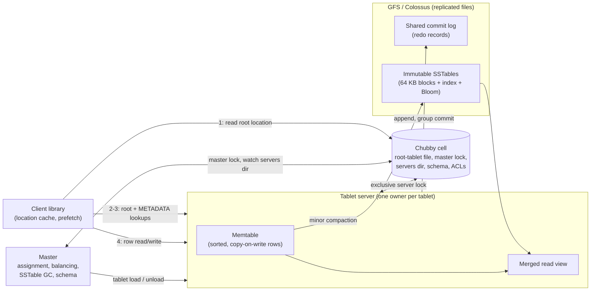

# Google Bigtable (2006 OSDI)

## TL;DR

Bigtable is a sparse, persistent, sorted map from (row, column, timestamp) to uninterpreted bytes. Rows are kept in lexicographic order and split into range partitions called tablets (100-200 MB by default in 2006), so your row-key design decides both data locality and where load concentrates.
The tablet server never edits data in place. A write is a redo record appended to a commit log plus an insert into the in-memory memtable. A read merges the memtable with a stack of immutable SSTables. Compactions (minor, merging, major) turn this write-optimized log into a read-optimized layout, at the cost of rewriting data more than once (write amplification).
Bigtable is a data plane on top of other services. Durability comes from GFS (now Colossus), and "who serves what" comes from Chubby locks. Each tablet has exactly one serving process at a time, so safety rests on leases and lock-file deletion rather than on replica quorums.
Location lookup is a three-level B+-tree: a Chubby file, then the root tablet, then the METADATA tablets. With 128 MB METADATA tablets it can address 2^34 tablets. Clients cache locations, so the master is almost never on the request path.
The trade-off you need to know cold: single-row atomicity only, range scans are cheap, sequential keys create hot spots, and a dead server costs you reassignment plus log replay rather than a quorum failover. Cloud Bigtable keeps the model, but moves routing into a frontend pool and keeps all data, including the shared log, in Colossus.

## Mental Model



Treat Bigtable as three independent loops that share no per-request state.
The control loop (master plus Chubby) decides which single process owns each key range. It only touches the data path when ownership changes.
The serving loop (the tablet server) turns writes into a sequential log plus an in-memory sorted buffer. It answers reads by merging that buffer with immutable sorted files.
The storage loop (GFS, now Colossus) makes those files and logs durable and readable from any machine. That is why moving a tablet means moving a pointer and replaying a short log tail, not copying data.
Every operational property of Bigtable follows from these boundaries: fast rebalancing, cheap splits, Chubby as a hard dependency, and recovery time proportional to the unflushed log.

## Internals

### The data model and its semantics

The paper defines Bigtable as a sparse, distributed, persistent, multi-dimensional sorted map indexed by row key, column key, and timestamp. Values are uninterpreted byte arrays ([Chang et al., OSDI 2006](https://research.google.com/archive/bigtable-osdi06.pdf)).
Row keys are arbitrary strings. Every read or write under a single row key is atomic, no matter how many columns it touches. There are no multi-row transactions.
Column keys have the form `family:qualifier`.
Families are the unit of schema, access control, and storage accounting. They are meant to be few and rarely changed. Qualifiers are unbounded and created implicitly by writes.
Timestamps are 64-bit integers that the server assigns (real time in microseconds) or the client supplies. Each family carries a garbage-collection policy: keep the last N versions, or keep versions newer than some age.
The canonical example is Webtable. It stores pages under reversed-hostname row keys such as `com.cnn.www`, so pages from one domain sort next to each other. Content goes in a `contents:` family and inbound links in an `anchor:` family whose qualifier is the referring site.
That reversal is a physical-layout decision written into the key. Lexicographic order decides which rows share a tablet, so it decides which scans touch one server and which writes pile onto one server.

### Building blocks: GFS, SSTable, Chubby

The 2006 Bigtable stored its commit logs and data files in GFS. See [[17-Cloud-AI-Engineering/Volume_13_Seminal_Papers_and_Case_Studies/Chapter_09_GFS_and_Colossus|GFS and Colossus]] for that layer.
An SSTable is a persistent, ordered, immutable map from keys to values stored as a sequence of blocks (64 KB by default). A block index stored at the end of the file is loaded into memory when the file is opened. A point lookup then costs one binary search in memory plus one block read. An SSTable can optionally be mapped entirely into memory ([Chang et al., OSDI 2006](https://research.google.com/archive/bigtable-osdi06.pdf)).
Chubby is a highly available, persistent lock service. It exposes a small namespace of directories and files, each usable as an advisory lock. Clients hold sessions kept alive by leases. In the deployment the paper describes, a Chubby cell has five replicas with one elected master, kept consistent with Paxos (five-replica figure UNVERIFIED).
Bigtable uses Chubby for five jobs:
- guarantee at most one active master;
- store the bootstrap location of the root tablet;
- discover tablet servers and finalize their deaths;
- store schema (the column families of each table);
- store access control lists.
The dependency is real and the paper measured it. Averaged over the server-hours of its 14 busiest clusters, the share of Bigtable server-hours unavailable because of Chubby unavailability was 0.0047% ([Chang et al., OSDI 2006](https://research.google.com/archive/bigtable-osdi06.pdf)).

### Chubby as the ownership oracle: the fencing protocol

Most explanations stop at "Chubby elects the master." The more interesting mechanism is how Bigtable guarantees that a tablet is never served by two processes. It has no replica quorum on the data path, so it has to get this from somewhere else.
When a tablet server starts, it creates a uniquely named file in a well-known Chubby servers directory and takes an exclusive lock on it. The master watches that directory to discover servers.
A tablet server serves its tablets only while it holds that lock. If its Chubby session lapses, for example during a network partition, it stops serving and tries to re-acquire the lock as long as the file still exists. If the file is gone, the server kills itself.
The master periodically asks each tablet server about the state of its lock.
If a server reports that it lost the lock, or the master cannot reach it, the master tries to acquire that server's lock file itself.
If the master gets the lock, two facts follow. Chubby is alive, and the tablet server is either dead or cut off from Chubby. The master then deletes the file, so the server can never serve again even if it reconnects, and moves its tablets to the unassigned set.
This is a lease-plus-tombstone protocol. Deleting the file is the tombstone that turns "maybe dead" into "permanently retired."
The protocol has one timing assumption. A partitioned tablet server must notice that its session expired before the master can obtain and delete the lock. Chubby's session-lease design, where the client-side lease timeout is conservative relative to the master-side timeout, provides that ordering, provided clock rates are bounded.
The Chubby paper adds two more tools for systems that cannot accept that assumption ([Burrows, OSDI 2006](https://research.google.com/archive/chubby-osdi06.pdf)):
- sequencers, which are opaque lock-generation tokens that downstream servers check;
- lock-delay, which keeps a lock unavailable for a window after its holder disappears.
The master protects itself the same way. It kills itself if its own Chubby session expires. Master failure does not change tablet assignments, so the data plane keeps serving while a new master is elected.
On startup, a new master does four things:
1. Takes the unique master lock.
2. Scans the servers directory.
3. Asks every live tablet server which tablets it already holds.
4. Scans the METADATA table to find unassigned tablets, first adding the root tablet to the unassigned set if no server reported it.

### Tablet location: a three-level B+-tree with client caching

Level 0 is a Chubby file that holds the location of the root tablet.
Level 1 is the root tablet. It is the first tablet of the METADATA table and is never split, so the hierarchy never grows a fourth level.
Level 2 is the rest of the METADATA tablets. Each row maps an encoding of (table id, end row) to a user tablet's location ([Chang et al., OSDI 2006](https://research.google.com/archive/bigtable-osdi06.pdf)).
The capacity arithmetic is worth doing once:
- A METADATA row is about 1 KB, and METADATA tablets are capped at 128 MB, so one METADATA tablet indexes 2^27 / 2^10 = 2^17 = 131,072 tablets.
- The root tablet indexes 2^17 METADATA tablets, so the scheme addresses 2^17 * 2^17 = 2^34 (about 17.2 billion) user tablets.
- At 128 MB per tablet, that is 2^34 * 2^27 = 2^61 bytes, or 2 EiB.
The client library caches tablet locations. With an empty cache a lookup takes three network round trips. With a stale cache it can take up to six (UNVERIFIED figure from the paper text), because stale entries are only discovered on a miss.
Two refinements keep METADATA off the critical path. Clients prefetch the locations of neighboring tablets whenever they read METADATA. The location column family of METADATA sits in an in-memory locality group, so lookups never touch disk.
The master is not involved in any of this. In the original design, clients talk to tablet servers directly for both location and data, which is why one master could manage thousands of servers.

### Tablet serving: write path, read path, and the only mutable structure

A write arrives at the owning tablet server. The server checks that it is well formed and authorized, reading the permitted-writer list from a Chubby file that is almost always a client-cache hit.
It appends a redo record to the commit log, using group commit to amortize small writes. Only after the log commit does it insert the mutation into the memtable.
A read is authorized the same way and runs against a merged view of the memtable and the tablet's SSTables. All of them are sorted the same way, so the merge is a k-way streaming merge, not a sort.
The memtable is the only mutable structure that both reads and writes touch. The paper makes each memtable row copy-on-write, so reads and writes proceed in parallel without holding long locks.
Everything else on the read path is immutable. That is why SSTable reads need no concurrency control.
To recover a tablet, a server reads its METADATA entry: the list of SSTables plus a set of redo points, which are offsets into commit logs that may still hold unflushed updates. It loads the SSTable indexes and replays the log from those redo points to rebuild the memtable ([Chang et al., OSDI 2006](https://research.google.com/archive/bigtable-osdi06.pdf)).

### Compaction: the three kinds and why tombstones survive

A minor compaction runs when the memtable reaches a size threshold. The memtable is frozen, a new one takes writes, and the frozen one is written to GFS as a new SSTable.
Minor compaction does two things. It bounds tablet-server memory, and it advances the redo point, which shrinks the log that must be replayed after a crash.
Minor compactions alone would pile up SSTables, and every read would have to merge all of them. A merging compaction periodically reads a few SSTables plus the memtable and writes one new SSTable.
A major compaction rewrites all of a tablet's SSTables into exactly one.
Here is the mechanism a getting-started guide skips. A non-major merging compaction may leave older SSTables in place below its output, so the output has to keep deletion markers. Drop a tombstone there and the deleted value reappears from an older file.
Only a major compaction, which merges every SSTable the tablet has, can safely drop both tombstones and the data they suppress. The paper calls this the way Bigtable reclaims deleted data and makes deletes physically disappear on a timely basis, which matters for sensitive data.
The Worked Example includes a runnable toy tablet that reproduces this resurrection bug.
Two further consequences follow:
- GC policies are enforced lazily during compaction. Cloud Bigtable likewise warns that cells eligible for GC can still appear in reads until GC runs (exact delay UNVERIFIED), so readers that need strict TTL semantics must filter by timestamp.
- Immutability turns file deletion into a global mark-and-sweep. The master garbage-collects SSTables that no tablet references, and the METADATA table is the root set.

### Splits and merges without copying data

Only three tablet-set changes exist:
- table creation and deletion;
- merging two adjacent tablets into one;
- splitting one tablet into two.
The master starts creations, deletions, and merges. The tablet server starts splits.
A split is committed by writing the new tablet's entry into the METADATA table. The tablet server then notifies the master.
If that notification is lost, the system repairs itself. The next time the master asks some server to load the parent tablet, that server finds a METADATA entry covering only part of the requested range and tells the master about the split.
Because SSTables are immutable, a split rewrites no data. The two child tablets share the parent's SSTables, each reading only its own key range, and later compactions separate them physically.
This is why a split takes a metadata write and a minor compaction, not a bulk copy. It is the same property that lets Cloud Bigtable rebalance in minutes.

### The commit log: one per server, and sorted recovery

A log file per tablet would mean many concurrent append streams per server, so many GFS files and disk seeks, and group commit could only batch writes within one tablet.
The paper therefore has each tablet server write one commit log that mixes mutations from all its tablets.
The cost appears at recovery. Suppose a server with 100 tablets dies and those tablets move to 100 servers. Done naively, each new server reads the entire dead log to find its own entries, which multiplies log reads by 100.
Bigtable avoids this by first sorting the log by the key (table, row name, log sequence number). After sorting, each tablet's mutations sit in one contiguous run that can be read with a single seek and sequential reads.
The sort is parallel. The log is cut into 64 MB segments (figure UNVERIFIED), and the master coordinates sorting them on different tablet servers.
Two smaller mechanisms protect write latency:
- Each tablet server runs two log-writer threads, each with its own log file, and only one is active at a time. If GFS appends on the active file slow down, for example because of a sick chunk replica, the server switches files. Sequence numbers let recovery drop duplicate records written during the switch.
- Before a planned tablet move, the source server runs a minor compaction, stops serving, and runs a second small minor compaction. The target server then has almost no log to replay ([Chang et al., OSDI 2006](https://research.google.com/archive/bigtable-osdi06.pdf)).

### Refinements that make the read path tolerable

Locality groups: clients group column families into locality groups, and each tablet stores each group in its own SSTables.
A scan that reads only the small `language:` family never touches the large `contents:` bytes.
A locality group can be marked in-memory, which is how the METADATA location family stays resident.
Compression is set per locality group. Bigtable compresses each SSTable block on its own, so a single block can be read without decompressing the whole file.
The common scheme has two passes: a Bentley-McIlroy pass that finds long repeated strings over a large window, then a fast pass over a small window. On Webtable it reached roughly 10:1, compared with 3:1 or 4:1 for Gzip on HTML (ratios UNVERIFIED). The gain came from the row-key layout: pages from one host sit together and share boilerplate.
There are two cache levels. The Scan Cache holds key-value pairs, which helps when the same data is read repeatedly. The Block Cache holds SSTable blocks fetched from GFS, which helps reads that touch nearby data.
Each locality group can carry Bloom filters. A lookup can then skip any SSTable that cannot contain the requested row and column, so most reads of absent cells never touch GFS.

### What the 2006 numbers actually teach

The paper's benchmark used 1000-byte values. On a single tablet server it measured, per second:
- 1,212 random reads from GFS;
- 10,811 random reads from an in-memory locality group;
- 8,850 random writes;
- 4,425 sequential reads.
As the cluster grew to 500 tablet servers, per-server random reads fell to 241 ([Chang et al., OSDI 2006](https://research.google.com/archive/bigtable-osdi06.pdf)).
Random reads scaled worst. Aggregate throughput rose only about 100x for 500x the servers, because each 1000-byte read pulled a whole 64 KB block across the GFS network and saturated shared links.
The lesson is still current. Block size times random-read rate is your real network demand. Writes scale better because they turn into sequential log appends and bulk SSTable writes.

### From the paper to Cloud Bigtable

In Cloud Bigtable, every client request goes through a pool of frontend servers before reaching a node, and nodes are the paper's tablet servers (Google Cloud docs, as of 2026-10).
Data is never stored on the nodes themselves. Each node holds pointers to tablets stored in Colossus. Acknowledged writes go to a shared log in Colossus, which plays the role of the paper's per-server commit log (Google Cloud docs, as of 2026-10).
Clients no longer resolve locations. A routing layer sends each request to the node that owns the tablet, and the docs say rebalancing is fast and node failure loses no data because nothing is copied between nodes (Google Cloud docs, as of 2026-10).
After a cluster resize, Bigtable typically needs a few minutes under load to rebalance across the new set of nodes (Google Cloud docs, as of 2026-10).
Storage per node is still a real constraint, even though nodes hold no data. Google's docs say higher storage per node means more background work such as indexing, which raises latency even when CPU is sufficient (Google Cloud docs, as of 2026-10).
That is the compaction and index bookkeeping from the paper, showing up as a documented limit.
Placement and failure domains: a Cloud Bigtable cluster lives in a single zone. Replication adds clusters in other zones or regions inside one instance and is eventually consistent between clusters. App profiles choose single-cluster routing, which allows single-row transactions such as check-and-mutate and read-modify-write, or multi-cluster routing, which allows automatic failover.
See [[17-Cloud-AI-Engineering/Volume_03_GCP_Deep_Dive/Chapter_11_Cloud_Bigtable_LSM_Storage_and_Tablet_Serving|Cloud Bigtable: LSM Storage and Tablet Serving]] for the product-level treatment.

### Lineage

Several later systems either use this design or are built on Bigtable:
- Apache HBase reproduces the design on HDFS, with ZooKeeper in Chubby's role. See [[04-System-Design/05-Data-Stores/Apache-Cassandra|Apache Cassandra]] for the other descendant and [[04-System-Design/05-Data-Stores/Apache-ZooKeeper|ZooKeeper]] for the lock-service analogue.
- Cassandra combines Bigtable's column-family model and LSM storage with Dynamo-style consistent hashing. See [[08-Distinguished-Engineering/02-Distributed-Systems-Internals/Consistent-Hash-Ring|Consistent Hash Ring]].
- LevelDB, written by two of Bigtable's authors, is effectively an open-source tablet. RocksDB descends from it.
- Inside Google, Percolator (OSDI 2010) added cross-row snapshot-isolation transactions on top of Bigtable, and Megastore (CIDR 2011) added Paxos-replicated entity groups. Spanner (OSDI 2012) then replaced the single-owner model with Paxos groups per split. See [[17-Cloud-AI-Engineering/Volume_13_Seminal_Papers_and_Case_Studies/Chapter_06_Google_Spanner|Google Spanner]].
The underlying storage idea comes from the log-structured merge-tree of O'Neil et al. (Acta Informatica, 1996), which Bigtable cites.

## Numbers to Know

| Quantity | Value | Source and date |
| --- | --- | --- |
| Default tablet size | 100-200 MB | (Chang et al., OSDI 2006) |
| Tablets per tablet server | about 10 to 1,000 | (Chang et al., OSDI 2006) |
| METADATA row size | about 1 KB | (Chang et al., OSDI 2006) |
| METADATA tablet cap | 128 MB | (Chang et al., OSDI 2006) |
| Addressable tablets | 2^34 tablets, 2^61 bytes | (Chang et al., OSDI 2006) |
| Location lookup, cold cache | 3 round trips | (Chang et al., OSDI 2006) |
| Location lookup, stale cache | up to 6 round trips | (Chang et al., OSDI 2006; UNVERIFIED) |
| SSTable block size | 64 KB default | (Chang et al., OSDI 2006) |
| Unavailability due to Chubby | 0.0047% of server-hours, averaged over the 14 busiest clusters | (Chang et al., OSDI 2006) |
| Single tablet server, 1000-byte values | 1,212 random reads/s; 10,811 in-memory reads/s; 8,850 random writes/s; 4,425 sequential reads/s | (Chang et al., OSDI 2006) |
| Per-server random reads at 500 servers | 241/s | (Chang et al., OSDI 2006) |
| Cloud Bigtable SSD node, 1 KB rows | up to 17,000 reads/s or 14,000 writes/s or 220 MBps scan | (Google Cloud docs, as of 2026-10) |
| Enterprise Plus in-memory tier | 40,000 rows/s read per node, scalable in 40,000 steps to 120,000 | (Google Cloud docs, as of 2026-10; GA status UNVERIFIED) |
| Storage per node limit | 5 TB SSD, 16 TB HDD | (Google Cloud docs, as of 2026-10) |
| Recommended max storage utilization | 70% for throughput, 60% for latency | (Google Cloud docs, as of 2026-10) |
| Tiered storage limit | 32 TB/node Enterprise, 64 TB/node Enterprise Plus; labeled Preview in autoscaling docs | (Google Cloud docs, as of 2026-10) |
| Rebalance after resize | a few minutes under load | (Google Cloud docs, as of 2026-10) |
| Node price, us-central1 | about $0.65/node-hour Enterprise, about $0.85 Enterprise Plus | (nOps summary of Google Cloud pricing, as of 2026-08; confirm on the pricing page) |
| Storage price | about $0.17/GB-month SSD, about $0.026/GB-month HDD | (nOps summary of Google Cloud pricing, as of 2026-08; confirm on the pricing page) |
| DynamoDB per-partition ceiling | 3,000 RCU, 1,000 WCU, about 10 GB | (AWS docs; UNVERIFIED as of 2026-10) |
| DynamoDB max item size | 400 KB | (AWS docs; UNVERIFIED as of 2026-10) |

## AWS vs GCP Mechanism Parity

| Dimension | Bigtable paper / Cloud Bigtable | Amazon DynamoDB | Amazon EMR HBase / Amazon Keyspaces |
| --- | --- | --- | --- |
| Data model | Sorted map (row, family:qualifier, timestamp) to bytes, with multiple versions per cell | Items keyed by partition key plus optional sort key, one version per item | HBase: same model as Bigtable. Keyspaces: Cassandra CQL wide rows |
| Partitioning | Range-partitioned on the lexicographic row key; tablets split by size and load | Partition key hashed to partitions; sort-key order only within one partition key | HBase: range regions. Keyspaces: managed hash partitioning |
| Global ordering | Yes, full-table range scans in key order | No; Scan is unordered, Query is ordered within one partition key | HBase: yes. Keyspaces: token order only |
| Ownership and safety | One serving node per tablet; Chubby lease plus lock-file deletion fences old owners | Multi-Paxos replication group per partition with a leader ([USENIX ATC 2022](https://www.usenix.org/conference/atc22/presentation/elhemali)) | HBase: ZooKeeper sessions plus HDFS lease recovery on the WAL |
| Durability layer | GFS, now Colossus, which holds the SSTables and the shared log | Replicas across 3 AZs, each storing a B-tree and replication log | HBase: HDFS or S3 (EMRFS). Keyspaces: managed |
| Node failure behavior | Tablets reassigned; replay log tail from redo point; seconds to minutes of per-tablet unavailability | Leader election inside the replica group; the other replicas already hold the data | HBase: region reassignment plus WAL split and replay, as in the paper |
| Atomicity | Single row; check-and-mutate and read-modify-write need single-cluster routing | Single item; TransactWriteItems across items | HBase: single row. Keyspaces: lightweight transactions |
| Multi-region | Replication between clusters inside one instance, eventually consistent; app profiles route | Global tables | HBase: DIY replication. Keyspaces: multi-Region replication |
| Capacity unit | Nodes (CPU) plus storage per node, with autoscaling | RCU/WCU provisioned or on-demand; partition-level ceilings | HBase: EC2 instances. Keyspaces: capacity units |
| Hot-key behavior | Hot row stays on one node (a row is never split); hot range splits until it is one row | Hot partition key limited per partition; adaptive capacity isolates hot items | Same as the column to the left in each family |
| Row-level access control | Family and table-level IAM; no per-row IAM | IAM condition `dynamodb:LeadingKeys` restricts by partition key | HBase: cell ACLs via Ranger or coprocessors |
| Private access | Private Google Access, VPC Service Controls perimeter | VPC gateway endpoint plus endpoint policy | VPC-native (EMR); interface endpoints (Keyspaces) |

The most important difference is in the second and fourth rows.
Bigtable lets you range-scan the whole table because it is range-partitioned. It can afford a single owner per tablet because durability is delegated to a replicated file system.
DynamoDB hashes the partition key, which destroys global order but spreads load by default. It replicates each partition with Paxos, so a node failure costs only a leader election instead of a log replay.
On AWS, HBase on EMR is the closest copy of Bigtable's mechanism. DynamoDB is the closest operational equivalent.
See [[17-Cloud-AI-Engineering/Volume_02_AWS_Deep_Dive/Chapter_10_Amazon_DynamoDB_Architecture_and_Partitioning|DynamoDB Architecture and Partitioning]] and [[17-Cloud-AI-Engineering/Volume_04_AWS_vs_GCP_Translation/Chapter_04_Storage_and_Database_Translation|Storage and Database Translation]].

## Worked Example: A Toy Tablet, a Real Webtable, and a Sizing Model

### Part A - Reproduce the tombstone mechanism locally (no cost)

This pure-Python model has a commit log, a memtable, immutable SSTables with Bloom filters sized at 10 bits per key, merging compactions above a base run, and a major compaction.
Running it shows three things:
- the write amplification caused by compaction;
- the Bloom filter turning thousands of absent-key lookups into a few dozen block reads;
- the deleted-row resurrection you get if a non-major merge drops tombstones.

```python
# mini_tablet.py - toy model of a Bigtable tablet: commit log, memtable,
# immutable SSTables with Bloom filters, merging and major compactions.
# Pure Python 3, no dependencies, no cloud resources.
import bisect, hashlib

TOMB = b"__tombstone__"

class Bloom:
    def __init__(self, n_keys, bits_per_key=10, k=7):
        self.m = max(64, n_keys * bits_per_key)
        self.k, self.bits = k, bytearray(self.m // 8 + 1)
    def _idx(self, key):
        d = hashlib.sha256(key).digest()
        return [int.from_bytes(d[4*i:4*i+4], "big") % self.m for i in range(self.k)]
    def add(self, key):
        for b in self._idx(key):
            self.bits[b // 8] |= 1 << (b % 8)
    def may_contain(self, key):
        return all((self.bits[b // 8] >> (b % 8)) & 1 for b in self._idx(key))

class SSTable:
    """Immutable sorted run: keys[], values[] of (ts, val), plus a Bloom filter."""
    def __init__(self, items):
        self.keys = [k for k, _ in items]
        self.vals = [v for _, v in items]
        self.bloom = Bloom(len(items))
        for k in self.keys:
            self.bloom.add(k)
        self.nbytes = sum(len(k) + len(v[1]) + 8 for k, v in items)
    def get(self, key, stats):
        if not self.bloom.may_contain(key):
            return None
        stats["block_reads"] += 1          # would be one block fetch from GFS/Colossus
        i = bisect.bisect_left(self.keys, key)
        if i < len(self.keys) and self.keys[i] == key:
            return self.vals[i]
        return None

class Tablet:
    def __init__(self, memtable_rows=2000, merge_trigger=4, drop_tombstones_early=False):
        self.mem, self.ssts, self.log = {}, [], []
        self.memtable_rows, self.merge_trigger = memtable_rows, merge_trigger
        self.drop_tombstones_early = drop_tombstones_early   # the BUG we want to demonstrate
        self.stats = {"user_bytes": 0, "flushed_bytes": 0, "compacted_bytes": 0, "block_reads": 0}
    def put(self, key, val, ts):
        self.log.append((key, ts, val))                     # redo record first (durability)
        self.mem[key] = (ts, val)                           # then the memtable
        self.stats["user_bytes"] += len(key) + len(val) + 8
        if len(self.mem) >= self.memtable_rows:
            self.minor_compaction()
    def delete(self, key, ts):
        self.put(key, TOMB, ts)
    def minor_compaction(self):
        sst = SSTable(sorted(self.mem.items()))
        self.stats["flushed_bytes"] += sst.nbytes
        self.ssts.append(sst)                               # newest last
        self.mem, self.log = {}, []                         # redo point advances
        if len(self.ssts) - 1 >= self.merge_trigger:        # ssts[0] is the base run
            self.merging_compaction()
    def _merge(self, runs, drop_tombstones):
        merged = {}
        for run in runs:                                    # oldest first, newer overwrite
            for k, v in zip(run.keys, run.vals):
                if k not in merged or v[0] >= merged[k][0]:
                    merged[k] = v
        items = sorted((k, v) for k, v in merged.items() if not (drop_tombstones and v[1] == TOMB))
        sst = SSTable(items)
        self.stats["compacted_bytes"] += sst.nbytes
        return sst
    def merging_compaction(self):
        # Merge every run ABOVE the base; the base survives, so tombstones must be kept.
        self.ssts = [self.ssts[0], self._merge(self.ssts[1:], self.drop_tombstones_early)]
    def major_compaction(self):
        self.minor_compaction()
        self.ssts = [self._merge(self.ssts, drop_tombstones=True)]  # safe: no older run exists
    def get(self, key):
        if key in self.mem:
            v = self.mem[key]
            return None if v[1] == TOMB else v[1]
        for sst in reversed(self.ssts):                     # newest to oldest
            v = sst.get(key, self.stats)
            if v is not None:
                return None if v[1] == TOMB else v[1]
        return None

def run(drop_tombstones_early):
    t = Tablet(drop_tombstones_early=drop_tombstones_early)
    ts = 0
    for i in range(20000):                                  # load phase
        ts += 1
        t.put(b"row%08d" % i, b"x" * 100, ts)
    t.major_compaction()                                    # row00000042 now lives in the oldest run
    ts += 1
    t.delete(b"row00000042", ts)                            # tombstone goes to the memtable
    for i in range(20000, 40000):                           # more writes push the tombstone through merges
        ts += 1
        t.put(b"row%08d" % i, b"y" * 100, ts)
    t.minor_compaction()
    s = t.stats
    wa = (s["flushed_bytes"] + s["compacted_bytes"]) / s["user_bytes"]
    t.stats["block_reads"] = 0
    misses = sum(t.get(b"absent%06d" % i) is None for i in range(5000))
    return t.get(b"row00000042"), round(wa, 2), len(t.ssts), t.stats["block_reads"], misses

if __name__ == "__main__":
    for bug in (False, True):
        val, wa, runs, reads, misses = run(bug)
        shown = (val[:4] + b"...") if val else None
        print(f"drop_tombstones_early={bug}: deleted row reads back as {shown!r} | "
              f"write_amp={wa} | live SSTables={runs} | block reads for {misses} absent keys={reads}")
```

Output from a run on Python 3.11:

```text
drop_tombstones_early=False: deleted row reads back as None | write_amp=3.55 | live SSTables=3 | block reads for 5000 absent keys=68
drop_tombstones_early=True: deleted row reads back as b'xxxx...' | write_amp=3.55 | live SSTables=3 | block reads for 5000 absent keys=80
```

How to read it:
- A write amplification of 3.55 means every user byte was written about 3.5 times: once in the flush and again in each merge. Real systems add a log write on top.
- 68 block reads for 5,000 misses across two effective SSTable filters (10,000 queries) is a false-positive rate of about 0.68% (~0.7% vs ~0.8% theoretical), matching the textbook rate for 10 bits per key.
- The second line is the resurrection bug. The merged run dropped the tombstone while the base run still held the old value.

### Part B - Webtable on Cloud Bigtable (billable)

Cost estimate: one SSD node at about $0.65/node-hour plus negligible storage, so a two-hour lab costs about $1.30 to $1.50 (nOps summary of Google Cloud pricing, as of 2026-08).
If you forget to tear it down, the same node costs about $0.65 * 730 = $474.50 per month.
Set a budget alarm before creating anything:

```bash
export PROJECT=your-project-id
export BILLING=XXXXXX-XXXXXX-XXXXXX
gcloud services enable bigtable.googleapis.com bigtableadmin.googleapis.com --project="$PROJECT"

gcloud billing budgets create \
  --billing-account="$BILLING" \
  --display-name="bt-lab-budget" \
  --budget-amount=10USD \
  --filter-projects="projects/$PROJECT" \
  --threshold-rule=percent=0.5 \
  --threshold-rule=percent=0.9 \
  --threshold-rule=percent=1.0

gcloud bigtable instances create bt-lab \
  --project="$PROJECT" \
  --display-name="bt-lab" \
  --cluster-config=id=bt-lab-c1,zone=us-central1-b,nodes=1 \
  --cluster-storage-type=SSD
```

```python
# webtable.py - pip install google-cloud-bigtable
import datetime, os
from google.cloud import bigtable
from google.cloud.bigtable import column_family, row_filters
from google.cloud.bigtable.row_set import RowSet

PROJECT, INSTANCE = os.environ["PROJECT"], "bt-lab"
client = bigtable.Client(project=PROJECT, admin=True)
table = client.instance(INSTANCE).table("webtable")

if not table.exists():
    table.create(column_families={
        "contents": column_family.MaxVersionsGCRule(3),                         # keep 3 versions
        "anchor": column_family.MaxAgeGCRule(datetime.timedelta(days=30)),      # age-based GC
    })

def reverse_host(url_host: str) -> bytes:
    return ".".join(reversed(url_host.split("."))).encode()                     # www.cnn.com -> com.cnn.www

now = datetime.datetime.now(datetime.timezone.utc)
rows = []
for host, html in [("www.cnn.com", b"<html>v1</html>"), ("money.cnn.com", b"<html>m</html>"),
                   ("www.bbc.co.uk", b"<html>b</html>")]:
    r = table.direct_row(reverse_host(host))
    r.set_cell("contents", b"html", html, timestamp=now)
    r.set_cell("anchor", b"cnnsi.com", b"CNN", timestamp=now)
    rows.append(r)
for status in table.mutate_rows(rows):          # batch of independent single-row atomic mutations
    if status.code != 0:
        raise RuntimeError(status)

# Point read, newest version only.
row = table.read_row(b"com.cnn.www", filter_=row_filters.CellsColumnLimitFilter(1))
print(row.cells["contents"][b"html"][0].value)

# Range scan over one domain: all keys with prefix "com.cnn." ('/' sorts right after '.').
rs = RowSet()
rs.add_row_range_from_keys(start_key=b"com.cnn.", end_key=b"com.cnn/")
for r in table.read_rows(row_set=rs):
    print(r.row_key)

# Single-row read-modify-write (requires an app profile with single-cluster routing).
counter = table.append_row(b"com.cnn.www")
counter.increment_cell_value("anchor", b"inbound_count", 1)
print(counter.commit())
```

Teardown, which deletes all clusters, tables, and data in the instance:

```bash
gcloud bigtable instances delete bt-lab --project="$PROJECT" --quiet
gcloud billing budgets list --billing-account="$BILLING" --filter='displayName=bt-lab-budget' --format='value(name)' \
  | xargs -r -n1 gcloud billing budgets delete --quiet
```

### Part C - Capacity and cost sizing

Workload: vehicle telemetry with 50,000 writes/s of 1 KB rows, 15,000 point reads/s, 200 scans/s of 100 rows each, and 14-day retention, in one SSD cluster.
Step 1, write CPU: 50,000 / 14,000 = 3.57 node-equivalents, using the per-node SSD figure (Google Cloud docs, as of 2026-10).
Step 2, read CPU: 15,000 / 17,000 = 0.88 node-equivalents.
Step 3, scan CPU: 200 * 100 * 1 KB = 20 MB/s, and 20 / 220 = 0.09 node-equivalents.
Step 4, mixing: the docs give reads, writes, and scans as alternatives, so we approximate by adding the fractions: 3.57 + 0.88 + 0.09 = 4.54 nodes at 100% CPU. This linear mix is a planning assumption, not a documented formula.
Step 5, CPU headroom: at a 70% CPU planning target (our assumption), 4.54 / 0.7 = 6.5, so 7 nodes.
Step 6, logical bytes: 50 MB/s * 86,400 s = 4.32 TB/day, and 14 days gives 60.5 TB.
Step 7, stored bytes: assuming 2:1 block compression (an assumption that depends on the workload), about 30.2 TB on disk.
Step 8, storage nodes: at the 70% throughput-oriented utilization guidance, each SSD node holds 5 TB * 0.7 = 3.5 TB, so 30.2 / 3.5 = 8.6, which rounds to 9 nodes (Google Cloud docs, as of 2026-10).
Step 9, the binding constraint is storage (9 nodes), not CPU (7 nodes).
The levers are shorter retention, shorter column qualifiers (each cell carries its family, qualifier, and timestamp), coarser rows that pack several readings into one cell, or tiered storage, which is Preview as of 2026-10 and not something to plan production on.
Step 10, monthly cost:
- nodes: 9 * $0.65 * 730 = $4,270.50;
- storage: 30,200 GB * $0.17 = $5,134;
- total: about $9,405 per month for a single cluster (nOps summary of Google Cloud pricing, as of 2026-08).
Step 11, HA: a second replicated cluster roughly doubles node and storage cost, and adds replication network charges between regions (rate UNVERIFIED).
Under multi-cluster routing, each cluster must also have CPU headroom to absorb the other's traffic after failover, which pushes the per-cluster CPU target well below 70%.
Step 12, recovery cost check, using the paper's design: a server holds an unflushed log tail L = 4 GB (assumption) and its tablets are spread across N = 100 new owners.
Naive recovery reads N * L = 400 GB. Sorted recovery reads L once, writes about L of sorted segments, and lets each owner read only its own slice, so about 8 to 12 GB of I/O in total.

## Failure Modes and Pitfalls

### Sequential row keys hotspot a single tablet

A key that starts with a timestamp or a monotonically increasing ID sends every new write to the last tablet.
Splitting does not help, because after each split the new right-hand tablet becomes the hot one.
Symptom: one node pinned at high CPU while the cluster average looks healthy, and write latency rises with load while adding nodes changes nothing.
Mitigation: put a high-cardinality field such as device ID first and the time second, or salt with a bounded bucket prefix and fan out scans across buckets. Use Key Visualizer to confirm the fix.

### A hot row cannot be split

A row is the unit of atomicity, so it is never split across tablets.
A single celebrity row, a global counter, or a tall row that keeps growing with versions stays on one node no matter how many nodes you add.
Mitigation: shard counters across N rows and sum on read, cap versions with GC rules, and model time-series data as many short rows instead of one ever-growing row. Cloud Bigtable's row and cell size limits are 256 MB and 100 MB respectively (UNVERIFIED as of 2026-10).

### Deleted or expired data is still readable

Deletes and GC policies take physical effect only at compaction. Readers that assume strict TTL semantics may see expired cells.
Compliance teams who expect "deleted means gone now" need to know that physical removal waits for a major-compaction-equivalent pass.
Mitigation: apply timestamp-range filters on read, and for regulated data use crypto-shredding with per-tenant keys (see Security below).

### Storage density causes latency even when CPU is idle

Google documents that higher storage per node raises latency because of background indexing work, and recommends at most 60% storage utilization for latency-sensitive workloads (Google Cloud docs, as of 2026-10).
A team that sizes nodes by CPU alone and lets data grow will see p99 drift up for weeks with no deployment or traffic change to blame.
Mitigation: alert on storage utilization per node, and let autoscaling consider storage targets as well as CPU.

### Autoscaling lags traffic spikes

Rebalancing after a resize takes a few minutes under load (Google Cloud docs, as of 2026-10). Autoscaling also needs time to observe CPU before it acts.
A step change in traffic, such as a batch job starting or a marketing push, will be served by the old node count for several minutes.
Mitigation: pre-scale on a schedule before known events, and send batch traffic through a separate app profile pointed at a separate cluster.

### Lease expiry on pauses: the HBase lesson

In HBase, a long JVM garbage-collection pause can outlast the ZooKeeper session timeout. The master then declares the region server dead and reassigns its regions while the paused process still believes it owns them.
HBase relies on HDFS lease recovery of the write-ahead log to fence the zombie's writes. Bigtable's lock-file deletion plays the same role.
A home-grown Bigtable-like system that skips fencing gets split-brain writes. The general pattern is described in the Chubby paper's discussion of sequencers and lock-delay ([Burrows, OSDI 2006](https://research.google.com/archive/chubby-osdi06.pdf)).

### Lock-service dependency and over-reliance

Bigtable is unavailable whenever Chubby is unavailable for longer than session leases can cover, as the paper's 0.0047% measurement shows.
The Google SRE book describes the opposite failure. Chubby was so reliable that services quietly took hard dependencies on it, so Google began deliberately taking Chubby down for planned outages to keep its real availability close to its SLO and expose those dependencies ([Google SRE book, Service Level Objectives](https://sre.google/sre-book/service-level-objectives/)).
The same book covers Bigtable SRE's own story of over-alerting on low-level latency signals and moving to SLO-based alerting ([Google SRE book, Monitoring Distributed Systems](https://sre.google/sre-book/monitoring-distributed-systems/)).

### Metadata-plane overload: a cross-cloud analogue

In the 2015-09-20 DynamoDB event in us-east-1, larger membership metadata responses (caused by Global Secondary Index adoption) pushed requests from storage servers to the internal metadata service past their timeouts. Retries then overloaded that service and caused a cascade (AWS PIR, UNVERIFIED as of 2026-10).
The Bigtable equivalent is a mass client restart that empties location caches and sends a wave of METADATA lookups at the same time.
The paper's defenses are an in-memory METADATA location family, prefetching, and a tree that never needs a fourth level. Cloud Bigtable goes further and removes client-side resolution entirely by routing in the frontend pool.

### Replication semantics surprises

Under multi-cluster routing, replication between clusters is eventual. A client whose requests fail over can read stale data, and single-row conditional mutations are not available because two clusters could each apply a conflicting check-and-mutate.
Mitigation: use single-cluster routing with manual failover for any workload that needs check-and-mutate or read-modify-write, and keep multi-cluster profiles for idempotent writes and staleness-tolerant reads.

### The paper's own lessons

The authors list the failures that actually hit them:
- memory and network corruption;
- large clock skew;
- hung machines;
- extended and asymmetric network partitions;
- bugs in dependencies such as Chubby;
- GFS quota overflow;
- planned and unplanned hardware maintenance ([Chang et al., OSDI 2006](https://research.google.com/archive/bigtable-osdi06.pdf)).
They also argue for waiting to add new features, explicitly general-purpose multi-row transactions, until it is clear how they will be used. They then built the narrower single-row conditional mutations that applications actually needed.

## Security and Cost Angles

### IAM scoping

Cloud Bigtable predefined roles separate administration (`roles/bigtable.admin`), data read/write (`roles/bigtable.user`), read-only data (`roles/bigtable.reader`), and metadata-only visibility (`roles/bigtable.viewer`). Bind them at the instance or table level, not the project level.
Bigtable has no per-row IAM condition comparable to DynamoDB's `dynamodb:LeadingKeys`. Multi-tenant row isolation therefore has to be enforced in the service layer, or by using a table per tenant where tenant counts allow.
Use workload identity federation for GKE and Cloud Run callers instead of service account keys. See [[17-Cloud-AI-Engineering/Volume_08_Security_Identity_and_the_Data_Perimeter/Chapter_02_Workload_Identity_Federation|Workload Identity Federation]].

### Encryption key hierarchy

Data is encrypted at rest by default under Google-managed keys. CMEK lets a Cloud KMS key wrap the data encryption keys for each cluster.
With CMEK, disabling or destroying the key version makes the data unreadable. That gives you a crypto-shredding lever, which lazy GC alone cannot provide.
The trade-off is that a revoked or region-mismatched key is a self-inflicted availability outage, so test key rotation and access in staging first. See [[17-Cloud-AI-Engineering/Volume_08_Security_Identity_and_the_Data_Perimeter/Chapter_04_Encryption_Key_Hierarchies_and_Envelope_Encryption|Envelope Encryption]].

### Network perimeter

Put `bigtable.googleapis.com` inside a VPC Service Controls perimeter, so stolen credentials cannot read data from outside the perimeter. Reach the API from private subnets through Private Google Access.
Turn on Data Access audit logs for tables with sensitive data. Data reads are not logged by default, and enabling the logs costs log volume. See [[17-Cloud-AI-Engineering/Volume_03_GCP_Deep_Dive/Chapter_03_VPC_Service_Controls_Security_Perimeters|VPC Service Controls]].

### Unit economics levers

The cost model has two inputs: nodes, sized by the larger of CPU need and storage density, and stored bytes. The sizing example above shows storage density often sets node count before CPU does.
Cell overhead is real. Each stored cell carries its family, qualifier, and timestamp, so short qualifiers and packing many readings into one cell cut both storage and node count.
SSD versus HDD is a latency decision before it is a price decision. HDD storage is about 85% cheaper per GB, but random reads suffer badly (nOps summary of Google Cloud pricing, as of 2026-08).
Committed use discounts reduce node prices for steady baseline capacity (Google Cloud product page, as of 2026-10). Keep the autoscaled burst on demand. See [[17-Cloud-AI-Engineering/Volume_09_FinOps_and_Cloud_Economics/Chapter_02_Commitment_Discounts_Savings_Plans_vs_CUDs|Savings Plans vs CUDs]].
Replication multiplies cost by the number of clusters, and the CPU headroom needed for failover multiplies it again. Price HA explicitly against the cost of the outage it prevents.

## Interview Questions and Model Answers

### Question 1 (L5 - Senior)

You are storing IoT sensor readings in Bigtable with row key `timestamp#device_id`. Writes stopped scaling at about one node's worth of throughput. Explain why, and redesign the key.

#### Model Answer

Bigtable range-partitions on the lexicographic row key, so every new write lands at the right edge of the key space, in the single tablet that holds the newest timestamps.
Bigtable will split that tablet, but the new right-hand child immediately becomes the hot one. Splitting moves the hotspot without spreading it.
CPU on one node saturates near the per-node write figure (14,000 rows/s for SSD with 1 KB rows, Google Cloud docs as of 2026-10), and adding nodes does nothing because they receive no writes.
The redesign is `device_id#reverse_or_bucketed_timestamp`.
Device ID first spreads writes across the whole key space, in proportion to device cardinality.
A time component second keeps one device's history contiguous, so "last hour for device X" is one short range scan.
If the dominant query is "latest reading", use `Long.MAX_VALUE - ts` as the time component so the newest row sorts first and a limit-1 scan returns it.
If the dominant query is "all devices in a time window", that access pattern is what made the original key attractive. Then I would either salt with a bounded bucket prefix (`hash(device) mod 64 # ts`) and fan out 64 parallel scans, or maintain a second table keyed by time bucket written by the same pipeline, accepting dual-write consistency.
Finally, I would check the fix with Key Visualizer and keep an eye on per-node CPU skew, not cluster-average CPU.

#### Follow-up Interviewer Question

With 64 salt buckets, how does scan fan-out change p99 latency, and how would you choose the bucket count?

### Question 2 (L5 - Senior)

Walk a single-cell write and a single-cell read through a tablet server. Explain why reads are inherently more expensive and what the system does about it.

#### Model Answer

Write: the server validates the mutation and checks authorization against the writer ACL from Chubby (cached). It appends a redo record to the shared commit log in GFS using group commit, then inserts into the memtable and acknowledges.
The write path costs one sequential log append plus a memory insert, so it is cheap and its cost does not depend on table size.
Read: the server has to produce a merged view of the memtable and every SSTable in the tablet, because the newest version of a cell could be in any of them.
Without help, a point read costs one block fetch per SSTable, and in 2006 that meant pulling a 64 KB block across the GFS network to return 1000 bytes.
The defenses come in layers:
- Bloom filters per locality group skip SSTables that cannot contain the row and column, so absent-key reads mostly touch no blocks.
- Merging compactions bound how many SSTables a read has to merge.
- The block cache and scan cache absorb repeated reads.
- Locality groups keep scans from reading unrelated families.
- In-memory locality groups remove disk entirely for small hot data such as METADATA.
The paper's numbers show the asymmetry: 8,850 random writes/s against 1,212 random reads/s per server. Under scale, random reads degraded most because of block transfer over shared network links.
The design principle is that an LSM tree trades read amplification and background write amplification for cheap foreground writes. Compaction policy is the knob that sets that trade-off.

#### Follow-up Interviewer Question

If you halved the SSTable block size, which numbers improve, which get worse, and how would you decide?

### Question 3 (L6 - Staff)

A tablet server is partitioned from Chubby but still reachable by some clients. Prove that Bigtable does not end up with two servers accepting writes for the same tablet. Then name the assumption your proof depends on.

#### Model Answer

Ownership is defined by holding an exclusive Chubby lock on the server's uniquely named file in the servers directory. A server serves only while it holds that lock.
When the partition starts, the server's Chubby session lease runs out on the client side first, and it stops serving. It tries to reacquire the lock only while the file still exists, and kills itself if the file is gone.
Meanwhile the master sees the server either report a lost lock or fail to respond, and tries to take that server's lock itself.
Chubby grants the lock to the master only after the server's session has expired on the Chubby side. The master then deletes the file, which permanently retires that server identity, and only after that does it reassign the tablets.
So the sequence is: the old owner stops serving at its local lease expiry, Chubby's session expires, the master takes the lock, deletes the file, and the new owner loads the tablet.
The new owner can begin serving only after the old owner has stopped, as long as the old owner's local lease expiry comes before Chubby's session expiry. That is the assumption: bounded clock-rate drift between the tablet server and the Chubby master, plus the conservative client-side lease timeout.
If a process pauses for longer than the lease and then resumes in the middle of a write without checking its lease, it can issue a stale write. Single-owner systems close that hole with storage-side fencing.
The Chubby paper offers sequencers, which are lock-generation tokens checked by the downstream server, and lock-delay. HBase uses HDFS lease recovery on the WAL so that the old owner's log can no longer be appended to.
In a staff-level design review, I would require that any write to the log or data files carries an epoch the storage layer validates. Timing assumptions should be defense in depth, not the only line of defense.

#### Follow-up Interviewer Question

Cloud Bigtable writes acknowledged mutations to a shared log in Colossus. How would you fence that log against a zombie node, and what does that cost per write?

### Question 4 (L6 - Staff)

A tablet server holding 1,000 tablets dies. Estimate the recovery work. Explain the paper's commit-log design and its trade-off. Then explain what changes in Cloud Bigtable.

#### Model Answer

Recovery has three parts:
1. Detection: the Chubby session timeout plus the master's lock acquisition.
2. Reassignment: the master picks new owners based on load.
3. Replay: each new owner reads its tablets' SSTable indexes and replays commit-log records after each tablet's redo point.
The paper uses one commit log per server rather than one per tablet. That avoids thousands of concurrent append streams to GFS, and lets group commit batch writes across tablets, which is what makes the write path efficient.
The cost is that one log mixes records from all 1,000 tablets. If those tablets go to 100 servers and each reads the whole log, a 4 GB unflushed tail becomes 400 GB of GFS reads, all competing with live traffic.
The paper's fix is to sort the log by (table, row, sequence number) in 64 MB segments, in parallel across servers under master coordination. After that, each new owner reads only a contiguous slice. Total I/O becomes about one read of L, one write of L, and one read of L, around 12 GB instead of 400 GB in my example.
Two more levers bound L in the first place:
- minor compactions that advance redo points;
- a minor compaction before every planned move, so planned moves have almost no replay.
The availability cost: tablets on the dead server are unavailable from detection until replay finishes, measured in seconds to minutes depending on L. This is the price of having a single owner instead of a replica quorum.
In Cloud Bigtable, nodes hold no data, and acknowledged writes go to a shared log in Colossus (Google Cloud docs, as of 2026-10). Reassignment is a pointer move, and the docs describe fast recovery because nothing is copied.
What stays the same is that one node owns each tablet at a time. A node failure therefore still causes a short per-tablet unavailability, which client retries with deadlines have to absorb.

#### Follow-up Interviewer Question

How would you set client retry policy and deadlines so that a node failure is invisible in p99 without creating a retry storm during a zonal event?

### Question 5 (L6 - Staff)

The product team wants a feature store serving 2M point reads/s with p99 under 10 ms. Training jobs also need to scan whole tables nightly. Choose between Cloud Bigtable and DynamoDB and defend the choice with mechanism and cost.

#### Model Answer

First, separate the access patterns: point reads by entity key online, and full or time-ranged scans offline.
Bigtable's range partitioning makes ordered full-table and prefix scans first-class. DynamoDB's hash partitioning makes Scan unordered and expensive in read units, so offline export usually goes through export to S3 instead.
For online serving, both can reach 2M reads/s.
On Bigtable, 2M / 17,000 is about 118 SSD node-equivalents at 100% CPU, or about 170 nodes at a 70% target, before considering storage density. In-memory-tier nodes on Enterprise Plus at 40,000 rows/s per increment could cut that sharply (Google Cloud docs, as of 2026-10; GA status UNVERIFIED).
On DynamoDB, cost scales with read units, and per-partition ceilings mean a hot entity is throttled per partition, not per table.
The bigger risk is the nightly scan. On Bigtable, scanning the serving cluster competes for the same nodes and threatens the p99.
I would isolate it with a separate replicated cluster and a batch app profile, so the scan reads from a replica and serving keeps its own CPU. That costs a second cluster, or a serverless analytics compute path where offered.
On DynamoDB, export-to-S3 reads from backups without consuming table capacity, which is a cleaner isolation story.
My decision rule: if the organization is already on GCP, needs ordered time-ranged feature history per entity, and can afford a replica cluster for batch isolation, choose Bigtable. If the workload is pure point lookup with spiky traffic that on-demand capacity absorbs, choose DynamoDB.
Either way, I would size the hot-key tail explicitly. Some entities, such as the most popular items, get read far more often than average, and both systems pin a single key to one owner.

#### Follow-up Interviewer Question

How would you serve features whose freshness requirement is under 1 second when the writer is a streaming pipeline, and what consistency do readers see under multi-cluster routing?

### Question 6 (L7+ - Principal)

Bigtable deliberately shipped without multi-row transactions. Trace how Google later added them (Percolator, Megastore, Spanner). Then advise a company deciding whether to build transactions on top of a Bigtable-like store or adopt a Spanner-like system.

#### Model Answer

Bigtable's bet was that most applications at the time needed single-row atomicity, scale, and throughput. The authors explicitly put off general transactions until real usage was clear, and instead built the single-row conditional mutations that applications actually asked for.
Each successor added transactions with a different mechanism and cost:
- Percolator layered snapshot-isolation transactions on Bigtable. It used a timestamp oracle and stored locks and write records in extra Bigtable columns, with clients running two-phase commit. That bought incremental indexing at the cost of several Bigtable round trips per commit and lazy cleanup of locks left by failed clients.
- Megastore built Paxos-replicated entity groups across datacenters on Bigtable. Transactions were serializable within an entity group, but cross-group work needed two-phase commit or queues, and per-group write throughput was low.
- Spanner replaced single-owner tablets with Paxos groups per split and added TrueTime, giving externally consistent distributed transactions. The cost is commit wait and write latency bounded by the Paxos round trip.
My advice comes from the failure and cost profile, not from features:
- Building transactions on top of the store means you own lock cleanup, crash recovery for half-committed transactions, the hot spot at the timestamp oracle, and the read amplification of lock checks. That is a multi-year correctness program, as Percolator's design shows.
- Adopting a Spanner-like system shifts that correctness work to the vendor. You pay with higher per-write latency, which cross-region quorums make worse, and a higher cost per operation.
- If fewer than about 5% of operations need multi-entity atomicity, keep the wide-column store. Rework the schema so the atomic unit is one row, which Bigtable rewards, and push the rare multi-entity flows through a transactional outbox or saga.
- If correctness across entities is central, as with ledgers or inventory, adopt the Spanner-like system and keep Bigtable for the high-volume append and scan side.
The principal-level point is to put the transactional boundary where the business invariant lives, and to keep the high-volume path on the cheapest consistency model that preserves that invariant.

#### Follow-up Interviewer Question

How would you migrate a live Bigtable workload whose invariants have outgrown single-row atomicity to Spanner with zero downtime and verifiable correctness?

### Question 7 (L7+ - Principal)

You run a multi-tenant Bigtable-like platform for 400 internal teams. Compaction, storage density, and lazy GC are shared resources. Design the isolation, capacity, and SLO model.

#### Model Answer

Start from what is actually shared on a node: CPU for foreground requests, CPU and I/O for compaction, and the background work that grows with storage per node, which Google documents as a source of latency (Google Cloud docs, as of 2026-10).
A tenant that writes heavily, or deletes heavily so that tombstones pile up, consumes compaction capacity that its neighbors pay for in p99. Foreground QPS quotas alone do not capture that.
Isolation, in layers:
- Cells: cluster or instance groups per tenant tier, so a misbehaving tenant's blast radius is one cell. See [[17-Cloud-AI-Engineering/Volume_01_Cloud_Architecture_Principles/Chapter_03_Cell_Based_Architecture_and_Shuffle_Sharding|Cell-Based Architecture]].
- App profiles per workload class, routing batch work to replica clusters so it never shares CPU with latency-sensitive serving.
- Admission control on both foreground operations and bytes written, because bytes written drive compaction debt.
Capacity model: each tenant declares reads/s, writes/s, scan MB/s, and stored bytes. The platform converts these into node-equivalents using the per-node figures, takes the maximum of the CPU need and the storage-density need at a 60 to 70% utilization target, and adds failover headroom for replicated tiers.
Chargeback follows the same formula, which aligns incentives. Tenants who shorten retention or shrink their cells see their bill drop.
SLOs: latency and availability SLOs per tier, with burn-rate alerts measured from the client side.
Internally, also track compaction backlog, storage per node, and per-node CPU skew. These are leading indicators that give hours of warning before p99 breaks.
Governance:
- Key-design review for new tables, to catch sequential keys before launch.
- Mandatory GC rules for every family.
- Crypto-shredding via per-tenant CMEK for tenants with deletion obligations, because lazy GC alone is not a timely delete.
Finally, I would run planned dependency-failure drills, in the spirit of SRE's deliberate Chubby outages, so that teams find hidden hard dependencies on the platform's control plane before a real outage does.

#### Follow-up Interviewer Question

Which single metric would you put in front of leadership to show platform health and efficiency together, and how could teams game it?

## Further Reading

- [Bigtable: A Distributed Storage System for Structured Data (OSDI 2006)](https://research.google.com/archive/bigtable-osdi06.pdf) - the primary source for the location hierarchy, Chubby fencing, compactions, and sorted log recovery.
- [Bigtable, ACM TOCS 26(2), 2008](https://dl.acm.org/doi/10.1145/1365815.1365816) - the journal version with the same design; cite this in formal work.
- [The Chubby Lock Service for Loosely-Coupled Distributed Systems (OSDI 2006)](https://research.google.com/archive/chubby-osdi06.pdf) - sessions, leases, sequencers, and lock-delay, which are the fencing tools behind Bigtable's single-owner safety.
- [Cloud Bigtable overview](https://docs.cloud.google.com/bigtable/docs/overview) - how the paper's tablet servers became stateless nodes over Colossus with a frontend routing pool.
- [Cloud Bigtable: Understand performance](https://docs.cloud.google.com/bigtable/docs/performance) - current per-node throughput and the storage-utilization guidance that sizing depends on.
- [Amazon DynamoDB: A Scalable, Predictably Performant, and Fully Managed NoSQL Database Service (USENIX ATC 2022)](https://www.usenix.org/conference/atc22/presentation/elhemali) - the AWS counterpoint: hash partitioning and Paxos replica groups instead of range tablets with a single owner.
- [Google SRE book: Service Level Objectives](https://sre.google/sre-book/service-level-objectives/) - the planned Chubby outage story and why an over-reliable dependency is a risk.
- [Google SRE book: Monitoring Distributed Systems](https://sre.google/sre-book/monitoring-distributed-systems/) - the Bigtable SRE over-alerting case study and the move to SLO-based alerting.
- [[17-Cloud-AI-Engineering/Volume_13_Seminal_Papers_and_Case_Studies/Chapter_07_Google_Borg_and_Omega|Google Borg and Omega]] - previous chapter: the cluster manager that schedules Bigtable's tablet servers and shares its Chubby dependency.
- [[17-Cloud-AI-Engineering/Volume_13_Seminal_Papers_and_Case_Studies/Chapter_09_GFS_and_Colossus|GFS and Colossus]] - next chapter: the storage layer whose replication makes single-owner tablets safe.
- [[17-Cloud-AI-Engineering/Volume_13_Seminal_Papers_and_Case_Studies/Chapter_06_Google_Spanner|Google Spanner]] - where Bigtable's single-row model ends and Paxos-per-split transactions begin.
- [[17-Cloud-AI-Engineering/Volume_13_Seminal_Papers_and_Case_Studies/Chapter_01_Dynamo_and_DynamoDB|Dynamo and DynamoDB]] - the other half of the wide-column family tree; compare hash rings with range tablets.
- [[08-Distinguished-Engineering/02-Distributed-Systems-Internals/Raft-Consensus|Raft Consensus]] - background on the consensus layer that Chubby and Spanner groups rely on.
