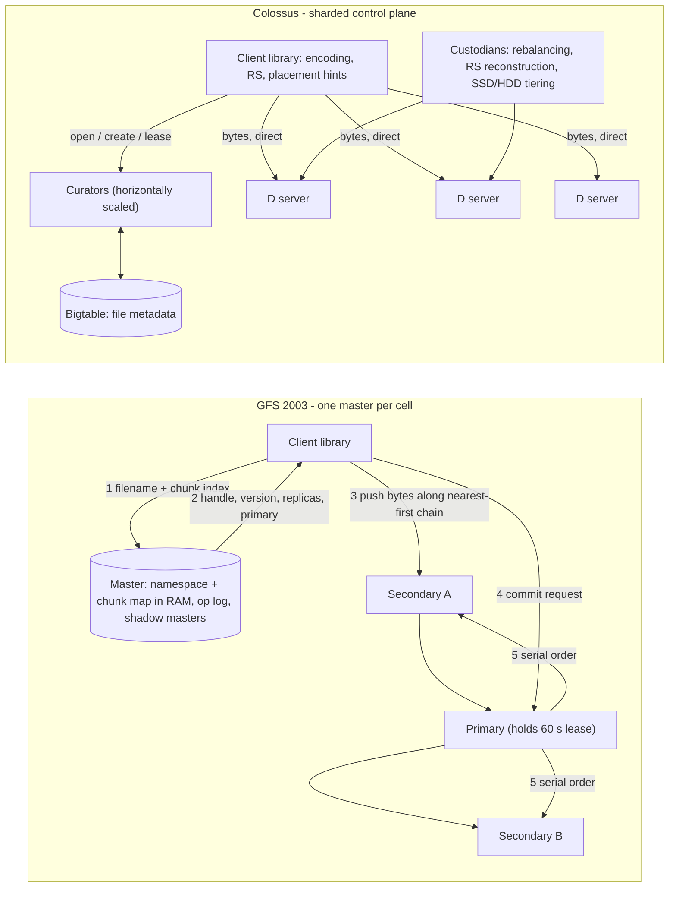

# Google File System (2003 SOSP) and Colossus

## TL;DR

- GFS separated control from data: one master kept all metadata in RAM (under 64 bytes per 64 MB chunk), and clients moved bytes directly to chunkservers over pipelined chains. The master was never on the data path, and that separation is the part of the design that has lasted.
- Mutation order comes from a 60-second chunk lease held by one primary replica, plus a chunk version number that fences off stale replicas. This is lease-based leadership without consensus on the data path, and it is safe only because the master waits for an old lease to expire before granting a new one.
- Record append is at-least-once and atomic per record, and it leaves padding and duplicates behind. The rest of the stack (MapReduce, Bigtable logs, readers) had to make records self-validating and self-identifying.
- The master failed on file count, metadata QPS and recovery time, not on bandwidth. Colossus sharded the master into horizontally scaled curators whose metadata lives in Bigtable, which gave more than 100x the metadata scale of the largest GFS clusters. Bytes still flow client to D server.
- Reed-Solomon, done in the client library, cuts raw overhead from 3x to about 1.5x. The costs are repair-read amplification (RS(6,3) reads 6 fragments to rebuild 1), worse degraded-read tails, and stricter failure-domain placement. Colossus now pairs this with SSD placement and a stateful handle protocol, which is how Rapid Bucket reaches sub-millisecond latency.

## Mental Model



In both systems the metadata service decides where bytes go and who may order mutations, and the bytes themselves never pass through it.
The data path scales with the number of disks and NICs.
The control path scales with the number of files, chunks, opens and lease grants.
GFS put the whole control path on one machine and kept it out of the data path with large chunks and client-side caching of locations.
That held until the file count and metadata rate grew.
Colossus kept the same split.
It sharded the control path across curators and moved its state into a database that already knew how to shard.
Every later Google storage product, including Cloud Storage, Spanner, BigQuery storage and Hyperdisk, is a client of this split.

## Internals

### The workload assumptions that justify every heresy

The GFS paper starts from four observations about Google's 2003 workload.
Component failures are the norm.
Files are multi-GB.
Most mutations are appends, not overwrites.
Co-designing the application and the file system API is acceptable.
Each design decision below only makes sense under these assumptions.
When the assumptions changed (many small files, latency-sensitive serving such as Gmail), the design broke in the places those assumptions had been holding up.

### GFS control plane: the single master

The master holds three kinds of metadata: the file and chunk namespaces, the mapping from files to chunks, and the location of each chunk's replicas ([GFS paper, SOSP 2003](https://static.googleusercontent.com/media/research.google.com/en//archive/gfs-sosp2003.pdf)).
Namespaces and the file-to-chunk mapping are persisted through an operation log.
Chunk locations are deliberately not persisted.
The master learns them by polling chunkservers at startup and keeps them current through HeartBeat messages.
This decision gets less attention than it deserves.
The chunkserver has the final word on which chunks it actually holds, because disks fail, get wiped and get renamed out from under the master.
If the master persisted locations, it would have a cache-coherence problem with thousands of machines.
By not persisting them, it never has to reconcile persisted state against the disks.

The namespace has no per-directory data structure.
It is a lookup table from full pathname to metadata, prefix-compressed in memory, at under 64 bytes per file.
Concurrency control uses read-write locks on path prefixes.
Creating `/home/user/foo` takes read locks on `/home` and `/home/user` and a write lock on `/home/user/foo`.
Two clients can therefore create files in the same directory concurrently, because neither takes a write lock on the directory.
A snapshot of `/home/user` takes a write lock on that path, which serializes against the read lock every create inside it must hold.

The master replies to a metadata mutation only after the log record is flushed to local disk and to remote replicas.
Flushes are batched to amortize the cost.
Recovery replays the log from the latest checkpoint.
Checkpoints use a compact B-tree-like form that can be memory-mapped without parsing, so recovery time is bounded by checkpoint size plus log tail.
Shadow masters replay the same log and serve read-only metadata.
They may lag the primary slightly, which is acceptable because file contents are read from chunkservers, not from the master.

### Leases, version numbers, and fencing

A mutation must be applied in the same order on every replica of a chunk.
GFS gets that order without running consensus per write.
The master grants a lease to one replica, the primary, with an initial timeout of 60 seconds.
The primary assigns consecutive serial numbers to all mutations it receives, and every secondary applies them in that order.
Lease extensions piggyback on HeartBeats, so a healthy primary keeps its lease without extra traffic.
Each time the master grants a new lease, it increments the chunk version number and records it persistently.
It also tells every up-to-date replica the new version before any client is told who the primary is.

The fencing argument goes like this.
If the master loses contact with a primary, it can safely grant a new lease once the old one has expired.
Expiry is measured on the master's own clock, so safety needs bounded clock drift rate, not synchronized clocks.
A replica that was down during a version bump comes back reporting an old version.
The master treats it as stale, excludes it from location replies, and garbage-collects it.
The master also puts the version number in its replies to clients, so a client or a cloning chunkserver can check it is talking to current data.
This is the same structure as a fencing token: a lease gives liveness and a monotonic epoch gives safety.
Compare it with the leader-lease plus term number in [[08-Distinguished-Engineering/02-Distributed-Systems-Internals/Raft-Consensus|Raft]].

### Data flow is decoupled from control flow

The client pushes data to all replicas before any write is committed.
It sends the data along a chain: each machine forwards to the closest replica that has not yet received it, with distances estimated from IP addresses.
Forwarding is pipelined over TCP, so a chunkserver starts forwarding as soon as bytes arrive.
The paper's ideal transfer time is `B/T + R*L` for B bytes, R replicas, link throughput T, and per-hop latency L.
At T = 100 Mbps, the B/T term for 1 MB is 8 Mb / 100 Mbps = 80 ms, and with sub-millisecond L the R*L term barely matters.
Pushed data sits in a chunkserver-side LRU buffer until the primary sends the commit.
The control message from client to primary is therefore small, and it has no effect on how data is routed through the topology.
This is the same principle as RDMA rendezvous protocols and as KV-cache transfer in [[17-Cloud-AI-Engineering/Volume_11_LLM_Serving_and_Inference_Systems_on_Cloud/Chapter_07_Prefill_and_Decode_Disaggregation|prefill/decode disaggregation]]: move bulk bytes along the topology-optimal path, and send ordering separately.

### Consistency model: consistent, defined, undefined

GFS defines a file region as consistent if all clients see the same bytes no matter which replica they read.
A region is defined if it is consistent and clients see what one mutation wrote in its entirety.
A successful serial write leaves the region defined.
Successful concurrent writes leave it consistent but undefined, meaning fragments of several writes are mixed together.
A failed write leaves it inconsistent: different replicas may hold different bytes.
Record append leaves defined regions interspersed with inconsistent ones.
The client library does not hide any of this, and applications are expected to cope.

### Record append: the mechanism getting-started guides never show

Record append turns a file into a multi-producer queue without any client-side locking.
The client pushes the record to all replicas of the file's last chunk and sends the request to the primary.
The primary checks whether the record fits in the current 64 MB chunk.
If it does not fit, the primary pads the chunk to its full length, tells the secondaries to pad too, and tells the client to retry on the next chunk.
To bound the waste from padding, a single append is capped at one quarter of the chunk size.
If it fits, the primary picks the offset, writes locally, and tells the secondaries to write at exactly that offset.
If any replica fails, the client retries the whole append.
The replicas that succeeded the first time now hold the record twice, and the replica that failed holds garbage at the earlier offset.
The guarantee is that the data is written atomically, as one contiguous range, at least once, at an offset the system chooses.

The consequence spreads up the stack.
Writers make records self-validating with checksums so readers can skip padding and fragments.
Writers make records self-identifying with unique IDs so readers can drop duplicates.
MapReduce outputs and Bigtable commit logs on GFS inherited this pattern (see [[17-Cloud-AI-Engineering/Volume_13_Seminal_Papers_and_Case_Studies/Chapter_08_Google_Bigtable|Google Bigtable (2006 OSDI)]]).
The modern equivalent is Rapid Bucket's appendable objects in Cloud Storage.
They come from the Colossus stateful protocol: a writer opens a handle and appends through a stream, with no record-append free-for-all.
The worked example below rebuilds GFS-style multi-writer appends on a standard bucket and shows that the at-least-once problem reappears at the commit layer.

### Integrity, placement, re-replication, and lazy GC

Each chunkserver checksums its own data in 64 KB blocks with 32-bit checksums, verifies them on every read, and scrubs idle chunks.
Replicas are not byte-identical, because padding and failed appends differ, so checksums cannot be compared across replicas.
That is why every replica must validate its own bytes.
Placement spreads replicas across racks, which protects against a rack switch or power loss at the cost of cross-rack write bandwidth.
New chunks go to chunkservers with below-average disk utilization, and the number of recent creations per chunkserver is limited, because a new chunk predicts heavy imminent writes.
Re-replication is prioritized by how far a chunk is below its replication goal, with a boost for chunks that are blocking client progress.
Clone traffic is throttled so a repair storm cannot starve foreground I/O.
Deletion is lazy.
The file is renamed to a hidden name and reclaimed after a configurable interval, three days by default.
Orphaned chunks are found by comparing HeartBeat chunk lists against the master's map.
Lazy GC turns a distributed delete into a local scan.
It also gives a free undo window, and it makes stale-replica cleanup and normal deletion the same mechanism.

### Why the single master broke

The ACM Queue interview with Sean Quinlan ([McKusick and Quinlan, "GFS: Evolution on Fast-forward", 2009](https://queue.acm.org/detail.cfm?id=1594206)) is the primary source for how GFS aged.
Google's 2017 PDSW keynote lists the problems tersely ([PDSW-DISCS 2017 keynote](https://pdsw.org/pdsw-discs17/slides/PDSW-DISCS-Google-Keynote.pdf)).
- One machine was not large enough for a large file system.
- The master was a single bottleneck for metadata operations.
- The master was fault tolerant but not highly available.
- There were no latency guarantees.

The arithmetic is in the worked example below.
At 64 bytes per chunk and per file, 100 PB of 1 GB files needs about 106 GB of master RAM, which was feasible.
100 PB of 1 MB files needs about 12.8 TB, which was not.
File count, not bytes, became the binding constraint once Bigtable, Gmail and other small-object users arrived.
Before Colossus, the workarounds were more GFS cells, multiple masters over shared chunkserver pools, and pushing small objects into Bigtable instead of files (UNVERIFIED: exact multi-cell mechanics as described in the 2009 interview).
Recovery time was the other problem: a failover window of tens of seconds or more is fine for batch MapReduce and unacceptable for user-facing serving.

### Colossus control plane: curators over Bigtable

Google's 2021 description names five components: the client library, curators, a metadata database, D file servers, and custodians ([Google Cloud blog, 2021-04](https://cloud.google.com/blog/products/storage-data-transfer/a-peek-behind-colossus-googles-file-system)).
Curators handle control operations such as file creation and scale horizontally.
They store file system metadata in Bigtable.
Google states this let Colossus scale more than 100x beyond the largest GFS clusters, and that the original motivation was GFS's metadata limits for Search.
Data flows directly between clients and D servers, which are network-attached disks with minimal logic.
Talks summarized by third parties describe D as closer to a block server than a file server (secondary source, [Zemb summary](https://pierrezemb.fr/posts/colossus-google/)).
Custodians are background managers for durability, availability and efficiency, including disk-space balancing and RAID reconstruction.
The client library implements software RAID and lets applications pick encodings that trade performance against cost.

The design moves complexity into the client.
GFS chunkservers did replication chaining themselves.
In Colossus the client decides the encoding and writes fragments to D servers itself.
D servers stay simple and identical, which lets them run on almost every machine in a cluster and share disks across tenants.
Custodians do the work that GFS's master did inline (re-replication, rebalancing) as asynchronous background jobs, a strict control-plane versus data-plane split (see [[17-Cloud-AI-Engineering/Volume_01_Cloud_Architecture_Principles/Chapter_04_Control_Plane_vs_Data_Plane_Separation|Control Plane vs Data Plane Separation]]).

The obvious circularity is that Bigtable stores its tablets on Colossus while Colossus stores its metadata in Bigtable.
Public talks describe the recursion ending in progressively smaller Colossus instances, with the smallest metadata held in Chubby (UNVERIFIED: not stated in the official blog posts).
Each level of the recursion holds orders of magnitude less metadata than the one above, so the bottom level is small enough for a single Paxos-replicated lock service.
The operational lesson is about bootstrap ordering.
A cold start of a cluster has to bring up the lowest level first, and that bootstrap path is exactly the kind of hidden circular dependency covered in [[17-Cloud-AI-Engineering/Volume_01_Cloud_Architecture_Principles/Chapter_02_Regions_Zones_and_Static_Stability|Regions, Zones, and Static Stability]].

Colossus is zonal.
Google calls it its "zonal cluster-level file system", and most data centers run one cluster and therefore one Colossus filesystem ([Google Cloud blog, 2025-04](https://cloud.google.com/blog/products/storage-data-transfer/how-the-colossus-stateful-protocol-benefits-rapid-storage); [The Register summary of the 2025-03 post](https://www.theregister.com/2025/03/27/google_l4_storage_performance_improvements/)).
Durability across zones and regions is therefore a property of the service layered on top, not of Colossus itself.
Cloud Storage regional and multi-region buckets, Spanner's Paxos groups and Hyperdisk replication each implement it (see [[17-Cloud-AI-Engineering/Volume_03_GCP_Deep_Dive/Chapter_09_Cloud_Storage_and_Colossus_Filesystem|Cloud Storage and Colossus Filesystem]]).
A Rapid zonal bucket exposes the raw zonal Colossus failure domain directly to customers, which is why its SLA differs from regional buckets.

### Reed-Solomon in production

Ford et al. formalized the vocabulary.
`R=n` means n identical replicas in a stripe.
`RS(n,m)` means n data blocks plus m code blocks, where any n of the n+m blocks reconstruct the stripe ([Ford et al., OSDI 2010](https://www.usenix.org/legacy/event/osdi10/tech/full_papers/Ford.pdf)).
RS(6,3) stores 9 fragments for 6 of data, which is 1.5x overhead, and survives any 3 losses.
R=3 costs 3x and survives 2.
The paper's most important finding concerns correlation, not code math.
Failure bursts larger than 20 nodes had rack affinity above 0.7, and bursts larger than 40 nodes had affinity of at least 0.9.
Large bursts were the dominant contributor to unavailability.
A code's tolerance is only real if the placement guarantees that no single failure domain holds more than m fragments of a stripe.
The paper also models multi-cell schemes such as `R=3x2` and `RS(6,3)x3`, where each cell holds a full encoding and recovers from a linked cell.
That is the conceptual ancestor of dual-region and multi-region buckets.

Three costs of RS show up in production that do not show up on a whiteboard.
First, repair-read amplification: rebuilding one lost RS(6,3) fragment reads 6 surviving fragments.
A dead 20 TB disk that was 80 percent full therefore pulls 96 TB across the fabric instead of 16 TB.
This is why Microsoft built Local Reconstruction Codes ([Huang et al., USENIX ATC 2012](https://www.usenix.org/conference/atc12/technical-sessions/presentation/huang)) and Facebook built locally repairable codes for HDFS ([Sathiamoorthy et al., VLDB 2013](https://arxiv.org/abs/1301.3791)).
Both trade a little extra storage for repair reads that touch a small local group.
Second, degraded reads: when a data fragment is unavailable, a read must fetch n fragments and decode them, so the request's tail latency becomes the maximum of n disk latencies instead of one.
Third, small writes and appends do not fit RS stripes well, because parity has to be recomputed as the stripe fills.
The common industry pattern is to write replicated first and transcode to RS once data is cold or the stripe is sealed.
Google has not published whether Colossus does exactly this for every encoding (UNVERIFIED for Colossus specifically).

### The real-time turn: SSD placement and the stateful protocol

The 2025 posts explain how Colossus serves latency-sensitive workloads on a fleet that is still mostly HDD ([Google Cloud blog, 2025-03](https://cloud.google.com/blog/products/storage-data-transfer/how-colossus-optimizes-data-placement-for-performance)).
The published expected latencies range from hundreds of milliseconds for standard Cloud Storage I/O, to tens of milliseconds for Gmail messages, to under 1 ms for Hyperdisk reads.
All of them run on the same filesystem abstraction.
The mechanism is a placement layer that decides per file whether data lives on SSD and for how long.
Reported policies include "place on SSD for one hour", "place on SSD for two hours" and "don't place on SSD" ([TechSpot summary](https://www.techspot.com/news/107332-google-colossus-internal-storage-system-relies-hdds-storing.html)).
The policies are chosen by simulating access patterns, so only data predicted to be re-read soon pays for flash.
The economics come from I/O density.
HDD capacity grows faster than HDD IOPS, so IOPS per TB falls every drive generation.
Flash used as a short-lived, predicted cache is a way to buy back IOPS without paying flash prices for every byte.

The second mechanism is the stateful protocol.
When a Colossus client opens a file, it gets a handle: state that includes which disks hold the file's data ([Google Cloud blog, 2025-04](https://cloud.google.com/blog/products/storage-data-transfer/how-the-colossus-stateful-protocol-benefits-rapid-storage)).
Later reads and writes go straight to those disks with no metadata lookups.
Rapid Bucket exposes this over gRPC bidirectional streams (`BidiReadObject`, `BidiWriteObject`).
Cloud Storage authorization and metadata access happen once, when the stream is created.
After that, each operation in the stream is a direct Colossus I/O, which gives sub-millisecond appends and ranged reads ([Google Developers blog, 2026](https://developers.googleblog.com/speeding-up-ai-bringing-google-colossus-to-pytorch-via-gcsfs-and-rapid-bucket/)).
This is the same move GFS made with client-side caching of chunk locations: move per-operation control-plane cost to per-session cost.
The difference is that it now applies to authorization too.
The risk is the same as in GFS: a cached handle can go stale, so the protocol needs explicit refresh operations.
The pricing page lists "Refresh Read Access Handle" and "Refresh Write Access Handle" as free operations, which is the visible trace of that mechanism ([Cloud Storage pricing, as of 2026-10](https://cloud.google.com/storage/pricing)).

## Numbers to Know

| Quantity | Value | Source |
| --- | --- | --- |
| GFS chunk size | 64 MB | GFS paper, SOSP 2003 |
| GFS default replication | 3 replicas, spread across racks | GFS paper, SOSP 2003 |
| GFS master metadata per chunk | under 64 bytes | GFS paper, SOSP 2003 |
| GFS namespace metadata per file | under 64 bytes, prefix-compressed | GFS paper, SOSP 2003 |
| GFS primary lease initial timeout | 60 s, extended via HeartBeat | GFS paper, SOSP 2003 |
| GFS checksum granularity | 32-bit checksum per 64 KB block | GFS paper, SOSP 2003 |
| GFS max record append size | 1/4 of chunk size (16 MB) | GFS paper, SOSP 2003 |
| GFS deleted-file retention | 3 days default, configurable | GFS paper, SOSP 2003 |
| GFS pipelined push, 1 MB at 100 Mbps | ~80 ms (B/T term) | GFS paper formula, computed |
| Rack affinity of failure bursts | above 0.7 for bursts over 20 nodes; at least 0.9 over 40 | Ford et al., OSDI 2010 |
| RS(6,3) vs R=3 raw overhead | 1.5x vs 3x; tolerates 3 vs 2 losses | Ford et al., OSDI 2010 notation, computed |
| RS(6,3) repair read per lost fragment | 6 fragments | computed |
| Colossus metadata scale vs largest GFS | over 100x | Google Cloud blog, 2021-04 |
| Largest Colossus filesystems | multiple EB; two exceed 10 EB each | Google Cloud blog, 2025-03 |
| Largest Colossus throughput | reads over 50 TB/s, writes up to 25 TB/s; busiest cluster over 600M IOPS | Google Cloud blog, 2025-03 |
| Hyperdisk ML on Colossus SSD | 2,500 nodes reading at 1.2 TB/s | Google Cloud blog, 2025-03 |
| Rapid Bucket status | GA since 2026-03-10 | Cloud Storage release notes, as of 2026-10 |
| Rapid Bucket throughput / QPS / latency | 15+ TB/s aggregate read, up to 20M QPS, sub-ms, per zonal bucket | Google Cloud blog, as of 2026-10 |
| Rapid storage SLA | 99.9% (zone); typical monthly over 99.95% | Cloud Storage docs, as of 2026-10 |
| Rapid Bucket prerequisites | hierarchical namespace + uniform bucket-level access | Cloud Storage docs, as of 2026-10 |
| Zonal bucket storage default quota | 1 TB, may vary by billing history | Cloud Storage quotas, as of 2026-10 |
| Rapid storage pricing model | per GB-hour, prorated per second, set per zone | Cloud Storage pricing, as of 2026-10 |
| GCS initial bucket I/O | ~1,000 object writes/s, ~5,000 object reads/s, then autoscale | Cloud Storage docs, as of 2026-10 |
| GCS ramp-up rule | no faster than doubling every 20 min | Cloud Storage docs, as of 2026-10 |
| GCS writes to same object name | 1 per second | Cloud Storage quotas, as of 2026-10 |
| GCS compose fan-in | 32 source objects per request | Cloud Storage quotas, as of 2026-10 |
| GCS Standard regional storage list price | ~$0.020/GB-month (us-central1) | UNVERIFIED, as of 2026-10 |
| S3 per-prefix request baseline | 3,500 writes/s, 5,500 reads/s per partitioned prefix | UNVERIFIED, as of 2026-10 |

## AWS vs GCP Mechanism Parity

| Dimension | Google (GFS to Colossus) | AWS (S3, EBS) | Critical difference |
| --- | --- | --- | --- |
| Lineage | GFS (2003) then Colossus; public papers on GFS, blog-level detail on Colossus | S3 internals partly public via [[17-Cloud-AI-Engineering/Volume_13_Seminal_Papers_and_Case_Studies/Chapter_05_Amazon_S3_ShardStore_Formal_Methods\|ShardStore (SOSP 2021)]]; EBS via [[17-Cloud-AI-Engineering/Volume_13_Seminal_Papers_and_Case_Studies/Chapter_03_Physalia_EBS_Control_Plane\|Physalia]] | Google built one filesystem under all products; AWS publicly describes per-service storage stacks |
| Metadata plane | Curators, horizontally scaled, state in Bigtable | S3 index subsystem and placement subsystem (named in the 2017 PIR) | Both shard metadata; S3's 2017 outage showed a full restart of the index subsystem took hours |
| Data servers | D servers: thin, disk-attached, checksum-only | ShardStore storage nodes: LSM-based key-value store per node | Colossus keeps servers thin and puts encoding in the client; ShardStore puts significant logic in the node |
| Redundancy | Client-library software RAID; RS and replication encodings chosen per application | Erasure coding inside S3 (Warfield, FAST 2023 keynote) | GCP exposes no encoding knob to customers; neither does S3 |
| Mutation ordering | GFS: chunk lease plus version number; Colossus: client obtains lease from curator | Not exposed; S3 objects are immutable with strong read-after-write | GFS leases were customer-visible semantics; in the cloud they are hidden behind immutable-object APIs |
| Zonal low-latency tier | Rapid Bucket: zonal, stateful gRPC streams, appendable objects (GA 2026-03) | S3 Express One Zone directory buckets with session auth via CreateSession | Both amortize authorization per session; Rapid does it per stream, S3 Express per short-lived session token (UNVERIFIED token lifetime) |
| Appends | Native appendable objects in zonal buckets; compose (32 sources) elsewhere | Appends supported in S3 Express One Zone (UNVERIFIED API details); S3 general purpose is immutable | Neither offers GFS multi-writer record append; single writer per handle or CAS |
| Read caching | Colossus SSD placement internally; Rapid Cache (formerly Anywhere Cache) for existing buckets | No managed in-place S3 read cache; FSx for Lustre or client caches | GCP offers a managed zonal cache over regional and multi-region buckets |
| Request scaling | Per-bucket key-index autoscaling from ~1k/5k ops/s; ramp by doubling per 20 min | Per-prefix partition autoscaling (UNVERIFIED baseline) | GCS hotspots on key ranges; S3 on prefixes; both punish sequential key names |
| Block storage substrate | Hyperdisk and Persistent Disk built on Colossus | EBS on dedicated storage servers with Physalia configuration consensus | GCP block storage shares the filesystem substrate with object storage; EBS is a separate stack |
| Failure domain | Colossus is zonal; cross-zone durability is implemented by the layered service | S3 Standard stores across multiple AZs; S3 Express One Zone is single-AZ | Zonal tiers on both clouds trade zone-loss survival for latency |

## Worked Example: Rebuilding Record Append on Cloud Storage, and Sizing the Storage Underneath

The lab has two parts.
Part A is an offline Python model that reproduces the master-memory, erasure-coding and repair-traffic arithmetic in this chapter.
Part B runs against a real regional bucket and rebuilds GFS-style multi-writer appends with `compose` and generation preconditions.
It measures the commit-rate ceiling that the per-object write limit imposes.

### Part A: offline capacity model (no cost)

```python
#!/usr/bin/env python3
"""Back-of-the-envelope sizing for GFS-style and Colossus-style storage. Pure stdlib."""
from math import comb

MB, TB, PB = 10**6, 10**12, 10**15
CHUNK, META_PER_CHUNK, META_PER_FILE = 64 * MB, 64, 64   # GFS paper bounds


def master_ram(logical_bytes, avg_file_bytes):
    files = logical_bytes // avg_file_bytes
    chunks = files * max(1, -(-avg_file_bytes // CHUNK))  # every file costs >= 1 chunk
    return files, chunks, files * META_PER_FILE + chunks * META_PER_CHUNK


print("== GFS master RAM ==")
for logical, avg in [(1 * PB, 1024 * MB), (1 * PB, 1 * MB), (100 * PB, 1024 * MB), (100 * PB, 1 * MB)]:
    f, c, ram = master_ram(logical, avg)
    print(f"logical={logical/PB:>5.0f} PB avg_file={avg/MB:>6.0f} MB files={f:>14,} ram={ram/1e9:>9.1f} GB")

LOGICAL = 100 * PB
schemes = {"R=3": (1, 2), "RS(6,3)": (6, 3), "RS(10,4)": (10, 4)}
print("\n== Raw bytes for 100 PB logical ==")
for name, (k, m) in schemes.items():
    print(f"{name:9s} overhead={(k+m)/k:.2f}x raw={LOGICAL*(k+m)/k/PB:6.0f} PB tolerates {m}")

DISK, FILL, D, B = 20 * TB, 0.8, 2000, 20 * MB   # assumptions: disk size, fill, repair fan-in, MB/s per disk
lost = DISK * FILL
print(f"\n== Repair of one failed disk (lost = {lost/TB:.0f} TB) ==")
for name, (k, m) in schemes.items():
    read = lost * (1 if name == "R=3" else k)
    print(f"{name:9s} fabric read={read/TB:6.0f} TB time={read/(D*B)/60:5.1f} min")

AFR, WINDOW_H = 0.02, 1.0                        # assumptions: 2% AFR, 1 h repair window
p = AFR * WINDOW_H / (365 * 24)
print("\n== P(stripe lost | one fragment already lost), independent failures ==")
for name, (k, m) in schemes.items():
    n, rem = k + m, k + m - 1
    pl = sum(comb(rem, j) * p**j * (1 - p) ** (rem - j) for j in range(m, rem + 1))
    print(f"{name:9s} P={pl:.3e}  needs >= {-(-n // m)} failure domains (<= {m} fragments each)")
```

Output from `python3 dfs_sizing.py`:

```text
== GFS master RAM ==
logical=    1 PB avg_file=  1024 MB files=       976,562 ram=      1.1 GB
logical=    1 PB avg_file=     1 MB files= 1,000,000,000 ram=    128.0 GB
logical=  100 PB avg_file=  1024 MB files=    97,656,250 ram=    106.2 GB
logical=  100 PB avg_file=     1 MB files=100,000,000,000 ram=  12800.0 GB

== Raw bytes for 100 PB logical ==
R=3       overhead=3.00x raw=   300 PB tolerates 2
RS(6,3)   overhead=1.50x raw=   150 PB tolerates 3
RS(10,4)  overhead=1.40x raw=   140 PB tolerates 4

== Repair of one failed disk (lost = 16 TB) ==
R=3       fabric read=    16 TB time=  6.7 min
RS(6,3)   fabric read=    96 TB time= 40.0 min
RS(10,4)  fabric read=   160 TB time= 66.7 min

== P(stripe lost | one fragment already lost), independent failures ==
R=3       P=5.213e-12  needs >= 2 failure domains (<= 2 fragments each)
RS(6,3)   P=6.664e-16  needs >= 3 failure domains (<= 3 fragments each)
RS(10,4)  P=1.943e-20  needs >= 4 failure domains (<= 4 fragments each)
```

Step-by-step reading of the model:

1. Bytes never threatened the GFS master. Going from 1 GB files to 1 MB files at the same 1 PB multiplies master RAM by about 120x (from 1.06 GB to 128 GB), because every file costs at least one chunk record.
2. RS(6,3) halves raw capacity relative to R=3. At 100 PB logical that is 150 PB of disks not bought, which dominates the TCO of a storage fleet.
3. The price is a 6x larger repair read. With the same throttled repair budget, the vulnerable window is 6x longer, and the probability model has to use the longer window for RS.
4. The independent-failure probabilities look astronomically safe, and they are misleading. Ford et al. show that failures are bursty and rack-correlated, so in practice the binding constraint is the last line: how many failure domains each stripe is spread across.
5. RS(6,3) across only 2 racks puts at least 5 fragments in one rack, and losing that rack loses the stripe. The code is only as strong as its placement.

### Part B: multi-writer append log on a real bucket

Cost estimate: one regional Standard bucket holding under 1 MB for under an hour, plus about 400 Class A operations (uploads, composes) and 200 Class B operations (reads).
At list prices this rounds to under $0.01 (UNVERIFIED per-operation list price, as of 2026-10).
Budget alarm first, then resources, then teardown.

```bash
#!/usr/bin/env bash
set -euo pipefail
export PROJECT_ID="$(gcloud config get-value project)"
export BILLING_ACCOUNT="XXXXXX-XXXXXX-XXXXXX"        # your billing account ID
export REGION="us-central1"
export LAB_BUCKET="gfs-lab-${PROJECT_ID}-$RANDOM"

# 1. Budget alarm: alert at 50% and 100% of 5 USD, scoped to this project
gcloud billing budgets create \
  --billing-account="${BILLING_ACCOUNT}" \
  --display-name="gfs-colossus-lab" \
  --budget-amount=5USD \
  --threshold-rule=percent=0.5 \
  --threshold-rule=percent=1.0 \
  --filter-projects="projects/${PROJECT_ID}"

# 2. Regional bucket, uniform bucket-level access, no public access
gcloud storage buckets create "gs://${LAB_BUCKET}" \
  --project="${PROJECT_ID}" \
  --location="${REGION}" \
  --uniform-bucket-level-access \
  --public-access-prevention

# 3. Run the append-log experiment
python3 -m venv .venv && . .venv/bin/activate
pip install google-cloud-storage
WRITERS=4 BATCHES=5 python3 gcs_append_log.py
```

```python
#!/usr/bin/env python3
"""Multi-writer append log on Cloud Storage: GFS record-append semantics rebuilt from
compose + generation preconditions. Requires: pip install google-cloud-storage
Env: LAB_BUCKET=<existing bucket>. Writers=4, batches=5 by default.
"""
import os
import sys
import threading
import time
import uuid
import zlib

from google.api_core.exceptions import PreconditionFailed, TooManyRequests, ServiceUnavailable
from google.cloud import storage

BUCKET = os.environ["LAB_BUCKET"]
LOG = "log/events.log"
MAX_COMPOSE_SOURCES = 32          # Cloud Storage limit per compose request
WRITERS = int(os.environ.get("WRITERS", "4"))
BATCHES = int(os.environ.get("BATCHES", "5"))
RECORDS_PER_BATCH = 8             # must be <= MAX_COMPOSE_SOURCES - 1

stats = {"commits": 0, "conflicts": 0, "throttled": 0, "fenced_dupes_avoided": 0}
lock = threading.Lock()


def record(payload: str) -> bytes:
    rid = uuid.uuid4().hex
    body = f"{rid}\t{payload}"
    return f"{body}\t{zlib.crc32(body.encode()):08x}\n".encode()


def ensure_log(bucket):
    try:
        bucket.blob(LOG).upload_from_string(b"", if_generation_match=0)
    except PreconditionFailed:
        pass  # someone else created it first; that is fine


def stage(bucket, batch_id, payloads):
    names = []
    for i, p in enumerate(payloads):
        name = f"staging/{batch_id}/{i:04d}"
        bucket.blob(name).upload_from_string(record(p), if_generation_match=0)
        names.append(name)
    return names


def commit(bucket, batch_id, staged, max_attempts=12):
    for attempt in range(max_attempts):
        log = bucket.get_blob(LOG)
        if (log.metadata or {}).get("last_batch") == batch_id:
            with lock:
                stats["fenced_dupes_avoided"] += 1
            return  # an earlier attempt succeeded but its response was lost
        dest = bucket.blob(LOG)
        dest.metadata = {"last_batch": batch_id}
        sources = [log] + [bucket.blob(n) for n in staged]
        try:
            dest.compose(sources, if_generation_match=log.generation)
            with lock:
                stats["commits"] += 1
            return
        except PreconditionFailed:
            with lock:
                stats["conflicts"] += 1
        except (TooManyRequests, ServiceUnavailable):
            with lock:
                stats["throttled"] += 1
        # full jitter backoff, capped at 2 s
        time.sleep((int.from_bytes(os.urandom(2), "big") / 65535) * min(2.0, 0.1 * 2 ** attempt))
    raise RuntimeError(f"batch {batch_id} not committed after {max_attempts} attempts")


def writer(wid):
    bucket = storage.Client().bucket(BUCKET)  # one client per thread
    for b in range(BATCHES):
        batch_id = f"w{wid}-b{b}-{uuid.uuid4().hex[:8]}"
        staged = stage(bucket, batch_id, [f"writer={wid} batch={b} n={i}" for i in range(RECORDS_PER_BATCH)])
        commit(bucket, batch_id, staged)
        for n in staged:
            bucket.blob(n).delete()


def verify(bucket):
    data = bucket.blob(LOG).download_as_bytes().decode()
    seen, bad, dup = set(), 0, 0
    for line in data.splitlines():
        rid, payload, crc = line.split("\t")
        if f"{zlib.crc32((rid + chr(9) + payload).encode()):08x}" != crc:
            bad += 1
        elif rid in seen:
            dup += 1
        else:
            seen.add(rid)
    return len(seen), dup, bad


if __name__ == "__main__":
    assert RECORDS_PER_BATCH <= MAX_COMPOSE_SOURCES - 1
    bkt = storage.Client().bucket(BUCKET)
    ensure_log(bkt)
    t0 = time.time()
    threads = [threading.Thread(target=writer, args=(w,)) for w in range(WRITERS)]
    [t.start() for t in threads]
    [t.join() for t in threads]
    elapsed = time.time() - t0
    unique, dup, bad = verify(bkt)
    expected = WRITERS * BATCHES * RECORDS_PER_BATCH
    print(f"elapsed={elapsed:.1f}s commits={stats['commits']} commit_rate={stats['commits']/elapsed:.2f}/s")
    print(f"conflicts(412)={stats['conflicts']} throttled(429/503)={stats['throttled']} fenced={stats['fenced_dupes_avoided']}")
    print(f"records unique={unique} expected={expected} duplicates={dup} corrupt={bad}")
    sys.exit(0 if unique == expected and bad == 0 else 1)
```

What the experiment shows, and why it maps back to GFS:

1. The generation number plays the role of the GFS chunk version number. `if_generation_match` is a fencing token, so a writer holding a stale view gets HTTP 412 instead of silently overwriting.
2. Commit rate is capped by the documented 1 write per second per object name, no matter how many writers you add. More writers only raise the 412 count. The only way to scale is group commit: stage up to 31 segments and fold them into one compose. This is the reason GFS record append existed, since it let hundreds of producers append to one file without serializing through the client.
3. The `last_batch` metadata check handles the common lost-response case. A compose that succeeded but whose HTTP response was lost would otherwise be retried and append the batch twice, which is exactly the GFS at-least-once duplicate.
4. The fence fails if another writer commits between your lost success and your retry, because that writer overwrites `last_batch`. That is why each record still carries a unique ID and a CRC, and why `verify()` deduplicates. End-to-end idempotency at the reader is the GFS lesson, and conditional writes do not remove the need for it.
5. On a Rapid zonal bucket you would replace this whole construction with an appendable object written through one open `BidiWriteObject` stream. That brings back single-writer append at sub-millisecond latency, at the cost of a zonal failure domain. See the official guide for the current client API ([Cloud Storage docs, as of 2026-10](https://docs.cloud.google.com/storage/docs/rapid/use-objects-in-zonal-buckets)).

### Capacity sizing: checkpoint storage for a 4,096-accelerator training job

The assumptions: a 70B-parameter dense model, bf16 weights, Adam with fp32 master weights and two fp32 moments, 512 hosts with 8 accelerators each, and a checkpoint every 30 minutes.

1. Checkpoint size: weights take 70e9 x 2 B = 140 GB, and optimizer state takes 70e9 x 12 B = 840 GB, so each checkpoint is about 980 GB.
2. Write budget: to keep the stall under 30 s with synchronous save, the job needs 980 GB / 30 s = about 33 GB/s aggregate, or about 64 MB/s per host. Per-host NIC bandwidth is not the bottleneck. Object count and request rate are.
3. Object count: if each of 4,096 ranks writes 8 tensor-shard files, a checkpoint is 32,768 objects under a new prefix.
4. On a standard regional bucket, a new key range starts at about 1,000 writes/s. 32,768 creates take about 33 s in creates alone, before autoscaling. Reaching 32,000 writes/s by the documented ramp rule needs 5 doublings at 20 minutes each, about 100 minutes ([Cloud Storage docs, as of 2026-10](https://docs.cloud.google.com/storage/docs/request-rate)). Mitigations: shard keys with a random leading component, keep a stable prefix layout so the index range stays warm, write fewer and larger objects, or use a hierarchical-namespace bucket, which Google states has higher initial QPS.
5. On a Rapid zonal bucket, 20M QPS and 15+ TB/s make both the 33 GB/s and the 32,768 objects trivial. The new constraints are the 1 TB default zonal-bucket quota, since keeping 3 checkpoints needs about 2.9 TB and a quota increase, and the zonal failure domain.
6. Durability plan: write every checkpoint to Rapid for fast restart. Asynchronously copy every Nth checkpoint to a regional or multi-region bucket so that losing a zone costs at most N x 30 minutes of training, not the run.
7. Cost formula: Rapid storage is billed per GB-hour by zone, so the monthly cost is about `retained_GB x 730 x zonal_hourly_rate`, plus operations, plus the durable-copy bucket. Take the current zonal rate from the pricing page. This chapter does not quote a Rapid rate because it could not be verified (see [[17-Cloud-AI-Engineering/Volume_10_AI_Infrastructure_on_Cloud/Chapter_06_High_Throughput_Checkpointing_to_Object_Storage|High-Throughput Checkpointing to Object Storage]]).

### Teardown

```bash
gcloud storage rm --recursive "gs://${LAB_BUCKET}"
gcloud billing budgets list --billing-account="${BILLING_ACCOUNT}" --format="value(name,displayName)"
gcloud billing budgets delete BUDGET_ID --billing-account="${BILLING_ACCOUNT}"   # BUDGET_ID from the list output
deactivate && rm -rf .venv
```

## Failure Modes and Pitfalls

### Metadata service as the real single point of failure

GFS's master was fault tolerant through log replication and shadow masters, but it was not highly available.
A failover meant a restart plus chunk-location polling of every chunkserver, and writes stalled while it ran.
AWS's 2017 us-east-1 S3 event shows the same pattern at cloud scale.
A command input error removed more capacity than intended from the index and placement subsystems.
Both then needed a full restart, which took hours because they had not been fully restarted in years as the region grew ([AWS PIR, 2017-02](https://aws.amazon.com/message/41926/)).
The lesson is that metadata recovery time grows with metadata size.
If the restart path is not exercised regularly, it is untested at current scale.
Colossus's sharded curators reduce how much of the system a single failure takes out.
They do not remove the need to rehearse cold start of the lowest bootstrap layer (see [[17-Cloud-AI-Engineering/Volume_07_Reliability_and_SRE/Chapter_07_Anatomy_of_Major_Cloud_Outages|Anatomy of Major Cloud Outages]]).

### Repair storms

When many replicas drop below their goal at once, unthrottled re-replication saturates disks and the network.
That increases timeouts, which marks more replicas as lost, which triggers more repair.
The 2011 EBS us-east-1 event is the canonical public example.
A network change isolated many EBS nodes, and their simultaneous attempts to find new mirrors exhausted free capacity and overwhelmed the control plane ([AWS PIR, 2011-04](https://aws.amazon.com/message/65648/)).
GFS throttled clone operations globally and per chunkserver, and prioritized chunks by how many replicas they had lost.
Ford et al. note the system waited before starting recovery so that short node restarts would not trigger it.
RS makes storms worse, because every repaired fragment costs k reads.
Repair bandwidth budgets therefore have to be sized for the worst correlated burst, not the steady-state annual failure rate.

### Correlated failures defeat the arithmetic

Independent-failure models give durability numbers with a dozen nines.
Power, rack switch and rolling-upgrade failures arrive in bursts, and they follow topology.
Placement must constrain fragments per rack, per power domain and per upgrade domain at the same time.
Upgrades are the most overlooked case: a fleet-wide kernel rollout that restarts one machine per rack at a time is a perfectly rack-correlated failure if it ignores stripe membership.
Google has publicly reported a 2015 europe-west1-b incident in which repeated lightning strikes on the local power grid caused permanent loss of a very small fraction of Persistent Disk data (UNVERIFIED: exact figures and incident ID not re-checked this session).

### Small-file hot spots

The GFS paper reports a hot spot when a batch-queue system stored an executable as a single-chunk file and then started it on hundreds of machines at once.
The few chunkservers holding that chunk were overloaded.
The fix was a higher replication factor for such files plus staggered start times.
Cloud Storage's version of this is key-range hotspotting.
Sequential names such as timestamps concentrate writes on one index range, and a new prefix starts cold.
The documented fix is the same idea: spread the load (random key prefixes) and ramp up gradually.

### At-least-once appends poisoning downstream aggregates

Any pipeline that counts records from a GFS-style append log without deduplicating by record ID over-counts after retries.
The failure is invisible until someone reconciles against a source of truth.
The CAS-and-compose lab shows that conditional writes narrow the window but do not close it once responses can be lost.
Idempotency has to be checked at the consumer.

### Stale location caches and stale handles

GFS clients cache chunk locations.
A client can read from a stale replica until the cache entry times out or the file is reopened.
For append-only files this mostly shows up as a premature end of chunk, not as wrong bytes.
Rapid Bucket handles bring the same trade-off back: a long-lived stream skips per-operation authorization and metadata work.
Revocation and placement changes then take effect only when the handle is refreshed or the stream is re-established.
That is a security consideration too, covered below.

### Degraded-read tail amplification

With RS(n,m), a read whose data fragment sits on a slow or failed disk becomes an n-way fan-out with decode.
Its latency is the maximum over n disks.
At p99 this is the [tail at scale](https://research.google/pubs/the-tail-at-scale/) problem moved into the storage layer.
Hedged fragment reads (asking for n+1 fragments and decoding from the first n) trade extra I/O for a lower tail.

### Zonal storage blast radius

A Rapid zonal bucket's SLA is 99.9% against a zone.
Data in it lives in one zonal Colossus filesystem.
Teams that move checkpoints or training shards to Rapid for the latency and drop the cross-zone copy have quietly downgraded their failure domain from region to zone.

### API-level ceilings that look like Colossus limits but are not

The 1 write per second limit per object name, the 1 metadata update per second per object, and the 32-source compose fan-in are Cloud Storage API limits ([Cloud Storage quotas, as of 2026-10](https://docs.cloud.google.com/storage/quotas)).
Designs that use one object as a counter, lock or manifest hit them immediately.
Use a database for coordination and object storage for bytes, which is the same split GFS made between master and chunkservers.

## Security and Cost Angles

### IAM scoping

For an append-only producer on standard buckets, grant `storage.objects.create` on the staging prefix through IAM Conditions, without delete.
Overwriting an existing object name requires delete permission, so a create-only principal cannot destroy history.
The compose-based committer, which overwrites the log object, needs delete on exactly one object name.
Isolate it in a separate service account from the producers.
Rapid Bucket requires uniform bucket-level access, which removes per-object ACLs and makes IAM the only authorization path.
That is simpler to audit and impossible to grant per object.
Because Rapid streams authorize at stream creation, cap how long streams live in your client so that IAM revocations take effect within a bounded time.
Verify against the current docs how in-flight handles respond to revocation, since Google does not specify this in the material reviewed (UNVERIFIED).
See [[17-Cloud-AI-Engineering/Volume_03_GCP_Deep_Dive/Chapter_02_Cloud_IAM_Roles_Policies_and_Conditions|Cloud IAM: Roles, Policies, and Conditions]].

### Encryption hierarchy

Cloud Storage encrypts data at rest with data encryption keys that are themselves wrapped by key encryption keys.
CMEK replaces the top of that chain with a Cloud KMS key you control, so disabling the key makes the data unreadable.
Check whether CMEK and the other bucket features you rely on are supported on Rapid zonal buckets before you migrate (UNVERIFIED: Rapid CMEK support not confirmed this session).
See [[17-Cloud-AI-Engineering/Volume_08_Security_Identity_and_the_Data_Perimeter/Chapter_04_Encryption_Key_Hierarchies_and_Envelope_Encryption|Encryption Key Hierarchies and Envelope Encryption]].

### Network perimeter

Put `storage.googleapis.com` inside a VPC Service Controls perimeter, so that stolen credentials cannot copy training data to a bucket in another project.
Route traffic through Private Google Access instead of public egress.
The AWS equivalent is an S3 gateway or interface endpoint with an endpoint policy that limits access to your organization's buckets (see [[17-Cloud-AI-Engineering/Volume_03_GCP_Deep_Dive/Chapter_03_VPC_Service_Controls_Security_Perimeters|VPC Service Controls]] and [[17-Cloud-AI-Engineering/Volume_08_Security_Identity_and_the_Data_Perimeter/Chapter_06_Constructing_an_Impenetrable_Data_Perimeter|Constructing an Impenetrable Data Perimeter]]).

### Unit-economics levers

- Redundancy is the largest cost lever, and on managed object storage you choose it through location type (zonal, regional, dual-region, multi-region), not through a code parameter. Pay for cross-zone or cross-region durability only for data that cannot be regenerated, and keep regenerable intermediates in the cheapest durable tier.
- Request count, not bytes, dominates the bill and the throttling risk for small-object workloads. Batch into larger objects (WebDataset-style shards, compose) to cut Class A operations and index load at the same time (see [[17-Cloud-AI-Engineering/Volume_10_AI_Infrastructure_on_Cloud/Chapter_07_High_Throughput_Data_Loaders_and_Storage_IO|High-Throughput Data Loaders and Storage I/O]]).
- Rapid storage is billed per GB-hour, so short-lived data such as hot checkpoints and staging shards should be deleted as soon as it is superseded. Lifecycle rules work in days, which is too coarse for hourly-billed storage, so delete explicitly in the training loop.
- Rapid Cache in front of an existing regional or multi-region bucket can be cheaper than duplicating a dataset into a zonal bucket when reads repeat and the dataset is large.

## Interview Questions and Model Answers

### Question 1 (L5 - Senior)

Why did GFS choose 64 MB chunks and a single master, and what broke first?

#### Model Answer

Large chunks shrink the master's metadata and traffic.
At under 64 bytes per chunk, a petabyte of large files needs about 1 GB of master RAM, so the whole map fits in memory and lookups are memory-speed.
Large chunks also let a client cache locations for a long time and keep a persistent TCP connection to one chunkserver for a long sequential read or append.
That takes the master out of the data path almost entirely.
A single master makes placement, re-replication and lease decisions with global knowledge and no distributed agreement.
The paper argues this was fine because the master handles only metadata.

The first thing to break was file count.
Every file costs at least one chunk record and one namespace entry no matter how small it is, so 1 MB files cost about 120x more master RAM per byte than 1 GB files (128 GB versus 1.06 GB per PB).
Metadata QPS and failover time came next, once latency-sensitive services arrived.
Bandwidth never broke, because it was never on the master.
A secondary problem was hot small files: a one-chunk executable launched on hundreds of machines overloaded its three replicas, which forced per-file replication factors.

#### Follow-up Interviewer Question

If you could change only one GFS parameter to support a billion 100 KB files without a redesign, which would it be and what would it cost you?

### Question 2 (L5 - Senior)

Walk through a GFS write.
A secondary times out after the primary has applied the mutation.
What state is the region in, and what does the client do?

#### Model Answer

The client asks the master for the primary and the replicas, and gets the chunk handle, the version number and the locations, which it caches.
It pushes the data along a nearest-first chain, where it is buffered in each chunkserver's LRU cache.
It then sends the write request to the primary.
The primary assigns a serial number, applies the write locally, and forwards the request to the secondaries, which apply it in serial-number order.
If one secondary fails, the primary returns an error to the client.
The region is now inconsistent: the primary and the healthy secondary hold the new bytes and the failed replica does not.
The client retries the push and the write.
A retry can land concurrently with other writers, so the region may end up consistent but undefined.
The system does not roll back.
It relies on the client retrying and, if the replica stays bad, on the master excluding it.
That happens through HeartBeat-detected failure or through version-number checks at the next lease grant, and the master then re-replicates from a good copy.
The design choice was to give up atomic multi-replica writes in exchange for no two-phase commit on the data path.
Applications compensate by preferring append over overwrite and by validating records.

#### Follow-up Interviewer Question

How does the chunk version number keep the failed secondary from serving reads after it comes back with stale data?

### Question 3 (L6 - Staff)

Design an exactly-once, multi-producer append log on Cloud Storage for 500 producers writing about 2,000 records per second, and explain how it differs from GFS record append.

#### Model Answer

GFS record append gave many producers atomic, at-least-once appends to one file, with the primary choosing offsets.
Cloud Storage objects are immutable and each object name accepts about 1 write per second, so a naive shared log object commits at most about one batch per second.
I would separate staging from committing.
Each producer writes immutable segment objects with `if_generation_match=0` under randomized prefixes, which scales with the bucket's key-index autoscaling.
A small number of committers, ideally one per log partition chosen through a lease in a database, fold up to 31 segments per compose into the partition's log object.
Each compose uses `if_generation_match` on the current generation as the fencing token.
At about one compose per second per partition, 2,000 records per second needs either about 65 records per segment (31 segments x ~65 = ~2,000 records folded per compose) or about 4 to 8 partitions for headroom.
Exactly-once needs two layers.
The committer records the last committed batch ID in the object's metadata, so a retry after a lost response is detected.
Every record carries a unique ID and a checksum, and consumers deduplicate, because a lost response followed by another committer's success defeats the metadata fence.
If sub-millisecond latency matters and a zonal failure domain is acceptable, Rapid Bucket appendable objects remove the compose tree, but they are single-writer per stream.
So I would still partition by producer group and have a manifest in a database record partition order.
For a durable order that spans regions, I would put the ordering in a database such as Spanner and keep object storage for payload bytes only.

#### Follow-up Interviewer Question

Your committer's lease expires while a compose is in flight, and a new committer takes over.
Walk through why the log cannot fork.

### Question 4 (L6 - Staff)

You run 100 PB on R=3.
Finance wants RS(6,3).
Make the case for it and against it, with numbers.

#### Model Answer

The case for it is that RS(6,3) is 1.5x overhead versus 3x, so raw capacity drops from 300 PB to 150 PB.
On a disk fleet that is roughly half the drives, servers, power and floor space, and it tolerates 3 losses per stripe instead of 2.
The case against it, or at least the conditions on it, starts with repair.
Rebuilding one lost fragment reads 6, so a failed 20 TB disk that was 80 percent full pulls 96 TB across the fabric instead of 16 TB.
With a fixed repair budget, the window of reduced redundancy is 6x longer, and repair traffic competes with foreground I/O during exactly the correlated bursts where both spike.
Degraded reads fan out to 6 disks, so p99 read latency during repair is set by the slowest of 6.
Small writes and appends do not fit stripes, so I would write replicated and transcode once data is sealed, which needs temporary extra capacity and transcoding I/O.
Placement must put at most 3 of the 9 fragments in any rack or power domain, so at least 3 independent domains, and preferably 9, so that a rolling upgrade never takes 2 fragments of one stripe at once.
I would migrate cold, large, sealed data first, keep hot small objects and active append tails replicated, and evaluate an LRC variant if repair bandwidth is the binding constraint.
The success metric is not storage saved.
It is storage saved with p99 read latency and modeled durability under the Ford et al. burst model unchanged.

#### Follow-up Interviewer Question

How would you size the repair bandwidth throttle so that a 40-node rack-correlated burst neither loses data nor violates foreground read SLOs?

### Question 5 (L6 - Staff)

GFS uses leases instead of consensus to order writes.
Prove it is safe when the master is partitioned from the primary, and state the assumptions.

#### Model Answer

Safety means at most one primary per chunk can get a mutation accepted at a given time.
The master grants a lease for a fixed duration, 60 seconds initially, measured from its own clock.
On every grant it bumps a persistent version number and informs the current replicas.
If it is partitioned from the primary, it does not issue a new lease until the old one has expired by its own clock, plus a margin.
That requires the master's and primary's clocks to drift at a bounded rate.
They do not need to be synchronized.
The primary stops accepting mutations when its lease expires by its own clock, and because its clock may run slow, the master's wait must cover the worst-case drift.
A primary that resurfaces after expiry has no lease and stops ordering writes.
A replica that missed the version bump is detected as stale by its version and is not handed to clients.
The residual risks are a process pause on the primary between checking its lease and applying a mutation, and replicas that accept a forwarded mutation without checking the primary's epoch.
Robust systems close the first by having replicas reject mutations tagged with an older epoch, which is the fencing-token pattern.
The second is closed by giving secondaries the version too.
The master itself is a single decision-maker made durable by log replication, so leases plus versions are sufficient there.
In Colossus the curator issues leases, and the epoch-check discipline matters more because curators are many and sharded.

#### Follow-up Interviewer Question

Where exactly would you put the epoch check so that a primary paused in GC for 90 seconds cannot corrupt a chunk after it resumes?

### Question 6 (L7+ - Principal)

You are replacing the GFS master.
Why put file metadata in Bigtable rather than building a dedicated sharded metadata service, and what new failure modes does that create?

#### Model Answer

Bigtable already solves the hard parts of sharding.
Its range-partitioned tablets split and move automatically under load.
Its lookups are bounded at a few hops through the metadata hierarchy.
It has years of operational tooling.
Putting curators on top of it makes them nearly stateless, so they scale horizontally and can be restarted or replaced without recovery replay.
Google reports this gave more than 100x metadata scale over the largest GFS clusters.
Range partitioning on path keys also keeps directory listings local to a tablet, which a hash-sharded design would scatter.
The new failure modes start with the circular dependency: Bigtable stores its data on Colossus, so the recursion has to end in progressively smaller instances, reportedly bottoming out in Chubby.
Cold start must go strictly bottom-up and has to be rehearsed.
Hot directories become hot tablets, so a pathological workload such as millions of creates under one prefix concentrates load until the tablet splits.
That is a metadata analog of Cloud Storage's ramp-up guidance.
Metadata latency is now a Bigtable read with its own tail, so per-operation cost has to be amortized.
The stateful handle protocol does this by resolving locations and authorization once per open and then doing direct I/O.
Finally, a Bigtable regression becomes a filesystem regression for every product, so the release process for the metadata store must be the most conservative in the fleet, with cell-scoped rollouts.
I would require static stability: open handles keep serving reads and appends even if curators and Bigtable are briefly unavailable, so a control-plane outage degrades to "no new opens" and not to "no I/O".

#### Follow-up Interviewer Question

How long should a handle remain valid without a curator round-trip, and what goes wrong at each end of that range?

### Question 7 (L7+ - Principal)

Design checkpoint and restart storage for a 4,096-accelerator, 70B-parameter training run on Google Cloud, with an AWS equivalent.
Defend the durability choice to a VP.

#### Model Answer

A full checkpoint with Adam state is about 980 GB: 140 GB of bf16 weights plus 840 GB of fp32 optimizer state.
Saving every 30 minutes with under 30 s of stall needs about 33 GB/s aggregate, which is only about 64 MB/s per host across 512 hosts.
The real pressure is metadata.
At 8 shards per rank, one checkpoint is about 32,768 objects under a new prefix.
A standard bucket starts at about 1,000 writes per second per key range and should be ramped by doubling no faster than every 20 minutes.
Cold, that is tens of seconds of creates, and reaching full rate takes over an hour.
A Rapid zonal bucket in the accelerators' zone handles this with large margin: 15+ TB/s and about 20M QPS, sub-millisecond appends through stateful streams, and native PyTorch and JAX integrations.
I would write every checkpoint there, asynchronously, from host memory, so the training step only blocks on device-to-host copy.
Durability is where the VP needs a direct answer.
Rapid is zonal with a 99.9% SLA, so a zone loss loses recent checkpoints and stops the run anyway, because the accelerators are in the same zone.
I therefore copy every fourth checkpoint to a regional bucket and keep a final-weights copy in multi-region.
The worst-case loss is 2 hours of a run that costs far more per hour than the storage.
The zonal quota defaults to 1 TB, so keeping 3 checkpoints needs a quota increase filed before launch.
Retention is enforced in the training loop, because storage is billed per GB-hour.
On AWS the analog is S3 Express One Zone in the same AZ, with session-based authorization, plus asynchronous copies to S3 Standard in multiple AZs.
I would verify per-bucket transaction scaling and any append API limits against current docs before committing.

#### Follow-up Interviewer Question

The restart path has every rank reading the latest checkpoint at once, and one zonal D-server rack is degraded.
How do you keep the restart from turning into a degraded-read tail problem?

### Question 8 (L7+ - Principal)

HDD capacity keeps growing while HDD IOPS per drive stays roughly flat.
How should a Colossus-like system respond, and how do you know your SSD placement policy is working?

#### Model Answer

IOPS per TB falls with every drive generation.
Filling bigger disks therefore lowers I/O capacity per byte stored, and at some point the fleet is I/O-bound before it is capacity-bound.
There are four responses.
Mix complementary workloads on the same spindles, so cold archival bytes fill capacity while hot bytes consume IOPS, which is the declustering argument from Google's PDSW 2017 keynote.
Buy SSD as a predicted, time-bounded cache, not as a tier assigned by file type.
Lower I/O per logical byte with larger reads and better encodings.
Charge customers in a way that reflects I/O, not just bytes.
Colossus's published approach is per-file placement policies, such as SSD for one hour, two hours, or not at all, chosen by simulating access traces.
The policy is an optimization problem: minimize total cost of SSD byte-hours plus HDD I/O, subject to latency SLOs per workload class.
To know it works, I track SSD hit ratio weighted by bytes and by operations, HDD utilization percentiles per disk (not fleet averages, because stragglers set the tail), and SSD byte-hours per served I/O.
I also track prediction regret: the HDD reads that a perfect-foresight policy would have served from SSD.
The failure modes are a workload shift that makes yesterday's simulation wrong, so HDD queues explode and the tail follows.
The other is SSD write-endurance burn from placements that churn too fast.
The guardrails are a static floor of SSD capacity per latency-critical tenant, rate limits on placement churn, and rollouts of policy changes cell by cell with automated rollback on HDD p99.

#### Follow-up Interviewer Question

How would you price a storage product to customers so that its billing incentives match this cost model, and what does Rapid Bucket's per-GB-hour plus per-operation pricing tell you about Google's answer?

## Further Reading

- [The Google File System, Ghemawat, Gobioff, Leung, SOSP 2003](https://static.googleusercontent.com/media/research.google.com/en//archive/gfs-sosp2003.pdf) - the primary source for leases, record append, the consistency model and master design; read sections 2.7 and 3.3 twice.
- [GFS: Evolution on Fast-forward, McKusick and Quinlan, ACM Queue 2009](https://queue.acm.org/detail.cfm?id=1594206) - the GFS tech lead explains which assumptions failed and why the master had to go.
- [Availability in Globally Distributed Storage Systems, Ford et al., OSDI 2010](https://www.usenix.org/legacy/event/osdi10/tech/full_papers/Ford.pdf) - Google fleet data showing correlated failures dominate, plus the R=n and RS(n,m) models and multi-cell schemes.
- [Colossus under the hood: a peek into Google's scalable storage system, Google Cloud blog 2021](https://cloud.google.com/blog/products/storage-data-transfer/a-peek-behind-colossus-googles-file-system) - the official component model: client library, curators, Bigtable metadata, D servers, custodians.
- [Colossus under the hood: How we deliver SSD performance at HDD prices, Google Cloud blog 2025](https://cloud.google.com/blog/products/storage-data-transfer/how-colossus-optimizes-data-placement-for-performance) - current scale numbers and the SSD placement mechanism behind latency-sensitive products.
- [Colossus: the secret ingredient in Rapid Storage's high performance, Google Cloud blog 2025](https://cloud.google.com/blog/products/storage-data-transfer/how-the-colossus-stateful-protocol-benefits-rapid-storage) - the stateful handle protocol and how Rapid exposes it.
- [Cluster-Level Storage at Google, PDSW-DISCS 2017 keynote](https://pdsw.org/pdsw-discs17/slides/PDSW-DISCS-Google-Keynote.pdf) - concise list of GFS master problems and the declustering and disk-mix economics of Colossus.
- [Erasure Coding in Windows Azure Storage, Huang et al., USENIX ATC 2012](https://www.usenix.org/conference/atc12/technical-sessions/presentation/huang) - Local Reconstruction Codes, the standard fix for RS repair amplification.
- [XORing Elephants: Novel Erasure Codes for Big Data, Sathiamoorthy et al., VLDB 2013](https://arxiv.org/abs/1301.3791) - locally repairable codes measured on a production HDFS cluster.
- [Using Lightweight Formal Methods to Validate a Key-Value Storage Node in Amazon S3, Bornholt et al., SOSP 2021](https://www.amazon.science/publications/using-lightweight-formal-methods-to-validate-a-key-value-storage-node-in-amazon-s3) - the closest public AWS counterpart to a D server, and how it is verified.
- [Summary of the Amazon S3 Service Disruption, AWS PIR 2017](https://aws.amazon.com/message/41926/) - metadata subsystem restart at scale, the failure mode every sharded metadata design must rehearse.
- [Summary of the Amazon EC2 and Amazon RDS Service Disruption, AWS PIR 2011](https://aws.amazon.com/message/65648/) - the canonical public re-mirroring storm.
- [Cloud Storage Rapid Bucket documentation](https://docs.cloud.google.com/storage/docs/rapid/rapid-bucket) - current prerequisites, semantics and zonal behavior of the Colossus-native customer API.
- [Cloud Storage request rate and access distribution guidelines](https://docs.cloud.google.com/storage/docs/request-rate) - the customer-visible effect of key-index autoscaling; required reading before any large checkpoint or ingestion design.
- [[17-Cloud-AI-Engineering/Volume_13_Seminal_Papers_and_Case_Studies/Chapter_08_Google_Bigtable|Google Bigtable (2006 OSDI)]] - previous chapter; the database that later became Colossus's metadata store.
- [[17-Cloud-AI-Engineering/Volume_13_Seminal_Papers_and_Case_Studies/Chapter_10_Dremel_Interactive_Analysis|Dremel: Interactive Analysis of Web-Scale Datasets (2010 VLDB)]] - next chapter; a major Colossus client whose scan throughput depends on everything above.
- [[17-Cloud-AI-Engineering/Volume_02_AWS_Deep_Dive/Chapter_08_S3_Deep_Dive_Consistency_and_ShardStore|S3 Deep Dive: Consistency and ShardStore]] - the AWS side of the parity table in depth.
