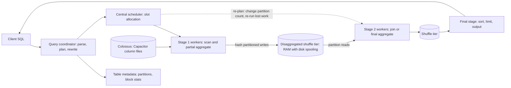

# Dremel: Interactive Analysis of Web-Scale Datasets (2010 VLDB)

## TL;DR

Dremel stores nested records one column at a time and encodes their structure losslessly with two small integers per value: the repetition level and the definition level, so NULLs take no value bytes and any column can be read on its own.
What a query costs depends on the columns it touches and the partitions and blocks it fails to prune, not on how many rows it returns, and on-demand BigQuery bills exactly that quantity at $6.25 per TiB (Google Cloud pricing, as of 2026-10).
The 2010 multi-level serving tree is a fixed aggregation fan-in, so it fails on high-cardinality GROUP BY and on joins; this is why Dremel added shuffle and in 2014 moved to a disaggregated in-memory shuffle tier (Melnik et al., PVLDB 2020).
Storage (Colossus), compute (centrally scheduled slots), and memory (the shuffle tier) are separated, which turns a query into a DAG of stages; each stage boundary acts as a checkpoint that allows preemption, straggler re-execution, and re-planning while the query runs.
The trade-off is that you get elasticity with no operations work, and you pay in per-byte or per-slot-second pricing, multi-tenant tail latency, and a proprietary storage format; on AWS the same ideas are split across Parquet on S3, Athena (Trino), and Redshift.

## Mental Model



The 2010 system was a tree: a root server split a query across intermediate servers, which split it across thousands of leaf servers scanning column stripes, and partial results flowed back up through fixed fan-in.
The modern system keeps the columnar scan at the leaves but replaces the fixed tree with a DAG of stages that exchange data through a shared, separately provisioned shuffle tier.
The key intuition is three independent pools: bytes live in Colossus, CPU is leased as slots for seconds at a time, and intermediate state lives in a memory tier that outlives any single worker.
Because no stage writes directly to another stage's workers, the scheduler can add workers, lose workers, or change the number of partitions mid-query without restarting the whole query.
The 2010 tree is a special case of this DAG in which every exchange is an aggregation toward a single node.

## Internals

### Lineage and the problem Dremel solved

Dremel was conceived at Google in 2006 as a "20 percent" project (Melnik et al., PVLDB 2020).
The 2010 paper by Melnik, Gubarev, Long, Romer, Shivakumar, Tolton, and Vassilakis appeared at VLDB 2010 in Singapore, in PVLDB Vol. 3, No. 1, pp. 330-339, and was reprinted in CACM in June 2011.
It received the VLDB 2020 Test of Time Award, and the retrospective "Dremel: A Decade of Interactive SQL Analysis at Web Scale" appeared in PVLDB 13(12): 3461-3472.
At the time, the alternative was MapReduce (Dean and Ghemawat, OSDI 2004) over row-oriented records stored in GFS (see [[17-Cloud-AI-Engineering/Volume_13_Seminal_Papers_and_Case_Studies/Chapter_09_GFS_and_Colossus|GFS and Colossus]]).
That approach paid three times on every ad hoc question: it read every field of every record, it parsed whole records, and it started batch jobs that took minutes to launch.
Dremel attacked each cost separately: columnar storage for nested data, a long-running serving tree instead of per-job processes, and in situ analysis of data already sitting in the shared file system.
The retrospective lists the lasting principles as SQL, disaggregated compute and storage, in situ analysis, serverless computing, and columnar storage for semistructured data (Melnik et al., PVLDB 2020).

### Data model

Records are strongly typed nested structures in the Protocol Buffers style.
Each field has a multiplicity: required (exactly one), optional (zero or one), or repeated (zero or more, ordered).
The paper's running example is a `Document` schema: required `DocId`; optional group `Links` with repeated `Backward` and `Forward`; and repeated group `Name`, which contains repeated group `Language` (required `Code`, optional `Country`) and optional `Url`.
BigQuery's `STRUCT` and `ARRAY` types, with the `NULLABLE`, `REQUIRED`, and `REPEATED` column modes, are the direct descendants of this model.

### Column striping: repetition and definition levels

Values of each leaf field are stored contiguously as a column stripe.
Splitting the values alone loses the information needed to rebuild records: given the stream `en-us, en, en-gb`, you cannot tell which `Name` or which record each `Code` came from.
Dremel attaches two integers to every value, NULLs included.
The repetition level `r` says at which repeated field in the path the value repeated; `r = 0` means a new record starts.
The definition level `d` says how many fields in the path that could be undefined (optional or repeated) are actually present.
For a path, `max_r` is the number of repeated fields on it, and `max_d` is the number of optional plus repeated fields on it.
A value is a real, non-NULL leaf value exactly when `d == max_d`, and any `d < max_d` is a NULL placeholder that also says how deep the path was defined before it was cut off.
NULLs are not stored as values; the definition level alone determines them.
Levels are bit-packed using only as many bits as the maximum level requires, so a required top-level column with `max_r = max_d = 0` stores no levels at all.
For `Name.Language.Country` (`max_r = 2`, `max_d = 3`), each value carries 2 bits of `r` and 2 bits of `d` before run-length encoding, and the long runs of identical levels typical of real data compress further.

The following output from the lab in the Worked Example reproduces the paper's Figure 3 for records r1 and r2:

```text
Name.Language.Code     (max_r=2, max_d=2)   Name.Language.Country (max_r=2, max_d=3)
  en-us  r=0 d=2                              us    r=0 d=3
  en     r=2 d=2                              NULL  r=2 d=2
  NULL   r=1 d=1                              NULL  r=1 d=1
  en-gb  r=1 d=2                              gb    r=1 d=3
  NULL   r=0 d=1                              NULL  r=0 d=1
```

Here is how to read row 3 of `Code`: `r=1` means the repetition happened at `Name`, the first repeated field, so a new `Name` started; `d=1` means only `Name` is defined and `Language` is absent.
That NULL encodes the second `Name` of r1, which has a `Url` but no `Language`.
The final row (`r=0`, `d=1`) says r2 starts here, has a `Name`, and has no `Language` under it.

### Record assembly

To return nested results or evaluate expressions across sibling columns, Dremel rebuilds records with a finite-state machine compiled from the schema and the subset of columns being read.
Each state reads one column, and the next value's repetition level picks the transition: the reader stays on the same field, jumps back to an ancestor, or moves on to the next column.
Because the machine is built only for the requested columns, assembling a partial record with two of 270 fields costs work proportional to those two columns, not to the full schema.

### The mechanism the getting-started guide skips: computing on levels without assembly

Most aggregate queries never assemble records at all, because the levels are enough to compute structural facts.
The number of instances of any repeated ancestor A (with repetition level `r_A` and definition level `d_A`) can be counted from any single descendant column: count the entries with `r <= r_A` and `d >= d_A`.
In the lab, `COUNT(Name)` per record computed from `Name.Language.Code` gives `[3, 1]`, and computed from `Name.Url` it also gives `[3, 1]`, matching the source records.
A planner that knows this picks the narrowest descendant column, measured in compressed bytes, to answer `SELECT COUNT(*) FROM t, UNNEST(t.name)`, so the bytes scanned for that query depend on the cheapest column under `name`, not on `name` as a whole.
Record boundaries for per-record aggregation (the 2010 dialect's `WITHIN RECORD` scoping, now expressed with correlated `UNNEST` subqueries) are positions where `r = 0`, so per-record aggregates are a streaming scan with O(1) state.
Filters such as `IS NOT NULL` on a deeply nested field reduce to a comparison of `d` against `max_d` on bit-packed levels, which can be evaluated over run-length-encoded runs without decoding any values.
This is the deep reason why "pay only for columns you touch" holds even for nested data: no step of the evaluation needs to materialize the parent structure.

### Levels versus lengths: Parquet, ORC, Arrow

Parquet adopted the Dremel encoding directly, while ORC tracks the lengths of repeated fields and the presence of optional values instead (Melnik et al., PVLDB 2020).
With levels, every leaf column carries the full structural information, so a single column is self-describing and can be read alone; the cost is that the levels are duplicated across sibling leaves.
With lengths, structural information is stored once per repeated ancestor, which is cheaper for wide sibling groups but forces the reader to fetch the ancestor's length stream along with the leaf.
The retrospective presents this as a real trade-off rather than a strict win for either side, and Capacitor, BigQuery's successor to the original ColumnIO format, keeps the level-based model while adding its own encodings (Melnik et al., PVLDB 2020).

### The 2010 serving tree

A root server receives the query, reads table metadata, and rewrites the query into a union of partial queries, one per child.
Intermediate servers rewrite again for their children, and leaf servers scan tablets, which are horizontal partitions of a table stored as column stripes in GFS.
A query dispatcher assigns tablets to slots, which are execution threads on leaf servers, and it can move work off a slow server onto a server holding another replica of the same tablet.
Partial aggregates flow upward, and each level merges the results of its children.
For aggregations with small outputs such as `COUNT`, `SUM`, and low-cardinality `GROUP BY`, adding tree levels cuts the root's fan-in and therefore the root's merge time.
The paper also exposes a tail-latency knob that MapReduce lacked: the client can ask for results after a chosen fraction of tablets has been processed, trading completeness for latency (the specific example percentages are UNVERIFIED).
Approximate one-pass algorithms handle top-k and count-distinct, which bounds the size of each partial result.

### Why the tree had to go: cardinality arithmetic

Let K be the number of distinct groups, F the fan-in at the root, and assume each leaf sees most groups.
Each partial aggregate then holds about K rows no matter how deep the tree is, so the root must merge about F x K rows.
With K = 10^8 and F = 30, the root ingests 3 x 10^9 rows, roughly 300 GB at 100 bytes per row, inside one process, which is not feasible.
Extra tree levels do not help, because pre-aggregation can only shrink a partial result down to K, never below it.
Joins are worse, because a tree has no path that moves rows with equal keys from different leaves onto the same node.
The fix is a hash-partitioned exchange: each producer splits its output into P partitions by `hash(key)`, and each of P consumers merges a single partition, so per-consumer input is about M x K / P rows for M producers.
With M = 3,000, K = 10^8, and P = 10^4, that is about 3 x 10^7 rows, roughly 3 GB per consumer, and P can be raised if needed.
Dremel added distributed joins through a shuffle primitive soon after the 2010 paper, and the new shuffle architecture is what enabled joins, analytic functions, and other complex SQL (Melnik et al., PVLDB 2020).

### Disaggregated storage

Dremel originally ran shared-nothing, with replicated tablets on local disks, which coupled storage capacity to compute capacity.
The first experiment with a GFS-based Dremel showed an order-of-magnitude performance degradation, partly because scanning a table of hundreds of thousands of tablets meant opening as many GFS files, which took multiple seconds (Melnik et al., PVLDB 2020).
Making it work took tuning of the storage format, the metadata representation, query affinity, and prefetching, and the later move from GFS's single master to Colossus's distributed multi-master metadata added scalability and robustness (Melnik et al., PVLDB 2020).
The lesson carries straight over to Athena on S3: opening many small objects is a fixed per-object latency tax that columnar compression cannot remove.

### Disaggregated memory: the shuffle tier

The first shuffle stored sorted intermediate results in local RAM and on local disk, and the coupling between compute nodes and intermediate shuffle storage became the scalability bottleneck (Melnik et al., PVLDB 2020).
In 2012 the team built a disaggregated shuffle on Colossus, explored alternatives including a dedicated shuffle service, and in 2014 settled on an infrastructure that supports fully in-memory query execution (Melnik et al., PVLDB 2020).
In that design, the RAM and disk that hold intermediate shuffle data are managed separately, in a distributed transient storage system (Melnik et al., PVLDB 2020).
The paper reports three results after deployment: shuffle latency fell by an order of magnitude, shuffles an order of magnitude larger became possible, and the service's resource cost dropped by more than 20% (Melnik et al., PVLDB 2020).
Google's engineering blog describes the infrastructure as memory-based with support for disk spooling, built specifically for Google's datacenter networking ([BigQuery blog](https://cloud.google.com/blog/products/bigquery/in-memory-query-execution-in-google-bigquery)).
That networking dependency is real: an all-to-all exchange between 3,000 producers and 10,000 partitions is 3 x 10^7 logical flows, which only makes sense on a full-bisection Clos fabric (see [[17-Cloud-AI-Engineering/Volume_13_Seminal_Papers_and_Case_Studies/Chapter_13_Jupiter_Datacenter_Network|Jupiter]]).
The tier also buys fault tolerance: shuffle output persists independently of the producer, so a lost or preempted consumer re-reads its partition instead of forcing the producers to recompute.
This is the mechanism behind the "spilled to disk" statistic in BigQuery query plans: when a partition outgrows its memory share, the tier spools it, and latency degrades smoothly instead of the query failing.

### Serverless scheduling and dynamic query execution

Slots became a fungible unit of CPU, memory, and I/O allocated by a central scheduler with a cluster-wide view, which lets the service share capacity across tenants and preempt work at stage boundaries (Melnik et al., PVLDB 2020).
BigQuery converts SQL into an execution graph of stages, which are made of steps, and it can modify the query plan while a query is running ([BigQuery query plan docs](https://cloud.google.com/bigquery/docs/query-plan-explanation), as of 2026-10).
Mid-query re-planning works because shuffle boundaries are materialized: once a stage's output is in the tier, the scheduler can see its real size and skew, then choose the number of consumers or the join strategy (broadcast versus hash-partitioned) for the next stage.
Job statistics report cost as `totalSlotMs`, an abstract accounting of slot time, and that is the quantity capacity pricing bills ([BigQuery query plan docs](https://cloud.google.com/bigquery/docs/query-plan-explanation), as of 2026-10).

### Capacitor and storage-side pruning

BigQuery stores table data in Capacitor, a columnar encoding on Colossus described in the 2016 "Inside Capacitor" engineering post ([BigQuery storage overview](https://docs.cloud.google.com/bigquery/docs/storage_overview), as of 2026-10).
The retrospective covers storage-side techniques including evaluating predicates directly on encoded data, partition and block pruning using per-block statistics, and reordering rows within a file to lengthen runs for run-length encoding (Melnik et al., PVLDB 2020; the claim that optimal row reordering is NP-hard and solved heuristically is UNVERIFIED).
Clustering a table on a column sorts data so that block-level min and max statistics become selective, which is the user-visible lever on the same pruning machinery.

### Control plane, data plane, failure domains

The control plane covers query admission, planning, metadata reads, and slot scheduling; the data plane covers the scan workers, the shuffle tier, and Colossus reads.
Metadata lookup sits on the critical path of every query, so a degraded metadata or quota service fails every query even while the data plane is healthy (see [[17-Cloud-AI-Engineering/Volume_01_Cloud_Architecture_Principles/Chapter_04_Control_Plane_vs_Data_Plane_Separation|Control Plane vs Data Plane Separation]]).
Datasets are regional or multi-regional resources, and a query runs where its data lives, so the regional deployment is the blast-radius unit for the shuffle tier and the scheduler.
For the product view of slots, reservations, and BigQuery storage, see [[17-Cloud-AI-Engineering/Volume_03_GCP_Deep_Dive/Chapter_13_BigQuery_Dremel_Capacitor_and_Slot_Orchestration|BigQuery: Dremel, Capacitor, and Slot Orchestration]].

## Numbers to Know

| Quantity | Value | Source |
|---|---|---|
| Dremel conceived | 2006, as a 20 percent project | (Melnik et al., PVLDB 13(12), 2020) |
| Original paper | PVLDB Vol. 3 No. 1, pp. 330-339, VLDB 2010 | (VLDB 2010 proceedings) |
| First GFS-based Dremel | Order-of-magnitude slowdown; opening hundreds of thousands of tablet files took multiple seconds | (Melnik et al., PVLDB 2020) |
| Shuffle on Colossus | Built 2012 | (Melnik et al., PVLDB 2020) |
| In-memory shuffle tier | Settled 2014 | (Melnik et al., PVLDB 2020) |
| In-memory shuffle gains | About 10x lower shuffle latency, about 10x larger shuffles, more than 20% lower service resource cost | (Melnik et al., PVLDB 2020) |
| BigQuery on-demand compute | $6.25 per TiB scanned, US regions | (Google Cloud pricing, as of 2026-10) |
| On-demand free tier | First 1 TiB of query data per billing account per month | (Google Cloud pricing, as of 2026-10) |
| On-demand minimum | 10 MB billed per referenced table | (Google Cloud pricing, as of 2026-10) |
| Editions pay-as-you-go | Standard $0.04, Enterprise $0.06, Enterprise Plus $0.10 per slot-hour, US | (Google Cloud pricing, as of 2026-10) |
| Editions commitments | Enterprise $0.048 (1 yr) / $0.036 (3 yr); Enterprise Plus $0.08 / $0.06 per slot-hour | (Google Cloud pricing, as of 2026-10) |
| Slot billing granularity | Per second, quoted per slot-hour | (Google Cloud pricing, as of 2026-10) |
| Flat-rate and Flex Slots | Retired 2023-07-05, replaced by Editions | (Google Cloud pricing, as of 2026-10) |
| Free storage | 10 GiB per month | (Google Cloud pricing, as of 2026-10) |
| Active logical storage | About $0.02 per GiB-month | UNVERIFIED |
| Standard edition reservation cap | 1,600 slots | UNVERIFIED |
| On-demand per-project slot ceiling | About 2,000 concurrent slots | UNVERIFIED |
| Maximum query run time | 6 hours | UNVERIFIED |
| Amazon Athena on-demand | $5 per TB scanned, 10 MB minimum per query | UNVERIFIED |
| Break-even slot-hours per TiB, Enterprise PAYG | 6.25 / 0.06 = 104 slot-hours per TiB | Derived from the rows above (as of 2026-10) |
| Level bits for `Name.Language.Country` | 2 bits r + 2 bits d per value before RLE | Derived from the 2010 encoding |
| 2010 test table T1 | About 85 billion records, about 87 TB | UNVERIFIED |

## AWS vs GCP Mechanism Parity

| Dimension | Google Cloud (BigQuery / Dremel) | AWS (Athena, Redshift, S3) | Critical difference |
|---|---|---|---|
| Storage format | Capacitor on Colossus, proprietary and service-managed | Customer-managed Parquet or ORC on S3; Redshift Managed Storage for RA3 and Serverless | AWS leaves file sizing, compaction, and layout to you; BigQuery does it for you |
| Nested encoding | Dremel levels natively; `STRUCT` and `ARRAY` columns | Parquet uses the same Dremel levels; Redshift `SUPER` with PartiQL for semistructured data | Athena gets the Dremel encoding through Parquet; Redshift `SUPER` is a different model |
| Metadata | Internal table metadata with per-block statistics | AWS Glue Data Catalog plus Parquet footer statistics | Glue partition listing is an extra control-plane hop per query |
| Execution model | Stage DAG with central slot scheduler and mid-query re-planning | Athena: Trino-based engine with pipelined worker-to-worker exchange; Redshift: leader node plus compute node slices | Trino's default streaming exchange does not persist intermediates, so a worker loss fails the query |
| Shuffle | Disaggregated in-memory tier with disk spooling | Athena: in-worker exchange with spill; Redshift: redistribution between compute nodes | GCP decouples shuffle memory from compute; AWS ties it to the workers |
| On-demand price | $6.25 per TiB (as of 2026-10) | Athena $5 per TB (UNVERIFIED) | TiB versus TB units differ by about 10% |
| Capacity model | Editions slots, autoscaled, with reservations and assignments | Athena provisioned capacity in DPUs; Redshift Serverless RPUs or provisioned nodes | Each vendor defines its capacity unit differently; benchmark per workload |
| Per-query cost guardrail | `maximum_bytes_billed` on the job; custom daily quotas | Athena workgroup `BytesScannedCutoffPerQuery` | BigQuery checks before execution; Athena cancels once the cutoff is reached |
| Fine-grained access | Column policy tags, row access policies, authorized views | Lake Formation column and row filters; Redshift row-level security and column grants | Both put enforcement in the engine, not in storage |
| Network perimeter | VPC Service Controls around `bigquery.googleapis.com` | VPC interface endpoints for Athena, S3 gateway endpoints, `aws:SourceVpce` conditions | VPC-SC blocks cross-project copy exfiltration at the API layer; AWS needs SCPs plus endpoint and bucket policies together |
| Failure recovery | Shuffle checkpoints allow re-running a single stage | Athena retries the whole query; Redshift aborts the transaction | Long queries survive worker loss more cheaply on BigQuery |

See [[17-Cloud-AI-Engineering/Volume_04_AWS_vs_GCP_Translation/Chapter_05_Messaging_Streaming_and_Analytics_Translation|Messaging, Streaming, and Analytics Translation]] for the service-level mapping.

## Worked Example: Striping by Hand, Then Measuring Pruning and Shuffle on BigQuery

### Part A - Column striping in 90 lines of Python (free, offline)

This script implements the 2010 striping algorithm and the parent-count trick from the Internals section; running it reproduces the paper's Figure 3 exactly.

```python
"""Dremel column striping with repetition and definition levels (VLDB 2010, Sec 4)."""
from collections import defaultdict

# Schema node: (name, label, children); label in {"required","optional","repeated"}
DOCUMENT = [
    ("DocId", "required", None),
    ("Links", "optional", [
        ("Backward", "repeated", None),
        ("Forward", "repeated", None)]),
    ("Name", "repeated", [
        ("Language", "repeated", [
            ("Code", "required", None),
            ("Country", "optional", None)]),
        ("Url", "optional", None)]),
]

R1 = {"DocId": 10,
      "Links": {"Forward": [20, 40, 60]},
      "Name": [{"Language": [{"Code": "en-us", "Country": "us"}, {"Code": "en"}],
                "Url": "http://A"},
               {"Url": "http://B"},
               {"Language": [{"Code": "en-gb", "Country": "gb"}]}]}
R2 = {"DocId": 20,
      "Links": {"Backward": [10, 30], "Forward": [80]},
      "Name": [{"Url": "http://C"}]}


def leaves(schema, prefix="", rep=0, dfn=0):
    """Yield (path, max_rep, max_def) for every leaf column."""
    for name, label, kids in schema:
        r = rep + (label == "repeated")
        d = dfn + (label != "required")
        path = prefix + name
        if kids is None:
            yield path, r, d
        else:
            yield from leaves(kids, path + ".", r, d)


def stripe(records, schema):
    cols = defaultdict(list)
    meta = {p: (r, d) for p, r, d in leaves(schema)}

    def emit_nulls(kids_schema, prefix, r, d):
        for p, _, _ in leaves(kids_schema, prefix):
            cols[p].append((None, r, d))

    def walk(rec, sch, prefix, r, d, rep_depth):
        for name, label, kids in sch:
            path = prefix + name
            raw = rec.get(name) if rec is not None else None
            vals = raw if label == "repeated" else ([] if raw is None else [raw])
            my_rep = rep_depth + (label == "repeated")
            if not vals:
                if kids is None:
                    cols[path].append((None, r, d))
                else:
                    emit_nulls(kids, path + ".", r, d)
                continue
            dd = d + (label != "required")
            for i, v in enumerate(vals):
                rr = r if i == 0 else my_rep
                if kids is None:
                    cols[path].append((v, rr, dd))
                else:
                    walk(v, kids, path + ".", rr, dd, my_rep)

    for rec in records:
        walk(rec, schema, "", 0, 0, 0)
    return cols, meta


def per_record(col):
    """Split a striped column at record boundaries (r == 0)."""
    out = []
    for v, r, d in col:
        if r == 0:
            out.append([])
        out[-1].append((v, r, d))
    return out


def count_parent(col, parent_rep, parent_def):
    """Count instances of a repeated ancestor using ONLY one descendant column."""
    return [sum(1 for _, r, d in rec if r <= parent_rep and d >= parent_def)
            for rec in per_record(col)]


if __name__ == "__main__":
    cols, meta = stripe([R1, R2], DOCUMENT)
    for path, (mr, md) in meta.items():
        print(f"{path}  (max_r={mr}, max_d={md})")
        for v, r, d in cols[path]:
            print(f"    {str(v):10s} r={r} d={d}")
    print("COUNT(Name) per record from Name.Language.Code:",
          count_parent(cols["Name.Language.Code"], 1, 1))
    print("COUNT(Name) per record from Name.Url:",
          count_parent(cols["Name.Url"], 1, 1))
    _, md = meta["Name.Language.Country"]
    print("Non-NULL Country values:",
          [v for v, r, d in cols["Name.Language.Country"] if d == md])
```

Expected tail of the output: `COUNT(Name) per record ... [3, 1]` from both columns, and `Non-NULL Country values: ['us', 'gb']`.

### Part B - BigQuery measurement lab

Cost estimate: the lab loads about 200,000 synthetic nested documents, roughly 400 MB of logical data, using load jobs, which are not billed as queries.
Storage costs under one cent per month at about $0.02 per GiB-month (UNVERIFIED), and the 10 GiB monthly free storage tier covers it (Google Cloud pricing, as of 2026-10).
The three executed queries scan a few tens of MB in total, which falls inside the 1 TiB monthly free query tier; with the free tier used up, the bound is well under $0.05 at $6.25 per TiB.
`maximum_bytes_billed` puts a hard 2 GiB ceiling on every executed query: BigQuery rejects any query that would bill more, before it runs.

Budget alarm (create it before running the lab):

```bash
gcloud billing budgets create \
  --billing-account="${BILLING_ACCOUNT_ID}" \
  --display-name="dremel-lab" \
  --budget-amount=5USD \
  --filter-projects="projects/${GOOGLE_CLOUD_PROJECT}" \
  --threshold-rule=percent=0.5 \
  --threshold-rule=percent=0.9
```

Lab script (`pip install google-cloud-bigquery`, then `export GOOGLE_CLOUD_PROJECT=...`):

```python
"""Measure Dremel mechanics on BigQuery: column pruning, nested data, shuffle stages."""
import os, random
from google.cloud import bigquery

PROJECT = os.environ["GOOGLE_CLOUD_PROJECT"]
DATASET = f"{PROJECT}.dremel_lab"
TABLE = f"{DATASET}.docs"
CAP = 2 * 1024**3  # hard ceiling: any query billing more than 2 GiB fails before running

client = bigquery.Client(project=PROJECT)
client.create_dataset(bigquery.Dataset(DATASET), exists_ok=True)

schema = [
    bigquery.SchemaField("doc_id", "INT64", mode="REQUIRED"),
    bigquery.SchemaField("ts", "TIMESTAMP", mode="REQUIRED"),
    bigquery.SchemaField("tenant", "STRING", mode="REQUIRED"),
    bigquery.SchemaField("body", "STRING"),
    bigquery.SchemaField("name", "RECORD", mode="REPEATED", fields=[
        bigquery.SchemaField("url", "STRING"),
        bigquery.SchemaField("language", "RECORD", mode="REPEATED", fields=[
            bigquery.SchemaField("code", "STRING", mode="REQUIRED"),
            bigquery.SchemaField("country", "STRING")])]),
]
table = bigquery.Table(TABLE, schema=schema)
table.time_partitioning = bigquery.TimePartitioning(field="ts", type_=bigquery.TimePartitioningType.DAY)
table.clustering_fields = ["tenant"]
client.create_table(table, exists_ok=True)

def doc(i):
    return {"doc_id": i,
            "ts": f"2026-10-{1 + i % 14:02d}T00:00:00Z",
            "tenant": f"t{i % 50}",
            "body": "x" * 2000,  # a fat column the cheap queries never touch
            "name": [{"url": f"http://h{i}/{j}",
                      "language": [{"code": random.choice(["en", "de", "pl"]),
                                    "country": random.choice([None, "us", "gb"])}
                                   for _ in range(random.randint(0, 3))]}
                     for j in range(random.randint(1, 3))]}

for start in range(0, 200_000, 20_000):  # ~400 MB logical; load jobs are free
    client.load_table_from_json([doc(i) for i in range(start, start + 20_000)],
                                TABLE, job_config=bigquery.LoadJobConfig(schema=schema)).result()

QUERIES = {
    "select_star": f"SELECT * FROM `{TABLE}` LIMIT 10",
    "narrow_column": f"SELECT COUNT(*) FROM `{TABLE}`, UNNEST(name) n WHERE n.url IS NOT NULL",
    "pruned_partition_cluster": f"""SELECT l.code, COUNT(*) c FROM `{TABLE}`, UNNEST(name) n, UNNEST(n.language) l
        WHERE ts >= '2026-10-10' AND tenant = 't7' GROUP BY l.code""",
    "shuffle_heavy": f"""SELECT a.tenant, COUNT(DISTINCT b.doc_id) FROM `{TABLE}` a
        JOIN `{TABLE}` b ON a.doc_id = b.doc_id + 1 GROUP BY a.tenant""",
}

for label, sql in QUERIES.items():
    dry = client.query(sql, job_config=bigquery.QueryJobConfig(dry_run=True, use_query_cache=False))
    print(f"{label:26s} dry-run bytes={dry.total_bytes_processed:>12,}")
    if label == "select_star":
        continue  # LIMIT does not bound bytes scanned; never pay for this one
    job = client.query(sql, job_config=bigquery.QueryJobConfig(
        use_query_cache=False, maximum_bytes_billed=CAP))
    job.result()
    print(f"{'':26s} billed={job.total_bytes_billed:,} slot_ms={job.slot_millis:,}")
    for st in job.query_plan:
        print(f"{'':28s}{st.name:24s} in={st.records_read} out={st.records_written} "
              f"shuffle_out={st.shuffle_output_bytes} spilled={st.shuffle_output_bytes_spilled}")
```

What to observe:
- The `select_star` dry run reports about the full ~400 MB, because `body` is 2,000 bytes per row and `LIMIT` stops output, not the scan.
- `narrow_column` reports a few MB, because only the `name.url` stripe (with its levels) is read.
- `pruned_partition_cluster` reads fewer bytes than its unpruned equivalent, because day partitions before `2026-10-10` are skipped and clustering on `tenant` lets block statistics skip blocks that do not contain `t7`.
- `shuffle_heavy` shows several stages with non-zero `shuffle_output_bytes`, which is the hash-partitioned exchange that the 2010 tree could not express.

Teardown (deletes the dataset and every table in it):

```bash
bq rm -r -f -d "${GOOGLE_CLOUD_PROJECT}:dremel_lab"
```

### Part C - Equivalent AWS guardrail (no billable resources created)

An Athena workgroup costs nothing by itself; the cutoff cancels any query that scans more than 2 GiB.

```bash
aws athena create-work-group --name dremel-lab \
  --configuration "EnforceWorkGroupConfiguration=true,BytesScannedCutoffPerQuery=2147483648,ResultConfiguration={OutputLocation=s3://YOUR-RESULTS-BUCKET/dremel-lab/}"
# Teardown
aws athena delete-work-group --work-group dremel-lab --recursive-delete-option
```

### Part D - Capacity and cost sizing, step by step

Scenario: a 100 TiB event table with 400 columns of roughly equal size, partitioned by day over 365 days; a typical dashboard query reads 8 columns over 7 days, and the workload runs 5,000 queries per day.
Step 1, bytes per query: 100 TiB / 400 columns = 0.25 TiB per column, so 8 columns = 2 TiB, and 7/365 of that = 0.0384 TiB = 39.3 GiB.
Step 2, on-demand cost per query: 0.0384 x $6.25 = $0.24, while an unpruned `SELECT *` over the full table costs 100 x $6.25 = $625, about 2,600x more.
Step 3, on-demand monthly cost: 5,000 x 0.0384 TiB = 192 TiB per day, which is $1,199 per day or about $36,000 per 30-day month (Google Cloud pricing, as of 2026-10).
Step 4, measure slot intensity from `INFORMATION_SCHEMA.JOBS` (`total_slot_ms`); assume a measured 0.4 slot-hours per query, so the intensity is 0.4 / 0.0384 = 10.4 slot-hours per TiB.
Step 5, break-even: Enterprise pay-as-you-go wins whenever intensity is below 6.25 / 0.06 = 104 slot-hours per TiB; Standard's threshold is 156, Enterprise Plus's is 62.5, and Enterprise on a 3-year commitment is 174.
Step 6, capacity cost: 5,000 x 0.4 = 2,000 slot-hours per day x $0.06 = $120 per day, or $3,600 per month; a 1.5x factor for autoscaler granularity and headroom gives about $5,400 per month, about 6.7x cheaper than on-demand.
Step 7, reservation shape: 2,000 slot-hours over 24 hours averages 83 slots, but if 80% of queries fall in a 10-hour business window that is 160 slots, so with a 3x peak-to-mean ratio, set the autoscaling maximum near 500 slots with a small baseline.
Counter-case: if the same queries parse JSON strings with regular expressions and reach 150 slot-hours per TiB, Enterprise capacity costs 150 x $0.06 = $9.00 per TiB, more than $6.25, so on-demand is cheaper.
The general rule is that on-demand is priced on bytes and capacity is priced on CPU, so CPU-light, byte-heavy scans favor capacity, and CPU-heavy transforms over small byte footprints favor on-demand.
For commitment break-even mechanics, see [[17-Cloud-AI-Engineering/Volume_09_FinOps_and_Cloud_Economics/Chapter_02_Commitment_Discounts_Savings_Plans_vs_CUDs|Commitment Discounts]].

Tail-latency sizing: a scan over 100,000 tablets in which each task has a 0.1% chance of being slow has a probability of 0.999^100000, about e^-100, of seeing no straggler, and about 100 stragglers are expected.
This is why the 2010 tree re-dispatched slow tablets to other replicas and offered partial results, and why speculative re-execution of the last 1% of tasks, at about 1% extra work, is standard in every engine descended from Dremel.

## Failure Modes and Pitfalls

### Bill shock from `SELECT *` with `LIMIT`

On-demand billing counts bytes in the columns read across the partitions not pruned, so `LIMIT` does not reduce bytes billed.
A 40 TiB table queried with `SELECT * ... LIMIT 100` bills about 40 x $6.25 = $250 per run (Google Cloud pricing, as of 2026-10).
Mitigations: set `maximum_bytes_billed` on every job submitted by tooling, set `require_partition_filter` on large partitioned tables, add per-user daily custom query quotas, and use table preview, which reads storage directly, instead of a query.

### Repeated-field explosion

Each `UNNEST` of an ARRAY is a correlated cross join, so chaining two arrays with average lengths of 50 and 40 multiplies the row count by 2,000 before any filter runs.
The blow-up becomes shuffle volume, which turns into spilling and then resource-exceeded failures.
Mitigation: aggregate inside the array with a correlated subquery (`(SELECT COUNT(*) FROM UNNEST(arr) WHERE ...)`), which the levels mechanism evaluates without expanding parents.

### Key skew in shuffle

Hash partitioning sends every row with the same key to one consumer, so a NULL join key or a single dominant tenant ID turns one partition into the query's critical path.
Dynamic re-planning can rebalance some skewed stages, but a single key's rows still end up on one worker.
Mitigations: filter NULL keys before joins, salt hot keys with a random suffix and then re-aggregate, or broadcast the small side.

### Global ORDER BY without LIMIT

A total order requires a final merge, and very large unbounded sorts concentrate memory in the final stage.
Mitigation: add `LIMIT`, or write to a table and let consumers sort downstream.

### Slot contention and the idle-slot cliff

In a reservation, concurrent queries share slots under fair scheduling, so a backfill that launches 200 heavy queries cuts the per-query share for everyone in the reservation.
Idle slots borrowed from other reservations can be taken back by their owner with no warning, which produces latency cliffs that look like regressions even though nothing in your query changed.
Mitigation: put latency-critical dashboards in their own reservation with a baseline, and treat borrowed idle capacity as best-effort.

### Clustering decay and the small-tablet tax

Streaming writes and DML land data that is not yet clustered, so block pruning degrades until background re-clustering catches up, and bytes scanned grow with no change to the query.
On AWS the equivalent is millions of small Parquet files: the 2020 retrospective's GFS experiment, where opening hundreds of thousands of files cost multiple seconds, is the same failure mode, and only compaction fixes it (Melnik et al., PVLDB 2020).

### Control-plane dependencies during regional events

Query admission depends on IAM, quota, and metadata services, so incidents in shared control-plane services can fail queries while storage stays healthy.
Google Cloud's 2025-06-12 incident, attributed to a Service Control quota-policy change that crashed globally, and AWS's 2025-10-20 us-east-1 incident, triggered by a DynamoDB DNS automation race, both affected many dependent services; the analytics-specific impact is UNVERIFIED here, so read the providers' PIRs before citing them in a review.
Mitigation: if dashboards are business-critical, keep cached or materialized results outside the query path, and route through [[17-Cloud-AI-Engineering/Volume_07_Reliability_and_SRE/Chapter_07_Anatomy_of_Major_Cloud_Outages|outage-informed]] runbooks.

## Security and Cost Angles

### IAM scoping

In BigQuery, the right to run jobs (`roles/bigquery.jobUser` on the billing project) is separate from the right to read data (`roles/bigquery.dataViewer` on a dataset or table).
That separation enables a central "compute project" pattern: analysts run jobs in a project tied to a reservation, while data stays in producer projects that grant only read access.
Column-level security uses policy tags enforced at scan time, row-level security uses `CREATE ROW ACCESS POLICY`, and authorized views expose computed subsets without granting access to the base table.
On AWS, Lake Formation column and row filters apply to Athena and Redshift Spectrum, and the workgroup IAM resource ARN scopes who can spend money in which workgroup.

### Encryption hierarchy

BigQuery encrypts data at rest by default and supports customer-managed keys in Cloud KMS, which wrap the data-encryption keys used for table storage (envelope encryption; see [[17-Cloud-AI-Engineering/Volume_08_Security_Identity_and_the_Data_Perimeter/Chapter_04_Encryption_Key_Hierarchies_and_Envelope_Encryption|Envelope Encryption]]).
Disabling or destroying the KMS key version makes the dependent tables unreadable, which is a deliberate cryptographic kill switch and also an outage risk if key IAM is misconfigured.
On AWS, SSE-KMS on the S3 data bucket and on the Athena results location covers the same layers, and every object read can call KMS, so S3 Bucket Keys matter for KMS request costs at scan scale.

### Exfiltration perimeter

The classic BigQuery exfiltration path is a legitimate identity copying a table into a project the attacker controls, which no network control can see because it happens entirely at the API layer.
A VPC Service Controls perimeter around `bigquery.googleapis.com` blocks cross-perimeter copies and queries whose destination is outside the perimeter (see [[17-Cloud-AI-Engineering/Volume_03_GCP_Deep_Dive/Chapter_03_VPC_Service_Controls_Security_Perimeters|VPC Service Controls]]).
The AWS equivalent needs several pieces together: SCPs, S3 bucket policies conditioned on `aws:SourceVpce` and `aws:ResourceOrgID`, and VPC endpoint policies (see [[17-Cloud-AI-Engineering/Volume_08_Security_Identity_and_the_Data_Perimeter/Chapter_06_Constructing_an_Impenetrable_Data_Perimeter|Data Perimeter]]).

### Unit-economics levers

- Partitioning and clustering cut bytes scanned, and on-demand billing shrinks linearly with them.
- Column pruning is free: projecting 8 of 400 columns cuts cost by 50x before any other optimization.
- Materialized views and pre-aggregated tables turn repeated dashboard scans into small reads.
- Choosing on-demand or Editions per project, based on measured slot-hours per TiB, is the largest single lever, as Part D shows.
- Physical (compressed) versus logical storage billing pays off for highly compressible data; verify current rates before switching (rates UNVERIFIED here).

## Interview Questions and Model Answers

### Question 1 (L5 - Senior)

Explain repetition and definition levels using a repeated group `Name` that contains a repeated group `Language` with a required `Code`.
Why does this encoding let an engine count `Name` entries without reading `Name` "itself"?

#### Model Answer

The path `Name.Language.Code` has two repeated fields, so `max_r = 2`, and two fields that can be undefined, so `max_d = 2`.
Each value carries `r`, which records which repeated field in the path started a new instance (0 means a new record, 1 a new `Name`, 2 a new `Language` within the same `Name`), and `d`, which records how many of those undefined-able fields are present.
A `Name` with no `Language` still emits a placeholder with `d = 1`, which preserves the existence of that `Name` in the `Code` column even though no `Code` value exists.
`Name` is a group, not a leaf, so it has no column of its own; its existence is fully encoded in the levels of every leaf under it.
To count `Name` instances, scan any single descendant column and count entries with `r <= 1` and `d >= 1`; the first condition marks the start of a new `Name` or a new record, and the second confirms `Name` was defined.
The planner should pick the descendant column with the smallest compressed footprint, so the cost of `COUNT(*)` over `UNNEST(name)` is set by the cheapest leaf.
NULLs cost no value bytes, because `d < max_d` already means NULL, and bit-packed levels with run-length encoding make the structural overhead small.
The trade-off is that levels are duplicated in every sibling leaf, which is why ORC chose length streams instead; that saves space for wide sibling groups but requires reading the ancestor stream.

#### Follow-up Interviewer Question

How would you evaluate `WHERE name.language.country IS NULL` at the level of a `Name` instance, using only the `Country` column's levels?

### Question 2 (L5 - Senior)

An analyst ran `SELECT * FROM events LIMIT 100` against a 40 TiB table and received a $250 charge.
Explain the mechanism and the controls you would deploy.

#### Model Answer

Data is stored by column, and on-demand billing counts the bytes of every column referenced across every partition not pruned, so `SELECT *` touches all 40 TiB of columns.
`LIMIT` stops output rows after the scan is scheduled across thousands of parallel workers; it does not shrink the set of column blocks to be read, so cost is about 40 x $6.25 = $250 (Google Cloud pricing, as of 2026-10).
Controls fall into three layers.
Per-job: tools and notebooks set `maximum_bytes_billed`, which BigQuery checks against the dry-run estimate before execution, so the query fails without being charged.
Per-table: `require_partition_filter` on large partitioned tables, plus clustering on common filter columns so block statistics can prune.
Per-principal: custom daily query-usage quotas per user and per project, and moving heavy users onto an Editions reservation, where cost is bounded by slot capacity instead of bytes.
Education is the weakest control; the strongest is making the expensive query impossible to run by default.

#### Follow-up Interviewer Question

The same analyst now runs `SELECT user_id FROM events WHERE ts > CURRENT_DATE() - 1` on a table partitioned by ingestion time, not by `ts`, and the bill is still large; why?

### Question 3 (L6 - Staff)

The 2010 Dremel used a multi-level serving tree; by 2014 it had a disaggregated in-memory shuffle.
Explain quantitatively why the tree stopped being enough, and what the shuffle tier made possible besides joins.

#### Model Answer

A serving tree is a reduction toward one node: each level merges partial results, which works when partial results shrink, as with `COUNT`, `SUM`, and low-cardinality `GROUP BY`.
With K distinct groups, each partial result holds about K rows however deep the tree is, so the root merges F x K rows; with K = 10^8 and fan-in 30, that is 3 x 10^9 rows in one process.
Joins need rows with equal keys from different leaves to meet, and the tree has no lateral data movement.
Hash-partitioned shuffle replaces reduction-to-one with reduction-to-P, giving about M x K / P rows per consumer, with P chosen by the planner.
The first shuffle used workers' local RAM and disk, so memory for intermediates was bound to compute nodes, and a large shuffle meant large workers sitting idle while waiting for it (Melnik et al., PVLDB 2020).
The 2014 tier manages shuffle RAM and disk separately in a transient distributed store, and the paper reports about 10x lower shuffle latency, about 10x larger shuffles, and more than 20% lower resource cost (Melnik et al., PVLDB 2020).
Besides joins, persisting intermediates outside the producer gives three properties.
Recovery is per stage: a lost consumer re-reads its partition, and producers do not recompute.
Preemption becomes cheap: the scheduler can reclaim slots at stage boundaries for fairness across tenants.
Plans can adapt: once a stage's output is materialized, its real size and skew are known, so the next stage's parallelism or join strategy can change mid-query, which BigQuery documents as modifying the plan while the query runs ([query plan docs](https://cloud.google.com/bigquery/docs/query-plan-explanation), as of 2026-10).
The cost is an extra network hop and a dependency on a full-bisection fabric, since an exchange between 3,000 producers and 10,000 partitions involves about 3 x 10^7 logical flows.
Trino's default pipelined exchange shows the opposite trade: lower latency for small queries, but a single worker failure kills the query.

#### Follow-up Interviewer Question

When would you choose a pipelined, non-persisted exchange over a persisted shuffle tier, and how would you decide per query at run time?

### Question 4 (L6 - Staff)

Your company spends $40,000 per month on BigQuery on-demand.
Leadership asks whether to buy Editions capacity; walk through the decision and the reservation design.

#### Model Answer

The deciding metric is slot intensity: slot-hours consumed per TiB billed, computed per project and per workload class from `INFORMATION_SCHEMA.JOBS` as `SUM(total_slot_ms)/3.6e6` divided by `SUM(total_bytes_billed)/2^40`.
On-demand costs $6.25 per TiB and Enterprise pay-as-you-go costs $0.06 per slot-hour, so capacity wins below 104 slot-hours per TiB; the thresholds are 156 for Standard and 62.5 for Enterprise Plus (Google Cloud pricing, as of 2026-10).
Typical BI scans over well-pruned columnar data run at tens of slot-hours per TiB, so they move to capacity; regex- or JSON-heavy ELT over small inputs can exceed the threshold and should stay on-demand.
The decision is per project, not per company, because projects are assigned to reservations independently.
Design: a "bi-interactive" reservation with a baseline sized to the business-hours p50 slot demand plus autoscaling to the p95, and a separate "batch" reservation with no baseline, so batch backfills cannot take dashboard capacity.
Commit to a 1-year or 3-year rate only for the baseline that is stable over several months; autoscaled slots are billed at pay-as-you-go rates.
Risks: autoscaler granularity and scale-down lag inflate real cost above the theoretical number, so apply a 1.3x to 1.5x factor; and capacity removes the per-query byte guardrail, so runaway queries now cost latency for everyone instead of money.
Validate with a two-week shadow analysis, pricing actual job history under both models, before signing anything.

#### Follow-up Interviewer Question

After the migration, dashboard p95 latency doubled even though average slot usage is only 60% of the reservation maximum; what is happening?

### Question 5 (L6 - Staff)

A daily dashboard query went from 8 seconds to 90 seconds with no change in SQL and only 5% data growth.
Give your debugging path, in order.

#### Model Answer

First, compare bytes billed and bytes processed between a fast and a slow run; if bytes jumped, pruning broke, for example through clustering decay from streaming or DML writes, a partition filter defeated by a function wrapped around the partition column, or a schema change that widened a column.
Second, if bytes are flat, compare `total_slot_ms` with elapsed time; if slot-ms is flat but elapsed time grew, the query was waiting for slots, which points to contention or loss of borrowed idle slots in the reservation, and the jobs timeline will show low concurrent slot allocation.
Third, if slot-ms grew, read the query plan per stage: look for a stage whose maximum compute time far exceeds its average, which indicates key skew, often a new NULL or default key from an upstream bug.
Fourth, check `shuffle_output_bytes_spilled`; spilling means a partition outgrew memory, often because an upstream `UNNEST` began emitting longer arrays.
Fifth, check whether the plan shape changed, for example a join that switched from broadcast to hash because one side crossed a size threshold, which a 5% growth can trigger.
Each check costs only metadata reads, so the investigation should take minutes, and the fix maps to the cause: re-cluster or repair predicates, isolate the reservation, salt keys, pre-aggregate arrays, or materialize the small side.

#### Follow-up Interviewer Question

How would you build an automated regression detector across 10,000 scheduled queries that separates these causes without a human reading plans?

### Question 6 (L7+ - Principal)

Design a Dremel-class interactive analytics service on AWS for 10 PB and 1,000 concurrent analysts, with p50 under 5 seconds on typical dashboards.
What do you buy, what do you build, and where are the hard limits?

#### Model Answer

Start from Dremel's three pools and map each to AWS: durable bytes in S3, CPU in an elastic worker fleet, and intermediate state in a shuffle tier.
Storage: Parquet, which already uses Dremel levels, under an open table format so compaction, snapshot isolation, and file-level statistics are managed, with target file sizes of hundreds of MB to avoid the per-object open tax that slowed Dremel's first GFS experiment (Melnik et al., PVLDB 2020).
Metadata: per-file and per-row-group min and max statistics held in a catalog the planner can prune with, without listing S3, because listing millions of objects on the critical path breaks the p50 target.
Compute: buy before building; Athena handles ad hoc work and Redshift (Serverless or RA3) handles the hot dashboard set, because hot dashboards benefit from local caching and result reuse that a pure scan engine lacks.
Shuffle: neither service exposes a disaggregated memory tier, so very large joins either fail or spill locally; if a custom engine is justified, build the shuffle tier as a separate fleet, memory-first with spool to local NVMe, partition-addressable, with stage-boundary persistence so workers can be preempted.
Fairness: 1,000 concurrent analysts need admission control and per-tenant fair share at the scheduler, not just autoscaling, or one backfill starves everyone (see [[17-Cloud-AI-Engineering/Volume_07_Reliability_and_SRE/Chapter_02_Load_Shedding_Backpressure_and_Admission_Control|Admission Control]]).
Tail latency: with tens of thousands of scan tasks, stragglers are certain, so speculative re-execution of the slowest 1% and an optional partial-result mode for exploratory queries are requirements.
Hard limits: a single-AZ worker fleet saves inter-AZ transfer but forfeits zonal resilience; a cross-AZ shuffle pays per-GB inter-AZ charges at multi-TB exchange volumes (see [[17-Cloud-AI-Engineering/Volume_09_FinOps_and_Cloud_Economics/Chapter_04_Network_Egress_Economics_and_Optimization|Egress Economics]]).
The principal-level call is whether owning a shuffle tier beats paying BigQuery's margin: unless analytics is the product, buy managed engines, invest in layout and governance, and accept that the largest shuffles are a capability gap.

#### Follow-up Interviewer Question

Quantify the inter-AZ data-transfer bill for a daily 50 TB shuffle replicated across three AZs, and propose a placement that removes most of it without losing zonal recovery.

### Question 7 (L7+ - Principal)

You run a shared BigQuery platform for 300 teams on a single organization-wide reservation pool.
Design isolation so that one team's runaway workload cannot breach other teams' SLOs, and explain the failure modes of your own design.

#### Model Answer

The underlying problem is that slots are fungible and scheduled fairly, so a team that launches 500 concurrent heavy queries gets a large aggregate share at the expense of tenants running a single query each.
Tier tenants by SLO: put tier-0 dashboards in dedicated reservations with committed baselines, tier-1 workloads in shared reservations with autoscaling caps, and tier-2 batch work in a no-baseline reservation that only borrows idle slots.
Assign by project, so each team's billing project maps to exactly one reservation, and the blast radius of a runaway workload is its own reservation.
Add admission control above BigQuery for tier-1: a per-team concurrent job budget enforced in the orchestration layer, because queueing inside BigQuery still lets one tenant hold slots that others are waiting for.
Make bytes and slot usage visible to each team through daily `INFORMATION_SCHEMA` chargeback, because unpriced capacity gets consumed by whoever cares least (see [[17-Cloud-AI-Engineering/Volume_09_FinOps_and_Cloud_Economics/Chapter_06_FinOps_Organizational_Practices_and_Automation|FinOps Practices]]).
Failure modes of this design: idle-slot borrowing makes tier-2 latency bimodal, and teams will read that as an outage, so tier-2 must have an SLO of "eventually"; reservation sprawl strands committed capacity; and per-project assignment breaks when a team queries cross-project with a single service account, so identities must be scoped per workload.
The deeper principle comes from cell-based architecture: isolation units must match failure units, and a shared pool with fair scheduling is a single cell with soft walls (see [[17-Cloud-AI-Engineering/Volume_01_Cloud_Architecture_Principles/Chapter_03_Cell_Based_Architecture_and_Shuffle_Sharding|Cell-Based Architecture]]).

#### Follow-up Interviewer Question

How would you size each tier-0 reservation baseline from history so the probability of queueing during the business-day peak stays below 1%?

## Further Reading

- [Dremel: Interactive Analysis of Web-Scale Datasets, CACM 2011 reprint of VLDB 2010](https://m-cacm.acm.org/magazines/2011/6/108648-dremel-interactive-analysis-of-web-scale-datasets/fulltext) - the original description of column striping, levels, FSM-based record assembly, and the serving tree.
- [Dremel: A Decade of Interactive SQL Analysis at Web Scale, PVLDB 2020](https://www.vldb.org/pvldb/vol13/p3461-melnik.pdf) - the authors' own account of disaggregated storage, the in-memory shuffle, serverless scheduling, and Capacitor, with production impact numbers.
- [In-memory query execution in Google BigQuery](https://cloud.google.com/blog/products/bigquery/in-memory-query-execution-in-google-bigquery) - engineering post on the memory-first shuffle with disk spooling and its dependence on datacenter networking.
- [BigQuery query plan and timeline](https://cloud.google.com/bigquery/docs/query-plan-explanation) - how stages, steps, slot-ms accounting, and mid-query plan changes surface to users, essential for diagnosing shuffle problems.
- [BigQuery storage overview](https://docs.cloud.google.com/bigquery/docs/storage_overview) - the official entry point to Capacitor and table storage layout.
- [Inside Capacitor, BigQuery's next-generation columnar storage format](https://cloud.google.com/blog/products/bigquery/inside-capacitor-bigquerys-next-generation-columnar-storage-format) - Mosha Pasumansky's 2016 post on encoding and row reordering beyond the 2010 ColumnIO format.
- [BigQuery pricing](https://cloud.google.com/bigquery/pricing) - check current on-demand and Editions rates before any sizing exercise.
- [Apache Parquet documentation](https://parquet.apache.org/docs/) - the open-source implementation of Dremel levels that most AWS analytics stacks depend on.
- MapReduce: Simplified Data Processing on Large Clusters (OSDI 2004) - the batch baseline Dremel was built to beat, and the origin of the shuffle abstraction.
- Large-scale cluster management at Google with Borg (EuroSys 2015) - the cluster substrate that supports Dremel's slot scheduling and preemption (see [[17-Cloud-AI-Engineering/Volume_13_Seminal_Papers_and_Case_Studies/Chapter_07_Google_Borg_and_Omega|Borg and Omega]]).
- Jupiter Rising (SIGCOMM 2015) - why an all-to-all shuffle across thousands of workers is affordable on Google's fabric (see [[17-Cloud-AI-Engineering/Volume_13_Seminal_Papers_and_Case_Studies/Chapter_13_Jupiter_Datacenter_Network|Jupiter]]).
- F1 Query: Declarative Querying at Scale (PVLDB 2018) - a sibling Google engine that shares the SQL dialect lineage and contrasts interactive and batch execution modes.
- Presto: SQL on Everything (ICDE 2019) - the architecture behind Athena's Trino lineage, useful for understanding pipelined exchange trade-offs.
- Amazon Redshift Re-invented (SIGMOD 2022) - AWS's account of managed storage, the compute and storage split, and serverless scaling in Redshift.
- [[17-Cloud-AI-Engineering/Volume_13_Seminal_Papers_and_Case_Studies/Chapter_09_GFS_and_Colossus|Previous: GFS and Colossus]] and [[17-Cloud-AI-Engineering/Volume_13_Seminal_Papers_and_Case_Studies/Chapter_11_Maglev_Network_Load_Balancer|Next: Maglev]] - the storage layer under Dremel, and the load balancer in front of Google's frontends.
