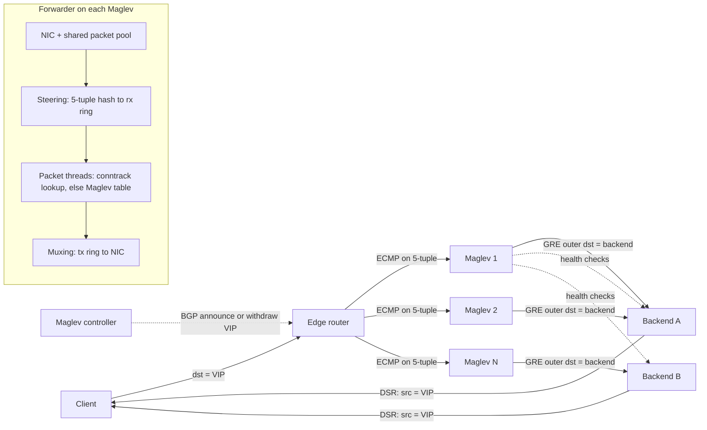

# Maglev: Fast and Reliable Network Load Balancer (2016 NSDI)

## TL;DR

- Maglev is a scale-out L4 load balancer: routers spread packets across a pool of commodity Linux servers using ECMP, every server is active, and you add capacity by adding servers instead of buying a bigger appliance (Maglev paper, NSDI 2016).
- The data plane bypasses the kernel: the NIC and a userspace process share one packet pool, a steering module hashes each packet's 5-tuple onto per-core rings, lock-free packet threads pick a backend and GRE-encapsulate the packet, and pointers move between rings without copies, so one machine fills a 10 Gbps link with small packets (Maglev paper, NSDI 2016).
- Backend selection has two layers: a per-thread, unshared, fixed-size connection-tracking table keeps a flow sticky while one Maglev sees it, and Maglev hashing gives every Maglev the same answer for the same 5-tuple when that table cannot help.
- Maglev hashing fills a prime-sized lookup table (65537 or 655373 entries) by taking turns across per-backend permutations, which gives O(1) lookup and near-perfect balance but more disruption than the minimum: removing 1 of 1000 backends at M=65537 remaps about 6.6x the ideal number of slots (this chapter's simulator).
- Responses skip the load balancer through direct server return (DSR), so you size Maglev against ingress packets per second only; the costs are asymmetric routing, encapsulation overhead, and broken connections that appear when ECMP churn coincides with any backend-set change (skewed or consistent).

## Mental Model



Think of Maglev as a stateless-by-default function from 5-tuple to backend, replicated on every machine in the pool, with a local cache in front of it.
The router does not keep flows on the same Maglev, so any Maglev can receive the next packet of any connection.
The design holds together because every Maglev computes the same lookup table from the same backend set, so a packet that lands on a "cold" Maglev still reaches the right backend.
Connection tracking covers the case where the backend set changes while a flow is alive, as long as the flow stays on one Maglev.
Return traffic never comes back through Maglev, so the load balancer handles only the small request direction of an asymmetric workload.
Each layer covers one failure: ECMP covers Maglev-machine loss, consistent hashing covers ECMP reshuffles, and connection tracking covers backend-set churn.
A connection breaks only when two of those events overlap.

## Internals

### Frontend topology and the packet path

Each Google service exposes one or more virtual IPs (VIPs), and a VIP is not tied to any physical interface (Maglev paper, NSDI 2016).
The Maglev controller on each machine announces VIPs to the upstream router over BGP, and the router propagates them into the backbone.
DNS hands clients a VIP, and the client's packet travels to the router nearest the serving cluster.
The router picks one Maglev with ECMP, a hash of the packet header over all equal-cost next hops.
The Maglev forwarder matches the packet to a VIP, selects a service endpoint, wraps the packet in GRE with the endpoint as the outer destination, and sends it into the fabric.
The endpoint decapsulates and sees the original packet, still addressed to the VIP, and replies with the VIP as source address straight to the client.
This is direct server return, and it determines the economics: the return direction, typically the larger byte stream for web and streaming workloads, never touches the load balancer.
For an LLM inference API that streams tokens over long-lived connections, this asymmetry is large, because ingress is prompts and ACKs while egress is the token stream.

See [[17-Cloud-AI-Engineering/Volume_00_Foundations_Under_the_Cloud/Chapter_02_Datacenter_Networking_Fabrics|Datacenter Networking Fabrics]] for ECMP and BGP mechanics, and [[17-Cloud-AI-Engineering/Volume_03_GCP_Deep_Dive/Chapter_05_Cloud_Load_Balancing_GFEs_and_Maglev|Cloud Load Balancing: GFEs and Maglev]] for how the product layers GFEs behind Maglev.

### Control plane versus data plane

Every Maglev machine runs two components: a controller and a forwarder (Maglev paper, NSDI 2016).
The controller checks the forwarder's health and decides whether the machine should announce or withdraw its VIPs over BGP.
That one decision is how a sick Maglev drains itself: withdraw the routes, and the router's ECMP set shrinks.
The forwarder holds VIP configuration as backend pools, and a pool can contain endpoint addresses or other pools, so configuration nests.
Each forwarder health-checks its own backends, so health state is computed independently on every machine rather than agreed on through consensus.
Configuration arrives from files or over RPC, and a push does not land on every machine at the same instant, so for a short window two Maglevs in one cluster can hold different backend sets.
That window is the root of the subtle failure mode analyzed below.
The paper describes clusters split into shards that serve disjoint VIP sets, which isolates tenants and caps per-machine table memory, though the evaluation assumes one shard per cluster (Maglev paper, NSDI 2016).
The data plane never waits on the control plane: packets are forwarded with whatever table is currently installed, which is the static-stability pattern from [[17-Cloud-AI-Engineering/Volume_01_Cloud_Architecture_Principles/Chapter_04_Control_Plane_vs_Data_Plane_Separation|Control Plane vs Data Plane Separation]].

### The kernel-bypass forwarding pipeline

The Linux network stack does per-packet work Maglev does not need: socket lookup, skb allocation, netfilter traversal, and context switches.
Maglev skips all of it by running the forwarder in userspace against a NIC that DMAs straight into a packet pool shared with the process.
The pipeline has three stages (Maglev paper, NSDI 2016, Sec 3.2):
- The steering module reads each received packet, computes its 5-tuple hash, and places a pointer to it on the receive ring of one packet thread.
- Each packet thread is pinned to a dedicated core, matches the packet to a VIP and drops it if none matches, picks a backend, writes the GRE header in place, and places the pointer on its transmit ring.
- The muxing module polls the transmit rings and hands the pointers back to the NIC for transmission.

Packets are never copied.
Only pointers move between rings, and the rings track which pool slots are received, processed, or free for reuse.
Threads share no mutable state, so the hot path takes no locks.
When a packet thread's receive ring is full, the steering module falls back to round-robin across other threads rather than dropping the packet (Maglev paper, NSDI 2016; UNVERIFIED in this review).
That fallback silently breaks thread affinity for the connection, which matters for connection tracking.
Packets move through the pipeline in batches to amortize NIC doorbell and cache costs, and a timer flushes partial batches so latency stays bounded at low load (Maglev paper, NSDI 2016; exact timer value UNVERIFIED).

Here is the line-rate arithmetic that justifies all of this.
A minimum Ethernet frame is 64 bytes plus 20 bytes of preamble and inter-frame gap, or 84 bytes, which is 672 bits.
10 Gbps divided by 672 bits is 14.88 Mpps, so one machine has 67.2 ns per packet in total.
Spread across 8 pinned threads, each thread has about 538 ns per packet, which covers a few cache misses and leaves no room for a syscall.
At 100 Gbps the machine-wide budget falls to 6.72 ns per packet, which is why later systems moved more of this work into NIC offload, per-host software dataplanes, and switch ASICs.
For background on the kernel-bypass family (DPDK, netmap, RDMA), see [[15-Technical-Whitepapers/10-Seminal-Low-Latency-Systems-Papers/03-Kernel-Bypass-and-Sub-Microsecond-IO|Kernel Bypass and Sub-Microsecond IO]].

### Two-layer backend selection

Connection tracking is a per-thread hash table from 5-tuple to the chosen backend (Maglev paper, NSDI 2016, Sec 3.3).
It is local and fixed-size, and the paper states that connection state is not shared even between packet threads on the same machine, to avoid contention.
The paper names the cases where tracking alone fails:
- ECMP gives no connection affinity, so when the Maglev set changes, the router may send a live flow to a different Maglev that has no entry for it.
- A fixed-size table can fill under heavy load or a SYN flood, and new flows then go untracked.

Sharing state across Maglevs through a distributed hash table would fix both problems, but it puts a network round trip on the per-packet path, and the paper rejects it for that reason.
Maglev's answer is a deterministic function that every machine evaluates identically: Maglev hashing.

The correctness rule is short enough to memorize.
A packet reaches the right backend if either (a) it lands on the thread that holds its tracking entry, or (b) the Maglev it lands on computes a table that maps its slot to the same backend as before.
A connection breaks only when both fail at once, for example when an ECMP reshuffle or steering fallback (breaking a) happens during a window where Maglevs hold different backend sets or the slot was remapped by backend churn (breaking b).

### Maglev hashing: the algorithm

Let M be the lookup table size, a prime much larger than the backend count N (Maglev paper, NSDI 2016, Sec 3.4).
Each backend has a unique name, hashed with two independent functions:
- offset = h1(name) mod M
- skip = h2(name) mod (M - 1) + 1
- permutation[i][j] = (offset + j * skip) mod M

Because M is prime, every skip in [1, M-1] is coprime to M, so each backend's sequence visits every slot exactly once.
Population is a round-robin race.
Each backend in turn claims the next slot in its permutation that is still empty, and the loop stops when all M slots are filled.
Lookup is entry[hash(5-tuple) mod M]: one multiply-free index into a flat array, with no binary search and no pointer chasing.
Average build cost is O(M log M), degrading toward O(M^2) as N approaches M, which is one more reason to keep M >> N (Maglev paper, NSDI 2016).
Because backends take turns, each gets either floor(M/N) or ceil(M/N) slots, so balance is near-perfect by construction.
Weights fit in naturally: a backend with weight w takes w turns per round, which is what Envoy does when it places each host "some number of times proportional to its weight" ([Envoy docs](https://www.envoyproxy.io/docs/envoy/latest/intro/arch_overview/upstream/load_balancing/load_balancers), as of 2026-10).

### The mechanism a getting-started guide omits: Maglev trades disruption for balance

Ring hashing (Karger) and rendezvous hashing guarantee minimal disruption: when a backend leaves, only its keys move.
Maglev hashing does not.
When a backend is removed, the survivors' race runs differently: a survivor that used to lose a contested slot early may now win it, which shifts its later choices, and some slots that belonged to other survivors change owner.
The paper accepts this on purpose: with one lookup table per VIP, M must stay small for memory, and at small M the alternatives balance badly.
At M=65537 with 1000 backends, Karger and rendezvous hashing need 29.7% and 49.5% backend overprovisioning to absorb their imbalance, falling to 10.3% and 12.3% at M=655373 (Maglev paper, NSDI 2016, Sec 5.3).
Maglev hashing needs almost none.

The simulator in the Worked Example measures the cost of that trade:

| M | N | Slots changed on removing 1 backend | Ideal (victim share) | Collateral on survivors |
|---|---|---|---|---|
| 65537 | 10 | 10.20% | 10.00% | 0.20% |
| 65537 | 100 | 1.57% | 1.00% | 0.57% |
| 65537 | 1000 | 0.67% | 0.10% | 0.57% |
| 655373 | 100 | 1.13% | 1.00% | 0.13% |
| 655373 | 1000 | 0.43% | 0.10% | 0.33% |

Two non-obvious facts follow.
First, collateral damage does not shrink as N grows at fixed M: at M/N = 65, collateral is 5.6x the ideal movement, so large backend pools on small tables churn more than you would expect.
Second, collateral damage is exactly the population of connections that break when connection tracking misses.
A flow on a surviving backend never needed to move, and it breaks only because the table moved it.
The ratio M/N is therefore a reliability parameter as well as a memory parameter, and the paper's 655373 table exists for large pools.

### Fragments and the second hop

Only the first IP fragment carries the L4 header, so a 5-tuple hash cannot place later fragments (Maglev paper, NSDI 2016).
Maglev hashes fragments on the 3-tuple of source, destination, and protocol instead.
That alone is not enough, because the router's ECMP may send different fragments of one datagram to different Maglevs.
Each Maglev therefore holds a special backend pool containing every Maglev in the cluster, and on receiving a fragment it uses the 3-tuple hash to pick one designated Maglev and forwards the fragment there over GRE.
The GRE recursion control field limits redirection to one extra hop, so fragments cannot loop between Maglevs (Maglev paper, NSDI 2016; field-level detail UNVERIFIED in this review).
The designated Maglev reassembles enough state to forward all fragments to the same backend.

### Failure domains

| Failure domain | Blast radius | Recovery mechanism |
|---|---|---|
| One packet thread stalls | Its receive ring fills | Steering falls back to other threads, and consistent hashing preserves the mapping |
| One Maglev machine dies | 1/N of flows move via ECMP | Router removes the next hop when BGP or BFD times out, and consistent hashing keeps backends stable |
| One backend dies | Its flows reset | Each Maglev's health checker removes it independently, and the table rebuilds locally |
| Config push skew | Collateral slots on moved flows | Converges when the push completes |
| Controller announcement bug | Every VIP the controller announces | Only a human or a canary can stop it, since it is a control-plane global action |
| Router or ECMP group | The whole cluster | Anycast or DNS shifts traffic to another cluster |

### Lineage and descendants

Microsoft's Ananta (SIGCOMM 2013) also splits a software mux from host agents, but it NATs on the host and returns traffic through the host agent rather than using pure DSR.
Duet (SIGCOMM 2014) and SilkRoad (SIGCOMM 2017) move the VIP table and connection state into switch ASICs to reach terabit rates per device.
Beamer (NSDI 2018) removes connection state from the mux entirely by daisy-chaining packets to the previous backend.
Facebook's [Katran](https://github.com/facebookincubator/katran) runs a Maglev-style hash inside XDP/eBPF, and GitHub's [GLB Director](https://github.com/github/glb-director) uses rendezvous hashing with a "second chance" backend to avoid connection state.
Envoy ships a Maglev balancer with a 65537-entry default table ([Envoy docs](https://www.envoyproxy.io/docs/envoy/latest/intro/arch_overview/upstream/load_balancing/load_balancers), as of 2026-10).
Inside Google, Maglev provides network load balancing for Google Cloud Platform (Maglev paper, NSDI 2016), and the per-host software dataplane is covered in the next chapter, [[17-Cloud-AI-Engineering/Volume_13_Seminal_Papers_and_Case_Studies/Chapter_12_Andromeda_Network_Virtualization|Andromeda]].
For background on ring hashing, see [[08-Distinguished-Engineering/02-Distributed-Systems-Internals/Consistent-Hash-Ring|Consistent Hash Ring]].

## Numbers to Know

| Quantity | Value | Source |
|---|---|---|
| Maglev in production at Google since | 2008 | (Maglev paper, NSDI 2016) |
| Per-machine throughput | Saturates a 10 Gbps link with small packets | (Maglev paper, NSDI 2016) |
| 10GbE line rate at 64-byte frames | 14.88 Mpps, 67.2 ns per packet machine-wide | Derived: 10e9 / (84 B x 8) |
| 100GbE line rate at 64-byte frames | 148.8 Mpps, 6.72 ns per packet | Derived |
| Average forwarder processing time per packet | About 350 ns | (Maglev paper, NSDI 2016) UNVERIFIED |
| Lookup table sizes evaluated | 65537 (small), 655373 (large) | (Maglev paper, NSDI 2016, Sec 5.3) |
| Overprovisioning for Karger / rendezvous, N=1000, M=65537 | 29.7% / 49.5% | (Maglev paper, NSDI 2016, Sec 5.3) |
| Same at M=655373 | 10.3% / 12.3% | (Maglev paper, NSDI 2016, Sec 5.3) |
| Table build complexity | O(M log M) average, O(M^2) worst case | (Maglev paper, NSDI 2016, Sec 3.4) |
| Table memory per VIP at M=65537, 4-byte entries | 256 KiB | Derived |
| Collateral remap, N=1000, M=65537 | 0.57% of slots (5.6x the ideal) | This chapter's simulator |
| Envoy Maglev default table size | 65537 | ([Envoy docs](https://www.envoyproxy.io/docs/envoy/latest/intro/arch_overview/upstream/load_balancing/load_balancers), as of 2026-10) |
| AWS NLB TCP idle timeout | 350 s default, configurable | (AWS docs, as of 2026-10) UNVERIFIED |
| AWS NLB UDP idle timeout | 120 s | (AWS docs, as of 2026-10) UNVERIFIED |
| ELBv2 target group deregistration delay default | 300 s | (AWS docs, as of 2026-10) UNVERIFIED |
| AWS NLB list price, us-east-1 | 0.0225 USD per LB-hour + 0.006 USD per NLCU-hour | (AWS pricing, as of 2026-10) UNVERIFIED |
| AWS NLCU dimensions (TCP) | 800 new flows/s, 100,000 active flows, 1 GB/h processed | (AWS pricing, as of 2026-10) UNVERIFIED |
| GCP forwarding rule list price | 0.025 USD/h for the first 5 rules per project per region | (Google Cloud pricing, as of 2026-10) UNVERIFIED |
| GCP health check source ranges for passthrough NLB | 35.191.0.0/16, 209.85.152.0/22, 209.85.204.0/22 | (Google Cloud docs, as of 2026-10) UNVERIFIED |

## AWS vs GCP Mechanism Parity

| Dimension | Google Cloud (Maglev lineage) | AWS (NLB on Hyperplane) |
|---|---|---|
| Product | External passthrough Network Load Balancer, documented as Maglev-based (Google Cloud docs, as of 2026-10; UNVERIFIED); see [[17-Cloud-AI-Engineering/Volume_03_GCP_Deep_Dive/Chapter_05_Cloud_Load_Balancing_GFEs_and_Maglev\|GFEs and Maglev]] | Network Load Balancer, built on the Hyperplane distributed flow-tracking service (AWS re:Invent talks; UNVERIFIED) |
| Flow placement | Consistent hash on a 5-, 3-, or 2-tuple depending on session affinity, plus local connection tracking | Flow hash on protocol, source and destination IP and port, plus TCP sequence number for TCP (AWS docs, as of 2026-10; UNVERIFIED) |
| State model | State is a local cache and the hash is the source of truth, so any LB node can forward any packet when configs agree | Flow state is the source of truth, held by a stateful flow-tracking layer (internals not public) |
| Return path | DSR: the backend replies directly with the VIP as source | Return traffic is handled by the NLB data plane, which lets it do NAT for IP targets (UNVERIFIED) |
| Client IP | Always preserved, because packets are not NATed | Preserved for instance targets and configurable for IP targets (AWS docs; UNVERIFIED) |
| Backend view of the packet | Destination is the forwarding-rule IP, and the guest environment installs a local route so the kernel accepts it | Destination is the target's own IP |
| Health checking | Health checked from Google ranges, with per-backend-service policy on whether existing connections persist on unhealthy backends (UNVERIFIED) | Per-target-group health checks, and failing AZ nodes are pulled from DNS |
| Weighted balancing | WEIGHTED_MAGLEV locality policy, with weights reported per endpoint in an HTTP health-check response header (Google Cloud docs; UNVERIFIED) | No per-target weights on an NLB target group (UNVERIFIED) |
| Draining | Connection draining timeout on the backend service | Deregistration delay on the target group |
| Zonal failure domain | Regional backend service, and the VIP is not bound to a zone | One NLB node and IP per enabled AZ, with cross-zone balancing off by default (UNVERIFIED) |
| TLS | None: TLS terminates on the backend | Optional TLS listener terminating on the NLB with ACM certificates |
| Private equivalent | Internal passthrough NLB, realized in the Andromeda host dataplane (see [[17-Cloud-AI-Engineering/Volume_13_Seminal_Papers_and_Case_Studies/Chapter_12_Andromeda_Network_Virtualization\|Andromeda]]) | Internal NLB; PrivateLink endpoint services sit behind an NLB or GWLB |
| Encapsulation | GRE in the paper; the production overlay is not publicly specified | VPC overlay; GENEVE on UDP 6081 for GWLB appliances |

The philosophical split is what interviewers probe.
Maglev bets on determinism: if every node computes the same function from the same inputs, you do not need shared state.
Hyperplane-style designs bet on replicated flow state, which supports NAT and symmetric return paths but makes the state layer a scaling and correctness concern of its own.
See [[17-Cloud-AI-Engineering/Volume_04_AWS_vs_GCP_Translation/Chapter_02_Networking_and_Load_Balancing_Translation|Networking and Load Balancing Translation]] for the product-level mapping.

## Worked Example: Maglev Table Simulator, Passthrough NLB Lab, and Fleet Sizing

### Part 1 - Runnable simulator (no cloud cost)

```python
#!/usr/bin/env python3
"""Maglev hashing (Eisenbud et al., NSDI 2016, Sec 3.4) simulator.
Measures balance, disruption on backend removal, and connection breakage
when an ECMP reshuffle coincides with backend-set skew between Maglevs.
Pure Python 3 standard library; no cloud resources."""
import hashlib
import random
import sys


def _h(data, salt):
    d = hashlib.blake2b(data.encode(), digest_size=8, person=salt).digest()
    return int.from_bytes(d, "little")


def permutation_params(name, m):
    offset = _h(name, b"maglev-offset") % m
    skip = _h(name, b"maglev-skip") % (m - 1) + 1
    return offset, skip


def populate(backends, m, weights=None):
    """Pseudocode 1 from the paper, generalized with integer weights.
    A backend with weight w takes w turns per round-robin pass."""
    n = len(backends)
    if n == 0:
        return [-1] * m
    weights = weights or [1] * n
    params = [permutation_params(b, m) for b in backends]
    nxt = [0] * n
    entry = [-1] * m
    filled = 0
    while True:
        for i in range(n):
            for _ in range(weights[i]):
                offset, skip = params[i]
                c = (offset + nxt[i] * skip) % m
                while entry[c] >= 0:
                    nxt[i] += 1
                    c = (offset + nxt[i] * skip) % m
                entry[c] = i
                nxt[i] += 1
                filled += 1
                if filled == m:
                    return entry


def names(table, backends):
    return [backends[i] for i in table]


def balance(table, n):
    counts = [0] * n
    for i in table:
        counts[i] += 1
    return max(counts) / (len(table) / n), min(counts) / (len(table) / n)


def disruption(m, n, victim=0):
    before = [f"10.0.{i // 250}.{i % 250}:443" for i in range(n)]
    after = [b for j, b in enumerate(before) if j != victim]
    t0 = names(populate(before, m), before)
    t1 = names(populate(after, m), after)
    changed = sum(1 for a, b in zip(t0, t1) if a != b)
    victim_slots = sum(1 for a in t0 if a == before[victim])
    collateral = changed - victim_slots
    return changed / m, victim_slots / m, collateral / m


def ecmp_skew(m, n, flows=200000, maglevs=8, seed=7):
    """Old Maglev set has `maglevs` members; one is drained so ECMP rehashes.
    The receiving Maglev has no conntrack entry and falls back to the table.
    Case A: all Maglevs share config. Case B: receiver has a newer backend set
    (one backend removed) because a config push is mid-flight."""
    rnd = random.Random(seed)
    backends = [f"be-{i}" for i in range(n)]
    newer = backends[1:]
    t_old = names(populate(backends, m), backends)
    t_new = names(populate(newer, m), newer)
    moved = broken_a = broken_b = 0
    for _ in range(flows):
        five_tuple = f"{rnd.getrandbits(32)}:{rnd.getrandbits(16)}->vip:443/tcp"
        k = _h(five_tuple, b"flow-5tuple")
        if k % maglevs == k % (maglevs - 1):
            continue
        moved += 1
        slot = k % m
        original = t_old[slot]
        if original == backends[0]:
            continue
        if t_old[slot] != original:
            broken_a += 1
        if t_new[slot] != original:
            broken_b += 1
    return moved / flows, broken_a / max(moved, 1), broken_b / max(moved, 1)


def main():
    m = int(sys.argv[1]) if len(sys.argv) > 1 else 65537
    for n in (10, 100, 1000):
        hi, lo = balance(populate([f"b{i}" for i in range(n)], m), n)
        tot, vic, col = disruption(m, n)
        print(f"M={m} N={n}: max/ideal={hi:.4f} min/ideal={lo:.4f} "
              f"changed={tot:.4%} victim_share={vic:.4%} collateral={col:.4%}")
    moved, a, b = ecmp_skew(m, 100)
    print(f"ECMP 8->7 Maglevs: flows moved={moved:.2%}; "
          f"broken (same config)={a:.3%}; broken (config skew)={b:.3%}")
    w = populate(["big", "small"], m, weights=[3, 1])
    print(f"weights 3:1 -> big gets {w.count(0) / m:.3%} of slots")


if __name__ == "__main__":
    main()
```

Run it with `python3 maglev_sim.py 65537`.
It finishes in under one second on a laptop.
Observed output:

```text
M=65537 N=10: max/ideal=1.0000 min/ideal=0.9999 changed=10.2003% victim_share=10.0005% collateral=0.1999%
M=65537 N=100: max/ideal=1.0010 min/ideal=0.9994 changed=1.5732% victim_share=1.0010% collateral=0.5722%
M=65537 N=1000: max/ideal=1.0071 min/ideal=0.9918 changed=0.6668% victim_share=0.1007% collateral=0.5661%
ECMP 8->7 Maglevs: flows moved=87.51%; broken (same config)=0.000%; broken (config skew)=0.560%
weights 3:1 -> big gets 75.000% of slots
```

How to read the output:
- Balance stays within 1% of ideal even at N=1000, which is the property the paper optimizes for.
- The ECMP model uses naive modulo hashing, so draining 1 of 8 Maglevs moves 87.5% of flows; switches with resilient ECMP move closer to 1/8, but plan for the bad case.
- With identical configuration on every Maglev, zero moved flows break, because the hash is the source of truth.
- With a mid-push config skew, 0.56% of moved flows break, which matches the collateral column: config skew turns hash collateral directly into connection resets.

### Part 2 - Observe Maglev behavior on a Google Cloud external passthrough NLB

Estimated cost: two e2-micro VMs plus one forwarding rule for one hour comes to roughly 0.05 USD at list price (Google Cloud pricing, as of 2026-10; UNVERIFIED), plus negligible egress.
Set a budget alarm before you create anything.

```bash
#!/usr/bin/env bash
set -euo pipefail
export PROJECT_ID="$(gcloud config get-value project)"
export REGION=us-central1 ZONE=us-central1-a
export BILLING_ACCOUNT="XXXXXX-XXXXXX-XXXXXX"   # replace
MYIP="$(curl -s https://ifconfig.me)/32"

# Budget alarm (alerts at 50% and 90% of 5 USD).
gcloud billing budgets create --billing-account="$BILLING_ACCOUNT" \
  --display-name=maglev-lab-budget --budget-amount=5USD \
  --threshold-rule=percent=0.5 --threshold-rule=percent=0.9 \
  --filter-projects="projects/$PROJECT_ID"

# Backend: echoes hostname and the client ip:port it sees; health endpoint reports a weight.
cat > /tmp/startup.sh <<'EOF'
#!/bin/bash
W=$(curl -sf -H 'Metadata-Flavor: Google' \
  http://metadata.google.internal/computeMetadata/v1/instance/attributes/lb-weight || echo 100)
cat > /opt/srv.py <<'PY'
import http.server, os, socket
W = os.environ.get("W", "100")
class H(http.server.BaseHTTPRequestHandler):
    def do_GET(self):
        body = ("%s peer=%s:%d\n" % (socket.gethostname(), *self.client_address)).encode()
        self.send_response(200)
        if self.path == "/healthz":
            self.send_header("X-Load-Balancing-Endpoint-Weight", W)
        self.send_header("Content-Length", str(len(body)))
        self.end_headers()
        self.wfile.write(body)
    def log_message(self, *a):
        pass
http.server.ThreadingHTTPServer(("0.0.0.0", 80), H).serve_forever()
PY
W="$W" nohup python3 /opt/srv.py >/dev/null 2>&1 &
EOF

gcloud compute instance-templates create maglev-lab-tpl \
  --machine-type=e2-micro --image-family=debian-12 --image-project=debian-cloud \
  --tags=maglev-lab --metadata-from-file=startup-script=/tmp/startup.sh

gcloud compute instance-groups managed create maglev-lab-mig \
  --zone="$ZONE" --size=2 --template=maglev-lab-tpl

gcloud compute firewall-rules create maglev-lab-allow --network=default \
  --direction=INGRESS --action=ALLOW --rules=tcp:80 --target-tags=maglev-lab \
  --source-ranges="$MYIP,35.191.0.0/16,209.85.152.0/22,209.85.204.0/22"

gcloud compute health-checks create http maglev-lab-hc \
  --region="$REGION" --port=80 --request-path=/healthz

gcloud compute backend-services create maglev-lab-bs --region="$REGION" \
  --load-balancing-scheme=EXTERNAL --protocol=TCP \
  --health-checks=maglev-lab-hc --health-checks-region="$REGION" \
  --session-affinity=NONE --connection-draining-timeout=30

gcloud compute backend-services add-backend maglev-lab-bs --region="$REGION" \
  --instance-group=maglev-lab-mig --instance-group-zone="$ZONE"

gcloud compute forwarding-rules create maglev-lab-fr --region="$REGION" \
  --load-balancing-scheme=EXTERNAL --ip-protocol=TCP --ports=80 \
  --backend-service=maglev-lab-bs
```

Experiments:

```bash
VIP=$(gcloud compute forwarding-rules describe maglev-lab-fr --region="$REGION" --format='value(IPAddress)')

# 1. 5-tuple hashing: each curl uses a new ephemeral source port, so flows spread.
for i in $(seq 1 20); do curl -s "http://$VIP/"; done | awk '{print $1}' | sort | uniq -c

# 2. Passthrough proof: the backend sees YOUR public ip:port; there is no SNAT.
curl -s "http://$VIP/"

# 3. DSR plumbing: the guest environment installed a local route for the VIP.
VM=$(gcloud compute instance-groups managed list-instances maglev-lab-mig --zone="$ZONE" --format='value(name)' | head -1)
gcloud compute ssh "$VM" --zone="$ZONE" --command "ip route show table local | grep $VIP"

# 4. Collapse to 2-tuple affinity: every request now lands on one backend.
gcloud compute backend-services update maglev-lab-bs --region="$REGION" --session-affinity=CLIENT_IP
for i in $(seq 1 20); do curl -s "http://$VIP/"; done | awk '{print $1}' | sort | uniq -c

# 5. Optional (flag and behavior UNVERIFIED): weighted Maglev driven by the health-check header.
gcloud compute backend-services update maglev-lab-bs --region="$REGION" \
  --session-affinity=NONE --locality-lb-policy=WEIGHTED_MAGLEV
```

Experiment 3 shows the DSR contract from the paper surviving into the product: the backend must accept packets addressed to an IP it does not own.
A custom image without the guest environment drops those packets silently, while health checks, which target the VM's own IP, still pass.

Teardown, in exact dependency order:

```bash
gcloud compute forwarding-rules delete maglev-lab-fr --region="$REGION" --quiet
gcloud compute backend-services delete maglev-lab-bs --region="$REGION" --quiet
gcloud compute health-checks delete maglev-lab-hc --region="$REGION" --quiet
gcloud compute instance-groups managed delete maglev-lab-mig --zone="$ZONE" --quiet
gcloud compute instance-templates delete maglev-lab-tpl --quiet
gcloud compute firewall-rules delete maglev-lab-allow --quiet
BUDGET=$(gcloud billing budgets list --billing-account="$BILLING_ACCOUNT" \
  --filter='displayName=maglev-lab-budget' --format='value(name)')
gcloud billing budgets delete "$BUDGET" --quiet
```

### Part 3 - Back-of-the-envelope: sizing a self-run Maglev-style tier for an inference API

Workload assumptions:
- 800 Gbps of token-stream egress.
- A 1:20 ingress-to-egress byte ratio, so 40 Gbps of ingress.
- Ingress dominated by ACKs and small prompts, with a mean packet size of 128 bytes.
- 2 M concurrent connections.

Step 1, ingress packet rate: 40e9 / 8 / 128 = 39 Mpps.
Step 2, per-node capacity is an assumption you must benchmark: plan for 8 Mpps and 7 Gbps per node at 70% of measured saturation on a 10 GbE NIC.
Step 3, node count: packet rate needs ceil(39 / 8) = 5 nodes, and bandwidth needs ceil(40 / 7) = 6 nodes, so bandwidth binds at 6.
Step 4, headroom: add one node to absorb a failure and one to cover a drain during deploys, for 8 nodes, which also fits a common 8-way ECMP group.
Step 5, connection tracking: steady state is 2 M / 8 = 250 k flows per node, or 333 k with two nodes out, which at 64 bytes per entry is about 21 MB.
Step 6, SYN-flood exposure: 5 Mpps of spoofed SYNs is 625 k entries/s per node, so a 4 M-entry table fills in 6.4 s, after which new connections depend only on hash consistency.
Step 7, table memory: 5000 VIPs x 65537 entries x 4 bytes = 1.3 GB per node, or 13 GB at M=655373, which is why large-M tables are reserved for VIPs with large pools and why VIPs are sharded.
Step 8, the reliability check: with 200 backends per VIP at M=65537, collateral sits around 0.5% of slots, so roughly 0.5% of the flows ECMP moves during a config-skew window will reset; if that window is 10 s and drains happen hourly, the reset budget is acceptable for HTTP but not for multi-hour training-control or gRPC streams.

On a managed service you pay the provider for steps 2 to 7 instead: NLB charges NLCU-hours on new flows, active flows, and bytes (UNVERIFIED), while the GCP passthrough NLB charges per forwarding rule plus data processing (UNVERIFIED).
Cost per million tokens for the LB tier is usually below 1% of accelerator cost; see [[17-Cloud-AI-Engineering/Volume_09_FinOps_and_Cloud_Economics/Chapter_05_GPU_and_TPU_Unit_Economics|GPU and TPU Unit Economics]].

## Failure Modes and Pitfalls

### 1. ECMP churn during a configuration push

A Maglev drains, ECMP rehashes most flows, and the receiving Maglevs fall back to the hash while a backend-set change is only half-propagated.
The simulator shows the broken fraction equals the hash's collateral fraction, about 0.56% of moved flows at N=100.
Mitigations:
- Never drain Maglevs and change backend sets in the same window.
- Pace config pushes so the skew window stays short.
- Keep M/N high.
- Prefer switches with resilient ECMP hashing.

### 2. Connection-table exhaustion

A SYN flood or a sudden flow storm fills the fixed-size tables, so new legitimate flows go untracked.
This is invisible until a backend health flap remaps slots, and at that point every untracked flow on a remapped slot resets.
Alert on table occupancy and use SYN cookies or upstream scrubbing; on AWS that means Shield, and on GCP it means Cloud Armor network-edge protections (product scope UNVERIFIED).

### 3. Health-check flapping turns into table churn

Each Maglev health-checks independently, so a backend that is marginal will flap differently on different Maglevs, which is permanent config skew with real collateral damage.
Fix it with hysteresis (N consecutive failures before removal) and with a floor on the fraction of capacity that health checks may remove automatically.
The AWS us-east-1 event of October 2025 showed this class at scale: per AWS's post-event summary, the NLB health-check subsystem marked healthy capacity unhealthy while EC2 network state was delayed, and automated failover removed capacity (AWS PES, 2025-10; UNVERIFIED in this review).
The generalizable lesson matches [[17-Cloud-AI-Engineering/Volume_01_Cloud_Architecture_Principles/Chapter_02_Regions_Zones_and_Static_Stability|Static Stability]]: when health signals are correlated with a control-plane impairment, fail static rather than draining.

### 4. VIP announcement is a global control-plane hazard

The controller's BGP announce or withdraw decision has the largest blast radius in the system.
In the Google Compute Engine incident of April 2016, a network-configuration change withdrew GCE IP blocks from BGP announcement across regions, and the canary signal that should have stopped the rollout did not (Google Cloud incident report 16007, 2016-04; UNVERIFIED in this review).
Fixes:
- Rate-limit withdrawals.
- Make canary failure block the rollout.
- Refuse any change that withdraws more than a small fraction of prefixes at once.

For more on this pattern, see [[17-Cloud-AI-Engineering/Volume_07_Reliability_and_SRE/Chapter_07_Anatomy_of_Major_Cloud_Outages|Anatomy of Major Cloud Outages]].

### 5. MTU, encapsulation, and ICMP

GRE adds header bytes, so a full-size client packet can exceed the fabric MTU after encapsulation unless the fabric runs jumbo frames or MSS is clamped.
ICMP "fragmentation needed" messages are sent to the VIP by an intermediate router, so their 5-tuple does not match the flow, and a naive L4 balancer delivers them to the wrong backend, which black-holes Path MTU discovery.
Production L4 balancers must parse the inner header quoted in the ICMP payload, or broadcast PTB messages to all backends, which is the approach Cloudflare has described (UNVERIFIED).

### 6. Connection balance is not load balance

Maglev balances flows, not bytes or GPU-seconds.
Long-lived HTTP/2, gRPC, or token-streaming connections pin load to the backends that happened to receive them, and an L4 balancer can never rebalance an established connection.
For LLM serving, put an L7 router behind the L4 tier that is aware of KV-cache locality and queue depth (see [[17-Cloud-AI-Engineering/Volume_14_Staff_Plus_Interview_Arena/Chapter_01_Design_Multi_Tenant_LLM_Inference_Platform|Multi-Tenant LLM Inference Platform]]), and cap connection age so clients reconnect.

### 7. Affinity collapse behind NAT

CLIENT_IP affinity hashes only the source address, so a carrier-grade NAT or corporate egress that puts thousands of users behind one IP lands them all on one backend.
Use 5-tuple hashing unless the protocol needs affinity, and push application-level affinity into L7 cookies.

### 8. DSR breaks stateful middleboxes and custom images

A host firewall on the backend sees only one direction of each flow if it inspects the wrong interface, and images without the VIP local route drop traffic while passing health checks.
Test backend images against the VIP itself, not just the health-check path.

## Security and Cost Angles

IAM scoping:
- On GCP, grant `roles/compute.loadBalancerAdmin` for LB resources and keep firewall changes under `roles/compute.securityAdmin`, because an L4 passthrough LB's exposure is defined by VPC firewall rules, not by the LB.
- On AWS, scope `elasticloadbalancing:*` with resource ARNs and tag conditions, and guard `ec2:AuthorizeSecurityGroupIngress` separately, since NLB security groups are now the primary ingress control (UNVERIFIED for feature scope).
- The VIP announcement path is the highest-privilege action in a self-run Maglev, so treat BGP config pushes as change-managed releases with two-person review.

Encryption:
- A passthrough LB never sees plaintext, so TLS private keys live only on the backends, in Secret Manager or Certificate Manager on GCP and Secrets Manager or ACM-exported certificates on AWS, with the key hierarchy rooted in KMS (see [[17-Cloud-AI-Engineering/Volume_08_Security_Identity_and_the_Data_Perimeter/Chapter_04_Encryption_Key_Hierarchies_and_Envelope_Encryption|Envelope Encryption]]).
- Terminating TLS on an AWS NLB listener moves the key boundary to AWS-managed infrastructure, which is simpler but changes your compliance story.

Private boundaries:
- Internal passthrough NLBs keep VIPs on RFC 1918 space, and Private Service Connect publishes them across VPCs.
- On AWS, PrivateLink endpoint services require an NLB or GWLB in front, so the NLB becomes the producer-side data perimeter.
- Combine with [[17-Cloud-AI-Engineering/Volume_03_GCP_Deep_Dive/Chapter_03_VPC_Service_Controls_Security_Perimeters|VPC Service Controls]] for managed APIs.

DDoS:
- Because Maglev is stateless-by-default, a SYN flood degrades stickiness before it degrades forwarding; the forwarder keeps running, but correctness under churn erodes.
- Scrub upstream and alert on connection-table occupancy.

Unit-economics levers:
- DSR means LB cost scales with request bytes, not response bytes, which makes L4 passthrough the cheapest tier for egress-heavy inference streaming.
- On AWS, enabling NLB cross-zone balancing adds inter-AZ data charges, so leave it off when per-AZ capacity is balanced (UNVERIFIED for current billing treatment).
- Collapse VIPs: each GCP forwarding rule is billed hourly (UNVERIFIED), and one forwarding rule can carry a port range.
- Keep connections long-lived but bounded to amortize AWS per-new-flow NLCU charges without creating connection-imbalance hot spots.

## Interview Questions and Model Answers

### Question 1 (L5 - Senior)

Explain Maglev hashing, why the table size must be prime, and why Google chose it over ring hashing.

#### Model Answer

Each backend derives an offset and a skip from two hashes of its name, and its preference list is the arithmetic sequence offset + j * skip mod M.
M must be prime so that every skip value is coprime to M, which makes each sequence a full permutation that visits every slot exactly once; with a composite M, some backends would cycle through a subset of slots and population could stall.
The table is filled by round-robin, with each backend claiming its next free preferred slot, so slot counts differ by at most one per weight unit and balance is near-perfect.
Lookup is a single array index, which matters when the per-packet budget is a few hundred nanoseconds.
Ring hashing needs a large number of virtual nodes per backend to balance well, and Maglev keeps one table per VIP across thousands of VIPs, so memory forces small tables, and at small tables ring and rendezvous hashing need 29.7% to 49.5% overprovisioning at N=1000.
The trade is that Maglev hashing is not minimally disruptive: removing a backend remaps some survivors' slots too, about 0.57% of slots at N=1000 and M=65537, against an ideal of 0.1%.
Connection tracking absorbs that collateral for flows that stay on one Maglev, which is why the two mechanisms are designed together.

#### Follow-up Interviewer Question

If your pool grows from 200 to 5000 backends per VIP, what do you change, and what does it cost?

### Question 2 (L5 - Senior)

Walk a SYN packet from a client to a backend and the SYN-ACK back, naming every component and what state each one touches.

#### Model Answer

DNS returns the VIP, and the client sends a SYN to it.
The edge router has a BGP route for the VIP from every healthy Maglev's controller and picks one by ECMP over the header hash; the router keeps no per-flow state.
On the Maglev, the NIC DMAs the packet into the shared pool, and the steering module hashes the 5-tuple and enqueues a pointer on one packet thread's ring.
The packet thread matches the VIP, misses in its connection table because this is a new flow, indexes the VIP's Maglev table with the 5-tuple hash, records the choice in its connection table, writes a GRE header with the backend as outer destination, and enqueues the pointer for the muxing module to transmit.
The backend decapsulates, its kernel accepts the inner packet because the VIP is configured locally, and the socket stack answers with a SYN-ACK whose source is the VIP.
The SYN-ACK goes straight to the client through normal routing and never touches Maglev, so Maglev never sees the handshake complete and cannot use TCP state for decisions.
The state touched is only the per-thread connection-tracking entry on one Maglev and the socket on the backend.

#### Follow-up Interviewer Question

The client's next packet lands on a different Maglev; under what exact conditions does it still reach the same backend?

### Question 3 (L6 - Staff)

Your self-run Maglev-style tier resets about 0.5% of connections during every deploy, and the team proposes replicating connection state across all LB nodes; evaluate this proposal.

#### Model Answer

First, diagnose: resets during deploys mean a moved flow reached a node whose table disagrees with the original, so either backend sets differ across LB nodes during the push, or the backend set itself changed and the flow was untracked.
The 0.5% figure matches the hash's collateral fraction at moderate M/N, which points to config skew combined with ECMP movement rather than random loss.
Replicating state fixes that but puts a cross-node write on every new flow and a read or lookup on every cache miss; at tens of Mpps, that is a distributed system with its own consistency, partition, and SYN-flood amplification problems, which is exactly what the paper declined to build.
Cheaper fixes, in order:
- Decouple LB-node drains from backend-set changes in the deploy pipeline, so the two failure conditions never overlap.
- Version backend configs and have nodes install a new table only after a short delay, so the skew window narrows to the push jitter.
- Raise M for large pools to cut collateral damage.
- Enable resilient ECMP hashing so a drain moves about 1/N of flows instead of most of them.
- Drain backends by setting weight to zero while existing flows stay tracked and the connection-draining timer runs, instead of deleting them.

If the business really needs zero resets for very long-lived flows, state replication can be justified, but scope it narrowly to the VIPs that need it, Beamer-style daisy chaining being a lighter alternative.
The staff-level point is that you should reach for a coordination protocol only after removing the operational overlap that creates the failure.

#### Follow-up Interviewer Question

How would you build an SLO and alert that detects this class of regression before customers do?

### Question 4 (L6 - Staff)

Size an L4 tier for 40 Gbps of ingress with 128-byte mean packets and 2 M concurrent connections, and defend each headroom choice.

#### Model Answer

The packet rate is 40e9 / 1024 bits = 39 Mpps.
I would benchmark the forwarder on target hardware, then plan at 70% of saturation, say 8 Mpps and 7 Gbps per 10 GbE node, which gives 5 nodes for packet rate and 6 for bandwidth, so 6.
I add one node for an unplanned failure and one for a deploy drain, because both happen and the drain is the event that moves flows, for 8 nodes.
Each node holds 250 k tracked flows at steady state and 333 k degraded, about 21 MB, so memory is not the constraint; SYN-flood fill time is, at 6.4 s for a 4 M-entry table under a 5 Mpps flood, so I want upstream SYN cookies and occupancy alerts.
Per-VIP table memory decides the shard count: 5000 VIPs at 65537 entries is 1.3 GB per node, fine, but large-M tables for big pools should be selective.
I would also check router ECMP fan-out limits and BGP convergence time, since those cap how many nodes can serve one VIP and how fast failures heal.
Finally, I would validate the ingress-to-egress ratio from flow logs, because DSR sizing collapses if a new feature, such as large prompt uploads for retrieval-augmented generation, flips the ratio.

#### Follow-up Interviewer Question

The product adds 100 Gbps NICs; does your per-packet design still work, and what would you change?

### Question 5 (L6 - Staff)

Design weighted load balancing for a heterogeneous inference fleet (H100 and older-GPU nodes behind one VIP) using Maglev hashing.

#### Model Answer

Maglev hashing supports weights by giving a backend w turns per population round, so its table share is proportional to w.
Static weights from relative throughput are the first step, for example a weight of 3 for a node with 3x tokens per second, which the simulator shows yields exactly a 75% share at 3:1.
Dynamic weights are better for inference, because effective capacity depends on batch occupancy and KV-cache pressure, and GCP exposes this pattern as WEIGHTED_MAGLEV, with weights reported in a health-check response header (UNVERIFIED).
The risks are control-loop risks:
- Every weight change rebuilds the table and remaps collateral slots, so weights must be quantized and rate-limited.
- Weights computed from instantaneous load oscillate, because the newest weight sends new connections to the idle node, which then reports itself busy.
- Independent health checkers on each LB node may read different weights, which is config skew again.

I would smooth with an EWMA, quantize to a few levels, cap the change per interval, and accept that L4 weighting only steers new connections.
Per-request balancing belongs in an L7 router that sees queue depth and prefix-cache hits.

#### Follow-up Interviewer Question

How would you stop a single misbehaving node that reports a huge weight from absorbing the fleet's traffic?

### Question 6 (L7+ - Principal)

Compare Maglev's deterministic-hash design with AWS Hyperplane's replicated flow-state design, and decide which you would build for a cloud NAT gateway versus a public VIP load balancer.

#### Model Answer

Maglev treats the hash as truth and state as a cache, so any node can forward any packet when configs agree, scaling is linear, and losing a node costs nothing but a cache.
That works for a public VIP balancer because the backend can reply directly to the client, and the LB never needs to rewrite the return path.
A NAT gateway breaks that assumption: translation creates a mapping, the source port allocation, that the return packet must find, and the return packet arrives from the internet on whatever node the routing chooses.
That mapping is state that cannot be recomputed from the header, so a NAT needs replicated or deterministically partitioned flow state, which is what Hyperplane-style designs provide, using shuffle sharding to bound blast radius per customer (see [[17-Cloud-AI-Engineering/Volume_01_Cloud_Architecture_Principles/Chapter_03_Cell_Based_Architecture_and_Shuffle_Sharding|Shuffle Sharding]]).
The costs of state are correctness under partitions, state capacity as a hard limit (flow counts become billing dimensions), and failover that needs a replica rather than a hash.
I would build the Maglev design for public VIPs, PrivateLink-free internal VIPs, and anything with DSR-capable backends, and the replicated-state design for NAT, firewalls, PrivateLink, and anything that rewrites addresses in both directions.
The principal-level framing is to put state only where the protocol forces it, and to make the stateless tier the default so the stateful tier stays small, cellular, and separately scaled.

#### Follow-up Interviewer Question

How would a 30-minute impairment of the flow-state layer manifest differently to customers of each design, and how would you contain it?

### Question 7 (L7+ - Principal)

You run inference on GPUs across AWS and GCP; design the L4 and L7 traffic tier so model rollouts cause no stream resets and keep KV-cache affinity.

#### Model Answer

At L4, use the passthrough balancers, the GCP external passthrough NLB and the AWS NLB, purely for connection distribution and DDoS absorption, with 5-tuple hashing and no client-IP affinity, because enterprise NAT would create hot spots.
Behind them, run an L7 router fleet that terminates TLS and routes per request on prefix hash, tenant, and live queue depth, because KV-cache reuse is a per-request property that L4 cannot see.
Rollouts follow the Maglev correctness rule: never change the L4 backend set and drain L4 nodes in the same window, and drain L7 routers by setting weight to zero while connection-draining timers cover the longest expected stream.
Cap stream and connection lifetime, for example by sending GOAWAY after a bounded age, so connection imbalance self-heals and drains finish in bounded time.
For the GPU pool, use a consistent hash with bounded load on prefix keys, so adding a replica moves only a bounded share of prefixes, and pre-warm new replicas' prefix caches before raising their weight.
Across clouds, steer at DNS or anycast by region health, and accept that streams in flight on a failed region reset; clients resume using idempotent request IDs, since no L4 trick survives region loss.
Measure resets per thousand streams during deploys as an SLI with an error budget, and gate rollouts on it, as in [[17-Cloud-AI-Engineering/Volume_07_Reliability_and_SRE/Chapter_01_SLIs_SLOs_and_Error_Budget_Engineering|Error Budget Engineering]].

#### Follow-up Interviewer Question

The L7 tier's prefix-hash routing concentrates one viral system prompt on a single GPU replica; how do you detect and resolve that without destroying cache affinity for everyone else?

## Further Reading

- [Maglev: A Fast and Reliable Software Network Load Balancer, NSDI 2016 (USENIX)](https://www.usenix.org/conference/nsdi16/technical-sessions/presentation/eisenbud) - the primary source; read Sections 3.2 to 3.4 and 5.3 twice.
- [Google Research publication page for Maglev](https://research.google/pubs/maglev-a-fast-and-reliable-software-network-load-balancer/) - canonical PDF and abstract, including the GCP network load balancing claim.
- [Envoy load balancer architecture docs](https://www.envoyproxy.io/docs/envoy/latest/intro/arch_overview/upstream/load_balancing/load_balancers) - a production L7 adoption of Maglev hashing with weights, useful for contrasting with ring hash.
- [Katran (Meta) source](https://github.com/facebookincubator/katran) - a Maglev-style L4 balancer in XDP/eBPF, showing how kernel-bypass ideas moved into the kernel's fast path.
- [GLB Director (GitHub) source](https://github.com/github/glb-director) - rendezvous hashing with second-chance forwarding, an alternative answer to the same untracked-flow problem.
- [The Paper Trail: Network Load Balancing with Maglev](https://www.the-paper-trail.org/post/2020-06-23-maglev/) - a concise engineering review that focuses on the operational trade-offs.
- Patel et al., "Ananta: Cloud Scale Load Balancing," SIGCOMM 2013 - Microsoft's contemporaneous design, worth comparing for its NAT-capable host agents.
- Olteanu et al., "Stateless Datacenter Load-balancing with Beamer," NSDI 2018 - removes mux connection state with daisy chaining, a direct response to Maglev's untracked-flow window.
- Miao et al., "SilkRoad: Making Stateful Layer-4 Load Balancing Fast and Cheap Using Switching ASICs," SIGCOMM 2017 - shows where the 100 Gbps-and-beyond per-packet budget forces the design.
- [[17-Cloud-AI-Engineering/Volume_13_Seminal_Papers_and_Case_Studies/Chapter_12_Andromeda_Network_Virtualization|Andromeda: Cloud Network Virtualization (2018 NSDI)]] - the next chapter, where load balancing moves into the per-host virtual network dataplane.
