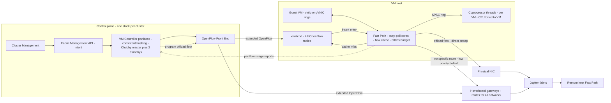

# Andromeda: Cloud Network Virtualization (2018 NSDI)

## TL;DR

Andromeda is Google Cloud's network virtualization stack. It sorts flows into a set of processing paths: a busy-polling Fast Path on the host with a 300 ns per-packet CPU budget, per-VM Coprocessor threads for expensive per-packet work, and shared Hoverboard gateways for the long tail of mostly idle flows (Dalton et al., NSDI 2018).
The Hoverboard model only installs a direct host-to-host route after the sending host reports that a flow is busy. This cut programming for a 40k-VM network from 487M flows in 74 s to 1.5M flows in 1.9 s, because 84% of VM pairs never talk to each other (Dalton et al., NSDI 2018).
Every packet has a fixed CPU cost, so packets per second (pps) is the real limit, not bandwidth: 300 ns per packet is about 3.3 Mpps per core, which is about 40 Gbps at 1500 B but only about 5 Gbps at 200 B.
The control plane is split per cluster, partitioned by consistent hashing, uses a Chubby-elected master with two standbys, keeps a separate update queue for each customer network, and fails static. Under overload the data plane keeps forwarding on its last good state rather than asking for more programming.
Speed of change came from a userspace data plane with hitless upgrades and VM live migration, not from fixed hardware. The cost is host cores spent on networking, which Google has since been moving onto Titanium offload hardware (Google Cloud blog, 2023).

## Mental Model



Think of Andromeda as a cache hierarchy for forwarding state, not as a switch.
The authoritative state is every VM's location plus every firewall, route, and load-balancer rule in every virtual network. It lives in the control plane, and only Hoverboards hold all of it in forwarding form.
Each host holds a small, demand-driven subset. The Fast Path flow cache is L1, vswitchd's OpenFlow tables are L2, and the Hoverboard default route is the backing store for anything not cached.
The "fill" policy is driven by measured usage, not by first-packet misses. A VM pair becomes a direct host-to-host flow only after the sending host reports that it crossed a bandwidth threshold. Pairs that never talk cost nothing, and pairs that talk rarely ride a shared gateway at a small latency cost.
Expensive per-packet features run off the critical path on coprocessor threads charged to the tenant. So adding a feature does not slow the Fast Path, and a tenant that triggers costly processing burns its own CPU.

## Internals

### The requirements that forced the design

The paper frames the problem as five requirements that pull against each other: performance isolation between tenants, scalability, fast provisioning of large numbers of VMs, bandwidth and latency close to bare hardware, and high feature velocity with high availability ([Dalton et al., NSDI 2018](https://www.usenix.org/conference/nsdi18/presentation/dalton)).
The paper is a production systems paper (USENIX NSDI '18, Renton, WA, pages 373-387). Its contribution is how the pieces fit together end to end, not a single new algorithm.
It builds on [NVP (Koponen et al., NSDI 2014)](https://www.usenix.org/conference/nsdi14/technical-sessions/presentation/koponen), which scaled a network virtualization controller by partitioning and by splitting logical from physical control. It also builds on [Open vSwitch (Pfaff et al., NSDI 2015)](https://www.usenix.org/conference/nsdi15/technical-sessions/presentation/pfaff), whose vswitchd and OpenFlow model Andromeda's host switch extends.
The paper should be read alongside [Azure Accelerated Networking (Firestone et al., NSDI 2018)](https://www.usenix.org/conference/nsdi18/presentation/firestone), presented at the same conference. It solved the same problem with FPGA SmartNICs, explicitly to avoid spending host CPU.

### Control plane: three layers, partitioned and fail-static

The control plane has three layers (Dalton et al., NSDI 2018).
The Cluster Management (CM) layer provisions compute, storage, and networking for users. It is not specific to networking and is outside the paper's scope.
The Fabric Management (FM) layer exposes an intent-level API that hides how the network is built: the switch programming mechanism, the encapsulation format, and which network elements perform which functions.
The Switch layer has two kinds of software switch: the virtual switch on each VM host, based on Open vSwitch, and the standalone Hoverboard gateways.
VM Controllers (VMCs) in the FM layer work by convergence. They compare the desired state with each switch's actual state and push the difference, the same reconcile pattern covered in [[17-Cloud-AI-Engineering/Volume_05_Kubernetes_and_Platform_Engineering/Chapter_01_Kubernetes_Control_Loop_Internals|Kubernetes Control Loop Internals]].
VMCs send OpenFlow through an OpenFlow Front End (OFE) to a userspace vswitchd on each host. The OFE decouples controller scale from the number of switch connections and lets the host side be upgraded on its own schedule.
Each cluster runs several VMC partitions, and each partition owns a share of the cluster's hosts chosen by consistent hashing (see [[08-Distinguished-Engineering/02-Distributed-Systems-Internals/Consistent-Hash-Ring|Consistent Hash Ring]]).
Each partition is a Chubby-elected master with two standbys. The overall control plane is split into a regionally aware control plane (RACP) and a globally aware control plane (GACP) (Dalton et al., NSDI 2018, as summarized by [The Morning Paper](https://blog.acolyer.org/2018/05/02/andromeda-performance-isolation-and-velocity-at-scale-in-cloud-network-virtualization/)).
Isolation is a first-class control plane property.
A separate control stack runs in every cluster. A cluster is defined as co-located machines with uniform network connectivity that share one hardware failure domain, so a control plane failure is contained to the same blast radius as a physical failure (see [[17-Cloud-AI-Engineering/Volume_01_Cloud_Architecture_Principles/Chapter_03_Cell_Based_Architecture_and_Shuffle_Sharding|Cell-Based Architecture]]).
Inside a VMC, updates from the FM layer are queued separately for each virtual network. So a burst of changes in one customer's network (for example, an autoscaler adding 5,000 VMs) does not delay programming for other networks (Dalton et al., NSDI 2018).
Every layer is designed to fail static. If the controllers above it are unavailable, a layer keeps its last programmed state instead of clearing it, so the data plane keeps forwarding while the control plane recovers. This is the pattern in [[17-Cloud-AI-Engineering/Volume_01_Cloud_Architecture_Principles/Chapter_04_Control_Plane_vs_Data_Plane_Separation|Control Plane vs Data Plane Separation]] and [[17-Cloud-AI-Engineering/Volume_01_Cloud_Architecture_Principles/Chapter_02_Regions_Zones_and_Static_Stability|Static Stability]].
The paper reports control plane improvements that cut median programming latency for an FM request (for example, adding a VM to a network) from 551 ms to 184 ms, and p99 from 3.7 s to 576 ms. The control plane also scaled smoothly to virtual networks of 100k VMs (Dalton et al., NSDI 2018).

### Three programming models and why Hoverboard wins

There are three classic ways to get forwarding state to hosts, and the paper explains why each one fails at Google's scale.
Preprogrammed model: push every route for every VM to every host that might need it.
Andromeda started with OpenFlow and the preprogrammed model only (Dalton et al., NSDI 2018).
Flow count grows as O(n x h), where n is the number of VMs and h is the number of hosts carrying at least one VM of the network. VMs on the same host share a forwarding table; without that sharing it would be O(n^2).
So programming time grows quadratically until n is about h, and linearly after that. Quadratic growth means provisioning a large network takes control plane CPU and memory, and data plane memory, in proportion to the square of its size.
On-demand model: the host punts the first packet of an unknown flow to the controller, which installs a route.
This is efficient while it works, and fails in a metastable way.
The paper's warning is exact: if the control plane falls behind, every VM host starts asking for on-demand programming. That adds load to the already slow control plane, and the feedback loop ends in an outage (Dalton et al., NSDI 2018).
This is the same retry-amplification loop covered in [[17-Cloud-AI-Engineering/Volume_07_Reliability_and_SRE/Chapter_03_Resilient_Communication_Retries_Jitter_and_Circuit_Breakers|Retries, Jitter, and Circuit Breakers]]. The on-demand model puts the control plane in the data path for first packets, which breaks control/data plane separation.
Gateway model: send all traffic through gateways that hold all routes. Performance is predictable and control plane cost is minimal, but you need a very large gateway fleet and every packet takes an extra hop.
The Hoverboard model combines on-demand and gateway.
Each host starts with a low-priority default route that sends any packet without a specific route to Hoverboard gateways, which hold forwarding information for all virtual networks.
When a flow crosses a usage threshold, the controller programs an *offload flow*: a direct host-to-host route with higher priority than the default, so later packets skip the Hoverboard.
It works because flow bandwidth is extremely skewed.
In a production cluster measured over 30 minutes, 84% of VM pairs never communicated, and 98% of flows peaked below 20 kbps (Dalton et al., NSDI 2018).
The paper evaluated a 20 kbps offload threshold, and the NSDI talk reported that more than 99.5% of traffic is offloaded ([NSDI '18 slides](https://www.usenix.org/sites/default/files/conference/protected-files/andromeda_nsdi18_slides.pdf)).
On a test with VMs placed on a fixed pool of 10k physical hosts and a 40k-VM network, the preprogrammed model needed 487M flows, 74 s, and 10 GB RAM per VMC partition. The Hoverboard model needed 1.5M flows, 1.9 s, and a peak of 513 MB per partition (Dalton et al., NSDI 2018).

### The mechanism most readers miss: whose telemetry triggers offload, and the offload lag

The controller decides what to offload from usage reports sent by the *sending VM hosts*, not by the Hoverboards (Dalton et al., NSDI 2018).
The paper's reason is robustness. Hoverboards are exactly the components that get overloaded when offload falls behind, and an overloaded gateway is the worst place to rely on for the telemetry that relieves the overload.
Sender-side reports keep the detection loop working when the gateways are saturated. Detection cost is also spread across every host, so it grows with the fleet rather than concentrating on the gateways.
The consequence for workloads is an *offload lag*.
A new flow between two VMs that have not recently talked starts on the Hoverboard path. It moves to the direct path only after (a) the sending host reports its usage, and (b) the VMC and OFE program the offload flow, with latency in the same range as the FM programming figures above (median 184 ms, p99 576 ms in the paper's measurement).
The extra hop and the gateway queue add latency to first-RTT and connection-setup traffic. A medium-sized transfer that finishes inside the lag window may never be offloaded at all.
At 10 Gbps, a 500 MB transfer takes 0.4 s, which is comparable to the p99 programming latency above.
This is why an all-to-all shuffle across freshly created VMs is the worst case for any gateway-plus-offload design: many new elephant pairs appear at once and all of them hit the gateways before the controller catches up.
Later work on gateway-based designs, such as Zeta (Zhang et al., [NSDI 2022](https://www.usenix.org/system/files/nsdi22-paper-zhang_qianyu.pdf)), used the 20 kbps elephant threshold from the Andromeda paper as an empirical baseline. It reports that slow on-host flow detection in a comparable design let gateway load climb sharply before elephants were offloaded.
The reporting interval and the current production threshold are not public. Treat the lag numbers here as a model built from the paper's latencies, not as a measured property of today's Google Cloud.

### Data plane: Fast Path, vswitchd slow path, Coprocessors

The on-host data plane is a hierarchy of userspace processing paths (Dalton et al., NSDI 2018).
The Fast Path is the first level and favours raw performance over flexibility. It has a per-packet CPU budget of 300 ns, which limits both how much work it can do per packet and how much state it can touch.
Fast Path cores busy-poll both the virtual NIC rings (guest VM queues) and the physical NIC rings. They copy packets to and from guest memory and apply per-flow actions such as encapsulation and decapsulation via a flow table lookup ([NSDI '18 slides](https://www.usenix.org/sites/default/files/conference/protected-files/andromeda_nsdi18_slides.pdf)).
The Fast Path avoids locks and synchronization, optimizes memory locality, uses hugepages, avoids thread handoffs and system calls, and batches end to end (Dalton et al., NSDI 2018).
The slides report more than 30 Gb/s and more than 3M pps on one core. The paper reports 32.8 Gb/s from a single core using only checksum offloads, plus memory-copy offloads in Andromeda 2.2.
A packet that misses the Fast Path flow cache goes to the on-host vswitchd, which holds the full OpenFlow tables. vswitchd works out the actions and inserts an entry into the Fast Path cache, the miss-and-insert loop in the paper's data plane diagram.
The Fast Path flow lookup also decides which Coprocessor stages apply to a packet. If any do, the packet is passed to the right coprocessor thread over a single-producer single-consumer (SPSC) packet ring (Dalton et al., NSDI 2018).
Coprocessors are per-VM "floating" threads whose CPU is charged to the VM's container. They run work that is CPU-heavy or has no strict latency target, with DoS protection given as an example (NSDI '18 slides).
That accounting is the isolation mechanism. A tenant whose traffic triggers expensive processing uses CPU billed to its own VM instead of stealing Fast Path cycles from neighbours, and new features can ship on the coprocessor path without touching the 300 ns budget.
This is a deliberate contrast with Azure. AccelNet treats burning host cores on networking as the main cost to remove, while Andromeda accepts dedicated host cores in exchange for software velocity and a uniform virtual device on any NIC.
A Google engineer described the same trade-off informally in 2017: dedicating processor cores to the switch lets Google vary NIC hardware while presenting one virtual device to guests ([Hacker News thread](https://news.ycombinator.com/item?id=15640462), informal, not official documentation).

### Evolution: removing the hypervisor from the packet path

Pre-Andromeda, Google ran a global control plane that preprogrammed VM-to-VM routes. Andromeda 1.0 launched in 2014 ([Google Cloud blog, 2017-11](https://cloud.google.com/blog/products/gcp/andromeda-2-1-reduces-gcps-intra-zone-latency-by-40-percent)).
Andromeda 1.5 added ingress virtual NIC offloads and merged redundant lookups in the VMM with the kernel OVS flow table lookup (Dalton et al., NSDI 2018).
Andromeda 2.0 merged VMM and host kernel packet processing into one OS-bypass, busy-polling userspace data plane, so performance-critical packets are processed end to end on one CPU with no thread handoffs or context switches.
Andromeda 2.1 lets the data plane read and write the virtual NIC rings directly, bypassing the VMM.
Taking the VMM out of the datapath removed four thread wakeups per network round trip (Dalton et al., NSDI 2018).
Google's launch post describes 2.1 as a hypervisor bypass built on virtio, with the guest and the Andromeda switch talking through shared-memory queues. Previously a hypervisor thread bridged them and was descheduled when idle, which raised tail latency on the next packet (Google Cloud blog, 2017-11).
Andromeda 2.1 cut VM-to-VM latency by 40% versus 2.0 and by nearly 8x versus the 2014 launch (Google Cloud blog, 2017-11).
Andromeda 2.2 uses Intel QuickData DMA engines to offload large packet copies (Dalton et al., NSDI 2018).
Compared with the initial production deployment, the paper reports 19x higher throughput and 16x better CPU efficiency (cycles per byte).
After the paper, Google built the gVNIC guest driver, and Andromeda was rebuilt on the Snap microkernel-style host networking framework ([Stanford CS244 lecture slides, 2022](https://2022-cs244.github.io/slides/Lecture_09_2022.pdf); [Snap, SOSP 2019](https://research.google/pubs/pub48630/)).
In 2021 Google reported upgrading Andromeda to use hardware offloads such as zero-copy, TSO, and encryption without VM downtime, reaching up to 100 Gbps of encrypted VM-to-VM traffic ([Google Cloud blog, 2021-03](https://cloud.google.com/blog/products/networking/increasing-bandwidth-to-c2-and-n2-vms/)).
With Titanium, Andromeda runs on the IPU offload device and still sends packets without a route to Hoverboard gateways, which still handle the long tail of flows ([Google Cloud blog, Titanium](https://cloud.google.com/blog/products/compute/titanium-underpins-googles-workload-optimized-infrastructure)). See [[17-Cloud-AI-Engineering/Volume_03_GCP_Deep_Dive/Chapter_06_Compute_Engine_and_Titanium_Architecture|Compute Engine and Titanium Architecture]].
The paper's own future-work section predicted this path: offload more of the Fast Path to hardware, and prepare for much larger and more dynamic virtual networks of lightweight endpoints such as containers.

### Velocity: hitless upgrades and live migration as an architectural tool

The paper credits non-disruptive upgrades and VM live migration with letting Google make major architectural changes in production with essentially no customer impact (Dalton et al., NSDI 2018).
A userspace data plane can be replaced like a process.
The talk describes a weekly rollout cadence. The upgrade sequence is a brownout (the new process starts and gets state), a short blackout (the old process stops its engines), and a transfer of network state to the new data plane ([NSDI '18 talk](https://crossminds.ai/video/nsdi-18-andromeda-performance-isolation-and-velocity-at-scale-in-cloud-network-virtualization-606cf292a4e4dc35a6cf670f/); CS244 slides, 2022).
Live migration is the escape hatch for changes that cannot be applied in place. Drain a host's VMs, change its stack completely, then move VMs back, with the guest seeing only a brief pause.
Blackout durations for upgrades and migrations are not reproduced here because they could not be verified in this batch.
The general lesson: if you build in the ability to replace components safely from the start, a software data plane can evolve faster than any fixed-function design. Without it, the same software turns into a fleet-wide single point of failure, as covered in [[17-Cloud-AI-Engineering/Volume_06_Infrastructure_as_Code_and_Delivery/Chapter_06_Progressive_Delivery_and_Deployment_Pipelines|Progressive Delivery]].

### Where Andromeda sits in the stack

Andromeda virtualizes the network on top of the physical Clos fabric covered in the next chapter, [[17-Cloud-AI-Engineering/Volume_13_Seminal_Papers_and_Case_Studies/Chapter_13_Jupiter_Datacenter_Network|Jupiter]]. Google described Jupiter fabrics as delivering more than 1 Pbps of bisection bandwidth ([Google Cloud blog, 2019-06](https://cloud.google.com/blog/products/networking/google-cloud-networking-in-depth-how-andromeda-2-2-enables-high-throughput-vms)).
Andromeda is shared between Compute Engine and bandwidth-heavy internal products such as BigQuery and Bigtable (Google Cloud blog, 2019-06).
User-visible load balancing and edge proxying are covered in the previous chapter, [[17-Cloud-AI-Engineering/Volume_13_Seminal_Papers_and_Case_Studies/Chapter_11_Maglev_Network_Load_Balancer|Maglev]], and in [[17-Cloud-AI-Engineering/Volume_03_GCP_Deep_Dive/Chapter_05_Cloud_Load_Balancing_GFEs_and_Maglev|Cloud Load Balancing]].
The product-level view of VPCs, subnets, and network tiers is in [[17-Cloud-AI-Engineering/Volume_03_GCP_Deep_Dive/Chapter_04_Global_VPC_Andromeda_SDN_and_Network_Tiers|Global VPC, Andromeda SDN, and Network Tiers]].

## Numbers to Know

| Quantity | Value | Source |
|---|---|---|
| Fast Path per-packet CPU budget | 300 ns | (Dalton et al., NSDI 2018) |
| Implied Fast Path packet rate per core | about 3.3 Mpps (1 / 300 ns) | derived from (Dalton et al., NSDI 2018) |
| Measured single-core throughput | 32.8 Gb/s; talk: more than 30 Gb/s and more than 3M pps per core | (Dalton et al., NSDI 2018; NSDI '18 slides) |
| VM pairs that never communicate (30-min window) | 84% | (Dalton et al., NSDI 2018) |
| Flows with peak throughput below 20 kbps | 98% | (Dalton et al., NSDI 2018) |
| Offload threshold evaluated | 20 kbps | (Dalton et al., NSDI 2018) |
| Traffic offloaded from Hoverboards | more than 99.5% | (NSDI '18 slides, 2018) |
| 40k-VM network, preprogrammed | 487M flows, 74 s, 10 GB RAM per VMC partition | (Dalton et al., NSDI 2018) |
| 40k-VM network, Hoverboard | 1.5M flows, 1.9 s, 513 MB peak RAM per partition | (Dalton et al., NSDI 2018) |
| Scale test setup | 30 VMC partitions x 8 Broadwell logical CPUs, 60 OFEs x 4 CPUs, 10k physical hosts | (Dalton et al., NSDI 2018) |
| FM programming latency, median | 551 ms improved to 184 ms | (Dalton et al., NSDI 2018) |
| FM programming latency, p99 | 3.7 s improved to 576 ms | (Dalton et al., NSDI 2018) |
| Designed virtual network size | 100k VMs per network | (Dalton et al., NSDI 2018; NSDI '18 slides) |
| VMM removal in 2.1 | four fewer thread wakeups per round trip | (Dalton et al., NSDI 2018) |
| Gains vs initial production deployment | 19x throughput, 16x CPU efficiency | (Dalton et al., NSDI 2018) |
| 2.1 latency gain | 40% vs 2.0; nearly 8x vs 2014 launch | (Google Cloud blog, 2017-11) |
| 2.1 throughput gain | 47% vs 2.0 | (Data Center Knowledge reporting Google benchmarks, 2017-11) |
| Same-zone VM RTT after 2.1 | about 40 us, informal engineer statement | (Hacker News, 2017-11; not official) |
| Same-zone egress cap, Skylake+ VMs with at least 16 vCPUs | 32 Gbps, GA | (Google Cloud blog, 2019-06; current value UNVERIFIED as of 2026-10) |
| GPU VM bandwidth at Next '19 | up to 100 Gbps on V100 and T4 platforms | (Google Cloud blog, 2019-06) |
| N2/C2 high-bandwidth configs | 50, 75, 100 Gbps via gVNIC, launched in Preview | (Google Cloud blog, 2021-03; current GA scope UNVERIFIED as of 2026-10) |
| Tier_1 VM-to-internet egress | up to 25 Gbps, GA for N2, N2D, C2D, M3 | (Google Cloud blog, page dated about 2023; UNVERIFIED as of 2026-10) |
| gVNIC requirement | required for 100 Gbps egress | (Google Cloud blog, 2022 pi calculation post) |
| Jupiter bisection bandwidth | more than 1 Pbps per fabric | (Google Cloud blog, 2019-06) |
| Default VPC MTU / max MTU | 1460 / 8896 bytes | UNVERIFIED as of 2026-10 |
| Inter-zone VM egress price | about USD 0.01 per GB | UNVERIFIED as of 2026-10 |

## AWS vs GCP Mechanism Parity

AWS-side entries could not be checked against primary AWS documentation in this batch, so every AWS cell is tagged UNVERIFIED. They reflect publicly presented architecture, not checked limits.

| Dimension | Google Cloud (Andromeda) | AWS (Nitro VPC data plane) | Critical difference |
|---|---|---|---|
| Where per-packet work runs | Originally a userspace Fast Path on dedicated, busy-polling host cores (Dalton et al., NSDI 2018); now on the Titanium IPU (Google Cloud blog) | Nitro Card for VPC, a dedicated offload card, so host cores are not used for VPC processing (UNVERIFIED) | Andromeda optimized for software velocity first and moved to offload later; Nitro started as offload hardware |
| Forwarding-state distribution | Hoverboard defaults plus usage-triggered offload flows over extended OpenFlow via OFE (Dalton et al., NSDI 2018) | Central mapping service queried and cached by the Nitro data plane (UNVERIFIED) | GCP publishes its long-tail strategy; AWS has not published an equivalent of usage-based offload |
| Control plane partitioning | Per-cluster stacks, VMC partitions by consistent hashing, Chubby master plus two standbys, per-network queues (Dalton et al., NSDI 2018) | Cell-based, zonal control planes (UNVERIFIED for VPC specifics) | Both contain blast radius; only GCP has a peer-reviewed description |
| Long-tail and first-packet path | Unrouted packets take the low-priority default route to Hoverboards; no controller punt (Dalton et al., NSDI 2018) | Mapping-cache miss handling is not publicly specified (UNVERIFIED) | Andromeda keeps the controller out of the first-packet path |
| Expensive features | Coprocessor threads charged to the VM (Dalton et al., NSDI 2018) | Hyperplane-based shared services for NLB, NAT Gateway, PrivateLink (UNVERIFIED) | GCP charges feature CPU to the tenant's VM; AWS moves features to separate scale-out fleets |
| Stateful filtering | VPC firewall rules enforced in the host data plane (UNVERIFIED detail) | Security groups enforced on Nitro, with per-instance connection-tracking allowances (UNVERIFIED) | Both put connection-tracking state on the host side; the tracking budget is a hidden quota on both |
| Isolation of packet rate | Fast Path CPU sized to throughput targets; costly work billed per VM (Dalton et al., NSDI 2018) | Per-instance pps allowance, visible through ENA driver counters (UNVERIFIED) | AWS exposes an explicit pps-exceeded counter; GCP limits are mostly expressed as bandwidth caps |
| Upgrade mechanism | Weekly hitless userspace upgrades plus live migration (Dalton et al., NSDI 2018; NSDI '18 talk) | Nitro live update without instance reboot (UNVERIFIED) | Both treat in-place data plane upgrade as table stakes |
| Low-latency placement | Compact placement policy (UNVERIFIED limits) | Cluster placement group (UNVERIFIED limits) | Andromeda 2.1 cut same-zone latency without requiring placement constructs (Hacker News, informal) |
| HPC and ML transport | Andromeda over Jupiter; dedicated GPU NIC paths on accelerator VMs (UNVERIFIED) | SRD for EFA and ENA Express (UNVERIFIED) | See [[17-Cloud-AI-Engineering/Volume_10_AI_Infrastructure_on_Cloud/Chapter_02_Interconnect_Technologies_NVLink_EFA_and_TPU_ICI\|Interconnect Technologies]] |
| Published primary source | Peer-reviewed NSDI 2018 paper | Conference talks; no peer-reviewed VPC data plane paper known to this author | Interview answers about AWS internals should be framed as public talk material, not specification |

## Worked Example: Measuring the Andromeda Data Path and Sizing Against the 300 ns Budget

### Goal

Provision two VMs on gVNIC in a compact placement group inside a private VPC with no external IPs.
Measure request-response latency for (a) a dense back-to-back stream and (b) a sparse stream well below 20 kbps on a freshly created VM pair, plus single-stream bulk throughput.
Then compare the measurements with the per-packet budget model.
The dense-versus-sparse comparison is an experiment, not a promise. Google does not document whether intra-zone pairs on today's Titanium hosts are preprogrammed or Hoverboard-routed, or what the current threshold is.
If the sparse p50 matches the dense p50, the conclusion is that your pair was programmed directly. Do not read Hoverboard behaviour into noise.

### Cost estimate

Two n2-standard-4 VMs for 1 hour at roughly USD 0.19 per VM-hour list price in us-central1 (UNVERIFIED as of 2026-10) is about USD 0.40.
Two 10 GB pd-balanced boot disks for one hour cost well under USD 0.01.
Intra-zone traffic between VMs using internal IPs in the same zone is not billed as inter-zone egress (UNVERIFIED as of 2026-10).
Budget the lab at USD 1 and set a USD 10 alarm as a safety net.

### Step 1 - Provision (gcloud)

```bash
#!/usr/bin/env bash
set -euo pipefail
PROJECT="$(gcloud config get-value project)"
REGION="us-central1"
ZONE="us-central1-a"
NET="andromeda-lab"

gcloud compute networks create "$NET" --subnet-mode=custom
gcloud compute networks subnets create "$NET-sn" --network="$NET" \
  --region="$REGION" --range=10.10.0.0/24 --enable-private-ip-google-access

# Internal test traffic only, plus SSH from the IAP TCP forwarding range.
gcloud compute firewall-rules create "$NET-allow-internal" --network="$NET" \
  --allow=tcp:5001-5002,icmp --source-ranges=10.10.0.0/24
gcloud compute firewall-rules create "$NET-allow-iap-ssh" --network="$NET" \
  --allow=tcp:22 --source-ranges=35.235.240.0/20

gcloud compute resource-policies create group-placement "$NET-compact" \
  --collocation=collocated --region="$REGION"

for VM in a b; do
  gcloud compute instances create "$NET-$VM" --zone="$ZONE" \
    --machine-type=n2-standard-4 \
    --network-interface=subnet="$NET-sn",nic-type=GVNIC,no-address \
    --image-family=debian-12 --image-project=debian-cloud \
    --boot-disk-size=10GB --boot-disk-type=pd-balanced \
    --resource-policies="$NET-compact" \
    --maintenance-policy=TERMINATE \
    --labels=lab=andromeda
done

gcloud compute instances describe "$NET-b" --zone="$ZONE" \
  --format='value(networkInterfaces[0].networkIP)'
```

### Step 2 - Budget alarm (create before running anything long)

```bash
BILLING="$(gcloud billing projects describe "$PROJECT" \
  --format='value(billingAccountName)' | sed 's|billingAccounts/||')"
gcloud billing budgets create --billing-account="$BILLING" \
  --display-name="andromeda-lab" --budget-amount=10USD \
  --threshold-rule=percent=0.5 --threshold-rule=percent=0.9 \
  --filter-projects="projects/$PROJECT"
```

### Step 3 - Measurement tool (Python standard library only, so no NAT or package install is needed)

```python
#!/usr/bin/env python3
# rr.py - TCP request/response latency and bulk throughput probe.
# Server: python3 rr.py server
# Client: python3 rr.py rr   <ip> <count> <interval_s> <msg_bytes>
#         python3 rr.py bulk <ip> <seconds>
import socket, statistics, sys, time

RR_PORT, BULK_PORT = 5001, 5002

def serve():
    import threading
    def rr_loop():
        s = socket.socket(); s.setsockopt(socket.SOL_SOCKET, socket.SO_REUSEADDR, 1)
        s.bind(("0.0.0.0", RR_PORT)); s.listen(16)
        while True:
            c, _ = s.accept(); c.setsockopt(socket.IPPROTO_TCP, socket.TCP_NODELAY, 1)
            threading.Thread(target=echo, args=(c,), daemon=True).start()
    def echo(c):
        with c:
            while True:
                d = c.recv(65536)
                if not d: return
                c.sendall(d)
    def bulk_loop():
        s = socket.socket(); s.setsockopt(socket.SOL_SOCKET, socket.SO_REUSEADDR, 1)
        s.bind(("0.0.0.0", BULK_PORT)); s.listen(4)
        while True:
            c, _ = s.accept()
            with c:
                while c.recv(4 << 20):
                    pass
    threading.Thread(target=rr_loop, daemon=True).start()
    bulk_loop()

def rr(ip, count, interval, size):
    c = socket.create_connection((ip, RR_PORT))
    c.setsockopt(socket.IPPROTO_TCP, socket.TCP_NODELAY, 1)
    msg, samples = b"x" * size, []
    for _ in range(count):
        t0 = time.perf_counter_ns()
        c.sendall(msg)
        got = 0
        while got < size:
            got += len(c.recv(size - got))
        samples.append((time.perf_counter_ns() - t0) / 1000.0)
        if interval > 0:
            time.sleep(interval)
    samples.sort()
    q = lambda p: samples[min(len(samples) - 1, int(p * len(samples)))]
    print(f"n={count} size={size}B interval={interval}s "
          f"p50={q(0.50):.1f}us p90={q(0.90):.1f}us p99={q(0.99):.1f}us "
          f"max={samples[-1]:.1f}us mean={statistics.mean(samples):.1f}us")

def bulk(ip, seconds):
    c = socket.create_connection((ip, BULK_PORT))
    buf, sent, end = b"\0" * (1 << 20), 0, time.time() + seconds
    while time.time() < end:
        c.sendall(buf); sent += len(buf)
    c.close()
    print(f"single-stream {sent * 8 / seconds / 1e9:.2f} Gbps over {seconds}s")

if __name__ == "__main__":
    mode = sys.argv[1]
    if mode == "server": serve()
    elif mode == "rr": rr(sys.argv[2], int(sys.argv[3]), float(sys.argv[4]), int(sys.argv[5]))
    elif mode == "bulk": bulk(sys.argv[2], int(sys.argv[3]))
```

```bash
for VM in a b; do
  gcloud compute scp rr.py "$NET-$VM":~ --zone="$ZONE" --tunnel-through-iap
done
gcloud compute ssh "$NET-b" --zone="$ZONE" --tunnel-through-iap \
  --command='nohup python3 rr.py server >/dev/null 2>&1 &'
B_IP=10.10.0.3   # replace with the IP printed in Step 1
# Sparse first: 120 samples, one per second, 64 B each -> about 1 kbps, far below 20 kbps.
gcloud compute ssh "$NET-a" --zone="$ZONE" --tunnel-through-iap \
  --command="python3 rr.py rr $B_IP 120 1.0 64"
# Dense: 200k back-to-back samples.
gcloud compute ssh "$NET-a" --zone="$ZONE" --tunnel-through-iap \
  --command="python3 rr.py rr $B_IP 200000 0 64"
gcloud compute ssh "$NET-a" --zone="$ZONE" --tunnel-through-iap \
  --command="python3 rr.py bulk $B_IP 20"
```

Python adds interpreter overhead to each RTT on both ends, so treat the numbers as an upper bound on the network RTT.
In the sparse run, part of the latency comes from guest and host power-state wakeups after one second idle. Compare its p50 with the dense p50 before attributing any gap to the network path.
Single-stream Python bulk throughput is usually limited by guest CPU, well below the VM egress cap. The cap is per VM and needs several parallel streams to reach.

### Step 4 - Back-of-the-envelope sizing against the per-packet budget

Per-core packet rate from the published budget: 1 / 300 ns = 3.33 Mpps.
At a 1500 B packet: 3.33e6 x 1500 x 8 = 40.0 Gbps, which matches the measured 32.8 Gb/s once you allow for cache misses and the guest copy.
At a 200 B RPC packet: 3.33e6 x 200 x 8 = 5.3 Gbps.
At 64 B: 3.33e6 x 64 x 8 = 1.7 Gbps.
So a VM sold as "32 Gbps" can be pps-bound at a few Gbps when sending small packets. The binding limit is packets per second, and only the vendor knows how many Fast Path or IPU cycles your VM is entitled to.
Raising the MTU attacks the same denominator. If per-packet cost were flat, an 8896 B MTU (UNVERIFIED max) would move the same 3.33 Mpps to about 237 Gbps on paper, which is why bulk-transfer tuning starts with MTU and TSO and not with core counts.
Control plane sizing from the paper: 487M flows / 40k VMs = about 12,200 flows per VM preprogrammed, versus 1.5M / 40k = about 38 flows per VM with Hoverboards. That is a 325x reduction in state, a 39x reduction in programming time (74 s / 1.9 s), and a 19.5x reduction in memory (10 GB / 513 MB).
Hoverboard fleet sizing model, illustrative and not Google's real fleet: a cluster of 10,000 hosts averaging 5 Gbps egress carries 50 Tbps. If 0.5% stays on Hoverboards, that is 250 Gbps. At about 30 Gbps per forwarding core, that is about 9 cores of steady-state forwarding.
The sizing driver is not the steady state but the offload-lag burst. If 2,000 VMs start an all-to-all shuffle at 10 Gbps each, up to 20 Tbps can hit the default route for up to one programming p99 (about 0.6 s in the paper's figures). That is 80x the steady-state load, so the gateway tier must shed load, rate-limit unoffloaded traffic, or be designed to pass back-pressure to senders.

### AWS parity probe (optional)

```bash
# Requires an existing subnet and a security group that allows tcp/5001-5002 from itself.
aws ec2 create-placement-group --group-name andromeda-parity --strategy cluster
aws ec2 run-instances \
  --image-id resolve:ssm:/aws/service/ami-amazon-linux-latest/al2023-ami-kernel-default-x86_64 \
  --instance-type c7i.xlarge --count 2 \
  --placement GroupName=andromeda-parity \
  --subnet-id "$SUBNET_ID" --security-group-ids "$SG_ID" \
  --tag-specifications 'ResourceType=instance,Tags=[{Key=lab,Value=andromeda-parity}]'
ACCT="$(aws sts get-caller-identity --query Account --output text)"
aws budgets create-budget --account-id "$ACCT" \
  --budget '{"BudgetName":"andromeda-parity","BudgetLimit":{"Amount":"10","Unit":"USD"},"TimeUnit":"MONTHLY","BudgetType":"COST"}' \
  --notifications-with-subscribers '[{"Notification":{"NotificationType":"ACTUAL","ComparisonOperator":"GREATER_THAN","Threshold":50,"ThresholdType":"PERCENTAGE"},"Subscribers":[{"SubscriptionType":"EMAIL","Address":"you@example.com"}]}]'
```

Cost for two c7i.xlarge instances for one hour is roughly USD 0.36 at list price (UNVERIFIED as of 2026-10).
Run the same `rr.py` binary there, and check the ENA driver's `ethtool -S` allowance-exceeded counters while running the 64 B dense test (counter names UNVERIFIED).

### Teardown (exact)

```bash
# GCP
gcloud compute instances delete andromeda-lab-a andromeda-lab-b --zone=us-central1-a --quiet
gcloud compute resource-policies delete andromeda-lab-compact --region=us-central1 --quiet
gcloud compute firewall-rules delete andromeda-lab-allow-internal andromeda-lab-allow-iap-ssh --quiet
gcloud compute networks subnets delete andromeda-lab-sn --region=us-central1 --quiet
gcloud compute networks delete andromeda-lab --quiet
BUDGET_ID="$(gcloud billing budgets list --billing-account="$BILLING" \
  --filter='displayName=andromeda-lab' --format='value(name)')"
gcloud billing budgets delete "$BUDGET_ID" --quiet

# AWS
IDS="$(aws ec2 describe-instances --filters Name=tag:lab,Values=andromeda-parity \
  Name=instance-state-name,Values=pending,running,stopped \
  --query 'Reservations[].Instances[].InstanceId' --output text)"
aws ec2 terminate-instances --instance-ids $IDS
aws ec2 wait instance-terminated --instance-ids $IDS
aws ec2 delete-placement-group --group-name andromeda-parity
aws budgets delete-budget --account-id "$ACCT" --budget-name andromeda-parity
```

## Failure Modes and Pitfalls

### On-demand programming collapse (metastable failure)

The paper's own warning: if the control plane falls behind, every host asks for on-demand programming, which adds load to the slow control plane and leads to an outage (Dalton et al., NSDI 2018).
The trigger can be harmless, such as a controller failover, a big deploy, or a mass VM restart after a zonal event. The amplification is structural.
Hoverboard defuses this by giving every unprogrammed flow a working, if slower, default path. When the controller lags, latency rises instead of connectivity failing.
If you build your own overlay (Kubernetes CNI, service mesh, a custom VPC for a GPU cloud), check whether cache misses ever block on a controller. If they do, you have rebuilt the on-demand model and its failure mode.

### Gateway overload during offload lag

All-to-all traffic patterns (shuffles, the collective warm-up of a distributed training job, a cache cluster rebalancing) create many new elephant pairs at once.
Until offload flows are programmed, those bytes go through Hoverboards. That raises latency for every tenant whose long-tail flows share the same gateways, a cross-tenant coupling that the per-host data plane otherwise avoids.
Andromeda's choice of sender-side usage reports keeps the offload loop alive when gateways saturate (Dalton et al., NSDI 2018). The gateway tier still needs headroom sized for bursts, not for the 0.5% steady state.
Workload-side mitigation: warm up connections between peers with a short pre-shuffle exchange before the timed phase, and keep long-lived connection pools rather than per-request connections.

### Small-packet pps exhaustion that looks like a bandwidth problem

A VM well below its advertised Gbps can still be throttled because per-packet costs are fixed. The 300 ns budget turns into 1.7 Gbps at 64 B per core of data plane work.
Symptoms: retransmits and rising tail latency at a flat, low Gbps, often on DNS resolvers, memcached and Redis tiers, packet-processing appliances, and RPC-heavy microservices.
Diagnosis: measure pps, not bps. Batch at the application layer (pipelining, larger frames, gRPC message coalescing), and spread load across more queues and VMs.

### Connection-tracking state as a hidden quota

Stateful firewalls in host data planes hold per-connection state. Workloads with huge numbers of short-lived or idle connections (NAT appliances, scanners, push-notification fan-out) can exhaust that state before CPU or bandwidth.
The specific limits on both clouds are UNVERIFIED in this batch. The design rule is to recycle connections, tune idle timeouts, and load test with a realistic number of connections, not just a realistic number of requests.

### Expecting the advertised egress cap on one stream

Per-VM caps (for example, the 32 Gbps same-zone cap for 16+ vCPU Skylake-or-newer VMs, Google Cloud blog, 2019-06) are aggregate caps.
One TCP stream is bounded by one guest core, one Fast Path queue, and congestion control. Engineers who benchmark with a single `iperf` stream and file a ticket are measuring their own setup, not Andromeda.
High-bandwidth configurations also need gVNIC (Google Cloud blog, 2022). A VM still on virtio will never reach them regardless of machine size.

### Data plane upgrades as a correlated failure source

A weekly, fleet-wide data plane rollout is a correlated change to the one component every packet crosses.
The fix is the progressive delivery discipline in [[17-Cloud-AI-Engineering/Volume_06_Infrastructure_as_Code_and_Delivery/Chapter_06_Progressive_Delivery_and_Deployment_Pipelines|Progressive Delivery]]: canary per cluster, roll out cluster by cluster with control stacks per failure domain, use fast automatic rollback, and keep the old binary hot during brownout.
For dissections of real network-control-plane outages on both clouds and how configuration pushes became correlated failures, see [[17-Cloud-AI-Engineering/Volume_07_Reliability_and_SRE/Chapter_07_Anatomy_of_Major_Cloud_Outages|Anatomy of Major Cloud Outages]]. No Google Cloud public incident report blaming Andromeda's host data plane itself was verified in this batch.

### Misreading live migration effects as network faults

Host maintenance on Compute Engine can live-migrate VMs, causing a short pause the guest sees as a latency spike and sometimes as clock skew.
Latency-SLO alerting tuned to sub-millisecond baselines should correlate spikes with maintenance events before paging a networking team.
For tightly coupled HPC and ML, the lab above uses `--maintenance-policy=TERMINATE` to make the behaviour explicit. That swaps pauses for restarts, which requires checkpointing (see [[17-Cloud-AI-Engineering/Volume_10_AI_Infrastructure_on_Cloud/Chapter_08_Fault_Tolerance_and_Fleet_Resiliency_at_Scale|Fault Tolerance and Fleet Resiliency]]).

## Security and Cost Angles

### Isolation is enforced in the data plane, not in the guest

Firewall rules, routes, and network membership are compiled by the control plane into host flow state. A compromised guest cannot widen its own reachability, because enforcement runs outside it: on host cores in 2018, on the IPU with Titanium.
Coprocessor CPU charged per VM is also a security control: a tenant that triggers expensive DoS-protection processing pays for it in its own CPU allocation (Dalton et al., NSDI 2018).
Separate per-cluster control stacks and per-network VMC queues limit the control plane's ability to spread one tenant's churn or malformed intent to others.

### Encryption in transit

Google reported Andromeda hardware offloads for encryption that keep up to 100 Gbps of encrypted VM-to-VM traffic (Google Cloud blog, 2021-03).
Treat provider-level encryption as defence in depth, not as a replacement for TLS or mTLS at the application layer. Provider encryption does not authenticate your peer workload's identity.
The key hierarchy for provider-managed network encryption is not customer-controllable. Customer key control (CMEK, envelope encryption) applies to storage, not to the virtual wire (see [[17-Cloud-AI-Engineering/Volume_08_Security_Identity_and_the_Data_Perimeter/Chapter_04_Encryption_Key_Hierarchies_and_Envelope_Encryption|Encryption Key Hierarchies]]).

### IAM scoping

Separate the people who can change topology (networks, subnets, routes) from the people who can change reachability policy (firewall rules). On Google Cloud this maps to the network-admin and security-admin role split (UNVERIFIED role names in this batch; see [[17-Cloud-AI-Engineering/Volume_03_GCP_Deep_Dive/Chapter_02_Cloud_IAM_Roles_Policies_and_Conditions|Cloud IAM]]).
Use VPC Service Controls perimeters for exfiltration risk through Google APIs, because firewall rules in the VM data plane do not govern API-level data movement (see [[17-Cloud-AI-Engineering/Volume_03_GCP_Deep_Dive/Chapter_03_VPC_Service_Controls_Security_Perimeters|VPC Service Controls]]).
The lab uses no external IPs, IAP-only SSH, and Private Google Access on the subnet. That is the minimum perimeter worth teaching, and it also avoids NAT data-processing charges.

### Unit economics levers

The Hoverboard model is itself a cost lever: shared gateway cores in place of per-host memory and programming CPU that grows with O(n x h).
For customers, the cost-relevant facts are: (1) high-bandwidth configurations need gVNIC and may need Tier_1 networking, whose pricing is UNVERIFIED as of 2026-10; (2) inter-zone traffic is billed while intra-zone internal traffic generally is not (UNVERIFIED as of 2026-10); (3) packets per second, not Gbps, decides how many VMs a small-packet service needs.
Example: a 200 B RPC service needing 10 Mpps is bounded by data plane packet processing. Doubling VM size buys more bandwidth cap but may not buy proportionally more pps, so benchmark pps per dollar per machine shape before standardizing.
Placement for latency (compact placement) concentrates VMs and therefore correlates failures. Pay that blast-radius cost only for workloads whose SLO actually depends on tens of microseconds.
See [[17-Cloud-AI-Engineering/Volume_09_FinOps_and_Cloud_Economics/Chapter_04_Network_Egress_Economics_and_Optimization|Network Egress Economics]] for the full egress fee model.

## Interview Questions and Model Answers

### Question 1 (L5 - Senior)

Explain the Hoverboard programming model and quantify why it beats preprogramming every route on every host.

#### Model Answer

Preprogramming installs routes for every VM on every host that hosts part of the network, so state grows as O(n x h), quadratic until the number of VMs is about the number of hosts.
The paper's 40k-VM test needed 487M flows, 74 s, and 10 GB per controller partition, which is too slow for elastic provisioning and wastes host memory.
Hoverboard installs only a low-priority default route pointing at gateways that know every network. The controller then adds direct host-to-host "offload" flows only for pairs whose sender-reported usage crosses a threshold (20 kbps in the paper).
It works because traffic is skewed: 84% of VM pairs never talked in a 30-minute window and 98% of flows peaked below 20 kbps, yet more than 99.5% of bytes ended up offloaded.
The result was 1.5M flows in 1.9 s using 513 MB. That is roughly 325x less state, 39x faster programming, and about 20x less memory.
The cost: unoffloaded flows take an extra hop through a shared gateway, and new elephants pay an offload lag before going direct.

#### Follow-up Interviewer Question

Why does the controller trust usage reports from senders rather than from the Hoverboards that actually see the traffic?

### Question 2 (L5 - Senior)

A customer runs a memcached tier on a VM advertised at 32 Gbps but sees retransmits and p99 spikes at only 3 Gbps. Walk through your diagnosis.

#### Model Answer

First, think in packets, not bytes: the bottleneck is per-packet work.
Andromeda's published Fast Path budget is 300 ns per packet, about 3.3 Mpps per core. At 1500 B that is about 40 Gbps, but memcached replies are often around 100 to 200 B, so 3 Gbps at 120 B is about 3.1 Mpps, right at one core's worth of budget.
I would measure pps and packet-size distribution in the guest and confirm the VM uses gVNIC with multiple queues. Then I would check whether the load is spread across enough flows to hash onto multiple queues, since a few hot connections pin a few queues.
Fixes in order of leverage: batch at the application layer (multi-get, pipelining) to raise bytes per packet, spread clients across more connections and queues, scale out horizontally, and only then try larger machine shapes, after benchmarking pps per dollar.
I would also rule out guest-side causes: interrupt and softirq imbalance, too few receive queues, or guest CPU saturation from Python or Java serialization, which show up as similar symptoms.

#### Follow-up Interviewer Question

How would raising the MTU help a bulk-transfer workload on the same VM, and why would it do almost nothing for memcached?

### Question 3 (L6 - Staff)

You are designing the control plane for a new GPU cloud's overlay network that must support 100k-endpoint tenant networks. Compare preprogrammed, on-demand, gateway, and hybrid models, and pick one with explicit failure-mode reasoning.

#### Model Answer

Preprogrammed is simple and has no first-packet penalty, but state and programming time grow as O(n x h). Provisioning time becomes the binding constraint for elastic tenants and for recovery after mass restarts.
On-demand (punt the first packet to the controller) keeps state minimal but puts the controller in the data path. Andromeda's authors explicitly avoided it because a lagging controller makes every host ask for programming, a metastable overload that ends in an outage.
Pure gateway gives predictable control plane cost but adds a hop to every packet and needs a gateway fleet sized for all bytes, which is fatal for GPU east-west traffic at hundreds of Gbps per node.
I would choose the hybrid: default route to a scale-out gateway tier, usage-triggered offload from sender telemetry, a fail-static data plane, per-tenant controller queues, and controller partitions by consistent hashing inside each failure domain.
For a GPU cloud I would add one thing Andromeda did not need in 2018: preprogram known gang-scheduled peer sets at job admission. The scheduler already knows which nodes will run all-to-all collectives, so waiting for usage telemetry would put the first seconds of every job through the gateways.
That makes the scheduler a control plane client, which needs its own rate limits and priority, so a burst of job admissions does not starve tenant network changes.
I would set SLOs on offload latency (time from threshold crossing to programmed flow) and on gateway queue depth, because those are the two signals that show the hybrid degrading towards a pure gateway design.

#### Follow-up Interviewer Question

The gateway tier saturates during a large job launch: what do you shed, and how do you stop shedding from breaking the telemetry loop that would relieve it?

### Question 4 (L6 - Staff)

Andromeda put the virtual switch on dedicated host cores, Azure AccelNet put it on FPGAs, and AWS Nitro uses offload cards. Give a decision framework for a new provider.

#### Model Answer

The axes are feature velocity, unit cost, performance isolation, the hardware supply chain, and how upgrades are delivered.
Software on host cores (Andromeda 2018) gives the fastest iteration, any-NIC portability, and a uniform virtual device. It needs hitless userspace upgrades and live migration to be safe, and it gives up sellable host cores plus some latency jitter from shared caches and memory bandwidth.
FPGA SmartNICs (AccelNet) recover host cores and lower jitter while staying reprogrammable. The costs are an FPGA engineering skill set, a slower development loop than C++, and a hardware/software boundary that must be versioned.
Fixed offload cards (Nitro-style) give the best per-packet efficiency and a strong isolation boundary from the host. Features must fit the card's programmability, and the card's capacity becomes a hard per-instance pps and connection-tracking limit.
History shows convergence: Andromeda added DMA copy offload in 2.2, then zero-copy, TSO, and encryption offloads, and now runs on the Titanium IPU, while keeping Hoverboards as a software scale-out tier.
My framework: put the per-packet fast path in hardware once the feature set is stable. Keep features that change often, long-tail routing, and expensive per-tenant processing in scale-out software tiers or per-tenant charged threads. Keep control plane semantics hardware-agnostic so the data plane can move without changing the API.
For a new provider with a small team, I would start with software on host cores to learn quickly, build the upgrade and live-migration machinery from day one, and plan the offload once the pps-per-dollar gap justifies the hardware programme.

#### Follow-up Interviewer Question

Which Andromeda feature would you refuse to move into the hardware fast path, and why?

### Question 5 (L6 - Staff)

How does Andromeda give performance isolation between tenants who share the same host data plane and the same gateways, and where is isolation still weak?

#### Model Answer

There are three mechanisms.
First, CPU-heavy per-packet work runs on per-VM coprocessor threads charged to the VM's container, so a tenant whose traffic triggers DoS processing or other expensive features spends its own CPU instead of Fast Path cycles.
Second, the Fast Path is given enough dedicated CPU for throughput targets and is kept to bounded work (300 ns budget, no locks, no syscalls). Its per-packet cost is predictable, and the hard limits are enforced at the VM boundary.
Third, in the control plane, VMCs keep separate update queues for each virtual network, so one tenant's churn does not delay programming latency for others. Separate control stacks per cluster keep failures within a hardware failure domain.
The weak points are shared resources that are not CPU-accounted. Hoverboards carry many tenants' long-tail and not-yet-offloaded traffic, so one tenant's burst of new elephants can raise latency for others until offload catches up.
The Fast Path cores, caches, and memory bandwidth on a host are physically shared, so a small-packet flood from one VM pushes against the same core budget as its neighbours unless per-VM pps shaping is strict. The paper does not detail that shaping, so I would not claim its specifics.
To verify isolation, I would run adversarial benchmarks: one VM generating 64 B floods and connection churn on a host while measuring a neighbour's p99 RTT, plus a job-launch storm in one network while measuring another network's programming latency.

#### Follow-up Interviewer Question

Design a fair-share policy for the Hoverboard tier that keeps one tenant's offload-lag burst from raising another tenant's p99, without creating per-tenant gateway fleets.

### Question 6 (L7+ - Principal)

Andromeda shipped data plane releases weekly and changed its architecture several times without customer impact. Design the release and migration system that makes that safe at fleet scale, and state what you would never compromise on.

#### Model Answer

The basic primitive is replacing the process in place: the new data plane starts alongside the old (brownout), receives the network state, then takes over the rings during a short blackout. The old binary stays resident for immediate rollback.
State transfer must be versioned and backward compatible in both directions so rollback is always possible. I would treat the state schema with the same compatibility rules as a wire protocol.
Live migration is the second primitive, for changes that cannot be made in place: drain hosts by migrating VMs, re-image or re-architect, then refill. That is how Andromeda moved from kernel and VMM processing to OS bypass, and then to VMM bypass, with essentially no customer impact.
Rollout follows failure domains: canary hosts inside one cluster, then whole clusters, never more than one cluster per region in parallel. Automatic rollback is triggered by data plane SLIs (pps drops, RTT percentiles, offload latency, gateway queue depth) and not only by crash rates.
Non-negotiables: the data plane fails static if the control plane is unavailable during an upgrade, upgrades never depend on the control plane being healthy, and blackout time is a tracked SLI with a budget.
The organizational piece matters as much as the technical one. Weekly velocity is only safe if the release train is boring, so feature flags gate behaviour separately from binary rollout and the coprocessor path absorbs most new features without touching the Fast Path.
I would set an explicit error budget for upgrade-induced blackouts across the fleet, and freeze feature releases (not fixes) when it is exhausted, in line with [[17-Cloud-AI-Engineering/Volume_07_Reliability_and_SRE/Chapter_01_SLIs_SLOs_and_Error_Budget_Engineering|Error Budget Engineering]].

#### Follow-up Interviewer Question

A new release has a bug that only shows up after 72 hours of uptime: how does your rollout design catch it before it reaches every region?

### Question 7 (L7+ - Principal)

A team launches a 2,000-VM distributed preprocessing job on Google Cloud. The first 30 to 60 seconds show poor all-to-all throughput and high latency, then performance becomes normal. Using what you know about Andromeda, give your hypotheses, how you would test each, and what you would change at the platform level.

#### Model Answer

Hypothesis one is offload lag. Thousands of new VM pairs start at once; until sender usage reports cross the threshold and the controller programs direct flows, bytes go through shared gateways. Programming latency in the paper was 184 ms median and 576 ms p99 per request, and a burst of many offloads queues behind itself.
Test: rerun with a warm-up phase where every peer exchanges a few MB before the timed shuffle. If the slow first phase disappears, the remaining gap is offload or programming, not the application.
Hypothesis two is control plane programming for the VMs themselves. Two thousand VMs created at once is a big FM request burst in one network, which per-network queues contain but do not make free.
Test: separate VM creation from job start by a minute, and compare a pool of pre-created, warm VMs.
Hypothesis three is not the network at all: TCP slow start and connection setup across about 4M directed pairs, DNS resolution storms, and data-loader warm-up all look like a slow first minute.
Test: count connection setups and check whether the application opens all pairs at once. Many frameworks build a full mesh lazily and serially.
Platform changes: keep warm VM pools for recurring jobs, have the job framework do a deliberate peer warm-up, use a topology-aware design such as hierarchical shuffle that reduces simultaneous pairs from O(n^2) towards O(n sqrt n), and place the job with compact placement only if the latency SLO justifies the correlated-failure risk.
For accelerator jobs I would move collective traffic onto the accelerator-specific networking paths that bypass the general VPC data plane where the platform offers them. Those specifics are product-level and should be checked per machine family (see [[17-Cloud-AI-Engineering/Volume_10_AI_Infrastructure_on_Cloud/Chapter_03_High_Performance_AI_Cluster_Architectures|High-Performance AI Cluster Architectures]]).
I would close with the principle: offload designs reward long-lived, predictable communication patterns, so a well-run platform makes its traffic predictable before it asks the network to be fast.

#### Follow-up Interviewer Question

How would you prove to Google support, with data from the guest only, that the slow phase is in the provider's virtual network and not in your application?

### Question 8 (L7+ - Principal)

The paper predicted that containers would make virtual networks much larger and more dynamic. Would you reuse the Hoverboard model for a 1M-pod Kubernetes overlay, and what breaks?

#### Model Answer

The skew argument usually holds for pods: most pod pairs never talk and service traffic concentrates on a few backends, so default-route-plus-offload remains attractive.
What breaks first is churn. Pods live for minutes, not months, so offload entries go stale quickly, and the controller's write rate scales with pod churn times active fan-out, not just pod count.
Second, identity: pod IPs are reused, so a stale offload flow pointing an old IP at a new pod is a correctness and security bug. Offload entries need generation numbers or identity-bound keys, and invalidation must be faster than IP reuse.
Third, policy: Kubernetes network policy is label-based and changes often, and the gateway must enforce the same policy as the host. That means one compiled policy artefact with a version number, checked on both paths, so the result does not depend on which path a packet took.
Fourth, the service abstraction: most pod traffic goes to service VIPs, so client-side load balancing in the host data plane (like Maglev-style consistent hashing at the source) removes far more gateway load than per-pair offload does.
I would reuse the structure (default to a scale-out tier, offload based on telemetry, fail static, per-tenant queues), key offload on service and identity instead of IP pairs, and set a per-node cap on offload entries with LRU eviction back to the default path.
I would also measure the gateway tier's steady state against its offload-lag burst, because pod autoscaling events create exactly the many-new-pairs bursts that drive gateway sizing.

#### Follow-up Interviewer Question

How do you make offload invalidation safe against IP reuse when controller-to-node propagation is eventually consistent?

## Further Reading

- [Andromeda: Performance, Isolation, and Velocity at Scale in Cloud Network Virtualization (Dalton et al., NSDI 2018)](https://www.usenix.org/conference/nsdi18/presentation/dalton) - the primary source for every Hoverboard, Fast Path, and control plane number in this chapter.
- [NSDI '18 paper PDF](https://www.usenix.org/system/files/conference/nsdi18/nsdi18-dalton.pdf) - read Section 3 (control plane models and the on-demand overload argument) and the scaling evaluation closely.
- [NSDI '18 Andromeda slides](https://www.usenix.org/sites/default/files/conference/protected-files/andromeda_nsdi18_slides.pdf) - the clearest diagrams of the Fast Path, coprocessor, and Hoverboard offload loop, plus the 99.5% offload figure.
- [The Morning Paper on Andromeda](https://blog.acolyer.org/2018/05/02/andromeda-performance-isolation-and-velocity-at-scale-in-cloud-network-virtualization/) - a compact walkthrough of VMC partitioning, Chubby election, and the RACP/GACP split.
- [Andromeda 2.1 reduces GCP's intra-zone latency by 40% (Google Cloud blog, 2017-11)](https://cloud.google.com/blog/products/gcp/andromeda-2-1-reduces-gcps-intra-zone-latency-by-40-percent) - the hypervisor-bypass mechanism explained by one of the paper's authors.
- [How Andromeda 2.2 enables high-throughput VMs (Google Cloud blog, 2019-06)](https://cloud.google.com/blog/products/networking/google-cloud-networking-in-depth-how-andromeda-2-2-enables-high-throughput-vms) - how the 32 Gbps and 100 Gbps tiers relate to the Andromeda and Jupiter stack.
- [100 Gbps networking for N2 and C2 (Google Cloud blog, 2021-03)](https://cloud.google.com/blog/products/networking/increasing-bandwidth-to-c2-and-n2-vms/) - evidence of the move to hardware offloads (zero-copy, TSO, encryption) without VM downtime.
- [Titanium underpins Google's workload-optimized infrastructure (Google Cloud blog)](https://cloud.google.com/blog/products/compute/titanium-underpins-googles-workload-optimized-infrastructure) - confirms Andromeda now runs on the IPU while Hoverboards remain the scale-out tier.
- [Snap: a Microkernel Approach to Host Networking (SOSP 2019)](https://research.google/pubs/pub48630/) - the host networking framework Andromeda was rebuilt on, including its upgrade model.
- [Stanford CS244 Andromeda lecture slides (2022)](https://2022-cs244.github.io/slides/Lecture_09_2022.pdf) - post-paper evolution (gVNIC, Snap, upgrade blackout sequencing) and a useful comparison with AccelNet.
- [Azure Accelerated Networking: SmartNICs in the Public Cloud (Firestone et al., NSDI 2018)](https://www.usenix.org/conference/nsdi18/presentation/firestone) - the opposite design choice presented at the same conference; read the two together.
- [VFP: A Virtual Switch Platform for Host SDN in the Public Cloud (Firestone, NSDI 2017)](https://www.usenix.org/conference/nsdi17/technical-sessions/presentation/firestone) - Microsoft's host SDN match-action design that preceded AccelNet.
- [Network Virtualization in Multi-tenant Datacenters (Koponen et al., NSDI 2014)](https://www.usenix.org/conference/nsdi14/technical-sessions/presentation/koponen) - NVP, the controller-partitioning lineage Andromeda builds on.
- [The Design and Implementation of Open vSwitch (Pfaff et al., NSDI 2015)](https://www.usenix.org/conference/nsdi15/technical-sessions/presentation/pfaff) - the vswitchd and flow-caching model Andromeda's host switch extends.
- [Zeta, east-west gateway framework (Zhang et al., NSDI 2022)](https://www.usenix.org/system/files/nsdi22-paper-zhang_qianyu.pdf) - a later gateway-offload design that measures the offload-lag and gateway-overload problems discussed here.
- [[17-Cloud-AI-Engineering/Volume_13_Seminal_Papers_and_Case_Studies/Chapter_13_Jupiter_Datacenter_Network|Jupiter: Multi-Terabit Datacenter Network]] - the physical fabric underneath Andromeda; read next.
- [[15-Technical-Whitepapers/10-Seminal-Low-Latency-Systems-Papers/03-Kernel-Bypass-and-Sub-Microsecond-IO|Kernel Bypass and Sub-Microsecond I/O]] - background on the busy-polling, OS-bypass techniques the Fast Path relies on.
