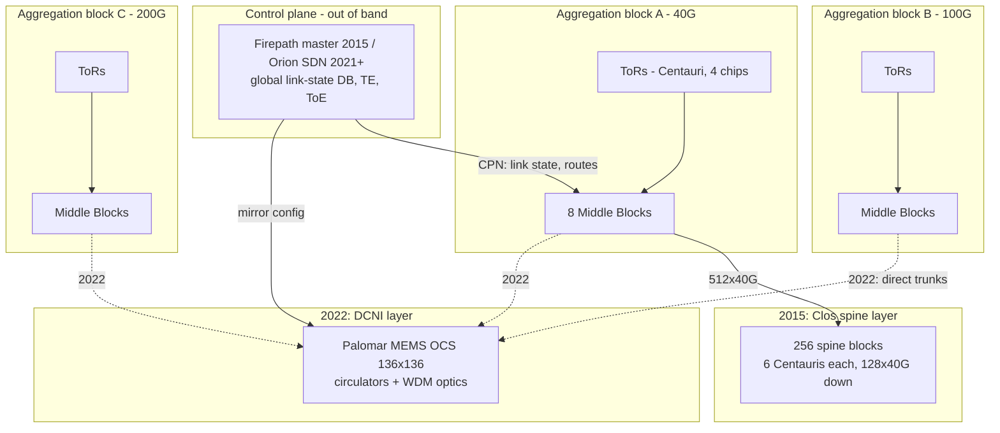

# Jupiter: Multi-Terabit Datacenter Network (2015 SIGCOMM)

## TL;DR

Jupiter is Google's fifth-generation datacenter fabric, first deployed in 2012.
It is a multi-stage Clos network built from 16x40G merchant-silicon chips, and it reaches 1.3 Pbps of bisection bandwidth across 64 aggregation blocks and 256 spine blocks ([Singh et al., SIGCOMM 2015](https://conferences.sigcomm.org/sigcomm/2015/pdf/papers/p183.pdf)).
The routing design centralizes topology state and distributes forwarding computation.
Every switch boots with the intended topology, learns actual link state through neighbor discovery, and reports it to an elected master over an out-of-band control network.
The master sends global link-state deltas to every switch, and each switch computes its own ECMP tables.
BGP runs only at the fabric edge.
Having more bandwidth did not remove packet loss.
Shallow merchant-silicon buffers, incast, deliberate ToR oversubscription and imperfect ECMP hashing caused congestion drops starting at about 25% average utilization, so host and QoS tuning mattered as much as raw bandwidth.
In 2022 Jupiter dropped the spine layer and replaced it with MEMS optical circuit switches (OCS) that connect aggregation blocks directly.
Traffic engineering and topology engineering together match Clos throughput for Google's traffic, with 5x speed and capacity, 30% lower capex and 41% lower power ([Poutievski et al., SIGCOMM 2022](https://research.google/pubs/jupiter-evolving-transforming-googles-datacenter-network-via-optical-circuit-switches-and-software-defined-networking/)).
The core trade-off: a Clos fabric is oblivious to the traffic matrix but forces you to pre-build the spine and pins every block to the spine's speed.
A direct-connect fabric is cheap and supports mixed speeds, but without topology engineering it pays a roughly 2x transit tax on permutation traffic.

## Mental Model



Think of the fabric as three separable layers.
ToRs and aggregation blocks are electrical packet switches that do the per-packet work: lookup, ECMP hashing and buffering.
Above them sits a layer whose only job is to connect blocks to each other.
In 2015 that layer was itself a packet-switched Clos stage, the spine, so any block could reach any other through any spine without anyone knowing the traffic matrix.
In 2022 that layer became passive mirrors, an OCS that switches light without decoding it.
The OCS is therefore agnostic to data rate and wavelength, but it only offers fixed point-to-point circuits that are reconfigured on a timescale of milliseconds to hours.
Intelligence moved upward into a logically centralized controller, which first only distributed link state (Firepath) and later also chose WCMP weights and the block-to-block topology itself (Orion with traffic and topology engineering).
The out-of-band control plane network is the boundary that makes this safe: the data plane forwards on its last-known state even when the controller is unhealthy.
That boundary is the same control/data split covered in [[17-Cloud-AI-Engineering/Volume_01_Cloud_Architecture_Principles/Chapter_04_Control_Plane_vs_Data_Plane_Separation|Control Plane vs Data Plane Separation]].

## Internals

### The problem Jupiter solved

Before the Clos generations, Google ran conventional cluster networks built from large vendor chassis switches.
Average bandwidth per host was limited to about 100 Mbps, and incast and outcast drops were severe ([Singh et al., SIGCOMM 2015](https://static.googleusercontent.com/media/research.google.com/en//pubs/archive/43837.pdf)).
The paper names three ideas that run through all five generations (Firehose 1.0, Firehose 1.1, Watchtower, Saturn and Jupiter).
First, multi-stage Clos topologies built from many small switches.
Second, commodity merchant silicon instead of proprietary chassis.
Third, centralized control based on a global configuration pushed to every switch ([SIGCOMM 2015 PDF](https://conferences.sigcomm.org/sigcomm/2015/pdf/papers/p183.pdf)).
Capacity grew 100x over ten years to more than 1 Pbps of bisection bandwidth (same source).
For general fabric background, read [[17-Cloud-AI-Engineering/Volume_00_Foundations_Under_the_Cloud/Chapter_02_Datacenter_Networking_Fabrics|Datacenter Networking Fabrics]] first.

### Clos theory in five sentences

A Clos network builds a large switch out of stages of small switches: an ingress stage, a middle stage and an egress stage.
A strictly non-blocking Clos needs m >= 2n - 1 middle switches, where n is the number of inputs per ingress switch.
A rearrangeably non-blocking Clos needs only m >= n, if existing connections can be re-routed.
A datacenter folds the network so that ingress and egress stages are the same ToR and aggregation switches.
For packet networks, rearrangeability is approximated statistically by hashing flows across all middle-stage paths (ECMP) rather than by explicit circuit setup.
The classic references are Clos (1953) and Al-Fares et al., who in 2008 showed commodity fat-trees at datacenter scale (see Further Reading).

### Generation 1 for scale: Firehose 1.0

In the first generation, each aggregation block hosted 16 ToRs and exposed 32x10G ports to 32 spine blocks.
Each spine block exposed 32x10G to 32 aggregation blocks.
The resulting fabric scaled to 10K machines at 1G average bandwidth to any machine ([CACM reprint](https://cacm.acm.org/research/jupiter-rising/)).
The intermediate generations (Firehose 1.1, Watchtower, Saturn) are described in the paper.
This chapter does not repeat their per-generation numbers because they could not be re-verified in this research pass.

### Jupiter building blocks and the arithmetic that falls out

Jupiter (first deployed 2012) used 16x40G merchant-silicon chips.
An aggregation block was 8 Middle Blocks with 128x40G each, and a spine block had 128x40G of north-south ports ([Google Research PDF](https://research.google.com/pubs/archive/7a2ef8424cdc3be32a4cb96bf3e3483eaf0b8949.pdf)).
The building blocks (all from [CACM](https://cacm.acm.org/research/jupiter-rising/)) are:

- Centauri is a chassis with four switch chips.
  Used as a ToR, each chip serves its own subnet of machines.
  In one configuration each chip has 48x10G down to servers and 16x10G up to the fabric.
- A Middle Block (MB) is four Centauris.
  Each ToR chip connects to eight MBs with dual redundant 10G links, which is where its 16 uplinks go.
- The aggregation block is 8 MBs and exposes up to 512x40G toward the spine.
- The spine block is six Centauris and exposes 128x40G toward the aggregation blocks.
- Jupiter was capped at 64 aggregation blocks so that every spine-block and aggregation-block pair keeps dual redundant links.

From those inputs the rest is arithmetic (derived values, computed in the Worked Example):

- Spine blocks = 64 x 512 / 128 = 256.
- Links per aggregation-spine pair = 128 / 64 = 2, which is the dual-redundancy constraint that set the 64-block cap.
- Aggregate aggregation-to-spine capacity = 64 x 512 x 40 Gbps = 1.311 Pbps, which matches the paper's 1.3 Pbps figure.
- Inside an aggregation block, ToR-facing capacity is 8 MBs x 256 x 10G = 20.48 Tbps and spine-facing capacity is 512 x 40G = 20.48 Tbps.
  The aggregation layer is 1:1, so oversubscription lives only at the ToR.
  In the 48-down, 16-up configuration that ratio is 3:1.

One subtlety matters in interviews.
The 1.3 Pbps figure equals the sum of all aggregation-to-spine link capacity.
The textbook definition, the minimum cut between two equal halves measured in one direction, would be half of that.
When a vendor or paper quotes "bisection bandwidth", always ask which convention it uses.

Jupiter also had a hard requirement for incremental deployment: new network technology had to be introduced in situ, because the cost of stranded hosts and downtime was too high (Google Research PDF above).
That requirement is the seed of the 2022 redesign.

### Merchant silicon and the shallow-buffer consequence

Merchant silicon gave Google cheap, fast-evolving port density.
The price was small on-chip buffers.
The paper calls those buffers "sub optimal for our server TCP stack" ([CACM](https://cacm.acm.org/research/jupiter-rising/)).
The chips used shared-memory buffers across all ports, and Google configured them to hand a disproportionate share of buffer to ports absorbing a burst ([Cambridge-hosted copy of the paper](https://www.cl.cam.ac.uk/teaching//1819/R02/papers/p183.pdf)).
This is the root of the congestion experience below.
Shallow buffers are not a defect you can tune away.
They are a design decision that pushes congestion control onto hosts.

### Control plane: Firepath, a centralized link-state IGP

Firepath was the routing architecture for the Firehose, Watchtower and Saturn fabrics, and it anticipated several SDN principles ([CACM](https://cacm.acm.org/research/jupiter-rising/)).
It is the mechanism most readers have never seen spelled out, so here it is step by step.

1. Intended topology first.
   Every switch is configured with the baseline, planned topology of the whole cluster, because each switch plays a role fixed by its position in the cluster plan.
2. Pairwise neighbor discovery (ND).
   Each port runs ND to learn its peer's identity and to verify that the cabling matches the plan.
   As summarized from Section 5.2, a port is declared up only when both the PHY and ND report up ([secondary summary of the paper](https://www.adrian.idv.hk/2019-09-15-s15-jupiter/)).
   This gating turns a miscabled port into a down port rather than a silent black hole.
3. Report to the master.
   A Firepath client on each fabric switch sends its local view of connectivity to the elected Firepath master.
   Redundant master candidates run on a selected subset of spine switches.
   They talk to clients over a separate, out-of-band Control Plane Network (CPN) ([Google paper PDF](https://static.googleusercontent.com/media/research.google.com/en//pubs/archive/43837.pdf)).
4. Global link-state database (LSD).
   The master assembles a versioned LSD and sends it to clients: a full copy first, then deltas ([secondary summary](https://medium.com/@orr101/iigr-jupiter-rising-a-decade-of-clos-topologies-and-centralized-control-in-googles-datacenter-618bbb5c48fe)).
5. Local computation.
   Each switch computes shortest paths with ECMP from the LSD.
   It expresses forwarding tables as deltas against the known static topology, which is cheap because the topology barely changes ([SIGCOMM 2015 PDF](https://conferences.sigcomm.org/sigcomm/2015/pdf/papers/p183.pdf)).
6. Edge only BGP.
   Cluster Border Routers (CBRs) run eBGP to the inter-cluster switches, learn the default route and redistribute it through Firepath (same source).
7. Addressing.
   Firepath routes at Layer 3 all the way to the ToR, and each ToR is one Layer 2 broadcast domain.
   ToR subnets are aligned so they aggregate well in the small forwarding tables of merchant silicon ([Google paper PDF](https://static.googleusercontent.com/media/research.google.com/en//pubs/archive/43837.pdf)).

Google chose this over running OSPF, IS-IS or BGP on hundreds of switches for three reasons.
First, maintaining hundreds of independent switch stacks and BGP configurations "seemed daunting" (SIGCOMM 2015 PDF).
Second, the topology was static with massive multipath, so flooding-based discovery solved a problem Google did not have.
Third, the team was inspired by large storage systems with a centralized manager, namely GFS (see [[17-Cloud-AI-Engineering/Volume_13_Seminal_Papers_and_Case_Studies/Chapter_09_GFS_and_Colossus|GFS and Colossus]]).
Churn is low.
The paper measured about 2,000 LSD-changing events per month in a typical cluster, roughly 70 a day or 3 an hour ([CACM](https://cacm.acm.org/research/jupiter-rising/)).
At that rate, a central node that sends deltas is far cheaper than O(N^2) flooding across tens of thousands of ports.

Why this is not a single point of failure in the forwarding path:
when a link fails, the two endpoint switches detect it locally through PHY or ND and react locally first, then notify the master ([secondary summary](https://medium.com/@orr101/iigr-jupiter-rising-a-decade-of-clos-topologies-and-centralized-control-in-googles-datacenter-618bbb5c48fe)).
A master failure triggers election among candidates, but forwarding tables already installed keep working.
Master election should be read with the same lens as leader election in [[08-Distinguished-Engineering/02-Distributed-Systems-Internals/Raft-Consensus|Raft]]: the candidate set and the recency of its state are what matter.

### Fabric congestion: why 25% utilization was the knee

Despite the capacity, Google's fabrics saw high congestion drops as utilization approached 25%.
The paper names four causes ([CACM](https://cacm.acm.org/research/jupiter-rising/)):

- bursty flows produced inadmissible traffic over short intervals, seen as incast or outcast;
- commodity switches had limited buffering;
- some links, such as ToR uplinks, were deliberately oversubscribed to save cost;
- flow hashing was imperfect, especially during failures.

The mitigations matter more than the diagnosis.
They were:

- QoS-aware drop in switch schedulers, so lower-priority traffic is discarded first;
- bounding the host TCP congestion window for intra-cluster traffic, so a sender cannot overrun the small buffers;
- link-level pause at ToRs in early fabrics;
- repopulating spine links when a depopulated fabric was congesting;
- shared-buffer tuning;
- careful configuration of the switch hash functions for ECMP balance.

The last three are in [the Cambridge-hosted copy](https://www.cl.cam.ac.uk/teaching//1819/R02/papers/p183.pdf).
Together these cut the packet discard rate at 25% average utilization from 1% to below 0.01% (CACM).
The lesson: average utilization is a misleading SLI in a shallow-buffer fabric.
The relevant quantities are microburst occupancy at the ToR and the variance of ECMP load.

Why ECMP variance is worse than intuition suggests: hash N equal elephant flows onto N equal paths.
The probability that at least two flows collide is 1 - N!/N^N, which is 99.76% for N = 8.
The expected hottest path then carries about 2.6x the mean (simulated in the Worked Example).
Collective-heavy ML traffic, with few flows that are large and synchronized, is exactly this regime.

### Jupiter Evolving (2022): removing the spine

By 2022 the spine had become the constraint for three reasons ([Poutievski et al., SIGCOMM 2022](https://engineering.purdue.edu/~vshriva/courses/papers/jupiter_2022.pdf)).

- Pre-build tax.
  A Clos fabric needs at least the spine layer built up front.
  Refreshing compute is incremental (drain a rack and replace it), but refreshing the spine is not.
- Speed pinning.
  A new 200G aggregation block attached to a 100G spine runs every uplink at 100G and strands half its optics.
  See the heterogeneity calculation in the Worked Example.
- Predictable traffic.
  Google's production traffic matrix is predictable over long timescales.
  Analytics found peak alignment, stable ranking and gravity-model structure ([Google Research, OFC 2023 abstract](https://research.google/people/leonpoutievski/)).
  A gravity model means demand between blocks i and j is roughly proportional to egress(i) x ingress(j).

The redesign has three parts ([Google Research abstract](https://research.google/pubs/jupiter-evolving-transforming-googles-datacenter-network-via-optical-circuit-switches-and-software-defined-networking/)).

1. A datacenter interconnection (DCNI) layer of MEMS optical circuit switches replaces the spine.
   Aggregation blocks connect directly to each other through OCS circuits.
2. Centralized SDN traffic engineering (TE) computes weighted multipath (WCMP-style) splits across direct and one-hop transit paths.
3. Automated topology engineering (ToE) re-stripes OCS circuits so the block-level topology follows the measured demand.

The reported results are 5x higher speed and capacity, 30% lower capex and 41% lower power.
About 60% of traffic takes the direct path between source and destination aggregation blocks.
TE plus ToE on direct-connect achieves throughput similar to Clos for production traffic (same source).
The design takes in 40G, 100G, 200G and faster blocks incrementally ([SIGCOMM 2022 PDF](https://engineering.purdue.edu/~vshriva/courses/papers/jupiter_2022.pdf)).

### The optical layer: Apollo, Palomar, circulators and WDM

Apollo is described as the first large-scale production deployment of OCS for datacenter networking ([Urata et al., arXiv 2208.10041](https://arxiv.org/abs/2208.10041)).
It has three co-designed parts:

- Palomar, an in-house 3D MEMS OCS.
- Optical circulators that make each OCS port bidirectional, effectively doubling the OCS radix.
- WDM transceivers co-designed for the impairments of circulator links, delivered over four generations and speeds of optics ([arXiv PDF](https://arxiv.org/pdf/2208.10041)).

Secondary summaries of the paper describe Palomar as a 136x136 strictly non-blocking switch with millisecond-scale switching and typical insertion loss below 2 dB ([alphaXiv summary](https://www.alphaxiv.org/abs/2208.10041)).

Why WDM and circulators are load-bearing rather than incidental:
an OCS port is a mirror, so it carries whatever light arrives.
WDM packs several wavelengths into each fiber, raising bandwidth per OCS port without adding mirrors.
Circulators separate transmit and receive on one fiber, so one OCS port serves a full duplex link instead of half of one.
Each OCS is a fixed-radix, expensive, power-sipping device.
Every doubling of bandwidth per port halves the number of OCSes, fibers and patch-panel positions you need for a given fabric.
The hard constraint is the optical power budget.
Every circulator, mirror and connector adds insertion loss, and the transceiver must still close the link.
That is why the paper treats transceiver and OCS co-design as the critical path.

Because circuits do not care about line rate, a 100G block and a 200G block can both terminate on the same OCS.
A link between them simply runs at the lower common speed, while 200G-to-200G pairs run at full rate.
This is the mechanism behind incremental, heterogeneous refresh.

### Deep mechanism: the transit tax and why topology engineering carries the load

Take n aggregation blocks with U uplinks each, wired as a uniform full mesh.
Each pair gets d = U / (n - 1) direct links: 8.13 for n = 64 and U = 512.
Under uniform all-to-all traffic this is ideal, because every byte goes direct.
Under a full permutation, every block sends everything to one partner.
The direct path carries only d links' worth, and the rest must transit an intermediate block, consuming two link-hops per byte.
The link budget per block is d + 2(T - d) <= U, so T <= (U + d) / 2.
That is 50.8% of the Clos-equivalent throughput for n = 64 (derived; see the Worked Example).
A Clos fabric serves any permutation at full rate, because the spine is the transit layer and was paid for up front.

Topology engineering removes the penalty when demand is predictable.
If a block pair carries 25% of a block's traffic, ToE can give that pair about 128 of the 512 uplinks instead of 8.
Most bytes then go direct, and TE only has to absorb the residual mismatch with transit.
The two engineering loops run on different clocks.
TE adjusts weights quickly as demand shifts.
ToE moves circuits rarely and carefully, because reconfiguring a live circuit drains traffic from it.
This is why the 2022 paper insists on combining TE and ToE: either alone loses to Clos on some traffic matrices.

The ML implication is direct.
Ring and hierarchical all-reduce produce near-permutation traffic, which is the worst case for an untuned direct-connect mesh.
It is also the best case for topology engineering if the job is long-lived and its communication pattern is known in advance.
TPU v4 slices exploit exactly this by building per-job torus topologies through OCS (see [[17-Cloud-AI-Engineering/Volume_13_Seminal_Papers_and_Case_Studies/Chapter_15_Google_TPU_Architecture_Evolution|Google TPU Architecture Evolution]] and [[17-Cloud-AI-Engineering/Volume_10_AI_Infrastructure_on_Cloud/Chapter_02_Interconnect_Technologies_NVLink_EFA_and_TPU_ICI|Interconnect Technologies]]).

### Orion: the successor control plane

Orion is Google's distributed SDN platform, deployed in both Jupiter and the B4 WAN.
It is built from micro-services around a central publish-subscribe database and supports intent-based management ([Ferguson et al., NSDI 2021](https://www.usenix.org/system/files/nsdi21-ferguson.pdf)).
The paper reports:

- up to 40x faster convergence;
- up to 1.16 million network updates per second;
- 16x larger supported networks;
- a 50x reduction in data-plane unavailable time in Jupiter (100x in B4);
- a bi-weekly release cadence.

These figures are from the [Semantic Scholar abstract](https://www.semanticscholar.org/paper/Orion:-Google's-Software-Defined-Networking-Control-Ferguson-Gribble/ee2f645efd64d421485ada0fcfc5e0ed8188a766).
The progression from Firepath to Orion is a progression in what is centralized.
Firepath centralized only link-state distribution.
Orion centralizes intent, TE decisions and, with ToE, the physical topology.
Each step raises the blast radius of a controller bug, which is why the domain partitioning of control matters (see Failure Modes).
Google has since published CAPA, an architecture for operating cluster networks with high availability ([ACM DL](https://dl.acm.org/doi/10.5555/3691825.3691934)).
Its venue and details were not re-verified for this chapter.

### Failure domains

| Domain | What fails together | Containment mechanism |
| --- | --- | --- |
| Link | One 10G/40G/100G+ circuit | Dual redundant links; local ECMP next-hop removal before the master is told |
| ToR | One rack's machines | Accepted; schedulers spread replicas across racks |
| Aggregation block | All ToRs in the block | The scheduler places replicas across blocks; the 2022 design drains blocks for refresh |
| Spine block (2015) | 1/256 of inter-block capacity | ECMP spreads load over the remaining spines |
| OCS (2022) | The circuits through that device | Many OCSes, each carrying a small slice of each block's uplinks |
| CPN | Control reachability | Dual redundant links per chassis; the 2015 paper notes the standby was initially unmonitored |
| Controller domain | Route and TE updates | The data plane keeps last-known state; domains are kept small |

## Numbers to Know

| Quantity | Value | Source |
| --- | --- | --- |
| Pre-Clos average bandwidth per host | ~100 Mbps | (Singh et al., SIGCOMM 2015) |
| Firehose 1.0 scale | 32 aggregation x 32 spine blocks, 10K machines at 1G average | (Singh et al., SIGCOMM 2015) |
| Capacity growth over a decade | 100x, to more than 1 Pbps bisection | (Singh et al., SIGCOMM 2015) |
| Jupiter first deployment | 2012 | (Singh et al., SIGCOMM 2015) |
| Jupiter switch silicon | 16x40G merchant chips | (Singh et al., SIGCOMM 2015) |
| Jupiter maximum bisection | 1.3 Pbps | (Singh et al., SIGCOMM 2015) |
| Aggregation block uplinks | up to 512x40G | (Singh et al., SIGCOMM 2015) |
| Spine block downlinks | 128x40G, six Centauris | (Singh et al., SIGCOMM 2015) |
| Maximum aggregation blocks | 64, set by dual links per spine pair | (Singh et al., SIGCOMM 2015) |
| Spine blocks at full build | 256 | derived: 64 x 512 / 128 |
| ToR oversubscription, 48-down/16-up configuration | 3:1 | derived from (Singh et al., SIGCOMM 2015) |
| LSD-changing events per cluster | ~2000/month, ~70/day, ~3/hour | (Singh et al., SIGCOMM 2015) |
| Congestion knee | Drops became high near 25% average utilization | (Singh et al., SIGCOMM 2015) |
| Discard rate at 25% utilization after mitigation | 1% -> <0.01% | (Singh et al., SIGCOMM 2015) |
| Jupiter 2022 vs. prior | 5x speed and capacity, -30% capex, -41% power | (Poutievski et al., SIGCOMM 2022) |
| Traffic on the direct block-to-block path | ~60% | (Poutievski et al., SIGCOMM 2022) |
| Block speeds supported side by side | 40G, 100G, 200G and beyond | (Poutievski et al., SIGCOMM 2022) |
| Palomar OCS radix | 136x136, 3D MEMS | (Urata et al., arXiv 2022, via secondary summary) |
| OCS switching time | milliseconds | (Urata et al., arXiv 2022, via secondary summary) |
| Generations of WDM optics through OCS | 4 | (Urata et al., arXiv 2022) |
| Orion convergence improvement | up to 40x | (Ferguson et al., NSDI 2021) |
| Orion update throughput | up to 1.16M updates/s | (Ferguson et al., NSDI 2021) |
| Orion data-plane unavailability reduction, Jupiter | 50x | (Ferguson et al., NSDI 2021) |
| Uniform direct-connect, permutation throughput vs. Clos | ~50.8% for 64 blocks | derived: (U + d) / 2U |
| ECMP hottest path, 8 elephants on 8 paths | ~2.6x mean | derived by simulation in this chapter |
| AWS single-flow cap outside a cluster placement group | 5 Gbps | UNVERIFIED (AWS docs, as of 2026-10) |
| GCP per-VM egress cap | scales with vCPU count; higher with Tier_1 networking | UNVERIFIED for exact values (Google Cloud docs, as of 2026-10) |

## AWS vs GCP Mechanism Parity

| Dimension | Google Cloud (Jupiter lineage) | AWS | Critical difference |
| --- | --- | --- | --- |
| Public evidence about the fabric | Peer-reviewed papers: SIGCOMM 2015, SIGCOMM 2022, Apollo on arXiv 2022, Orion at NSDI 2021 | Mostly re:Invent talks plus the SRD transport paper; this research pass found no peer-reviewed AWS paper on fabric topology | On AWS you infer fabric behavior from instance-level limits; on GCP you can reason from the published design |
| Physical topology | Clos (2005-2012 generations) moving to direct-connect aggregation blocks through MEMS OCS | Clos-style fabric built from AWS-designed switches; UNVERIFIED in detail | Google publicly removed the spine; no equivalent public AWS claim was found |
| Routing control | Centralized link-state distribution (Firepath), then Orion SDN with TE and ToE | Not publicly specified in comparable detail (UNVERIFIED) | Google's control-plane blast radius is documented; AWS's has to be assumed |
| Multipath at the host edge | ECMP flow hashing in switches; host-side repathing such as PLB (UNVERIFIED citation) | SRD on the Nitro card sprays packets across many paths for EFA, and ENA Express extends SRD to TCP/UDP (UNVERIFIED limits, as of 2026-10) | SRD moves multipathing to per-packet in the NIC, while Jupiter's ECMP is per-flow in switches |
| Congestion control | Shallow buffers plus host-side control: TCP cwnd bounds in 2015, later delay-based Swift (UNVERIFIED citation) | SRD rate control implemented in Nitro (UNVERIFIED detail) | Both clouds push congestion response onto the host or NIC, not switch buffers |
| Customer placement primitive | Compact placement policy (UNVERIFIED supported machine families, as of 2026-10) | Cluster placement groups | Both expose "same low-latency domain" without naming the physical tier |
| Per-flow and per-VM ceilings | Per-VM egress cap that scales with vCPUs; Tier_1 raises it (UNVERIFIED values) | Per-instance bandwidth, with a single-flow cap outside cluster placement groups (UNVERIFIED values) | A single TCP flow rarely reaches NIC line rate on either cloud |
| AI scale-out fabric | TPU ICI with OCS-built slices; GPU VMs on Jupiter plus GPU-specific NICs | EFA on EC2 UltraClusters; AWS announced a "10p10u" AI fabric in 2024 (UNVERIFIED) | Google reuses OCS for both the general fabric and ML topologies |
| Incremental refresh | OCS lets mixed-speed blocks coexist and lets topology be re-striped live | Not published | This is a structural capex lever unique to the published Jupiter design |
| Control-plane network | Out-of-band CPN with dual links per chassis | Not published | The CPN is a hidden dependency that should appear in your mental failure model |

## Worked Example: Modeling Jupiter Capacity, ECMP Collisions, and the Transit Tax

### Part A: offline capacity model (no cloud resources, no cost)

The script below reproduces the Jupiter arithmetic and the 2022 transit-tax derivation.
It uses only the Python 3 standard library.

```python
#!/usr/bin/env python3
"""Back-of-the-envelope model of Jupiter: 2015 Clos vs 2022 direct-connect.
Pure Python 3 standard library. Provisions no cloud resources."""
import random
import statistics

G = 1e9


def clos_2015():
    agg_blocks, agg_up, spine_down, speed = 64, 512, 128, 40 * G
    spine_blocks = agg_blocks * agg_up // spine_down
    print("[Clos]   spine blocks needed           :", spine_blocks)
    print("[Clos]   links per agg/spine pair      :", spine_down // agg_blocks)
    print("[Clos]   agg->spine capacity (Pbps)    : %.3f" % (agg_blocks * agg_up * speed / 1e15))
    chip_down, chip_up = 48, 16   # one Centauri ToR config, per chip, 10G ports
    print("[Clos]   ToR oversubscription          : %.1f:1" % (chip_down / chip_up))


def ecmp(flows, paths, trials=20000, seed=7):
    rnd = random.Random(seed)
    worst = []
    for _ in range(trials):
        load = [0] * paths
        for _ in range(flows):
            load[rnd.randrange(paths)] += 1
        worst.append(max(load))
    return statistics.mean(worst) / (flows / paths)


def ecmp_study():
    for flows, paths in [(8, 8), (16, 8), (64, 8), (512, 64)]:
        print("[ECMP]   %4d equal elephants over %3d paths: hottest path = %.2fx mean"
              % (flows, paths, ecmp(flows, paths)))


def direct_connect(n=64, uplinks=512):
    d = uplinks / (n - 1)               # uniform mesh: direct links per pair
    # Full permutation: each block sends all traffic to one partner.
    # Direct carries d; transit uses 2 link-units per unit: d + 2(T - d) <= U
    t = (uplinks + d) / 2
    print("[Direct] links per pair, uniform mesh  : %.2f" % d)
    print("[Direct] permutation throughput vs Clos: %.1f%%" % (100 * t / uplinks))
    for share in (0.10, 0.25):
        print("[ToE]    pair with %2.0f%% of demand gets   : %d direct links"
              % (100 * share, share * uplinks))


def heterogeneity(spine_gbps=100, new_block_gbps=200, links=512):
    clos = links * min(spine_gbps, new_block_gbps)
    full = links * new_block_gbps
    print("[Mixed]  %dG block on %dG spine uses   : %.0f%% of its optics"
          % (new_block_gbps, spine_gbps, 100 * clos / full))


if __name__ == "__main__":
    clos_2015()
    ecmp_study()
    direct_connect()
    heterogeneity()
```

Output from an actual run:

```text
[Clos]   spine blocks needed           : 256
[Clos]   links per agg/spine pair      : 2
[Clos]   agg->spine capacity (Pbps)    : 1.311
[Clos]   ToR oversubscription          : 3.0:1
[ECMP]      8 equal elephants over   8 paths: hottest path = 2.60x mean
[ECMP]     16 equal elephants over   8 paths: hottest path = 2.10x mean
[ECMP]     64 equal elephants over   8 paths: hottest path = 1.53x mean
[ECMP]    512 equal elephants over  64 paths: hottest path = 1.92x mean
[Direct] links per pair, uniform mesh  : 8.13
[Direct] permutation throughput vs Clos: 50.8%
[ToE]    pair with 10% of demand gets   : 51 direct links
[ToE]    pair with 25% of demand gets   : 128 direct links
[Mixed]  200G block on 100G spine uses   : 50% of its optics
```

### Step-by-step sizing walk-through

Step 1: Fix the radix.
The aggregation block exposes 512 uplinks, the spine block exposes 128 downlinks, and you want 2 links per pair for redundancy, so 128 / 2 = 64 blocks maximum.

Step 2: Count the spine.
64 x 512 / 128 = 256 spine blocks.
In a Clos fabric you must cable and power the spine for the target size, or plan to re-cable it as you grow.
That pre-build capital is idle until the aggregation blocks arrive.

Step 3: Compute capacity.
64 x 512 x 40G = 1.311 Pbps, matching the paper's 1.3 Pbps under Google's convention.

Step 4: Place the oversubscription.
The aggregation layer is 1:1.
The ToR is 3:1 in the 48/16 configuration, so a rack's machines get at most one third of their NIC bandwidth to the rest of the fabric at the same time.

Step 5: Size for ECMP variance, not the average.
With 8 synchronized elephants on 8 paths, the hottest path carries 2.6x its fair share.
If you size links for the mean, you overrun the shallow buffers on that path.
This is why the paper's congestion knee sits near 25% average utilization rather than near 90%.

Step 6: Evaluate the direct-connect alternative.
With no topology engineering, permutation traffic gets 50.8% of the Clos throughput.
With ToE matched to a gravity-model demand matrix, a pair carrying 25% of demand gets 128 direct links and pays almost no transit tax.
The ToE cadence must be slower than demand drift but faster than the hardware refresh cycle.

Step 7: Price the refresh.
A 200G block on a 100G spine strands 50% of its optics.
On an OCS layer, only links toward slower peers are derated.

### Part B: optional cloud lab, observing per-flow vs per-VM ceilings on GCP

This lab measures what a tenant actually sees: per-flow throughput and how throughput is spread across parallel streams between two VMs in one zone.
Interpret it with care.
In practice the binding constraint is usually the per-VM egress shaping in the virtual NIC (see [[17-Cloud-AI-Engineering/Volume_13_Seminal_Papers_and_Case_Studies/Chapter_12_Andromeda_Network_Virtualization|Andromeda]]), not the Jupiter fabric.

Cost estimate (UNVERIFIED prices, check the Compute Engine pricing page, as of 2026-10):
2 x n2-standard-8 at roughly 0.39 USD/hour each in us-central1, plus two ephemeral external IPv4 addresses and two 10 GB boot disks.
That comes to roughly 1 USD for a one-hour session.
Intra-zone traffic over internal IPs is expected to be free of egress charges (UNVERIFIED, as of 2026-10).

```bash
#!/usr/bin/env bash
set -euo pipefail
PROJECT="$(gcloud config get-value project)"
BILLING_ACCOUNT="${BILLING_ACCOUNT:?set BILLING_ACCOUNT=XXXXXX-XXXXXX-XXXXXX}"
REGION=us-central1
ZONE=us-central1-a
MT=n2-standard-8

# 0. Budget alarm first: alert at 50% and 100% of 5 USD for this project.
gcloud billing budgets create \
  --billing-account="$BILLING_ACCOUNT" \
  --display-name="jupiter-lab" \
  --budget-amount=5USD \
  --threshold-rule=percent=0.5 \
  --threshold-rule=percent=1.0 \
  --filter-projects="projects/${PROJECT}"

# 1. Isolated VPC: iperf only from the subnet, SSH only from the IAP range.
gcloud compute networks create jup-lab --subnet-mode=custom
gcloud compute networks subnets create jup-lab-sn \
  --network=jup-lab --region="$REGION" --range=10.10.0.0/24
gcloud compute firewall-rules create jup-lab-iperf \
  --network=jup-lab --allow=tcp:5201 --source-ranges=10.10.0.0/24
gcloud compute firewall-rules create jup-lab-iap-ssh \
  --network=jup-lab --allow=tcp:22 --source-ranges=35.235.240.0/20

# 2. Two VMs in the same zone.
for vm in jup-a jup-b; do
  gcloud compute instances create "$vm" --zone="$ZONE" --machine-type="$MT" \
    --subnet=jup-lab-sn --image-family=debian-12 --image-project=debian-cloud \
    --metadata=startup-script='apt-get update && apt-get install -y iperf3'
done
sleep 90

# 3. Measure 1, 4 and 16 parallel streams.
IP_A="$(gcloud compute instances describe jup-a --zone="$ZONE" \
  --format='get(networkInterfaces[0].networkIP)')"
gcloud compute ssh jup-a --zone="$ZONE" --tunnel-through-iap --command 'iperf3 -s -D'
for P in 1 4 16; do
  gcloud compute ssh jup-b --zone="$ZONE" --tunnel-through-iap \
    --command "iperf3 -c ${IP_A} -P ${P} -t 20 -J" > "run_P${P}.json"
  echo "P=${P} total Gbps: $(jq '.end.sum_received.bits_per_second/1e9' "run_P${P}.json")"
  echo "P=${P} per-stream Gbps: $(jq -c '[.end.streams[].receiver.bits_per_second/1e9|floor]' "run_P${P}.json")"
done
```

What to look for:
the gap between P=1 and P=16 shows the per-flow ceiling.
The spread across streams at P=16 shows hashing and shaping imbalance.
A plateau at higher P is the per-VM cap.

Exact teardown (run even if the script fails partway):

```bash
ZONE=us-central1-a; REGION=us-central1
gcloud compute instances delete jup-a jup-b --zone="$ZONE" --quiet
gcloud compute firewall-rules delete jup-lab-iperf jup-lab-iap-ssh --quiet
gcloud compute networks subnets delete jup-lab-sn --region="$REGION" --quiet
gcloud compute networks delete jup-lab --quiet
# Optional: remove the budget after confirming the bill is settled.
# gcloud billing budgets list --billing-account="$BILLING_ACCOUNT"
# gcloud billing budgets delete BUDGET_ID --billing-account="$BILLING_ACCOUNT"
```

## Failure Modes and Pitfalls

### Fabric-wide restart and control-plane convergence collapse

The 2015 paper sorts production outages into three categories: control software problems at scale, aging hardware exposing unhandled failure modes, and misconfigurations ([Google paper PDF](https://static.googleusercontent.com/media/research.google.com/en//pubs/archive/43837.pdf)).
In its first example, a datacenter power event made the entire fabric restart at once ([Cambridge-hosted copy](https://www.cl.cam.ac.uk/teaching//1819/R02/papers/p183.pdf)).
The paper then describes the convergence failure that followed.
Liveness checks (ND) and route computation competed for limited embedded switch CPU.
Route churn delayed ND heartbeats, which caused link flaps and more churn, and convergence needed manual intervention.
The fix was to prioritize liveness over route computation (UNVERIFIED wording; reconstructed from the paper and not re-checked in this pass).
The general pattern is a metastable failure.
The system is stable at steady state but has no path back from a cold start in which every node does maximal work at once.
The defenses are:

- prioritized CPU scheduling for liveness traffic;
- damping;
- staged bring-up;
- testing cold start as a scenario in its own right (see [[17-Cloud-AI-Engineering/Volume_07_Reliability_and_SRE/Chapter_05_Chaos_Engineering_and_Game_Days|Chaos Engineering and Game Days]]).

### Silent loss of redundancy

Over years of deployment, aging hardware wore down the fabric's built-in redundancy.
Software was vulnerable to internal backplane link failures, which caused rare traffic black-holing.
Each chassis had dual CPN links in active-standby mode, and the standby link was initially not monitored ([CACM mobile](https://m-cacm.acm.org/magazines/2016/9/206261-jupiter-rising/fulltext)).
Redundancy you do not continuously probe is a coin flip at failover time.
Monitor the standby path with the same SLI as the active path.

### Average-utilization blindness

Congestion drops appeared at about 25% average utilization ([CACM](https://cacm.acm.org/research/jupiter-rising/)).
Dashboards built on 1-minute or 5-minute averages cannot see microsecond-scale incast in shallow buffers.
Instrument per-queue drop counters and buffer high-watermarks, and alert on drops, not on utilization.

### ECMP polarization and hash collisions

Using the same hash function and seed at successive tiers makes every tier choose correlated paths, which concentrates load.
The paper notes that Google had to configure the switch hash functions carefully ([Cambridge-hosted copy](https://www.cl.cam.ac.uk/teaching//1819/R02/papers/p183.pdf)).
During failures, ECMP groups shrink unevenly, and the surviving paths absorb load in proportion to how their hash buckets are remapped.
ML training is the worst case: a few large, synchronized flows, which push the hottest path to 2.6x the mean in this chapter's simulation.

### Depopulated fabrics

Building a fabric with only part of the spine populated saves capex but raises oversubscription.
Google had to repopulate spine links when depopulated fabrics congested (same source).
A depopulated fabric must carry an explicit runbook trigger for repopulation, sized against your demand forecast.

### Transit-tax surprise in direct-connect fabrics

A sudden shift in the traffic matrix, such as a new large training job or a storage migration, can move a direct-connect fabric toward permutation traffic before ToE reacts.
In that window TE has to route over transit paths, and effective capacity can approach about 50% of the Clos equivalent (derived).
Drain-aware ToE and admission control for large new tenants are the mitigations.

### Controller blast radius

As the controller takes on more decisions, a bad push can damage more of the network.
In the June 2019 Google Cloud incident, a configuration change caused network control-plane jobs in several locations to be descheduled.
That cut network capacity and caused heavy congestion across multiple regions (UNVERIFIED details; read the official incident report before citing).
Defenses:

- fail-static data planes that keep the last good forwarding state;
- small controller domains;
- staged config rollout with automatic halts, as in [[17-Cloud-AI-Engineering/Volume_06_Infrastructure_as_Code_and_Delivery/Chapter_06_Progressive_Delivery_and_Deployment_Pipelines|Progressive Delivery]].

See also [[17-Cloud-AI-Engineering/Volume_07_Reliability_and_SRE/Chapter_07_Anatomy_of_Major_Cloud_Outages|Anatomy of Major Cloud Outages]].

### Tenant-side pitfalls on either cloud

- Single-flow assumptions.
  One TCP stream will not reach the instance's advertised bandwidth on either cloud.
  Use parallel streams, a multi-path transport such as SRD through EFA or ENA Express on AWS, or collective libraries that open many connections.
- Placement drift.
  Instances outside a cluster placement group (AWS) or compact placement policy (GCP) may land far apart in the fabric hierarchy, raising latency and tail variance.
- Treating the zone as one flat fabric.
  A zone contains many aggregation domains, and cross-domain traffic shares inter-block capacity with every other tenant.

## Security and Cost Angles

### Security

- Out-of-band control as a security boundary.
  The CPN keeps routing control off the tenant data path, so a compromised workload cannot inject routing updates through the data plane.
  Model the CPN as a high-value asset with its own access control and monitoring.
- Topology verification as integrity control.
  Gating a port on ND (port up only when both PHY and ND are up) means that a miswired or spoofed peer does not come up, because its identity does not match the intended topology.
- Encryption in transit.
  Google states that traffic between VMs is encrypted when it crosses physical boundaries it does not control, and AWS states that supported Nitro instances automatically encrypt traffic between each other.
  Exact scope and instance families are UNVERIFIED (as of 2026-10).
  For regulated data, still use TLS or mTLS at the application layer so the guarantee does not hinge on instance-type support (see [[17-Cloud-AI-Engineering/Volume_08_Security_Identity_and_the_Data_Perimeter/Chapter_04_Encryption_Key_Hierarchies_and_Envelope_Encryption|Encryption Key Hierarchies]]).
- IAM scoping for the lab and for production placement.
  On GCP, separate `roles/compute.networkAdmin` (VPCs, firewall rules) from `roles/compute.instanceAdmin.v1`.
  Grant `roles/iap.tunnelResourceAccessor` only to the operators who need SSH through IAP.
  On AWS, restrict `ec2:CreatePlacementGroup` and `ec2:ModifyInstancePlacement` to the platform team, because placement decides which tenants share fabric domains.
- Private boundaries.
  The lab allows iperf only from the subnet CIDR and SSH only from the IAP range.
  In production, combine this with VPC Service Controls on GCP or VPC endpoints on AWS, as in [[17-Cloud-AI-Engineering/Volume_08_Security_Identity_and_the_Data_Perimeter/Chapter_06_Constructing_an_Impenetrable_Data_Perimeter|Constructing an Impenetrable Data Perimeter]].

### Cost and unit economics

- Removing the spine is a structural opex lever.
  The 30% capex and 41% power reductions in the 2022 paper came largely from eliminating spine blocks and enabling incremental refresh ([SIGCOMM 2022 PDF](https://engineering.purdue.edu/~vshriva/courses/papers/jupiter_2022.pdf)).
  For an operator building its own AI cluster, the equivalent decision is whether a pre-built non-blocking spine is worth paying for when the traffic matrix is known.
- Oversubscription is a pricing decision.
  A 3:1 ToR trades cross-rack bandwidth for fewer optics and switch ports.
  Rack-local scheduling turns that discount into real savings, and rack-oblivious scheduling turns it into tail latency.
- Billing mirrors the fabric hierarchy.
  Both clouds charge for traffic between zones but not within a zone over internal addresses.
  Exact rates are UNVERIFIED (as of 2026-10); see [[17-Cloud-AI-Engineering/Volume_09_FinOps_and_Cloud_Economics/Chapter_04_Network_Egress_Economics_and_Optimization|Network Egress Economics]].
  Keep chatty tiers in the same zone, and pay for cross-zone traffic only where you need zonal redundancy.
- GPU idle time is the dominant network cost in AI.
  A collective stalled on a hot ECMP path idles every accelerator in the job.
  Paying for placement-group capacity or multi-path transports is cheap next to idle accelerator-hours (see [[17-Cloud-AI-Engineering/Volume_09_FinOps_and_Cloud_Economics/Chapter_05_GPU_and_TPU_Unit_Economics|GPU and TPU Unit Economics]]).

## Interview Questions and Model Answers

### Question 1 (L5 - Senior)

Jupiter Rising reports 1.3 Pbps with 64 aggregation blocks.
Derive the number from the building blocks, explain where oversubscription lives, and explain why the design stopped at 64 blocks.

#### Model Answer

Each aggregation block exposes up to 512 uplinks at 40G, so 64 blocks give 64 x 512 x 40G = 1.311 Pbps, which is the paper's 1.3 Pbps.
Each spine block has 128 downlinks, so the full build needs 64 x 512 / 128 = 256 spine blocks.
The 64-block cap comes from redundancy, not chip capacity: 128 spine downlinks spread over 64 blocks gives exactly 2 links per pair.
Going to 128 blocks would leave each pair with a single link, so one optic failure would cut that pair's direct spine path and cause uneven ECMP shrinkage.
Inside the aggregation block, the ToR-facing side (8 MBs x 256 x 10G) and the spine-facing side (512 x 40G) both equal 20.48 Tbps, so that layer is 1:1.
Oversubscription lives at the ToR.
In the 48-down, 16-up chip configuration it is 3:1.
Finally, Google's 1.3 Pbps counts total aggregation-to-spine capacity.
The textbook one-direction min-cut bisection would be half that, so when comparing fabrics I normalize the definition first.

#### Follow-up Interviewer Question

If an operations team depopulates half the spine to defer capex, what happens to the effective oversubscription, the ECMP fan-out, and the failure blast radius of a single spine block?

### Question 2 (L5 - Senior)

Google saw high congestion drops at about 25% average utilization.
Explain the mechanism and how you would detect and fix it in your own fabric.

#### Model Answer

Average utilization hides time structure.
Merchant-silicon switches have shallow shared buffers, so a burst lasting tens of microseconds can overflow a queue while the 5-minute average sits at 25%.
The paper lists four causes: incast and outcast bursts, limited buffering, deliberate oversubscription at ToR uplinks, and imperfect ECMP hashing that gets worse during failures.
To detect it, I would export per-queue drop counters and buffer high-watermarks at high frequency.
I would correlate drops with application fan-in patterns, such as a scatter-gather aggregator receiving from hundreds of leaves at once.
For the fix I would follow Google's layered approach:

- QoS classes, so drops hit low-priority traffic first;
- host-side cwnd bounds or a modern datacenter congestion controller, so senders cannot overrun the buffers;
- shared-buffer tuning that lets a hot port borrow buffer;
- hash-seed diversity across tiers to avoid polarization;
- for incast specifically, application-level fan-in limits or request staggering.

Google's mitigations cut the discard rate at 25% utilization from 1% to below 0.01%.
That tells you the problem was mostly host and queue behavior, not missing capacity.

#### Follow-up Interviewer Question

Link-level pause solved ToR overrun in early fabrics.
Why would you hesitate to use PFC-style pause across a large multi-tier fabric today, and what failure mode are you worried about?

### Question 3 (L6 - Staff)

Firepath centralized link-state distribution in a fabric of thousands of switches.
A reviewer says, "a central master is a single point of failure, use BGP everywhere like everyone else."
Defend or refute the design, with its failure modes.

#### Model Answer

Firepath centralizes state distribution, not forwarding.
Every switch starts with the intended topology, checks real links through pairwise neighbor discovery, and reports to an elected master on an out-of-band CPN.
The master sends a versioned link-state database, in full first and then as deltas, and each switch computes ECMP tables locally.
When a link fails, the endpoint switches react locally before the master even learns of it, and installed tables keep forwarding if the master dies.
So the master sits on the path for convergence, not for availability.
The reasons it beats BGP everywhere in this setting are concrete:

- the topology is static and known, so discovery by flooding solves a non-problem;
- churn is about 3 events per hour per cluster, so a central delta stream is cheap;
- operations do not scale across hundreds of independent BGP configurations.

BGP stays where it belongs, at the border routers with the external networks.
The real risks are different, and I would name them:

- The CPN becomes a hidden dependency.
  Google initially did not monitor the standby CPN links.
- The master is a convergence bottleneck after correlated events.
  A fabric-wide restart after a power event produced a cold-start storm, and the paper describes manual intervention being needed to converge.
- A bad intended-topology push spreads to every switch at once.

My conditions for accepting the design:

- liveness traffic gets CPU priority over route computation on switches;
- master candidates are chosen by state recency, and election is tested under partition;
- the data plane fails static on loss of the controller;
- intended-topology pushes are staged and checked against the observed topology before activation.

With those guards, centralization reduces total risk compared with hundreds of distributed protocol instances, each with its own configuration drift.

#### Follow-up Interviewer Question

Orion later centralized traffic engineering and topology decisions too.
How does that change the blast-radius argument, and how would you partition controller domains so one bad TE solution cannot degrade a whole campus?

### Question 4 (L6 - Staff)

You run a 100G Clos fabric and must start deploying 200G aggregation blocks next quarter without downtime.
Compare re-spining the Clos with moving to an OCS-based direct-connect design like Jupiter 2022.

#### Model Answer

In a Clos fabric, a 200G block attached to a 100G spine runs every uplink at 100G and strands 50% of its optics until the whole spine is refreshed.
Refreshing a spine in place means draining spine blocks in waves, which cuts capacity for everyone during the migration.
You also pay up front for spine capacity sized for the end state.
With an OCS layer, blocks connect to each other through passive mirror circuits that ignore line rate.
200G-to-200G pairs run at 200G and 200G-to-100G pairs run at 100G, so value arrives block by block.
Google reports 5x speed and capacity, 30% lower capex and 41% lower power after this change.

The cost is a transit tax.
In a uniform 64-block mesh each pair has about 8 direct links, and a full permutation reaches only (U + d) / 2U, about 51% of Clos throughput.
That makes three conditions mandatory:

- a predictable traffic matrix (Google measured gravity-model structure, peak alignment and stable ranking);
- traffic engineering that splits demand over direct and one-hop transit paths;
- topology engineering that re-stripes circuits toward demand, operated drain-first.

My decision rule:
if the demand matrix is stable over the ToE reconfiguration horizon and you have, or can build, a mature SDN controller, direct-connect wins on capex, power and refresh agility.
If traffic is adversarial or unknown (multi-tenant, bursty, unpredictable), or the organization cannot run TE and ToE safely, the Clos fabric's obliviousness is worth its price.

#### Follow-up Interviewer Question

The OCS reconfiguration itself takes milliseconds, so why does Google treat topology changes as slow, drain-first operations, and what goes wrong if ToE reacts to every TE signal?

### Question 5 (L6 - Staff)

A customer's 64-GPU training job on a public cloud reaches only about 40% of expected all-reduce bandwidth, while single-pair iperf tests look fine.
Walk through your diagnosis using what Jupiter teaches about fabrics.

#### Model Answer

A clean single-pair test only shows that one path and one NIC work.
All-reduce is a synchronized set of a few large flows, and its step time is set by the slowest link in the ring or tree.
I would check four things in order.

1. Placement.
   Are all instances in one cluster placement group (AWS) or compact placement policy (GCP)?
   If not, flows cross more fabric tiers and share inter-block capacity with other tenants.
2. Flow count versus path count.
   If the collective library opens one connection per peer, ECMP hashing puts several elephants on the same path.
   This chapter's simulation shows the hottest path at about 2.6x fair share for 8 flows on 8 paths, and the job runs at the pace of that path.
   Raise the number of channels or connections per peer, or use a transport that multipaths per packet.
   On AWS that is SRD through EFA, which sprays packets across paths in the Nitro card.
3. Per-flow and per-VM shaping.
   Confirm that a single stream is not hitting the documented per-flow cap, and that the instance's network tier is right, for example Tier_1 on GCP.
4. Topology awareness.
   Map the ring order to the physical topology so that neighbors in the ring are close in the fabric.

To prove the diagnosis I would run the collective benchmark with growing channel counts.
If bandwidth rises roughly with the channel count and then plateaus at the NIC rate, hashing was the bottleneck.
If it plateaus early regardless, the cause is shaping or placement.

#### Follow-up Interviewer Question

Per-packet spraying fixes hash collisions but reorders packets.
Where in the stack must reordering be absorbed, and why does that make spraying viable for SRD but hard for plain TCP in switches?

### Question 6 (L7+ - Principal)

You are designing the network for a new 50,000-accelerator AI campus that will run both long frontier training jobs and a large multi-tenant inference fleet.
Use the Jupiter lineage to argue for a fabric architecture and its control plane.

#### Model Answer

I would split by workload physics, not by organization.
Training traffic is dominated by collectives that are near-permutation and known in advance for the life of a job.
That is the worst case for an untuned direct-connect fabric and the best case for topology engineering.
So the training scale-out domain should use reconfigurable circuits (OCS) to build per-job topologies, the way TPU v4 slices build tori through OCS.
Circuits should change only at job boundaries, because the job scheduler already knows the communication pattern.
Inference traffic is many small, unpredictable request flows from many tenants, and it has to absorb bursts.
That favors an oblivious fabric, such as a Clos or a direct-connect mesh with ample transit headroom, with strong host-side congestion control, because no controller can predict tenant bursts.
I would put both on a common OCS-based interconnection layer, so capacity can be re-striped between the training and inference pools quarterly as the business mix changes.
That is the capex lever Jupiter 2022 demonstrated: incremental, mixed-speed refresh without a pre-built spine.

The control plane follows the Firepath-to-Orion lesson.
Centralize intent and topology, but split control into small domains, each owning a slice of OCS devices and blocks.
Domains are rolled out in stages and fail static when the controller is lost.
A single global controller is the largest blast radius in the building.

I would budget for these risks explicitly:

- the cold-start storm, so I would run game days that power-cycle a whole domain;
- the optical power budget across circulators and patch panels, which limits per-port speed upgrades;
- operational maturity, because TE and ToE are software products that need their own SLOs.

The economics come down to accelerator idle time.
A 1% loss in collective efficiency across 50,000 accelerators is worth more per year than most of the fabric's optics, so I would pay for headroom in the training domain and accept oversubscription in inference.

#### Follow-up Interviewer Question

The CFO asks for a single fabric for both workloads to simplify procurement.
What is the minimum architecture change that preserves most of the benefit, and which metric would you commit to as proof?

### Question 7 (L7+ - Principal)

Several hyperscalers have had incidents where a network control-plane change cut capacity across multiple regions.
Using Jupiter and Orion as the reference, design a change-safety system for a centralized SDN controller that manages topology.

#### Model Answer

Start from what a centralized controller can do that a distributed protocol cannot: change thousands of devices consistently within seconds.
That capability is also the failure mode.
I would build five layers of defense.

1. Intent validation before push.
   Every new intended topology or TE solution is checked against the observed topology, the same principle as Firepath's neighbor-discovery cabling check.
   Invariants are proved offline: no block isolated, minimum cut per block pair above an SLO floor, and no change in more than one failure domain at a time.
2. Domain partitioning.
   Controllers own small, disjoint slices.
   Rollouts proceed domain by domain with bake times, and the automated halt triggers on data-plane SLIs (drop rate, path diversity, capacity headroom), not on controller health.
3. Fail-static data plane.
   Switches and OCSes keep the last known good state when they lose the controller, so a crashed or descheduled controller freezes the network rather than emptying it.
   Scheduling systems must treat network control jobs as the highest priority and must never be able to deschedule them in bulk.
   That dependency is exactly what multi-region network incidents have exposed (see the UNVERIFIED note on the 2019 incident).
4. Cold-start safety.
   Liveness gets CPU priority over route computation, bring-up is rate-limited, and full-domain power-cycle drills are a release gate.
5. Out-of-band reachability.
   The CPN has monitored redundant paths, because Google found that the standby CPN links were unmonitored.

I would measure the system by data-plane unavailability.
Orion's reported 50x reduction in data-plane unavailable time in Jupiter shows that a well-run centralized controller improves availability rather than hurting it, provided the blast radius is engineered.

#### Follow-up Interviewer Question

Fail-static protects you when the controller disappears, but what about when the controller is alive and confidently wrong, and how do you detect a plausible but harmful TE solution before it reaches the second domain?

## Further Reading

- [Singh et al., "Jupiter Rising: A Decade of Clos Topologies and Centralized Control in Google's Datacenter Network", SIGCOMM 2015](https://conferences.sigcomm.org/sigcomm/2015/pdf/papers/p183.pdf) - The primary source for five generations of Clos fabrics, Firepath, and candid congestion and outage lessons.
- [Jupiter Rising, CACM research highlight](https://cacm.acm.org/research/jupiter-rising/) - A condensed, readable version with the building-block details and the congestion numbers.
- [Poutievski et al., "Jupiter Evolving", SIGCOMM 2022](https://research.google/pubs/jupiter-evolving-transforming-googles-datacenter-network-via-optical-circuit-switches-and-software-defined-networking/) - Explains why the spine was removed and how TE plus ToE on OCS matches Clos throughput.
- [Urata et al., "Mission Apollo: Landing Optical Circuit Switching at Datacenter Scale", arXiv 2022](https://arxiv.org/abs/2208.10041) - The hardware story of Palomar MEMS, circulators and WDM co-design.
- [Ferguson et al., "Orion: Google's Software-Defined Networking Control Plane", NSDI 2021](https://www.usenix.org/system/files/nsdi21-ferguson.pdf) - The production SDN controller that succeeded Firepath-era control, with availability data.
- [CAPA: an architecture for operating cluster networks with high availability](https://dl.acm.org/doi/10.5555/3691825.3691934) - Google's follow-on work on operating cluster networks safely.
- [Stanford CS244 copy of Jupiter Evolving](https://web.stanford.edu/class/cs244/papers/poutievski-sigcomm22.pdf) - A teaching-course mirror, useful alongside the course's discussion of direct-connect versus Clos.
- C. Clos, "A Study of Non-Blocking Switching Networks", Bell System Technical Journal, 1953 (UNVERIFIED citation details) - The mathematical origin of every fabric in this chapter.
- M. Al-Fares, A. Loukissas, A. Vahdat, "A Scalable, Commodity Data Center Network Architecture", SIGCOMM 2008 (UNVERIFIED citation details) - The academic fat-tree blueprint that paralleled Google's production path.
- Related chapters: [[17-Cloud-AI-Engineering/Volume_13_Seminal_Papers_and_Case_Studies/Chapter_12_Andromeda_Network_Virtualization|Andromeda (previous chapter)]], [[17-Cloud-AI-Engineering/Volume_13_Seminal_Papers_and_Case_Studies/Chapter_14_MillWheel_and_Dataflow_Model|MillWheel and the Dataflow Model (next chapter)]], [[17-Cloud-AI-Engineering/Volume_10_AI_Infrastructure_on_Cloud/Chapter_03_High_Performance_AI_Cluster_Architectures|High-Performance AI Cluster Architectures]], [[17-Cloud-AI-Engineering/Volume_03_GCP_Deep_Dive/Chapter_04_Global_VPC_Andromeda_SDN_and_Network_Tiers|Global VPC and Andromeda]], [[15-Technical-Whitepapers/04-Networking-and-Protocols/High-Performance-TCP-and-Networking|High-Performance TCP and Networking]].
