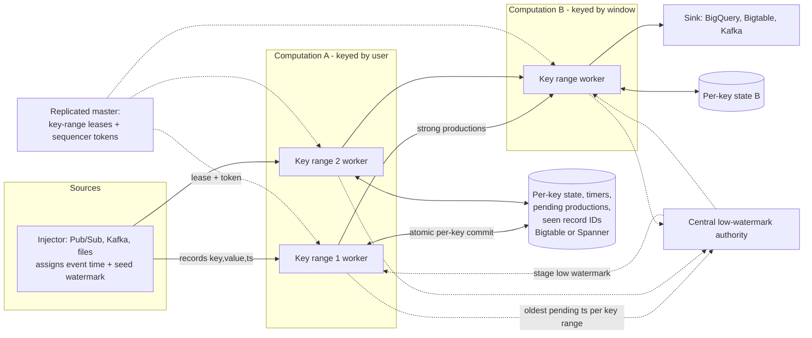

# MillWheel (2013 VLDB) and The Dataflow Model (2015 VLDB)

## TL;DR

MillWheel makes exactly-once a per-key storage problem: dedup the record ID, run user code, atomically commit state, timers, and outputs in one write, then ACK upstream, then send downstream.
The low watermark of a stage is `min(oldest pending work in the stage, low watermarks of all upstream stages)`, and the injector seeds it with a heuristic, so "complete" always means "estimated complete".
The Dataflow Model splits every pipeline into four separate questions: what is computed (transforms), where in event time (windowing), when in processing time results are emitted (triggers), and how refinements relate (accumulation mode).
Batch is a special case of streaming: on a bounded source the watermark jumps to infinity when the input is exhausted, so each window fires exactly one on-time pane and triggers do nothing else.
Exactly-once covers only effects inside the pipeline. Late data dropped past allowed lateness, non-idempotent external side effects, and sink semantics are three separate correctness problems you must solve on their own.

## Mental Model



Think of a MillWheel pipeline as a set of independent per-key state machines, each persisted as one row in a strongly consistent store, joined by retried RPC streams.
Correctness does not come from a global snapshot of the whole job, as in Flink.
Each key commits its own small transaction for every record or bundle, and that transaction contains the new state, the newly set timers, the outputs it will produce, and the record ID it just consumed.
Progress is tracked by a second, separate data flow: every worker reports the oldest timestamp it has not finished, and a central authority folds those reports into one watermark per stage.
The watermark then flows back to workers, where it fires event-time timers.
The Dataflow Model sits on top of this machinery.
Windows become extra grouping keys, triggers become timers, and accumulation modes decide what a timer firing writes downstream.

## Internals

### Lineage and scope

MillWheel was published in PVLDB Vol. 6, No. 11 (VLDB 2013) by Akidau, Balikov, Bekiroglu, Chernyak, Haberman, Lax, McVeety, Mills, Nordstrom, and Whittle, as Google's general-purpose low-latency stream processor ([paper](http://www.vldb.org/pvldb/vol6/p1033-akidau.pdf)).
Its motivating workload was Zeitgeist, which detects spikes and dips in search query volume.
A dip is hard because the system has to tell "these queries are delayed on the wire" apart from "these queries do not exist".
That single requirement forces both event-time progress tracking (watermarks) and exactly-once counting, because a duplicate looks like a spike.
The Dataflow Model paper (PVLDB Vol. 8, VLDB 2015) generalized MillWheel's primitives and FlumeJava's batch primitives into one programming model ([paper](https://www.vldb.org/pvldb/vol8/p1792-Akidau.pdf)).
That model became the Cloud Dataflow SDK and later Apache Beam.
It received the VLDB Test of Time Award in 2026 ([VLDB awards page](https://www.vldb.org/awards_10year.html), as of 2026-10).
The original authors published a retrospective, "The Dataflow Model Revisited", in PVLDB 19(12), 2026 ([paper](https://www.vldb.org/pvldb/vol19/p4953-fernandez-moctezuma.pdf)).
This chapter covers both papers and the retrospective, because the retrospective is now the best guide to which parts of the model to treat as load-bearing.

### MillWheel computation model

A MillWheel program is a directed graph of computations connected by streams.
Every record is a triple of key, value, and event timestamp.
Each consumer of a stream defines its own key extractor, so the same stream can be keyed by user in one consumer and by query in another.
Processing for a single key is serialized, and computations on different keys run in parallel.
That serialization is what lets per-key state be updated without locks or multi-key transactions.
It is also the root cause of hot-key bottlenecks (see Failure Modes).
Per-key persistent state is an opaque byte string stored in a row of Bigtable or Spanner.
The paper's Bigtable and Spanner are the systems covered in [[17-Cloud-AI-Engineering/Volume_13_Seminal_Papers_and_Case_Studies/Chapter_08_Google_Bigtable|Google Bigtable]] and [[17-Cloud-AI-Engineering/Volume_13_Seminal_Papers_and_Case_Studies/Chapter_06_Google_Spanner|Google Spanner]].
Timers are per-key callbacks set for a wall-clock time or a low-watermark value, and they fire in increasing timestamp order.
A replicated master splits each computation's key space into key intervals and assigns them to workers.
The master moves, splits, and merges intervals for load balancing, which is the dynamic sharding the paper relies on to keep latency flat as the job scales.

### The per-record exactly-once protocol

When a worker receives a record for key K, MillWheel runs these steps in order:

1. It checks the record ID against K's dedup data and discards the record if it is a duplicate.
2. It runs user code, which may change state, set or cancel timers, and emit productions (output records).
3. It commits every pending change to the backing store as one atomic write to K's row: new state, timer changes, the productions, and the consumed record ID.
4. It ACKs the sender.
5. It sends the productions downstream.

The order of steps 3, 4, and 5 is the whole guarantee.
If the worker crashes before step 3, nothing was persisted, the sender retries, and the record is processed from scratch.
If the worker crashes between steps 3 and 4, the sender retries, step 1 finds the ID already committed, the duplicate is dropped, and the ACK is sent.
If the worker crashes between steps 4 and 5, the productions are already in storage, and the restarted worker re-sends them with the same record IDs, so the downstream dedup absorbs any copies.
The paper calls productions that are checkpointed before they are sent strong productions.
Strong productions also make non-deterministic user code safe.
Downstream sees exactly one version of the output, the one that was committed, even if a retry would have computed something different.

Dedup lookups would cost one storage read per record, which is too slow.
MillWheel keeps an in-memory Bloom filter of seen IDs and reads the store only when the filter answers "maybe".
Record IDs are garbage collected once every sender that could retry them has confirmed it will not.
Cloud Dataflow kept this design.
Every message between stages carries a unique ID, each receiver keeps a catalog of IDs it has seen, and every stage's output is checkpointed so the IDs are stable across retries (Google Cloud docs, as of 2026-10).
Dataflow keeps a set of rolling Bloom filters bucketed by system time.
This stops any one filter from saturating, lets old filters be garbage collected whole, and limits how much must be scanned at worker startup (Google Cloud docs, as of 2026-10).

### Weak productions and the ACK-chain problem

Strong productions add a storage write on the critical path at every stage.
For computations that are already idempotent, MillWheel lets users switch to weak productions, which send downstream before checkpointing.
The danger is a straggler.
If stage C is slow to ACK, stage B cannot ACK stage A, and so on, and in-flight records pile up across the whole chain.
MillWheel breaks the chain by having a worker that waits too long for a downstream ACK checkpoint its pending productions.
It can then ACK its own upstream right away, and the wait stays local to the slow hop.
This is the same "do not let one slow dependency hold resources across the fleet" principle found in [[17-Cloud-AI-Engineering/Volume_07_Reliability_and_SRE/Chapter_02_Load_Shedding_Backpressure_and_Admission_Control|Load Shedding, Backpressure, and Admission Control]].
Users can also turn exactly-once off entirely, which removes the dedup step.
Dataflow's modern at-least-once streaming mode is the managed version of that switch.

### Fencing zombie writers, and why fencing enables caching

The master moves key intervals between workers.
A worker that has been partitioned away may not yet know it lost its lease, and it may still try to commit.
MillWheel attaches a sequencer token to every write, and the token is invalidated when a new owner takes over the interval.
The storage layer rejects writes that carry a stale token, which is the classic fencing-token pattern.
The less obvious result is a performance one.
Because the token guarantees a single writer per key, a worker can safely cache per-key state in memory and skip reading its own state back on every record.
The paper credits framework-level caching with roughly halving normalized CPU load ([MillWheel paper](http://www.vldb.org/pvldb/vol6/p1033-akidau.pdf)).
So the fencing token is not only a safety mechanism.
It is what makes a read-modify-write per record affordable.
Remove the token, and you must either re-read state on every record or accept split-brain corruption.

### Low watermark computation

The paper defines the oldest work of computation A as the timestamp of the oldest unfinished record in A, counting records that are in flight, stored, or pending delivery.
The low watermark of A is `min(oldest work of A, low watermark of C for every C that outputs to A)`.
The recursion stops at injectors.
An injector's watermark is a heuristic about data that has not yet entered the system.
For example, a file injector can use the minimum creation time of all files it has not finished reading.
Because that heuristic can be wrong, records can arrive behind the watermark.
Those records are late, and computations must either drop them or correct for them.

Mechanically, each worker aggregates oldest-work timestamps over the key intervals it owns and reports them, bucketed by key interval, to a central authority.
The authority journals the values to persistent storage and broadcasts each stage's watermark back to workers.
For the result to be correct, the authority must have a report covering every key interval of a stage before it can advance that stage's watermark.
It must also ignore reports from intervals that have moved to a new owner.
Without those two rules, a key interval in the middle of migration could drop out of the minimum, and the watermark would jump ahead of work that is still pending (paper Section 6; exact report format UNVERIFIED).
The authority is shardable, so the central design does not become a throughput ceiling.
Two consequences matter in production.
First, watermark lag adds up stage by stage, because each stage adds its own reporting and processing delay to the minimum it inherits.
Second, one stuck key holds back the watermark for its entire stage and every stage after it, because a minimum has no notion of "most keys are fine".

### Watermark holds and output timestamps

A watermark is not only "oldest unprocessed input".
A stage that buffers data in state also places a hold, a promise not to let its output watermark pass the timestamp of what it will emit later.
In Beam terms, a stage's output watermark is the minimum of its input watermark and all active holds from buffered window panes and output-timestamped timers.
The `TimestampCombiner` of a grouping operation decides which timestamp an aggregated pane carries, and so where the hold sits.
Beam's default is the end of the window.
That lets the downstream watermark move up to the window end promptly.
Choosing `EARLIEST` instead holds the downstream watermark at the earliest element in the pane.
With several windowed aggregations in a row, that can add a full window of latency at each stage.
This is one of the most common reasons a correct-looking multi-stage pipeline has much higher end-to-end latency than its window size suggests, and it does not appear in getting-started material.

### The Dataflow Model: What, Where, When, How

The 2015 paper's main contribution was to separate four concerns that earlier systems had tangled together:

- What: the transforms (ParDo, GroupByKey, Combine).
- Where in event time: windowing.
- When in processing time: triggers.
- How refinements relate: accumulation mode.

Windowing is defined as two operations on 4-tuples of (key, value, event time, window).
`AssignWindows` copies each element into zero or more windows: one for fixed windows, several for sliding windows.
`MergeWindows` runs inside `GroupByKeyAndWindow` and is what makes unaligned windows such as sessions possible.
Every element starts in a proto-session `[t, t + gap)`, and overlapping proto-windows for the same key are merged before grouping.
Session windows are therefore data-driven and differ per key, which no aligned-window system can express.
Merging has a cost: the runner must re-merge state whenever a late element bridges two existing sessions, so session state cannot be finalized at a fixed time.

Triggers decide when a window's pane is emitted.
The paper offers watermark triggers (fire when the watermark passes the end of the window), processing-time triggers, data-arrival triggers (counts), and combinators such as repeat, sequence, first-of, and all-of.
The production pattern is "speculative early panes on a processing-time cadence, one on-time pane at the watermark, then a late pane for each late element until allowed lateness expires".
Allowed lateness is a garbage-collection horizon on the event-time axis.
Once the watermark passes window end plus allowed lateness, the runner deletes that window's state and silently drops any record that arrives for it later.

Accumulation mode defines what each pane means:

- Discarding: each pane holds only the data since the previous pane. Downstream must sum the panes, which suits sinks that add deltas.
- Accumulating: each pane holds the full result so far. Downstream must overwrite by key, which suits sinks that support upserts.
- Accumulating and retracting: each pane emits the new value plus a retraction of the previous one. This is needed when the output feeds a second grouping on a different key, because otherwise the old and new values are both counted downstream.

The paper described retractions as part of the model.
Beam never shipped user-facing retractions as a general feature (UNVERIFIED as of 2026-10), and the 2026 retrospective calls the user-facing retraction protocol one of the parts that aged poorly.

### Batch as a special case, and what "unified" really means

The paper's implementation ran the same model on FlumeJava for batch and MillWheel for streaming.
In batch, the bounded source's watermark moves to infinity once input is exhausted, so each window fires one on-time pane and there is no late data.
The pipeline graph stays the same between the two modes.
What changes is the physical execution: batch can sort and shuffle huge amounts of data with no per-record commits, while streaming pays per-key commits for low latency.
On Dataflow, batch always runs exactly-once, and streaming runs exactly-once by default with an optional at-least-once mode (Google Cloud docs, as of 2026-10).
The 2026 retrospective takes a provocative line: streaming analytics is really a materialized-view maintenance problem.
It argues that windowing is "just another grouping dimension" and should not have been the foundation of the consistency model.
It proposes declared constraints on change instead: finalization, ordering, monotonicity, and partitioning ([Revisited](https://www.vldb.org/pvldb/vol19/p4953-fernandez-moctezuma.pdf)).
A staff engineer should be able to argue both sides: the original model is what runs in production on Dataflow and Flink today, and the retrospective explains why streaming SQL and incremental view maintenance engines are moving away from triggers.

### Modern managed implementation on Google Cloud

Dataflow Streaming Engine moves shuffle and per-key state out of the worker VMs and into a service backend, so workers become mostly stateless compute that can be autoscaled without moving state through their disks.
Exactly-once on Streaming Engine still follows the MillWheel shape: stable IDs, a per-receiver ID catalog, checkpointed outputs, Bloom filters, and garbage collection (Google Cloud docs, as of 2026-10).
Sources that are not deterministic, such as Pub/Sub, must give the runner a record ID, because the runner cannot invent a stable one when a redelivered message may look different from the original (Google Cloud docs, as of 2026-10).
At-least-once mode is turned on with the `streaming_mode_at_least_once` service option, and setting it automatically enables Streaming Engine with resource-based billing (Google Cloud docs, as of 2026-10).
The streaming mode changes how Streaming Engine processes records but not the semantics of I/O connectors.
For example, at-least-once mode should be paired with BigQuery `STORAGE_API_AT_LEAST_ONCE` writes, and it is incompatible with the BigQueryIO `FILE_LOADS` method (Google Cloud docs, as of 2026-10).

### Contrast: Flink's global snapshots

Apache Flink, the engine behind Amazon Managed Service for Apache Flink, takes the opposite route to exactly-once.
Asynchronous barrier snapshotting (Carbone et al., 2015, derived from Chandy-Lamport) injects barriers at the sources.
Each operator snapshots its local state when barriers have arrived on all of its inputs, and the snapshot becomes durable as one globally consistent checkpoint.
Per-record cost is close to zero, because there is no per-record commit and no dedup catalog.
The price shows up at recovery and at the sink.
Recovery rewinds the entire job, or a failover region of it, to the last checkpoint and replays from source offsets.
End-to-end exactly-once needs a transactional sink, such as Kafka transactions committed on checkpoint completion, so output becomes visible only once per checkpoint interval.
MillWheel and Dataflow pay per-record storage I/O instead.
In return, recovery is local to the moved key intervals, and committed output is visible downstream within milliseconds.
Neither is strictly better.
The choice is between cost per record and both the blast radius of recovery and the latency at which output becomes visible.

## Numbers to Know

| Quantity | Value | Source |
|---|---|---|
| MillWheel median record delay, single-stage, 200 CPUs | 3.6 ms | MillWheel paper, VLDB 2013 |
| MillWheel 95th-percentile record delay, same experiment | 30 ms | MillWheel paper, VLDB 2013 |
| MillWheel median latency scaling, 20 to 2000 CPUs | roughly flat; p99 worsens but stays on the order of 100 ms | MillWheel paper, VLDB 2013 |
| CPU saving from framework state caching (enabled by single-writer fencing) | about 2x lower normalized CPU | MillWheel paper, VLDB 2013 |
| Latency penalty of strong productions plus exactly-once vs weak/off | about one order of magnitude at median | MillWheel paper, VLDB 2013 (UNVERIFIED exact figure) |
| Dataflow batch semantics | always exactly-once | Google Cloud docs, as of 2026-10 |
| Dataflow streaming default mode | exactly-once; at-least-once is opt-in | Google Cloud docs, as of 2026-10 |
| At-least-once savings claim for streaming ETL | "up to 70%" (vendor claim, workload dependent) | Google Cloud blog, as of 2026-10 |
| Dataflow streaming bundle retry on persistent error | retried indefinitely; can stall the pipeline | Google Cloud docs, as of 2026-10 |
| Bloom filter bits per element at 1% false-positive rate | 9.59 bits (`-ln(0.01)/ln(2)^2`) | derived |
| Kinesis Data Streams provisioned shard write limit | 1 MB/s or 1000 records/s | AWS docs (UNVERIFIED as of 2026-10) |
| Kinesis Data Streams provisioned shard read limit | 2 MB/s shared per shard | AWS docs (UNVERIFIED as of 2026-10) |
| Managed Service for Apache Flink KPU | 1 vCPU, 4 GB memory per KPU, billed per KPU-hour | AWS docs (UNVERIFIED as of 2026-10) |
| Dataflow streaming vCPU, memory, and Streaming Engine unit prices | see [pricing](https://cloud.google.com/dataflow/pricing) | UNVERIFIED as of 2026-10 |

Bloom filter sizing check (derived): at 200,000 records/s with a 10-minute dedup horizon, about 120 million IDs are live.
A 1% false-positive filter for them takes about 144 MB, compared with 1.92 GB for the raw 16-byte IDs.
Storage lookups then fall from 200,000/s to about 2,000/s.

## AWS vs GCP Mechanism Parity

| Concern | Google Cloud | AWS | Critical difference |
|---|---|---|---|
| Programming model | Apache Beam on Dataflow (native runner) | Flink DataStream/Table/SQL on Managed Service for Apache Flink; Beam Flink runner possible (UNVERIFIED support scope) | Beam keeps What/Where/When/How as first-class concepts; Flink exposes watermarks and timers directly, and triggers are a Beam-layer concept |
| Exactly-once mechanism | Per-key atomic commit plus record-ID catalog and rolling Bloom filters (MillWheel lineage) | Asynchronous barrier snapshots of all operator state (Chandy-Lamport lineage) | Dataflow pays per-record storage I/O for local recovery; Flink pays a global rewind on failure |
| Output visibility under exactly-once | As soon as the per-key commit lands | Transactional sinks commit at checkpoint completion, so latency is at least the checkpoint interval | Do not promise sub-second end-to-end exactly-once on Flink with a Kafka transactional sink |
| State location | Streaming Engine backend, off the worker VM | RocksDB or heap on the worker, plus durable checkpoints | Dataflow autoscaling does not move state through worker disks; Flink rescaling restores from a checkpoint or savepoint |
| Watermark origin | Runner-estimated from the source (Pub/Sub backlog and timestamp attribute) | Per-split `WatermarkStrategy` (bounded out-of-orderness, idleness) defined in user code | Flink makes the user own the heuristic; an idle Kafka or Kinesis shard stalls the watermark unless idleness is configured |
| Watermark aggregation | Central authority per stage over key intervals | Min over input channels, propagated in-band as stream elements | In-band propagation has no central component, but it ties watermark progress to data-plane backpressure |
| Late data | Allowed lateness plus late-firing triggers; drops counted after the horizon | Allowed lateness on windows plus side outputs for late data | Flink side-output-for-late is first-class; in Beam, late records past the horizon are dropped silently unless you watch the metrics |
| Relaxed semantics | `streaming_mode_at_least_once` service option | `CheckpointingMode.AT_LEAST_ONCE` (skips barrier alignment) | Both trade duplicates for lower latency and cost; on both, sink semantics stay a separate decision |
| Ingest log | Pub/Sub (no user-visible partitions), Managed Service for Apache Kafka | Kinesis Data Streams (shards), Amazon MSK | Shard and partition counts cap the parallelism of Flink source readers; Pub/Sub has no partition ceiling but also no total order |
| Exactly-once sinks | BigQuery Storage Write API (exactly-once mode), Bigtable idempotent mutations | Kafka/MSK transactional producer; Kinesis has no transactional write | Writing to Kinesis is at-least-once; consumers must deduplicate by business key |
| Job upgrade | In-place update with compatibility check, or drain then replace | Snapshot (savepoint) then restart with new code | Drain fires incomplete windows early; savepoints keep window state across the upgrade |

Translation context: [[17-Cloud-AI-Engineering/Volume_04_AWS_vs_GCP_Translation/Chapter_05_Messaging_Streaming_and_Analytics_Translation|Messaging, Streaming, and Analytics Translation]], [[17-Cloud-AI-Engineering/Volume_03_GCP_Deep_Dive/Chapter_14_Messaging_and_Streaming_Cloud_Pub_Sub_and_Dataflow|Cloud Pub/Sub and Dataflow]], and [[17-Cloud-AI-Engineering/Volume_02_AWS_Deep_Dive/Chapter_13_Messaging_and_Streaming_SQS_SNS_EventBridge_and_MSK|SQS, SNS, EventBridge, and MSK]].

## Worked Example: MillWheel mechanics in 80 lines, then an event-time pipeline on Dataflow

### Part A - a dependency-free MillWheel simulator

This script runs with plain Python 3 and costs nothing.
It shows the three mechanisms covered above: dedup on retry, fencing a zombie writer, and the watermark being held back by unACKed work.

```python
"""Toy MillWheel: per-key exactly-once via record-ID catalog, strong
productions, sequencer-token fencing, and low-watermark computation.
Pure Python 3, no dependencies. Run: python3 millwheel_sim.py"""
import random

class Store:
    """Stands in for Bigtable: one atomic conditional write per key."""
    def __init__(self):
        self.rows = {}      # key -> dict(state, seen_ids, pending_out)
        self.token = {}     # key range owner token (fencing)
    def commit(self, key, token, row):
        if self.token.get(key) != token:
            raise PermissionError("zombie writer fenced: stale token")
        self.rows[key] = row  # single atomic row mutation

class Stage:
    def __init__(self, name, store):
        self.name, self.store = name, store
        self.pending = {}   # record_id -> event timestamp (unacked work)
        self.upstream_wm = float("-inf")
    def acquire(self, key):
        tok = random.getrandbits(32)
        self.store.token[key] = tok
        return tok
    def low_watermark(self):
        oldest = min(self.pending.values(), default=float("inf"))
        return min(oldest, self.upstream_wm)
    def receive(self, rec, token, crash_after_commit=False):
        rid, key, ts, val = rec
        self.pending[rid] = ts
        row = self.store.rows.get(key, {"state": 0, "seen": set(), "out": []})
        if rid in row["seen"]:
            del self.pending[rid]
            return "dup-dropped-and-acked"
        new = {"state": row["state"] + val,
               "seen": row["seen"] | {rid},
               "out": row["out"] + [(f"{rid}-out", key, ts, row["state"] + val)]}
        self.store.commit(key, token, new)   # strong production: checkpoint first
        if crash_after_commit:
            return "crashed-before-ack"       # sender will retry
        del self.pending[rid]                 # ack upstream only after commit
        return "processed"

random.seed(7)
st = Store()
a = Stage("A", st)
t_old = a.acquire("user1")
a.upstream_wm = 150
r1 = ("id-1", "user1", 101, 5)
print("1:", a.receive(r1, t_old, crash_after_commit=True))
print("   watermark while id-1 unacked:", a.low_watermark())
t_new = a.acquire("user1")                     # key range moves to a new worker
print("2: retry ->", a.receive(r1, t_new))
print("   state:", st.rows["user1"]["state"], "(not 10: retry deduplicated)")
try:
    a.receive(("id-2", "user1", 105, 1), t_old)
except PermissionError as e:
    print("3:", e)
a.pending.pop("id-2", None)
a.upstream_wm = 200
print("4: watermark after drain:", a.low_watermark())
```

Verified output:

```text
1: crashed-before-ack
   watermark while id-1 unacked: 101
2: retry -> dup-dropped-and-acked
   state: 5 (not 10: retry deduplicated)
3: zombie writer fenced: stale token
4: watermark after drain: 200
```

Line 1 shows that the upstream watermark is 150, but the stage watermark is 101.
The unACKed record holds it back, exactly as the oldest-work rule says.

### Part B - Beam pipeline with early, on-time, and late panes

Save as `windowed_counts.py`.
Local mode uses `TestStream` on the DirectRunner and needs no cloud resources (`pip install apache-beam`).
Cloud mode reads from Pub/Sub on Dataflow.

```python
import argparse
import json

import apache_beam as beam
from apache_beam.options.pipeline_options import PipelineOptions, StandardOptions
from apache_beam.testing.test_stream import TestStream
from apache_beam.transforms import trigger, window
from apache_beam.transforms.window import TimestampedValue

TIMING = {0: "EARLY", 1: "ON_TIME", 2: "LATE", 3: "UNKNOWN"}


class FormatPane(beam.DoFn):
    def process(self, kv, w=beam.DoFn.WindowParam, pane=beam.DoFn.PaneInfoParam):
        key, total = kv
        yield json.dumps({
            "key": key,
            "window": [float(w.start), float(w.end)],
            "pane": TIMING.get(pane.timing, "?"),
            "pane_index": pane.index,   # use (key, window, pane_index) for idempotent upserts
            "total": total,
        })


def windowed_sum(pcoll):
    return (
        pcoll
        | "Window" >> beam.WindowInto(
            window.FixedWindows(60),
            trigger=trigger.AfterWatermark(
                early=trigger.AfterProcessingTime(10),
                late=trigger.AfterCount(1)),
            accumulation_mode=trigger.AccumulationMode.ACCUMULATING,
            allowed_lateness=120)
        | "Sum" >> beam.CombinePerKey(sum)
        | "Format" >> beam.ParDo(FormatPane()))


def local_source():
    return (TestStream()
            .advance_watermark_to(0)
            .add_elements([TimestampedValue(("user1", 1), 10),
                           TimestampedValue(("user1", 1), 20)])
            .advance_processing_time(15)          # early pane may fire here
            .add_elements([TimestampedValue(("user1", 1), 50)])
            .advance_watermark_to(60)             # on-time pane for [0, 60)
            .add_elements([TimestampedValue(("user1", 1), 15)])   # late, within lateness
            .advance_watermark_to(181)            # past 60 + 120: state GC
            .add_elements([TimestampedValue(("user1", 1), 5)])    # dropped silently
            .advance_watermark_to_infinity())


def run(argv=None):
    ap = argparse.ArgumentParser()
    ap.add_argument("--mode", choices=["local", "pubsub"], default="local")
    ap.add_argument("--input_subscription")
    ap.add_argument("--output_topic")
    args, beam_args = ap.parse_known_args(argv)
    opts = PipelineOptions(beam_args)
    opts.view_as(StandardOptions).streaming = True
    p = beam.Pipeline(options=opts)
    if args.mode == "local":
        windowed_sum(p | "TestStream" >> local_source()) | beam.Map(print)
    else:
        events = (
            p
            | "Read" >> beam.io.ReadFromPubSub(
                subscription=args.input_subscription,
                timestamp_attribute="event_ts",   # event time, drives the watermark
                id_label="event_id")              # stable ID for dedup of publisher retries
            | "Key" >> beam.Map(lambda b: (json.loads(b.decode("utf-8"))["user"], 1)))
        (windowed_sum(events)
         | "Encode" >> beam.Map(lambda s: s.encode("utf-8"))
         | "Write" >> beam.io.WriteToPubSub(topic=args.output_topic))
    result = p.run()
    if args.mode == "local":
        result.wait_until_finish()


if __name__ == "__main__":
    run()
```

Expected local output: possibly an EARLY pane with total 2, then an ON_TIME pane with total 3, then a LATE pane with total 4, and nothing for the record at event time 5.
The ON_TIME and LATE panes follow directly from the trigger definition.
Whether the EARLY pane fires depends on how the DirectRunner advances processing time, so treat it as illustrative (UNVERIFIED against a specific Beam release).
The dropped record is the lesson: there is no error and no exception, only a dropped-due-to-lateness counter.

### Part C - run on Dataflow, with budget alarm and teardown

Pubsub mode calls `run()` and returns while the job stays RUNNING, so the publishes in this script run.
Local mode still waits, because the TestStream is finite.

```bash
export PROJECT=my-project REGION=us-central1 BILLING=XXXXXX-XXXXXX-XXXXXX
gcloud config set project "$PROJECT"
gcloud services enable dataflow.googleapis.com pubsub.googleapis.com

# Budget alarm first: email alerts at 50% and 90% of 25 USD.
gcloud billing budgets create --billing-account="$BILLING" \
  --display-name=mw-lab --budget-amount=25USD \
  --threshold-rule=percent=0.5 --threshold-rule=percent=0.9 \
  --filter-projects="projects/$PROJECT"

gcloud pubsub topics create mw-in
gcloud pubsub subscriptions create mw-in-sub --topic=mw-in
gcloud pubsub topics create mw-out
gcloud storage buckets create "gs://$PROJECT-mw-tmp" --location="$REGION"

python windowed_counts.py --mode=pubsub --job_name=windowed-counts \
  --runner=DataflowRunner --project="$PROJECT" --region="$REGION" \
  --temp_location="gs://$PROJECT-mw-tmp/tmp" \
  --input_subscription="projects/$PROJECT/subscriptions/mw-in-sub" \
  --output_topic="projects/$PROJECT/topics/mw-out" \
  --enable_streaming_engine --machine_type=n2-standard-2 --max_num_workers=2
# Optional, for idempotent ETL only: --dataflow_service_options=streaming_mode_at_least_once

# Publish an on-time event and a deliberately late one.
gcloud pubsub topics publish mw-in --message='{"user":"u1"}' \
  --attribute=event_ts="$(date -u +%Y-%m-%dT%H:%M:%SZ)",event_id=e1
gcloud pubsub topics publish mw-in --message='{"user":"u1"}' \
  --attribute=event_ts="$(date -u -d '-10 minutes' +%Y-%m-%dT%H:%M:%SZ 2>/dev/null || date -u -v-10M +%Y-%m-%dT%H:%M:%SZ)",event_id=e2
```

Exact teardown:

```bash
JOB_ID=$(gcloud dataflow jobs list --region="$REGION" --status=active \
  --format='value(id)' --filter='name~windowed')
[ -n "$JOB_ID" ] && gcloud dataflow jobs cancel "$JOB_ID" --region="$REGION"
gcloud pubsub subscriptions delete mw-in-sub
gcloud pubsub topics delete mw-in mw-out
gcloud storage rm -r "gs://$PROJECT-mw-tmp"
BUDGET_ID=$(gcloud billing budgets list --billing-account="$BILLING" \
  --filter='displayName=mw-lab' --format='value(name)')
gcloud billing budgets delete "$BUDGET_ID" --billing-account="$BILLING"
```

Use `cancel` in the lab, because `drain` would fire every open window as incomplete and keep the job running until the drain finishes.
Lab cost estimate: one or two n2-standard-2 workers plus Streaming Engine usage for one hour, on the order of 1 USD (UNVERIFIED as of 2026-10; check the [Dataflow pricing page](https://cloud.google.com/dataflow/pricing)).

### Part D - back-of-the-envelope sizing for a production pipeline

Workload: 200,000 events/s, 1 KB each, 10 million active users, 1-minute fixed windows, 2 minutes of allowed lateness, 3 stages.

1. Ingest bandwidth is `200,000 x 1 KB = 200 MB/s`, which is 17.3 TB/day.
2. Kinesis provisioned equivalent: `max(200 MB/s / 1 MB/s, 200,000 / 1000) = 200` shards, or 260 with 30% headroom (shard limits UNVERIFIED as of 2026-10). That is also the ceiling on Flink source parallelism.
3. Dedup catalog: a 10-minute retry horizon gives 120 million live IDs. The Bloom filter takes 144 MB at 1% false positives, split into ten rolling 1-minute filters of about 14.4 MB each, and backing-store lookups fall to about 2,000/s.
4. Window state: each key holds at most `(60 + 120) / 60 + 1 = 4` live windows. That is 40 million accumulators, and at 64 bytes each about 2.6 GB of state before overhead.
5. Latency budget for the on-time pane: 60 s window, plus about 5 s of source watermark lag, plus about 3 x 1 s of per-stage lag, gives about 68 s from window start. Early panes every 10 s give dashboards a speculative number in the meantime. Per-stage lag values are assumptions; measure them with the data watermark lag metrics.
6. Compute: assume a measured 5,000 events/s per vCPU in exactly-once mode for parse plus a combiner-lifted sum (a planning assumption, UNVERIFIED; benchmark your own DoFns). That gives 40 vCPU. At an assumed all-in 0.10 USD per vCPU-hour including memory and Streaming Engine (UNVERIFIED), the cost is about `40 x 730 x 0.10 = 2,920 USD/month`.
7. Mode decision: this pipeline aggregates counts, so at-least-once would inflate totals. Keep exactly-once, and use the at-least-once discount only on the separate raw-event ETL branch.

## Failure Modes and Pitfalls

### Watermark stalls

A poison-pill record stalls the pipeline.
In Dataflow streaming, a bundle that throws is retried indefinitely, which can stall the pipeline permanently (Google Cloud docs, as of 2026-10).
Because the failing record stays pending, the stage's oldest work never advances, so the watermark freezes for every downstream stage, and every event-time window stops firing.
Mitigation: catch per-element exceptions, route the bad records to a dead-letter output, and alert on the dead-letter rate.
Do not let the runner's retry loop be your error handling.

A hot key turns into a watermark problem.
Per-key serialization means one key at 50,000 events/s is limited by one worker thread.
Its backlog becomes the stage's oldest work and holds the global watermark back.
Mitigation: combiner lifting, `Combine.perKey().withHotKeyFanout()` in Beam Java, or salting the key with a two-stage merge.
The idea is the same as the shuffle-sharding analysis in [[17-Cloud-AI-Engineering/Volume_01_Cloud_Architecture_Principles/Chapter_03_Cell_Based_Architecture_and_Shuffle_Sharding|Cell-Based Architecture and Shuffle Sharding]].

On Flink, an idle source partition stalls the watermark.
A Kafka partition or Kinesis shard with no traffic never advances its watermark, and the operator takes the minimum over all partitions.
Configure source idleness, and know that marking a partition idle lets late data through if the partition wakes up with old timestamps.

### Watermarks that run ahead, and silent data loss

If the source heuristic advances past real data, for example because mobile clients upload hours later or publisher clocks are skewed, windows close early.
Everything past allowed lateness is then dropped with no error.
The only signal is a dropped-due-to-lateness counter that most teams never chart.
Mitigation: alert on that counter.
Size allowed lateness from the measured p99.9 of the gap between event time and ingest time, not from a guess.
For low-volume, high-value late data, route it to a correction path in batch.

### Exactly-once misread as end-to-end

Dataflow's guarantee is that results which stay inside the pipeline are reflected at most once, and records are processed at least once (Google Cloud docs, as of 2026-10).
A DoFn that calls a payment API, sends an email, or posts to an HTTP webhook will repeat that side effect on every bundle retry.
Mitigation: make the external call idempotent with a deterministic request ID derived from the record ID.
Put a `Reshuffle` or `@RequiresStableInput` checkpoint before the side effect, so a retry replays the same input.

Accumulating panes written to an append-only sink double count.
An ACCUMULATING pane `total=3` followed by `total=4`, appended to a table, sums to 7.
Mitigation: upsert keyed by `(key, window)`, with `pane_index` as a monotonic version, or use DISCARDING mode with an additive sink.

### Lifecycle operations

Drain produces incomplete windows.
Draining moves the watermark to infinity, which fires every open window before its data is complete.
A downstream consumer that treats ON_TIME panes as final will store partial counts during every deployment.
Prefer in-place update, or Flink savepoints, for stateful jobs.
When drain is unavoidable, tag the drained panes downstream.

Session-window state can grow without bound.
A bot that sends an event every `gap - 1` seconds keeps one session open forever, and a late element that bridges two sessions forces a state merge.
Mitigation: cap session duration in a custom `WindowFn`, or filter bot traffic before windowing.

### Flink-specific pitfalls

Checkpoint alignment under backpressure is a problem.
Barriers queue behind backlogged data, checkpoints time out, and transactional sinks stop committing, so output stalls even though the job is "running".
Unaligned checkpoints reduce alignment time but increase checkpoint size.

A Kafka transaction timeout can lose data.
If the Kafka transaction timeout is shorter than checkpoint interval plus recovery time, the broker aborts transactions that Flink still expects to commit after a restart.
Size the transaction timeout from the worst-case recovery time, not the checkpoint interval.

### Ingestion layer as the shared dependency

The AWS Kinesis Data Streams event in us-east-1 on 2020-11-25 began during a capacity addition to the front-end fleet.
Each front-end server kept a thread for every other front-end server, so growing the fleet pushed servers past an OS thread limit.
The outage cascaded into Cognito, CloudWatch, Lambda, and other services that use Kinesis internally ([AWS PIR](https://aws.amazon.com/message/11201/)).
For stream processors, the lesson is that the ingest log is the root of the watermark and recovery tree.
When it degrades, every consumer's watermark stalls together, and the backlog drains as a thundering herd when it recovers.
Pre-size consumer autoscaling caps and replay rate limits for that catch-up.
Treat them as part of the [[17-Cloud-AI-Engineering/Volume_01_Cloud_Architecture_Principles/Chapter_05_Constant_Work_and_Workload_Smoothing|constant-work]] design.
See [[17-Cloud-AI-Engineering/Volume_07_Reliability_and_SRE/Chapter_07_Anatomy_of_Major_Cloud_Outages|Anatomy of Major Cloud Outages]] for the full dissection.

## Security and Cost Angles

### IAM scoping

On Google Cloud, run each Dataflow job as a dedicated worker service account with `roles/dataflow.worker` plus resource-level grants.
For example, give `roles/pubsub.subscriber` on the one subscription and `roles/bigquery.dataEditor` on the one dataset, not project-wide Editor.
The identity that launches the job needs `roles/dataflow.developer` and `iam.serviceAccounts.actAs` on the worker service account.
`actAs` is the privilege-escalation edge to audit.
On AWS, give the Managed Flink application a service execution role scoped to specific stream ARNs, specific MSK cluster or topic resources, and the checkpoint bucket prefix.
See [[17-Cloud-AI-Engineering/Volume_02_AWS_Deep_Dive/Chapter_01_IAM_Policy_Evaluation_Engine|IAM Policy Evaluation Engine]].

### Encryption

Streaming state is a copy of your data at rest that teams often forget about.
Dataflow supports CMEK for job state, and the key must be in the job's region, with the Dataflow service agent granted encrypter/decrypter permissions on it (UNVERIFIED scope of CMEK coverage for Streaming Engine state as of 2026-10).
On AWS, encrypt Kinesis with SSE-KMS, MSK at rest with KMS, and Flink checkpoints with SSE-KMS on the S3 bucket.
Every checkpoint write then becomes a KMS call or a cached data key, so check KMS request quotas at high checkpoint frequency.
See [[17-Cloud-AI-Engineering/Volume_08_Security_Identity_and_the_Data_Perimeter/Chapter_04_Encryption_Key_Hierarchies_and_Envelope_Encryption|Encryption Key Hierarchies and Envelope Encryption]].

### Network perimeter

Run Dataflow workers without public IPs (`--no_use_public_ips` in Python) on a subnet with Private Google Access, inside a VPC Service Controls perimeter that includes Dataflow, Pub/Sub, BigQuery, and Cloud Storage.
Run Managed Flink in VPC mode, with interface VPC endpoints for Kinesis, KMS, and CloudWatch, and an S3 gateway endpoint for checkpoints.
See [[17-Cloud-AI-Engineering/Volume_03_GCP_Deep_Dive/Chapter_03_VPC_Service_Controls_Security_Perimeters|VPC Service Controls]] and [[17-Cloud-AI-Engineering/Volume_08_Security_Identity_and_the_Data_Perimeter/Chapter_06_Constructing_an_Impenetrable_Data_Perimeter|Constructing an Impenetrable Data Perimeter]].

### Unit-economics levers

1. Pick the streaming mode per branch. Exactly-once for aggregations, at-least-once (vendor claim: up to 70% cheaper for streaming ETL) for idempotent ETL into sinks that already deduplicate.
2. Use combiner lifting. `CombinePerKey` pre-aggregates before the shuffle, which cuts shuffled bytes and dedup catalog entries by the per-bundle fan-in.
3. Choose window and lateness geometry. State cost scales with `(window + allowed_lateness) / period` live windows per key, so 24 hours of lateness on 1-minute windows means 1,441 live windows per key.
4. Do not use sliding windows where a fixed window plus a downstream rolling sum works. `SlidingWindows(60 min, every 1 min)` copies every element into 60 windows.
5. On Flink, match parallelism to KPUs, and use incremental RocksDB checkpoints so checkpoint I/O scales with the change rate rather than the state size.

Deeper economics live in [[17-Cloud-AI-Engineering/Volume_09_FinOps_and_Cloud_Economics/Chapter_01_Cloud_Billing_Models_and_Unit_Cost_Allocation|Cloud Billing Models and Unit Cost Allocation]].

## Interview Questions and Model Answers

### Question 1 (L5 - Senior)

What exactly does a low watermark guarantee, and what happens to a record that arrives behind it?

#### Model Answer

A low watermark W for a stage says the system believes no more records with event time below W will arrive at that stage.
In MillWheel it is computed as the minimum of the stage's oldest unfinished work and the watermarks of all upstream stages.
At the injector it is a heuristic, for example the minimum creation time of unfinished files, or a backlog-based estimate on Pub/Sub.
It is therefore an estimate of completeness, not a guarantee, and it advances monotonically.
A record behind the watermark is late.
In Beam, a late record that is still within the window's allowed lateness is added to the window state, and the late trigger fires a new pane.
Past `window_end + allowed_lateness`, the window state has been garbage collected and the record is dropped, increasing a counter but raising no error.
The operational point is that "correct" output depends on three settings, not one: the watermark heuristic, allowed lateness, and the sink's handling of repeated panes.
I would chart the dropped-late counter next to event-time-to-ingest-time lag percentiles, and size lateness from the p99.9 of that lag.

#### Follow-up Interviewer Question

Your watermark is fine for 99.9% of traffic, but one mobile client version uploads in batches 6 hours late. Do you raise allowed lateness to 6 hours?

### Question 2 (L5 - Senior)

Dataflow says it is exactly-once. A DoFn in your pipeline calls a payments API. Can a customer be charged twice?

#### Model Answer

Yes.
Dataflow's guarantee is that each record is processed at least once and that results which stay inside the pipeline are committed at most once.
That holds for shuffled data, state, and timers, through the ID catalog and checkpointed outputs.
A bundle that fails after the HTTP call but before its commit is retried, and the API is called again.
The fix has two parts.
First, pass an idempotency key derived from a stable record ID to the payments API, so the provider deduplicates.
Second, make sure the input to that DoFn is stable across retries by putting a `Reshuffle` or `@RequiresStableInput` checkpoint in front of it.
Otherwise an upstream non-deterministic step, such as random sampling or a lookup with a timestamp, could hand the retry a different record and a different key.
Exactly-once is a property of a boundary.
Inside the runner it is free, and across a boundary you have to build it, either with a transactional or offset-based sink (for example the BigQuery Storage Write API) or with idempotency keys.

#### Follow-up Interviewer Question

The payments provider deduplicates idempotency keys only for 24 hours, and you sometimes replay a subscription from a snapshot 3 days back. What do you change?

### Question 3 (L6 - Staff)

Design an ad-billing aggregation: per-advertiser spend per minute, written to BigQuery, with corrections allowed up to 24 hours late and invoices built from the result. Choose window, trigger, accumulation mode, streaming mode, and sink semantics, and justify the cost.

#### Model Answer

Events carry event time and a unique impression ID from the ad server, which I pass as the source record ID so publisher retries are deduplicated.
Use exactly-once streaming mode, because this is a sum.
At-least-once would inflate revenue, and dedup in the sink cannot recover from duplicates once they have been summed.
Use 1-minute fixed windows keyed by advertiser.
The trigger is `AfterWatermark(early=AfterProcessingTime(30s), late=AfterProcessingTime(5min))`.
Late firings are batched every 5 minutes rather than per element, because per-element late firings over 24 hours turn into a write storm into BigQuery.
Accumulating mode means each pane carries the full current total.
The sink is an upsert keyed by `(advertiser, window_start)`, with `pane_index` as a version, so only the latest pane wins.
In BigQuery that is a Storage Write API exactly-once stream into a staging table plus periodic MERGE, or a latest-version view.
The cost risk is state: 24 hours of lateness on 1-minute windows keeps up to 1,441 live windows per advertiser.
With 1 million advertisers, that is about 1.4 billion accumulators, roughly 100 GB of state.
That is where I would push back.
I would split the system into a real-time path with 1-minute windows and 10 minutes of lateness for dashboards and pacing, and a correction path that reprocesses the day in batch from the retained log for invoicing.
This is the "unified model, two physical executions" idea of the Dataflow paper.
The same transform code runs in both, and the invoice is built only from the batch result, where the watermark is infinite and every window is final.

#### Follow-up Interviewer Question

Finance asks why the dashboard total for yesterday differs from the invoice by 0.3%. Walk through every mechanism that can cause the gap and how you would reconcile it.

### Question 4 (L6 - Staff)

A production Dataflow streaming job's data watermark has been flat for 40 minutes while system lag looks normal and CPU is low. Debug it.

#### Model Answer

A flat watermark with low CPU means something is pending and not progressing, not that the job is overloaded.
I would go stage by stage and find the first stage whose input watermark is moving but whose output watermark is flat.
Everything after that stage simply inherits the minimum.
There are four candidates.
First, a poison pill: one bundle failing and retrying forever. Streaming bundles retry indefinitely, so the worker logs show the same exception repeating. The fix is a dead-letter output and redeploying with update.
Second, a hot or stuck key, where one key's backlog is the stage's oldest work. Look at per-key processing time or a hot-key log, then use fanout or salting.
Third, a hold from state: a stateful DoFn timer with an old output timestamp, or an `EARLIEST` timestamp combiner on a long session, legally holds the output watermark back.
Fourth, a source cause: a Pub/Sub subscription where a few old messages are never ACKed because a downstream sink rejects them, or a Kafka partition that has gone idle.
Low CPU points toward the first and fourth, while a hot key usually pegs one worker thread.
The deeper staff point is that the watermark is a minimum over the whole key space.
That is great for correctness and terrible for fault isolation, so the alerting design should include a per-stage watermark-lag SLO and dead-letter rate alarms, not just end-to-end freshness.

#### Follow-up Interviewer Question

You cannot redeploy for 2 hours because of a change freeze, but the business needs fresh numbers. What can you do safely, and what does each option do to correctness?

### Question 5 (L6 - Staff)

Compare MillWheel or Dataflow per-key commits with Flink's asynchronous barrier snapshots. When is each the right choice on AWS or GCP?

#### Model Answer

MillWheel commits every record or bundle per key: dedup check, state, timers, and outputs in one atomic write, then ACK, then send.
The cost is per-record storage I/O, softened by Bloom filters and caching that single-writer fencing makes safe.
The benefits are that recovery is local to the moved key intervals, committed output is visible downstream immediately, and non-deterministic user code is safe because downstream only sees the committed output.
Flink takes a globally consistent snapshot every checkpoint interval using barriers.
Per-record overhead is close to zero, so throughput per vCPU is typically higher.
But a failure rewinds the job, or its failover region, to the last checkpoint and replays.
End-to-end exactly-once needs transactional sinks, whose output becomes visible only when a checkpoint completes, so visible latency is at least the checkpoint interval.
Choose Dataflow-style commits when keys are many and independent, output must be visible in under a second with exactly-once, and failures should not cause fleet-wide replay storms.
Choose Flink when state per key is large, throughput per dollar dominates, seconds of output latency are acceptable, and the team can own watermark strategies and checkpoint tuning.
On AWS the managed choice is Flink. On GCP it is Dataflow, or Flink on GKE or Dataproc.
In practice the cloud often decides for you, so the real skill is knowing which correctness levers you lose when you switch.

#### Follow-up Interviewer Question

Your Flink job on Managed Service for Apache Flink has 2 TB of RocksDB state, and checkpoints are starting to time out under backpressure. What are your options, and what does each cost?

### Question 6 (L7+ - Principal)

The 2026 "Dataflow Model Revisited" paper argues that windowing should not have been the foundation of the consistency model and that triggers aged poorly. You own the streaming platform strategy for a company with 400 Beam pipelines. What do you do with that argument?

#### Model Answer

First, separate the parts that aged well from the parts that did not.
Event time, watermarks as a completeness estimate, per-key state with timers, and exactly-once via stable IDs are durable mechanisms, and every serious engine now has them.
The retrospective's point is about the user-facing interface.
It argues that windows are just grouping keys, that triggers and retractions asked users questions they should never have been asked, and that streaming analytics is really incremental view maintenance with declared constraints such as finalization, ordering, and monotonicity.
For my platform, that suggests a direction, not a migration.
New analytical workloads, such as aggregations, joins, and dashboards, should default to a declarative SQL or table layer: Beam SQL or Dataflow SQL-style surfaces, BigQuery continuous queries, or Flink SQL on AWS.
There, finalization is a declared property and the engine chooses triggers.
Pipelines with stateful business logic, such as fraud rules, sessionization with custom merging, or pipelines with external side effects, stay on the low-level state and timer API, because that is the part the authors call unrepentant.
I would not rewrite 400 working pipelines, since rewrite risk dominates any interface elegance.
Instead I would lint for the known failure classes: accumulating panes into append-only sinks, unbounded allowed lateness, side effects without stable input, and `EARLIEST` combiners in chains.
I would also build the platform contract around tables with explicit finality columns (`is_final`, `pane_index`), so consumers stop guessing whether a number can change.
That gives most of the benefit of the new model on top of today's engines.

#### Follow-up Interviewer Question

An influential team argues for replacing all of this with micro-batch MERGE jobs every 5 minutes on the warehouse. Under what numbers would you agree?

### Question 7 (L7+ - Principal)

Design regional disaster recovery for an exactly-once streaming pipeline on Google Cloud whose output feeds fraud decisions, with RPO of 0 for accepted events and RTO under 15 minutes.

#### Model Answer

Dataflow jobs and their Streaming Engine state are regional, so the state does not survive a regional loss.
Exactly-once inside one job does not carry over to a second job in another region.
Start from the durable log.
Pub/Sub keeps acknowledged-publish messages independently of the consumer job, so the RPO for accepted events is a property of the ingest log's replication, not of the pipeline.
That is where the RPO of 0 is won or lost (UNVERIFIED per-region durability specifics as of 2026-10).
For RTO, run a warm standby job in the second region on its own subscription, either fully active or processing with outputs suppressed.
Make the sink tolerate both jobs: writes keyed by `(event_id)` or `(key, window, pane_index)` with last-writer-wins, so duplicate processing across regions is idempotent by design.
Cross-region exactly-once is impossible without a global commit, so you engineer idempotence instead.
The watermark is the subtle part.
A cold standby restarting from a snapshot or seek-to-time has to rebuild window state, and until it has caught up, its on-time panes are wrong unless the seek point is at least `window + allowed_lateness` before the failover time.
So the seek offset equals the state horizon, and the replay volume (event rate times horizon) sets catch-up time and therefore RTO.
At 200,000 events/s and a 3-minute horizon, that is 36 million events.
If the standby can catch up at 3 times real-time throughput, catch-up takes about 90 seconds, which fits the 15-minute budget.
Fraud decisions need a defined degraded mode during failover: rules-only scoring fed by the raw stream, without windowed features, rather than blocking.
That is the static-stability principle from [[17-Cloud-AI-Engineering/Volume_01_Cloud_Architecture_Principles/Chapter_02_Regions_Zones_and_Static_Stability|Regions, Zones, and Static Stability]].
Finally, rehearse it.
A game day that kills the primary job's region and measures catch-up time, duplicate rate at the sink, and feature staleness is the only evidence that counts.

#### Follow-up Interviewer Question

Running both regions active doubles the compute cost. Defend or reject that spend to the CFO using the numbers from your design.

## Further Reading

- [MillWheel: Fault-Tolerant Stream Processing at Internet Scale (VLDB 2013)](http://www.vldb.org/pvldb/vol6/p1033-akidau.pdf) - The primary source for per-key exactly-once, strong and weak productions, fencing tokens, and low-watermark computation.
- [The Dataflow Model (VLDB 2015)](https://www.vldb.org/pvldb/vol8/p1792-Akidau.pdf) - Defines What/Where/When/How, window assignment and merging, triggers, and accumulation modes.
- [The Dataflow Model Revisited (PVLDB 19(12), 2026)](https://www.vldb.org/pvldb/vol19/p4953-fernandez-moctezuma.pdf) - The authors' own Test of Time grading of what aged well and badly, and the best guide to where streaming interfaces are heading.
- [After Lambda: Exactly-once processing in Google Cloud Dataflow, Part 1](https://cloud.google.com/blog/products/data-analytics/after-lambda-exactly-once-processing-in-google-cloud-dataflow-part-1) - Reuven Lax's precise definition of what exactly-once does and does not cover in Dataflow's streaming shuffle.
- [After Lambda, Part 2: Ensuring low latency](https://cloud.google.com/blog/products/gcp/after-lambda-exactly-once-processing-in-cloud-dataflow-part-2-ensuring-low-latency) - The Bloom filter, ID catalog, and garbage-collection mechanics that make per-record dedup affordable.
- [Exactly-once in Dataflow (Google Cloud docs)](https://cloud.google.com/dataflow/docs/concepts/exactly-once) - Current official statement of the guarantee, including non-deterministic sources and late data.
- [Set the pipeline streaming mode (Google Cloud docs)](https://cloud.google.com/dataflow/docs/guides/streaming-modes) - The exact service option and connector pairing rules for at-least-once mode.
- [At-least-once vs exactly-once streaming modes (Google Cloud blog)](https://cloud.google.com/blog/products/data-analytics/dataflow-at-least-once-vs-exactly-once-streaming-modes) - The vendor's reasoning and cost claims for choosing a mode per workload.
- [Streaming 102: The world beyond batch (O'Reilly)](https://www.oreilly.com/radar/the-world-beyond-batch-streaming-102/) - Tyler Akidau's visual walkthrough of panes, triggers, and accumulation that the paper only describes formally.
- Carbone et al., "Lightweight Asynchronous Snapshots for Distributed Dataflows" (2015) - The Flink checkpointing algorithm to set against MillWheel's per-key commits.
- Chambers et al., "FlumeJava: Easy, Efficient Data-Parallel Pipelines" (PLDI 2010) - The batch half of the Dataflow implementation and the origin of deferred pipeline optimization.
- [AWS Kinesis us-east-1 event summary, 2020-11-25](https://aws.amazon.com/message/11201/) - A primary-source case study of an ingest-log failure cascading through dependent services.
- Related chapters: [[17-Cloud-AI-Engineering/Volume_13_Seminal_Papers_and_Case_Studies/Chapter_13_Jupiter_Datacenter_Network|Jupiter (previous)]], [[17-Cloud-AI-Engineering/Volume_13_Seminal_Papers_and_Case_Studies/Chapter_15_Google_TPU_Architecture_Evolution|TPU Architecture Papers (next)]], [[17-Cloud-AI-Engineering/Volume_14_Staff_Plus_Interview_Arena/Chapter_04_Design_Global_Real_Time_Feature_Store|Global Real-Time Feature Store]], [[17-Cloud-AI-Engineering/Volume_07_Reliability_and_SRE/Chapter_03_Resilient_Communication_Retries_Jitter_and_Circuit_Breakers|Retries, Jitter, and Circuit Breakers]], and [[04-System-Design/06-Messaging-and-Streaming/Apache-Kafka|Apache Kafka]].
