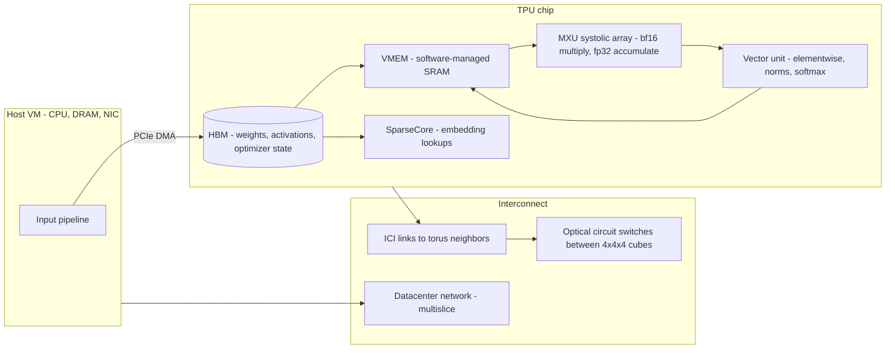

# Google TPU Architecture Papers: TPU v1 to v5p (ISCA 2017-2023)

## TL;DR

- Every TPU generation rests on one idea: feed a weight-stationary systolic Matrix Multiply Unit (MXU) from a software-managed scratchpad, so each operand is read from SRAM once and reused across the whole array instead of being refetched per multiply.
- TPU v1 (ISCA 2017) was an 8-bit inference coprocessor with 92 TOPS of peak compute, but it was starved by 34 GB/s DDR3. Its ridge point of about 1350 MACs per weight byte is the first roofline lesson every TPU engineer has to learn.
- TPU v2/v3 made the chip a training supercomputer. They added bfloat16 multiplies with fp32 accumulation, HBM, and a dedicated 2D-torus Inter-Chip Interconnect (ICI). bfloat16 keeps the fp32 exponent, so loss scaling is not needed, and it cuts multiplier area about 9x compared with fp32.
- TPU v4 (ISCA 2023) wired 64 cubes of 4x4x4 chips through optical circuit switches (OCS). The OCS turns a fixed 4096-chip torus into a pool of failure-isolated blocks that are composed on demand. That improves availability, deployment speed and tenant isolation, and the optics cost less than 5% of system cost.
- In production the failure unit is the slice, not the chip. Your levers are MXU-aligned tensor shapes, operational intensity above the HBM ridge, collectives mapped onto torus axes, spare-cube headroom, and checkpoint intervals sized to slice MTBF.

## Mental Model



The host CPU only stages data and launches compiled programs.
Once XLA has compiled a step, the TPU executes it deterministically.
Tensors stream from HBM into a compiler-managed scratchpad, and from there into the MXU.
In the MXU, weights sit still while activations flow through the array and partial sums ripple toward the accumulators.
Communication between chips is also compiled.
Each collective is a fixed schedule of transfers over point-to-point ICI links to torus neighbors, with no switch and no NIC on that path.
Above a single cube, the links leave the rack as fibers and terminate on MEMS-mirror optical circuit switches.
Those switches do not route packets.
They set physical light paths, so the scheduler can stitch any set of healthy cubes into a torus of the requested shape.
In short, the compiler owns the memory hierarchy, ICI owns tightly coupled scale-up, OCS owns topology, and the DCN carries only the loosely coupled traffic between slices.

## Internals

### Lineage and the papers that define it

The primary record is a sequence of Google papers, most with Norman Jouppi and David Patterson as authors:

- [In-Datacenter Performance Analysis of a Tensor Processing Unit](https://arxiv.org/abs/1704.04760), ISCA 2017, covers TPU v1.
- [A Domain-Specific Supercomputer for Training Deep Neural Networks](https://m-cacm.acm.org/magazines/2020/7/245702-a-domain-specific-supercomputer-for-training-deep-neural-networks/fulltext), CACM 2020, covers TPU v2 and v3.
- The Design Process for Google's Training Chips: TPUv2 and TPUv3, IEEE Micro 2021, Norrie et al.
- [Ten Lessons From Three Generations Shaped Google's TPUv4i](https://dl.acm.org/doi/abs/10.1109/ISCA52012.2021.00010), ISCA 2021, covers the inference chip.
- [TPU v4: An Optically Reconfigurable Supercomputer for Machine Learning with Hardware Support for Embeddings](https://arxiv.org/abs/2304.01433), ISCA 2023.

The TPU v4 paper calls v4 Google's fifth domain-specific architecture (DSA) and its third ML supercomputer (Jouppi et al., ISCA 2023).
There is no ISCA paper for TPU v5p.
Its public description comes from Google Cloud documentation and launch material, so v5p facts in this chapter carry doc dates, not paper citations.

### TPU v1: an inference coprocessor built around one systolic array

TPU v1 was deployed in Google datacenters from 2015 and accelerated only the inference phase of neural networks (Jouppi et al., ISCA 2017).
The paper's workload was production MLPs, CNNs and LSTMs, which it says made up 95% of Google's datacenter NN inference demand at the time (Jouppi et al., ISCA 2017).
The heart of the chip is a 256x256 matrix of 65,536 8-bit multiply-accumulate units.
At 700 MHz that gives 65,536 x 0.7e9 = 4.59e13 MAC/s, or 92 TOPS when a MAC is counted as two operations (Jouppi et al., ISCA 2017).
On-chip storage is 28 MiB of software-managed memory: a 24 MiB Unified Buffer for activations and 4 MiB of 32-bit accumulators.
Off-chip memory is 8 GiB of DDR3 for weights at 34 GB/s.
The card sits on PCIe and draws about 40 W in typical operation (Jouppi et al., ISCA 2017).

The control model is deliberately CISC.
The host pushes a small set of coarse instructions over PCIe: read host memory, read weights, matrix multiply or convolve, activate, and write host memory.
The chip has no caches, no branch prediction, no out-of-order execution and no multithreading.
The paper argues this deterministic execution fits a p99 response-time target better than the average-case optimizations of CPUs and GPUs (Jouppi et al., ISCA 2017).
The paper reports the TPU on average 15x to 30x faster than a contemporary Haswell CPU or K80 GPU on these workloads, with 30x to 80x higher TOPS/W (Jouppi et al., ISCA 2017).

### The mechanism: weight-stationary systolic dataflow

A getting-started guide will tell you the TPU "has a matrix unit".
It will not tell you why the matrix unit dictates your tensor shapes.

1. A weight tile of up to 256x256 is shifted into the array and held in place, one weight per MAC cell.
2. Activations enter from one edge, one row vector per cycle, and march across the array cell by cell.
3. Each cell multiplies the passing activation by its resident weight, adds the partial sum arriving from its upstream neighbor, and passes the result downstream.
4. After a fill latency proportional to the array dimension, one full row of partial sums leaves the array every cycle and lands in the accumulators.
5. A weight FIFO double-buffers the next tile behind the current one, so weight loading overlaps compute as long as enough activation rows stream through to amortize the load.

The energy argument is the whole reason for the design.
In a register-file machine every multiply needs at least two operand reads from a register file or SRAM.
In a systolic array an operand read from SRAM once is reused N times as it hops between neighboring cells over short wires.
Hop-to-hop transfer costs far less energy than an SRAM read, and an SRAM read costs orders of magnitude less than a DRAM read.
Horowitz's ISSCC 2014 energy table is the standard reference for that ordering (UNVERIFIED exact pJ figures, so none are quoted here).

Two consequences follow, and both bite in production.

First, utilization depends on matching shapes.
A contraction or output dimension that is not a multiple of the array width still costs a full pass.
On a 128-wide MXU a dimension of 129 costs two passes, which wastes nearly half of the second pass.
If a layer's K dimension is only 64, half the cells hold no useful weight.
The v1 paper observed this directly: on its CNN1 workload only about half of the MACs held useful weights on active cycles, because some layers had shallow feature depths (Jouppi et al., ISCA 2017).

Second, you need many activation rows per weight tile.
Loading a weight tile is pure overhead unless enough activation rows (the batch, or batch x sequence) stream through it.
That is why TPU inference performance depends on batch size, and why decode-phase LLM serving on any systolic machine is a batching problem first (see [[17-Cloud-AI-Engineering/Volume_11_LLM_Serving_and_Inference_Systems_on_Cloud/Chapter_01_LLM_Inference_Mechanics_Prefill_vs_Decode|Prefill vs Decode]]).

### The v1 roofline: why the most-cited ML chip was memory-bound

The ridge point is peak compute divided by memory bandwidth: 4.59e13 MAC/s / 34e9 B/s = about 1350 MACs per weight byte.
This number is derived here from the paper's own figures.
Any layer that performs fewer than about 1350 MACs per byte of weight fetched from DDR3 is memory-bound.
For the MLPs and LSTMs that dominated the workload, weight reuse is set by batch size, and the p99 latency target capped batch size.
The paper reports that about 35% of CNN1's cycles were spent waiting for weights to load, during fully connected layers running at an operational intensity of only 32 (Jouppi et al., ISCA 2017).
The paper also reports that GDDR5-class bandwidth would have roughly tripled the achieved TOPS.
That counterfactual explains why every later TPU uses HBM.

### TPU v2 and v3: the chip becomes a supercomputer node

Training changed the requirements.
Backpropagation needs floating point, much more memory for activations and optimizer state, and all-reduce of gradients across many chips.
The CACM paper says the TPUv2 project began in 2014 (Jouppi et al., CACM 2020).
It frames the result as co-design of five layers: TensorFlow, the XLA compiler, the TPU architecture, the Brain floating-point format, and the ICI interconnect.
That co-design let production applications scale at 96% to 99% of perfect linear speedup (Jouppi et al., CACM 2020).

The structural changes:

- Two TensorCores per chip, each with a 128x128 MXU, a vector unit, a scalar unit and HBM.
  A TPU v2 core was quoted at 22.5 TFLOP/s with 300 GB/s to 8 GB of HBM, or 45 TFLOP/s and 600 GB/s per chip (Fischer and Saba, arXiv 1810.09868, 2018).
- MXU arithmetic changed from int8 to bfloat16 multiplies with fp32 accumulation (Google Cloud blog, 2019-08).
- Each chip gained an ICI router and links directly to its neighbors.
  This builds a 2D torus without a separate switch or NIC.
  The TPU v4 paper describes the v3 machine as a 1024-chip system that could not be used until all 1024 chips and all cables were installed and tested (Jouppi et al., ISCA 2023).
- TPU v3 doubled the MXUs per core and moved to liquid cooling.
  Google quoted up to 420 TFLOPS per Cloud TPU v3 device and more than 100 PFLOPS per full v3 pod (Google Cloud blog, 2019-08).

Why 128x128 rather than v1's 256x256?
For a fixed MAC budget, four 128x128 arrays hold the same number of MACs as one 256x256 array.
But they waste less work on dimensions that are not multiples of 256, and they shorten fill and drain latency.
Training graphs contain many medium-sized matrices (attention heads, per-expert FFNs, small batches per core), so the smaller granularity pays.
The cost is more control and more wiring per MAC.
This reasoning is the author's trade-off analysis, not a quotation from the papers.

### bfloat16: the arithmetic decision that made TPU training work

bfloat16 has 1 sign bit, 8 exponent bits and 7 explicit mantissa bits.
It is the top half of an IEEE fp32 value.

| Format | Exponent bits | Mantissa bits (explicit) | Dynamic range | Needs loss scaling for training |
| --- | --- | --- | --- | --- |
| fp32 | 8 | 23 | about 1e-38 to 3e38 | No |
| fp16 | 5 | 10 | about 6e-5 (normal) to 65504 | Usually yes |
| bfloat16 | 8 | 7 | Same as fp32 | No |

Mechanism one, range.
Gradients and activations span many orders of magnitude.
fp16 underflows small gradients unless the loss is scaled up and gradients scaled back down.
bfloat16 shares fp32's exponent, so a model trained in fp32 usually trains in bf16 without loss scaling, and conversion is a truncation of the low 16 bits.

Mechanism two, silicon.
A multiplier array grows roughly with the square of the significand width, including the implicit leading bit.
That width is 24 bits for fp32, 11 for fp16 and 8 for bf16.
So 24^2 / 8^2 = 9, and a bf16 multiplier needs about one ninth the area of an fp32 multiplier.
Likewise 11^2 / 8^2 = 1.9, so it needs about half the area of an fp16 multiplier.
These ratios are first-order arithmetic.
Google's own bfloat16 post makes the same square-law argument (Google Cloud blog, 2019-08).
Because the systolic array is almost entirely multipliers and adders, multiplier area translates directly into MACs per mm^2 and per watt.

Mechanism three, accumulation stays wide.
Each product is accumulated in fp32 inside the MXU (Google Cloud blog, 2019-08).
The 7-bit mantissa therefore limits the precision of each individual product, but rounding error does not compound across long dot-product reductions inside the matrix unit.
The trap is everything outside the MXU.
A reduction you write yourself in bf16 on the vector unit, such as a loss sum, a layernorm variance or a softmax denominator, does compound error.
See [[17-Cloud-AI-Engineering/Volume_11_LLM_Serving_and_Inference_Systems_on_Cloud/Chapter_06_Model_Quantization_and_Compression|Model Quantization and Compression]] for the later FP8 and INT8 story.

### TPUv4i: ten lessons that read like an architecture review checklist

The ISCA 2021 TPUv4i paper describes the inference DSA that Google has deployed since 2020.
It distills ten lessons from the three prior generations (Jouppi et al., ISCA 2021).
Paraphrased, the lessons most relevant to cloud engineers are these:

- Logic, wires, SRAM and DRAM improve at different rates.
- Compiler compatibility and backwards ML compatibility matter more than peak FLOPS.
- Design for performance per TCO, not performance per CapEx.
- Inference chips must be air-cooled to deploy globally.
- Some inference applications still need floating point.
- Production inference needs multi-tenancy.
- Model memory and compute demand keep growing.
- The latency SLO, not batch size, is the binding inference constraint.

Lessons 2 and 3 come back in the L7 interview question below, because they are the strongest public argument for and against building your own accelerator.

### TPU v4: optical circuit switching as a topology control plane

TPU v4 was deployed from 2020.
It outperforms v3 by 2.1x and improves performance per watt by 2.7x (Jouppi et al., ISCA 2023).
The supercomputer grew 4x to 4096 chips, which the paper says makes it nearly 10x faster overall (Jouppi et al., ISCA 2023).
Each chip has 275 bf16 TFLOPS and 32 GiB of HBM2 at 1200 GB/s (Jouppi et al., ISCA 2023).
Those numbers match two TensorCores x four 128x128 MXUs x 2 FLOPs x 1.05 GHz.

**Physical topology.**
Sixteen hosts of four chips each make a rack-level cube of 64 chips in a 4x4x4 arrangement.
Inside the cube, ICI runs over electrical links.
Each of the cube's six faces exposes 16 links, so each cube has 96 optical links leaving it.
For 64 cubes that is 64 x 96 = 6144 fiber endpoints.
The paper's 48 OCSes provide 48 x 128 = 6144 ports, so the arithmetic closes (derived from Jouppi et al., ISCA 2023).

**Data plane versus control plane.**
The OCS data plane is passive optics.
MEMS mirror arrays steer light from an input fiber to an output fiber.
They have no packet buffers, perform no packet parsing and do not care about data rate, so a link upgrade does not require a switch upgrade.
The control plane is the slice scheduler.
When a job asks for, say, a 4x4x8 slice, the scheduler picks two healthy cubes and programs the mirrors so that the face links of the two cubes join into the requested torus, including the wraparound links.
Reconfiguration happens at job boundaries, not per packet, so mirror settling time is off the critical path (UNVERIFIED: exact settling time).

**Twisted tori.**
The OCS can wire the wraparound links with an offset, which gives a twisted 3D torus.
For non-cubic shapes this shortens the network diameter and improves all-to-all bandwidth (Jouppi et al., ISCA 2023).
On a fixed copper backplane the twist would be impossible.

**What the OCS buys, per the paper.**
The paper lists improved scale, availability, utilization, modularity, deployment, security, power and performance, at an optics cost below 5% of system cost and 3% of system power (Jouppi et al., ISCA 2023).
Incremental deployment alone was decisive.
With v3, delivery delays on any component held up the whole machine.
With v4, each 64-chip cube went into production as soon as its 64 chips and their cables were installed and tested (Jouppi et al., ISCA 2023).

**The availability mechanism, quantified.**
This is the deepest idea in the v4 paper, and it does not appear in product docs.
Let host availability be a. A cube needs all 16 of its hosts, so cube availability is a^16.
A statically wired 4096-chip torus needs all 1024 hosts at once, so its availability is a^1024.

| Host availability | Cube availability | Static 4096-chip torus | OCS: 60 of 64 cubes healthy | OCS: 16 of 64 cubes (one 1024-chip slice) |
| --- | --- | --- | --- | --- |
| 99.9% | 0.984 | 0.359 | 0.9965 | about 1.0 |
| 99.5% | 0.923 | 0.006 | 0.446 | about 1.0 |
| 99.0% | 0.852 | about 0 | 0.030 | about 1.0 |

The table is computed with a binomial model in this chapter.
It assumes independent host failures, and correlated rack or power failures make it optimistic (author calculation).
Three lessons follow.
First, without reconfiguration, a large static torus is almost never fully healthy, because any single dead host breaks every ring through it.
Second, OCS turns the problem from "the specific hosts are all healthy" into "any k cubes are healthy", which is a binomial tail and is very forgiving for slices well below pod size.
Third, OCS does not save a job that wants the entire pod.
Production jobs should be sized to leave spare cubes, which is the TPU analogue of N+k capacity planning in [[17-Cloud-AI-Engineering/Volume_01_Cloud_Architecture_Principles/Chapter_02_Regions_Zones_and_Static_Stability|Static Stability]].

**SparseCore.**
Each v4 chip also has SparseCores.
These are dataflow processors for embedding lookups that speed up embedding-heavy models 5x to 7x while using only about 5% of die area and power (Jouppi et al., ISCA 2023).
The design point matters because recommendation models are dominated by gather and scatter operations with little arithmetic, which a systolic array cannot accelerate.

**Results.**
The paper reports that an LLM trained on v4 averaged about 60% of peak FLOPS.
For similar-sized systems, v4 was 1.2x to 1.7x faster than an NVIDIA A100 while using 1.3x to 1.9x less power (Jouppi et al., ISCA 2023).
The OCS mechanism is the same technology that Google's Jupiter datacenter fabric adopted.
See [[17-Cloud-AI-Engineering/Volume_13_Seminal_Papers_and_Case_Studies/Chapter_13_Jupiter_Datacenter_Network|Jupiter]] for the datacenter-scale version.

### TPU v5p: the documented successor

Google lists v5p at 459 bf16 TFLOPS and 918 int8 TOPS per chip, with 95 GB of HBM at about 2.76 TB/s and pods of up to 8960 chips (Google launch figures as reported 2023-12; JAX Scaling Book, as of 2026-10).
Each chip has two TensorCores with four 128x128 MXUs each.
That implies a clock of about 1.75 GHz from 459e12 / (2 x 4 x 16384 x 2) (derived).
ICI bandwidth is quoted at 4800 Gbps per chip in a 3D torus (secondary sources quoting Google, as of 2026-10).
The JAX Scaling Book gives the full pod shape as 16x20x28, with 2x2x1 chips per host.
That makes 2240 hosts and 17,920 TensorCores (JAX Scaling Book, as of 2026-10).
The pod is 140 groups of 4x4x4 chips, which fits the v4 cube-and-OCS building block, but Google has not published a v5p architecture paper confirming the internal wiring (UNVERIFIED: v5p OCS wiring details).
Google Cloud docs list four SparseCores per v5p chip and position v5p for large-scale pre-training and recommender training (Google Cloud docs, as of 2026-10).

### Beyond v5p, for orientation only

Compute Engine docs as of 2026-10 list three current accelerator-optimized TPU versions: v6e (Trillium), v5p and TPU7x (Google Cloud docs, as of 2026-10).
The docs recommend TPU7x for high-FP8 pre-training and inference, and v6e for cost-effective serving.
The JAX Scaling Book lists TPU7x at about 2.3e15 bf16 FLOPs/s per chip, 192 GiB of HBM and 128 MiB of VMEM (JAX Scaling Book, as of 2026-10).
Secondary sources say Trillium moved the MXU from 128x128 to 256x256 (UNVERIFIED against a Google primary source).
For the accelerator-level comparison with GPUs and Trainium, see [[17-Cloud-AI-Engineering/Volume_10_AI_Infrastructure_on_Cloud/Chapter_01_Accelerator_Architectures_GPUs_Trainium_TPUs|Accelerator Architectures]].

### Failure domain boundaries

| Boundary | What fails together | Consequence |
| --- | --- | --- |
| TensorCore or chip | One chip's compute and HBM | The XLA program for the whole slice cannot proceed, because collectives are compiled across every chip |
| Host (4 chips on v4 and v5p) | Chips sharing a host, PCIe and NIC | Slice loss, with the host drained by maintenance |
| Cube (4x4x4) | Electrical ICI domain in a rack | With OCS, the scheduler swaps in a spare cube on restart |
| OCS | One switch carries a fraction of the links in one dimension | Slices using those ports lose their wraparound links (UNVERIFIED: Google's OCS redundancy policy) |
| Slice | The unit of SPMD execution | Fail-stop, with restart from checkpoint |
| Multislice over DCN | Independent slices joined by data parallelism | One slice failing stalls synchronous training on all slices |

## Numbers to Know

| Quantity | Value | Source |
| --- | --- | --- |
| TPU v1 MACs | 65,536 (256x256), 8-bit | Jouppi et al., ISCA 2017 |
| TPU v1 peak | 92 TOPS at 700 MHz | Jouppi et al., ISCA 2017 |
| TPU v1 on-chip memory | 28 MiB, software-managed | Jouppi et al., ISCA 2017 |
| TPU v1 weight memory bandwidth | 34 GB/s DDR3 | Jouppi et al., ISCA 2017 |
| TPU v1 typical power | about 40 W | Jouppi et al., ISCA 2017 |
| TPU v1 ridge point | about 1350 MACs per weight byte | Derived from the figures above |
| TPU v1 vs K80 and Haswell | 15x to 30x faster, 30x to 80x TOPS/W | Jouppi et al., ISCA 2017 |
| TPU v2 per core | 22.5 TFLOP/s, 8 GB HBM at 300 GB/s | Fischer and Saba, 2018 |
| TPU v3 device and pod | 420 TFLOPS per device, more than 100 PFLOPS per pod | Google Cloud blog, 2019-08 |
| TPU v3 supercomputer size | 1024 chips | Jouppi et al., ISCA 2023 |
| v2/v3 scaling efficiency | 96% to 99% of linear | Jouppi et al., CACM 2020 |
| TPU v4 per chip | 275 bf16 TFLOPS, 32 GiB HBM2, 1200 GB/s | Jouppi et al., ISCA 2023 |
| TPU v4 vs v3 | 2.1x performance, 2.7x performance per watt | Jouppi et al., ISCA 2023 |
| TPU v4 supercomputer | 4096 chips = 64 cubes of 4x4x4 | Jouppi et al., ISCA 2023 |
| TPU v4 OCS count and ports | 48 OCS x 128 ports = 6144 = 64 cubes x 96 links | Jouppi et al., ISCA 2023, arithmetic derived |
| OCS share of system | below 5% of cost, below 3% of power | Jouppi et al., ISCA 2023 |
| SparseCore | 5x to 7x faster embeddings at about 5% of die area and power | Jouppi et al., ISCA 2023 |
| v4 LLM efficiency | about 60% of peak FLOPS | Jouppi et al., ISCA 2023 |
| TPU v5p per chip | 459 bf16 TFLOPS, 918 int8 TOPS | Google launch figures, 2023-12 |
| TPU v5p HBM | 95 GB at about 2765 GB/s | Google launch figures, 2023-12; JAX Scaling Book, as of 2026-10 |
| TPU v5p ridge point | about 166 FLOPs/byte | Derived: 459e12 / 2.765e12 |
| TPU v5p ICI | 4800 Gbps per chip | Secondary sources quoting Google, as of 2026-10 |
| TPU v5p pod | 8960 chips, 16x20x28, 4 chips per host | JAX Scaling Book, as of 2026-10 |
| TPU v5p host VM | 208 vCPUs (Sapphire Rapids), 448 GB memory | Google Cloud docs, as of 2026-10 |
| TPU7x host VM | 224 vCPUs (Emerald Rapids), 960 GB memory | Google Cloud docs, as of 2026-10 |
| TPU7x per chip | about 2.3e15 bf16 FLOPs/s, 192 GiB HBM, 128 MiB VMEM | JAX Scaling Book, as of 2026-10 |
| bf16 vs fp32 multiplier area | about 1/9 | Derived from significand widths 8 and 24 |
| v5p on-demand price per chip-hour | UNVERIFIED, check the Cloud TPU pricing page | - |

## AWS vs GCP Mechanism Parity

| Dimension | Google Cloud TPU | AWS Trainium and Inferentia | Critical difference |
| --- | --- | --- | --- |
| Lineage | TPU v1 (2015 deployment) through v4, v5e, v5p, v6e and TPU7x | Inferentia, then Trainium generations, all Annapurna Labs silicon | Google has published peer-reviewed architecture papers, while AWS publishes mostly product docs and re:Invent talks |
| Matmul engine | MXU weight-stationary systolic array, 128x128 through v5p | NeuronCore tensor engine, described by AWS as systolic-array based (UNVERIFIED dimensions) | Both reward tile-aligned shapes, and the tile size differs per generation |
| Number formats | bf16 multiply with fp32 accumulate since v2, int8, and FP8 on newer generations | bf16, FP8 variants and hardware stochastic rounding (UNVERIFIED per generation) | Check format support per generation before porting quantized checkpoints |
| On-chip memory model | Compiler-managed VMEM scratchpad fed from HBM | Compiler-managed SBUF scratchpad (UNVERIFIED naming per generation) | Both are scratchpad machines, so the compiler does the work a cache does on a GPU |
| Scale-up fabric | ICI direct links, 2D or 3D torus, no switch | NeuronLink between chips in an instance or UltraServer (UNVERIFIED topology) | A torus has no switch hop, but bisection bandwidth depends on slice shape |
| Topology reconfiguration | OCS composes 4x4x4 cubes into slices and supports twisted tori | No public equivalent, and scale-out uses a static electrical Clos | OCS gives availability by composition, while AWS relies on placement groups and spare instances |
| Scale-out fabric | DCN between slices (multislice) | EFA with SRD multipath transport over Clos, see [[17-Cloud-AI-Engineering/Volume_10_AI_Infrastructure_on_Cloud/Chapter_02_Interconnect_Technologies_NVLink_EFA_and_TPU_ICI\|Interconnects]] | TPU keeps tightly coupled traffic on ICI, while AWS spreads collectives across EFA as well |
| Compiler stack | XLA from JAX, PyTorch/XLA and TensorFlow | Neuron SDK compiler with PyTorch and JAX frontends | Both compile ahead of time, and shape changes trigger recompilation on both |
| Failure unit | The slice, which is fail-stop | The job across instances, with HyperPod-style health checks and node replacement, see [[17-Cloud-AI-Engineering/Volume_10_AI_Infrastructure_on_Cloud/Chapter_03_High_Performance_AI_Cluster_Architectures\|AI Clusters]] | On both, a single bad chip forces restart from checkpoint unless the framework is elastic |
| Embedding acceleration | SparseCore on v4, v5p and TPU7x | No dedicated public equivalent (UNVERIFIED) | Recommender economics differ materially |
| Capacity acquisition | Reservations, queued resources and Spot TPUs | Capacity Blocks for ML, On-Demand Capacity Reservations and Spot | Both treat large contiguous accelerator capacity as scarce and scheduled |

For the platform-level translation, see [[17-Cloud-AI-Engineering/Volume_04_AWS_vs_GCP_Translation/Chapter_06_AI_and_ML_Platform_Translation|AI and ML Platform Translation]].

## Worked Example: Measuring the MXU Tile Cliff and Sizing a v5p Training Run

### Cost estimate and guardrails

The lab uses one single-chip TPU v5e VM (`v5litepod-1`) as Spot capacity for under an hour.
At an assumed on-demand rate of about 1.20 USD per v5e chip-hour (UNVERIFIED, check the Cloud TPU pricing page) the lab costs under 2 USD, and Spot is cheaper.
The boot disk and host VM are billed with the TPU VM.
Create a budget alert before you provision anything.
Budgets send alerts but do not stop spend, so the teardown command is the real control.

### Step 1: budget alarm

```bash
#!/usr/bin/env bash
set -euo pipefail
: "${BILLING_ACCOUNT:?set BILLING_ACCOUNT, e.g. 0X0X0X-0X0X0X-0X0X0X}"
: "${PROJECT_ID:?set PROJECT_ID}"
gcloud billing budgets create \
  --billing-account="${BILLING_ACCOUNT}" \
  --display-name="tpu-lab-budget" \
  --budget-amount=20USD \
  --filter-projects="projects/${PROJECT_ID}" \
  --threshold-rule=percent=0.5 \
  --threshold-rule=percent=0.9 \
  --threshold-rule=percent=1.0
```

### Step 2: provision a Spot TPU VM

```bash
#!/usr/bin/env bash
set -euo pipefail
: "${PROJECT_ID:?set PROJECT_ID}"
ZONE="${ZONE:-us-central1-a}"
TPU_NAME="${TPU_NAME:-tpu-lab}"
gcloud config set project "${PROJECT_ID}"
gcloud services enable tpu.googleapis.com
# Confirm the accelerator type exists in your zone before creating.
gcloud compute tpus accelerator-types list --zone="${ZONE}" | grep -E 'v5litepod-1\b' || {
  echo "v5litepod-1 not offered in ${ZONE}; pick another zone" >&2; exit 1; }
gcloud compute tpus tpu-vm create "${TPU_NAME}" \
  --zone="${ZONE}" \
  --accelerator-type=v5litepod-1 \
  --version=v2-alpha-tpuv5-lite \
  --spot
gcloud compute tpus tpu-vm ssh "${TPU_NAME}" --zone="${ZONE}" \
  --command='pip install -U "jax[tpu]"'
```

### Step 3: the microbenchmark

The benchmark holds M and K fixed and sweeps N across tile boundaries.
It reports useful TFLOPS, meaning FLOPs of the requested shape per second.
If the hardware and compiler process N in passes of width W, then N = W*j + 1 costs about the same time as N = W*(j+1).
Useful TFLOPS then drops by roughly the padding fraction, and that reveals W empirically.
The shapes keep operational intensity well above the HBM ridge so the measurement isolates MXU fill rather than memory bandwidth.

```python
# bench.py - run on the TPU VM: python3 bench.py
import time
import jax
import jax.numpy as jnp

def useful_tflops(m, k, n, iters=30):
    ka, kb = jax.random.split(jax.random.PRNGKey(0))
    a = jax.random.normal(ka, (m, k), dtype=jnp.bfloat16)
    b = jax.random.normal(kb, (k, n), dtype=jnp.bfloat16)
    f = jax.jit(lambda x, y: jnp.dot(x, y, preferred_element_type=jnp.float32))
    f(a, b).block_until_ready()  # compile and warm up
    t0 = time.perf_counter()
    for _ in range(iters):
        out = f(a, b)
    out.block_until_ready()
    dt = (time.perf_counter() - t0) / iters
    return 2.0 * m * k * n / dt / 1e12

def intensity(m, k, n):
    flops = 2.0 * m * k * n
    bytes_moved = 2 * m * k + 2 * k * n + 4 * m * n  # bf16 in, fp32 out
    return flops / bytes_moved

if __name__ == "__main__":
    print("devices:", jax.devices())
    m = k = 8192
    for n in [1024, 1025, 1088, 1152, 1153, 1280, 1281, 2048]:
        print(f"N={n:5d} intensity={intensity(m, k, n):7.1f} FLOP/B "
              f"useful={useful_tflops(m, k, n):7.1f} TFLOPS")
```

```bash
gcloud compute tpus tpu-vm scp bench.py "${TPU_NAME}":~ --zone="${ZONE}"
gcloud compute tpus tpu-vm ssh "${TPU_NAME}" --zone="${ZONE}" --command='python3 bench.py'
```

How to read the result:

- If 1025 and 1152 show similar wall time, the effective pass width is 128.
- If the plateau runs to 1280, the effective width is 256, which can come from compiler tiling as well as from the physical array.
- XLA may tile differently from the physical MXU, which is exactly why you measure instead of assuming.

### Step 4: teardown (exact command)

```bash
gcloud compute tpus tpu-vm delete "${TPU_NAME}" --zone="${ZONE}" --quiet
gcloud compute tpus tpu-vm list --zone="${ZONE}"   # must print no tpu-lab row
```

### Step 5: back-of-the-envelope capacity sizing on v5p

Goal: pre-train a 70B-parameter dense transformer on 1.4T tokens.

1. Training compute is about 6ND = 6 x 70e9 x 1.4e12 = 5.88e23 FLOPs.
2. Per-chip delivered throughput is peak x MFU.
   At 459e12 x 0.5 that is 2.3e14 FLOP/s.
3. Chip-hours are 5.88e23 / 2.3e14 / 3600, about 712,000 chip-hours at 50% MFU.
   That rises to about 890,000 at 40% MFU and falls to about 593,000 at 60%.
4. Wall-clock on 4096 chips is about 7.2 days at 50% MFU.
   On a full 8960-chip pod it is about 3.3 days, but per the OCS availability table a full-pod job has no spare cubes.
   Plan on about 4096 to 7680 chips with spares.
5. Memory: mixed-precision Adam needs about 16 bytes per parameter for weights, gradients, fp32 master weights and two moments.
   That is about 1.12 TB.
   Spread across 95 GB chips it needs at least 12 chips before activations, which is trivially satisfied by FSDP over thousands of chips (see [[17-Cloud-AI-Engineering/Volume_10_AI_Infrastructure_on_Cloud/Chapter_05_Memory_Optimization_ZeRO_FSDP_and_JAX_Sharding|ZeRO, FSDP, and JAX Sharding]]).
6. Communication sanity check: a bf16 gradient all-reduce of 140 GB over about 600 GB/s of per-chip ICI has a ring lower bound of about 2S/B = 0.47 s per step.
   That bound assumes plain data parallelism with full replication.
   With FSDP reduce-scatter overlapped with backward compute, communication is hidden only when step compute time exceeds it.
   Check this with the profiler, not by assumption.
7. Cost is chip-hours x rate.
   At a hypothetical 4.00 USD per chip-hour (UNVERIFIED), 712,000 chip-hours is about 2.85M USD.
   Every 10 points of MFU moves the bill by roughly 20%, which is why MFU is the primary unit-economics metric (see [[17-Cloud-AI-Engineering/Volume_09_FinOps_and_Cloud_Economics/Chapter_05_GPU_and_TPU_Unit_Economics|GPU and TPU Unit Economics]]).

## Failure Modes and Pitfalls

**Tile misalignment.**
Hidden sizes, head dimensions, vocabulary sizes or per-device batch shards that are not multiples of the MXU width waste MXU passes.
A vocabulary of 50,257 is the classic example.
Pad to the tile size, for example 50,304 is a multiple of 128.
Under sharding the requirement applies per shard, so a 4096 dimension split 64 ways leaves only 64 per device, which half-fills a 128-wide array.

**Memory-bound inference masquerading as compute-bound.**
On v5p the ridge point is about 166 FLOPs/byte.
In bf16 decode, each weight byte supports roughly one FLOP per sequence in the batch.
A batch below about 166 is therefore HBM-bound regardless of peak TFLOPS.
This is the TPU v1 lesson at a different scale.

**Recompilation storms.**
XLA compiles one program per static shape.
Variable sequence lengths, a ragged final batch or Python-side shape changes trigger new compilations, which can take minutes on large slices.
Use shape bucketing, padding and a persistent compilation cache.

**Host input starvation.**
The TPU is idle whenever the host pipeline cannot keep up.
The profile shows this as gaps between steps with low MXU duty cycle and an idle host-to-device transfer queue.
See [[17-Cloud-AI-Engineering/Volume_10_AI_Infrastructure_on_Cloud/Chapter_07_High_Throughput_Data_Loaders_and_Storage_IO|Data Loaders and Storage I/O]].

**Slice fail-stop and the full-pod trap.**
One chip, host or ICI link failure stops the whole SPMD program.
Jobs that request the entire pod remove the spare-cube headroom that OCS exists to provide, and they suffer the a^N availability collapse.

**Multislice DCN bottleneck.**
Data parallelism across slices goes over the DCN, which has far less bandwidth than ICI.
Putting tensor or sequence parallelism across slices instead of within them causes collapse at step boundaries.
Map the parallelism axes so the most frequent collectives stay on ICI (see [[17-Cloud-AI-Engineering/Volume_10_AI_Infrastructure_on_Cloud/Chapter_04_Distributed_Training_Parallelism_Strategies|Parallelism Strategies]]).

**bf16 outside the MXU.**
The MXU accumulates in fp32, but your own reductions may not.
Loss sums, layernorm statistics and softmax denominators computed in bf16 drift.
This shows up as loss spikes that disappear in fp32, so keep these reductions in fp32 explicitly.

**Silent data corruption (SDC).**
Google's "Cores that don't count" (Hochschild et al., HotOS 2021) and Meta's "Silent Data Corruptions at Scale" (Dixit et al., 2021) describe defective cores that compute wrong answers without raising errors.
At thousands of chips per job, the probability that some chip is "mercurial" during a multi-week run is high.
The Gemini 1.0 technical report describes SDC as a recurring event at its training scale and reports raising goodput through fast detection and in-memory redundant state (UNVERIFIED exact frequencies and goodput figures).
Detection levers include:

- Deterministic replay of a step on a different slice.
- Cross-replica checksums of parameters.
- Loss and gradient-norm anomaly detectors.

See [[17-Cloud-AI-Engineering/Volume_10_AI_Infrastructure_on_Cloud/Chapter_08_Fault_Tolerance_and_Fleet_Resiliency_at_Scale|Fault Tolerance at Scale]].

**Spot preemption is whole-slice.**
A Spot or preemptible TPU slice is reclaimed as a unit.
Checkpoint cadence must assume the whole job can vanish at once (see [[17-Cloud-AI-Engineering/Volume_09_FinOps_and_Cloud_Economics/Chapter_03_Spot_Economics_and_Interruption_Handling|Spot Economics]]).

**Quota and stockout.**
TPU quota is per generation, per region and often per zone.
Large slices may wait in queued resources indefinitely.
A training plan without a capacity contract is a wish.

**Public PIRs.**
No public Google post-incident review specific to TPU fabric failure was verified for this chapter.
For cascade patterns in shared control planes, which also govern the TPU provisioning APIs, see [[17-Cloud-AI-Engineering/Volume_07_Reliability_and_SRE/Chapter_07_Anatomy_of_Major_Cloud_Outages|Anatomy of Major Cloud Outages]].

## Security and Cost Angles

### IAM scoping

Grant `roles/tpu.admin` only to the pipeline identity that creates and deletes slices, and `roles/tpu.viewer` to observers.
Attach a dedicated, least-privilege service account to TPU VMs with `--service-account`.
That account should be able to read the training bucket and write checkpoints, and nothing else.
Use Workload Identity Federation for CI rather than exported keys (see [[17-Cloud-AI-Engineering/Volume_08_Security_Identity_and_the_Data_Perimeter/Chapter_02_Workload_Identity_Federation|Workload Identity Federation]]).

### Network boundary

Create TPU VMs with `--internal-ips` so the hosts have no public addresses, and reach Google APIs through Private Google Access.
Wrap the training and checkpoint buckets in a VPC Service Controls perimeter so that a compromised training host cannot copy weights to a foreign project.
Whether the Cloud TPU API itself is a supported VPC-SC service should be confirmed in the VPC-SC supported products list (UNVERIFIED in this revision) (see [[17-Cloud-AI-Engineering/Volume_03_GCP_Deep_Dive/Chapter_03_VPC_Service_Controls_Security_Perimeters|VPC Service Controls]]).

### Tenant isolation through physical topology

The TPU v4 paper lists security among the OCS benefits (Jouppi et al., ISCA 2023).
Because a slice's ICI links are physically circuit-switched to that slice alone, another tenant has no packet path into its torus.
That is a stronger isolation primitive than VLANs or encryption on a shared packet fabric.

### Key hierarchy

Checkpoints and datasets at rest in Cloud Storage can use CMEK through Cloud KMS with envelope encryption, where a per-object DEK is wrapped by a KEK (see [[17-Cloud-AI-Engineering/Volume_08_Security_Identity_and_the_Data_Perimeter/Chapter_04_Encryption_Key_Hierarchies_and_Envelope_Encryption|Envelope Encryption]]).
Model weights are the crown jewels, so a key-revocation runbook should exist before the first checkpoint lands.
Confidential-computing support for TPU HBM contents was not verified, so do not assume memory encryption on the accelerator (UNVERIFIED).

### Unit-economics levers, in order of typical impact

1. MFU.
   Padding to tile shapes, overlapping collectives, keeping reductions in the right precision and removing input stalls move cost linearly.
2. Generation fit.
   Serving-optimized parts such as v6e, per the docs, versus training parts such as v5p and TPU7x.
   Paying for HBM capacity you do not use is waste.
3. Capacity model.
   Spot for preemption-tolerant work, committed use for steady fleets, and queued or flex-start provisioning for bursty training (UNVERIFIED current discount levels).
4. Spare-cube policy.
   Size jobs a few cubes below pod size, so restarts land on healthy hardware instead of waiting for repair.
5. Checkpoint interval.
   Use Young's approximation, T_opt = sqrt(2 x C x MTBF).
   With a 60 s checkpoint write and a 4-hour job MTBF, T_opt = sqrt(2 x 60 x 14,400) = about 1315 s, or about 22 minutes.
   Expected lost work per failure is then about T/2 plus restart time.
   See [[17-Cloud-AI-Engineering/Volume_10_AI_Infrastructure_on_Cloud/Chapter_06_High_Throughput_Checkpointing_to_Object_Storage|Checkpointing]].

## Interview Questions and Model Answers

### Question 1 (L5 - Senior)

TPU v1 had 92 TOPS of peak compute, yet the paper reports that much of its time on production MLPs and LSTMs was spent waiting. Explain why, and what you would change.

#### Model Answer

The roofline ridge point is peak compute over memory bandwidth.
For v1 that is 65,536 MACs x 700 MHz = 4.59e13 MAC/s divided by 34 GB/s, about 1350 MACs per weight byte.
A fully connected layer with an 8-bit weight matrix performs one MAC per weight per input row.
Its operational intensity therefore equals the batch size, and the p99 latency target capped the batch well below 1350.
So the MXU sat idle while weights streamed in from DDR3.
The paper's CNN1 example spent about 35% of cycles waiting for weights in FC layers running at an intensity of 32.
The paper's own counterfactual is to raise memory bandwidth: GDDR5-class bandwidth would have roughly tripled achieved performance.
Every later TPU uses HBM for exactly this reason.
A second lever is batching across requests within the latency budget, which is the ancestor of continuous batching.
A third is keeping weights resident on chip when they fit.
The trade-off: a bigger batch raises intensity but hurts tail latency, and the paper's point is that the latency SLO, not the hardware, sets the achievable batch.

#### Follow-up Interviewer Question

Recompute the ridge point for v5p, and tell me the minimum decode batch size at which a bf16 70B model becomes compute-bound on a single v5p chip, ignoring KV-cache traffic.

### Question 2 (L5 - Senior)

Why did Google choose bfloat16 over fp16 for TPU training, and where does bf16 still hurt you?

#### Model Answer

bf16 keeps fp32's 8-bit exponent, so it covers the same dynamic range.
Small gradients therefore do not underflow, and you do not need the loss-scaling machinery that fp16 requires.
Converting from fp32 is just truncating the low 16 bits, so mixed-precision code is simple.
In silicon, multiplier area grows roughly with the square of significand width.
That width is 8 bits for bf16, 24 for fp32 and 11 for fp16, so a bf16 multiplier is about one ninth the size of an fp32 one and about half the size of an fp16 one.
A systolic array is almost entirely multipliers, so that area turns into MACs per watt.
The precision cost is a 7-bit mantissa.
Inside the MXU it is contained, because products are accumulated in fp32.
It hurts in reductions you perform yourself outside the MXU: loss sums, variance for normalization, softmax denominators and optimizer state.
Those must be fp32, and the master weights must be fp32, or long runs drift and spike.

#### Follow-up Interviewer Question

FP8 halves the bits again. Which of these arguments still hold, and what new mechanism, such as per-tensor scaling, do you need?

### Question 3 (L6 - Staff)

The TPU v4 paper claims optical circuit switching improves availability. Quantify that claim, and tell me how it changes the way you size training jobs.

#### Model Answer

Model a v4 cube as 16 hosts of four chips, and assume independent host availability a.
A cube is usable only when all 16 hosts are up, so cube availability is a^16.
At a = 99.5% that is 0.923.
A statically wired 4096-chip torus needs all 1024 hosts at once.
Its availability is a^1024, about 0.6% at 99.5%.
In other words, a static large torus is almost never whole, because one dead host breaks every ring that passes through it.
With OCS the scheduler needs any k healthy cubes rather than specific ones.
For one 1024-chip slice, which is 16 of 64 cubes, the binomial tail is essentially 1.
For 60 of 64 cubes it is about 45%, and for all 64 it is back to 0.6%.
So OCS converts placement from a conjunction into a k-of-n problem.
But it only helps if you leave spares.
I would size the largest production job several cubes below pod size, define the restart policy as "reallocate onto any healthy cubes from the latest checkpoint", and track cube-level, not host-level, availability as an SLI.
Caveat: the independence assumption is optimistic.
Correlated failures such as rack power, cooling loops or a bad firmware rollout reduce the effective number of spares.
The same reasoning shows up in [[17-Cloud-AI-Engineering/Volume_01_Cloud_Architecture_Principles/Chapter_03_Cell_Based_Architecture_and_Shuffle_Sharding|cell-based architecture]].

#### Follow-up Interviewer Question

What happens to the twisted-torus benefit and to all-reduce bandwidth when the scheduler assembles your 4x4x8 slice from cubes in non-adjacent racks? Does physical distance matter for an optical circuit?

### Question 4 (L6 - Staff)

A 70B training job on a v5p slice runs at 32% MFU. Walk me through how you find the missing 25 points.

#### Model Answer

I would capture a profiler trace of several steady-state steps and split step time into MXU-busy, vector-unit-busy, collective, host-wait and idle time.
I'd check host-wait first, since gaps between steps mean the input pipeline or checkpoint I/O is blocking.
Fix that with prefetch, more host workers or asynchronous checkpoints.
Next, check the MXU work itself.
Look for matmuls whose per-device shapes are not multiples of 128 after sharding.
Typical culprits are head dimensions, vocabulary size and small per-shard batches.
Pad them, or change the mesh so each shard is tile-aligned.
Then look at the vector-unit and HBM-bound ops.
Layernorm, softmax, rotary embeddings and the optimizer update are bandwidth-bound.
Check that XLA fused them, and use rematerialization deliberately, since it trades FLOPs for HBM.
Then check collectives.
All-gather and reduce-scatter under FSDP should overlap with compute.
If they show up as exposed time, the mesh axes are mapped badly onto the torus, or the per-step compute is too small to hide communication.
Increase per-device batch, or move tensor parallelism to the shorter, better-connected axis.
If the job is multislice, confirm that only data-parallel traffic crosses the DCN.
Finally, compare MFU against a known-good reference configuration to separate model issues from fleet issues.
A single slow chip, from thermal throttling or a weak link, sets the pace for the whole synchronous step.

#### Follow-up Interviewer Question

Your trace shows collectives fully overlapped and MXU duty cycle high, yet MFU is still 40%. Where are the FLOPs going?

### Question 5 (L6 - Staff)

You are choosing between TPU and GPU fleets for a latency-sensitive LLM serving product with p99 TTFT and inter-token latency SLOs. What do the TPU papers teach you that a vendor datasheet does not?

#### Model Answer

The v1 paper's central result is that deterministic execution wins when the SLO is a tail latency.
The v4i paper repeats that latency, not batch size, is the binding inference constraint.
For decode, the binding resource on either architecture is HBM bandwidth, as the ridge-point arithmetic shows.
So I would compare tokens per second per dollar at the target p99, measured on both fleets with the real batch-size distribution, not peak TFLOPS.
TPU-specific considerations:

- XLA compiles per shape, so variable prompt and generation lengths need bucketing, and a cold compile is a tail-latency event that must happen before traffic arrives.
- The serving part should be chosen for HBM bandwidth and capacity per dollar.
- KV-cache capacity per chip bounds concurrency.

GPU-specific considerations: a more mature ecosystem of dynamic-shape kernels and serving engines.
I would also weigh portability.
A JAX or PyTorch/XLA stack runs on TPU and, with effort, on Trainium.
CUDA-specific kernels do not.
Decision rule: pilot both under production traces, and choose on cost at SLO plus the operational cost of the compile and shape discipline.

#### Follow-up Interviewer Question

How would you design shape bucketing so that padding waste stays under 10% without exploding the number of compiled programs?

### Question 6 (L7+ - Principal)

Your CEO asks whether the company should build its own ML accelerator, citing Google's TPU. Use the TPU papers to frame the decision.

#### Model Answer

The TPU's success came from co-design across a vertically owned stack: framework, compiler, chip, number format, interconnect and datacenter.
The papers stress this repeatedly.
The v4i lessons on compiler compatibility, backwards ML compatibility and perf per TCO show that the silicon is the easy part.
Google had internal demand large and stable enough to amortize multiple chip generations, and it could change its own frameworks to fit.
For a company without that, the decisive questions are these:

- Is our workload stable and large enough that a 2x efficiency gain on a narrow kernel mix outweighs the generation cadence of merchant silicon?
- Can we fund a compiler team indefinitely?
- Can we absorb a multi-year lag before first production?
- Do we control the model architecture, or will it move under the chip, as the TPU v4 paper notes production workloads did "radically and rapidly"?

The cheaper path to most of the benefit is to rent DSAs, either TPU or Trainium, and invest in a portable compiler-based stack (JAX or PyTorch/XLA) plus shape and precision discipline.
That captures the systolic-array economics without the tape-out risk.
It also turns accelerator choice into a procurement lever across clouds rather than a lock-in.
I would build only if the analysis shows a durable gap at our scale and the organization accepts a decade-long program.

#### Follow-up Interviewer Question

Suppose you rent instead. How do you structure capacity commitments across TPU and Trainium so that a generation transition, or a stockout in one region, does not stall your training roadmap?

### Question 7 (L7+ - Principal)

At 8960 chips, silent data corruption and fail-stop faults are routine. Design the reliability architecture for a multi-week pre-training run, including the numbers you would put on the dashboard.

#### Model Answer

There are two fault classes.
Fail-stop faults are detected and stop the slice.
Silent faults produce wrong numbers and keep running.

For fail-stop faults, the job is a function of checkpoint interval, restart latency and spare capacity.
Measure the job's MTBF empirically from the fleet failure rate per chip times the chip count, choose the interval with Young's approximation (sqrt(2 x C x MTBF)), and drive C down with asynchronous, sharded checkpoints and in-memory replicas on peer hosts.
Restart onto spare cubes through OCS reallocation so that recovery does not wait for repair.
Pre-compile and cache the program so restart time is not dominated by XLA compilation.

For silent faults:

- Deterministic replay of a sampled step on a different slice.
- Cross-replica parameter hashes after each update, since data-parallel replicas must agree bit-for-bit or within a tolerance.
- Anomaly detection on loss, gradient norm and per-layer activation statistics.
- Fleet-level screening that quarantines chips that ever disagree, following Google's "Cores that don't count" approach.

On rollback, discard checkpoints written after the first detected divergence, because a corrupted checkpoint is worse than a lost hour.

Dashboard metrics:

- Goodput, meaning productive step time over wall time.
- MFU.
- Time to detect and time to recover per fault class.
- Spare-cube count.
- Checkpoint write time.
- The fraction of steps verified by replay or hashing.

The trade-off is that verification costs compute.
Sample at a rate that bounds the expected undetected-corruption window to less than one checkpoint interval.

#### Follow-up Interviewer Question

Cross-replica hashes rely on bit-exact determinism. Which parts of a TPU training step can break determinism, and how do you make the detector robust to them?

## Further Reading

- [In-Datacenter Performance Analysis of a Tensor Processing Unit (ISCA 2017)](https://arxiv.org/abs/1704.04760) - The founding paper. Read it for the weight-stationary MXU, the CISC control model and the roofline argument that reappears in every later generation.
- [A Domain-Specific Supercomputer for Training Deep Neural Networks (CACM 2020)](https://m-cacm.acm.org/magazines/2020/7/245702-a-domain-specific-supercomputer-for-training-deep-neural-networks/fulltext) - How v2 and v3 co-designed bf16, HBM, ICI and XLA into a training machine that scales near-linearly.
- [Ten Lessons From Three Generations Shaped Google's TPUv4i (ISCA 2021)](https://dl.acm.org/doi/abs/10.1109/ISCA52012.2021.00010) - The most transferable paper in the series, a checklist for any accelerator or platform decision framed in perf per TCO.
- [TPU v4: An Optically Reconfigurable Supercomputer (ISCA 2023)](https://arxiv.org/abs/2304.01433) - The OCS topology, the availability and deployment argument, SparseCore, and the A100 comparison.
- [BFloat16: The secret to high performance on Cloud TPUs (Google Cloud blog, 2019)](https://cloud.google.com/blog/products/ai-machine-learning/bfloat16-the-secret-to-high-performance-on-cloud-tpus) - The official rationale for bf16 multiply with fp32 accumulate.
- [How to Think About TPUs (JAX Scaling Book)](https://jax-ml.github.io/scaling-book/tpus/) - Current per-generation numbers, the VMEM and HBM hierarchy, and roofline exercises for sharding on real pod shapes.
- [TPU machines in the accelerator-optimized machine family (Google Cloud docs)](https://docs.cloud.google.com/compute/docs/tpus/tpu-machines) - The current authoritative list of TPU versions, host shapes and workload recommendations.
- H. T. Kung, "Why Systolic Architectures?", IEEE Computer, 1982 - The original argument for systolic dataflow that the MXU implements.
- Poutievski et al., "Jupiter Evolving", SIGCOMM 2022, and Liu et al., "Lightwave Fabrics", SIGCOMM 2023 - How the same OCS technology reshaped Google's datacenter fabric. Pair them with [[17-Cloud-AI-Engineering/Volume_13_Seminal_Papers_and_Case_Studies/Chapter_13_Jupiter_Datacenter_Network|Jupiter]].
- Hochschild et al., "Cores that don't count", HotOS 2021 - The primary source on mercurial cores and silent data corruption at fleet scale.
- Previous chapter: [[17-Cloud-AI-Engineering/Volume_13_Seminal_Papers_and_Case_Studies/Chapter_14_MillWheel_and_Dataflow_Model|MillWheel and the Dataflow Model]] - Read it for the streaming systems that generate and process the data these chips train on.
