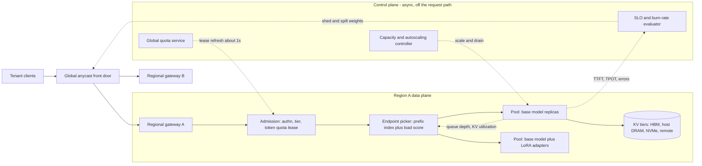

# System Design: Multi-Tenant LLM Inference Platform

## TL;DR

A multi-tenant LLM platform is a scheduler for scarce accelerator memory, so it should meter tenants in weighted tokens and KV-cache occupancy, never in requests per second.
Admission control has to happen at the gateway, before any prefill FLOP is spent: reserve input tokens plus an estimated output length, reconcile against the real output, and reject early with a `Retry-After`.
The request router decides both cost and latency, because prefix-cache affinity saves prefill compute but also concentrates load, so affinity must always be capped by per-replica load limits.
Inside the engine, continuous batching, paged KV memory, and chunked prefill set the TTFT versus TPOT trade-off, and fairness needs a work-based counter such as VTC rather than FCFS.
Use the tier mix to enforce SLAs and keep capacity statically stable: size failover headroom for the tiers you promised, and shed Flex and batch traffic first during a regional loss.

## Mental Model



Picture a request as an object passing through four gates, each running on a shorter clock than the one before.
The front door picks a region on a timescale of seconds, using latency, residency rules, and capacity headroom.
The admission gate decides in microseconds whether the tenant can afford the tokens it is about to consume.
The endpoint picker decides in milliseconds which replica's KV cache and queue the request should join.
The engine scheduler decides every iteration (tens of milliseconds) which sequences advance by one token and which prefill chunks run.
The control plane only adjusts weights and leases out of band, so a control plane outage freezes the current configuration and does not stop traffic, which is the static-stability property covered in [[17-Cloud-AI-Engineering/Volume_01_Cloud_Architecture_Principles/Chapter_04_Control_Plane_vs_Data_Plane_Separation|Control Plane vs Data Plane Separation]].

## Internals

### Requirements that shape everything

Tenants differ on four axes: model (base plus optional LoRA adapter), tier (Reserved, Priority, Standard, Flex or batch), residency (which geographies may process the data), and traffic shape (prompt length, output length, burstiness, shared-prefix ratio).
The SLIs that matter are time to first token (TTFT), time per output token (TPOT, or inter-token latency), and admitted-request success rate.
Requests per second is not an SLI.
One 100k-token prompt can cost as much prefill compute as several hundred 300-token chat turns, and it holds HBM for its whole lifetime.
The resource actually being sold is KV-cache residency multiplied by time, plus prefill FLOPs, so every quota, fairness counter, and cost model in this chapter uses token units.
The prefill/decode asymmetry behind this is derived in [[17-Cloud-AI-Engineering/Volume_11_LLM_Serving_and_Inference_Systems_on_Cloud/Chapter_01_LLM_Inference_Mechanics_Prefill_vs_Decode|LLM Inference Mechanics: Prefill vs Decode Phases]].

### Data plane versus control plane

The data plane is the front door, the regional gateway, the endpoint picker, and the model servers.
It has to keep working with whatever quota leases, routing weights, and replica sets it last received.
The control plane is the quota service, the capacity controller, the model and adapter registry, and the SLO evaluator.
It writes configuration and leases asynchronously.
The OpenAI incident in Failure Modes shows the classic violation: data plane service discovery depended on a Kubernetes API server that the control plane had overloaded.

### Layer 1: Global front door and region selection

On Google Cloud, the global external Application Load Balancer terminates TLS at Google Front Ends on an anycast VIP (see [[17-Cloud-AI-Engineering/Volume_03_GCP_Deep_Dive/Chapter_05_Cloud_Load_Balancing_GFEs_and_Maglev|Cloud Load Balancing: GFEs and Maglev]]).
On AWS, the equivalent is Global Accelerator anycast in front of regional NLBs or ALBs, or Route 53 latency records (see [[17-Cloud-AI-Engineering/Volume_00_Foundations_Under_the_Cloud/Chapter_03_DNS_Anycast_and_Global_Traffic_Management|DNS, Anycast, and Global Traffic Management]]).
The LLM-specific twist is that the nearest region is often the wrong choice.
TTFT is dominated by queueing and prefill, not by a 60 ms RTT, so region weights should come from published headroom: free KV tokens, waiting-queue depth, and per-tier burn rate.
Google documents a multi-cluster GKE Inference Gateway that load-balances inference across GKE clusters that can span regions, built on Gateway API, Multi Cluster Ingress, InferencePool, and InferenceObjective ([GKE docs](https://docs.cloud.google.com/kubernetes-engine/docs/how-to/setup-multicluster-inference-gateway), as of 2026-10).
On the managed side, Amazon Bedrock cross-region inference (CRIS) exposes geographic and global inference profiles, and model cards price Global and US CRIS separately ([AWS Bedrock model card](https://docs.aws.amazon.com/bedrock/latest/userguide/model-card-moonshot-ai-kimi-k3.html), as of 2026-10).
Residency is a hard filter applied before any scoring: an EU-only tenant's request is never eligible for a US pool, however much headroom the US has.

### Layer 2: Admission control in token units

This is the mechanism most getting-started guides leave out, and the one interviewers probe hardest.

**Reservation and reconciliation.**
At admission the gateway knows `input_tokens` exactly (after tokenization or a cheap estimate) but does not know the output length.
It debits `input_tokens + reserve_out` from the tenant's token bucket.
Here `reserve_out = min(max_tokens, q95_out[tenant, model])`, where `q95_out` is a rolling 95th-percentile output length per tenant.
When the request finishes, the gateway credits back `reserve_out - actual_out`, or debits the shortfall, and the balance is allowed to go negative down to a bounded debt floor.
Reserving the full `max_tokens` is safe but throttles honest tenants who set `max_tokens=8192` and use 200.
Reserving only the mean lets a burst of long generations overshoot the quota by the length variance.
Reserving the per-tenant quantile with bounded debt keeps the overshoot near `q99-q95` per in-flight request while staying close to work-conserving.

**Output tokens cost more than input tokens.**
A decode token holds a batch slot for a full iteration and re-reads the whole KV cache.
An input token is processed in a dense GEMM that is up to thousands of times more arithmetic-efficient.
Charge output tokens at a weight `w_out > w_in`; the VTC paper uses 2 to 1, and the simulator below does the same.

**Distributed quota without a hot global counter.**
A single global counter adds cross-region RTT to every request and becomes a single point of failure.
Instead, each regional gateway holds a lease of `L` tokens per refresh interval from a global quota service (backed by DynamoDB global tables or Spanner).
It spends the lease from a local in-memory token bucket and renews about every second, sending the usage it actually consumed.
The worst-case overshoot during a partition is `R x L` for `R` regions, which is the explicit error budget you trade for keeping the quota service off the request path.
If the quota service is unreachable, gateways keep serving on their last lease and decay it toward a conservative floor rather than failing open to infinity or failing closed to zero.
This is the constant-work pattern from [[17-Cloud-AI-Engineering/Volume_01_Cloud_Architecture_Principles/Chapter_05_Constant_Work_and_Workload_Smoothing|Constant Work and Workload Smoothing]].

**Shed early, by criticality.**
The Google SRE book's overload chapter recommends tagging every request with a criticality class and rejecting the lowest class first, as close to the client as possible ([Google SRE book, Handling Overload](https://sre.google/sre-book/handling-overload/)).
For LLMs, rejecting after prefill wastes the most expensive part of the request.
The gateway therefore estimates `expected_wait = queued_prefill_tokens / pool_prefill_rate` and returns 429 or 503 with `Retry-After` if the wait already exceeds the tier's TTFT deadline.
The AWS Builders' Library makes the same argument: overloaded services should spend as little work as possible on requests they will reject ([Using load shedding to avoid overload](https://aws.amazon.com/builders-library/using-load-shedding-to-avoid-overload/)).

### Layer 3: The endpoint picker - prefix affinity versus load

**How prefix caches are keyed.**
Engines such as vLLM split a sequence into fixed-size KV blocks and identify each full block by a chained hash, `h_i = H(h_{i-1}, tokens_in_block_i, extra_keys)`.
`extra_keys` covers the LoRA adapter ID and any cache salt.
Two requests share a cached prefix exactly when they share a leading run of block hashes.
SGLang's RadixAttention keeps the same information as a radix tree over token sequences with LRU eviction of leaves ([Zheng et al., SGLang, NeurIPS 2024](https://arxiv.org/abs/2312.07104)).
Mechanics are in [[17-Cloud-AI-Engineering/Volume_11_LLM_Serving_and_Inference_Systems_on_Cloud/Chapter_03_KV_Cache_Management_and_PagedAttention|KV-Cache Management and PagedAttention]].

**How the router predicts hits.**
The picker keeps an approximate index from block hash to the set of replicas that probably hold that block.
It fills the index either from its own routing decisions (cheap, but stale after evictions) or from KV-event streams the engines publish (accurate, but costs more control traffic).
For each candidate replica `r`, it computes something like:

```text
score(r) = a * matched_prefix_tokens(r) / prompt_tokens
         - b * waiting_queue_tokens(r) / pool_mean
         - c * kv_utilization(r)
         - d * (adapter_loaded(r) ? 0 : 1)
eligible(r) = load(r) <= (1 + eps) * mean_load      # bounded-load cap
```

The bounded-load cap comes from consistent hashing with bounded loads ([Mirrokni, Thorup, Zadimoghaddam, SODA 2018](https://arxiv.org/abs/1608.01350)).
Without the cap, one viral system prompt pins every request to the replica that cached it first.
That replica's queue grows until the TTFT saved by the cache hit is smaller than the TTFT lost to queueing.
With the cap, overflow spills to the next-best replica, which then caches the hot prefix too, so hot prefixes replicate themselves in proportion to their load.
GKE Inference Gateway is GA and ships prefix-aware routing and disaggregated serving ([Google Cloud](https://cloud.google.com/discover/inference-optimization), as of 2026-10).
Its InferenceObjective resource carries an integer priority where a higher value means a more critical request ([GKE docs](https://docs.cloud.google.com/kubernetes-engine/docs/how-to/serve-with-gke-inference-gateway), as of 2026-10).

**LoRA multiplexing.**
S-LoRA showed that thousands of adapters can share one base model by paging adapter weights in and out of unified GPU memory ([Sheng et al., MLSys 2024](https://arxiv.org/abs/2311.03285)).
For the router, a request for an adapter that is not resident pays an adapter load.
Adapter affinity therefore gets a term in the score, with the same bounded-load cap.

### Layer 4: The engine - continuous batching, chunked prefill, preemption

Orca introduced iteration-level scheduling: the batch is re-formed every forward pass, so a finished sequence frees its slot right away instead of waiting for the longest sequence in a static batch ([Yu et al., OSDI 2022](https://www.usenix.org/conference/osdi22/presentation/yu)).
PagedAttention stores KV in fixed-size blocks mapped through a per-sequence block table, like OS virtual memory.
That removes most of the fragmentation that wasted the majority of KV memory in earlier systems and enables copy-on-write prefix sharing ([Kwon et al., SOSP 2023](https://arxiv.org/abs/2309.06180)).
Sarathi-Serve splits long prefills into chunks and co-schedules them with ongoing decodes under a per-iteration token budget, so a 100k-token prompt cannot stall every streaming user ([Agrawal et al., OSDI 2024](https://www.usenix.org/conference/osdi24/presentation/agrawal)).

**The chunk-size knob, quantified.**
Take a 70.6B-parameter dense model on 8 x H100 with tensor parallelism of 8.
Prefill costs about `2 x 70.6e9 = 141 GFLOP` per token before attention.
At 40% MFU of 8 x 989 dense BF16 TFLOPS, that is about 3.2 PFLOPS sustained.
A 2048-token chunk therefore adds about 91 ms to the iteration that carries it, and a 512-token chunk adds about 23 ms.
Every decoding user in that batch sees the added time as TPOT jitter.
So the chunk budget per tier is literally the exchange rate between new users' TTFT and existing users' TPOT.
Batch pools should use large chunks, and interactive pools should use small chunks.
Details are in [[17-Cloud-AI-Engineering/Volume_11_LLM_Serving_and_Inference_Systems_on_Cloud/Chapter_04_Continuous_Batching_and_Scheduling_Algorithms|Continuous Batching and Scheduling Algorithms]].

**Fairness inside the engine: the Virtual Token Counter.**
FCFS is not fair: a tenant that submits 10x the requests gets about 10x the service and pushes everyone else's queueing delay up.
Static per-tenant partitions are fair but not work-conserving, so idle reserved capacity is wasted.
VTC keeps a counter per tenant, incremented by `w_in x prefill_tokens + w_out x decode_tokens` as service is delivered.
It always admits the next request from the backlogged tenant with the smallest counter.
When a tenant goes from idle to backlogged, VTC lifts its counter to the minimum among active tenants, so idle time cannot be banked into a later burst.
VTC is proven to keep the service difference between backlogged tenants within a bound tied to the batch token capacity ([Sheng et al., Fairness in Serving LLMs, OSDI 2024](https://www.usenix.org/conference/osdi24/presentation/sheng)).
Run strict priority across tiers and VTC within a tier, and the result is the scheduler in the worked example.

**Preemption when KV runs out.**
When decode growth exhausts free KV blocks, the engine has to evict a running sequence.
Recompute discards the victim's KV and re-runs its prefill later.
For an 8k-token context on the 70B model, that costs about 8192 / 22,400 tok/s = 0.37 s of whole-node prefill time.
Swapping moves `8192 x 320 KiB = 2.7 GB` over PCIe, about 2.7 GB / 8 GPUs / ~50 GB/s effective, or roughly 7 ms, but it needs pinned host memory and makes the engine more complex.
The policy decision is who gets evicted.
Pick the lowest tier first and, within a tier, the request with the most remaining work, never the request closest to completion.
Preemption that keeps repeating is a capacity alarm, not a scheduling strategy.
vLLM exposes a `priority` scheduling policy, and Llumnix goes further by live-migrating requests (including KV) across instances to defragment and isolate priorities ([Sun et al., OSDI 2024](https://www.usenix.org/conference/osdi24/presentation/sun-biao)).

### Layer 5: KV-cache sharing beyond one replica

Prefill/decode disaggregation runs the two phases on separate pools and ships the KV cache between them.
That removes prefill/decode interference and lets each phase use its own parallelism.
DistServe frames the objective as goodput: requests per second that meet both TTFT and TPOT SLOs ([Zhong et al., OSDI 2024](https://www.usenix.org/conference/osdi24/presentation/zhong-yinmin)).
Splitwise reached a similar split from a power and cost angle ([Patel et al., ISCA 2024](https://arxiv.org/abs/2311.18677)).
Mooncake treats the KV cache as the central resource, pooling DRAM and SSD across the cluster as a distributed KV store and scheduling around cache locality ([Qin et al., FAST 2025](https://www.usenix.org/conference/fast25/presentation/qin)).
The cost of disaggregation is KV bytes on the wire.
A 4k-token prompt on the 70B model is `4096 x 320 KiB = 1.34 GB` that must reach the decode pool before the first decode step.
That is fine over EFA or RDMA at hundreds of Gbps per GPU, and it is a TTFT disaster over a congested TCP path.
See [[17-Cloud-AI-Engineering/Volume_11_LLM_Serving_and_Inference_Systems_on_Cloud/Chapter_07_Prefill_and_Decode_Disaggregation|Prefill and Decode Disaggregation]] and [[17-Cloud-AI-Engineering/Volume_10_AI_Infrastructure_on_Cloud/Chapter_02_Interconnect_Technologies_NVLink_EFA_and_TPU_ICI|Interconnect Technologies: NVLink, EFA, and TPU ICI]].

**Cross-tenant cache isolation.**
A shared prefix cache is a timing side channel.
If tenant B's request returns a faster TTFT because tenant A recently sent the same prefix, B can probe for A's prompts.
Mix a per-tenant (or per-org) salt into the root block hash so identical prefixes from different tenants never collide.
You lose cross-tenant sharing of public system prompts.
In exchange you remove a class of leakage that has been demonstrated against production APIs ([Gu et al., Auditing Prompt Caching in Language Model APIs](https://arxiv.org/abs/2502.07776)).

### Failure domains and cells

The failure domains, from smallest to largest, are GPU (Xid errors, ECC, hangs), node (8 GPUs bound by NVLink, one TP group), replica group, pool (model x region), zone, and region.
Make a cell a `(region, model, pool)` triple with its own gateway shard, endpoint picker, and autoscaler.
Shuffle-shard tenants onto subsets of replicas, so one tenant's poison-pill prompt (for example one that triggers a kernel crash at a specific sequence length) only takes out its own shard ([Workload isolation using shuffle-sharding](https://aws.amazon.com/builders-library/workload-isolation-using-shuffle-sharding/); [[17-Cloud-AI-Engineering/Volume_01_Cloud_Architecture_Principles/Chapter_03_Cell_Based_Architecture_and_Shuffle_Sharding|Cell-Based Architecture and Shuffle Sharding]]).
GPU nodes take minutes to replace (provisioning, driver init, loading 141 GB of weights), so replica-level failure has to be absorbed by N+k headroom, not by autoscaling.

### SLA enforcement loops

Enforcement runs on four nested clocks.
Per iteration (~20-100 ms): engine priority, chunk budget, preemption victim choice.
Per request (~1 ms): gateway admission, deadline-based early rejection, region and replica choice.
Per minute: multi-window burn-rate alerts per tier, shed weights pushed to the front door, autoscaling on queue depth and KV utilization ([[17-Cloud-AI-Engineering/Volume_07_Reliability_and_SRE/Chapter_01_SLIs_SLOs_and_Error_Budget_Engineering|SLIs, SLOs, and Error Budget Engineering]]).
Per week: reserved-capacity purchases and tier repricing, driven by observed goodput per accelerator-hour.
The SLA should measure admitted-request success and TTFT/TPOT percentiles for requests within a declared envelope (prompt length, `max_tokens`, request rate).
Without that envelope, one tenant's 1M-token prompts would breach your SLA for you.

## Numbers to Know

| Quantity | Value | Source |
|---|---|---|
| Bedrock service tiers | Reserved, Priority, Standard, Flex; selected with `service_tier` values `reserved`, `priority`, `default`, `flex` | ([AWS Bedrock docs](https://docs.aws.amazon.com/bedrock/latest/userguide/service-tiers-inference.html), as of 2026-10) |
| Bedrock Priority price | 1.75x Standard per-token rate | ([AWS Bedrock pricing](https://aws.amazon.com/bedrock/pricing/), as of 2026-10) |
| Bedrock Flex and Batch price | 0.5x Standard per-token rate | ([AWS Bedrock pricing](https://aws.amazon.com/bedrock/pricing/), as of 2026-10) |
| Bedrock Reserved tier | Targets 99.5% uptime for model response; 1- or 3-month term; separate input and output TPM; overflows to Standard | ([AWS Bedrock docs](https://docs.aws.amazon.com/bedrock/latest/userguide/service-tiers-inference.html), as of 2026-10) |
| Bedrock Reserved minimum | 100,000 input TPM and 10,000 output TPM | (Caylent analysis, third-party, as of 2026-08; UNVERIFIED against AWS docs) |
| KV cache per token, Llama-3.1-70B-class (80 layers, 8 KV heads, head dim 128, BF16) | 2 x 80 x 8 x 128 x 2 B = 320 KiB | (derived from the published model config; arithmetic) |
| Dense 70.6B weights | 141 GB BF16, 71 GB FP8 | (arithmetic) |
| H100 SXM HBM3 per GPU | 80 GB, 3.35 TB/s | (NVIDIA H100 datasheet; UNVERIFIED this pass) |
| H100 SXM dense BF16 | ~989 TFLOPS | (NVIDIA H100 datasheet; UNVERIFIED this pass) |
| KV capacity, 8 x H100, 90% memory utilization, 40 GB activation reserve, BF16 weights | ~395 GB, ~1.2M tokens, ~294 sequences at 4k context | (derived, this chapter) |
| Decode iteration, batch 128, mean context 2.5k, 50% bandwidth efficiency | ~18 ms per step, ~7,000 output tok/s per node | (derived roofline, this chapter) |
| Prefill throughput, same node, 40% MFU | ~22,000 tok/s | (derived, this chapter) |
| Prefill chunk cost on that node | 512 tokens ~23 ms, 2048 tokens ~91 ms added to the iteration | (derived, this chapter) |
| vLLM PagedAttention throughput gain | 2-4x vs FasterTransformer and Orca at the same latency | ([Kwon et al., SOSP 2023](https://arxiv.org/abs/2309.06180)) |
| DistServe gain | Up to 7.4x more requests or 12.6x tighter SLO vs colocated baselines | ([Zhong et al., OSDI 2024](https://www.usenix.org/conference/osdi24/presentation/zhong-yinmin)) |
| p5.48xlarge | 8 x H100 80 GB, 3,200 Gbps EFA | (AWS EC2 docs; UNVERIFIED this pass) |
| p5.48xlarge on-demand price | Assumed USD 55/hr in the cost model | (UNVERIFIED; check the EC2 pricing page) |

## AWS vs GCP Mechanism Parity

| Concern | AWS | Google Cloud | Critical difference |
|---|---|---|---|
| Global front door | Global Accelerator anycast to regional NLB/ALB; Route 53 latency and weighted records | Global external Application LB on GFE anycast VIP | GCP terminates L7 at the global edge in one resource, while AWS puts L7 in each region behind L4 anycast; see [[17-Cloud-AI-Engineering/Volume_04_AWS_vs_GCP_Translation/Chapter_02_Networking_and_Load_Balancing_Translation\|Networking Translation]] |
| Inference-aware L7 routing (self-hosted) | Gateway API Inference Extension on EKS via a conformant gateway (UNVERIFIED for specific AWS-managed support); SageMaker endpoints offer least-outstanding-requests routing (UNVERIFIED this pass) | GKE Inference Gateway GA: InferencePool, InferenceObjective priority, prefix-aware routing, disaggregated serving | GCP has a first-party managed endpoint picker, while on AWS you run and operate the picker yourself |
| Multi-region self-hosted routing | Global Accelerator endpoint weights driven by your own headroom signals | Multi-cluster GKE Inference Gateway across regions | On AWS the headroom-to-weight feedback loop is your code |
| Managed priority tiers | Bedrock Reserved, Priority (1.75x), Standard, Flex (0.5x) | Vertex AI Provisioned Throughput plus pay-as-you-go and batch (UNVERIFIED this pass for current tier names and multipliers) | Bedrock Reserved overflows to Standard automatically, so you must decide whether overflow is acceptable for your SLA |
| Managed cross-region routing | Bedrock CRIS geographic and global inference profiles | Vertex AI global endpoint for Gemini (UNVERIFIED this pass) | A geographic profile keeps processing inside a geography, while a global profile may not, which is a residency decision rather than a performance one |
| RDMA for KV transfer | EFA with SRD multipath transport | GPUDirect-TCPX/TCPXO on A3 and A3 Mega, RDMA on A3 Ultra (UNVERIFIED this pass) | SRD tolerates out-of-order delivery by design, while RoCE fabrics depend on lossless or congestion-controlled configuration |
| Private access to managed endpoints | PrivateLink interface endpoints for `bedrock-runtime`; SCP and endpoint policies | Private Service Connect plus VPC Service Controls perimeter around `aiplatform.googleapis.com` | VPC SC is an API-level perimeter, while AWS composes several policy layers; see [[17-Cloud-AI-Engineering/Volume_08_Security_Identity_and_the_Data_Perimeter/Chapter_06_Constructing_an_Impenetrable_Data_Perimeter\|Data Perimeter]] |
| Quota model (managed) | Per-account, per-region, per-model TPM and RPM in Service Quotas; Standard, Priority, and Flex share on-demand quota while Reserved has its own pool (third-party source) | Provisioned Throughput in GSUs plus shared pay-as-you-go capacity (UNVERIFIED this pass) | You must still enforce per-tenant quotas inside your gateway on both clouds, because the provider sees only your account |

## Worked Example: Token-Fair Priority Scheduler and Capacity Model

### Part A - runnable simulator (no cloud cost)

The script models one replica with continuous batching, a KV reservation budget, stall-free chunked prefill, and two policies: FCFS, and strict tier priority with VTC inside a tier.
It runs in under one second on Python 3.9+ with no dependencies.

```python
#!/usr/bin/env python3
"""Iteration-level LLM engine simulator: FCFS vs priority + Virtual Token Counter (VTC).
Usage: python3 vtc_sim.py [fcfs|vtc] [seed]"""
import random
import sys
from collections import deque

STEP_MS = 25           # assumed wall time of one engine iteration
STEP_TOKENS = 2048     # chunked-prefill token budget per iteration (prefill + decode)
MAX_RUNNING = 96       # max concurrent sequences in the batch
KV_TOKENS = 400_000    # KV-cache capacity in tokens
W_IN, W_OUT = 1.0, 2.0 # VTC weights for input and output tokens
SIM_STEPS = 24_000     # 600 s of simulated time

# name: (tier, arrivals per step, prompt tokens, output tokens); tier 0 = highest
TENANTS = {
    "heavy-batch": (1, 0.400, 3000, 300),
    "chat-a":      (1, 0.020, 800, 150),
    "chat-b":      (1, 0.020, 800, 150),
    "premium":     (0, 0.015, 1200, 200),
}


class Req:
    __slots__ = ("tenant", "tier", "arrive", "prompt", "out", "prefilled",
                 "decoded", "first_tok")

    def __init__(self, tenant, tier, arrive, prompt, out):
        self.tenant, self.tier, self.arrive = tenant, tier, arrive
        self.prompt, self.out = prompt, out
        self.prefilled = self.decoded = 0
        self.first_tok = None


def pick_fcfs(queues, counters):
    best = None
    for t, q in queues.items():
        if q and (best is None or q[0].arrive < queues[best][0].arrive):
            best = t
    return best


def pick_vtc(queues, counters):
    active = [t for t, q in queues.items() if q]
    if not active:
        return None
    top = min(TENANTS[t][0] for t in active)          # strict priority across tiers
    cands = [t for t in active if TENANTS[t][0] == top]
    return min(cands, key=lambda t: counters[t])       # VTC within a tier


def run(policy, seed):
    rng = random.Random(seed)
    pick = pick_vtc if policy == "vtc" else pick_fcfs
    queues = {t: deque() for t in TENANTS}
    counters = {t: 0.0 for t in TENANTS}
    running, done = [], []
    for step in range(SIM_STEPS):
        for t, (tier, lam, p, o) in TENANTS.items():
            if rng.random() < lam:
                if not queues[t] and policy == "vtc":
                    busy = [counters[u] for u in TENANTS if queues[u] or
                            any(r.tenant == u for r in running)]
                    if busy:  # counter lift: no banking of idle credit
                        counters[t] = max(counters[t], min(busy))
                queues[t].append(Req(t, tier, step,
                                     int(p * rng.uniform(0.5, 1.5)),
                                     int(o * rng.uniform(0.5, 1.5))))
        reserved = sum(r.prompt + r.out for r in running)
        while len(running) < MAX_RUNNING:
            t = pick(queues, counters)
            if t is None:
                break
            r = queues[t][0]
            if reserved + r.prompt + r.out > KV_TOKENS:
                break  # head-of-line wait for KV space
            queues[t].popleft()
            running.append(r)
            reserved += r.prompt + r.out
        budget = STEP_TOKENS
        for r in running:                 # decodes first (stall-free batching)
            if r.prefilled == r.prompt and budget > 0:
                r.decoded += 1
                budget -= 1
                counters[r.tenant] += W_OUT
        for r in running:                 # then chunked prefill with leftover budget
            if r.prefilled < r.prompt and budget > 0:
                chunk = min(budget, r.prompt - r.prefilled)
                r.prefilled += chunk
                budget -= chunk
                counters[r.tenant] += W_IN * chunk
                if r.prefilled == r.prompt and r.first_tok is None:
                    r.first_tok = step + 1
        still = []
        for r in running:
            (done if r.decoded >= r.out else still).append(r)
        running = still
    return done, queues


def pct(xs, p):
    xs = sorted(xs)
    return xs[min(len(xs) - 1, int(p * len(xs)))] if xs else float("nan")


def main():
    policy = sys.argv[1] if len(sys.argv) > 1 else "vtc"
    seed = int(sys.argv[2]) if len(sys.argv) > 2 else 7
    done, queues = run(policy, seed)
    print(f"policy={policy} seed={seed} completed={len(done)}")
    print(f"{'tenant':<12} {'n':>5} {'ttft_p50_ms':>12} {'ttft_p99_ms':>12} "
          f"{'out_tok/s':>10} {'backlog':>8}")
    for t in TENANTS:
        mine = [r for r in done if r.tenant == t]
        ttft = [(r.first_tok - r.arrive) * STEP_MS for r in mine]
        tps = sum(r.decoded for r in mine) / (SIM_STEPS * STEP_MS / 1000)
        print(f"{t:<12} {len(mine):>5} {pct(ttft, .5):>12.0f} {pct(ttft, .99):>12.0f} "
              f"{tps:>10.1f} {len(queues[t]):>8}")


if __name__ == "__main__":
    main()
```

Observed output (`python3 vtc_sim.py fcfs 7` then `python3 vtc_sim.py vtc 7`):

```text
policy=fcfs seed=7 completed=7996
tenant           n  ttft_p50_ms  ttft_p99_ms  out_tok/s  backlog
heavy-batch   7041        76050       154575     3509.2     2590
chat-a         315        79800       154925       78.0      135
chat-b         363        75875       154900       88.5      144
premium        277        78475       153800       90.7      106
policy=vtc seed=7 completed=8166
tenant           n  ttft_p50_ms  ttft_p99_ms  out_tok/s  backlog
heavy-batch   6825        80575       167025     3402.6     2805
chat-a         452           75          425      112.8        0
chat-b         503           75          450      122.3        0
premium        386           75          425      127.9        0
```

How to read it:
Under FCFS, a single overloading tenant gives every tenant a p50 TTFT of about 76-80 s, because the queue is shared and ordered by arrival.
Under priority plus VTC, the light tenants and the premium tier see a 75 ms p50 and about 0.43 s p99, and the overloading tenant absorbs all of the queueing it caused.
Total completions rise slightly (8,166 vs 7,996) because short requests stop waiting behind long ones.
The heavy tenant's backlog still grows without bound, which is exactly why the gateway's token-bucket admission (Layer 2) must sit in front of the engine.
Fair scheduling decides who waits, and only admission control decides how much waiting is allowed to exist.
The model's simplifications are a fixed 25 ms step regardless of batch composition, one replica, and no preemption; extend `STEP_MS` to follow the chunk-cost formula from Internals to see the TPOT penalty of large chunks.

### Part B - optional: tier priorities on GKE Inference Gateway

This part assumes the cluster from Google's [Serve an LLM with GKE Inference Gateway](https://docs.cloud.google.com/kubernetes-engine/docs/how-to/serve-with-gke-inference-gateway) tutorial is already running.
Check the installed CRD schema before you apply anything, because the extension's API versions have changed across releases:

```bash
kubectl explain inferenceobjective.spec
kubectl get crd | grep -i inference
```

```yaml
# Field names follow the GKE tutorial; confirm apiVersion with `kubectl get crd`.
apiVersion: inference.networking.x-k8s.io/v1alpha2
kind: InferenceObjective
metadata:
  name: premium-chat
spec:
  priority: 100          # higher value = more critical
  poolRef:
    name: vllm-pool      # replace with your InferencePool name
---
apiVersion: inference.networking.x-k8s.io/v1alpha2
kind: InferenceObjective
metadata:
  name: batch-backfill
spec:
  priority: 1
  poolRef:
    name: vllm-pool
```

Cost estimate: the tutorial's GPU node pool dominates cost, roughly USD 10-15 per hour for a single H100 node on demand (UNVERIFIED; check the Compute Engine GPU pricing page for your region), so a 2-hour session costs about USD 20-30.

Budget alarm on GCP, created before the cluster:

```bash
gcloud billing budgets create \
  --billing-account=XXXXXX-XXXXXX-XXXXXX \
  --display-name="llm-gateway-lab" \
  --budget-amount=50USD \
  --filter-projects=projects/PROJECT_ID \
  --threshold-rule=percent=0.5 \
  --threshold-rule=percent=0.9
```

Equivalent budget alarm on AWS, if you mirror the lab on EKS:

```bash
aws budgets create-budget --account-id 111122223333 \
  --budget '{"BudgetName":"llm-gateway-lab","BudgetLimit":{"Amount":"50","Unit":"USD"},"TimeUnit":"MONTHLY","BudgetType":"COST"}' \
  --notifications-with-subscribers '[{"Notification":{"NotificationType":"ACTUAL","ComparisonOperator":"GREATER_THAN","Threshold":80,"ThresholdType":"PERCENTAGE"},"Subscribers":[{"SubscriptionType":"EMAIL","Address":"you@example.com"}]}]'
```

Teardown, which removes all billable resources from the lab:

```bash
kubectl delete inferenceobjective premium-chat batch-backfill
gcloud container clusters delete CLUSTER_NAME --location=CLUSTER_LOCATION --quiet
gcloud compute addresses list --filter="name~inference" --format="value(name,region)"   # release any leftover static IPs
```

### Part C - back-of-the-envelope capacity and cost

Workload: 100 RPS global peak, mean 2,000 input and 400 output tokens, 50% prefix-cache hit rate on input tokens, dense 70.6B model in BF16 on 8 x H100 nodes.

Step 1, prefill demand: `100 x 2000 x (1 - 0.5) = 100,000 tok/s`, divided by about 22,400 tok/s per node, gives 4.5 node-equivalents.
Step 2, decode demand: `100 x 400 = 40,000 tok/s`, divided by about 6,970 tok/s per node at batch 128, gives 5.7 node-equivalents.
Step 3, steady state: 10.2 node-equivalents of time-shared work; at a 70% utilization target for queueing headroom, that is 14.6 nodes.
Step 4, region-loss tolerance done naively: 3 regions, each able to carry half of global peak, means `3 x ceil(14.6 / 2) = 24` nodes.
Step 5, tier-aware static stability: if only the 60% Priority and Standard share must survive a region loss and Flex or batch is shed, each region needs `max(14.6 / 3, 14.6 x 0.6 / 2) = 4.9`, giving 3 x 5 = 15 nodes.
That tier policy saves 9 nodes, about USD 361k per month at the assumed USD 55 per node-hour (UNVERIFIED price).
Step 6, unit cost: 15 nodes x USD 55 = USD 825 per hour, serving 144M output tokens and 360M input tokens per hour (720M before cache hits).
That works out to about USD 5.7 per million output tokens if all cost is assigned to output, or about USD 1.6 per million tokens blended over 504M uncached tokens per hour.
Step 7, sensitivity: the prefix hit rate is the biggest lever; dropping it from 50% to 0% adds 4.5 node-equivalents, about 6.4 nodes at a 70% target.
FP8 weights cut the decode step from about 18 ms to about 13 ms in the same roofline, worth about 25% of decode capacity, which needs an accuracy check per [[17-Cloud-AI-Engineering/Volume_11_LLM_Serving_and_Inference_Systems_on_Cloud/Chapter_06_Model_Quantization_and_Compression|Model Quantization and Compression]].

## Failure Modes and Pitfalls

### Sticky routing amplifies a misroute (Anthropic, August-September 2025)

Anthropic's postmortem describes three overlapping infrastructure bugs that degraded Claude output quality ([A postmortem of three recent issues](https://www.anthropic.com/engineering/a-postmortem-of-three-recent-issues)).
In one of them, some short-context requests were routed to servers configured for a much longer context window.
A load-balancing change raised the affected share, and sticky routing meant an affected user kept landing on the bad servers.
The general lesson for prefix-affinity and session-affinity routers is that affinity turns a small per-request error rate into a large per-user error rate.
Affinity keys therefore need TTLs, error-triggered re-hashing, and per-pool canaries that score output quality, not only HTTP status codes.
The same postmortem covers a TPU misconfiguration and a compiler issue that corrupted token selection, which availability SLOs can never detect.
Quality SLIs from continuous evals are mandatory ([[13-Agentic-AI/Agentic_AI_Zero_to_Godhood/Volume_10_Evaluation_and_Observability/Chapter_07_Production_Evaluation|Production Evaluation]]).

### Control plane overload takes down the data plane (OpenAI, December 2024)

OpenAI's December 11, 2024 incident report ([OpenAI status](https://status.openai.com/)) attributes a multi-hour outage to a newly deployed telemetry service.
Its Kubernetes API calls overloaded cluster control planes, and DNS-based service discovery failed once cached records expired.
For an inference platform, the endpoint picker's replica set and the gateway's quota leases must survive API server loss.
Serve from the last-known-good state, and never let a fleet-wide agent issue load-proportional calls to a shared control plane ([[17-Cloud-AI-Engineering/Volume_07_Reliability_and_SRE/Chapter_07_Anatomy_of_Major_Cloud_Outages|Anatomy of Major Cloud Outages]]).

### Prefix hotspot collapse

Without a bounded-load cap, one popular system prompt drives one replica's queue up while its neighbors sit idle.
The symptom is a bimodal TTFT distribution with high average cache-hit rate and low average GPU utilization.
The fix is the `(1 + eps)` load cap plus spill-induced replication of hot prefixes.

### Retry storms that buy prefill twice

A client timeout at 30 s on a request already 25 s into prefill wastes all that compute if the engine does not see the disconnect, and the retry pays it again.
Propagate cancellation from the gateway to the engine (abort on stream close), honor `Retry-After`, and use full-jitter backoff with retry budgets ([[17-Cloud-AI-Engineering/Volume_07_Reliability_and_SRE/Chapter_03_Resilient_Communication_Retries_Jitter_and_Circuit_Breakers|Retries, Jitter, and Circuit Breakers]]).
Queues that grow faster than they drain become insurrmountable backlogs, so cap queue age per tier and drop the expired work ([Avoiding insurmountable queue backlogs](https://aws.amazon.com/builders-library/avoiding-insurmountable-queue-backlogs/)).

### Preemption thrash

When admitted KV demand exceeds capacity, recompute-based preemption can evict and re-prefill the same long sequences repeatedly.
Throughput looks high while goodput collapses.
Alert on preemptions per minute, and close the gap with admission-time KV reservation rather than optimistic admission.

### Autoscaling on the wrong signal

GPU "utilization" from the driver measures whether any kernel was active, not how many FLOPs or bytes were used, so a memory-bound decode batch reads as 100% at any batch size.
Scale on waiting-queue tokens and KV utilization, and remember that a new replica needs minutes to load weights ([[17-Cloud-AI-Engineering/Volume_11_LLM_Serving_and_Inference_Systems_on_Cloud/Chapter_08_Cloud_GPU_Autoscaling_and_Cold_Start_Mitigation|Cloud GPU Autoscaling and Cold-Start Mitigation]]).

### Quota drift across regions

With leased quotas, a partition lets each region keep spending its lease, so a tenant can briefly reach `R x` its contracted TPM.
Size `L` so that `R x L` stays within what the capacity plan can absorb, and decay leases while the quota service is unreachable.

### Upstream quota surprises on managed endpoints

If your platform fronts Bedrock or Vertex AI, all of your tenants share your account's per-model, per-region quota.
One tenant's batch job can therefore return 429s to your premium tenants unless your gateway enforces per-tenant quotas below the upstream limit.
Route batch traffic to Flex or Batch, which on Bedrock costs half the Standard rate ([AWS Bedrock pricing](https://aws.amazon.com/bedrock/pricing/), as of 2026-10).

### Cross-tenant cache timing leak

An unsalted shared prefix cache lets one tenant detect another tenant's prompts through TTFT differences, which is why per-tenant salt is mixed into the block hash.

## Security and Cost Angles

### IAM scoping

On AWS, scope `bedrock:InvokeModel` and `bedrock:InvokeModelWithResponseStream` to specific inference-profile and foundation-model ARNs.
With cross-region inference, the policy must also allow the model ARN in every destination region the profile can route to, and an SCP that denies those regions will break CRIS (AWS docs, UNVERIFIED this pass).
Use a separate role per gateway cell, so a compromised cell cannot invoke models outside its pool.
On GCP, grant `roles/aiplatform.user` only to the gateway's workload identity, never to tenant principals ([[17-Cloud-AI-Engineering/Volume_08_Security_Identity_and_the_Data_Perimeter/Chapter_02_Workload_Identity_Federation|Workload Identity Federation]]).
Tenants authenticate to your gateway, and the gateway alone holds cloud credentials, which is the confused-deputy boundary you must defend.

### Encryption and key hierarchy

Prompts and completions in logs, KV spill tiers (host DRAM, NVMe, remote KV stores), and fine-tuned adapters are all tenant data.
Encrypt KV spill files and adapter artifacts with per-tenant data keys wrapped by a KMS or Cloud KMS key, and use crypto-shredding (destroying the key so the data becomes unreadable) for tenant offboarding ([[17-Cloud-AI-Engineering/Volume_08_Security_Identity_and_the_Data_Perimeter/Chapter_04_Encryption_Key_Hierarchies_and_Envelope_Encryption|Envelope Encryption]]).
Treat prompt logging as opt-in per tenant, with redaction before persistence.

### Network boundaries

Reach Bedrock through a PrivateLink interface endpoint with an endpoint policy restricting principals and models.
Reach Vertex AI through Private Service Connect inside a VPC Service Controls perimeter, so exfiltration through a different project's endpoint is blocked ([[17-Cloud-AI-Engineering/Volume_03_GCP_Deep_Dive/Chapter_03_VPC_Service_Controls_Security_Perimeters|VPC Service Controls]]).
Prompt-injection and tool-exfiltration risks at the gateway are covered in [[17-Cloud-AI-Engineering/Volume_12_AI_Applications_MLOps_and_Data_Platforms/Chapter_08_Cloud_Security_for_AI_Systems_Attacks_and_Defenses|Cloud Security for AI Systems]].

### Unit-economics levers, ordered by typical impact

1. Prefix-cache hit rate: every hit token is prefill you do not pay for, and cache-aware routing is how you get hits at fleet scale.
2. Effective utilization: the gap between 40% and 70% average utilization is a 1.75x cost difference, and tier-aware shedding is what makes running hot safe.
3. Tier arbitrage: send latency-tolerant work to Flex or Batch, which cost 0.5x on Bedrock, and price your own Priority tier at the cost of the headroom it needs.
4. Precision: FP8 weights and KV roughly halve memory traffic per token, subject to evals.
5. Commitments: Bedrock Reserved (1 or 3 months) or self-hosted capacity reservations and Savings Plans or CUDs, sized to the base load, with peaks on on-demand ([[17-Cloud-AI-Engineering/Volume_09_FinOps_and_Cloud_Economics/Chapter_02_Commitment_Discounts_Savings_Plans_vs_CUDs|Commitment Discounts]]).
6. Spot or preemptible capacity, only for the batch tier, with checkpointable request queues ([[17-Cloud-AI-Engineering/Volume_09_FinOps_and_Cloud_Economics/Chapter_03_Spot_Economics_and_Interruption_Handling|Spot Economics]]).

## Interview Questions and Model Answers

### Question 1 (L5 - Senior)

Your platform rate-limits tenants at 600 requests per minute, yet one tenant within that limit keeps degrading everyone else, so what is wrong and what do you build?

#### Model Answer

Requests are the wrong unit, because cost per request varies by more than 1000x with prompt length and output length.
A 100k-token prompt costs hundreds of times the prefill of a chat turn and holds HBM for its whole lifetime.
I would meter in weighted tokens: `w_in x input + w_out x output`, with `w_out` around 2 or higher because decode tokens occupy batch slots and re-read the KV cache.
Since output length is unknown at admission, the gateway reserves `input + min(max_tokens, q95_out[tenant])` from a per-tenant token bucket and reconciles on completion.
The balance may go into bounded debt, so honest tenants with large `max_tokens` are not over-throttled.
I keep separate input and output TPM limits plus a concurrency cap, because KV residency is a third resource that neither TPM limit captures.
Rejection happens before prefill with a 429 and `Retry-After`, computed from the bucket refill time.
In a multi-region deployment, buckets are fed by leases from a global quota service, which bounds overshoot at `regions x lease` during partitions without putting a global counter on the hot path.

#### Follow-up Interviewer Question

A tenant sets `max_tokens=32768` on every call but usually generates 150 tokens, so how does your reservation behave during their first five minutes with no history, and what prior would you use?

### Question 2 (L5 - Senior)

p99 TTFT for chat users jumped from 0.8 s to 9 s while the GPU utilization dashboard shows 95% and unchanged throughput, so how do you diagnose it?

#### Model Answer

First, GPU utilization as reported by the driver only says that some kernel was running; it says nothing about queueing, so I would ignore it.
TTFT is queue wait plus prefill time plus network, so I would split it into those components using engine metrics: waiting-request count, prefill tokens queued, KV-cache utilization, and preemption count.
Pattern one: the waiting queue grows while KV utilization is near 100%, meaning admission is blocked on KV space, often because a tenant shifted to long contexts.
Fix pattern one with per-tenant concurrency or KV caps at the gateway, or more capacity.
Pattern two: the queue is short but TTFT is long, which suggests long prompts are being prefilled without chunking, or with a chunk budget so large that each iteration is slow.
Fix pattern two by enabling or tightening chunked prefill.
Pattern three: preemptions are spiking, so sequences are being recomputed and new requests wait behind recomputation.
Pattern four: a routing change cut the prefix hit rate, so every request now pays full prefill; I would compare hit rate before and after the latest deploy.
I would also check whether the problem is concentrated on a few replicas, which points to routing hotspots rather than global capacity.
Then I would correlate with the tenant mix, because constant throughput with rising tail latency is the signature of one tenant's traffic shape changing.

#### Follow-up Interviewer Question

You find it is pattern two, but shrinking the chunk budget raises TPOT for long-running streams, so how do you pick the chunk size per pool, and could you pick it adaptively?

### Question 3 (L6 - Staff)

Design request routing across 200 replicas of one model, where 70% of traffic shares a few dozen system prompts and the rest are unique RAG contexts.

#### Model Answer

The goal is to maximize goodput: requests meeting the TTFT and TPOT SLOs per GPU-hour.
Prefix hits are worth a lot, because each hit token removes about 141 GFLOP of prefill on a 70B model.
I would key prefixes the way the engine does, with chained hashes of fixed-size token blocks salted by tenant and adapter, so the router and the engine agree on what a hit is.
The picker keeps an approximate block-hash-to-replica index, fed by engine KV events when available and by its own routing history otherwise, with TTLs to absorb evictions.
For each request it scores replicas on matched prefix fraction minus normalized queued tokens minus KV utilization, but only among replicas under `(1 + eps)` of mean load.
That cap is consistent hashing with bounded loads applied to cache affinity.
Without the cap, the hottest system prompt melts its first replica; with it, overflow lands on the next-best replica, which then caches the prefix, so hot prefixes end up replicated in proportion to their demand.
The unique RAG traffic gets no affinity benefit, so for those requests the router should fall back to the least-loaded replica rather than paying index lookups for nothing.
For scale, I would shard pickers by model pool and keep them stateless apart from soft state, so a picker restart only costs a short-term drop in hit rate, never correctness.
Picker failure must fail open to plain least-loaded routing.
Finally, I would put a TTL on affinity and re-hash on error, because sticky routing turns a single bad replica into a cohort of persistently harmed users, as the 2025 Anthropic postmortem showed.

#### Follow-up Interviewer Question

How do you choose `eps`, and what metric would tell you it is too small (lost cache hits) or too large (hotspots) in production?

### Question 4 (L6 - Staff)

Two hundred enterprise tenants share a pool, and one tenant's nightly batch job ruins daytime-in-Asia chat latency for everyone else, so compare your options for isolation.

#### Model Answer

There are four options, each with a different trade-off between isolation, utilization, and operational cost.
Static partitioning gives each tenant dedicated replicas, which is perfect isolation but not work-conserving, so utilization collapses with 200 tenants and diurnal patterns.
Separate pools per tier remove the specific conflict, since batch runs on a large-chunk pool and chat on a small-chunk pool, at the cost of fragmenting capacity into two forecasts.
Fair queueing inside a shared pool with VTC is work-conserving.
It charges each tenant weighted tokens served, always admits from the least-served backlogged tenant, and lifts the counter of a newly active tenant to the current minimum so idle credit is not banked.
VTC bounds the service gap between backlogged tenants, and my simulator shows chat p99 TTFT dropping from about 155 s to about 0.45 s against a single flooding tenant.
Shuffle sharding assigns each tenant a random subset of replicas, which contains failures caused by poison-pill prompts, not just load.
I would combine them: tier separation for the batch versus interactive split, VTC within each tier, shuffle sharding for fault containment, and gateway token buckets to bound total admitted load.
Fair scheduling decides who waits; it does not stop the queue from growing, as the unbounded heavy-tenant backlog in the simulation shows.

#### Follow-up Interviewer Question

An enterprise tenant pays for 3x the share of a standard tenant, so how do you express that in VTC, and what happens to fairness when that tenant is idle for six hours and then bursts?

### Question 5 (L6 - Staff)

KV cache is full, a Priority-tier request arrives, and every running sequence is Standard tier, so walk through what the engine and gateway should do and what it costs.

#### Model Answer

The gateway should rarely let this happen: Priority admission should be gated on reserved KV headroom per tier, not on global free space.
When it does happen, the engine must free blocks by preempting a victim.
Victim choice is lowest tier first and, within the tier, the sequence with the most remaining expected work and the least sunk prefill.
Evicting a sequence one token from completion throws away the most work for the least space.
Recompute is cheap in memory but costs about 0.37 s of whole-node prefill for an 8k-token context on a 70B model.
That time is stolen from every co-scheduled request.
Swapping costs about 2.7 GB of PCIe traffic for the same context, around 7 ms across 8 GPUs, but needs pinned host memory and makes the engine more complex.
Either way, preemption must be visible: count preemptions per minute per tier, and if the Standard-tier SLO burns because of Priority preemptions, the Priority tier's reservation is undersized.
That is a capacity planning signal, not a scheduling one.
An alternative is to migrate the victim to another replica with spare KV, as in Llumnix, which turns a recompute into a network transfer.
Commercially, Priority tiers should be priced at the cost of the headroom they need; Bedrock prices Priority at 1.75x Standard, which is a useful anchor for what that headroom costs.

#### Follow-up Interviewer Question

Your Priority tier is 10% of traffic but bursty with a peak-to-mean ratio of 4, so how much KV headroom do you reserve per replica, and how does shuffle sharding change that number?

### Question 6 (L7+ - Principal)

You run the same model in three regions, GPU capacity is scarce and takes weeks to obtain, and leadership wants to survive the loss of any one region, so how do you size and operate this?

#### Model Answer

Naive static stability says each region carries half of global peak, so three regions cost 1.5x steady-state capacity: 24 nodes instead of about 15 in my worked example.
At tens of dollars per node-hour (around $55/node-hr, adding 9 nodes is a $4.3M annual decision), that is a seven-figure commitment, and it ignores the fact that tiers have different promises.
I would make survivability tier-aware: Priority and Standard (60% of traffic in the example) must survive a region loss, and Flex and batch are explicitly shed or deferred.
With that, each region needs `max(peak/3, 0.6 x peak/2)` and the fleet stays at 15 nodes.
The shed policy must be pre-computed and pushed to the front door as static weights, not decided during the incident by a control plane that might be impaired.
Failover has second-order effects that must be designed for.
The surviving regions' prefix caches are cold for the moved traffic, so TTFT rises and effective capacity drops by the lost hit rate until caches warm, so the model should assume a 0% hit rate for the first minutes.
Clients retry, so the front door must hold retry budgets and the gateways must reject quickly with `Retry-After`.
Residency-pinned tenants in the failed region have nowhere legal to go, so the contract must say so or include an in-geography second region.
I would validate with regional evacuation game days that measure goodput, not just the success rate ([[17-Cloud-AI-Engineering/Volume_07_Reliability_and_SRE/Chapter_05_Chaos_Engineering_and_Game_Days|Chaos Engineering and Game Days]]).
Managed spillover, such as Bedrock CRIS profiles, can serve as a burst tier if contracts and residency allow it, which turns some fixed headroom into per-token variable cost.

#### Follow-up Interviewer Question

Finance proposes dropping to two regions with managed-endpoint spillover as the failover path, so what risks does that introduce, and what would you measure before agreeing?

### Question 7 (L7+ - Principal)

A large customer asks for a contractual SLA on your inference API, so what do you promise, how do you measure it, and how does the system enforce it?

#### Model Answer

I would promise only what the system controls and can measure at a well-defined point.
Availability means the success rate of admitted requests within the tenant's contracted envelope: TPM, concurrency, maximum prompt length, and `max_tokens`.
It is measured at the regional gateway egress, excluding 429s for traffic beyond the envelope.
Latency means TTFT p95 and TPOT p95 within an envelope of prompt-length buckets, because TTFT for a 100k-token prompt is dominated by prefill physics, not service quality.
I would not put latency in the contractual SLA for Standard tier at all; it becomes an internal SLO, and latency commitments become a Reserved or Priority product backed by dedicated headroom.
For reference, Bedrock's Reserved tier targets 99.5% uptime, which shows that even a hyperscaler prices hard capacity guarantees conservatively.
Enforcement maps to the four loops: per-iteration priority and chunk policy, per-request admission and deadline-aware shedding, per-minute burn-rate alerts that tighten lower-tier admission, and weekly capacity purchases.
Quality also needs an internal SLO, using canary prompts with known-good outputs scored continuously per pool, because a silent numerical regression would pass every availability check.
Finally, the SLA credit structure must cost less than the headroom it would take to never breach, which is the actual economic decision.

#### Follow-up Interviewer Question

The customer insists that TTFT for 128k-token prompts must also be in the SLA, so what architecture changes, such as disaggregation, context caching, or dedicated pools, would you need, and how would you price them?

### Question 8 (L7+ - Principal)

Should this platform self-host open-weight models on EKS or GKE, front Bedrock or Vertex AI, or both, and how do you make the decision quantitatively?

#### Model Answer

The self-hosted unit cost is `node_price_per_hour / (tokens_per_hour_per_node x effective_utilization)`.
In my model that is about USD 1.6 per million blended tokens at 70% utilization with a 50% prefix hit rate, under an unverified USD 55 per node-hour assumption.
Halve utilization and the cost doubles, which is why most self-hosted fleets end up more expensive than they look on paper.
Compare that against the managed per-token price for the same model and tier, including Flex or Batch discounts for latency-tolerant traffic and Priority premiums for interactive traffic.
Self-hosting wins when utilization is high and predictable, when you need custom kernels, LoRA multiplexing, or cache policies the provider does not offer, or when the model is not available managed.
Managed wins for spiky or small workloads, for frontier proprietary models only available there, and when the team cannot staff GPU operations, which include driver updates, Xid triage, and fleet repair.
The common principal-level answer is both, with the same gateway in front.
Base load runs on self-hosted reserved capacity at high utilization, bursts and long-tail models go to managed endpoints, and per-tenant quotas and fairness stay in your gateway because the provider only sees your account.
The decision is revisited quarterly as prices move, which is why the cost model must be code that reads live prices, not a spreadsheet from launch.
See [[17-Cloud-AI-Engineering/Volume_09_FinOps_and_Cloud_Economics/Chapter_05_GPU_and_TPU_Unit_Economics|GPU and TPU Unit Economics]] and [[17-Cloud-AI-Engineering/Volume_11_LLM_Serving_and_Inference_Systems_on_Cloud/Chapter_11_End_to_End_Latency_Throughput_and_Cost_Modeling|End-to-End Latency, Throughput, and Cost Modeling]].

#### Follow-up Interviewer Question

The hybrid design means a prompt may be cached on your fleet but not on the managed endpoint, so how does your router account for cache-hit economics across the two backends?

## Further Reading

- [Orca: A Distributed Serving System for Transformer-Based Generative Models (OSDI 2022)](https://www.usenix.org/conference/osdi22/presentation/yu) - the origin of iteration-level scheduling that every modern engine assumes.
- [Efficient Memory Management for LLM Serving with PagedAttention (SOSP 2023)](https://arxiv.org/abs/2309.06180) - explains why KV memory management, not FLOPs, limits batch size.
- [Taming Throughput-Latency Tradeoff in LLM Inference with Sarathi-Serve (OSDI 2024)](https://www.usenix.org/conference/osdi24/presentation/agrawal) - the chunked-prefill mechanism behind the TTFT versus TPOT knob.
- [Fairness in Serving Large Language Models (OSDI 2024)](https://www.usenix.org/conference/osdi24/presentation/sheng) - the VTC algorithm and its fairness bound, which turn multi-tenant fairness from opinion into proof.
- [DistServe (OSDI 2024)](https://www.usenix.org/conference/osdi24/presentation/zhong-yinmin) - defines goodput and makes the case for prefill/decode disaggregation.
- [Llumnix (OSDI 2024)](https://www.usenix.org/conference/osdi24/presentation/sun-biao) - live request migration across instances for defragmentation and priority isolation.
- [Mooncake (FAST 2025)](https://www.usenix.org/conference/fast25/presentation/qin) - a production KV-cache-centric architecture with pooled DRAM and SSD cache tiers.
- [SGLang and RadixAttention](https://arxiv.org/abs/2312.07104) - tree-structured prefix sharing and its scheduling implications.
- [Consistent Hashing with Bounded Loads](https://arxiv.org/abs/1608.01350) - the theory behind capping cache affinity to avoid hotspots.
- [AWS Builders' Library: Fairness in multi-tenant systems](https://aws.amazon.com/builders-library/fairness-in-multi-tenant-systems/) - how AWS layers quotas, admission, and fair scheduling.
- [AWS Builders' Library: Using load shedding to avoid overload](https://aws.amazon.com/builders-library/using-load-shedding-to-avoid-overload/) - why rejecting early and cheaply preserves goodput.
- [Google SRE book: Handling Overload](https://sre.google/sre-book/handling-overload/) - criticality classes and client-side throttling, applied directly to tiering.
- [Gateway API Inference Extension](https://gateway-api-inference-extension.sigs.k8s.io/) - the open specification behind InferencePool and the endpoint picker.
- [GKE Inference Gateway tutorial](https://docs.cloud.google.com/kubernetes-engine/docs/how-to/serve-with-gke-inference-gateway) - the reference implementation of priority objectives and model-aware routing on GKE.
- [Amazon Bedrock service tiers](https://docs.aws.amazon.com/bedrock/latest/userguide/service-tiers-inference.html) - the managed analogue of Reserved, Priority, Standard, and Flex tiering.
- [Anthropic: A postmortem of three recent issues](https://www.anthropic.com/engineering/a-postmortem-of-three-recent-issues) - a rare public PIR on routing and numerical-correctness failures in LLM serving.
- Next chapter: [[17-Cloud-AI-Engineering/Volume_14_Staff_Plus_Interview_Arena/Chapter_02_Design_Distributed_GPU_Cluster_Scheduler|System Design: Distributed GPU Cluster Scheduler]] - how the capacity this platform consumes is gang-scheduled and placed.
