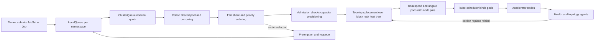

# System Design: Distributed GPU Cluster Scheduler

## TL;DR

A distributed training job is a gang: if it cannot get all N accelerators at the same time, in a topology that keeps its collectives fast, it gets nothing useful, and any capacity it holds while it waits is wasted.
Admission and placement have to be decided together, against a topology tree (host, rack or sub-block, block, zone), before any pod reaches the node-level binder; otherwise partial gangs deadlock the fleet.
The count of free GPUs tells you little; what matters is schedulable capacity, meaning the largest gang each topology level can admit right now, and best-fit placement exists to keep that number high.
Fair share has two layers: guaranteed nominal quota per tenant, plus borrowing of idle capacity that can be taken back by preemption, and every preemption costs victim size x time since its last checkpoint, not just one job.
At multi-thousand-GPU scale, hardware failure is a scheduling input and not an exception: size spare nodes from observed failure rates, and size checkpoint intervals with Young/Daly, or goodput collapses.

## Mental Model



Think of the scheduler as two decoupled machines with a contract between them.
The admission machine (Kueue, Slurm's controller, or HyperPod task governance) owns the fleet-wide decision: whether this whole gang may run now, against whose quota, and in which topology domain.
The binding machine (kube-scheduler or slurmd) only carries out a placement that has already been decided, for pods that are guaranteed to fit.
Because admission happens while the job is suspended and holds no nodes, a gang that cannot be admitted holds nothing, which removes the hold-and-wait condition behind partial-gang deadlock.
The feedback edges matter as much as the forward path.
Health agents change the topology tree under the scheduler, and preemption puts work back into the queues, so both loops need damping or the system oscillates.

## Internals

### Why a pod-at-a-time scheduler fails for gangs

The default kube-scheduler pops one pod at a time from its active queue, runs filter and score plugins, and binds.
Take two 64-pod jobs, each needing 8 GPUs per pod, on a 100-node fleet.
If pods interleave, job A can end up holding 50 nodes and job B 50 nodes, and neither can start.
NCCL or JAX initialization blocks until every rank joins, so both jobs sit forever with 800 GPUs allocated and zero useful FLOPs.
That is a textbook deadlock: mutual exclusion on nodes, hold-and-wait by partially placed gangs, no preemption, and circular wait.
There are three standard fixes, and each attacks a different Coffman condition.
Coscheduling plugins (the scheduler-plugins PodGroup, Volcano) hold pods at a Permit barrier until minMember pods can be bound, which removes hold-and-wait at the binder.
Kubernetes 1.35 added native gang scheduling as an alpha feature (KEP-4671), built on a new core Workload API that pods reference ([ScaleOps 1.35 overview](https://scaleops.com/blog/kubernetes-1-35-release-overview/), as of 2026-10); its graduation status in later minor releases is UNVERIFIED.
Queue-level admission (Kueue, Slurm) keeps the job suspended until quota and placement are reserved for the whole gang, so no pod exists until the gang fits.
The third approach is the one hyperscale fleets use, because it puts quota, fairness, and topology into a single decision.

### Kueue's object model and the admission cycle

Kueue models capacity as ResourceFlavors (a class of nodes, chosen by labels and optionally bound to a Topology), ClusterQueues (nominal quota per flavor and resource), Cohorts (groups of ClusterQueues that lend and borrow), and LocalQueues (namespaced entry points that point at one ClusterQueue).
A Job, JobSet, RayJob, or LeaderWorkerSet becomes a Workload object made of PodSets.
Each admission cycle takes the head of every ClusterQueue, works out whether it fits within nominal quota, or by borrowing within the cohort, or only after preemption, and admits at most one workload per cohort per cycle to avoid racing on shared capacity.
Admission checks are pluggable gates that must all report Ready before the job is unsuspended; the ProvisioningRequest check asks the cluster autoscaler for atomic capacity, and on GKE that request is served by Dynamic Workload Scheduler.
Queueing strategy is a real trade-off.
StrictFIFO preserves order but lets one unschedulable 512-node gang block every smaller job behind it in the same ClusterQueue.
BestEffortFIFO lets smaller workloads go around a head that does not fit, which keeps utilization high but can starve large gangs unless something else reserves for them.

### Topology-aware scheduling: the tree, the search, the pin

Kueue's Topology-Aware Scheduling (TAS) is beta and enabled by default since Kueue v0.14 ([Kueue docs](https://kueue.sigs.k8s.io/docs/concepts/topology_aware_scheduling/), as of 2026-10).
A Topology object lists node labels from coarsest to finest, for example block, then sub-block or rack, then hostname, and a ResourceFlavor points at it.
On GKE the labels are `cloud.google.com/gce-topology-block`, `cloud.google.com/gce-topology-subblock`, and `cloud.google.com/gce-topology-host` ([LWS TAS example](https://lws.sigs.k8s.io/docs/examples/tas/), as of 2026-10).
On AWS the raw input is the EC2 `DescribeInstanceTopology` API, which returns an ordered `NetworkNodes` list per instance, plus `CapacityBlockId` and `ZoneId` ([boto3 docs](https://docs.aws.amazon.com/boto3/latest/reference/services/ec2/client/describe_instance_topology.html), as of 2026-10).
HyperPod surfaces this as node labels of the form `topology.k8s.aws/network-node-layer-N` (UNVERIFIED label spelling).
A workload states its constraint per PodSet with `kueue.x-k8s.io/podset-required-topology` (hard) or `kueue.x-k8s.io/podset-preferred-topology` (soft: Kueue climbs one level at a time when the preferred level does not fit) ([AWS HyperPod TAS docs](https://docs.aws.amazon.com/sagemaker/latest/dg/sagemaker-hyperpod-eks-operate-console-ui-governance-tasks-scheduling.html), as of 2026-10).
The search runs over a capacity-annotated tree.
Every leaf (host) records free accelerators after subtracting both TAS-admitted pods and non-TAS pods such as DaemonSets, and every inner node sums its children.
For a required level L, the algorithm looks for domains at L whose free capacity, counted in whole pod slots, is at least the PodSet count.
Among those it prefers the tightest fit, which leaves big holes untouched for later big gangs; profile names and tie-breaking have changed between releases (UNVERIFIED for any given version).
The result is written into the Workload's admission as a topology assignment: a list of domains with pod counts.
Pods are created behind a scheduling gate, then ungated with node selectors that pin them to the assigned domains, so kube-scheduler only binds inside a pre-approved set (gate name and pinning details UNVERIFIED for current release).
When a node fails, the beta TASFailedNodeReplacement feature, on by default, tries to find a replacement node for the affected workload in place, instead of evicting and re-queueing the whole gang ([Kueue docs](https://kueue.sigs.k8s.io/docs/concepts/topology_aware_scheduling/), as of 2026-10).

### The mechanism getting-started guides skip: schedulable capacity and fragmentation

Dashboards show "free GPUs".
That is the wrong metric for a gang fleet, because a block with 7 scattered free nodes cannot host an 8-node block-local gang.
The metric to track is schedulable capacity S(L, k): the number of k-node gangs that topology level L could admit right now, computed as the sum over domains d at L of floor(free_nodes(d) / k).
Fragmentation is then free_nodes minus k x S(L, k), and it should be graphed for each common gang size.
Best-fit placement keeps S high for large k by filling the most-used domains first.
Worst-fit (spread) placement, the kube-scheduler default spirit for stateless services, keeps S high for small k and quickly destroys large-gang capacity.
The remaining failure is head-of-line starvation under BestEffortFIFO.
A 64-node gang waits for an entire block to drain, but small jobs keep backfilling into the block, so it never drains.
HPC solved this decades ago with EASY backfilling (Lifka 1995; Mu'alem and Feitelson, IEEE TPDS 2001).
You reserve the earliest future time when the head gang fits, and backfill a smaller job only if its declared runtime ends before that reservation, or if it lands outside the reserved domain.
Slurm's backfill scheduler implements this with job time limits.
Kueue as of this writing admits on current capacity rather than runtime estimates, so a Kubernetes fleet copies the effect with three tools: a per-block "draining" taint set by a controller when a large gang has waited past an SLO, StrictFIFO on the ClusterQueue that owns large gangs, and maximum-runtime limits on backfill queues.
This is the most common gap between an L5 design (gang plus topology) and an L6 design (gang plus topology plus starvation control with a measurable S(L, k) SLO).

### Fair share: quota, borrowing, dominant share, and reclaim

Dominant Resource Fairness (Ghodsi et al., NSDI 2011) equalizes each tenant's largest share across resource types, and it is strategy-proof: a tenant cannot gain by lying about its demand.
In a fleet where GPUs are the binding resource, the dominant share is almost always GPU share, so DRF reduces to weighted max-min fairness on GPUs, while still protecting against CPU-heavy or memory-heavy jobs.
Kueue implements two layers.
Nominal quota is a guarantee: a ClusterQueue can always reclaim up to its nominal quota by preempting borrowers (`reclaimWithinCohort`).
Borrowing lets a queue use idle cohort capacity up to `borrowingLimit`, while the lender caps exposure with `lendingLimit`.
With Fair Sharing enabled, Kueue gives each ClusterQueue a numeric share value that summarizes how much it borrows compared with its peers in the cohort, and it preempts so as to move shares toward equality ([Kueue preemption docs](https://kueue.sigs.k8s.io/docs/concepts/preemption/), as of 2026-10).
Admission Fair Sharing (KEP-4136) orders pending workloads by the historical usage of their source LocalQueue, so a team that just ran a big job yields to one that ran nothing ([KEP-4136](https://github.com/kubernetes-sigs/kueue/tree/main/keps/4136-admission-fair-sharing), as of 2026-10).
Instantaneous fairness ignores job length, and that is the deep problem.
Themis (Mahajan et al., NSDI 2020) argues for finish-time fairness: the ratio of a job's completion time on the shared cluster to its completion time on a dedicated 1/N share.
Gavel (Narayanan et al., OSDI 2020) generalizes policies to heterogeneous accelerators through effective throughput matrices.
Tiresias (Gu et al., NSDI 2019) shows that when job durations are unknown, least-attained-service priorities in two dimensions (GPUs x time) beat FIFO on completion time.

### Preemption: victim selection is a cost minimization

Preempting a gang destroys all work done since its last durable checkpoint, multiplied by its size, and also charges restart time (image pull, weight and optimizer load, NCCL rendezvous) to the fleet.
Victim cost is therefore lost_gpu_hours = size_gpus x (t_now - t_last_checkpoint) + size_gpus x t_restart.
Kueue's built-in ordering puts lower priority first, then, among equals, more recently admitted workloads first, which approximates "least work lost" only when every job checkpoints at the same cadence.
A production design exports t_last_checkpoint (for example as a workload annotation written by the trainer) and uses it in a custom ordering or an external controller.
The other lever is cooperative preemption: send SIGTERM, let the trainer write an emergency checkpoint within `terminationGracePeriodSeconds`, then kill.
For a model whose sharded checkpoint flushes to local NVMe in 30 to 60 seconds and drains to object storage asynchronously, a 120-second grace period turns lost work into near zero.
That grace period is the same order of magnitude as the EC2 Spot two-minute notice, and much longer than the GCP Spot 30-second notice (UNVERIFIED in this session, see [[17-Cloud-AI-Engineering/Volume_09_FinOps_and_Cloud_Economics/Chapter_03_Spot_Economics_and_Interruption_Handling|Spot Economics]]).
Preemption also needs damping.
Without a minimum runtime before a workload can be preempted, and without hysteresis between the share that triggers preemption and the share admission aims for, two cohorts can ping-pong a workload forever.
Kueue issue #16666 documents exactly this, an infinite preemption and readmission loop with fair sharing and hierarchical cohorts, caused by the preemption ordering disagreeing with the admission ordering ([kueue#16666](https://github.com/kubernetes-sigs/kueue/issues/16666), as of 2026-10).

### Failure domains and why the scheduler owns reliability

Meta's Llama 3 report gives the best public failure-rate data: 466 job interruptions in a 54-day pre-training window on a 16,384-H100 job, 419 of them unexpected, with GPU and HBM faults the leading causes ([Llama 3 paper, arXiv 2407.21783](https://arxiv.org/abs/2407.21783), 2024; counts UNVERIFIED in this session).
That works out to about 4.7e-4 unexpected interruptions per GPU-day, which is the planning number used in the worked example.
ByteDance's MegaScale (Jiang et al., NSDI 2024) shows that a single straggler or flapping NIC gates the entire collective, so detecting and evicting stragglers is a scheduling feature, not a monitoring nicety.
Google's TPU v4 paper (Jouppi et al., ISCA 2023) explains why optical circuit switches between 64-chip cubes raise slice availability: a slice can be assembled from any healthy cubes rather than needing a contiguous physical block.
That is topology-aware scheduling done in the optical layer.
Borg (Verma et al., EuroSys 2015) contributed the priority bands, quota-as-admission, and preemption cascades on which every system here is built; Omega (Schwarzkopf et al., EuroSys 2013) explains why shared-state optimistic schedulers scale where monolithic ones stall.

## Numbers to Know

| Quantity | Value | Source |
| --- | --- | --- |
| p5.48xlarge accelerators | 8 x H100, 640 GB HBM3 total, 900 GB/s NVSwitch peer-to-peer | ([Vantage, citing AWS](https://www.vantage.sh/blog/aws-ec2-capacity-blocks-gpu-shortage-cost), as of 2026-10) |
| p5.48xlarge scale-out network | 3,200 Gbps EFAv2, GPUDirect RDMA | ([Vantage, citing AWS](https://www.vantage.sh/blog/aws-ec2-capacity-blocks-gpu-shortage-cost), as of 2026-10) |
| p5.48xlarge Capacity Block vs On-Demand, us-east-1 | 34.608 USD/hr vs 55.04 USD/hr | ([AWS ML Blog](https://aws.amazon.com/blogs/machine-learning/secure-short-term-gpu-capacity-for-ml-workloads-with-ec2-capacity-blocks-for-ml-and-sagemaker-training-plans/), as of 2026-05) |
| Capacity Block price change, Jan 2026 | p5e.48xlarge 34.61 to 39.80 USD/hr; p5en.48xlarge 36.18 to 41.61 USD/hr | ([The Register](https://www.theregister.com/2026/01/05/aws_price_increase/), as of 2026-01) |
| DWS Flex-start billing | Billed on usage like on-demand; Flex-start and Calendar prices scheduled to change November 2026 | ([Google Cloud DWS pricing](https://cloud.google.com/products/dws/pricing), as of 2026-10) |
| Kueue TAS status | Beta, on by default since v0.14; TASFailedNodeReplacement beta, on by default | ([Kueue docs](https://kueue.sigs.k8s.io/docs/concepts/topology_aware_scheduling/), as of 2026-10) |
| HyperPod task governance add-on | v1.6.0-eksbuild.1 installs Kueue v0.19.2 | ([AWS docs](https://docs.aws.amazon.com/sagemaker/latest/dg/sagemaker-hyperpod-eks-operate-console-ui-governance-setup-task-governance.html), as of 2026-10) |
| Native Kubernetes gang scheduling | Alpha in v1.35 (KEP-4671) | ([Palark](https://palark.com/blog/kubernetes-1-35-release-features/), as of 2026-10) |
| Unexpected interruptions, 16k H100 job | 419 in 54 days, about 4.7e-4 per GPU-day | ([Llama 3 paper](https://arxiv.org/abs/2407.21783), 2024, UNVERIFIED in session) |
| Spot interruption notice | EC2 2 minutes; GCP Spot VMs 30 seconds | (AWS and Google Cloud docs, UNVERIFIED in session) |
| TPU largest single-pod slices | v5p 8,960 chips; Ironwood (TPU7x) 9,216 chips; Trillium 256 chips per pod | (Google Cloud docs, UNVERIFIED in session) |
| Derived: 512 x p5.48xlarge (4,096 H100) on Capacity Blocks | 17,719 USD/hr, about 12.9M USD per 730-hr month | (computed from AWS ML Blog price, as of 2026-05) |
| Derived: cost of 1 percent idle on that fleet | about 129k USD per month | (computed) |

## AWS vs GCP Mechanism Parity

| Concern | AWS | Google Cloud | Critical difference |
| --- | --- | --- | --- |
| Queueing and quota | SageMaker HyperPod task governance (managed Kueue on EKS); self-managed Kueue on EKS; Slurm on HyperPod | Kueue on GKE (Google co-maintains it); Slurm through Cluster Toolkit | HyperPod pins the Kueue version through the add-on; on GKE you choose the version, so you inherit the upgrade work |
| Gang semantics | HyperPod gang scheduling uses Kueue `waitForPodsReady`, which evicts and requeues if pods are not all ready before the timeout ([AWS docs](https://docs.aws.amazon.com/sagemaker/latest/dg/sagemaker-hyperpod-eks-operate-console-ui-governance-tasks-gang-scheduling.html), as of 2026-10) | Same Kueue mechanism; JobSet plus ProvisioningRequest for atomic node acquisition | `waitForPodsReady` is a runtime safety net; quota-level admission is the real gang barrier on both clouds |
| Topology discovery | `DescribeInstanceTopology` returns ordered NetworkNodes per instance, and is eventually consistent right after launch ([boto3](https://docs.aws.amazon.com/boto3/latest/reference/services/ec2/client/describe_instance_topology.html)); `DescribeCapacityReservationTopology` ([AWS docs](https://docs.aws.amazon.com/AWSEC2/latest/UserGuide/ec2-instance-topology-examples.html)) | Node labels for block, sub-block, and host on RDMA-capable GKE nodes ([llm-d GKE guide](https://llm-d.ai/docs/dev/infrastructure/providers/gke)) | On AWS, an agent has to poll and label nodes; on GKE, labels arrive with the node, so there is no labeling race |
| Topology placement | Kueue TAS in HyperPod, on by default; documented to be disabled if Karpenter provisions nodes ([AWS docs](https://docs.aws.amazon.com/sagemaker/latest/dg/sagemaker-hyperpod-eks-operate-console-ui-governance-tasks-scheduling.html)) | Kueue TAS; for Ironwood TPU7x, dynamic slices scheduled with Kueue and TAS ([GKE docs](https://docs.cloud.google.com/kubernetes-engine/docs/how-to/use-gke-dynamic-slicing)) | TPU slices are topology-shaped units (for example 4x4x4), so placement becomes slice-shape fitting through OCS rather than a choice of switch tier |
| Scale-up domain | 8-GPU NVLink per p5 node; larger UltraServer domains on GB200 and Trn2 (UNVERIFIED sizes) | 8-GPU NVLink per A3/A4 node; GB200 NVL72 on A4X; TPU ICI across a slice | Any gang member split across a scale-up boundary pays a 10x or greater bandwidth cliff |
| Guaranteed future capacity | EC2 Capacity Blocks for ML (upfront, fixed window, price set at purchase) | DWS Calendar mode future reservations | Both are calendar-shaped; your scheduler must treat the block end as a hard deadline for checkpointing |
| Queued "start when available" capacity | No exact EC2 equivalent; SageMaker training plans are closest | DWS Flex-start via ProvisioningRequest or MIG resize requests | Flex-start delivers all-or-nothing node sets, which is gang semantics at the infrastructure layer |
| Cheapest preemptible | EC2 Spot, 2-minute notice | Spot VMs, 30-second notice | 30 s is too short for a synchronous checkpoint; on GCP Spot you need continuous async checkpointing |
| Node repair | HyperPod health checks, node replacement, and auto-resume | GKE node auto-repair; GPU and TPU maintenance notifications | Both replace nodes; neither preserves your topology domain unless capacity exists in the same block |

## Worked Example: Gang, Topology, and Fair-Share Admission on a Local Fleet

The lab uses a kind cluster with fake 8-GPU nodes, so it runs on a laptop for 0 USD.
It exercises the same Kueue TAS code paths that HyperPod and GKE run.
A pure-Python simulator then shows best-fit placement and lost-work-aware victim selection, which Kueue does not expose directly.

### Cost estimate, budget alarm, and teardown

The local lab costs 0 USD and provisions no billable resources.
If you repeat it on EKS or GKE with small CPU nodes, set a budget first, because control-plane fees alone run a few USD per day.

```bash
# AWS: 20 USD monthly budget, email at 80 percent of actual spend.
aws budgets create-budget --account-id "$AWS_ACCOUNT_ID" \
  --budget '{"BudgetName":"gpu-sched-lab","BudgetLimit":{"Amount":"20","Unit":"USD"},"TimeUnit":"MONTHLY","BudgetType":"COST"}' \
  --notifications-with-subscribers '[{"Notification":{"NotificationType":"ACTUAL","ComparisonOperator":"GREATER_THAN","Threshold":80,"ThresholdType":"PERCENTAGE"},"Subscribers":[{"SubscriptionType":"EMAIL","Address":"you@example.com"}]}]'

# Google Cloud: equivalent budget on the billing account.
gcloud billing budgets create --billing-account="$BILLING_ACCOUNT" \
  --display-name=gpu-sched-lab --budget-amount=20USD --threshold-rule=percent=0.8

# Teardown for the local lab (exact command).
kind delete cluster --name kueue-tas
```

### Step 1: an eight-node fleet with a two-level topology and fake GPUs

```bash
#!/usr/bin/env bash
set -euo pipefail
KUEUE_VERSION="v0.14.0"   # pin a tested release; check the Kueue releases page for the latest patch

cat > /tmp/kind-tas.yaml <<'EOF'
kind: Cluster
apiVersion: kind.x-k8s.io/v1alpha4
nodes:
- role: control-plane
- role: worker
- role: worker
- role: worker
- role: worker
- role: worker
- role: worker
- role: worker
- role: worker
EOF
kind create cluster --name kueue-tas --config /tmp/kind-tas.yaml

# 2 blocks x 2 racks x 2 hosts; each host advertises 8 fake GPUs.
i=0
for n in $(kubectl get nodes -l '!node-role.kubernetes.io/control-plane' -o name | sort); do
  b=$(( i / 4 )); r=$(( (i / 2) % 2 ))
  kubectl label "$n" fleet.example.com/pool=gpu \
    topology.example.com/block="b$b" topology.example.com/rack="b$b-r$r" --overwrite
  kubectl patch "$n" --subresource=status --type=json \
    -p='[{"op":"add","path":"/status/capacity/example.com~1gpu","value":"8"}]'
  i=$(( i + 1 ))
done

kubectl apply --server-side -f "https://github.com/kubernetes-sigs/kueue/releases/download/${KUEUE_VERSION}/manifests.yaml"
kubectl -n kueue-system rollout status deploy/kueue-controller-manager --timeout=180s
```

### Step 2: topology, flavor, two tenants in one cohort

```yaml
# /tmp/kueue-fleet.yaml
apiVersion: kueue.x-k8s.io/v1alpha1
kind: Topology
metadata:
  name: fleet-topology
spec:
  levels:
  - nodeLabel: topology.example.com/block
  - nodeLabel: topology.example.com/rack
  - nodeLabel: kubernetes.io/hostname
---
apiVersion: kueue.x-k8s.io/v1beta1
kind: ResourceFlavor
metadata:
  name: tas-gpu
spec:
  nodeLabels:
    fleet.example.com/pool: gpu
  topologyName: fleet-topology
---
apiVersion: kueue.x-k8s.io/v1beta1
kind: ClusterQueue
metadata:
  name: prod
spec:
  cohort: fleet
  namespaceSelector: {}
  queueingStrategy: StrictFIFO
  preemption:
    reclaimWithinCohort: Any
    withinClusterQueue: LowerPriority
  resourceGroups:
  - coveredResources: ["cpu", "example.com/gpu"]
    flavors:
    - name: tas-gpu
      resources:
      - name: cpu
        nominalQuota: 16
      - name: example.com/gpu
        nominalQuota: 32
        lendingLimit: 32
---
apiVersion: kueue.x-k8s.io/v1beta1
kind: ClusterQueue
metadata:
  name: research
spec:
  cohort: fleet
  namespaceSelector: {}
  queueingStrategy: BestEffortFIFO
  preemption:
    reclaimWithinCohort: Any
    withinClusterQueue: LowerPriority
  resourceGroups:
  - coveredResources: ["cpu", "example.com/gpu"]
    flavors:
    - name: tas-gpu
      resources:
      - name: cpu
        nominalQuota: 16
      - name: example.com/gpu
        nominalQuota: 32
        borrowingLimit: 32
---
apiVersion: v1
kind: Namespace
metadata:
  name: prod
---
apiVersion: v1
kind: Namespace
metadata:
  name: research
---
apiVersion: kueue.x-k8s.io/v1beta1
kind: LocalQueue
metadata:
  name: lq
  namespace: prod
spec:
  clusterQueue: prod
---
apiVersion: kueue.x-k8s.io/v1beta1
kind: LocalQueue
metadata:
  name: lq
  namespace: research
spec:
  clusterQueue: research
```

### Step 3: a gang that cannot fit in a rack, then one that fits a block, then a reclaim

```bash
kubectl apply -f /tmp/kueue-fleet.yaml

gang() {  # gang <namespace> <name> <pods> <required-level-label>
cat <<EOF | kubectl apply -f -
apiVersion: batch/v1
kind: Job
metadata:
  name: $2
  namespace: $1
  labels:
    kueue.x-k8s.io/queue-name: lq
spec:
  parallelism: $3
  completions: $3
  completionMode: Indexed
  template:
    metadata:
      annotations:
        kueue.x-k8s.io/podset-required-topology: "$4"
    spec:
      restartPolicy: Never
      containers:
      - name: rank
        image: busybox:1.36
        command: ["sh", "-c", "sleep 900"]
        resources:
          requests: {cpu: "100m"}
          limits: {example.com/gpu: "8"}
EOF
}

# 4 hosts x 8 GPUs cannot fit a 2-host rack: stays pending, holds nothing.
gang research rack-gang 4 topology.example.com/rack
# Same gang constrained to a block: admitted, borrows nothing yet (32 GPUs = nominal).
gang research block-gang 4 topology.example.com/block
# Research borrows prod's idle 32 GPUs for a second block-sized gang.
gang research borrow-gang 4 topology.example.com/block
sleep 10
kubectl get workloads -A
kubectl -n research get workloads -o jsonpath='{range .items[*]}{.metadata.name}{" "}{.status.admission.podSetAssignments[0].topologyAssignment}{"\n"}{end}'

# Prod reclaims its nominal quota: Kueue preempts research's borrowing workload.
gang prod prod-gang 4 topology.example.com/block
sleep 15
kubectl get workloads -A
kubectl -n research describe workload | grep -iE 'preempt|evict' || true
```

What to observe: `rack-gang` stays inadmissible and creates no running pods, which is the gang barrier working at admission time.
`block-gang` gets a topology assignment listing all 4 hosts of one block.
`borrow-gang` lands in the other block by borrowing prod's lent quota.
`prod-gang` triggers `reclaimWithinCohort`, which evicts a research workload because prod is below its nominal quota.
The topology assignment field path varies by Kueue API version (UNVERIFIED for releases that serve v1beta2); `kubectl get workload -o yaml` always shows it.

### Step 4: lost-work-aware victim selection and the fragmentation metric

```python
#!/usr/bin/env python3
"""Toy gang scheduler: topology-aware best-fit placement, weighted fair share,
and lost-work-aware preemption. Pure Python 3.9+, no dependencies, 0 USD."""
from dataclasses import dataclass, field

GPUS_PER_NODE = 8

@dataclass
class Node:
    name: str
    block: str
    rack: str
    healthy: bool = True
    job: str = ""

@dataclass
class Job:
    name: str
    tenant: str
    nodes: int
    priority: int
    required_level: str          # "rack" or "block"
    gpu_hours_since_ckpt: float = 0.0
    placed: list = field(default_factory=list)

def build_fleet(blocks=2, racks_per_block=4, nodes_per_rack=4):
    return [Node(f"b{b}-r{r}-n{n}", f"b{b}", f"b{b}-r{r}")
            for b in range(blocks) for r in range(racks_per_block)
            for n in range(nodes_per_rack)]

def free_by_domain(fleet, level):
    dom = {}
    for nd in fleet:
        key = nd.rack if level == "rack" else nd.block
        dom.setdefault(key, [])
        if nd.healthy and not nd.job:
            dom[key].append(nd)
    return dom

def place(fleet, job):
    """Best fit: the domain with the FEWEST free nodes that still fits the gang."""
    dom = free_by_domain(fleet, job.required_level)
    fits = [(len(v), k) for k, v in dom.items() if len(v) >= job.nodes]
    if not fits:
        return False
    _, best = min(fits)
    chosen = sorted(dom[best], key=lambda nd: (nd.rack, nd.name))[: job.nodes]
    for nd in chosen:
        nd.job = job.name
    job.placed = [nd.name for nd in chosen]
    return True

def release(fleet, job):
    for nd in fleet:
        if nd.job == job.name:
            nd.job = ""
    job.placed = []

def restore(fleet, job, names):
    for nd in fleet:
        if nd.name in names:
            nd.job = job.name
    job.placed = list(names)

def fits_now(fleet, job):
    ok = place(fleet, job)
    if ok:
        release(fleet, job)
    return ok

def tenant_share(running, weights):
    use = {t: 0 for t in weights}
    for j in running:
        use[j.tenant] += j.nodes * GPUS_PER_NODE
    return {t: use[t] / weights[t] for t in weights}

def pick_victims(fleet, running, incoming, weights):
    """Candidates: lower priority, or tenants above the incoming tenant's share.
    Order by priority then lost work; then spare victims that were unnecessary."""
    share = tenant_share(running, weights)
    mine = share[incoming.tenant]
    cands = [j for j in running if j.priority < incoming.priority
             or share[j.tenant] > mine]
    cands.sort(key=lambda j: (j.priority, j.gpu_hours_since_ckpt))
    saved = {j.name: list(j.placed) for j in cands}
    victims = []
    for v in cands:
        victims.append(v)
        release(fleet, v)
        if fits_now(fleet, incoming):
            break
    else:
        for x in victims:
            restore(fleet, x, saved[x.name])
        return None
    for v in sorted(victims, key=lambda j: -j.gpu_hours_since_ckpt):
        restore(fleet, v, saved[v.name])
        if fits_now(fleet, incoming):
            victims.remove(v)
        else:
            release(fleet, v)
    for x in victims:
        restore(fleet, x, saved[x.name])
    return victims

def frag_report(fleet, level, gang):
    dom = free_by_domain(fleet, level)
    free = sum(len(v) for v in dom.values())
    usable = sum((len(v) // gang) * gang for v in dom.values())
    return free, usable

if __name__ == "__main__":
    fleet = build_fleet()
    weights = {"research": 1.0, "prod": 1.0}
    running = []
    for j in [Job("prod-a", "prod", 3, 100, "rack", 2.0),
              Job("res-a", "research", 2, 10, "rack", 30.0),
              Job("res-b", "research", 4, 10, "rack", 5.0),
              Job("res-c", "research", 8, 10, "block", 120.0),
              Job("res-d", "research", 6, 10, "block", 1.0)]:
        ok = place(fleet, j)
        if ok:
            running.append(j)
        print(f"{j.name:7s} nodes={j.nodes} level={j.required_level:5s} admitted={ok}")
    free, usable = frag_report(fleet, "rack", 4)
    print(f"free nodes={free}, usable by 4-node rack-local gangs={usable}")
    big = Job("prod-b", "prod", 10, 100, "block")
    print(f"prod-b admitted without preemption: {place(fleet, big)}")
    if not big.placed:
        v = pick_victims(fleet, running, big, weights) or []
        print(f"victims={[x.name for x in v]} lost GPU-hours="
              f"{sum(x.gpu_hours_since_ckpt for x in v):.1f}")
        for x in v:
            release(fleet, x)
            running.remove(x)
        print(f"prod-b admitted after preemption: {place(fleet, big)}")
```

A run picks `res-d` and `res-b` (6 GPU-hours of lost work) and leaves `res-c` (120 GPU-hours) running, even though all three share the same priority.
A naive "newest first" or "largest first" order would very likely have evicted the most expensive job instead.
The second pass matters: a greedy pass over-selects victims, and trying to restore each one, most expensive first, removes the unneeded evictions.

### Capacity and cost sizing for a 4,096-GPU fleet

Fleet: 512 x p5.48xlarge = 4,096 H100 on Capacity Blocks at 34.608 USD/hr (AWS ML Blog, as of 2026-05).
Hourly cost: 512 x 34.608 = 17,719 USD/hr, or about 12.9M USD per 730-hour month; per GPU-hour, 34.608 / 8 = 4.33 USD.
Each percentage point of idle or fragmented capacity costs about 129k USD per month, which is the budget that justifies building the scheduler at all.

Failure rate: take 4.7e-4 unexpected interruptions per GPU-day from the Llama 3 data (UNVERIFIED in session).
A 2,048-GPU job sees 0.97 interruptions per day, so MTBF M is about 24.7 hours; a 16,384-GPU job sees 7.8 per day, so M is about 3.1 hours.

Checkpoint interval (Young 1974, refined by Daly 2006): T_opt = sqrt(2 x C x M), where C is the blocking checkpoint cost.
With C = 2 minutes and restart cost R = 10 minutes, the expected waste fraction is roughly C/T + (T/2 + R)/M.

| Job size (GPUs) | Interruptions/day | MTBF (h) | T_opt (min) | Waste fraction |
| --- | --- | --- | --- | --- |
| 1,024 | 0.48 | 49.5 | 109 | 4.0 percent |
| 2,048 | 0.97 | 24.7 | 77 | 5.9 percent |
| 4,096 | 1.94 | 12.4 | 55 | 8.7 percent |
| 16,384 | 7.76 | 3.1 | 27 | 20.1 percent |

The 16k row explains why frontier teams drive C toward zero with asynchronous checkpointing to local NVMe and R toward seconds with warm spares; Llama 3 reports above 90 percent effective training time only because they did both.

Spare nodes: for a 4,096-GPU job, node interruptions arrive at about 1.94 per day.
If a failed node takes 24 hours to repair, the number of nodes down at any moment is roughly Poisson with mean 1.94, and its 99th percentile is 6.
So hold 6 hot spare nodes (1.2 percent of the fleet) inside the same block, or TAS hot-swap has nowhere topology-local to go.

Preemption cost: evicting a 1,024-GPU job 20 minutes after its last checkpoint wastes 341 GPU-hours, or about 1,477 USD, before counting restart time.
That number is the bar any priority policy has to clear.

## Failure Modes and Pitfalls

### Partial-gang deadlock and zombie gangs

Symptom: hundreds of GPUs allocated, NCCL init timeouts in logs, zero MFU.
Cause: pods created before admission (bare pods, operators that bypass Kueue, or Kueue's `manageJobsWithoutQueueName` left false so unlabeled jobs skip the queue entirely).
Mitigation: enforce queue-name labels with a ValidatingAdmissionPolicy, turn on `waitForPodsReady` with a timeout and exponential requeue backoff, and alert on workloads whose admitted-to-all-ready time exceeds the image pull p99.

### Large-gang starvation under BestEffortFIFO

Symptom: a 512-GPU job waits days while utilization looks healthy at 95 percent.
Cause: small jobs keep backfilling the domains the big gang needs, so S(block, 64 nodes) stays at zero.
Mitigation: track S(L, k) as an SLO, drain domains with a controller once a large gang crosses its wait threshold, and route large gangs to a StrictFIFO ClusterQueue.

### Preemption ping-pong and cascading requeues

Symptom: the same workloads are admitted and evicted every few cycles, and the API server write rate climbs.
Public example: Kueue issue #16666, an infinite fair-share preemption loop with hierarchical cohorts and multiple flavors, fixed by checking borrowing up to the least common ancestor cohort ([kueue PR #16886](https://github.com/kubernetes-sigs/kueue/pull/16886), as of 2026-10).
Mitigation: minimum runtime before a workload is preemptible, hysteresis between preemption and admission thresholds, and a preemption budget per cohort per hour.

### Control-plane overload from the scheduler's own clients

A fleet of thousands of nodes, each running list-watch agents (DCGM exporters, topology labelers, health checkers), can overwhelm kube-apiserver.
OpenAI's December 2024 public postmortem described a new telemetry deployment that overloaded Kubernetes API servers in large clusters and broke DNS-based service discovery (UNVERIFIED, link omitted).
The general lesson: agents must use informers with resync jitter, never relist at the same moment across the fleet, and a GPU scheduler must keep admitted work running when the control plane is degraded, which is static stability (see [[17-Cloud-AI-Engineering/Volume_01_Cloud_Architecture_Principles/Chapter_02_Regions_Zones_and_Static_Stability|Static Stability]]).

### Topology label drift and the post-launch consistency window

`DescribeInstanceTopology` is eventually consistent right after launch, so an early read can return incomplete topology ([boto3 docs](https://docs.aws.amazon.com/boto3/latest/reference/services/ec2/client/describe_instance_topology.html), as of 2026-10).
If a labeler marks a node schedulable before its labels are correct, TAS will place a "rack-local" gang across spines.
Mitigation: taint new nodes until their topology labels are verified, and re-check labels after any host replacement.

### Stragglers and silent hardware faults

One slow GPU, a flapping NIC, or a thermally throttled node gates every collective, as MegaScale documents (Jiang et al., NSDI 2024).
The scheduler has to consume step-time skew per rank, cordon outliers, and hot-swap them, instead of waiting for a hard failure.
Silent data corruption needs periodic known-answer tests during idle windows, which the scheduler must reserve time for (see [[17-Cloud-AI-Engineering/Volume_10_AI_Infrastructure_on_Cloud/Chapter_08_Fault_Tolerance_and_Fleet_Resiliency_at_Scale|Fault Tolerance at Scale]]).

### Thundering herd after a block failure

When a block loses power or its spine, every gang in it requeues at once, and all of them pull multi-GB images and multi-TB checkpoints together.
Object storage request-rate limits and node image-pull bandwidth then stretch time to recovery from minutes to hours.
Mitigation: requeue with jittered backoff, pre-stage images on spare nodes, and spread checkpoint keys across prefixes (see [[17-Cloud-AI-Engineering/Volume_10_AI_Infrastructure_on_Cloud/Chapter_06_High_Throughput_Checkpointing_to_Object_Storage|Checkpointing]]).

### Quota and capacity-block edges

EC2 P-instance On-Demand quotas are counted in vCPUs, and a p5.48xlarge consumes 192 of them, so a quota request sized in "instances" comes out short (UNVERIFIED current default values).
Capacity Blocks end at a fixed time; any job still running at expiry loses all work since its last checkpoint, so the scheduler must force a checkpoint and drain before the block ends.
Karpenter and Kueue TAS can disagree about node placement, which is why AWS documents disabling TAS in HyperPod when Karpenter provisions nodes ([AWS docs](https://docs.aws.amazon.com/sagemaker/latest/dg/sagemaker-hyperpod-eks-operate-console-ui-governance-tasks-scheduling.html), as of 2026-10).

## Security and Cost Angles

### IAM scoping

The topology labeler needs only `ec2:DescribeInstanceTopology` and, for reservations, `ec2:DescribeCapacityReservationTopology` ([AWS docs](https://docs.aws.amazon.com/AWSEC2/latest/UserGuide/ec2-instance-topology-examples.html), as of 2026-10); grant them through EKS Pod Identity or IRSA, never through node instance profiles.
On GKE, bind controller service accounts through Workload Identity Federation for GKE, and keep `roles/container.admin` away from tenants (see [[17-Cloud-AI-Engineering/Volume_08_Security_Identity_and_the_Data_Perimeter/Chapter_02_Workload_Identity_Federation|Workload Identity Federation]]).
Tenants should hold RBAC on Jobs and LocalQueues in their own namespace only; ClusterQueues, Cohorts, Topologies, and PriorityClasses belong to the platform team.
Priority is a privilege: use a ValidatingAdmissionPolicy to restrict which namespaces may reference high WorkloadPriorityClasses, or any tenant can preempt the fleet.

### Isolation between tenants on shared accelerators

GPU nodes in a shared fleet should be single-tenant per gang (whole-node allocation), because GPU memory and NVLink peers are poor isolation boundaries.
Scrub GPU memory and local NVMe on handoff, and treat node reuse across tenants like VM reuse (see [[17-Cloud-AI-Engineering/Volume_00_Foundations_Under_the_Cloud/Chapter_01_Hypervisors_MicroVMs_and_Sandboxing|Hypervisors and Sandboxing]]).

### Data perimeter for checkpoints and datasets

Checkpoints are the crown jewels: encrypt with customer-managed keys (KMS on AWS, CMEK on Google Cloud) using envelope encryption, and scope key grants to the training role of each tenant.
Route checkpoint traffic through S3 gateway endpoints or Private Google Access, and put the buckets inside a VPC Service Controls perimeter on Google Cloud (see [[17-Cloud-AI-Engineering/Volume_08_Security_Identity_and_the_Data_Perimeter/Chapter_06_Constructing_an_Impenetrable_Data_Perimeter|Data Perimeter]]).

### Unit-economics levers

Commit the predictable baseline (reservations or Capacity Blocks at roughly 37 percent below p5 On-Demand per the AWS ML Blog figures, as of 2026-05), and push burst work to Flex-start or Spot with async checkpointing.
Charge back on admitted GPU-hours, not requested GPUs, and show each team its lost-work GPU-hours from preemption, so priority inflation has a visible price (see [[17-Cloud-AI-Engineering/Volume_09_FinOps_and_Cloud_Economics/Chapter_05_GPU_and_TPU_Unit_Economics|GPU and TPU Unit Economics]]).
Raising S(L, k) for your most common gang size is usually worth more than any discount negotiation, because fragmentation is idle spend you have already paid for.

## Interview Questions and Model Answers

### Question 1 (L5 - Senior)

Your team runs PyTorch jobs of 32 to 128 pods on EKS with the default scheduler, and the cluster regularly shows high GPU allocation but near-zero training throughput. Diagnose and fix it.

#### Model Answer

This is partial-gang deadlock: several jobs each hold part of their pods, the rest are Pending, and every placed rank blocks in NCCL rendezvous waiting for peers that never arrive.
I would confirm it by joining Pending pods to their owning jobs and checking that more than one job is partially bound, with NCCL init timeouts in the running ranks.
The fix is to move the gang decision before pod creation.
I would install Kueue (or turn on HyperPod task governance, which manages Kueue), create the jobs suspended, and let Kueue admit a job only when quota and placement exist for all of its pods.
I would add `waitForPodsReady` with a timeout somewhat above image-pull p99, so a gang that still fails to come up (a bad node, an image error) is evicted and requeued with backoff instead of holding capacity.
To prevent bypass, I would enforce the queue-name label with an admission policy and configure Kueue to manage unlabeled jobs.
The trade-off is admission latency: a job now waits in the queue until it fits completely, which is correct because a partial start has zero value.

#### Follow-up Interviewer Question

Kueue admitted the gang, but two pods are still Pending because a DaemonSet consumed CPU on their nodes; what went wrong, and how does topology-aware admission account for non-queued pods?

### Question 2 (L5 - Senior)

Three teams share 1,024 GPUs with nominal quotas of 512, 256, and 256. Research wants to use idle capacity overnight without hurting production. Design the quota model.

#### Model Answer

Put the three ClusterQueues in one cohort, with nominal quota equal to each team's guarantee.
Give research a borrowing limit so it can use idle GPUs, and give production a lending limit so some of its capacity is never lent, which caps its reclaim latency.
Set `reclaimWithinCohort` so a team below its nominal quota can preempt borrowers, which keeps the guarantee real.
Borrowed work must be preemptible by contract: research jobs on borrowed capacity have to checkpoint at least every T minutes and handle SIGTERM with a grace period long enough for an emergency checkpoint.
I would turn on fair sharing with weights if teams should share the surplus proportionally, and admission fair sharing so recent heavy users yield to idle teams.
The failure mode to watch is reclaim latency: if research gangs are large and checkpoint rarely, production's reclaim costs size x time since last checkpoint, so I would cap borrowed gang size or require faster checkpoints for borrowed admissions.

#### Follow-up Interviewer Question

Production's reclaim hits a 512-GPU research job 50 minutes after its last checkpoint; how would you change the policy so this costs less next time without taking away research's ability to borrow?

### Question 3 (L6 - Staff)

Design topology-aware placement for a 4,096-GPU fleet on p5 instances where `DescribeInstanceTopology` exposes three network layers, serving gangs from 8 to 2,048 GPUs.

#### Model Answer

First, model the topology as a tree from the API's ordered NetworkNodes: layer one is the farthest switch tier, layer three is the switch directly above the instance, and host and NVLink domains sit beneath.
A labeler controller polls the API, taints new nodes until their labels are stable (the API is eventually consistent after launch), and writes them as node labels that a Kueue Topology object references.
Second, set the constraint per job class: tensor-parallel groups never leave a node, data-parallel rings for jobs up to one layer-three domain are required at that level, and the largest jobs use a preferred constraint at layer two so they can fall back to layer one with a measured step-time penalty.
Third, the placement policy is best fit: choose the feasible domain with the least free capacity, which preserves contiguous holes.
Fourth, I would define the SLO on schedulable capacity S(L, k) for the top three gang sizes, not on free GPUs, and alert when S(layer2, 256 nodes) stays at zero longer than the large-gang wait SLO.
Fifth, starvation control: a drain controller taints a domain for new small admissions when a large gang has waited too long, and backfill queues carry maximum runtimes so drains finish in bounded time, which is EASY backfilling expressed with Kubernetes primitives.
Finally, spares: from about 4.7e-4 interruptions per GPU-day I expect about 2 node failures per day across the fleet, so I would hold about 6 spare nodes spread across layer-two domains so that hot swap stays topology-local.
The trade-off is that best fit plus drains lowers small-job throughput a little in exchange for large gangs actually starting; I would show leadership the number in dollars, at about 129k USD per month per percentage point of idle.

#### Follow-up Interviewer Question

A 2,048-GPU job runs at 12 percent lower step rate when split across two layer-one domains than when it sits in one; how do you decide between waiting for a contiguous domain and starting fragmented now?

### Question 4 (L6 - Staff)

Design the preemption policy for a fleet that mixes production fine-tuning, research pre-training, and evaluation sweeps, with the goal of minimizing wasted GPU-hours.

#### Model Answer

The objective is lost GPU-hours, defined as victim GPUs x time since last durable checkpoint, plus victim GPUs x restart time.
Priority order alone is a weak proxy, because a newly admitted 64-GPU sweep and a 1,024-GPU run that checkpointed 50 minutes ago have very different preemption costs.
Mechanically: trainers report their last checkpoint time as a workload annotation, a controller computes cost, and victim selection first picks candidates by priority and share (lower priority, or tenants above fair share), then orders them by ascending cost.
A second pass then tries to put back each selected victim, most expensive first, so greedy over-selection is undone.
Cooperative preemption turns cost into near zero: SIGTERM, an emergency checkpoint to local NVMe within a grace period of about 120 seconds, then an asynchronous drain to object storage.
I would add damping: a minimum runtime before preemptibility, a per-cohort preemption budget, and hysteresis between preemption and admission thresholds, because fair-share preemption loops are a documented failure in Kueue (issue #16666).
For Spot capacity, GCP's 30-second notice cannot fit a synchronous multi-TB checkpoint, so jobs on GCP Spot must checkpoint asynchronously and continuously; EC2's 2-minute notice leaves room for a cooperative flush.
I would report lost GPU-hours per tenant and charge them to the preemptor, which makes priority inflation self-correcting.

#### Follow-up Interviewer Question

Teams start checkpointing every 2 minutes so they can never be preempted cheaply; what does that do to storage, and how would you price checkpoint frequency?

### Question 5 (L6 - Staff)

A 16,384-GPU pre-training job is reaching only 75 percent effective training time. Use first principles to find where the time goes and what the scheduler should change.

#### Model Answer

Start with the failure model: at about 4.7e-4 interruptions per GPU-day, the job sees about 7.8 interruptions per day, so MTBF is about 3.1 hours.
With a 2-minute blocking checkpoint, Young/Daly gives T_opt of about 27 minutes.
With a 10-minute restart, expected waste is C/T + (T/2 + R)/M, which comes out near 20 percent, consistent with the 75 percent symptom.
Three levers, in order of impact.
Restart time R dominates, so the scheduler should keep warm spare nodes, with images pulled and health checks passed, inside the same topology domain, and use in-place node replacement so the gang is not requeued from scratch.
Checkpoint cost C should go toward zero through asynchronous sharded checkpoints to local NVMe with background upload, which lets the interval shrink.
MTBF can be raised by proactive eviction: straggler detection on per-rank step time, and known-answer tests on idle spares, catch degrading hardware before it crashes the job.
The scheduler also has to avoid making things worse: requeue backoff jitter and checkpoint read fan-out must not overload object storage at restart.
Cutting R to 1 minute and C to 15 seconds gives T_opt of about 9.6 minutes and waste around 3 to 4 percent, which is in line with publicly reported frontier results.

#### Follow-up Interviewer Question

Hot spares cost about 1 percent of the fleet permanently; how do you size them per block, and what runs on them when they are idle?

### Question 6 (L7+ - Principal)

You own a 10,000-GPU budget spread across AWS and Google Cloud, with demand that is 60 percent steady pre-training and 40 percent bursty research. Design the capacity and scheduling strategy, including how the two clouds' scheduling primitives compose.

#### Model Answer

Separate capacity acquisition from capacity allocation; they run on different timescales and use different primitives.
For acquisition, cover the steady 60 percent with long-term reservations or committed capacity, buy calendar-shaped peaks with EC2 Capacity Blocks or DWS Calendar mode, and serve research burst from DWS Flex-start and Spot.
On allocation, one Kueue control plane per cluster, with MultiKueue dispatching from a manager cluster, gives one quota model across clouds, but I would not let gangs span clouds: cross-cloud bandwidth and latency make cross-cloud collectives impractical, so a gang always stays inside one cluster and one topology domain.
Data gravity decides placement more than price: a job goes to the cloud where its dataset and latest checkpoint live, unless the egress cost of moving them is below the queueing cost of waiting (see [[17-Cloud-AI-Engineering/Volume_09_FinOps_and_Cloud_Economics/Chapter_04_Network_Egress_Economics_and_Optimization|Egress Economics]]).
The two clouds express topology differently: TPU slices are fixed-shape units whose availability rises with OCS reconfiguration, while GPU fleets are switch-tier trees, so the job abstraction should declare required collective bandwidth and gang size, and a per-cloud translator should map that onto TPU slice shapes or GPU topology levels.
Governance: Capacity Block end times act as hard deadlines, so the scheduler must drain and checkpoint ahead of expiry; DWS pricing changes (one is scheduled for November 2026) feed into the cost model each quarter.
The organizational KPI is goodput dollars per useful FLOP, decomposed into fragmentation, failure waste, preemption waste, and queueing delay, with one owner for each term.
The main risk is building a meta-scheduler that becomes a single point of failure; admitted work must keep running if the manager cluster is down, which is a static stability requirement.

#### Follow-up Interviewer Question

Finance proposes moving all research to Spot to save money; quantify what happens to research throughput and which job classes should be exempt.

### Question 7 (L7+ - Principal)

Leadership says the fair-share policy is unfair: the team running a 90-day pre-training job holds 40 percent of the fleet, and the others feel starved. Redesign fairness.

#### Model Answer

The complaint is valid, because instantaneous max-min fairness ignores duration: a job that holds a large share for 90 days is fair at every instant and unfair over the quarter.
I would use three layers.
First, guarantees stay as nominal quotas, decided by leadership and reviewed quarterly, because predictability matters more than theoretical optimality for a 90-day run.
Second, the surplus is shared by usage history rather than current share, which is what Kueue's admission fair sharing does with decayed historical usage per queue.
Third, I would report Themis-style finish-time fairness per team, the ratio of actual completion time to completion time on a dedicated 1/N slice, as the fairness KPI instead of instantaneous share, and keep DRF for multi-resource safety because it is strategy-proof.
The trade-off is gaming: history-based priority invites job splitting and fake idleness, so usage should be measured in admitted GPU-hours, and gang size requests should be audited against achieved MFU.
I would also stop the pre-training job from being preemptible by surplus-sharing logic, because evicting a 16k-GPU job destroys far more value than it frees, and protect it only up to its quota.
Any policy change ships first in shadow mode, comparing decisions against current policy on replayed traces, because fairness changes with hierarchical cohorts have produced real preemption loops.

#### Follow-up Interviewer Question

How would you replay a month of production traces to estimate the impact of a fairness change on large-gang wait time before you deploy it?

## Further Reading

- [Large-scale cluster management at Google with Borg (EuroSys 2015)](https://research.google/pubs/large-scale-cluster-management-at-google-with-borg/) - the origin of priority bands, quota-as-admission, and preemption semantics used by every fleet scheduler since.
- Omega: flexible, scalable schedulers for large compute clusters (Schwarzkopf et al., EuroSys 2013) - explains shared-state optimistic scheduling and why monolithic schedulers hit throughput limits.
- [Dominant Resource Fairness (NSDI 2011)](https://www.usenix.org/conference/nsdi11/dominant-resource-fairness-fair-allocation-multiple-resource-types) - the strategy-proof multi-resource fairness that GPU fleets reduce to weighted GPU max-min.
- [Analysis of Large-Scale Multi-Tenant GPU Clusters for DNN Training Workloads (USENIX ATC 2019)](https://www.usenix.org/conference/atc19/presentation/jeon) - Microsoft Philly traces showing gang locality versus queueing-delay trade-offs and failure patterns.
- [Tiresias (NSDI 2019)](https://www.usenix.org/conference/nsdi19/presentation/gu) - two-dimensional least-attained-service scheduling when job durations are unknown.
- [Themis (NSDI 2020)](https://www.usenix.org/conference/nsdi20/presentation/mahajan) - finish-time fairness, the right lens for long-running training jobs.
- [Gavel (OSDI 2020)](https://www.usenix.org/conference/osdi20/presentation/narayanan-deepak) - heterogeneity-aware policies through effective throughput, needed when mixing H100, H200, and TPUs.
- [Pollux (OSDI 2021)](https://www.usenix.org/conference/osdi21/presentation/qiao) - co-adapting resources and batch size to maximize goodput instead of throughput.
- [MLaaS in the Wild (NSDI 2022)](https://www.usenix.org/conference/nsdi22/presentation/weng) - Alibaba PAI traces on GPU fragmentation and low utilization in production fleets.
- [MegaScale (NSDI 2024)](https://www.usenix.org/conference/nsdi24/presentation/jiang-ziheng) - straggler detection and fault tolerance for training on more than 10,000 GPUs.
- [TPU v4: An Optically Reconfigurable Supercomputer (ISCA 2023)](https://arxiv.org/abs/2304.01433) - OCS-based slice assembly as topology-aware scheduling in hardware.
- [The Llama 3 Herd of Models (2024)](https://arxiv.org/abs/2407.21783) - the best public interruption statistics for a 16k-GPU job, the input for spare and checkpoint sizing.
- [Kueue Topology-Aware Scheduling concepts](https://kueue.sigs.k8s.io/docs/concepts/topology_aware_scheduling/) - the authoritative description of TAS levels, constraints, and hot swap.
- [Kueue Preemption concepts](https://kueue.sigs.k8s.io/docs/concepts/preemption/) - classic versus fair-sharing preemption rules and their exact trigger conditions.
- [KEP-2724 Topology Aware Scheduling](https://github.com/kubernetes-sigs/kueue/blob/main/keps/2724-topology-aware-scheduling/README.md) - design rationale, including why TAS lives in Kueue rather than kube-scheduler or the autoscaler.
- [Amazon EC2 instance topology examples](https://docs.aws.amazon.com/AWSEC2/latest/UserGuide/ec2-instance-topology-examples.html) - how to read NetworkNodes and Capacity Reservation topology on AWS.
- [HyperPod task governance gang scheduling](https://docs.aws.amazon.com/sagemaker/latest/dg/sagemaker-hyperpod-eks-operate-console-ui-governance-tasks-gang-scheduling.html) - how AWS packages Kueue gang semantics in a managed offering.
- Previous chapter: [[17-Cloud-AI-Engineering/Volume_14_Staff_Plus_Interview_Arena/Chapter_01_Design_Multi_Tenant_LLM_Inference_Platform|System Design: Multi-Tenant LLM Inference Platform]].
- Next chapter: [[17-Cloud-AI-Engineering/Volume_14_Staff_Plus_Interview_Arena/Chapter_03_Design_Billion_Scale_Enterprise_RAG|System Design: Billion-Scale Real-Time Enterprise RAG]].
- Related: [[17-Cloud-AI-Engineering/Volume_10_AI_Infrastructure_on_Cloud/Chapter_03_High_Performance_AI_Cluster_Architectures|High-Performance AI Cluster Architectures]] and [[17-Cloud-AI-Engineering/Volume_05_Kubernetes_and_Platform_Engineering/Chapter_02_Advanced_Scheduling_and_Topology_Aware_Placement|Advanced Scheduling and Topology-Aware Placement]].
