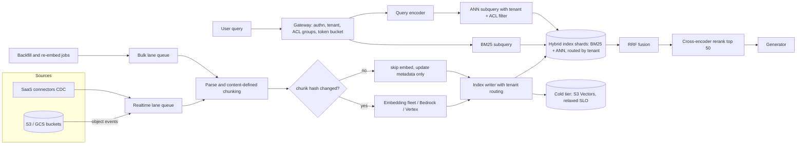

# System Design: Billion-Scale Real-Time Enterprise RAG

## TL;DR

At a billion chunks, cost and capacity are set by the vector index's memory footprint, not by the embedding bill: 1B x 1024-dim FP32 HNSW needs about 4.6 TB of RAM per copy, while 32x binary quantization with on-disk rescoring needs about 0.28 TB.
Keep p99 under 100 ms by fanning out to fewer shards, not by making each shard faster: route each query to the 1-4 shards that hold the tenant, because a 120-shard fan-out turns every shard's p99 into the query's p30.
Filtered ANN has a selectivity cliff: a small tenant filtered out of a large shared HNSW graph causes recall collapse or latency blow-up, so partition by filter selectivity (dedicated graph or exact scan), never by convenience.
Run hybrid retrieval (BM25 plus dense, fused with Reciprocal Rank Fusion) for recall, and also as a degradation path: when the embedding endpoint fails, BM25-only keeps serving.
Freshness and deletion are Lucene segment mechanics: refresh makes writes visible in about a second, deletes are tombstones until merge, and bulk tenant offboarding through delete-by-query triggers merge storms that hurt query p99.

## Mental Model



Think of it as two decoupled conveyor belts that share only the index.
The write belt is a priority-laned, idempotent pipeline keyed on `(tenant, doc_id, chunk_hash)`, so retries and re-crawls stay cheap and a 50M-document backfill cannot starve the 60-second freshness SLO of other tenants.
The read belt is a latency-budgeted fan-out whose width is set by tenant routing, and whose correctness depends on enforcing tenant and ACL filters inside the index, not after it.
Everything hard in this design lives where the belts meet the index: segment refresh and merge, graph construction CPU competing with query CPU, and the filtered graph traversal that decides whether a small tenant gets 95% recall or 20%.

## Internals

### Requirements that drive the architecture

The reference problem for this chapter is an enterprise RAG platform with about 4,000 tenants and 1.0B chunks total.
Tenant sizes are heavily skewed: the top 20 tenants hold 50% of the chunks, the next 400 hold 35%, and a long tail of about 3,580 tenants holds 15%.
Peak retrieval load is 5,000 QPS, with a p99 retrieval budget of 100 ms from query receipt to reranked top-k.
That budget excludes LLM generation.
Freshness target: p99 60 s from a source change to the content being searchable.
Deletion target: a deleted document is never returned after 60 s, and its bytes are physically purged within the retention policy.
Ingest runs at about 50M chunk mutations per day, with 10x bursts, plus occasional full re-embeds.
These are interview assumptions, not vendor figures.

### Data plane versus control plane

The data plane consists of the query gateway, query encoder, index shards, reranker, and index writers.
The control plane consists of tenant placement (which partition or shard group holds a tenant), index lifecycle (aliases, model version, shard splits), connector scheduling, and quota assignment.
Following [[17-Cloud-AI-Engineering/Volume_01_Cloud_Architecture_Principles/Chapter_04_Control_Plane_vs_Data_Plane_Separation|control plane vs data plane separation]], the gateway caches the tenant-to-placement map with a long TTL and keeps serving from that cache when the placement service is unavailable.
A placement change is a two-phase operation: dual-write to the old and new placements, backfill, flip the read alias, then stop writing to the old placement.
Reads never consult the control plane synchronously.

### Ingestion pipeline mechanics

Object events (S3 Event Notifications or EventBridge on AWS, Cloud Storage Pub/Sub notifications on GCP) and connector CDC records land in a real-time lane queue.
Backfills, tenant onboarding, and model migrations enter a separate bulk lane, with its own worker pool and embedding quota slice.
Two lanes plus per-tenant fair queuing in each lane is the minimum structure that stops one tenant's 30M-document initial crawl from pushing everyone else's freshness past 60 s.

Parsing and chunking happen next.
The mechanism most guides skip is content-defined chunking.
Fixed-size chunking (for example 512 tokens with 64 overlap) shifts every subsequent chunk boundary when a paragraph is inserted near the top of a document, so a one-line edit invalidates every chunk after it.
Structure-aware boundaries (headings, paragraph breaks) combined with a rolling-hash cut point inside long sections keep boundaries stable, so an edit invalidates only the chunks it touches.
Each chunk is then hashed (SHA-256 of normalized text plus the chunker version) and compared with the stored `chunk_hash` before embedding.
For a 30-chunk document where an edit changes 2 chunks, this skips 28 of 30 embedding calls, roughly a 93% reduction in embedding work for edit-heavy corpora.
Metadata-only changes (ACL, title, labels) bypass the embedder entirely and become partial updates.

Index writes are idempotent upserts keyed by a deterministic `_id = tenant:doc_id:chunk_ordinal`, carrying a monotonically increasing source version.
External versioning (writing only if the incoming version is greater than the stored one) stops a delayed retry from overwriting a newer write.
When a document shrinks from 30 chunks to 25, the writer must delete ordinals 25-29 explicitly.
Orphaned tail chunks are the most common source of "deleted text still retrieved" bugs.

### Index internals: Lucene segments, HNSW per segment, and why freshness costs CPU

In OpenSearch, each shard is a Lucene index made of immutable segments.
A refresh (default interval 1 s) turns the in-memory indexing buffer into a new searchable segment.
For `knn_vector` fields with the Faiss engine, a native HNSW graph is built per segment at flush or merge time.
The consequence is that freshness is paid in CPU: frequent refreshes produce many small segments, and every query has to search every segment's graph and merge the results.
Background merges then rebuild larger graphs from scratch, and HNSW construction cost grows superlinearly with segment size.
On a write-heavy shard, merge-time graph builds compete with queries for the same cores, which shows up as query p99 rising in lockstep with ingest rate.
Mitigations: a refresh interval sized to the freshness SLO (5-10 s is often enough for a 60 s SLO), larger indexing buffers, merge throttling during business hours, and on very hot write paths, a separate set of indexing nodes from search nodes.

Deletes are tombstones in a per-segment live-docs bitmap.
HNSW traversal still walks through deleted nodes, because they are graph waypoints, and then discards them.
Heavy delete ratios therefore spend part of the `ef_search` candidate list on dead vectors, which degrades both latency and recall until a merge expunges them.

### Memory model and quantization

OpenSearch documents the Faiss HNSW memory estimate as `1.1 * (4 * dimension + 8 * m)` bytes per vector, with `m` defaulting to 16 ([OpenSearch docs](https://docs.opensearch.org/latest/mappings/supported-field-types/knn-methods-engines/), as of 2026-10).
At 1024 dimensions, that is 1.1 x (4,096 + 128) = 4,646 bytes per vector, or about 4.65 TB per copy for 1B vectors.
OpenSearch 2.17 introduced an `on_disk` vector mode that defaults to the Faiss HNSW method, with a `compression_level` of 32x via 1-bit quantization and two-phase rescoring against full-precision vectors kept on disk ([OpenSearch docs](https://docs.opensearch.org/latest/vector-search/optimizing-storage/disk-based-vector-search/), as of 2026-10).
With 1-bit quantization, a 1024-dim vector occupies 128 bytes in memory, so the same formula gives about 1.1 x (128 + 128) = 282 bytes, or about 282 GB per copy.
This is an estimate derived from the formula, not a vendor figure.

The hidden cost is rescoring I/O.
With k = 50 and an oversample factor of 3, each query reads about 150 full-precision vectors (4 KB each at FP32/1024-d) from disk unless they sit in the page cache.
At 5,000 QPS that is up to 750,000 random 4 KB reads per second across the cluster.
That number, not RAM, decides whether `on_disk` mode is viable on network block storage or needs instance-local NVMe.
Tenant routing helps here as well: hot tenants' full-precision vectors stay resident in the page cache, and the cold tail pays the disk reads.

### ANN algorithm families and their lineage

HNSW (Malkov and Yashunin, IEEE TPAMI 2018) builds a multi-layer proximity graph and searches it greedily from a coarse entry layer down to layer 0.
Its recall-latency curve is excellent when the graph fits in RAM, and it degrades badly under restrictive filters (see below).
DiskANN (Subramanya et al., NeurIPS 2019) builds a single-layer Vamana graph stored on SSD, with product-quantized vectors in RAM guiding a beam search that issues only a few SSD reads per hop.
It is the intellectual ancestor of every "graph on disk, compressed vectors in memory" design, including the OpenSearch `on_disk` mode.
SPANN (Chen et al., NeurIPS 2021) takes the inverted-file approach instead: posting-list centroids in memory, posting lists on disk, and boundary vectors duplicated into several lists to fix recall at partition edges.
Google's ScaNN (Guo et al., ICML 2020) adds anisotropic vector quantization, which penalizes the component of quantization error parallel to the datapoint more than the orthogonal component, because only the parallel error changes inner-product rankings.
SOAR (Sun et al., NeurIPS 2023) extends ScaNN's IVF partitioning with spilled assignments, where a vector's secondary cluster is chosen so its residual is near-orthogonal to the primary residual, reducing correlated misses.
Vertex AI Vector Search is built on the ScaNN lineage.
AWS publishes less detail on the internals of Amazon S3 Vectors.
S3 Vectors reached GA on 2025-12-02 with up to 2 billion vectors per index, up to 20 trillion per bucket, and roughly 100 ms query latency ([AWS announcement](https://www.amazonaws.cn/en/new/2026/announcing-amazon-s3-vectors-cloud-object-storage-with-native-support-to-store-and-query-vectors/), [BigDATAwire](https://www.hpcwire.com/bigdatawire/this-just-in/amazon-s3-vectors-now-generally-available-with-increased-scale-and-performance/), as of 2026-10).

### The deep mechanism: the filtered-ANN selectivity cliff

Every multi-tenant pooled index runs every query with a predicate: `tenant_id = T AND acl_groups IN (user's groups)`.
Let `s` be the predicate's selectivity in a graph of `N` vectors, meaning the fraction of vectors that pass.
There are three ways to apply the filter, and each fails differently.

Post-filtering runs plain ANN for `k'` candidates and then discards non-matching ones.
The expected number of survivors is `k' * s`, so returning k = 50 at s = 10^-4 needs `k'` around 500,000.
In practice the engine returns fewer than k results, and the system silently loses recall.

In-traversal filtering (what OpenSearch calls efficient filtering for Faiss, and what Lucene does with a filter bitset) walks the graph but admits only matching nodes into the result set.
The graph was built without knowledge of the predicate.
At low `s`, most of a matching node's neighbors do not match, so the search visits on the order of `ef / s` nodes to collect `ef` matching candidates.
With `ef = 100` and `s = 10^-4`, that is about 1,000,000 node visits, worse than scanning the 10,000 matching vectors directly.
Worse, the subgraph induced by the predicate may be disconnected, so greedy search gets stuck in a local region and recall collapses with no error raised.

Exact search over the filtered set is cheap when the matching set is small.
Scanning 10,000 1-bit vectors is 1.28 MB of popcount work, which takes well under a millisecond on one core.
Scanning 10,000 FP32 1024-d vectors moves about 41 MB, which costs a few milliseconds of memory bandwidth.
OpenSearch's efficient filtering switches to exact search when the filtered candidate count is small relative to k, with a configurable threshold (`knn.advanced.filtered_exact_search_threshold`, UNVERIFIED setting name).

That leaves a danger zone in the middle, roughly 10^-3 < s < 10^-1.
There, the filtered set is too large to scan within budget, yet the induced subgraph is sparse enough that graph search loses recall or explodes in latency.
Research systems attack this zone directly.
Filtered-DiskANN (Gollapudi et al., ACM Web Conference 2023) builds label-aware graph edges, so each label's subgraph stays navigable.
ACORN (Patel et al., SIGMOD 2024) builds a denser, predicate-agnostic HNSW variant and expands the neighbor lists during search, so arbitrary predicate subgraphs stay connected.
Managed services do not let you pick these algorithms, so the production fix is placement:

| Tenant size class | Placement | Effective selectivity inside its graph | Search mode |
| --- | --- | --- | --- |
| Very large (>= ~20M chunks) | Dedicated index or dedicated shard group | ~1.0 for tenant filter | HNSW with ACL filter only |
| Medium (~200k to 20M) | Pooled index, routed to 1-2 shards via `_routing`, sized so the tenant is >= ~10% of each shard | >= 0.1 | HNSW with in-traversal filter |
| Small (< ~200k) | Pooled, routed to 1 shard, many tenants per shard | very low | Exact scan over filtered set (quantized), rescore top candidates |

The thresholds are workload-specific and must come from a recall benchmark on your own data, not from this table.
The principle is that partitions are chosen to push every tenant's selectivity out of the danger zone.
ACL filters stack on top of tenant filters.
A user who can see 0.5% of a large tenant's corpus reintroduces the cliff inside the dedicated index, so ACL-heavy tenants also need the exact-scan fallback.

### Tenant routing and fan-out

Elasticsearch-lineage engines, including OpenSearch, place a document on a shard by hashing its routing value, which defaults to `_id`.
Setting routing to `tenant_id` co-locates a tenant on one shard, so a query that passes the same routing value touches one shard instead of all of them.
`index.routing_partition_size` spreads each routing value over a small subset of shards (for example 2 of 24).
That bounds a large tenant's hot spot while keeping fan-out small.
The fan-out arithmetic is the reason this matters for p99.
If each shard independently exceeds its own p99 1% of the time, a query touching `n` shards exceeds that latency with probability `1 - 0.99^n`.

| Shards touched per query | P(query slower than single-shard p99) |
| --- | --- |
| 1 | 1.0% |
| 4 | 3.9% |
| 50 | 39.5% |
| 120 | 70.1% |

With 120-way fan-out, the per-shard p99 becomes roughly the query's p30 tail point, so the query p99 is set by each shard's p99.99.
Dean and Barroso's "The Tail at Scale" (CACM 2013) gives the standard mitigations, hedged and tied requests.
Routing removes most of the need for them.
Hedge only the residual multi-shard queries, and only after the 95th-percentile per-shard latency has elapsed, so extra load stays near 5%.

### Hybrid retrieval and fusion

Dense retrieval misses exact identifiers (error codes, SKUs, contract numbers, people's names) that BM25 matches trivially.
BM25 misses paraphrase and cross-lingual matches that dense retrieval handles.
OpenSearch runs both as subqueries of a `hybrid` query, and a search pipeline combines them between the query and fetch phases.
The `normalization-processor` is score-based: it normalizes each subquery's scores (`min_max`, `l2`, or `z_score`) and combines them with arithmetic, geometric, or harmonic means.
The `score-ranker-processor`, added in OpenSearch 2.19, is rank-based and applies Reciprocal Rank Fusion ([OpenSearch docs](https://docs.opensearch.org/latest/vector-search/ai-search/hybrid-search/rrf/), as of 2026-10).
RRF (Cormack, Clarke, and Buettcher, SIGIR 2009) scores a document as the sum over result lists of `1 / (k + rank)`, with `k = 60` as the conventional constant.
Because RRF throws away score magnitudes, it is robust when BM25 scores (unbounded, query-length dependent) and cosine scores (bounded) are not comparable.
It is the right default before you have labeled relevance data.
Score-based fusion wins once you have tuned weights from offline evaluation, because a large score margin carries information that ranks discard.

On Google Cloud, Vertex AI Vector Search supports dense, sparse, and hybrid search over dense plus sparse embeddings ([Google Cloud docs](https://docs.cloud.google.com/vertex-ai/docs/vector-search/overview), as of 2026-10).
There is no built-in BM25 analyzer in the classic API.
You generate sparse vectors yourself (TF-IDF, BM25 weights, or a learned sparse model) and the service fuses them with RRF.
LangChain's integration docs describe a "Vector Search 2.0" with auto-generated embeddings and RRF-based hybrid text search; its GA status is UNVERIFIED.
Google's Vector Search documentation now carries the "Gemini Enterprise Agent Platform" branding (Google Cloud docs, as of 2026-10), and this chapter keeps the historical name Vertex AI Vector Search for the API surface.

### Reranking and the latency budget

A cross-encoder reranker scores (query, chunk) pairs jointly, which is much more accurate than bi-encoder similarity but costs one transformer forward pass per candidate.
Reranking the fused top 50 on a GPU fleet fits the budget, while reranking the top 500 does not.

| Stage | p99 budget (design target) |
| --- | --- |
| Gateway: authn, tenant resolution, cached ACL groups, rate limit | 5 ms |
| Query embedding (self-hosted small encoder or cache hit) | 15 ms |
| Parallel BM25 + filtered ANN on 1-4 routed shards, incl. rescore | 35 ms |
| RRF fusion and fetch of `_source` for top 50 | 5 ms |
| Cross-encoder rerank of top 50 | 25 ms |
| Network and serialization slack | 15 ms |
| Total | 100 ms |

These are allocation targets, not vendor latency claims.
A managed embedding API called across a network hop often eats the whole embedding allocation by itself, which is why high-QPS platforms self-host the query encoder or cache embeddings for repeated queries.
S3 Vectors' roughly 100 ms query latency (as of 2026-10) cannot fit inside this budget, so it belongs in an economy tier with a relaxed SLO (for example 400 ms p99) for cold tenants and archives.

### Replication topology and failure domains

Each index runs a primary plus at least one replica, placed across availability zones with zone awareness.
Replicas serve reads, so replica count is a QPS lever as well as a durability lever.
The embedding fleet and reranker fleet are stateless and deployed per zone.
Zonal isolation of the read path follows [[17-Cloud-AI-Engineering/Volume_01_Cloud_Architecture_Principles/Chapter_02_Regions_Zones_and_Static_Stability|static stability]]: each zone must be able to serve its share of peak traffic when one zone is lost, which means provisioning for N+1 zones, not N.
Tenant placement maps naturally onto [[17-Cloud-AI-Engineering/Volume_01_Cloud_Architecture_Principles/Chapter_03_Cell_Based_Architecture_and_Shuffle_Sharding|cells]].
A cell is an independent cluster with its own index, encoder pool, and quotas, and large tenants are pinned to cells, so a poison-pill query or runaway ingest affects one cell only.

## Numbers to Know

| Quantity | Value | Source |
| --- | --- | --- |
| Faiss HNSW memory estimate | 1.1 x (4 x dim + 8 x m) bytes/vector | (OpenSearch docs, as of 2026-10) |
| HNSW default `m` / default `ef_search` (float) | 16 / 100 (256 for binary indexes) | (OpenSearch docs, as of 2026-10) |
| 1B x 1024-d FP32 HNSW, m=16 | ~4.65 TB per copy | derived from formula above |
| 1B x 512-d FP32 HNSW, m=16 | ~2.39 TB per copy | derived |
| 1B x 1024-d, 32x (1-bit) in-memory footprint | ~282 GB per copy, plus ~4 TB full-precision on disk | derived |
| `on_disk` mode introduced / default compression | OpenSearch 2.17 / 32x | (OpenSearch docs and blog, as of 2026-10) |
| RRF in OpenSearch hybrid search | 2.19+ via `score-ranker-processor` | (OpenSearch docs, as of 2026-10) |
| S3 Vectors scale at GA (2025-12-02) | 2B vectors/index, 20T vectors/bucket | (AWS announcement, as of 2026-10) |
| S3 Vectors query latency | ~100 ms | (AWS announcement via BigDATAwire, as of 2026-10) |
| S3 Vectors preview index cap (2025-07) | 50M vectors/index | (VentureBeat, as of 2026-10) |
| Bedrock Knowledge Bases concurrency | 1 ingestion job per KB, 5 per account | (AWS ML Blog, as of 2026-10) |
| Bedrock KB job size / docs per data source | 100 GB per job / 5M documents per data source | (AWS ML Blog, as of 2026-10) |
| Bedrock KB per-file size limit | 50 MB | (Bedrock User Guide via secondary source, as of 2026-10) |
| Titan Text Embeddings V2 price | $0.00002 per 1K input tokens ($0.02/M) | (AWS ML Blog, as of 2026-10) |
| Titan Text Embeddings V2 max input | 8,192 tokens | (AWS docs via secondary source, as of 2026-10) |
| Vertex AI node price, e2-standard-16 | $0.6165 per hour | (Google Cloud pricing page, as of 2026-10; attribution to the Vector Search table is UNVERIFIED) |
| Fan-out tail, 120 shards | 70.1% of queries exceed per-shard p99 | derived: 1 - 0.99^120 |
| Rescore I/O at 5,000 QPS, k=50, oversample 3 | up to 750k random 4 KB reads/s | derived |
| Full re-embed, 1B chunks x 300 tokens | 3 x 10^11 tokens, ~$6,000 at Titan V2 list | derived from the price above |

## AWS vs GCP Mechanism Parity

| Concern | AWS | Google Cloud | Critical difference |
| --- | --- | --- | --- |
| Change capture | S3 Event Notifications, EventBridge | Cloud Storage Pub/Sub notifications, Eventarc | Both are at-least-once; dedupe on `(bucket, key, version/generation)` |
| Work queue and lanes | SQS (separate queues per lane), MSK for CDC | Pub/Sub (separate subscriptions per lane), Managed Kafka | Pub/Sub has no FIFO-per-key without ordering keys; SQS FIFO caps throughput per group |
| Embedding | Bedrock Titan Text Embeddings V2, Cohere on Bedrock, self-hosted on EC2/EKS | Vertex AI text embedding / Gemini embedding models, self-hosted on GKE | Managed TPM quotas cap backfill rate on both; batch inference for bulk lane |
| Keyword retrieval | OpenSearch BM25 native analyzers | No native BM25 in classic Vector Search; supply sparse vectors | GCP pushes sparse-vector generation onto your pipeline |
| Dense ANN | OpenSearch Faiss / Lucene HNSW, IVF; `on_disk` 1-bit + rescore | Vector Search (ScaNN lineage, tree-AH), AlloyDB ScaNN index | OpenSearch exposes graph params; Vector Search exposes fewer knobs |
| Fusion | `score-ranker-processor` (RRF) or `normalization-processor` | RRF over dense + sparse in hybrid query | OpenSearch allows score-based fusion with tuned weights |
| Filtering | `filter` inside `knn` clause, efficient filtering with exact fallback | Token `restricts` (allow/deny) and numeric restricts on datapoints | Neither publishes recall guarantees under low selectivity; benchmark it |
| Tenant co-location | `_routing` + `routing_partition_size`, or index-per-tenant | Index or namespace-per-tenant, restricts on `tenant` token | No shard-routing primitive on Vector Search; isolation is by index or restrict |
| Freshness | Refresh interval (default 1 s) on segments | Streaming update indexes vs batch-update indexes | Batch-update indexes cannot meet a 60 s SLO |
| Cheap cold tier | S3 Vectors (GA 2025-12, ~100 ms) | UNVERIFIED equivalent; Vector Search 2.0 status UNVERIFIED | AWS has a first-party object-storage vector tier |
| Managed RAG | Bedrock Knowledge Bases | Vertex AI RAG Engine | Bedrock KB job and doc-count quotas bind at billion scale |
| Private network | VPC domain for OpenSearch, PrivateLink interface endpoints for Bedrock | Private Service Connect for Vector Search endpoints, VPC Service Controls | VPC-SC is an API-level perimeter; AWS composes SCPs + endpoint policies |
| Keys | KMS CMK on OpenSearch domain and S3 | CMEK via Cloud KMS on supported resources | Verify CMEK coverage per resource before promising it |

For broader context, see [[17-Cloud-AI-Engineering/Volume_12_AI_Applications_MLOps_and_Data_Platforms/Chapter_01_Vector_Databases_and_Similarity_Search_on_Cloud|Vector Databases and Similarity Search on Cloud]] and [[17-Cloud-AI-Engineering/Volume_11_LLM_Serving_and_Inference_Systems_on_Cloud/Chapter_09_Managed_Inference_Amazon_Bedrock_vs_Vertex_AI|Managed Inference: Bedrock vs Vertex AI]].

## Worked Example: Tenant-Routed Hybrid Index on OpenSearch with Quantized Vectors

### What the lab builds

The lab builds a one-node Amazon OpenSearch Service domain, an index with 1-bit on-disk vectors and tenant routing, an RRF search pipeline, hash-gated ingestion with Titan V2 embeddings, a hybrid query with tenant and ACL filtering, and a document delete that also removes orphan chunks.

### Cost estimate and budget guardrail

Cost drivers: one `r7g.large.search` data node plus 20 GB gp3 storage, billed hourly while the domain exists.
The current hourly rate is UNVERIFIED here, so check the OpenSearch Service pricing page for your region before you start.
Embedding 10,000 chunks of about 300 tokens is 3M tokens, which costs about $0.06 at Titan V2 list price (as of 2026-10).
Delete the domain the same day.

```bash
#!/usr/bin/env bash
set -euo pipefail
export AWS_REGION=us-east-1
ACCOUNT_ID=$(aws sts get-caller-identity --query Account --output text)
ME_ARN=$(aws sts get-caller-identity --query Arn --output text)

# Budget alarm: email at 80% of a 20 USD monthly cap.
aws budgets create-budget --account-id "$ACCOUNT_ID" \
  --budget '{"BudgetName":"rag-lab","BudgetLimit":{"Amount":"20","Unit":"USD"},"TimeUnit":"MONTHLY","BudgetType":"COST"}' \
  --notifications-with-subscribers '[{"Notification":{"NotificationType":"ACTUAL","ComparisonOperator":"GREATER_THAN","Threshold":80,"ThresholdType":"PERCENTAGE"},"Subscribers":[{"SubscriptionType":"EMAIL","Address":"you@example.com"}]}]'

cat > /tmp/policy.json <<EOF
{"Version":"2012-10-17","Statement":[{"Effect":"Allow",
 "Principal":{"AWS":"${ME_ARN}"},
 "Action":"es:ESHttp*",
 "Resource":"arn:aws:es:${AWS_REGION}:${ACCOUNT_ID}:domain/rag-lab/*"}]}
EOF

aws opensearch create-domain --domain-name rag-lab \
  --engine-version OpenSearch_2.19 \
  --cluster-config InstanceType=r7g.large.search,InstanceCount=1 \
  --ebs-options EBSEnabled=true,VolumeType=gp3,VolumeSize=20 \
  --encryption-at-rest-options Enabled=true \
  --node-to-node-encryption-options Enabled=true \
  --domain-endpoint-options EnforceHTTPS=true \
  --access-policies file:///tmp/policy.json

# Wait until Processing=false, then export the endpoint.
aws opensearch describe-domain --domain-name rag-lab \
  --query 'DomainStatus.[Processing,Endpoint]' --output text
```

### Index, pipeline, ingestion, query

```python
# pip install boto3 opensearch-py
import hashlib, json, os
import boto3
from opensearchpy import OpenSearch, RequestsHttpConnection, AWSV4SignerAuth, helpers

REGION = os.environ.get("AWS_REGION", "us-east-1")
HOST = os.environ["OS_ENDPOINT"]          # domain endpoint, no https://
INDEX = "chunks-v1-titanv2-1024"          # model version is part of the name
MODEL_ID = "amazon.titan-embed-text-v2:0"

creds = boto3.Session().get_credentials()
os_client = OpenSearch(hosts=[{"host": HOST, "port": 443}],
                       http_auth=AWSV4SignerAuth(creds, REGION, "es"),
                       use_ssl=True, verify_certs=True,
                       connection_class=RequestsHttpConnection, timeout=30)
bedrock = boto3.client("bedrock-runtime", region_name=REGION)

def create_index():
    body = {
        "settings": {"index": {
            "knn": True,
            "number_of_shards": 6,
            "number_of_replicas": 0,          # lab only; use >= 1 in production
            "routing_partition_size": 2,      # each tenant spans 2 of 6 shards
            "refresh_interval": "5s"}},       # sized to a 60 s freshness SLO
        "mappings": {
            "_routing": {"required": True},
            "properties": {
                "tenant_id": {"type": "keyword"},
                "doc_id": {"type": "keyword"},
                "ordinal": {"type": "integer"},
                "acl_groups": {"type": "keyword"},
                "chunk_hash": {"type": "keyword"},
                "embed_model": {"type": "keyword"},
                "text": {"type": "text"},
                "embedding": {"type": "knn_vector", "dimension": 1024,
                              "space_type": "l2", "mode": "on_disk",
                              "compression_level": "32x"}}}}
    if not os_client.indices.exists(index=INDEX):
        os_client.indices.create(index=INDEX, body=body)
    os_client.transport.perform_request(
        "PUT", "/_search/pipeline/rrf-pipeline",
        body={"phase_results_processors": [{"score-ranker-processor": {
            "combination": {"technique": "rrf", "rank_constant": 60}}}]})

def embed(text):
    resp = bedrock.invoke_model(modelId=MODEL_ID, body=json.dumps(
        {"inputText": text, "dimensions": 1024, "normalize": True}))
    return json.loads(resp["body"].read())["embedding"]

def chunk_hash(text, chunker_version="cdc-v1"):
    norm = " ".join(text.split()).lower()
    return hashlib.sha256(f"{chunker_version}|{norm}".encode()).hexdigest()

def upsert_document(tenant, doc_id, chunks, acl_groups):
    ids = [f"{tenant}:{doc_id}:{i}" for i in range(len(chunks))]
    existing = os_client.mget(index=INDEX, body={"docs": [
        {"_id": i, "routing": tenant, "_source": ["chunk_hash"]} for i in ids]})
    old = {d["_id"]: d["_source"]["chunk_hash"]
           for d in existing["docs"] if d.get("found")}
    actions, embedded = [], 0
    for i, (cid, text) in enumerate(zip(ids, chunks)):
        h = chunk_hash(text)
        if old.get(cid) == h:
            actions.append({"_op_type": "update", "_index": INDEX, "_id": cid,
                            "_routing": tenant, "doc": {"acl_groups": acl_groups}})
            continue
        embedded += 1
        actions.append({"_op_type": "index", "_index": INDEX, "_id": cid,
                        "_routing": tenant, "_source": {
                            "tenant_id": tenant, "doc_id": doc_id, "ordinal": i,
                            "acl_groups": acl_groups, "chunk_hash": h,
                            "embed_model": MODEL_ID, "text": text,
                            "embedding": embed(text)}})
    helpers.bulk(os_client, actions, refresh="wait_for")
    # Remove orphaned tail chunks when a document shrinks.
    os_client.delete_by_query(index=INDEX, routing=tenant, body={"query": {"bool": {
        "filter": [{"term": {"tenant_id": tenant}}, {"term": {"doc_id": doc_id}},
                   {"range": {"ordinal": {"gte": len(chunks)}}}]}}})
    return embedded

def search(tenant, user_groups, q, k=10):
    filt = [{"term": {"tenant_id": tenant}}, {"terms": {"acl_groups": user_groups}}]
    body = {"size": k, "_source": {"excludes": ["embedding"]},
            "query": {"hybrid": {"queries": [
                {"bool": {"must": [{"match": {"text": q}}], "filter": filt}},
                {"knn": {"embedding": {"vector": embed(q), "k": 50,
                                       "filter": {"bool": {"filter": filt}}}}}]}}}
    res = os_client.search(index=INDEX, body=body, routing=tenant,
                           params={"search_pipeline": "rrf-pipeline"})
    return [(h["_source"]["doc_id"], h["_source"]["ordinal"], round(h["_score"], 4))
            for h in res["hits"]["hits"]]

def delete_document(tenant, doc_id):
    os_client.delete_by_query(index=INDEX, routing=tenant, refresh=True, body={
        "query": {"bool": {"filter": [{"term": {"tenant_id": tenant}},
                                      {"term": {"doc_id": doc_id}}]}}})

if __name__ == "__main__":
    create_index()
    n = upsert_document("acme", "runbook-17",
        ["Error E-4031 means the KMS grant expired.",
         "Rotate the grant with the key admin role.",
         "Escalate to the platform on-call if rotation fails."], ["sre"])
    print("embedded chunks:", n)
    n = upsert_document("acme", "runbook-17",
        ["Error E-4031 means the KMS grant expired.",
         "Rotate the grant with the key admin role."], ["sre"])
    print("embedded on re-ingest:", n)          # expect 0, tail ordinal 2 deleted
    os_client.indices.refresh(index=INDEX)
    print(search("acme", ["sre"], "what does E-4031 mean"))
    print(search("acme", ["finance"], "what does E-4031 mean"))  # expect []
    delete_document("acme", "runbook-17")
```

The second call to `upsert_document` re-embeds nothing and deletes the orphaned third chunk.
The query for "E-4031" is an exact identifier, which BM25 matches even when the dense neighbor ranking is weak, and RRF fuses the two lists.
The `finance` query returns nothing because the ACL filter runs inside both subqueries, not after retrieval.

### Teardown

```bash
aws opensearch delete-domain --domain-name rag-lab
aws budgets delete-budget --account-id "$(aws sts get-caller-identity --query Account --output text)" --budget-name rag-lab
```

### Back-of-the-envelope capacity and cost for the reference platform

Step 1, vector memory.
At 1B chunks x 1024-d with 1-bit quantization, the footprint is about 282 GB per copy.
With one replica that is about 564 GB, and with 30% headroom for growth, segment overhead, and merge transients, the target is about 730 GB of native k-NN memory.

Step 2, node count.
Assume about 60 GB of each 128 GiB node is usable for native vector memory after JVM heap and OS page cache reservations (an assumption to validate against the k-NN circuit breaker settings).
That gives about 12-13 data nodes for vectors.
Keeping FP32 in memory instead would need about 9.3 TB x 1.3 / 60 GB, or about 200 nodes.
That roughly 15x difference is the single biggest cost lever in the design.

Step 3, rescore I/O.
Up to 750k random reads/s cluster-wide falls to about 60k per node across 13 nodes, before page-cache hits.
That points to instance-local NVMe or a high page-cache hit ratio for hot tenants, and it must be load-tested.

Step 4, text index.
1B chunks x about 1.2 KB of text is about 1.2 TB of source.
Inverted index plus stored `_source` typically adds the same order of magnitude again, about 1-2 TB per copy (an estimate), so it lives on disk.

Step 5, query compute.
5,000 QPS over 13 nodes is about 385 QPS per node.
Each query hits 1-2 shards, does an exact scan or HNSW search plus about 150 rescore reads, and runs a BM25 subquery.
Validate with a replayed production query log, not synthetic uniform queries.

Step 6, embedding spend.
Steady state is 50M chunk mutations/day x 300 tokens = 15B tokens/day, or about $300/day at $0.02/M (as of 2026-10).
With 90% hash-gate hits, that falls to about $30/day.
Peak ingest is 5,800 chunks/s x 300 tokens, about 104M tokens/min, which is far above typical default managed TPM quotas (UNVERIFIED for specific values).
So the real-time lane needs either a quota increase or a self-hosted encoder fleet, and the bulk lane uses batch inference.

Step 7, query embedding spend.
An average of 1,500 QPS is about 130M queries/day x 20 tokens = 2.6B tokens/day, or about $52/day if sent to Titan V2.
Self-hosting the query encoder is driven by latency, not dollars.

For the full cost-per-query framing, see [[17-Cloud-AI-Engineering/Volume_11_LLM_Serving_and_Inference_Systems_on_Cloud/Chapter_11_End_to_End_Latency_Throughput_and_Cost_Modeling|End-to-End Latency, Throughput, and Cost Modeling]].

## Failure Modes and Pitfalls

### Silent recall collapse under restrictive filters

Symptom: a small tenant reports "the assistant cannot find documents I know exist", while latency and error-rate dashboards stay green.
Mechanism: the selectivity cliff described in Internals, with in-traversal filtering on a disconnected induced subgraph, or post-filtering that returns fewer than k results.
Detection: a per-tenant canary set of (query, expected doc) pairs, scored hourly for recall@k and broken down by tenant size class.
Mitigation: re-placement by selectivity, an exact-scan threshold, and alerting when results are under-filled (returned hits < k while the tenant has > k matching docs).

### Embedding model version skew

Symptom: relevance falls off a cliff after a deploy, with no errors.
Mechanism: the query encoder was upgraded (or its dimension or normalization changed) while the index still holds vectors from the old model.
The vector spaces are incompatible, and cosine similarity between them returns plausible-looking noise.
Mitigation: put the model ID in the index name and in each document, have the gateway assert that the query model matches the alias's model, and migrate with a dual index and alias flip (Question 6).

### Merge storms from bulk deletes

Symptom: query p99 doubles for hours after a large tenant offboards or a retention job runs.
Mechanism: delete-by-query over tens of millions of pooled chunks creates tombstones across many segments.
Merge policy then rewrites those segments and rebuilds HNSW graphs, saturating CPU and I/O.
Mitigation: put large tenants in dedicated indexes, so offboarding means dropping an index (an O(1) metadata operation), throttle retention deletes, and schedule expunge merges off-peak.

### k-NN native memory pressure and graph thrash

Symptom: periodic latency cliffs and growing graph load or eviction counts.
Mechanism: total graph memory exceeds the k-NN circuit breaker limit (`knn.memory.circuit_breaker.limit`), so graphs are evicted and reloaded from disk on demand.
Mitigation: capacity alarms at 70% of the breaker limit, quantization, and moving cold tenants to a cheaper tier.

### Hot tenant on routed shards

Symptom: a single shard pair runs at 100% CPU while the cluster average is 30%.
Mechanism: tenant routing concentrates a large, bursty tenant on `routing_partition_size` shards.
Mitigation: per-tenant token buckets at the gateway ([[17-Cloud-AI-Engineering/Volume_07_Reliability_and_SRE/Chapter_02_Load_Shedding_Backpressure_and_Admission_Control|admission control]]), a larger partition size for that tenant's index, or promotion to a dedicated index.

### Ingest starvation and freshness SLO burn

Symptom: freshness p99 drifts from 40 s to 20 minutes during one tenant's onboarding.
Mechanism: a single shared queue with FIFO semantics, where the backfill sits ahead of real-time edits, and a shared embedding quota being consumed by the backfill.
Mitigation: lane separation, per-tenant weighted fair queuing, a reserved quota for the real-time lane, and an SLO burn-rate alert on event-to-searchable latency ([[17-Cloud-AI-Engineering/Volume_07_Reliability_and_SRE/Chapter_01_SLIs_SLOs_and_Error_Budget_Engineering|SLIs and SLOs]]).

### Retry amplification against the embedding API

Symptom: during an embedding endpoint brownout, ingest workers multiply load with immediate retries, throttling worsens, and query-time embedding (sharing the same quota) fails as well.
Mitigation: separate quotas or accounts for query and ingest embedding, capped exponential backoff with full jitter ([[17-Cloud-AI-Engineering/Volume_07_Reliability_and_SRE/Chapter_03_Resilient_Communication_Retries_Jitter_and_Circuit_Breakers|retries and jitter]]), and a circuit breaker that degrades queries to BM25-only.

### Regional dependency outages

On 2025-10-20, a latent race condition in DynamoDB's automated DNS management in us-east-1 left the regional endpoint without valid DNS records, and services that depended on it failed in cascade ([AWS PIR](https://aws.amazon.com/message/101925/), UNVERIFIED in this session).
On 2025-06-12, a Google Cloud Service Control change with a null-pointer path, which was not feature-flagged, crash-looped globally once replicated policy data arrived ([Google Cloud incident report](https://status.cloud.google.com/incidents/ow5i3PPK96RduMcb1SsW), UNVERIFIED in this session).
The RAG lessons: the query path should not depend on a regional control-plane API at request time.
Cache IAM-derived ACL group memberships with a bounded staleness window.
Treat the embedding endpoint as a dependency that may vanish, and keep a BM25-only mode that still meets a reduced quality SLO.
See [[17-Cloud-AI-Engineering/Volume_07_Reliability_and_SRE/Chapter_07_Anatomy_of_Major_Cloud_Outages|Anatomy of Major Cloud Outages]].

### Managed RAG quota ceilings

Bedrock Knowledge Bases allows one concurrent ingestion job per knowledge base and five per account, 100 GB per job, and 5M documents per data source (AWS ML Blog, as of 2026-10).
A pooled single-KB design for thousands of tenants therefore serializes freshness across all tenants.
At billion-chunk scale, managed KBs fit the silo pattern for mid-size tenants, while the pooled long tail and the largest tenants need a custom pipeline.

### Indirect prompt injection through ingested content

Every ingested document can carry instructions to the generator.
Retrieval relevance has no defense against this.
Treat retrieved text as untrusted data and apply the controls in [[17-Cloud-AI-Engineering/Volume_12_AI_Applications_MLOps_and_Data_Platforms/Chapter_08_Cloud_Security_for_AI_Systems_Attacks_and_Defenses|Cloud Security for AI Systems]].

## Security and Cost Angles

### Tenant and ACL isolation

Enforce tenant isolation in three layers.
Layer one: the gateway derives `tenant_id` from the authenticated token, never from a request parameter.
Layer two: the index enforces it, either through physical separation (an index per large tenant, with IAM or fine-grained access control scoped per index) or through a mandatory filter injected server-side.
Layer three: caches (query embedding cache, result cache, reranker cache, LLM response cache) include `tenant_id` and the ACL group-set hash in the key.
OpenSearch fine-grained access control supports document-level security, which can bind a role to a query filter, as defense in depth below the application filter.

ACL propagation has a write amplification problem.
Changing a group's access to a 2M-chunk folder means 2M partial updates.
The alternative is a late-binding check that stores a coarse `acl_scope` on chunks, over-fetches, and verifies fine-grained permissions against an authorization service before returning results.
That trades write cost for query latency and over-fetch recall loss.

### Keys and data at rest

OpenSearch domains use KMS keys for encryption at rest, and full-precision vector files on disk are covered by that encryption.
Embeddings are derived data that can leak source content through inversion attacks, so classify them at the same level as the source text.
For crypto-shredding a tenant, use per-tenant data keys at the application layer for stored text where feasible, so destroying one key renders backups unreadable.
Mechanics are covered in [[17-Cloud-AI-Engineering/Volume_08_Security_Identity_and_the_Data_Perimeter/Chapter_04_Encryption_Key_Hierarchies_and_Envelope_Encryption|Encryption Key Hierarchies]].

### Network perimeter

On AWS, run OpenSearch as a VPC domain, reach Bedrock through PrivateLink interface endpoints with endpoint policies restricted to the embedding model ARNs, and add SCP conditions that deny Bedrock calls outside the VPC endpoints.
On Google Cloud, wrap `aiplatform.googleapis.com` and `storage.googleapis.com` in a VPC Service Controls perimeter, and reach Vector Search index endpoints through Private Service Connect.
See [[17-Cloud-AI-Engineering/Volume_08_Security_Identity_and_the_Data_Perimeter/Chapter_06_Constructing_an_Impenetrable_Data_Perimeter|Constructing an Impenetrable Data Perimeter]] and [[17-Cloud-AI-Engineering/Volume_03_GCP_Deep_Dive/Chapter_03_VPC_Service_Controls_Security_Perimeters|VPC Service Controls]].

### Unit economics levers, ranked by impact

1. Vector precision and dimension: 32x quantization or 512-d instead of 1024-d changes node count by 2x-15x.
2. Tiering: put tenants with low query rates on S3 Vectors (economy SLO) instead of always-on nodes.
3. Hash-gated re-embedding and content-defined chunking: cuts steady-state embedding spend by an order of magnitude for edit-heavy corpora.
4. Reranker depth: reranking 50 vs 200 candidates is a 4x change in GPU spend.
5. Commitments on the steady node fleet ([[17-Cloud-AI-Engineering/Volume_09_FinOps_and_Cloud_Economics/Chapter_02_Commitment_Discounts_Savings_Plans_vs_CUDs|Savings Plans vs CUDs]]), with Spot or preemptible capacity only for stateless backfill embedding workers.

Bill tenants for showback on three meters: stored vectors (GB-month of in-memory footprint), queries, and embedded tokens.
Those three track the physical cost drivers.

## Interview Questions and Model Answers

### Question 1 (L5 - Senior)

Why would you run hybrid BM25 plus dense retrieval instead of dense only, and how do you fuse the two result lists?

#### Model Answer

Dense bi-encoders compress a chunk into one vector, which captures topical and paraphrastic similarity but blurs rare exact tokens such as error codes, part numbers, and names.
BM25 scores exact term overlap with IDF weighting, so it nails those tokens and fails on synonyms.
In enterprise corpora, a large share of queries contain identifiers, so dense-only retrieval visibly fails on them.
For fusion, start with Reciprocal Rank Fusion: each document scores the sum of `1/(k + rank)` across lists, with k around 60.
It needs no score calibration, which matters because BM25 scores are unbounded and depend on query length, while cosine scores are bounded.
In OpenSearch 2.19+, this is the `score-ranker-processor` in a search pipeline, running between the query and fetch phases.
Once I have a few thousand labeled query-document judgments, I would A/B test score-based fusion (min-max or z-score normalization with tuned weights), because RRF discards margin information.
A third benefit is operational: when the embedding service fails, the BM25 leg alone is a usable degraded mode, so hybrid also buys availability.
The cost is two subqueries per request and a larger index, roughly 1-2 TB of text index per copy at 1B chunks, which lives on disk and adds modest CPU.

#### Follow-up Interviewer Question

RRF ranks a document that appears at rank 3 in both lists above one at rank 1 in BM25 and absent from dense; when is that wrong, and how would you detect it?

### Question 2 (L5 - Senior)

Size the memory for 1B chunks embedded at 1024 dimensions in an HNSW index, and give three ways to cut it.

#### Model Answer

Using the Faiss HNSW estimate of `1.1 * (4d + 8m)` bytes with m = 16, each vector costs 1.1 x 4,224, about 4.6 KB.
That is about 4.65 TB per copy, and with one replica about 9.3 TB of RAM, roughly 155-200 large nodes depending on usable native memory per node.
First lever: reduce dimension, since Titan V2 supports smaller output dimensions and 512-d halves the vector term.
Validate recall on my own eval set before committing.
Second lever: quantization, such as FP16 (2x), byte (4x), or 1-bit binary (32x), with rescoring.
OpenSearch's `on_disk` mode defaults to 32x and rescoring, dropping the in-memory footprint to about 282 GB per copy.
The price is rescoring I/O: with k = 50 and oversample 3, each query reads about 150 full-precision vectors, which is 750k random reads per second at 5,000 QPS unless the page cache absorbs them.
Third lever: tiering, which keeps rarely queried tenants out of RAM entirely, for example in S3 Vectors, accepting roughly 100 ms query latency for that tier.
I would also lower m only with recall measurements, because m drives graph connectivity and filtered-search robustness.

#### Follow-up Interviewer Question

Your rescore reads are going to gp3 volumes and p99 doubled; what do you change first, and how do you prove the bottleneck is I/O rather than CPU?

### Question 3 (L6 - Staff)

Design tenant isolation for 4,000 tenants whose sizes range from 2,000 chunks to 80M chunks, with p99 retrieval under 100 ms.

#### Model Answer

I would not choose one pattern.
I would place tenants by filter selectivity, because filtered ANN degrades non-linearly as selectivity falls.
In a pooled HNSW graph of N vectors, a tenant with selectivity s forces in-traversal filtering to visit about `ef/s` nodes to fill its candidate list, and the induced subgraph can be disconnected, which drops recall without raising any error.
So I define three classes.
The largest roughly 20 tenants get dedicated indexes or cells.
Their tenant filter is a no-op, offboarding is an index drop, and their hot spots cannot hurt anyone else.
Medium tenants go into pooled indexes with `_routing = tenant_id` and a `routing_partition_size` of 2-4.
That routing does two things: it cuts fan-out from 120 shards to 2-4, which takes the query's tail from the shard p99.99 back to roughly the shard p99, and it keeps the tenant's selectivity within its shards above about 10%, where HNSW traversal stays healthy.
Small tenants are packed many to a shard, and search uses exact scan over the filtered set, which for 1-bit vectors is sub-millisecond popcount work for tens of thousands of vectors.
I set the class boundaries from a recall benchmark on canary queries per class, and placement is a control-plane decision cached at the gateway.
Moving a tenant between classes is dual-write, backfill, alias flip.
ACLs complicate the picture because they compound the selectivity, so ACL-heavy tenants keep the exact-scan fallback even inside dedicated indexes.
Monitoring includes per-class recall@k from canaries and an "under-filled results" counter, because neither latency nor error rate catches this failure.

#### Follow-up Interviewer Question

A medium tenant grows from 2M to 25M chunks in a month; walk me through the online migration to a dedicated index, including how you handle writes that arrive during the backfill.

### Question 4 (L6 - Staff)

A customer deletes a confidential document, and the contract says it must never appear in an answer after 60 seconds; where can it still leak from, and how do you guarantee the SLA?

#### Model Answer

There are at least six places the content survives a naive delete.
First, the index itself: in Lucene, a delete is a tombstone that becomes visible after the next refresh, so the refresh interval must be well under 60 s, and the delete path must issue an explicit refresh or wait for one before acknowledging.
Second, orphaned chunks: if the delete addressed the document ID but chunk IDs were never deleted correctly, or a prior shrink left tail ordinals, chunks survive, so I delete by `doc_id` filter, not by enumerating IDs.
Third, replicas: the delete must reach all copies, and a replica that lags must stop serving reads until it catches up.
Fourth, caches: result caches, reranker caches, and semantic LLM-response caches can hold the text, so cache keys carry a document-set version or a per-tenant epoch I can bump to invalidate.
Fifth, out-of-order pipelines: a delayed upsert retry can resurrect the document, so writes use external versioning, and the delete records a tombstone version that rejects older writes.
Sixth, the cold tier and derived stores, such as S3 Vectors entries, analytics copies, and eval datasets, all of which need the same delete fan-out tracked by a deletion ledger.
Physical erasure is a separate SLA: tombstoned bytes persist until a merge expunges them and snapshots age out, so I would run targeted expunge merges, document the snapshot retention window, and use per-tenant key destruction where crypto-shredding is required.
To prove it, a synthetic "delete canary" document is inserted and deleted every few minutes per cell, and a prober asserts it never comes back from any query path after 60 s.

#### Follow-up Interviewer Question

Expunge merges on the pooled indexes are causing p99 spikes every night; how do you meet erasure obligations without that cost?

### Question 5 (L6 - Staff)

Your p99 is 180 ms against a 100 ms SLO while median is 35 ms; diagnose and fix it.

#### Model Answer

A 5x gap between p50 and p99 usually means tail amplification or bimodal work, not uniform slowness, so I break the latency down per stage and per shard, using traces.
The first suspect is fan-out: if queries hit many shards, the query's p99 requires roughly the per-shard p99.99 (since `0.99^(1/120) ≈ 0.99992`), because `1 - 0.99^120` is about 70%.
The fix is tenant routing to cut fan-out, with hedged requests only for the remaining multi-shard queries, sent after the per-shard p95, which costs about 5% extra load.
The second suspect is bimodal filtered search: small tenants in the danger-zone selectivity band traverse huge parts of the graph.
I would bucket p99 by tenant size class, and if one class dominates, adjust the exact-search threshold or re-place those tenants.
The third suspect is segment count on write-hot shards, since many small segments multiply per-query graph searches, and concurrent merge graph builds steal cores.
I would correlate p99 with merge activity and refresh rate, then lengthen refresh to the SLO, separate indexing nodes from search nodes, or throttle merges.
The fourth suspect is rescore I/O misses on cold tenants, which shows as disk read latency spikes and page-cache misses.
The fifth suspect is the query embedding hop: a managed API call across a network can have a fat tail, so I would self-host the encoder near the gateway and cache popular queries.
I would also check JVM GC pauses and k-NN graph evictions against the circuit breaker limit.
Fixes are prioritized by the share of tail each one explains, and verified by replaying a recorded production query log.

#### Follow-up Interviewer Question

Hedging reduced p99 but the index cluster's CPU rose 25% and p50 got worse; what went wrong with the hedging policy?

### Question 6 (L7+ - Principal)

Leadership wants to switch from your current 1024-d embedding model to a new model with better retrieval quality; plan the migration for 1B chunks with zero downtime, and quantify cost and risk.

#### Model Answer

Embeddings from different models live in incompatible spaces, so this is a full re-embed into a new index, not an in-place update.
Cost in dollars is modest: 1B chunks x 300 tokens = 3 x 10^11 tokens, about $6,000 at Titan V2 list price, with a similar order of magnitude for other managed models.
The real constraints are throughput and capacity.
At a 2-week window, 3 x 10^11 tokens is about 250k tokens/s sustained, far above typical default on-demand quotas, so the bulk lane uses batch inference or a self-hosted encoder fleet on Spot GPUs with checkpointed progress.
During the migration I am also double-provisioned on index memory, so with 32x quantization that is about 282 GB extra per copy (~564 GB with one replica) for several weeks, which I budget explicitly.
The sequence starts with offline evaluation of the new model on our labeled query set per tenant class, because a model that wins public benchmarks can lose on domain identifiers.
Then the new index is created with the model ID in its name, the real-time lane dual-writes to both indexes, and the bulk lane backfills from the source of truth, not from the old index.
Next comes shadow traffic: send a sample of live queries to both, compare recall against judgments and overlap metrics, and watch latency on the new index under real filters.
Cutover is per tenant class by flipping aliases, with the gateway asserting that query encoder and index model match, so skew is impossible by construction.
Rollback is an alias flip as long as dual-write continues, so I keep dual-write for a fixed bake period before deleting the old index.
Risks to name: recall regressions concentrated in small tenants, quota contention starving the real-time lane (hence reserved quota), and the cost spike from double capacity.
Principal-level framing: make the platform model-agnostic, with model version as a first-class index attribute and a standing migration pipeline, because this will happen every 6-12 months.

#### Follow-up Interviewer Question

Halfway through the backfill, the new model's provider changes its default output normalization; how does your design detect this, and what is the blast radius?

### Question 7 (L7+ - Principal)

Make the build-versus-buy decision for this platform across OpenSearch on AWS, Vertex AI Vector Search, Bedrock Knowledge Bases, and S3 Vectors, and defend it to a CFO and a CISO in the same meeting.

#### Model Answer

I would decompose the decision by tier rather than pick one product.
The hot tier needs p99 under 100 ms, hybrid BM25, tenant routing, and document-level ACL filtering.
OpenSearch gives native BM25, graph and quantization knobs, routing, and document-level security, at the cost of owning capacity planning, merges, and upgrades.
Vertex AI Vector Search gives managed ScaNN-lineage ANN with streaming updates and dense-plus-sparse hybrid, but I would have to generate sparse vectors myself, and there is no shard-routing primitive, so isolation is by index or restricts.
The cold tier is the long tail of tenants that query rarely.
S3 Vectors stores up to 2B vectors per index at about 100 ms query latency (as of 2026-10), which cannot meet the hot SLO but removes always-on nodes for most tenants by count.
Bedrock Knowledge Bases fits as an onboarding path for mid-size tenants in a silo model, but one concurrent job per KB, five per account, and 5M documents per data source rule it out for the pooled long tail and the largest tenants.
For the CFO: the dominant cost is in-memory vector footprint, and quantization plus tiering cut node count by roughly an order of magnitude versus naive FP32.
I would present unit cost per tenant-GB-month and per thousand queries, with committed-use discounts on the steady hot fleet.
For the CISO: tenant ID is derived from identity, enforced in-index and in every cache key, data stays behind PrivateLink or VPC-SC perimeters, KMS keys protect data at rest, and embeddings are classified like source text because they can leak content.
I would also commit to two exit criteria: if operating OpenSearch costs more than a defined number of engineer-quarters per year, re-evaluate managed options, and if the GCP side of the business grows past a threshold, run the same tiering on Vector Search behind the same gateway contract.
The gateway API, eval harness, and ingestion pipeline are the parts we own on either cloud.
The index engine is a replaceable component.

#### Follow-up Interviewer Question

The CISO asks for proof that tenant A can never retrieve tenant B's chunks, even with a gateway bug; what architectural control and what continuous test do you offer?

### Question 8 (L6 - Staff)

Design the ingestion pipeline so a 30M-document tenant onboarding does not break the 60-second freshness SLO for everyone else, and size the embedding throughput.

#### Model Answer

Isolation comes from structure, not priority flags.
I would run two lanes, real-time and bulk, as separate queues with separate worker pools, and a reserved slice of embedding quota for the real-time lane that bulk cannot borrow.
Within each lane, per-tenant weighted fair queuing (deficit round robin over tenant sub-queues) stops one tenant's burst from monopolizing workers.
Every stage is idempotent, keyed on `(tenant, doc_id, chunk_ordinal)` with external versioning, so at-least-once delivery from S3, GCS, or Pub/Sub is safe.
Content-defined chunking plus a SHA-256 chunk hash gate means re-crawls and small edits re-embed only changed chunks.
For sizing, 50M mutations/day averages about 580 chunks/s, and a 10x peak is about 5,800 chunks/s.
At 300 tokens per chunk, that is about 1.74M tokens/s, or 104M tokens/min, before hash-gate savings.
The real-time lane must be provisioned for its share of that peak after the hash gate, and the bulk lane should be throughput-maximized with batch inference and allowed to lag.
The index side matters too: bulk writes create segments and trigger graph builds, so bulk-lane writers use larger bulk requests and target indexing-optimized nodes or off-peak windows, while the real-time lane uses small, frequent writes.
I would alert on event-to-searchable latency per lane as an SLI with multi-window burn rates, and on queue age per tenant to catch fairness failures early.

#### Follow-up Interviewer Question

The source system emits a delete and an update for the same document within 200 ms, and they land on different workers; prove your pipeline converges to the correct final state.

## Further Reading

- [Efficient and Robust Approximate Nearest Neighbor Search Using HNSW Graphs (Malkov and Yashunin, IEEE TPAMI 2018)](https://arxiv.org/abs/1603.09320) - the graph structure under OpenSearch's Faiss and Lucene engines, and the root of the filtered-search problem.
- DiskANN: Fast Accurate Billion-point Nearest Neighbor Search on a Single Node (Subramanya et al., NeurIPS 2019) - the SSD-resident graph plus in-memory compressed vectors design that disk-based vector modes descend from.
- [SPANN: Highly-efficient Billion-scale Approximate Nearest Neighbor Search (Chen et al., NeurIPS 2021)](https://arxiv.org/abs/2111.08566) - the inverted-file alternative with boundary duplication, useful for reasoning about IVF recall.
- [Accelerating Large-Scale Inference with Anisotropic Vector Quantization (Guo et al., ICML 2020)](https://arxiv.org/abs/1908.10396) - the ScaNN quantization insight behind Google's vector search stack.
- [SOAR: Improved Indexing for Approximate Nearest Neighbor Search (Sun et al., NeurIPS 2023)](https://arxiv.org/abs/2404.00774) - spilled IVF assignments with orthogonal residuals, the newer ScaNN-lineage recall improvement.
- Filtered-DiskANN: Graph Algorithms for Approximate Nearest Neighbor Search with Filters (Gollapudi et al., ACM Web Conference 2023) - label-aware graph construction that targets the selectivity cliff directly.
- [ACORN: Performant and Predicate-Agnostic Search Over Vector Embeddings and Structured Data (Patel et al., SIGMOD 2024)](https://arxiv.org/abs/2403.04871) - why induced subgraphs disconnect and how denser predicate-agnostic graphs fix it.
- [Reciprocal Rank Fusion Outperforms Condorcet and Individual Rank Learning Methods (Cormack, Clarke, Buettcher, SIGIR 2009)](https://plg.uwaterloo.ca/~gvcormac/cormacksigir09-rrf.pdf) - the original RRF paper and the source of k = 60.
- [The Tail at Scale (Dean and Barroso, CACM 2013)](https://research.google/pubs/the-tail-at-scale/) - fan-out tail math and hedged requests, the basis for the routing argument.
- [Retrieval-Augmented Generation for Knowledge-Intensive NLP Tasks (Lewis et al., NeurIPS 2020)](https://arxiv.org/abs/2005.11401) - the paper that named RAG, useful for separating retriever and generator concerns.
- [Billion-scale similarity search with GPUs (Johnson, Douze, Jegou, 2017)](https://arxiv.org/abs/1702.08734) - the Faiss paper, covering product quantization at billion scale and GPU-accelerated search.
- [OpenSearch disk-based vector search](https://docs.opensearch.org/latest/vector-search/optimizing-storage/disk-based-vector-search/) - official reference for `on_disk` mode, compression levels, and rescoring.
- [OpenSearch reciprocal rank fusion](https://docs.opensearch.org/latest/vector-search/ai-search/hybrid-search/rrf/) - official reference for rank-based versus score-based hybrid fusion.
- [Multi-tenant RAG with Amazon Bedrock Knowledge Bases (AWS ML Blog)](https://aws.amazon.com/blogs/machine-learning/multi-tenant-rag-with-amazon-bedrock-knowledge-bases/) - silo, pool, and bridge patterns with the quotas that bind them.
- [Vertex AI Vector Search overview](https://docs.cloud.google.com/vertex-ai/docs/vector-search/overview) - Google's dense, sparse, and hybrid search capabilities and the current product framing.
- Related chapters: [[17-Cloud-AI-Engineering/Volume_12_AI_Applications_MLOps_and_Data_Platforms/Chapter_02_Enterprise_Retrieval_Augmented_Generation_Architecture|Enterprise RAG Architecture]], [[17-Cloud-AI-Engineering/Volume_14_Staff_Plus_Interview_Arena/Chapter_02_Design_Distributed_GPU_Cluster_Scheduler|previous: Distributed GPU Cluster Scheduler]], and [[17-Cloud-AI-Engineering/Volume_14_Staff_Plus_Interview_Arena/Chapter_04_Design_Global_Real_Time_Feature_Store|next: Global Real-Time Feature Store]].
