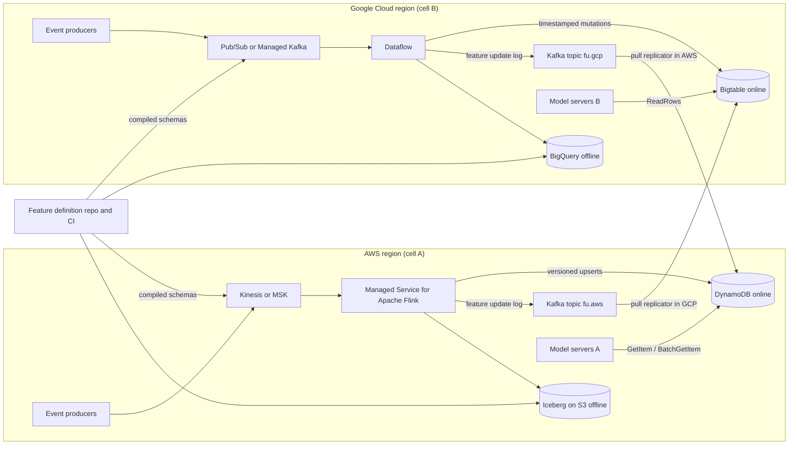

# System Design: Global Real-Time Feature Store

## TL;DR

A real-time feature store is three systems sharing one feature definition: a streaming write path, a low-latency online key-value read path, and an offline point-in-time-correct history used to build training sets.
Sub-10ms p99 reads come from keeping the number of keys each request fans out to small, reading only inside the region, and hedging requests, more than from picking the fastest database, because tail latency compounds across every parallel lookup.
For dual-cloud operation, replicate the compact feature-update log, not raw events, and make every online write idempotent and versioned so replicas converge whatever order updates arrive in, with no cross-cloud coordination.
Windowed aggregates computed in two clouds cannot be resolved by last-write-wins, so the cleanest design keeps a partial value per origin cloud and sums them at read time, which is a state-based CRDT.
Training-serving skew is an engineering bug, not a modeling bug: offline joins must subtract the measured ingestion-to-online lag, and schemas must be compiled from one source of truth into every registry on both clouds.

## Mental Model



Each cloud is a self-contained cell that can ingest, compute, and serve features with the other cloud entirely gone.
The only thing crossing between clouds is an asynchronous, pull-based feature-update log, and every record in it carries a version, so applying it is idempotent and order-insensitive.
Model servers never read across a cloud boundary on the request path, and the online store is always regional.
The feature definition repository is the only control-plane coupling, and it works at deploy time, never at request time.
This is static stability applied to ML data, as covered in [[17-Cloud-AI-Engineering/Volume_01_Cloud_Architecture_Principles/Chapter_02_Regions_Zones_and_Static_Stability|Regions, Zones, and Static Stability]].

## Internals

### Requirements that drive every decision

Online reads have a 10ms p99 budget measured at the model server, for roughly 3 to 30 entity lookups per inference.
For streaming features, freshness means event-to-online-visible p99 within seconds in the origin cloud and within tens of seconds in the peer cloud.
Offline correctness means a training row may only contain feature values that would have been visible online at that row's label timestamp.
Schema changes must land on both clouds without a coordinated flag day.
Losing either cloud must degrade freshness only, never availability.

### Control plane versus data plane

The control plane is the feature registry: feature definitions, entity keys, owners, TTLs, aggregation specs, and numeric feature IDs, kept in git and compiled by CI.
The data plane is the stream processors, the online stores, the replication log, and the offline tables.
The registry is never consulted per request.
Model servers load a compiled feature manifest at startup and on deploy, the same constant-work pattern described in [[17-Cloud-AI-Engineering/Volume_01_Cloud_Architecture_Principles/Chapter_04_Control_Plane_vs_Data_Plane_Separation|Control Plane vs Data Plane Separation]].
If the registry service is down, serving and ingestion continue on the last-known-good manifest.

### Write path: streaming ingestion and tiled aggregation

Raw events land in a partitioned log: Kinesis Data Streams or MSK on AWS, and Pub/Sub or Managed Service for Apache Kafka on Google Cloud (see [[17-Cloud-AI-Engineering/Volume_02_AWS_Deep_Dive/Chapter_13_Messaging_and_Streaming_SQS_SNS_EventBridge_and_MSK|Messaging and Streaming on AWS]] and [[17-Cloud-AI-Engineering/Volume_03_GCP_Deep_Dive/Chapter_14_Messaging_and_Streaming_Cloud_Pub_Sub_and_Dataflow|Pub/Sub and Dataflow]]).
The stream processor keys events by entity ID, so all state for one entity lives on one task slot.
Flink makes this keyed state consistent through asynchronous barrier snapshots, and Dataflow through its own checkpointed shuffle, both rooted in the event-time and watermark model of the Dataflow paper (Akidau et al., VLDB 2015) and the Flink state paper (Carbone et al., VLDB 2017).
Sliding-window aggregates such as "clicks in the last 1h" are not kept as one moving number.
Instead the processor emits tiles: fixed partial aggregates per (entity, feature, tile_start), for example 12 five-minute tiles covering one hour.
At read time the server sums the tiles that fall inside the window.
The trade-off is explicit: smaller tiles give a sharper window boundary but more cells to read and more writes, and the boundary error is at most one tile width.
Batch jobs can write large historical tiles, such as daily tiles for a 30-day window, into the same layout, so batch and streaming meet in one read-time merge instead of two code paths.
Tiles carry absolute values (sum, count, min, max), never deltas.
A delta like "add 1" is not idempotent, and Flink replays from the last checkpoint after a failure, so delta sinks double-count unless the sink is transactional.
An absolute tile value written again after a replay is a no-op.

### The mechanism the docs do not teach: versioned convergence and per-origin partials

Every online write carries a version, and the store keeps the highest version, not the latest arrival.
For a plain snapshot feature (for example "account_tier"), the version is the event time of the source event.
For a tile aggregate, event time is the wrong version.
A late event with an old event time produces a newer and more correct tile value.
The right version is a deterministic, monotonically increasing revision, such as the number of events folded into the tile, which only grows as late events are admitted and is identical across replays because it is derived from checkpointed state.
The two clouds' stores enforce "highest version wins" in different ways.
In Bigtable, every cell already has a client-settable timestamp, and a read with a cells-per-column limit of 1 returns the cell with the highest timestamp, whatever order the writes arrived in.
Writing the version into the cell timestamp therefore gives last-writer-wins by version with a blind write: no read, no condition, no extra round trip.
Garbage collection of older versions (for example a max-versions-1 rule) runs asynchronously during compaction, so stale cells can still exist on disk, and the reader must apply the cells-per-column filter itself instead of relying on GC.
In DynamoDB there are no per-attribute versions, so the same semantics need a conditional write: `ConditionExpression: attribute_not_exists(t_g) OR t_g < :v`, with one version attribute per feature group.
A conditional write that fails still uses write capacity, so stale replays cost money even when they change nothing.
The deeper problem is that one entity's events can be ingested in both clouds, for example a user whose mobile traffic hits AWS and whose web traffic hits Google Cloud.
Each cloud then computes only a partial tile, and last-writer-wins between two partials silently drops one of them.
The fix is to store one slot per origin: the column or attribute key becomes (feature, tile, origin), each origin slot is last-writer-wins by its own revision, and the reader sums across origins.
That is exactly a state-based grow-only counter CRDT: merge is commutative, associative, and idempotent, so the two clouds converge with no coordination and no ordering guarantee from the replication link.
During a cross-cloud partition, each cloud serves its own fresh partial plus the peer's last replicated partial, so the error is bounded by the peer's traffic during the partition, and that can be monitored.
The alternative, entity homing (one owner cloud per entity computes all of its aggregates), avoids partials but forces events to cross clouds before aggregation, which adds latency and egress and creates a dependency on the peer being healthy.

### Online read path and the tail-latency arithmetic

A single store call with a p99 of 4ms does not give a 4ms request p99 when the request makes N parallel calls.
The probability that all N calls finish under their individual p99 is 0.99^N: about 0.97 for N=3 and about 0.74 for N=30.
So the request-level p99 is set by roughly the p99.67 (N=3) to p99.97 (N=30) of a single call, the effect described in "The Tail at Scale" (Dean and Barroso, CACM 2013).
The levers, in order of impact, are:
first, cut N by packing all feature groups for an entity into one item or row, so one entity costs one call;
second, batch keys into one call (`BatchGetItem` on DynamoDB, a multi-row `ReadRows` on Bigtable);
third, hedge: send a duplicate request to another replica after the call passes its p95, which costs a few percent more reads in exchange for cutting the tail;
fourth, keep slowly changing features in an in-process near cache with a short TTL.
Packing cuts read fan-out but increases write cost on DynamoDB, because an `UpdateItem` is billed on the larger of the item sizes before and after the update, so changing one 50-byte feature inside a 4KB item costs 4 write units.
The standard resolution is to split items by update cadence: a narrow "streaming" item per entity for high-churn tiles and a wide "batch" item per entity for daily features, which gives two calls per entity, issued in parallel.
Bigtable charges by node capacity rather than by request unit, and a mutation writes only the cells it names, so it avoids this write amplification, but a wide row still makes the read bigger.
Reads are always region-local, eventually consistent reads.
Strongly consistent reads in DynamoDB cost twice as much and add no value here, because the feature is already seconds stale by design.

### Offline path: logs, point-in-time joins, and serving-lag correction

Each cloud writes three append-only logs to its lake: raw events, the feature-update log, and a served-feature log that records the exact feature vector each prediction used, keyed by request ID.
The served-feature log is the "log features at serving time" approach recommended in Google's Rules of ML.
It gives exact train-serve parity for features that already exist, but it cannot backfill a new feature.
For new features, the training set comes from a point-in-time join: for each label row (entity, label_ts), take the latest feature row with visible_ts < label_ts.
The step most implementations miss is defining visible_ts as feature_event_ts plus the measured p99 ingestion-to-online lag for that feature group, not feature_event_ts alone.
Without that shift, training sees values that were not yet readable online at prediction time, which is a subtle form of leakage that inflates offline metrics and shows up as an unexplained online regression.
The lag is not constant: it grows during backfills, during cross-cloud partitions, and for the peer-origin partial, so the correction should use the lag distribution recorded by the pipeline itself.
On AWS the offline tables are Apache Iceberg on S3, and on Google Cloud they are BigQuery tables.
Training normally runs in one cloud, so the other cloud's offline log is copied in bulk on a schedule, which is far cheaper than streaming it.

### Schema synchronization across clouds

The source of truth is one repository of Protobuf messages plus feature specs, with an immutable numeric ID per feature.
CI compiles each change into: AWS Glue Schema Registry versions, Pub/Sub schema revisions, Iceberg and BigQuery table schemas, DynamoDB attribute names, Bigtable column qualifiers, and the model server manifest.
The numeric ID, not the human-readable name, is the physical column qualifier and attribute name, so renaming a feature is a metadata change and an ID is never reused, which mirrors Protobuf field-number discipline.
Rollout follows expand-then-contract.
To add a feature: register the schema on both clouds, deploy readers that tolerate the field, then deploy writers, then backfill.
To remove a feature: stop the readers, then stop the writers, then tombstone the ID.
Every log record carries a schema fingerprint in its header.
A consumer that sees an unknown fingerprint sends the record to a dead-letter queue instead of guessing, because silently decoding a reused field with the wrong type is the worst failure in this system.
Registry-level compatibility checks such as Glue's BACKWARD or FULL modes (UNVERIFIED this session) catch structural breaks.
They do not catch semantic breaks such as a unit change from seconds to milliseconds, so CI also runs distribution checks on a shadow sample, in the spirit of TFX data validation.

### Managed products and where they fit

SageMaker Feature Store offers three online store types: Standard, Standard_V2, and InMemory (AWS docs, as of 2026-10).
The Standard tier is backed by DynamoDB and the InMemory tier by ElastiCache (Redis OSS) (AWS ML blog, as of 2026-10).
The new `UpdateRecord` API writes only the changed features, and it works on Standard_V2 and on all InMemory feature groups (AWS ML blog, as of 2026-10).
The InMemory tier supports list, set, and vector collection types (AWS docs, as of 2026-10).
According to a third-party summary of the AWS docs, an InMemory feature group cannot also have an offline store, which matters if you rely on managed online-to-offline sync (as of 2026-10, confirm against the primary docs).
The offline store buffers `PutRecord` data and writes it to S3 as Parquet within 15 minutes, in either the Glue or the Iceberg table format, and the console recommends Iceberg for most use cases (AWS docs, as of 2026-10).
On Google Cloud, Vertex AI Feature Store uses BigQuery as the offline source and serves through Bigtable online serving, organized as online store instances and feature views (Google Cloud release notes, as of 2026-10).
On 2026-02-17 Google deprecated both Vertex AI Feature Store Optimized online serving and Vertex AI Feature Store (Legacy) (Google Cloud release notes, as of 2026-10).
A secondary source puts the Legacy sunset at 2027-02-17 (as of 2026-10).
So on Google Cloud today, the managed path is BigQuery plus Bigtable online serving, and freshness is limited by how feature views sync from BigQuery.
For sub-second streaming freshness, Dataflow writing directly to Bigtable is the mechanism you control.
The design in this chapter uses the raw stores directly and treats the managed feature stores as optional catalog and serving layers on top, a pattern also discussed in [[17-Cloud-AI-Engineering/Volume_12_AI_Applications_MLOps_and_Data_Platforms/Chapter_05_Feature_Stores_and_Real_Time_Data_Serving|Feature Stores and Real-Time Data Serving]].

### Replication topology and failure domains

Each cloud publishes its feature-update log to a local Kafka topic.
A replicator running in the destination cloud pulls from the source, so the destination controls its own ingest rate, and a slow or broken destination never applies backpressure to the source's serving path.
The replicator applies records to the local online store with the same versioned writes used locally, so duplicates and reordering are harmless.
Replicating post-aggregation updates rather than raw events cuts cross-cloud bytes by the coalescing factor, and it also means a code bug in one cloud's aggregation logic cannot corrupt the other cloud's raw history.
Inside AWS, DynamoDB global tables can carry the cross-region copy in either multi-Region eventual consistency (MREC, the default) or multi-Region strong consistency (MRSC) mode (AWS docs, as of 2026-10).
MREC resolves conflicts by its own last-writer-wins rule, which does not know about your version field, so for features with application-level versions it is safer to have the replicator write each region explicitly, or to make sure only one writer per key per origin exists.
The failure-domain boundaries are: AZ (store replicas absorb it), region (the other region or cloud serves stale-but-valid features), cloud (the peer cloud serves from its own partials), and the registry (serving runs on the last-known-good manifest).
See [[17-Cloud-AI-Engineering/Volume_04_AWS_vs_GCP_Translation/Chapter_07_Multi_Cloud_and_Hybrid_Architecture_Reality|Multi-Cloud and Hybrid Architecture Reality]] for the latency and consistency costs of anything stronger.

## Numbers to Know

| Item | Value | Source |
| --- | --- | --- |
| SageMaker FS online store types | Standard, Standard_V2, InMemory | (AWS docs, as of 2026-10) |
| SageMaker FS Standard backing store | DynamoDB; InMemory backed by ElastiCache (Redis OSS) | (AWS ML blog, as of 2026-10) |
| SageMaker FS offline write delay | buffered and written to S3 within 15 minutes, Parquet only | (AWS docs, as of 2026-10) |
| DynamoDB per-partition ceiling | 3,000 RCU, 1,000 WCU, 10 GB | (third-party summary of AWS docs, as of 2026-10) |
| DynamoDB RCU / WCU size unit | 4 KB per strongly consistent read (eventual is half), 1 KB per write | (third-party summary of AWS docs, as of 2026-10) |
| DynamoDB on-demand price, us-east-1 | $0.125 per million RRU, $0.625 per million WRU | (third-party summary of AWS pricing after the 2024-11-14 cut, as of 2026-10) |
| DynamoDB 2024-11 price change | on-demand throughput down 50%, global tables down up to 67% | (AWS announcement, as of 2026-10) |
| DynamoDB global table design availability | 99.999% | (AWS docs, as of 2026-10) |
| DynamoDB max item size | 400 KB | UNVERIFIED |
| Bigtable SSD node throughput | up to 17,000 reads/s or 14,000 writes/s (1 KB rows), or 220 MBps scans | (Google Cloud docs, as of 2026-10) |
| Bigtable SSD node latency | under 5 ms | (Google Cloud docs, as of 2026-10) |
| Bigtable 10-node SSD cluster | about 140,000 rows/s; up to 1.2M read rows/s with in-memory tier | (Google Cloud docs, as of 2026-10) |
| Bigtable Enterprise Plus in-memory tier | sub-ms reads, 40,000 rows/s increments, up to 120,000 rows/s per node | (Google Cloud docs, as of 2026-10) |
| Bigtable in-memory tier price | from $0.20 per 40,000 rows/s capacity (billing time unit UNVERIFIED) | (Google Cloud pricing page, as of 2026-10) |
| Bigtable SSD storage price | from $0.17 per GB-month, billed per replica | (Google Cloud pricing page, as of 2026-10) |
| Bigtable tiered storage per node | up to 32 TB Enterprise, 64 TB Enterprise Plus | (Google Cloud docs, as of 2026-10) |
| Bigtable SSD node-hour price | about $0.65 in us-central1 | UNVERIFIED |
| Vertex AI FS Optimized online serving | deprecated 2026-02-17 | (Google Cloud release notes, as of 2026-10) |
| Vertex AI FS Legacy | deprecated 2026-02-17; sunset 2027-02-17 | (release notes; sunset date from secondary source, as of 2026-10) |
| Kinesis shard write limit | 1 MB/s or 1,000 records/s per shard | UNVERIFIED |
| Internet egress, first tier | about $0.09/GB from AWS | UNVERIFIED |
| Tail amplification | P(all N calls under single-call p99) = 0.99^N; 0.97 at N=3, 0.74 at N=30 | arithmetic |

## AWS vs GCP Mechanism Parity

| Concern | AWS | Google Cloud | Critical difference |
| --- | --- | --- | --- |
| Event log | Kinesis Data Streams (shards) or MSK | Pub/Sub (no partitions) or Managed Service for Apache Kafka | Kinesis and Kafka give per-key ordering inside a partition; Pub/Sub needs ordering keys, and ordered delivery reduces throughput per key |
| Stream compute | Managed Service for Apache Flink | Dataflow (Apache Beam) | Both checkpoint keyed state; Flink exposes the sink semantics directly, while Dataflow hides the shuffle and checkpoint cadence |
| Online store | DynamoDB, or SageMaker FS Standard (DynamoDB) and InMemory (ElastiCache) | Bigtable, or Vertex AI FS Bigtable online serving | DynamoDB bills per request unit and has no per-cell versions; Bigtable bills per node and has a native timestamp per cell |
| Versioned upsert | Conditional `PutItem` or `UpdateItem`; failed conditions still consume WCU | Blind mutation with explicit cell timestamp plus a read filter of 1 cell per column | Bigtable needs no read or condition for LWW-by-version; DynamoDB pays for every rejected stale write |
| Partial update cost | `UpdateItem` billed on the larger of the before and after item sizes | Mutation writes only the named cells | Wide items on DynamoDB inflate write cost; wide rows on Bigtable mainly inflate read size |
| Hot key behavior | Adaptive capacity can isolate a hot item, but one key cannot exceed per-partition limits | One row lives in one tablet; Enterprise Plus adds hotspot mitigation via the in-memory tier | Neither lets you exceed one key's physical limit; you must split or cache hot keys |
| Multi-region replication | Global tables, MREC (LWW) or MRSC | Bigtable multi-cluster replication, eventually consistent | Neither cloud replicates across the cloud boundary; you own that link |
| Offline store | Iceberg on S3 (SageMaker FS writes Glue or Iceberg tables) | BigQuery (Vertex AI FS reads BigQuery directly) | On GCP the offline store is the source and the online store syncs from it; on AWS the managed flow runs from online to offline |
| Schema registry | AWS Glue Schema Registry | Pub/Sub schemas (Avro or Protobuf) with revisions | Different compatibility semantics; compile both from one source |
| Private access | Gateway VPC endpoint for DynamoDB; PrivateLink for `sagemaker.featurestore-runtime` | Private Google Access or Private Service Connect; VPC Service Controls perimeter | VPC SC limits API-level data movement; AWS needs endpoint policies plus SCPs for the same effect |

## Worked Example: Versioned Dual-Cloud Writes and a Lag-Corrected Point-in-Time Join

### What the lab proves

The script writes the same feature update to DynamoDB and to Bigtable out of order, and shows that both stores converge on the highest version.
It prints DynamoDB consumed capacity, showing that a rejected conditional write still consumes 1 WCU (reported as None in this wrapper since the exception suppresses normal response payload), proving that stale writes are not free.
It then runs a local point-in-time join with and without serving-lag correction, so you can see the leakage directly.

### Provision

```bash
# AWS: no pre-provisioning; the script creates an on-demand table.
export AWS_REGION=us-east-1
# Google Cloud: one-node SSD Bigtable instance.
export GCP_PROJECT=my-project
gcloud services enable bigtable.googleapis.com bigtableadmin.googleapis.com --project "$GCP_PROJECT"
gcloud bigtable instances create fs-lab \
  --project="$GCP_PROJECT" \
  --display-name=fs-lab \
  --cluster-config=id=fs-lab-c1,zone=us-central1-b,nodes=1
pip install boto3 google-cloud-bigtable pandas
```

### Budget alarms

```bash
# AWS Budgets: 20 USD monthly cost budget, alert at 80 percent actual.
ACCOUNT_ID=$(aws sts get-caller-identity --query Account --output text)
cat > /tmp/budget.json <<'EOF'
{"BudgetName":"fs-lab","BudgetLimit":{"Amount":"20","Unit":"USD"},
 "TimeUnit":"MONTHLY","BudgetType":"COST"}
EOF
cat > /tmp/notif.json <<'EOF'
[{"Notification":{"NotificationType":"ACTUAL","ComparisonOperator":"GREATER_THAN",
  "Threshold":80,"ThresholdType":"PERCENTAGE"},
  "Subscribers":[{"SubscriptionType":"EMAIL","Address":"you@example.com"}]}]
EOF
aws budgets create-budget --account-id "$ACCOUNT_ID" \
  --budget file:///tmp/budget.json \
  --notifications-with-subscribers file:///tmp/notif.json

# Google Cloud Billing budget: 20 USD, alerts at 50 and 90 percent.
gcloud billing budgets create \
  --billing-account=XXXXXX-XXXXXX-XXXXXX \
  --display-name=fs-lab \
  --budget-amount=20USD \
  --threshold-rule=percent=0.5 \
  --threshold-rule=percent=0.9
```

### Code: fs_lab.py

```python
#!/usr/bin/env python3
"""Versioned feature upserts on DynamoDB and Bigtable, plus a lag-corrected PIT join."""
import argparse
import datetime as dt
import json

import boto3
import pandas as pd
from botocore.exceptions import ClientError

TABLE = "fs_lab_entity"


# ---------- AWS: DynamoDB, one item per entity, one version attribute per group ----------
def ddb_setup(region):
    ddb = boto3.client("dynamodb", region_name=region)
    try:
        ddb.create_table(
            TableName=TABLE,
            AttributeDefinitions=[{"AttributeName": "pk", "AttributeType": "S"}],
            KeySchema=[{"AttributeName": "pk", "KeyType": "HASH"}],
            BillingMode="PAY_PER_REQUEST",
            Tags=[{"Key": "lab", "Value": "fs-lab"}],
        )
    except ddb.exceptions.ResourceInUseException:
        pass
    ddb.get_waiter("table_exists").wait(TableName=TABLE)
    return ddb


def ddb_upsert(ddb, entity, group, value, version):
    """Apply only if version is higher than the stored version for this group."""
    try:
        resp = ddb.update_item(
            TableName=TABLE,
            Key={"pk": {"S": entity}},
            UpdateExpression="SET #g = :v, #t = :ver",
            ConditionExpression="attribute_not_exists(#t) OR #t < :ver",
            ExpressionAttributeNames={"#g": "g_" + group, "#t": "t_" + group},
            ExpressionAttributeValues={
                ":v": {"S": json.dumps(value, sort_keys=True)},
                ":ver": {"N": str(version)},
            },
            ReturnConsumedCapacity="TOTAL",
        )
        return "applied", resp["ConsumedCapacity"]["CapacityUnits"]
    except ClientError as e:
        if e.response["Error"]["Code"] == "ConditionalCheckFailedException":
            # The write was rejected but still consumed write capacity.
            return "rejected-stale", None
        raise


def ddb_read(ddb, entity, group):
    item = ddb.get_item(TableName=TABLE, Key={"pk": {"S": entity}},
                        ConsistentRead=False).get("Item", {})
    return item.get("g_" + group, {}).get("S"), item.get("t_" + group, {}).get("N")


# ---------- Google Cloud: Bigtable, one row per entity, one column per group ----------
def bt_setup(project, instance_id):
    from google.cloud import bigtable
    from google.cloud.bigtable import column_family
    client = bigtable.Client(project=project, admin=True)
    table = client.instance(instance_id).table(TABLE)
    if not table.exists():
        table.create(column_families={"f": column_family.MaxVersionsGCRule(1)})
    return table


def bt_upsert(table, entity, group, value, version_ms):
    """Blind write: the cell timestamp IS the version; no read, no condition."""
    row = table.direct_row(entity.encode())
    ts = dt.datetime.fromtimestamp(version_ms / 1000.0, tz=dt.timezone.utc)
    row.set_cell("f", group.encode(), json.dumps(value, sort_keys=True).encode(), timestamp=ts)
    row.commit()


def bt_read(table, entity, group):
    from google.cloud.bigtable import row_filters
    # GC of old versions is asynchronous; always filter to the newest cell explicitly.
    r = table.read_row(entity.encode(), filter_=row_filters.CellsColumnLimitFilter(1))
    if r is None:
        return None, None
    cell = r.cells["f"][group.encode()][0]
    return cell.value.decode(), int(cell.timestamp.timestamp() * 1000)


# ---------- Local: point-in-time join with serving-lag correction ----------
def pit_demo(lag_s):
    labels = pd.DataFrame({
        "entity": ["u1", "u1", "u2"],
        "label_ts": pd.to_datetime(["2026-10-20 10:00:05", "2026-10-20 10:10:00",
                                    "2026-10-20 10:00:02"]),
    })
    feats = pd.DataFrame({
        "entity": ["u1", "u1", "u2", "u2"],
        "feature_ts": pd.to_datetime(["2026-10-20 09:50:00", "2026-10-20 10:00:03",
                                      "2026-10-20 09:59:00", "2026-10-20 10:00:01"]),
        "clicks_1h": [3, 4, 7, 8],
    })
    for name, lag in (("naive", 0), ("lag-corrected", lag_s)):
        f = feats.assign(visible_ts=feats["feature_ts"] + pd.Timedelta(seconds=lag))
        f_cols = ["entity", "visible_ts", "clicks_1h"]
        out = pd.merge_asof(
            labels.sort_values("label_ts"),
            f.sort_values("visible_ts").loc[:, f_cols],
            left_on="label_ts", right_on="visible_ts", by="entity",
            direction="backward", allow_exact_matches=False,
        )
        out_cols = ["entity", "label_ts", "clicks_1h"]
        print(name, out.loc[:, out_cols].to_dict("records"))


def main():
    p = argparse.ArgumentParser()
    p.add_argument("mode", choices=["aws", "gcp", "pit"])
    p.add_argument("--region", default="us-east-1")
    p.add_argument("--project")
    p.add_argument("--instance", default="fs-lab")
    p.add_argument("--lag", type=int, default=5, help="p99 ingest-to-online lag, seconds")
    a = p.parse_args()

    newer = {"clicks_1h": 42}
    older = {"clicks_1h": 40}
    if a.mode == "aws":
        ddb = ddb_setup(a.region)
        print("newer:", ddb_upsert(ddb, "u1", "clicks", newer, 2000))
        print("older (arrives late):", ddb_upsert(ddb, "u1", "clicks", older, 1000))
        print("read:", ddb_read(ddb, "u1", "clicks"))
    elif a.mode == "gcp":
        t = bt_setup(a.project, a.instance)
        bt_upsert(t, "u1", "clicks", newer, 1760954400000)
        bt_upsert(t, "u1", "clicks", older, 1760954300000)
        print("read:", bt_read(t, "u1", "clicks"))
    else:
        pit_demo(a.lag)


if __name__ == "__main__":
    main()
```

Run `python fs_lab.py aws`, `python fs_lab.py gcp --project "$GCP_PROJECT"`, and `python fs_lab.py pit --lag 5`.
Both stores return the version-2000 (or newer-timestamp) value even though the older write arrived last.
In the PIT output, the naive join gives u1 at 10:00:05 a value of 4, from a feature event at 10:00:03 that was not yet readable online, while the lag-corrected join gives 3.

### Teardown

```bash
aws dynamodb delete-table --table-name fs_lab_entity --region "$AWS_REGION"
gcloud bigtable instances delete fs-lab --project="$GCP_PROJECT" --quiet
aws budgets delete-budget --account-id "$ACCOUNT_ID" --budget-name fs-lab
```

### Lab cost estimate

DynamoDB on-demand for a few dozen requests costs well under one cent at $0.625 per million WRU (as of 2026-10).
The one-node Bigtable instance dominates, at roughly $0.65 per node-hour (UNVERIFIED), so delete it the same day.

### Production capacity sizing, step by step

Assume a peak of 200,000 inferences/s globally, split evenly, so 100,000/s per cloud.
Each inference reads 3 entities, so 300,000 entity reads/s per cloud.
With a 2KB packed item, an eventually consistent DynamoDB read costs 0.5 RRU (one 4KB unit, halved), so 150,000 RRU/s.
A 730-hour month is 2,628,000 s, so sustained peak reads are 3.94e11 RRU, which at $0.125 per million is about $49,300 per month, or about $24,600 at a 50% average-to-peak ratio (as of 2026-10).
On writes, assume 50,000 raw events/s per cloud, which Flink coalesces per key over 1s to 20,000 entity updates/s, plus 20,000/s replicated from the peer, for 40,000 updates/s.
An `UpdateItem` on a 2KB item costs 2 WRU, so 80,000 WRU/s, which is 2.10e11 WRU per month, or about $131,400 sustained.
Splitting the high-churn tiles into a narrow item of 1KB or less halves that to about $65,700.
Without coalescing (100,000 updates/s at 2 WRU) the bill would be about $328,500, so the coalescing window is the biggest single cost lever and costs at most 1s of freshness.
On Bigtable, the docs rate an SSD node at 17,000 reads/s for 1KB rows (as of 2026-10).
Assume about 10,000/s at 2KB, which gives 30 nodes for reads, plus about 6 for 40,000 writes/s, for roughly 36 nodes at full load.
At a 70% CPU target (UNVERIFIED recommendation) that is about 52 nodes, roughly 52 x 730 x $0.65, or about $24,700 per month (node price UNVERIFIED), with storage negligible at 1TB x $0.17.
The structural conclusion: request-unit pricing punishes write-heavy streaming features, and node pricing rewards sustained throughput but makes you own headroom and autoscaling.
DynamoDB provisioned capacity with reserved capacity would narrow the gap, but those prices were not verified this session.
Cross-cloud replication of 20,000 updates/s per direction at about 600 bytes is 12 MB/s, or about 31.5 TB per month per direction, roughly $2,800 per month at $0.09/GB (UNVERIFIED), against about 4x that for raw-event replication.
See [[17-Cloud-AI-Engineering/Volume_09_FinOps_and_Cloud_Economics/Chapter_04_Network_Egress_Economics_and_Optimization|Network Egress Economics and Optimization]].

## Failure Modes and Pitfalls

### The null entity hot key

Anonymous traffic often collapses to an entity ID like "0", "unknown", or the empty string, which turns the busiest key in the system into one partition.
DynamoDB adaptive capacity can isolate a hot item, but one key cannot exceed the per-partition limits of 3,000 RCU and 1,000 WCU (third-party summary of AWS docs, as of 2026-10).
In Bigtable, one row lives in one tablet on one node.
Mitigation: reject null keys at ingestion, serve population-default features from the in-process manifest, and for real celebrity keys, write N salted replicas and read one at random.

### Backfill stampede

A batch materialization that pushes a billion rows into the online store competes with streaming writes for the same partitions or nodes, and streaming freshness collapses.
Mitigation: put a token-bucket rate limit on backfill writers, write backfill at lower versions so it can never overwrite fresher streaming values, and on Bigtable route backfills through a separate app profile so they can be isolated and monitored.

### Silent skew from lag growth

During an incident, ingestion lag can grow from seconds to minutes.
Models trained with a fixed small lag correction then see staler features online than they saw in training.
Mitigation: put a feature-age field in every served vector, alert on age percentiles per feature group, and fall back to defaults when a feature is older than its trained-on age.

### Delta counters under replay

A Flink job that writes "increment by k" to the online store double-counts after every checkpoint restore.
Mitigation: write absolute tile values with a deterministic revision, as in Internals.

### Schema field reuse

Reusing a retired field number or column qualifier with a new type makes old replicated records decode as garbage in the peer cloud, where the change may not have been deployed yet.
Mitigation: immutable numeric IDs, tombstones, a fingerprint in every record header, and dead-lettering of unknown fingerprints.

### TTL is not a read-time filter

DynamoDB TTL deletes expired items in the background rather than at the moment of expiry, so a read can return an item past its TTL.
Readers must compare the stored expiry against the current time themselves.

### Control-plane and DNS dependencies on the read path

In the October 2025 us-east-1 event, AWS described a race condition in DynamoDB's DNS management automation that left the regional endpoint without valid DNS records, and that cascaded into many dependent services ([AWS post-event summary](https://aws.amazon.com/message/101925/), details recalled, UNVERIFIED this session).
A feature store whose model servers resolve only the regional DynamoDB endpoint in one region fails closed in that scenario, while a design that serves defaults or a peer cell fails soft.
In June 2025, Google Cloud reported a global outage triggered by a Service Control policy change with blank fields hitting an unguarded code path, which affected API access across many products ([Google Cloud incident report](https://status.cloud.google.com/incidents/ow5i3PPK96RduMcb1SsW), details recalled, UNVERIFIED this session).
The lesson for this design is that dual-cloud only pays off if each cell's request path has no runtime dependency on the other cloud or on any global control plane.
That includes no synchronous registry lookups and no cross-cloud token exchange on the request path.
See [[17-Cloud-AI-Engineering/Volume_07_Reliability_and_SRE/Chapter_07_Anatomy_of_Major_Cloud_Outages|Anatomy of Major Cloud Outages]].

### Retry amplification on fan-out

With 30 parallel reads and three retries each, one slow storage node can multiply load by up to 4x on the partitions that are already struggling.
Mitigation: a request-level retry budget instead of per-call retries, hedging only after p95, and deadline propagation, as in [[17-Cloud-AI-Engineering/Volume_07_Reliability_and_SRE/Chapter_03_Resilient_Communication_Retries_Jitter_and_Circuit_Breakers|Retries, Jitter, and Circuit Breakers]].

## Security and Cost Angles

### IAM scoping

Model servers get read-only access to the specific online tables: on AWS `dynamodb:GetItem` and `dynamodb:BatchGetItem` on the table ARN, and on Google Cloud `roles/bigtable.reader` on the instance or table.
Stream processors get write access only, and only the replicator identity can write peer-origin columns, which you can enforce on DynamoDB with `dynamodb:Attributes` condition keys.
Cross-cloud identities use workload identity federation instead of static keys, as covered in [[17-Cloud-AI-Engineering/Volume_08_Security_Identity_and_the_Data_Perimeter/Chapter_02_Workload_Identity_Federation|Workload Identity Federation]].

### Encryption

DynamoDB and the SageMaker FS offline bucket use KMS keys, and S3 Bucket Keys reduce KMS request costs for the offline store (AWS docs, as of 2026-10).
Bigtable and BigQuery support CMEK through Cloud KMS.
The replication log is encrypted in transit with mTLS and at rest with each cloud's own key hierarchy, so neither cloud's KMS is on the other's critical path.
See [[17-Cloud-AI-Engineering/Volume_08_Security_Identity_and_the_Data_Perimeter/Chapter_04_Encryption_Key_Hierarchies_and_Envelope_Encryption|Encryption Key Hierarchies and Envelope Encryption]].

### Private boundaries

On AWS, use a gateway VPC endpoint for DynamoDB and the PrivateLink service `com.amazonaws.region.sagemaker.featurestore-runtime` if you serve through SageMaker FS (AWS docs, as of 2026-10).
On Google Cloud, put Bigtable, BigQuery, and Vertex AI inside a VPC Service Controls perimeter and allow the replicator through an explicit ingress rule, as described in [[17-Cloud-AI-Engineering/Volume_03_GCP_Deep_Dive/Chapter_03_VPC_Service_Controls_Security_Perimeters|VPC Service Controls]].
Features are often derived PII, such as location and purchase history, so the served-feature log falls in the same data classification as the raw events.

### Unit-economics levers

Cost per 1,000 inferences = (reads per inference x read unit price) + (amortized write cost / inferences) + replication egress + offline storage.
The levers, ordered by typical impact: write coalescing windows, splitting items by update cadence, near caching for batch features, Bigtable versus DynamoDB at sustained throughput, and replicating aggregates rather than events.

## Interview Questions and Model Answers

### Question 1 (L5 - Senior)

The ranking service must fetch 60 features for one user and 50 candidate items within a 10ms p99 budget at the model server.
Design the read path.

#### Model Answer

First, set the budget: about 1ms for serialization and network, about 6ms for the store, and about 2ms of slack for hedging and deserialization.
Pack all user feature groups into at most two items or rows (streaming and batch) so the user costs two parallel calls.
Item features for 50 candidates go into one `BatchGetItem` or one multi-row `ReadRows`, keyed by hashed item ID so keys spread across partitions.
Because the request p99 is set by roughly the slowest of N calls, I keep N at around 3 and hedge any call that passes its own p95, which costs a few percent of extra reads.
Item features change slowly, so they also sit in a per-host near cache with a TTL of tens of seconds, which takes most item reads off the network.
Reads are region-local and eventually consistent, because strong consistency doubles DynamoDB read cost and the feature is already seconds stale.
If a call misses its deadline, the server fills population defaults and logs the miss, because a stale or default feature is better than a timeout.

#### Follow-up Interviewer Question

Your near cache hit rate is 95%, but p99 got worse after you added it.
What happened?

### Question 2 (L5 - Senior)

Offline AUC is 0.82 but online it behaves like 0.76.
The features are identical code in batch and streaming.
Where do you look?

#### Model Answer

I first check point-in-time correctness: does the training join use the feature's event time or its online-visible time?
If it uses event time, training saw values that were not yet readable at prediction time, which is leakage proportional to the ingestion lag.
I fix this by joining on event time plus the measured p99 lag per feature group, using strictly-less-than semantics.
Second, I compare the served-feature log with the offline-joined values for the same request IDs, which gives a direct per-feature skew report.
Third, I check defaults: online misses that fill defaults may never appear in training if training drops nulls.
Fourth, I check window boundaries: tiled online windows have up to one tile of boundary error that an exact SQL window offline does not.

#### Follow-up Interviewer Question

The lag differs by origin cloud for the same feature.
How does the join handle that?

### Question 3 (L6 - Staff)

Users generate events in both AWS and Google Cloud, and both clouds must serve "purchases in the last 24h" with seconds of freshness.
Design the replication and conflict resolution.

#### Model Answer

Last-writer-wins on the aggregate is wrong, because each cloud only sees part of the user's events, so either partial would erase the other.
I store the aggregate as tiles with one slot per origin cloud: (feature, tile_start, origin).
Each origin slot is last-writer-wins by a deterministic revision, the count of events folded into the tile, which increases with late events and is the same across Flink replays.
The reader sums across origins, which is a grow-only-counter CRDT, so replicas converge whatever the delivery order or duplication, and no coordination is needed.
Replication is a pull-based Kafka log of tile updates, applied with the same versioned writes, so it is idempotent.
On Bigtable the revision goes into the cell timestamp and the write is blind; on DynamoDB it is a conditional `UpdateItem` per origin attribute, and I budget for rejected stale writes still consuming WCU.
During a partition, each cloud serves its own fresh partial plus the peer's last partial, so the error is bounded by peer-origin traffic during the outage, and I expose peer-partial age as a metric and a model input.
I rejected entity homing because it puts the peer cloud's health on the ingestion path and adds egress before aggregation.

#### Follow-up Interviewer Question

Now the feature is "distinct merchants in 24h".
Does the per-origin sum still work?

### Question 4 (L6 - Staff)

A team needs to change `session_length` from seconds to milliseconds and add three features, across both clouds, with no downtime.
Walk through the rollout.

#### Model Answer

A unit change is a semantic break that no registry compatibility mode will catch, so I treat it as a new feature with a new immutable ID, `session_length_ms`, not an in-place change.
CI compiles the change once into Glue Schema Registry, Pub/Sub schema revisions, Iceberg and BigQuery schemas, and the serving manifest, and checks compatibility on each target.
Phase one: register the schemas on both clouds.
Phase two: deploy readers and model servers that tolerate the new fields.
Phase three: dual-write old and new in both clouds' stream jobs.
Phase four: backfill the offline history for the new IDs, then retrain.
Phase five: switch models to the new ID, then stop writing the old one, then tombstone it.
Each record carries a schema fingerprint, and unknown fingerprints go to a dead-letter queue, so a cloud that lags the deploy fails loudly instead of decoding wrongly.
A shadow distribution check in CI catches the factor-of-1000 shift if someone tries to do it in place.

#### Follow-up Interviewer Question

Google Cloud deployed phase three but AWS is stuck at phase one for a day.
What do the AWS replicators do with GCP-origin records that carry the new fields?

### Question 5 (L6 - Staff)

Finance asks why the AWS feature store costs five times as much as the Google Cloud one at the same traffic.
Explain it and propose a fix.

#### Model Answer

DynamoDB on-demand bills each write by the larger of the before and after item sizes in 1KB units, so a 4KB packed item updated for one counter costs 4 WRU, and streaming features update constantly.
Bigtable bills node capacity and writes only the named cells, so the same pattern is cheap there once the cluster is sized.
I would quantify it: 40,000 updates/s at 2 WRU is about $131,000 per month at $0.625 per million WRU (as of 2026-10).
The fixes, in order: coalesce per key in Flink over 1s, which cuts writes by the duplicate factor; split items by update cadence so streaming tiles live in a sub-1KB item; and drop replicated stale writes early in the replicator by tracking the last applied revision in memory, before they reach DynamoDB.
Then I would compare provisioned capacity with reserved commitments against on-demand for the steady base load.
The trade-off I would state is that splitting items adds one parallel read per entity, so I would confirm the p99 impact with the 0.99^N model before shipping.

#### Follow-up Interviewer Question

Coalescing over 1s cut the cost in half, but fraud-model recall dropped.
How do you decide the window per feature group?

### Question 6 (L7+ - Principal)

The CTO asks whether dual-cloud for the feature store is worth it, given that the inference fleets are already split across clouds for GPU capacity reasons.
Give your position.

#### Model Answer

The decision follows from where inference runs: if models serve in both clouds, an online store must exist in both, because a cross-cloud read on the request path adds tens of milliseconds and couples availability, which breaks the 10ms budget and the failure-domain story.
So the real question is how much to share, not whether to have two stores.
I would make each cloud a complete cell for ingestion, compute, and serving, and share only an asynchronous, versioned feature-update log, so the system's consistency is "convergent with bounded staleness", which the model can be trained to tolerate.
I would refuse any design with cross-cloud synchronous consensus, because that pays a cross-cloud RTT on every write and makes either cloud's outage a global one.
The costs I would put on the table: egress for replication, two operational surfaces, two schema registries kept in sync by CI, and the per-origin CRDT complexity for aggregates.
The benefits: either cloud can fail with only freshness loss, and capacity can move between clouds without a data migration.
The 2025 DynamoDB DNS and Google Service Control incidents both show that dual-cloud resilience depends entirely on keeping each cell's request path free of the other cloud and of global control planes, so I would make that an audited invariant, tested with game days that cut the inter-cloud link for hours.

#### Follow-up Interviewer Question

The link is cut for six hours and a fraud model in AWS shows a precision drop on GCP-origin users.
What is your mitigation, and what would you change in training?

### Question 7 (L7+ - Principal)

Design the exactly-once story end to end, from event producer to online store and offline table, and tell me where you would deliberately not pay for exactly-once.

#### Model Answer

Producers are at-least-once with an event ID, because exactly-once producers across two clouds are not achievable at reasonable cost.
The stream processor deduplicates by event ID in keyed state within a bounded horizon, and its checkpoint (asynchronous barrier snapshots in Flink) makes the state effectively-once across failures.
The online sink does not need transactions, because it writes absolute values with deterministic revisions, so replays are no-ops, which makes it idempotent by construction and keeps the sink cheap and fast.
The offline Iceberg or BigQuery sink is where I pay for stronger semantics: commits tied to checkpoints, so training data has no duplicates, because duplicated label rows bias models in ways that are hard to detect.
The cross-cloud replicator is at-least-once and unordered by design, because the versioned, per-origin merge makes order irrelevant.
I would deliberately accept at-least-once for the served-feature log, deduplicated by request ID at query time, because transactional logging on the inference path would cost latency for no modeling benefit.
The residual risk is the deduplication horizon: an event redelivered after the horizon is double-counted, so I size the horizon from the producer's maximum retry window and alert on redelivery age.

#### Follow-up Interviewer Question

A producer bug resends 48 hours of events with new event IDs.
How do you detect it, and how do you repair online and offline state?

## Further Reading

- [The Dataflow Model (Akidau et al., VLDB 2015)](https://www.vldb.org/pvldb/vol8/p1792-Akidau.pdf) - the event-time, watermark, and trigger semantics behind correct windowed features under late data.
- [State Management in Apache Flink (Carbone et al., VLDB 2017)](https://www.vldb.org/pvldb/vol10/p1718-carbone.pdf) - how keyed state and asynchronous snapshots give effectively-once streaming aggregation.
- [Lightweight Asynchronous Snapshots for Distributed Dataflows (Carbone et al., 2015)](https://arxiv.org/abs/1506.08603) - the barrier snapshot algorithm whose replay behavior forces idempotent sinks.
- [Amazon DynamoDB: A Scalable, Predictably Performant, and Fully Managed NoSQL Database Service (USENIX ATC 2022)](https://www.usenix.org/conference/atc22/presentation/elhemali) - partitioning, adaptive capacity, and the request-router design that bound online read latency.
- [Bigtable: A Distributed Storage System for Structured Data (OSDI 2006)](https://static.googleusercontent.com/media/research.google.com/en//archive/bigtable-osdi06.pdf) - the timestamped cell model that makes blind versioned writes possible.
- [The Tail at Scale (Dean and Barroso, CACM 2013)](https://research.google/pubs/the-tail-at-scale/) - the fan-out arithmetic and hedged-request technique behind the sub-10ms design.
- [Hidden Technical Debt in Machine Learning Systems (Sculley et al., NeurIPS 2015)](https://papers.nips.cc/paper/5656-hidden-technical-debt-in-machine-learning-systems) - why train-serve skew and pipeline jungles are a systems problem.
- [Rules of Machine Learning (Zinkevich, Google)](https://developers.google.com/machine-learning/guides/rules-of-ml) - the source of the log-features-at-serving-time discipline.
- [Meet Michelangelo (Uber Engineering)](https://www.uber.com/blog/michelangelo-machine-learning-platform/) - the original public description of a shared online/offline feature store at scale.
- [Chronon (Airbnb, open source)](https://github.com/airbnb/chronon) - a production feature platform with windowed aggregation and point-in-time backfills worth reading in code.
- [Monolith: Real Time Recommendation System (ByteDance, 2022)](https://arxiv.org/abs/2209.07663) - real-time training and parameter-sync trade-offs adjacent to feature freshness.
- [SageMaker Feature Store online store docs](https://docs.aws.amazon.com/sagemaker/latest/dg/feature-store-storage-configurations-online-store.html) - current tiers, InMemory collection types, and PrivateLink service name.
- [SageMaker Feature Store UpdateRecord launch](https://aws.amazon.com/blogs/machine-learning/amazon-sagemaker-feature-store-introduces-updaterecord-for-feature-level-writes/) - Standard_V2 and feature-level writes.
- [Bigtable performance docs](https://docs.cloud.google.com/bigtable/docs/performance) and [Bigtable editions](https://docs.cloud.google.com/bigtable/docs/editions-overview) - per-node throughput, latency, and in-memory tier sizing.
- [Vertex AI release notes](https://docs.cloud.google.com/vertex-ai/docs/release-notes) - the 2026-02-17 deprecations that change the managed GCP path.
- Related chapters: [[17-Cloud-AI-Engineering/Volume_14_Staff_Plus_Interview_Arena/Chapter_03_Design_Billion_Scale_Enterprise_RAG|Billion-Scale Enterprise RAG]], [[17-Cloud-AI-Engineering/Volume_14_Staff_Plus_Interview_Arena/Chapter_05_Design_Multi_Region_Active_Active_API|Multi-Region Active-Active API]], [[17-Cloud-AI-Engineering/Volume_02_AWS_Deep_Dive/Chapter_10_Amazon_DynamoDB_Architecture_and_Partitioning|DynamoDB Architecture]], [[17-Cloud-AI-Engineering/Volume_03_GCP_Deep_Dive/Chapter_11_Cloud_Bigtable_LSM_Storage_and_Tablet_Serving|Bigtable Tablet Serving]], [[17-Cloud-AI-Engineering/Volume_13_Seminal_Papers_and_Case_Studies/Chapter_14_MillWheel_and_Dataflow_Model|MillWheel and the Dataflow Model]], and [[04-System-Design/06-Messaging-and-Streaming/Apache-Kafka|Apache Kafka]].
