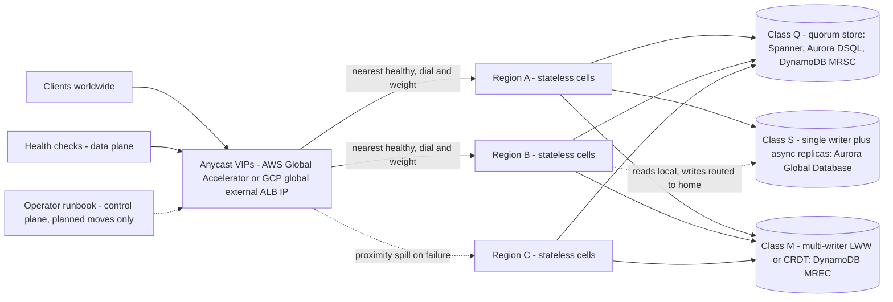

# System Design: Multi-Region Active-Active API on AWS and GCP

## TL;DR

"Active-active" is three separate decisions: which region accepts the request (anycast entry), which region may commit a write for a given key (the data ownership model), and who decides that a region is dead (failover control).
Quorum databases (Spanner, Aurora DSQL, DynamoDB MRSC) do not need a database failover step, and their commit latency is set by the round trip to the nearest majority, not the farthest replica - so where you put the witness region is a latency decision.
Multi-writer convergent stores (DynamoDB global tables in MREC mode) resolve conflicts with last-writer-wins, so cross-region read-modify-write, and even atomic `ADD` counters, can silently drop updates unless each item has exactly one writer region or you model the data as a CRDT.
Static stability is not just N+1 capacity in total, because anycast proximity spill sends a failed region's traffic to its nearest neighbor rather than spreading it evenly, so per-region headroom must be computed per failure scenario.
Failover must be driven by pre-provisioned capacity and data-plane mechanisms (health-check-driven anycast steering, quorum loss tolerance), because the control-plane APIs you would call during an outage live in specific regions that can be the ones failing.

## Mental Model



The edge layer is stateless and global: it announces the same IP prefixes from many points of presence, takes the TCP or TLS connection near the client, and forwards it to a regional stack chosen by proximity, health, and operator-set weights.
Regional stacks are stateless cells that should be able to serve any request for any user.
That is only true if the data tier underneath allows it.
Every entity in your schema has to be assigned to one of three consistency classes: Q (a write commits only after a cross-region majority acknowledges it), S (one home region writes and the others hold read replicas that lag), or M (any region writes and the replicas converge after the fact).
The choice of class sets your write latency floor, your RPO, and whether a regional failure needs a human or automated failover decision.
Most production designs mix all three classes: Q for money and inventory, S for large relational catalogs, M for sessions, carts, and telemetry.

## Internals

### Step 0 - Pin down what "active-active" means in the requirements

In the interview, start by splitting "active-active" into read-active (every region serves reads locally) and write-active (every region accepts writes for every key).
Read-active is cheap and works with any of the three classes.
Write-active for every key on every row needs either a quorum store, which costs cross-region latency on every commit, or a convergent store, which drops guarantees such as uniqueness, invariants, and read-modify-write correctness.
A third pattern, home-region-per-entity, covers most real products: every region accepts the request, but writes for tenant T are committed in T's home region (or by T's home shard in a quorum store), so writes are single-writer per key while the platform as a whole stays active-active.
Name the RPO and RTO per entity class early, for example "ledger RPO 0, RTO under 1 minute; cart RPO under 5 seconds; analytics RPO under 15 minutes", because those targets pick the class for you.
See [[17-Cloud-AI-Engineering/Volume_07_Reliability_and_SRE/Chapter_04_Disaster_Recovery_Tiers_and_RTO_RPO_Engineering|Disaster Recovery Tiers and RTO/RPO Engineering]] for the tier vocabulary.

### Layer 1 - Anycast entry and why it beats DNS failover for the front door

DNS-based regional failover depends on resolvers and clients honoring the TTL.
Stub resolvers, corporate recursive resolvers, JVM address caches, and connection pools commonly hold on to stale answers past the TTL, so the time it takes for a DNS failover to reach every client has a long tail you do not control.
Anycast reverses this: the client keeps one IP, the provider announces that prefix via BGP from many edge sites, and health-driven steering happens inside the provider's network after the packet arrives.
On AWS, a Global Accelerator standard accelerator gives you two static anycast IPv4 addresses and routes each new connection to a regional endpoint group based on geo-proximity, endpoint health, traffic dials, and endpoint weights (AWS Global Accelerator docs, as of 2026-10).
Each endpoint group (one per region) has a traffic dial from 0 to 100 percent, defaulting to 100, and each endpoint in a group has a weight from 0 to 255, defaulting to 128 (AWS Global Accelerator docs, as of 2026-10).
On Google Cloud, the global external Application Load Balancer exposes one anycast IP, terminates HTTP and TLS on Google Front Ends (GFEs) at the edge, and uses Maglev for consistent-hash packet distribution in front of the proxy tier ([Maglev, NSDI 2016](https://www.usenix.org/conference/nsdi16/technical-sessions/presentation/eisenbud)).
For mechanism depth on the GCP side, see [[17-Cloud-AI-Engineering/Volume_03_GCP_Deep_Dive/Chapter_05_Cloud_Load_Balancing_GFEs_and_Maglev|Cloud Load Balancing: GFEs and Maglev]] and [[17-Cloud-AI-Engineering/Volume_13_Seminal_Papers_and_Case_Studies/Chapter_11_Maglev_Network_Load_Balancer|Maglev]].

### The traffic dial mechanism that breaks naive capacity plans

The Global Accelerator traffic dial is not a global traffic split.
It only caps the share of traffic that proximity already sent to that endpoint group; the remainder goes to the next closest healthy group (AWS Global Accelerator docs, as of 2026-10).
For example, if two regions are both dialed to 50 percent, a client near region A has a 50 percent chance of landing in A and otherwise lands in the next closest region, not in a balanced pool.
Unhealthy regions spill the same way: their traffic goes to the next closest healthy group.
That means losing one region roughly doubles the load on its nearest neighbor, while a region on another continent sees almost no change.
If every endpoint is unhealthy, Global Accelerator fails open and sends traffic to an endpoint in the closest group anyway, so a deep health check that fails in every region at once does not black-hole traffic, but it does stop failover from protecting anyone (AWS Global Accelerator docs, as of 2026-10).
GCP's global external ALB behaves differently: backends declare capacity through balancing modes and capacity scalers, and traffic overflows to the next closest region when the nearest region reaches its declared capacity, so headroom is something you declare rather than something you discover during an incident (UNVERIFIED).
The capacity consequence is worked through numerically in the Worked Example.

### Layer 2 - Stateless regional cells

Each region runs identical cells with no synchronous runtime dependency on another region.
That includes auth: token validation has to work from locally cached signing keys, not by calling an issuer in another region.
Idempotency keys must be global or scoped to the entity's home, because a client retry after an anycast reroute can land in a different region than the first attempt.
Per-cell design is covered in [[17-Cloud-AI-Engineering/Volume_01_Cloud_Architecture_Principles/Chapter_03_Cell_Based_Architecture_and_Shuffle_Sharding|Cell-Based Architecture and Shuffle Sharding]], and the no-cross-region-dependency rule in [[17-Cloud-AI-Engineering/Volume_01_Cloud_Architecture_Principles/Chapter_02_Regions_Zones_and_Static_Stability|Regions, Zones, and Static Stability]].

### Layer 3a - Class Q: quorum commit and the nearest-majority rule

Spanner shards data into splits, and each split is a Paxos group with a leader replica that holds a time-based lease (10 seconds by default in the original paper) ([Spanner, OSDI 2012](https://www.usenix.org/conference/osdi12/technical-sessions/presentation/corbett)).
A read-write transaction takes locks at the leader, replicates through Paxos, picks a commit timestamp from TrueTime, and then performs commit wait until `TT.after(s)` is true before releasing locks.
This is what gives Spanner external consistency.
The paper reported TrueTime uncertainty epsilon as a sawtooth of roughly 1 to 7 ms, so commit wait costs on the order of 2 * epsilon ([Spanner, OSDI 2012](https://www.usenix.org/conference/osdi12/technical-sessions/presentation/corbett)).
The detail that getting-started guides leave out is that commit wait runs in parallel with Paxos replication.
In a multi-region configuration where the quorum round trip is larger than 2 * epsilon, commit wait is almost entirely hidden, and the latency you actually pay is the leader-to-majority round trip.
Spanner multi-region configurations use read-write replicas (voting, can be leader), read-only replicas (non-voting, serve local strong or stale reads), and witness replicas (voting, no full data copy, never leader).
In a configuration such as nam3, two read-write regions are close to each other and a witness region sits farther away (UNVERIFIED region composition).
With five voting replicas (2 + 2 + 1), the majority is 3, so a leader in the default leader region needs only one acknowledgment from the nearby second read-write region, and the distant witness is off the critical path in steady state.
Aurora DSQL makes the same trade more explicitly.
In a multi-region cluster of two peered regions plus a witness, the Journal commits to 2 of 3 regions ([Brooker, Aurora DSQL: Scalable, Multi-Region OLTP, arXiv 2607.13276](https://arxiv.org/abs/2607.13276)).
The paper measured a cluster spanning us-east-1 and us-east-2 with a witness in us-west-2.
In that setup, p99 COMMIT was about 30 ms against 7.4 ms single-region, even though the round trip to us-west-2 was 63 ms p99, because the nearest majority does not need the farthest region (Brooker, arXiv 2607.13276, as of 2026-10).
Primary-key SELECTs measured about 2 ms p99 and UPDATEs about 3 ms p99 in the same setup, because DSQL pays the cross-region cost once, at COMMIT, not per statement (Brooker, arXiv 2607.13276, as of 2026-10).
DSQL uses optimistic concurrency control, so conflicting transactions are rejected at commit, and the application must retry the whole transaction with backoff.
When one of the two active regions goes down, the surviving active region and the witness still form a majority, so commits continue without data loss (AWS Database Blog, as of 2026-10).
The design rule follows: put the witness or third voter close enough to one active region that the steady-state majority round trip fits your write SLO, but in a separate failure domain.
If the witness sits next to only one active region, losing that active region makes every commit pay the long round trip, so plan latency for the degraded state as well as the steady state.
DynamoDB global tables in multi-Region strong consistency (MRSC) mode are generally available and give RPO 0 with reads of the latest data from any region (AWS, as of 2026-10).
Treat the MRSC topology rule (three replicas, or two replicas plus a witness) and the limits on transactions and other features in MRSC mode as things to check in current docs before you design around them (UNVERIFIED).
See [[17-Cloud-AI-Engineering/Volume_03_GCP_Deep_Dive/Chapter_10_Cloud_Spanner_TrueTime_and_External_Consistency|Cloud Spanner: TrueTime and External Consistency]] and [[17-Cloud-AI-Engineering/Volume_02_AWS_Deep_Dive/Chapter_12_Aurora_DSQL_Multi_Region_Active_Active_SQL|Aurora DSQL: Multi-Region Active-Active SQL]].

### Layer 3b - Class S: single writer, storage-level async replication

Aurora's storage keeps six copies of each segment across three AZs, with a 4/6 write quorum and a 3/6 read quorum ([Aurora, SIGMOD 2017](https://dl.acm.org/doi/10.1145/3035918.3056101)).
Aurora Global Database extends this across regions by shipping redo log records from the primary cluster's storage to secondary-region storage volumes, not by logical binlog replication.
That keeps primary write performance unaffected and keeps typical cross-region lag under one second (AWS Aurora FAQ, as of 2026-10).
A global database supports up to ten secondary regions, and a secondary can be promoted to read/write in less than one minute (AWS Aurora FAQ, as of 2026-10).
There are two very different promotion paths.
Switchover is planned: the primary becomes read-only, secondaries catch up, and roles change with no data loss.
Failover is for a real outage: you promote a secondary and accept losing whatever had not replicated.
The `AuroraGlobalDBRPOLag` metric measures your actual exposure, and Aurora PostgreSQL's managed RPO parameter `rds.global_db_rpo` can block commits on the primary when lag exceeds a bound, turning an RPO target into a write-availability trade-off (AWS Aurora HA/DR whitepaper, as of 2026-10).
Since 2024-10-22, a Global Database writer endpoint follows the primary across switchover and failover, so applications do not need to change connection strings (AWS What's New, 2024-10-22).
That endpoint is still DNS, so client-side DNS caching and pooled connections to the old writer still matter.
A headless secondary (storage volume with no DB instances) keeps the sub-second RPO but trades it for a longer RTO, because instances must be created before the region can serve (AWS Aurora HA/DR whitepaper, as of 2026-10).
The fencing problem is the part interviewers probe.
After an unplanned failover, the old primary must never accept writes again for the same logical database.
Aurora handles this inside the global database topology, but your application-level singletons, such as cron leaders, outbox relays, and queue consumers keyed to "the writer region", need their own fencing token, typically the global database's current primary region read from a quorum store.
See [[17-Cloud-AI-Engineering/Volume_02_AWS_Deep_Dive/Chapter_11_Amazon_Aurora_Log_Is_The_Database|Amazon Aurora: Log-Is-The-Database]].

### Layer 3c - Class M: convergent multi-writer and CRDTs

DynamoDB global tables in the default multi-Region eventual consistency (MREC) mode accept writes in every replica region, replicate asynchronously, and resolve concurrent writes to the same item with last-writer-wins (UNVERIFIED as re-checked this pass; long-standing documented behavior).
The behavior that surprises people is that the condition expressions and transactions you rely on in one region are evaluated only against that region's replica.
Two regions can both pass `attribute_not_exists(pk)` for the same key, both commit, and LWW then silently discards one of the writes.
An atomic `UPDATE ... ADD n :1` is atomic only within its region.
Replication ships the resulting item state, so concurrent increments in two regions converge to one region's value and the other region's increments are lost.
The Worked Example demonstrates this.
The fix is to change the data model, not to tune the store.
A state-based CRDT is a replicated type whose merge function is commutative, associative, and idempotent (a join semilattice), so replicas converge no matter how often or in what order states are exchanged ([Shapiro et al., Conflict-free Replicated Data Types, SSS 2011](https://link.springer.com/chapter/10.1007/978-3-642-24550-3_29)).
A G-Counter keeps one slot per replica and merges by element-wise max, and a PN-Counter is two G-Counters.
On DynamoDB MREC, the conservative way to implement a G-Counter is one item per region (`pk = counter#us-east-1`), written only by that region and summed on read.
Assume conflict resolution is item-granular, not attribute-granular, and never let two regions write the same item.
The original Dynamo paper took the other route, using vector clocks and returning siblings to the application, which makes concurrency visible instead of hiding it ([Dynamo, SOSP 2007](https://www.allthingsdistributed.com/files/amazon-dynamo-sosp2007.pdf)).
LWW on wall clocks is also exposed to clock skew: a region whose clock runs ahead wins every conflict during the skew window.
Hybrid logical clocks bound this but cannot recover intent ([Kulkarni et al., Logical Physical Clocks, OPODIS 2014](https://cse.buffalo.edu/tech-reports/2014-04.pdf)).
Compare the evolution in [[17-Cloud-AI-Engineering/Volume_13_Seminal_Papers_and_Case_Studies/Chapter_01_Dynamo_and_DynamoDB|Dynamo and DynamoDB]] and leaderless quorums in [[04-System-Design/05-Data-Stores/Apache-Cassandra|Apache Cassandra]].

### Layer 4 - Failover control: data plane decides, control plane plans

A failover mechanism is statically stable when it needs no new resource creation, no control-plane mutation, and no cross-region coordination at the moment of failure ([AWS Builders' Library, Static stability using Availability Zones](https://aws.amazon.com/builders-library/static-stability-using-availability-zones/)).
For the front door, that means health-check-driven steering that is already configured and always running.
Global Accelerator endpoint-group health checks are an example, and detection time is approximately interval times threshold count (UNVERIFIED defaults of 30 seconds and 3).
Traffic dial and weight changes are control-plane calls, and the Global Accelerator API is served from us-west-2 (UNVERIFIED), so a dial-based runbook depends on the health of one specific region.
Route 53 Application Recovery Controller routing controls exist for exactly this problem: they flip DNS answers through a highly available data-plane cluster spread across several regions (UNVERIFIED cluster topology).
For the data tier, class Q stores need no failover decision because they keep committing as long as a majority survives.
That is the main operational argument for paying their latency.
Class S stores need a decision, and the decision is where outages get longer: automating unplanned Aurora Global failover on a single health signal risks flapping and data loss on transient partitions, while requiring a human adds minutes of RTO.
The defensible middle ground is to automate detection and preparation (pre-scale the target region, freeze deploys, page) but gate the data-losing promotion behind either a human or a quorum of independent signals from at least two vantage regions.
That avoids the fallback anti-pattern described in [AWS Builders' Library, Avoiding fallback in distributed systems](https://aws.amazon.com/builders-library/avoiding-fallback-in-distributed-systems/).
Retries during failover must use capped exponential backoff with jitter and a retry budget, or the surviving region absorbs both the shifted load and a retry multiplier ([AWS Builders' Library, Timeouts, retries, and backoff with jitter](https://aws.amazon.com/builders-library/timeouts-retries-and-backoff-with-jitter/)).
See [[17-Cloud-AI-Engineering/Volume_01_Cloud_Architecture_Principles/Chapter_04_Control_Plane_vs_Data_Plane_Separation|Control Plane vs Data Plane Separation]] and [[17-Cloud-AI-Engineering/Volume_07_Reliability_and_SRE/Chapter_03_Resilient_Communication_Retries_Jitter_and_Circuit_Breakers|Retries, Jitter, and Circuit Breakers]].

### Latency physics you design around

Light in fiber travels at roughly two-thirds of c, about 5 us per km one-way, so route length, not geodesic distance, sets the floor.
Measured inter-region round trips are the honest input, for example 63 ms p99 between US East and us-west-2 in the DSQL paper (Brooker, arXiv 2607.13276, as of 2026-10).
A write path's latency is roughly: client-to-edge RTT, plus edge-to-region RTT over the provider backbone, plus app time, plus the store's commit cost.
The commit cost is one nearest-majority RTT for class Q, a local commit (or local plus one round trip to the home region for remote writers) for class S, and a local commit for class M.
PACELC frames the trade-off: even with no partition, you choose between latency and consistency on every write ([Abadi, IEEE Computer 2012](https://www.cs.umd.edu/~abadi/papers/abadi-pacelc.pdf)).

## Numbers to Know

| Item | Value | Source |
| --- | --- | --- |
| Global Accelerator static anycast IPv4 addresses | 2 per accelerator | AWS Global Accelerator docs, as of 2026-10 |
| Global Accelerator traffic dial | 0-100 percent per endpoint group, default 100 | AWS Global Accelerator docs, as of 2026-10 |
| Global Accelerator endpoint weight | 0-255, default 128 | AWS Global Accelerator docs, as of 2026-10 |
| Global Accelerator fixed fee | USD 0.025 per accelerator-hour, plus per-GB DT-Premium | AWS pricing, as of 2026-10 |
| Global Accelerator health check interval and threshold | 10 or 30 s, threshold default 3 | UNVERIFIED |
| Aurora Global Database secondary regions | up to 10 | AWS Aurora FAQ, as of 2026-10 |
| Aurora Global Database typical cross-region lag | under 1 s | AWS Aurora FAQ, as of 2026-10 |
| Aurora Global Database promote secondary | under 1 minute | AWS Aurora FAQ, as of 2026-10 |
| Aurora Global Database writer endpoint | launched 2024-10-22 | AWS What's New, 2024-10 |
| Aurora storage quorum | 6 copies across 3 AZs, write 4/6, read 3/6 | Aurora SIGMOD 2017 |
| Aurora DSQL GA | 2025-05-27, 8 regions at GA | AWS press release, 2025-05 |
| Aurora DSQL availability design | 99.99 percent single-region, 99.999 percent multi-region | AWS DSQL features page, as of 2026-10 |
| Aurora DSQL multi-region COMMIT p99 | about 30 ms (us-east-1 + us-east-2, witness us-west-2) vs 7.4 ms single-region | Brooker, arXiv 2607.13276, 2026 |
| Aurora DSQL PK read p99, multi-region | about 2 ms | Brooker, arXiv 2607.13276, 2026 |
| US East to us-west-2 RTT p99 | about 63 ms | Brooker, arXiv 2607.13276, 2026 |
| DynamoDB global tables MRSC | GA mid-2025, RPO 0, 10 regions at launch, standard global tables pricing | AWS announcement, 2025-06 |
| Spanner TrueTime epsilon (2012 paper) | about 1-7 ms sawtooth | Spanner OSDI 2012 |
| Spanner Paxos leader lease (2012 paper) | 10 s default | Spanner OSDI 2012 |
| Spanner multi-region SLA | 99.999 percent | UNVERIFIED |
| Fiber propagation | about 5 us per km one-way | physics, stable |

## AWS vs GCP Mechanism Parity

| Concern | AWS mechanism | GCP mechanism | Critical difference |
| --- | --- | --- | --- |
| Anycast front door | Global Accelerator: 2 static anycast IPs, L4, endpoint groups per region | Global external ALB: 1 anycast IP, L7 on GFEs, Maglev in front | GA steering is proximity + dial + weight; GCLB overflow is driven by declared backend capacity (UNVERIFIED) |
| Operator traffic shifting | Traffic dial (group), weight (endpoint) - control-plane API | Capacity scaler, backend drain - control-plane API | Both are control-plane changes; neither is safe as the only failover path |
| DNS-level failover | Route 53 health checks, ARC routing controls on a multi-region data-plane cluster (UNVERIFIED topology) | Cloud DNS routing policies with health checks (UNVERIFIED scope) | DNS failover suffers client caching; anycast does not |
| Strongly consistent multi-region SQL | Aurora DSQL: OCC, 2-of-3 Journal quorum, witness region | Spanner: Paxos per split, 2PL plus TrueTime commit wait, witness replicas | DSQL aborts on conflict at commit; Spanner blocks on locks; both pay nearest-majority RTT |
| Multi-region strong KV | DynamoDB global tables MRSC (GA) | Spanner used as KV; Bigtable replication is eventually consistent (UNVERIFIED conflict semantics) | Only DynamoDB offers both MREC and MRSC modes on the same API surface |
| Single-writer relational DR | Aurora Global Database: storage-level redo shipping, up to 10 secondaries | AlloyDB and Cloud SQL cross-region replicas (UNVERIFIED feature parity) | Aurora replicates below the engine; failover is still a decision with RPO greater than 0 |
| Multi-writer convergent | DynamoDB MREC: LWW, region-local conditions | No first-party LWW multi-writer equivalent with identical semantics (UNVERIFIED) | CRDT modeling is your job on both clouds |
| Clock source | Amazon Time Sync (UNVERIFIED role in DSQL internals) | TrueTime (GPS + atomic clocks) | TrueTime exposes bounded uncertainty to the database; that is Spanner's core primitive |
| Failure isolation of global config | Per-region control planes, some global services anchored to one region (UNVERIFIED specifics) | Global control planes replicated globally | A global, strongly consistent config store spreads bad config globally in seconds |

## Worked Example: Lost-Update Lab and Three-Region Capacity Sizing

### What you will prove

Part A shows DynamoDB MREC losing concurrent cross-region atomic increments, then shows a per-region G-Counter converging correctly.
Part B shows Spanner multi-region serializing the same workload with no lost updates, measures commit latency, and demonstrates a bounded-stale read.
Part C sizes a three-region deployment, including the anycast spill effect.

### Cost estimate

DynamoDB part: about 200 on-demand writes plus replicated writes and a few reads, well under USD 0.01 at current on-demand rates (rates UNVERIFIED this pass; check the DynamoDB pricing page).
Spanner part: one instance in a multi-region configuration at 100 processing units for under one hour, roughly on the order of USD 1 (UNVERIFIED rate; check the Spanner pricing page before you run it).
If your chosen configuration rejects sub-node sizing, use `--nodes=1`, which costs about ten times more per hour (UNVERIFIED).
Global Accelerator is not provisioned in this lab; if you add one, it costs USD 0.025 per hour plus DT-Premium (AWS pricing, as of 2026-10).

### Budget alarms first

```bash
#!/usr/bin/env bash
set -euo pipefail
ACCT="$(aws sts get-caller-identity --query Account --output text)"
EMAIL="you@example.com"
aws budgets create-budget --account-id "$ACCT" \
  --budget '{"BudgetName":"aa-lab","BudgetLimit":{"Amount":"10","Unit":"USD"},"TimeUnit":"MONTHLY","BudgetType":"COST"}' \
  --notifications-with-subscribers "[{\"Notification\":{\"NotificationType\":\"ACTUAL\",\"ComparisonOperator\":\"GREATER_THAN\",\"Threshold\":50,\"ThresholdType\":\"PERCENTAGE\"},\"Subscribers\":[{\"SubscriptionType\":\"EMAIL\",\"Address\":\"$EMAIL\"}]}]"

PROJECT="$(gcloud config get-value project)"
BILLING="XXXXXX-XXXXXX-XXXXXX"
gcloud billing budgets create --billing-account="$BILLING" \
  --display-name=aa-lab --budget-amount=10USD \
  --threshold-rule=percent=0.5 --threshold-rule=percent=0.9 \
  --filter-projects="projects/$PROJECT"
```

### Part A - DynamoDB MREC: provision the global table

```bash
#!/usr/bin/env bash
set -euo pipefail
T=aa-lab
aws dynamodb create-table --region us-east-1 --table-name "$T" \
  --attribute-definitions AttributeName=pk,AttributeType=S \
  --key-schema AttributeName=pk,KeyType=HASH \
  --billing-mode PAY_PER_REQUEST \
  --stream-specification StreamEnabled=true,StreamViewType=NEW_AND_OLD_IMAGES
aws dynamodb wait table-exists --region us-east-1 --table-name "$T"
aws dynamodb update-table --region us-east-1 --table-name "$T" \
  --replica-updates '[{"Create":{"RegionName":"us-west-2"}}]'
until [ "$(aws dynamodb describe-table --region us-east-1 --table-name "$T" \
  --query 'Table.Replicas[?RegionName==`us-west-2`].ReplicaStatus' --output text)" = "ACTIVE" ]; do
  echo "waiting for replica"; sleep 15
done
echo "global table ready"
```

### Part A - The lost-update experiment

```python
#!/usr/bin/env python3
"""LWW lost updates vs per-region G-Counter on DynamoDB global tables (MREC)."""
import threading
import time

import boto3

TABLE = "aa-lab"
REGIONS = ["us-east-1", "us-west-2"]
N = 50


def client(region):
    return boto3.client("dynamodb", region_name=region)


def add_one(c, pk):
    c.update_item(
        TableName=TABLE,
        Key={"pk": {"S": pk}},
        UpdateExpression="ADD n :one",
        ExpressionAttributeValues={":one": {"N": "1"}},
    )


def naive_worker(region):
    c = client(region)
    for _ in range(N):
        add_one(c, "naive")


def gcounter_worker(region):
    c = client(region)
    for _ in range(N):
        add_one(c, "g#" + region)


def run(worker):
    threads = [threading.Thread(target=worker, args=(r,)) for r in REGIONS]
    for t in threads:
        t.start()
    for t in threads:
        t.join()


def read_naive(region):
    item = client(region).get_item(TableName=TABLE, Key={"pk": {"S": "naive"}}).get("Item")
    return int(item["n"]["N"]) if item else 0


def read_gcounter(region):
    keys = [{"pk": {"S": "g#" + r}} for r in REGIONS]
    resp = client(region).batch_get_item(RequestItems={TABLE: {"Keys": keys}})
    return sum(int(i["n"]["N"]) for i in resp["Responses"][TABLE])


if __name__ == "__main__":
    expected = N * len(REGIONS)
    run(naive_worker)
    time.sleep(15)
    print("naive ADD counter, expected", expected, {r: read_naive(r) for r in REGIONS})
    run(gcounter_worker)
    time.sleep(15)
    print("G-Counter, expected", expected, {r: read_gcounter(r) for r in REGIONS})
```

The expected outcome is that both regions converge to the same naive value, and that value is usually below 100.
Each region's in-region `ADD` is atomic, but replication carries item state and LWW keeps one region's version.
The exact number is nondeterministic, because it depends on how many increments land inside one replication window.
The G-Counter reaches exactly 100 in both regions after replication, because no item ever has two writer regions.
In production, also handle `UnprocessedKeys` from `batch_get_item`.

### Part B - Spanner multi-region: provision

```bash
#!/usr/bin/env bash
set -euo pipefail
gcloud services enable spanner.googleapis.com
gcloud spanner instances create aa-lab --config=nam3 \
  --description="active-active lab" --processing-units=100
gcloud spanner databases create aadb --instance=aa-lab \
  --ddl='CREATE TABLE counters (id STRING(64) NOT NULL, n INT64 NOT NULL) PRIMARY KEY (id)'
```

### Part B - Serializable increments, commit latency, stale reads

```python
#!/usr/bin/env python3
"""Spanner: no lost updates under concurrency; commit latency; bounded-stale read."""
import datetime
import statistics
import threading
import time

from google.cloud import spanner

N = 50
db = spanner.Client().instance("aa-lab").database("aadb")
lat_ms = []
lock = threading.Lock()


def incr(txn):
    rows = list(txn.execute_sql(
        "SELECT n FROM counters WHERE id = @id",
        params={"id": "c"},
        param_types={"id": spanner.param_types.STRING},
    ))
    n = rows[0][0] if rows else 0
    txn.insert_or_update("counters", columns=("id", "n"), values=[("c", n + 1)])


def worker():
    for _ in range(N):
        t0 = time.perf_counter()
        db.run_in_transaction(incr)
        with lock:
            lat_ms.append((time.perf_counter() - t0) * 1000.0)


with db.batch() as b:
    b.insert_or_update("counters", columns=("id", "n"), values=[("c", 0)])

threads = [threading.Thread(target=worker) for _ in range(2)]
for t in threads:
    t.start()
for t in threads:
    t.join()

with db.snapshot() as snap:
    print("strong read n =", list(snap.execute_sql("SELECT n FROM counters WHERE id = 'c'"))[0][0])
with db.snapshot(exact_staleness=datetime.timedelta(seconds=15)) as snap:
    print("15s-stale read n =", list(snap.execute_sql("SELECT n FROM counters WHERE id = 'c'"))[0][0])
lat_ms.sort()
print("txn p50 ms", round(statistics.median(lat_ms), 1), "p99 ms", round(lat_ms[int(0.99 * len(lat_ms)) - 1], 1))
```

The strong read returns exactly 100, because `run_in_transaction` retries aborted transactions and Spanner serializes them.
The stale read returns an older value but can be served by the nearest replica without contacting the leader, which is the read-latency lever for read-heavy APIs.
Run the script from VMs in two different regions to see how latency changes for a client far from the leader region.

### Teardown (exact)

```bash
#!/usr/bin/env bash
set -euo pipefail
gcloud spanner instances delete aa-lab --quiet
aws dynamodb update-table --region us-east-1 --table-name aa-lab \
  --replica-updates '[{"Delete":{"RegionName":"us-west-2"}}]'
until [ "$(aws dynamodb describe-table --region us-east-1 --table-name aa-lab \
  --query 'length(Table.Replicas || `[]`)' --output text)" = "0" ]; do
  echo "waiting for replica removal"; sleep 15
done
aws dynamodb wait table-exists --region us-east-1 --table-name aa-lab
aws dynamodb delete-table --region us-east-1 --table-name aa-lab
ACCT="$(aws sts get-caller-identity --query Account --output text)"
aws budgets delete-budget --account-id "$ACCT" --budget-name aa-lab
gcloud billing budgets list --billing-account="XXXXXX-XXXXXX-XXXXXX" --filter="displayName=aa-lab" --format="value(name)" \
  | xargs -r -n1 gcloud billing budgets delete --quiet
```

### Part C - Capacity sizing for a three-region API

Assume a global orders API at peak: 60,000 requests per second, 10 percent writes (6,000 per second), 1 KB items, and a 150 ms p99 SLO for writes.
Assume regions E (US East), W (US West), and U (EU), with proximity shares of E 45 percent, W 20 percent, and U 35 percent.
Assume a load test measured 1,000 RPS per application task at your p99 target; this is a workload-specific measurement, not a platform figure.
Step 1, normal load: E 27,000 RPS, W 12,000 RPS, U 21,000 RPS.
Step 2, naive N+1: with three equal regions, each needs 50 percent of peak (30,000 RPS), for 150 percent total provisioned.
Step 3, proximity spill: model each single-region failure separately.
If E fails, assume its clients' next closest region is W, so W carries 45 + 20 = 65 percent (39,000 RPS).
If W fails, W's traffic goes to E, so E carries 65 percent (39,000 RPS).
If U fails, assume EU clients' next closest region is E, so E carries 45 + 35 = 80 percent (48,000 RPS).
Per-region provision equals the maximum across scenarios: E 48,000, W 39,000, U 21,000, a total of 108,000 RPS, or 180 percent of peak.
Step 4, interpretation: proximity spill costs 30 extra points of capacity over the evenly redistributed ideal.
You can recover some of that by spreading spill with dials, but dial changes are control-plane calls that must not be on the critical failover path, so the 180 percent figure is the statically stable one.
Step 5, task count: E 48 tasks, W 39 tasks, U 21 tasks, plus 10 percent for deploy surge, giving 53, 43, and 24.
Step 6, write path on DynamoDB MREC: each 1 KB write consumes one write unit in the origin region plus one replicated write unit in each other replica region, so 6,000 writes per second becomes 18,000 billed write units per second across three regions.
Per month that is 6,000 * 2,592,000 s * 3 = 4.67e10 write units; multiply by the current on-demand price per million (UNVERIFIED this pass) to get the line item.
Write cost grows linearly with region count, so a fourth region costs about 33 percent more on writes.
Step 7, write path on a quorum store: in steady state, p99 commit is about the nearest-majority RTT; a DSQL-like US East pair with a US West witness measured about 30 ms p99 (Brooker, arXiv 2607.13276, 2026).
For an EU client of a US-anchored quorum, add the transatlantic RTT to reach a voting region, which can consume most of a 150 ms budget, so EU-homed entities should live in an EU-anchored quorum or a separate instance.
Step 8, degraded-state latency: if the active region nearest the witness fails, the majority now spans the long link, so re-check the SLO against roughly the 63 ms cross-country RTT plus app time.
Step 9, conclusion: use a quorum store for money and inventory, keyed per geography; use LWW multi-writer only for data that is single-writer per item or modeled as a CRDT; keep 180 percent stateless capacity, or reserve capacity for it.

## Failure Modes and Pitfalls

### Regional dependency hidden behind a "multi-region" design

On 2025-10-19/20, AWS us-east-1 had a long disruption that AWS's post-event summary attributed to a latent race condition in DynamoDB's automated DNS management, which left the regional endpoint's DNS record empty, and recovery then cascaded through dependent EC2 and load-balancing subsystems (AWS post-event summary, UNVERIFIED details this pass).
The lesson for active-active designers is not "avoid DynamoDB".
It is that any workload with a synchronous path to one region's endpoint, control plane, or identity flow is single-region regardless of where its replicas are.
Audit for hard-coded regional endpoints, single-region STS or IAM flows, deploy pipelines, secrets, and feature-flag services.
See [[17-Cloud-AI-Engineering/Volume_07_Reliability_and_SRE/Chapter_07_Anatomy_of_Major_Cloud_Outages|Anatomy of Major Cloud Outages]].

### Globally consistent replication of a poison input

On 2025-06-12, Google Cloud had a broad outage.
Google's incident report described a policy change with unexpected blank fields that was replicated globally within seconds and hit a code path in Service Control that had no feature flag or null-pointer handling, causing crash loops in every region (Google Cloud incident report, UNVERIFIED details this pass).
Recovery in the largest region was slower because restarting tasks overloaded a dependency without randomized backoff.
The lesson is that a strongly consistent global store is also a global, very fast distribution system for bad data, so config and policy need staged, region-by-region propagation with validation, even when the database could replicate them instantly.
Replication is not backup, and active-active is not isolation.

### Silent lost updates under LWW

Region-local conditional writes and transactions in MREC give a false sense of safety: uniqueness constraints, balance checks, and inventory decrements all pass locally and then get overwritten.
Symptoms are drift between derived counters and source events, double-sold inventory, and resurrected deleted items when a delete loses to a concurrent update.
Mitigations are single-writer-per-item (home region), CRDT modeling, or moving the entity to a class Q store.

### Health checks that are too deep or too shallow

A health check that calls a shared dependency fails in every region at once during that dependency's outage, and anycast fails open, so you lose failover exactly when you need it.
A health check that is too shallow keeps a region "healthy" while its database connection pool is exhausted.
Use a health signal that reflects the region's ability to serve its own cells, and alarm separately on dependency health.

### Spill-induced cascading failure

When a region drops out, proximity spill hits its nearest neighbor with roughly double the load, plus retries from clients whose connections were reset.
If that neighbor is provisioned for its own share plus a uniform N+1 slice, it saturates, its health checks fail, and traffic spills again to the third region.
This is the classic region-by-region cascade.
Defenses are per-scenario headroom (Part C), admission control and load shedding at the regional ingress, and retry budgets; see [[17-Cloud-AI-Engineering/Volume_07_Reliability_and_SRE/Chapter_02_Load_Shedding_Backpressure_and_Admission_Control|Load Shedding, Backpressure, and Admission Control]].

### Failover depends on capacity you do not have

Scale-up during a regional event competes with every other customer doing the same.
Quotas such as instance limits, function concurrency, and IP space are often lower in secondary regions, and accelerator capacity in particular may simply be unavailable.
Pre-provision, or hold capacity reservations, for the failover scenario; do not plan on autoscaling into it.

### Aurora Global failover pitfalls

Promoting with data loss while the old primary is only partitioned, not dead, can leave application singletons writing on both sides unless they are fenced.
JVM DNS caches and long-lived pooled connections keep talking to the old writer after the writer endpoint moves.
Set short client DNS TTLs and recycle connections on failover events.
A managed RPO bound turns replication lag spikes into primary write unavailability; alarm on `AuroraGlobalDBRPOLag` before you hit the bound.

### Quorum store pitfalls

Placing the witness far from both active regions puts the long link on every commit.
Placing it next to one active region makes the degraded state much slower than the steady state.
Leader-region placement in Spanner matters for writers far from it: every read-write transaction pays the round trip to the leader.
OCC stores (DSQL) under hot-key contention abort repeatedly, so hot counters need sharding or CRDT-style modeling even in a strongly consistent store.

## Security and Cost Angles

### IAM and blast radius

Scope runtime roles per region with conditions such as `aws:RequestedRegion`, so a compromised task in region E cannot mutate region U's resources.
Separate the failover-operator role (dial, routing control, global database switchover) from deployment roles, require MFA or break-glass for data-losing promotion, and audit every use.
Region-deny SCPs must exempt global services and the specific regions that host control planes your failover depends on, or the guardrail will block your own recovery.
See [[17-Cloud-AI-Engineering/Volume_02_AWS_Deep_Dive/Chapter_01_IAM_Policy_Evaluation_Engine|IAM Policy Evaluation Engine]] and [[17-Cloud-AI-Engineering/Volume_03_GCP_Deep_Dive/Chapter_02_Cloud_IAM_Roles_Policies_and_Conditions|Cloud IAM]].

### Keys and encryption across regions

AWS KMS multi-Region keys share key material and key ID across regions, so ciphertext written in one region can be decrypted in another without a cross-region KMS call.
That removes a runtime cross-region dependency.
The cost is that one key policy mistake now spans regions.
For Spanner multi-region instances with CMEK, keys must be available in each region of the configuration, so a key disabled in one region can affect a multi-region database (UNVERIFIED specifics; check current Spanner CMEK docs).
Envelope encryption keeps the KMS call on the data-key path rather than per record; see [[17-Cloud-AI-Engineering/Volume_08_Security_Identity_and_the_Data_Perimeter/Chapter_04_Encryption_Key_Hierarchies_and_Envelope_Encryption|Encryption Key Hierarchies and Envelope Encryption]].

### Private network boundaries

Database access should stay on private paths: VPC gateway or interface endpoints per region on AWS, and Private Service Connect plus a VPC Service Controls perimeter that includes every project in the topology on GCP.
A perimeter that omits the DR project turns failover into an access-denied outage.
See [[17-Cloud-AI-Engineering/Volume_08_Security_Identity_and_the_Data_Perimeter/Chapter_06_Constructing_an_Impenetrable_Data_Perimeter|Constructing an Impenetrable Data Perimeter]].

### Unit-economics levers

Replicated writes scale linearly with region count in multi-writer stores, so remove regions that do not serve users or pass the RTO math.
Witness regions and headless Aurora secondaries buy durability or quorum membership without paying for full serving capacity.
Stale reads from Spanner read-only replicas, and local reads in Aurora secondaries, move read traffic off the write quorum.
Static-stability headroom (180 percent in Part C) usually dominates the bill; commitment discounts on the baseline plus reservations on the failover delta are the standard lever (see [[17-Cloud-AI-Engineering/Volume_09_FinOps_and_Cloud_Economics/Chapter_02_Commitment_Discounts_Savings_Plans_vs_CUDs|Commitment Discounts]]).
Inter-region data transfer for app-level replication, logs, and traces is often the surprise line item; see [[17-Cloud-AI-Engineering/Volume_09_FinOps_and_Cloud_Economics/Chapter_04_Network_Egress_Economics_and_Optimization|Network Egress Economics]].

## Interview Questions and Model Answers

### Question 1 (L5 - Senior)

Why would you front a multi-region API with anycast instead of Route 53 latency or failover records, and what does anycast not solve?

#### Model Answer

DNS failover has to propagate through resolvers and client caches that often ignore TTLs, so time-to-recover has a long, uncontrolled tail.
Long-lived connections never re-resolve at all.
Anycast keeps one client-visible IP, steers each new connection inside the provider network using health checks that are always running, and so removes client caching from the recovery path.
On AWS, Global Accelerator gives two static anycast IPs with per-region endpoint groups, dials, and weights.
On GCP, the global external ALB gives one anycast IP with L7 termination at GFEs.
Anycast does not solve data consistency, does not move existing TCP connections (they reset and the client must reconnect), and does not add capacity: a failed region's traffic lands on the next closest region.
It also adds a cost line: GA is USD 0.025 per hour plus DT-Premium per GB (AWS pricing, as of 2026-10).

#### Follow-up Interviewer Question

Your mobile clients pin TLS and keep HTTP/2 connections open for 30 minutes; what happens to them during a regional failover behind anycast, and how do you bound it?

### Question 2 (L5 - Senior)

A teammate proposes DynamoDB global tables in two regions with a conditional write `attribute_not_exists(username)` to enforce unique usernames globally; evaluate it.

#### Model Answer

In MREC mode, the condition is evaluated against the local replica only, so two regions can each accept the same username within the replication window.
LWW then keeps one item and silently drops the other user's registration, which may already have been acknowledged.
Options, in order of preference: run uniqueness through a strongly consistent path (DynamoDB MRSC, Spanner, or DSQL) that pays one quorum RTT only at signup; or assign a home region by hashing the username and route the claim there, which is single-writer per key; or accept the race and reconcile with a background detector plus user-facing remediation.
Signup is rare and latency-tolerant, so paying 30 to 70 ms of quorum commit is cheap compared with the product cost of a duplicate identity.

#### Follow-up Interviewer Question

How would you migrate the existing table, which may already contain LWW-overwritten registrations, and how would you detect which users were affected?

### Question 3 (L6 - Staff)

Design the write path for a wallet balance service serving US and EU users with RPO 0 and a 200 ms p99 write SLO, on either cloud.

#### Model Answer

Balances need an invariant (no negative balance) and RPO 0, which rules out LWW multi-writer and async single-writer replication for the ledger.
I would use a quorum store and anchor each user's ledger in a quorum near the user's home geography: a US-anchored Spanner instance or DSQL cluster and an EU-anchored one, with users partitioned by residency.
A single global quorum would make EU writes cross the Atlantic to reach a majority.
Commit cost is the nearest-majority RTT; the DSQL paper measured about 30 ms p99 for a US East pair with a US West witness, versus 7.4 ms single-region (Brooker, arXiv 2607.13276, 2026).
That leaves budget for edge RTT and app time under 200 ms in steady state.
I would place the witness or third voter so the degraded state, with the near active region lost, still fits the SLO, and verify that with a game day, not a spreadsheet.
Writes are an append-only ledger with an idempotency key per client operation, enforced by a unique key in the same transaction, so anycast reroutes and client retries cannot double-debit.
The balance is derived in the same transaction, or kept as a materialized row updated under the same lock, so the invariant is checked atomically.
Cross-geography transfers become a saga with a transfer record in each ledger and an outbox, not a distributed transaction spanning two quorums.
Hot accounts on OCC need batching or sharded sub-balances, because they abort under contention.
Failure handling: losing one region costs no failover decision, because the quorum keeps committing.
Losing a whole geography makes that geography's users read-only or unavailable, which is the explicit price of RPO 0 with residency.

#### Follow-up Interviewer Question

Product now wants EU users to be able to pay US merchants in real time with exactly-once semantics; walk through the saga, its failure states, and how support staff see a stuck transfer.

### Question 4 (L6 - Staff)

You run three regions behind Global Accelerator with 45/20/35 percent proximity shares, provisioned uniformly at 50 percent of peak each; is that statically stable?

#### Model Answer

No.
Uniform 50 percent assumes that failed traffic spreads evenly, but GA sends an unhealthy group's traffic to the next closest healthy group, and the dial only caps what proximity already sent (AWS Global Accelerator docs, as of 2026-10).
If the 35 percent EU region fails and EU's next closest region is US East, US East carries 80 percent, well beyond 50 percent, saturates, fails health checks, and spills again: a cascade.
Per-region capacity must be the maximum over single-failure scenarios, which in this example is 80, 65, and 35 percent, or 180 percent total versus 150 percent for even redistribution.
You can lower that by redistributing with dials during the event, but dial changes are control-plane API calls served from one region (UNVERIFIED), so they cannot be the primary mechanism.
I would provision for the spill matrix, add admission control so overload degrades into shedding rather than cascade, and run a game day that fails each region to measure the real spill shares, because BGP and GA routing do not follow a map.

#### Follow-up Interviewer Question

Finance pushes back on 180 percent; which load can you shed or degrade deliberately during a regional event so you can provision less, and how do you make that safe?

### Question 5 (L6 - Staff)

Write the unplanned-failover runbook for an Aurora Global Database primary region outage, including what you automate and what you do not.

#### Model Answer

Detection is automated from at least two independent vantage regions: writer endpoint health, `AuroraGlobalDBRPOLag`, regional service health, and synthetic transactions, combined by a quorum rule to avoid acting on one observer's partition.
Preparation is automated: freeze deploys, scale the target region's app tier from the pre-provisioned floor, stop region-pinned singletons in the failing region by revoking their fencing token in a quorum store, and page the incident commander.
Promotion is gated, because failover to a secondary accepts losing whatever had not replicated, typically under one second of lag (AWS Aurora FAQ, as of 2026-10).
The gate is a human decision with a time box, or an automated decision only if the outage exceeds a threshold and RPO lag before the outage was within budget.
Promote with the managed failover path; the Global Database writer endpoint follows the new primary (AWS What's New, 2024-10-22), and clients with short DNS TTLs and pool recycling reconnect.
Afterwards, reconcile possibly lost writes by comparing application event logs or outboxes against the new primary, and do not switch back until a switchover (no data loss) can run under calm conditions.
What I do not automate: automatic failback, and promotion on a single signal, because flapping a single-writer database is worse than a few extra minutes of RTO.

#### Follow-up Interviewer Question

How do you test this runbook quarterly without paying the data-loss risk in production, and what evidence convinces you the test is representative?

### Question 6 (L7+ - Principal)

The CTO asks for "active-active across AWS and GCP" for the core API to survive a whole-provider outage; give your recommendation.

#### Model Answer

First separate the threat from the mechanism.
Provider-wide outages are rare, but the 2025-06-12 Google Cloud event and the 2025-10 us-east-1 event both show that global control planes and region-anchored dependencies can have very wide blast radius (incident reports, UNVERIFIED details).
Cross-provider active-active for write data means a quorum spanning providers, with every commit crossing provider interconnects, or LWW convergence with all the lost-update risks.
Neither cloud's managed quorum stores (Spanner, DSQL, DynamoDB MRSC) span providers, so you would be operating your own consensus database across clouds, with cross-cloud egress on every replicated byte and two IAM, KMS, and network perimeters to keep in sync.
My recommendation is tiered.
Run multi-region active-active within one primary provider for the core.
Use cross-provider warm standby for a narrowly defined "minimum viable service" (auth, read-only catalog, payment capture queue) with async replication and a rehearsed, human-gated switch.
Use cross-provider active-active only for stateless edge or read-only content.
I would put numbers on it: the cost of an additional full stack and the egress, versus expected loss as outage probability times revenue at risk times duration, and let the business choose the tier explicitly.
The decision document should also commit to removing single-region dependencies inside the primary provider first, because that is where most historical multi-region designs have actually failed.
See [[17-Cloud-AI-Engineering/Volume_04_AWS_vs_GCP_Translation/Chapter_07_Multi_Cloud_and_Hybrid_Architecture_Reality|Multi-Cloud and Hybrid Architecture Reality]].

#### Follow-up Interviewer Question

Which signal, and whose authority, triggers the cross-provider switch, and how do you stop it from being triggered by a partial outage that is really your own bug?

### Question 7 (L7+ - Principal)

Your platform's feature flags and authorization policies live in a strongly consistent multi-region database so every region sees changes instantly; critique that design.

#### Model Answer

Instant global consistency is the wrong goal for config, because it turns every bad push into a simultaneous global incident.
That is the pattern in Google's 2025-06-12 report, where a policy with blank fields replicated globally within seconds and crashed a binary everywhere (Google Cloud incident report, UNVERIFIED details).
I would keep the authoritative store strongly consistent for audit and ordering, but decouple distribution: changes propagate as versioned snapshots through a staged pipeline (canary cell, one region, then waves), with schema validation and a feature flag on the consuming code path.
Consumers must fail static: keep serving the last known good snapshot when the new one fails validation or the store is unreachable, so the data plane never needs a fresh config to keep serving.
Bake times and automated rollback signals are per wave, and emergency changes such as revocations get a separate fast path with tighter validation, not a bypass of all safety.
The trade-off is propagation delay, minutes instead of seconds, which is acceptable for almost all config.
For the rare security revocation that must be instant, the fast path is narrowly scoped and pre-tested.
See [[17-Cloud-AI-Engineering/Volume_01_Cloud_Architecture_Principles/Chapter_05_Constant_Work_and_Workload_Smoothing|Constant Work and Workload Smoothing]] for why snapshot push beats per-change deltas.

#### Follow-up Interviewer Question

How do you prove to an auditor that a revoked credential stops working everywhere within your stated bound if distribution is staged?

### Question 8 (L7+ - Principal)

Explain why the witness region placement for a DSQL cluster or a Spanner multi-region instance is a product decision, not just an infrastructure detail.

#### Model Answer

Commit latency in both systems is set by the round trip to the nearest majority of voters, so the witness and second voter decide the steady-state write p99.
The DSQL paper shows this directly: about 30 ms p99 commit despite a 63 ms RTT to the witness, because the closer pair forms the majority (Brooker, arXiv 2607.13276, 2026).
When a voter fails, the majority changes, and latency shifts to the next-nearest majority, so the degraded-state write latency is also fixed by placement.
Spanner adds the leader dimension: read-write transactions go through the split leader, so the default leader region decides which users pay an extra long-haul round trip.
Placement therefore decides which customers get fast writes, how much the product slows during an incident, and which jurisdictions hold voting replicas.
Those are product, SLO, and compliance trade-offs that need owners outside infrastructure.
I would present a small matrix of placement options against steady-state p99, degraded p99, and residency, and have product sign the SLO that matches.

#### Follow-up Interviewer Question

Your largest customer moves most of its traffic from the US to APAC; what do you change, in what order, and how do you avoid a write-latency regression for everyone else during the migration?

## Further Reading

- [Spanner: Google's Globally-Distributed Database, OSDI 2012](https://www.usenix.org/conference/osdi12/technical-sessions/presentation/corbett) - the original description of TrueTime, commit wait, and Paxos-per-split that every class Q design builds on.
- [Aurora DSQL: Scalable, Multi-Region OLTP (Brooker, arXiv 2607.13276)](https://arxiv.org/abs/2607.13276) - primary source for DSQL's Journal quorum and measured multi-region commit latencies.
- [Amazon Aurora: Design Considerations for High Throughput Cloud-Native Relational Databases, SIGMOD 2017](https://dl.acm.org/doi/10.1145/3035918.3056101) - the storage quorum and log-shipping model that Global Database extends across regions.
- [Dynamo: Amazon's Highly Available Key-value Store, SOSP 2007](https://www.allthingsdistributed.com/files/amazon-dynamo-sosp2007.pdf) - the canonical treatment of multi-writer availability, vector clocks, and why conflicts must be surfaced.
- [Amazon DynamoDB: A Scalable, Predictably Performant, and Fully Managed NoSQL Database Service, USENIX ATC 2022](https://www.usenix.org/conference/atc22/presentation/elhemali) - how the modern service evolved beyond Dynamo, including Paxos replica groups.
- [Conflict-free Replicated Data Types, SSS 2011](https://link.springer.com/chapter/10.1007/978-3-642-24550-3_29) - the formal basis for convergent multi-writer data modeling.
- [Maglev: A Fast and Reliable Software Network Load Balancer, NSDI 2016](https://www.usenix.org/conference/nsdi16/technical-sessions/presentation/eisenbud) - how Google's anycast front door spreads packets consistently across its proxy tier.
- [Consistency Tradeoffs in Modern Distributed Database System Design (PACELC), IEEE Computer 2012](https://www.cs.umd.edu/~abadi/papers/abadi-pacelc.pdf) - the latency-versus-consistency framing for the no-partition case that dominates write-path design.
- [AWS Builders' Library: Static stability using Availability Zones](https://aws.amazon.com/builders-library/static-stability-using-availability-zones/) - the definition of failover that needs no control-plane action, applied here at region scale.
- [AWS Builders' Library: Avoiding fallback in distributed systems](https://aws.amazon.com/builders-library/avoiding-fallback-in-distributed-systems/) - why rarely exercised failover paths fail, and how to design paths that are always exercised.
- [AWS Builders' Library: Timeouts, retries, and backoff with jitter](https://aws.amazon.com/builders-library/timeouts-retries-and-backoff-with-jitter/) - how to avoid the retry amplification that turns regional spill into a cascade.
- [How AWS Global Accelerator works](https://docs.aws.amazon.com/global-accelerator/latest/dg/introduction-how-it-works.html) - authoritative semantics of traffic dials, weights, and failover behavior used in the sizing math.
- [Amazon Aurora HA and DR Features for Global Resilience whitepaper](https://d1.awsstatic.com/Amazon%20Aurora%20High%20Availability%20and%20Disaster%20Recovery%20Features%20for%20Global%20Resilience%20Whitepaper.pdf) - managed RPO, headless secondaries, and switchover versus failover in AWS's own words.
- Related chapters: [[17-Cloud-AI-Engineering/Volume_14_Staff_Plus_Interview_Arena/Chapter_04_Design_Global_Real_Time_Feature_Store|System Design: Global Real-Time Feature Store]] (previous), [[17-Cloud-AI-Engineering/Volume_14_Staff_Plus_Interview_Arena/Chapter_06_Cloud_AI_Numbers_Every_Staff_Engineer_Must_Know|Cloud AI Numbers Every Staff Engineer Must Know]] (next), [[17-Cloud-AI-Engineering/Volume_13_Seminal_Papers_and_Case_Studies/Chapter_06_Google_Spanner|Google Spanner]], and [[08-Distinguished-Engineering/02-Distributed-Systems-Internals/Raft-Consensus|Raft Consensus]] for majority-quorum intuition.
