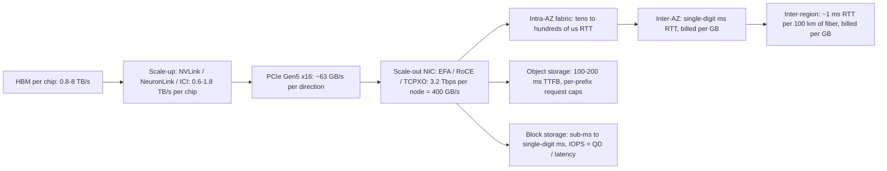

# Cloud AI Numbers Every Staff Engineer Must Know

## TL;DR

Every cloud AI system has three ceilings: bandwidth (bytes per second), latency (seconds per operation), and concurrency (operations in flight); Little's Law (`throughput = concurrency / latency`) links all three, and most "slow cloud" tickets trace back to one of them.
LLM decode is limited by HBM bandwidth, not FLOPs: the most tokens per second one sequence can get is roughly aggregate HBM bandwidth divided by the bytes read per step (weights plus KV-cache).
Each step outward in the bandwidth ladder costs about an order of magnitude: HBM (3.35-8 TB/s per chip), scale-up fabric (0.9-1.8 TB/s per GPU), scale-out NIC (about 50 GB/s per GPU on a 3.2 Tbps node), then object storage at 10-100 ms time to first byte.
Cloud networks do not give you "the" bandwidth; they enforce several separate limiters (aggregate, per-flow, packets per second, connection tracking, link-local), and each one drops packets silently when you exceed it.
An SLA is a refund schedule, not a design target: when services are chained in series, their availabilities multiply, the credit is capped at the bill for the failed service, and the business loss is uncapped.

## Mental Model



Read the diagram as a ladder of decreasing bandwidth and increasing latency.
Every hop away from the HBM generally gives up about 10x bandwidth and adds 10x or more latency.
Every AI-infrastructure design choice is a decision about which rung each byte lives on.
Tensor parallelism stays inside the scale-up domain because NVLink delivers about 18x the per-GPU bandwidth of the scale-out NIC.
Checkpoints go to object storage because only that rung is durable and cheap at terabyte scale, and that rung's request-rate limits then become your problem.
Billing and SLAs attach at specific rungs: data crossing AZ, region, or internet boundaries is metered, while HBM and NVLink traffic is free once you pay for the instance-hour.
A staff engineer can name the rung, its ceiling, and its price for any byte in the system.

## Internals

### The three-ceiling model and Little's Law

Every resource in this chapter exposes three limits: a bandwidth ceiling, a latency floor, and a concurrency limit.
Little's Law ties them together: sustained throughput equals the number of operations in flight divided by the latency of each operation.
For block storage, `IOPS = queue_depth / latency`, so a gp3 volume with about 1 ms latency at queue depth 1 delivers about 1,000 IOPS, no matter how many IOPS you provisioned.
For networks, the bandwidth-delay product applies: a single TCP flow needs `window >= bandwidth x RTT` bytes in flight, so 10 Gbps across a 2 ms inter-AZ RTT needs a 2.5 MB window.
For LLM serving, the in-flight concurrency is the batch, and KV-cache capacity in HBM caps it.
At the L6 bar, a diagnosis names which of the three ceilings binds before it proposes a fix.

### Accelerator memory: the roofline and the ridge point

The roofline model (Williams, Waterman, Patterson, CACM 2009) says attainable FLOP/s is the lower of peak compute and `arithmetic_intensity x memory_bandwidth`.
The ridge point, peak FLOP/s divided by bandwidth, is the arithmetic intensity a kernel needs before it becomes compute-bound.
For H100 SXM, dense BF16 is about 989 TFLOP/s and HBM3 delivers 3.35 TB/s, so the ridge sits near 295 FLOP per byte.
Decode multiplies each weight by one token per sequence, which is 2 FLOPs per parameter per sequence, so with BF16 weights (2 bytes) arithmetic intensity is about `B` FLOP per byte at batch size `B`.
A decode batch would need about 300 sequences just to reach the ridge on the weight read alone.
In practice it never reaches the ridge, because each sequence also streams its own KV-cache, and the KV bytes grow linearly with batch and context.
The consequence: the decode-throughput lever is HBM bandwidth and HBM capacity (for batch), not TFLOPs, and FP8 or INT4 weights help mainly because they cut bytes moved.
Prefill is a matrix-matrix product over the whole prompt, so it sits well above the ridge and is compute-bound.
That asymmetry is why [[17-Cloud-AI-Engineering/Volume_11_LLM_Serving_and_Inference_Systems_on_Cloud/Chapter_07_Prefill_and_Decode_Disaggregation|prefill and decode disaggregation]] exists.

### The interconnect hierarchy and why parallelism maps onto it

On a p5.48xlarge, each H100 has 900 GB/s of NVLink bandwidth through NVSwitch, while the node's 3,200 Gbps of EFA works out to 400 GB/s per node, or 50 GB/s per GPU.
That 18:1 ratio explains the standard layout: tensor parallelism (an all-reduce on every layer) stays inside the NVLink domain, and pipeline and data parallelism (less frequent, larger, overlappable transfers) cross the NIC.
TPU pods flatten this hierarchy: v5p chips connect over ICI at 4,800 Gbps per chip in a 3D torus that scales to 8,960 chips, and optical circuit switches rewire the torus between slices (Jouppi et al., ISCA 2023).
The NVL72-class rack designs (GB200) extend NVLink to 72 GPUs, which moves the 18:1 cliff from the 8-GPU boundary to the 72-GPU boundary.
The mechanism to internalize is NCCL's distinction between algorithm bandwidth and bus bandwidth.
NCCL defines `busbw = algbw x 2(n-1)/n` for all-reduce, because a ring all-reduce moves `2(n-1)/n` times the buffer size over each link.
Ring all-reduce time is therefore `2(n-1)/n x S / B_link`, which for large `n` approaches `2S/B` and does not depend on node count.
That independence is why data parallelism scales almost flat in bandwidth terms, and why latency (about `2(n-1)` hops) is what kills small-message collectives at scale.
When a vendor quotes "3.2 Tbps," compare it to the busbw that `nccl-tests` reports, not to the algbw.

### EFA and SRD: how AWS makes a lossy Ethernet fabric behave for collectives

EFA uses the Scalable Reliable Datagram (SRD) protocol, which runs on the Nitro card rather than on the host CPU (Shalev et al., IEEE Micro 2020).
SRD sprays the packets of one logical flow across many fabric paths by changing the encapsulation entropy, so a single NCCL connection does not pin to one ECMP path.
SRD gives up in-order delivery and hands out-of-order packets upward; reordering is left to the libfabric layer, and NCCL reaches libfabric through the `aws-ofi-nccl` plugin.
Retransmission happens in the Nitro hardware at microsecond timescales, far below the millisecond-scale retransmission timeouts of kernel TCP.
Packet spraying makes tail latency depend on the fabric as a whole rather than on the worst single link.
That property is what lets a synchronous all-reduce across thousands of GPUs avoid being gated by one hot ECMP path.
Google takes a different path for GPUs: A3 Mega uses GPUDirect-TCPXO, which DMAs payloads directly into GPU memory over eight 200 Gbps NICs, while A3 Ultra and A4 use RDMA over Converged Ethernet with 3.2 Tbps of GPU NICs per VM (Google Cloud docs, as of 2025-06).

### The mechanism the guides skip: EC2 bandwidth is a stack of independent policers

The instance-type table says "Up to 12.5 Gbps" or "50 Gbps," but that figure is only one of at least five limiters the Nitro card enforces at the same time.
First, aggregate bandwidth: instances labeled "up to" have a lower baseline and spend network I/O credits to burst, so a sustained transfer falls back to baseline after the credits run out.
Second, per-flow bandwidth: a single 5-tuple flow is limited to 5 Gbps outside a cluster placement group and 10 Gbps inside one (AWS EC2 docs, as of 2025-06).
The physical reason is ECMP: the fabric hashes the 5-tuple to a single path, so one flow cannot use more than one path's share.
ENA Express removes this limit by running SRD underneath TCP, which raises single-flow bandwidth to 25 Gbps between supported instances in the same AZ (AWS EC2 docs, as of 2025-06).
Third, a packets-per-second allowance, which small-packet workloads such as RPC fan-out or DNS hit long before any bandwidth limit.
Fourth, a connection-tracking allowance for tracked flows, which security group rules can trigger; an untracked rule (allow all from 0.0.0.0/0 in both directions) bypasses tracking.
Fifth, a link-local allowance of 1,024 packets per second per ENI, shared across traffic to the Amazon-provided DNS resolver, the instance metadata service, and the Time Sync service (AWS EC2 docs, as of 2025-06).
Traffic to the internet or to another region is limited to 50% of instance bandwidth for instances with 32 or more vCPUs, and to 5 Gbps below that (AWS EC2 docs, as of 2025-06).
None of these limiters emits a CloudWatch alarm by default; each one drops packets silently and increments an ENA driver counter.
The counters are visible with `ethtool -S eth0`: `bw_in_allowance_exceeded`, `bw_out_allowance_exceeded`, `pps_allowance_exceeded`, `conntrack_allowance_exceeded`, and `linklocal_allowance_exceeded`.
A staff engineer debugging a p99 regression on EC2 reads these counters before blaming the application.
Google Compute Engine enforces a per-VM egress cap that scales at about 2 Gbps per vCPU up to a per-series maximum, and Tier_1 networking raises that cap on supported series (Google Cloud docs, as of 2025-06).

### Storage: what you provision versus what you can actually get

Delivered EBS performance is the minimum of four terms: the volume's provisioned IOPS and throughput, the instance's EBS IOPS and bandwidth limits, `queue_depth / latency`, and I/O-size accounting.
EBS SSD volumes count each I/O up to 256 KiB as one operation and may merge small sequential I/Os, so I/O-size assumptions change the IOPS you actually observe (AWS EBS docs, as of 2025-06).
Smaller EBS-optimized instances can burst to their maximum EBS performance for 30 minutes at least once every 24 hours and then fall back to baseline, a trap during model-weight loads (AWS EC2 docs, as of 2025-06).
S3 scales request capacity per partitioned prefix: each prefix supports at least 3,500 PUT/COPY/POST/DELETE and 5,500 GET/HEAD requests per second, and S3 splits partitions in the background as load grows (AWS S3 docs, as of 2025-06).
Because splits lag the load, a checkpoint storm against a cold prefix gets `503 Slow Down` until the partitions catch up.
GCS starts each bucket at about 1,000 object writes and 5,000 object reads per second and autoscales by splitting index ranges; Google advises doubling request rate no faster than every 20 minutes and avoiding sequential key names (Google Cloud docs, as of 2025-06).
S3 Express One Zone directory buckets trade multi-AZ durability for single-digit-millisecond latency and use a session-based authorization model (`CreateSession`) that amortizes request-signing cost (AWS S3 docs, as of 2025-06).

### Pricing: why unit prices compound

GPU instance-hours dominate training and self-hosted serving bills, while network transfer and request charges dominate data pipelines.
The levers that matter are well known: commitments (Savings Plans, CUDs), preemptible capacity (Spot, with a 2-minute notice on AWS and a 30-second notice on GCP), and reservations (Capacity Blocks, reservations, Dynamic Workload Scheduler).
The trap is usually not the instance price but bytes crossing a billed boundary inside a training loop, such as a data cache in the wrong AZ or a cross-region replica.
See [[17-Cloud-AI-Engineering/Volume_09_FinOps_and_Cloud_Economics/Chapter_04_Network_Egress_Economics_and_Optimization|Network Egress Economics]] and [[17-Cloud-AI-Engineering/Volume_09_FinOps_and_Cloud_Economics/Chapter_05_GPU_and_TPU_Unit_Economics|GPU and TPU Unit Economics]].

### SLAs: the contract, the math, and correlation

The EC2 region-level SLA is 99.99% monthly uptime for instances spread across two or more AZs, and the instance-level SLA is 99.5% (AWS Compute SLA, as of 2025-06).
Credits are a percentage of the affected service's monthly charge: 10%, 30%, or 100% as uptime falls through the 99.99%/99.0%/95.0% tiers for the region-level SLA (AWS Compute SLA, as of 2025-06).
For dependencies in series, availabilities multiply, so `A_total = product(A_i)`.
For independent redundant copies in parallel, `A_total = 1 - product(1 - A_i)`, but real failures are correlated through shared control planes, global configuration pushes, and simultaneous deploys.
The Google SRE book's error-budget framing turns those percentages into minutes: 99.9% allows 43.2 minutes per 30 days, 99.99% allows 4.32 minutes, and 99.999% allows about 26 seconds.
See [[17-Cloud-AI-Engineering/Volume_07_Reliability_and_SRE/Chapter_01_SLIs_SLOs_and_Error_Budget_Engineering|SLIs, SLOs, and Error Budget Engineering]].

## Numbers to Know

Verification note: live re-checking against the 2026-10 docs and price sheets was not possible in this drafting pass.
The date shown on each row is the date the figure was last verified against the named primary source.
Rows marked UNVERIFIED are volatile and must be re-checked before anyone quotes them in a design review.
Vendor silicon specifications (HBM capacity and bandwidth, peak FLOPs) are fixed per SKU and do not drift.

### Physics and latency ladder

| Quantity | Value | Source (date) | Status |
|---|---|---|---|
| Light in fiber | ~200,000 km/s, ~1 ms RTT per 100 km | Physics (refractive index ~1.47) | Stable |
| AZ separation (AWS) | AZs within ~100 km (60 miles) of each other | AWS Regions and AZs page (as of 2025-06) | Stable |
| Inter-AZ RTT | Single-digit milliseconds | AWS Regions and AZs page (as of 2025-06) | Stable |
| S3 small-object first-byte latency | ~100-200 ms | AWS S3 performance guidelines (as of 2025-06) | Stable |
| S3 Express One Zone latency | Single-digit ms | AWS S3 docs (as of 2025-06) | Stable |
| io2 Block Express latency | Sub-millisecond | AWS EBS docs (as of 2025-06) | Stable |
| gp3 latency | Single-digit ms | AWS EBS docs (as of 2025-06) | Stable |
| Spot interruption notice | AWS 2 min, GCP 30 s | AWS EC2 docs, Google Cloud docs (as of 2025-06) | Stable |

### Accelerator memory and compute

| Accelerator | HBM capacity | HBM bandwidth | Dense peak | Ridge (FLOP/B) | Source (date) |
|---|---|---|---|---|---|
| NVIDIA A100 80GB SXM | 80 GB HBM2e | 2.04 TB/s | 312 TFLOPS BF16 | ~153 | NVIDIA datasheet (stable) |
| NVIDIA H100 SXM | 80 GB HBM3 | 3.35 TB/s | 989 TFLOPS BF16, 1,979 FP8 | ~295 BF16 | NVIDIA datasheet (stable) |
| NVIDIA H200 | 141 GB HBM3e | 4.8 TB/s | Same as H100 | ~206 BF16 | NVIDIA datasheet (stable) |
| NVIDIA B200 (as in DGX/HGX B200) | 180 GB HBM3e | 8 TB/s | ~2.25 PFLOPS BF16 dense (UNVERIFIED) | ~281 | NVIDIA DGX B200 spec (as of 2025-06) |
| AWS Trainium2 | 96 GiB HBM | 2.9 TB/s | 1.3 PFLOPS FP8 dense, ~667 TFLOPS BF16 | ~230 BF16 | AWS Trn2 launch (as of 2024-12) |
| AWS Inferentia2 | 32 GB HBM | ~0.82 TB/s | - | - | AWS Inf2 docs (as of 2025-06) |
| Google TPU v5e | 16 GB HBM2 | 819 GB/s | 197 TFLOPS BF16 | ~240 | Google Cloud TPU docs (as of 2025-06) |
| Google TPU v5p | 95 GB HBM2e | 2,765 GB/s | 459 TFLOPS BF16 | ~166 | Google Cloud TPU docs (as of 2025-06) |
| Google TPU v6e (Trillium) | 32 GB HBM | 1,640 GB/s | 918 TFLOPS BF16 | ~560 | Google Cloud TPU docs (as of 2025-06) |
| Google TPU7x (Ironwood) | 192 GB HBM3e | 7.37 TB/s | 4,614 TFLOPS FP8 | ~626 FP8 | Google announcement (as of 2025-04); GA status UNVERIFIED |

### Scale-up and scale-out fabrics

| Fabric | Bandwidth | Domain size | Source (date) | Status |
|---|---|---|---|---|
| NVLink 4 (H100/H200) | 900 GB/s per GPU | 8 GPUs per HGX node | NVIDIA datasheet | Stable |
| NVLink 5 (B200) | 1.8 TB/s per GPU | 8 (HGX) or 72 (NVL72) | NVIDIA datasheet | Stable |
| PCIe Gen5 x16 | ~63 GB/s per direction | Host-device | PCI-SIG spec arithmetic | Stable |
| EC2 p5.48xlarge EFA | 3,200 Gbps per node (EFAv2) | UltraCluster | AWS EC2 docs (as of 2025-06) | Stable |
| EC2 p5en.48xlarge EFA | 3,200 Gbps (EFAv3), H200 | UltraCluster | AWS EC2 docs (as of 2025-06) | Stable |
| EC2 p6-b200.48xlarge EFA | 3,200 Gbps (EFAv4), 8x B200 | UltraCluster | AWS launch (as of 2025-05) | Stable |
| EC2 trn2.48xlarge EFA | 3.2 Tbps (EFAv3), 16 chips | UltraServer of 64 chips via NeuronLink | AWS Trn2 launch (as of 2024-12) | Stable |
| GCE A3 Mega | 8 x 200 Gbps GPU NICs (GPUDirect-TCPXO) | Cluster | Google Cloud docs (as of 2025-06) | Stable |
| GCE A3 Ultra / A4 | 3.2 Tbps GPU NICs (RoCE) | Cluster | Google Cloud docs (as of 2025-06) | Stable |
| TPU v5e ICI | 1,600 Gbps per chip | 256-chip pod | Google Cloud TPU docs (as of 2025-06) | Stable |
| TPU v5p ICI | 4,800 Gbps per chip, 3D torus | 8,960-chip pod | Google Cloud TPU docs (as of 2025-06) | Stable |
| TPU7x ICI | 1.2 TB/s bidirectional per chip | 9,216-chip pod | Google announcement (as of 2025-04) | UNVERIFIED |

### General-purpose instance networking

| Limiter | Value | Source (date) | Status |
|---|---|---|---|
| EC2 single flow, outside cluster placement group | 5 Gbps | AWS EC2 docs (as of 2025-06) | Stable |
| EC2 single flow, inside cluster placement group | 10 Gbps | AWS EC2 docs (as of 2025-06) | Stable |
| EC2 single flow with ENA Express (same AZ) | 25 Gbps | AWS EC2 docs (as of 2025-06) | Stable |
| EC2 to internet or other region | 50% of instance bandwidth if >= 32 vCPU, else 5 Gbps | AWS EC2 docs (as of 2025-06) | Stable |
| EC2 link-local (DNS, IMDS, NTP) | 1,024 pps per ENI | AWS EC2 docs (as of 2025-06) | Stable |
| GCE per-VM egress default | ~2 Gbps per vCPU up to series cap | Google Cloud docs (as of 2025-06) | Stable |
| GCE Tier_1 per-VM egress | Up to 200 Gbps on select series | Google Cloud docs (as of 2025-06) | UNVERIFIED |
| AWS Direct Connect dedicated ports | 1, 10, 100, 400 Gbps | AWS Direct Connect docs (as of 2025-06) | Stable |
| GCP Dedicated Interconnect circuits | 10, 100 Gbps | Google Cloud docs (as of 2025-06) | Stable |

### Block, file, and object storage

| Resource | Limit | Source (date) | Status |
|---|---|---|---|
| gp3 baseline (included) | 3,000 IOPS, 125 MiB/s | AWS EBS docs (as of 2025-06) | Stable |
| gp3 maximum | 16,000 IOPS, 1,000 MiB/s, 16 TiB; later raised to 80,000 IOPS, 2,000 MiB/s, 64 TiB | AWS EBS docs (as of 2025-06) | Raised limits UNVERIFIED |
| io2 Block Express maximum | 256,000 IOPS, 4,000 MiB/s, 64 TiB, 99.999% durability | AWS EBS docs (as of 2025-06) | Stable |
| io2 Multi-Attach | Up to 16 Nitro instances, same AZ | AWS EBS docs (as of 2025-06) | Stable |
| Hyperdisk Extreme maximum | 350,000 IOPS | Google Cloud docs (as of 2025-06) | Stable |
| Hyperdisk Balanced maximum | 160,000 IOPS, 2,400 MiB/s | Google Cloud docs (as of 2025-06) | UNVERIFIED |
| Hyperdisk ML aggregate read throughput | Up to 1,200,000 MiB/s across attached VMs | Google Cloud docs (as of 2025-06) | UNVERIFIED |
| FSx for Lustre Persistent_2 throughput tiers | 125, 250, 500, 1,000 MB/s per TiB | AWS FSx docs (as of 2025-06) | Stable |
| S3 per partitioned prefix | 3,500 writes/s, 5,500 reads/s | AWS S3 docs (as of 2025-06) | Stable |
| S3 durability design | 99.999999999% (11 nines) | AWS S3 docs (as of 2025-06) | Stable |
| GCS initial per-bucket rate | ~1,000 writes/s, ~5,000 reads/s, then autoscale | Google Cloud docs (as of 2025-06) | Stable |
| GCS ramp guidance | Double request rate no faster than every 20 min | Google Cloud docs (as of 2025-06) | Stable |

### Price anchors (us-east-1 / us-central1, on-demand list)

| Item | Price | Source (date) | Status |
|---|---|---|---|
| p5.48xlarge on-demand | ~$55/hr after the 2025 P5 price reduction (~$6.9 per GPU-hr) | AWS EC2 pricing (as of 2025-06) | UNVERIFIED |
| TPU v5e / v6e / v5p on-demand | ~$1.20 / $2.70 / $4.20 per chip-hr | Google Cloud TPU pricing (as of 2025-06) | UNVERIFIED |
| S3 Standard storage | $0.023/GB-month (first 50 TB) | AWS S3 pricing (as of 2025-06) | UNVERIFIED |
| S3 PUT / GET requests | $0.005 / $0.0004 per 1,000 | AWS S3 pricing (as of 2025-06) | UNVERIFIED |
| GCS Standard regional storage | ~$0.020/GB-month | Google Cloud pricing (as of 2025-06) | UNVERIFIED |
| gp3 storage | $0.08/GB-month | AWS EBS pricing (as of 2025-06) | UNVERIFIED |
| AWS inter-AZ transfer | $0.01/GB in each direction | AWS EC2 pricing (as of 2025-06) | UNVERIFIED |
| AWS inter-region transfer (US) | ~$0.02/GB | AWS EC2 pricing (as of 2025-06) | UNVERIFIED |
| AWS internet egress (first 10 TB/month) | $0.09/GB | AWS EC2 pricing (as of 2025-06) | UNVERIFIED |
| GCP inter-zone transfer (same region) | $0.01/GB | Google Cloud VPC pricing (as of 2025-06) | UNVERIFIED |
| AWS NAT Gateway | $0.045/hr + $0.045/GB processed | AWS VPC pricing (as of 2025-06) | UNVERIFIED |
| AWS Interface VPC endpoint | ~$0.01/hr per AZ + $0.01/GB | AWS PrivateLink pricing (as of 2025-06) | UNVERIFIED |
| S3 Gateway endpoint | No charge | AWS VPC docs (as of 2025-06) | Stable |
| Claude Sonnet-class on Bedrock/Vertex | $3 input / $15 output per million tokens | Anthropic and cloud pricing pages (as of 2025-10) | UNVERIFIED |

### Availability SLAs (monthly uptime commitments)

| Service | SLA | Source (date) | Status |
|---|---|---|---|
| EC2 region-level (multi-AZ) | 99.99% | AWS Compute SLA (as of 2025-06) | Stable |
| EC2 instance-level | 99.5% | AWS Compute SLA (as of 2025-06) | Stable |
| GCE instances in multiple zones | 99.99% | GCE SLA (as of 2025-06) | Stable |
| GCE single instance | 99.9% | GCE SLA (as of 2025-06) | UNVERIFIED |
| S3 Standard | 99.9% | S3 SLA (as of 2025-06) | Stable |
| GCS Standard multi-region / regional | 99.95% / 99.9% | GCS SLA (as of 2025-06) | Stable |
| DynamoDB standard / global tables | 99.99% / 99.999% | DynamoDB SLA (as of 2025-06) | Stable |
| Spanner regional / multi-region | 99.99% / 99.999% | Spanner SLA (as of 2025-06) | Stable |
| EKS control plane | 99.95% | EKS SLA (as of 2025-06) | Stable |
| GKE regional / zonal control plane | 99.95% / 99.5% | GKE SLA (as of 2025-06) | Stable |
| Lambda | 99.95% | Lambda SLA (as of 2025-06) | Stable |
| Amazon Bedrock | 99.9% | Bedrock SLA (as of 2025-06) | Stable |

### Error budgets per 30-day month

| SLO | Allowed downtime |
|---|---|
| 99.5% | 216 min |
| 99.9% | 43.2 min |
| 99.95% | 21.6 min |
| 99.99% | 4.32 min |
| 99.999% | 25.9 s |

## AWS vs GCP Mechanism Parity

| Concern | AWS mechanism | GCP mechanism | Critical difference |
|---|---|---|---|
| Per-VM bandwidth enforcement | Nitro enforces aggregate baseline/burst credits plus pps, conntrack, and link-local allowances; exposed as ENA `*_allowance_exceeded` counters | Per-VM egress cap scaled by vCPU count; Tier_1 raises the cap on supported series | AWS has more separate limiters and per-limiter counters; on GCP the egress cap is usually the binding term |
| Single-flow bandwidth | 5 Gbps (10 Gbps in a cluster placement group, 25 Gbps with ENA Express SRD) | Not documented in the same per-flow form | Plan multi-flow transfers (parallel TCP streams, multipart) on both clouds |
| GPU scale-out transport | EFA with SRD: multipath spraying, out-of-order delivery, Nitro-offloaded retransmit | A3 Mega GPUDirect-TCPXO; A3 Ultra and A4 use RoCE at 3.2 Tbps | Different NCCL plugins and tuning knobs; bus bandwidth must be benchmarked per fabric, not assumed |
| Scale-up domain | 8-GPU NVLink nodes; P6e-GB200 UltraServers extend NVLink to 72 GPUs; Trn2 UltraServer joins 64 chips with NeuronLink | 8-GPU NVLink nodes; TPU pods of 256 (v5e, v6e) to 8,960 (v5p) chips on ICI with OCS | TPU ICI gives a far larger scale-up domain, so tensor and expert parallelism can span many more chips |
| Block storage provisioning | gp3 decouples IOPS and throughput from size; io2 Block Express for sub-ms latency | Hyperdisk Balanced and Extreme provision IOPS and throughput separately | Both are also capped by per-VM storage limits, which are often the real ceiling |
| Read-many model weights | io2 Multi-Attach (up to 16 instances, same AZ); usually S3 plus local NVMe | Hyperdisk ML read-only multi-attach to many VMs | GCP has a purpose-built block primitive for weight fan-out; AWS designs lean on object storage plus caching |
| Object request scaling | Per-prefix partitions split under load; 503 Slow Down during the lag | Per-bucket autoscaling by index-range splits; ramp guidance of doubling every 20 min | Both punish sudden cold-start storms; key design (hashed prefixes, non-sequential names) matters on both |
| Low-latency object tier | S3 Express One Zone directory buckets with `CreateSession` auth | Anywhere Cache (zonal SSD cache); Rapid Storage zonal buckets (status UNVERIFIED) | Express is a separate bucket type with its own API semantics; Anywhere Cache sits in front of existing buckets |
| Parallel file system | FSx for Lustre, throughput priced per TiB tier | Google Cloud Managed Lustre (GA status UNVERIFIED) | Check tier names, minimum capacity, and S3/GCS sync semantics separately |
| Accelerator capacity assurance | On-Demand Capacity Reservations; EC2 Capacity Blocks for ML | Reservations; Dynamic Workload Scheduler Flex-start and Calendar modes | Quota is not capacity on either cloud; only reservations guarantee placement |
| Preemptible capacity | Spot, 2-minute notice | Spot VMs, 30-second notice | GCP's shorter notice requires checkpoints that complete or can be abandoned within 30 s |
| Same-region storage-to-compute | S3 to EC2 in the same region: no transfer charge | GCS to GCE in the same location: no transfer charge | Cross-AZ caches you run yourself (NFS, Lustre, Redis) do incur inter-zone charges |
| Compute SLA | 99.99% region-level, 99.5% instance-level | 99.99% multi-zone, higher single-instance tier (UNVERIFIED) | Both pay only service credits; neither covers accelerator performance degradation |
| Managed LLM capacity | Bedrock per-model TPM/RPM quotas, cross-region inference profiles, Provisioned Throughput model units | Vertex AI quotas, global endpoint, Provisioned Throughput in GSUs | Cross-region routing changes data-residency posture; verify per model |

## Worked Example: A Staff-Level Numbers Calculator and a Little's Law Lab

### Part A: Non-billable calculator with live price lookup

This script turns the chapter's formulas into code.
It calls the AWS Price List API and the Google Cloud Billing Catalog API only if credentials are present; both APIs are free.

```python
#!/usr/bin/env python3
# staff_numbers.py - back-of-the-envelope calculator for cloud AI capacity and cost.
# Usage: python3 staff_numbers.py [--live-aws] [--live-gcp]
# Not named numbers.py on purpose: that would shadow the Python stdlib module.
import argparse
import json

GB = 1e9
TB = 1e12


def decode_ceiling(params_b, bytes_per_param, n_layers, n_kv_heads, head_dim,
                   kv_bytes, batch, ctx, hbm_tbps_per_chip, chips):
    weight_bytes = params_b * 1e9 * bytes_per_param
    kv_per_token = 2 * n_layers * n_kv_heads * head_dim * kv_bytes
    kv_bytes_step = batch * ctx * kv_per_token
    agg_bw = hbm_tbps_per_chip * TB * chips
    step_s = (weight_bytes + kv_bytes_step) / agg_bw
    return {
        "weight_GB": weight_bytes / GB,
        "kv_per_token_KiB": kv_per_token / 1024,
        "kv_step_GB": kv_bytes_step / GB,
        "step_ms": step_s * 1e3,
        "per_stream_tok_s": 1 / step_s,
        "aggregate_tok_s": batch / step_s,
    }


def kv_capacity_tokens(hbm_gb_per_chip, chips, weight_gb, overhead_frac, kv_per_token_bytes):
    free = hbm_gb_per_chip * chips * GB * (1 - overhead_frac) - weight_gb * GB
    return max(free, 0) / kv_per_token_bytes


def ring_allreduce_s(buffer_bytes, n_nodes, link_bytes_per_s):
    return 2 * (n_nodes - 1) / n_nodes * buffer_bytes / link_bytes_per_s


def checkpoint(params_b, bytes_per_param_state, nodes, node_gbps_to_storage,
               part_mib, prefix_put_per_s, prefixes):
    total = params_b * 1e9 * bytes_per_param_state
    bw_s = (total / nodes) / (node_gbps_to_storage * 1e9 / 8)
    puts = total / (part_mib * 1024 * 1024)
    req_s = puts / (prefix_put_per_s * prefixes)
    return {"total_TB": total / TB, "puts": int(puts),
            "bandwidth_bound_s": bw_s, "request_bound_s": req_s,
            "estimate_s": max(bw_s, req_s)}


def serial_availability(slas):
    a = 1.0
    for s in slas:
        a *= s
    return a


def downtime_min_per_30d(avail):
    return (1 - avail) * 30 * 24 * 60


def littles_law_iops(queue_depth, latency_ms):
    return queue_depth / (latency_ms / 1e3)


def aws_on_demand_price(instance_type, region_code="us-east-1"):
    import boto3
    client = boto3.client("pricing", region_name="us-east-1")
    filters = [
        {"Type": "TERM_MATCH", "Field": "instanceType", "Value": instance_type},
        {"Type": "TERM_MATCH", "Field": "regionCode", "Value": region_code},
        {"Type": "TERM_MATCH", "Field": "operatingSystem", "Value": "Linux"},
        {"Type": "TERM_MATCH", "Field": "tenancy", "Value": "Shared"},
        {"Type": "TERM_MATCH", "Field": "preInstalledSw", "Value": "NA"},
        {"Type": "TERM_MATCH", "Field": "capacitystatus", "Value": "Used"},
    ]
    resp = client.get_products(ServiceCode="AmazonEC2", Filters=filters, MaxResults=10)
    for item in resp["PriceList"]:
        doc = json.loads(item)
        for term in doc["terms"].get("OnDemand", {}).values():
            for dim in term["priceDimensions"].values():
                usd = float(dim["pricePerUnit"]["USD"])
                if usd > 0:
                    return usd
    return None


def gcp_skus_matching(substr, service="services/6F81-5844-456A", limit=5):
    from google.cloud import billing_v1
    client = billing_v1.CloudCatalogClient()
    out = []
    for sku in client.list_skus(parent=service):
        if substr.lower() in sku.description.lower():
            rate = sku.pricing_info[0].pricing_expression.tiered_rates[-1].unit_price
            out.append((sku.description, rate.units + rate.nanos / 1e9,
                        sku.pricing_info[0].pricing_expression.usage_unit))
            if len(out) >= limit:
                break
    return out


def main():
    ap = argparse.ArgumentParser()
    ap.add_argument("--live-aws", action="store_true")
    ap.add_argument("--live-gcp", action="store_true")
    ap.add_argument("--p5-usd-hr", type=float, default=55.0)  # UNVERIFIED anchor
    args = ap.parse_args()

    # 1. 70B-class GQA model, FP8 weights, BF16 KV, TP=8 on 8x H100 (3.35 TB/s each).
    d = decode_ceiling(params_b=70, bytes_per_param=1, n_layers=80, n_kv_heads=8,
                       head_dim=128, kv_bytes=2, batch=256, ctx=4096,
                       hbm_tbps_per_chip=3.35, chips=8)
    b1 = decode_ceiling(70, 1, 80, 8, 128, 2, 1, 4096, 3.35, 8)
    print("decode batch=1 per-stream ceiling tok/s: %.0f" % b1["per_stream_tok_s"])
    print("decode batch=256 ctx=4096: " + json.dumps({k: round(v, 2) for k, v in d.items()}))
    cap = kv_capacity_tokens(80, 8, d["weight_GB"], 0.10, d["kv_per_token_KiB"] * 1024)
    print("KV capacity tokens: %.2fM -> %.0f seqs at 4096 ctx" % (cap / 1e6, cap / 4096))

    price = args.p5_usd_hr
    if args.live_aws:
        live = aws_on_demand_price("p5.48xlarge")
        if live:
            price = live
            print("live p5.48xlarge on-demand: $%.2f/hr" % live)
    tok_hr = d["aggregate_tok_s"] * 3600
    for eff in (1.0, 0.5):
        print("eff=%.0f%%: $%.2f per 1M output tokens" % (eff * 100, price / (tok_hr * eff / 1e6)))

    # 2. Gradient all-reduce: 8B params BF16 across 16 nodes at 400 GB/s per node.
    t = ring_allreduce_s(8e9 * 2, 16, 400 * GB)
    print("ring all-reduce 16 GB over 16 nodes: %.0f ms (ideal busbw)" % (t * 1e3))

    # 3. Checkpoint: 70B, mixed-precision Adam = 16 bytes/param, 64 nodes at 40 Gbps to S3.
    c = checkpoint(70, 16, 64, 40, 64, 3500, 1)
    print("checkpoint one prefix: " + json.dumps({k: round(v, 2) for k, v in c.items()}))
    c64 = checkpoint(70, 16, 64, 40, 64, 3500, 64)
    print("checkpoint 64 warmed prefixes: estimate_s=%.2f" % c64["estimate_s"])

    # 4. Serial SLA: API Gateway 99.95, Lambda 99.95, Bedrock 99.9, DynamoDB 99.99.
    a = serial_availability([0.9995, 0.9995, 0.999, 0.9999])
    print("serial availability: %.4f%% -> %.1f min/30d" % (a * 100, downtime_min_per_30d(a)))
    a2 = 1 - (1 - a) ** 2
    print("two independent regions (upper bound): %.5f%%" % (a2 * 100))

    # 5. Little's Law on block storage.
    for qd, lat in ((1, 1.0), (4, 1.0), (16, 1.2), (64, 4.0)):
        print("QD=%d lat=%.1fms -> %.0f IOPS" % (qd, lat, littles_law_iops(qd, lat)))

    if args.live_gcp:
        for row in gcp_skus_matching("H100"):
            print("GCP SKU: %s -> %.4f per %s" % row)


if __name__ == "__main__":
    main()
```

Run it with `python3 staff_numbers.py`, or with `python3 staff_numbers.py --live-aws` if credentials with `pricing:GetProducts` are present.

### Step-by-step capacity and cost reasoning

Step 1, weight read: a 70B model in FP8 is about 70 GB, and eight H100s together supply 26.8 TB/s of HBM bandwidth, so one decode step costs at least 2.6 ms.
That caps a single stream at about 380 tokens per second before any tensor-parallel communication overhead.
Step 2, KV size: with 80 layers, 8 KV heads, head dimension 128, and BF16, each token costs `2 x 80 x 8 x 128 x 2 = 327,680` bytes, which is 320 KiB.
Step 3, KV capacity: 640 GB of HBM, minus 10% for activations and workspace, minus 70 GB of weights, leaves about 506 GB, or about 1.54M tokens, which is about 377 concurrent sequences at a 4,096-token context.
Step 4, batched step: at batch 256 and 4,096 context, the KV read is about 344 GB per step, five times the weight read, so the step takes about 15.4 ms.
Step 5, compute check: about 38 TFLOP per step at an FP8 peak near 15.8 PFLOP/s is about 2.4 ms, so the step remains memory-bound by more than 6x.
Step 6, throughput ceiling: 256 / 15.4 ms is about 16,600 output tokens per second per node.
Step 7, unit cost: at a $55/hr anchor (UNVERIFIED), that is about $0.92 per million output tokens at the roofline, and about $1.84 at a realistic 50% efficiency.
Step 8, the levers in order of impact: FP8 KV-cache halves the dominant term, prefix caching removes repeated KV, and moving to H200 (4.8 TB/s, 141 GB) speeds up both the bandwidth term and the batch-capacity term.
Step 9, checkpoint: 70B parameters with mixed-precision Adam is 16 bytes per parameter, about 1.12 TB, which is about 16,700 PUTs of 64 MiB each.
On a single cold prefix the 3,500 PUT/s floor makes the request rate, not bandwidth, the bottleneck at about 4.8 s, and real cold prefixes return 503 Slow Down before they split.

### Part B: Optional billable lab - Little's Law on gp3

The lab launches one m7i.large with a blank 100 GiB gp3 volume, runs fio at queue depths 1 and 32, and prints the results to the console output, so no SSH is needed.
Cost estimate: about $0.10 per hour for the instance plus about $0.01 per hour for the volume in us-east-1 (UNVERIFIED), so under $0.50 if you tear down within the hour.
Expected result: QD1 lands near 1,000-2,000 IOPS, set by latency, and QD32 flattens at the 3,000 IOPS gp3 baseline, set by provisioning.

Create a budget alarm first:

```bash
ACCOUNT_ID=$(aws sts get-caller-identity --query Account --output text)
aws budgets create-budget --account-id "$ACCOUNT_ID" \
  --budget '{"BudgetName":"numbers-lab","BudgetLimit":{"Amount":"5","Unit":"USD"},"TimeUnit":"MONTHLY","BudgetType":"COST"}' \
  --notifications-with-subscribers '[{"Notification":{"NotificationType":"ACTUAL","ComparisonOperator":"GREATER_THAN","Threshold":80,"ThresholdType":"PERCENTAGE"},"Subscribers":[{"SubscriptionType":"EMAIL","Address":"you@example.com"}]}]'
```

Launch the instance and run the benchmark:

```bash
export AWS_REGION=us-east-1
AMI=$(aws ssm get-parameter --name /aws/service/ami-amazon-linux-latest/al2023-ami-kernel-default-x86_64 \
  --query Parameter.Value --output text)
cat > /tmp/ud.sh <<'EOF'
#!/bin/bash
dnf install -y fio
DEV=/dev/nvme1n1
for QD in 1 32; do
  fio --name=qd$QD --filename=$DEV --rw=randwrite --bs=16k --direct=1 \
      --ioengine=libaio --iodepth=$QD --runtime=60 --time_based --group_reporting \
      | grep -E "IOPS=|clat \(usec\)|lat \(usec\)" | sed "s/^/FIO-QD$QD: /"
done
EOF
IID=$(aws ec2 run-instances --image-id "$AMI" --instance-type m7i.large \
  --block-device-mappings '[{"DeviceName":"/dev/sdf","Ebs":{"VolumeSize":100,"VolumeType":"gp3","Iops":3000,"Throughput":125,"DeleteOnTermination":true}}]' \
  --user-data file:///tmp/ud.sh \
  --tag-specifications 'ResourceType=instance,Tags=[{Key=lab,Value=numbers}]' \
  --query 'Instances[0].InstanceId' --output text)
echo "$IID"
sleep 300
aws ec2 get-console-output --instance-id "$IID" --latest --output text | grep FIO-
```

On Nitro instances the extra volume usually shows up as `/dev/nvme1n1`; if the output is empty, wait and retry, because cloud-init output reaches the console asynchronously.

Exact teardown:

```bash
aws ec2 terminate-instances --instance-ids "$IID"
aws ec2 wait instance-terminated --instance-ids "$IID"
aws budgets delete-budget --account-id "$ACCOUNT_ID" --budget-name numbers-lab
```

The gp3 volume is deleted along with the instance because `DeleteOnTermination` is true.

## Failure Modes and Pitfalls

### Silent allowance drops masquerading as application latency

A service fans out small RPCs and its p99 doubles while CPU and bandwidth graphs look healthy.
The cause is `pps_allowance_exceeded` or `conntrack_allowance_exceeded` incrementing on the ENA driver, with drops forcing TCP retransmits measured in hundreds of milliseconds.
The fix is to scrape `ethtool -S` into metrics, move to a larger or network-optimized instance, and use untracked security group rules for high-churn flows.

### DNS resolution failures from the link-local limit

High connection churn against the Amazon-provided resolver hits the 1,024 pps per-ENI link-local allowance and causes intermittent `SERVFAIL` or timeouts.
Data loaders that open a new S3 connection per shard are a classic trigger.
The fix is a local caching resolver on the node and connection pooling in the S3 client.

### Provisioned IOPS that never arrive

A team provisions 16,000 gp3 IOPS for a vector index and gets 2,000, because the application issues synchronous reads at queue depth 1 and 0.5 ms latency.
A second trap: a small instance's EBS burst covers the first 30 minutes of a model load, then performance drops to baseline.
The fix is to measure queue depth, raise concurrency (io_uring, async readers), and size against the instance's baseline EBS bandwidth, not its burst figure.

### Checkpoint storms and object-store throttling

Thousands of ranks writing to one new prefix at the same second get `503 Slow Down` from S3, or 429s and 503s from GCS, and synchronous checkpointing stalls every GPU.
The fix is hashed per-rank prefixes, asynchronous checkpointing staged on local NVMe, retries with jitter, and a deliberate ramp-up period, as covered in [[17-Cloud-AI-Engineering/Volume_10_AI_Infrastructure_on_Cloud/Chapter_06_High_Throughput_Checkpointing_to_Object_Storage|High-Throughput Checkpointing]].

### Accelerator fleet failure rates are not zero

The Llama 3 paper reports 466 job interruptions during a 54-day snapshot of pre-training on 16,384 H100s, about 78% of the unexpected ones attributed to confirmed or suspected hardware issues, with GPUs and HBM3 the largest categories (Llama 3 Herd of Models, 2024).
At that scale, expect an interruption every few hours, and budget checkpoint frequency using `optimal_interval ~ sqrt(2 x checkpoint_cost x MTBF)` (the Young/Daly approximation).
MegaScale reports 55.2% MFU on 12,288 GPUs and attributes much of the effort to diagnosing stragglers and faults (Jiang et al., NSDI 2024).

### Quota is not capacity

A raised On-Demand quota for P instances, measured in vCPUs on AWS or in GPUs per region on GCP, does not guarantee that hardware exists in the AZ.
Launches fail with `InsufficientInstanceCapacity` or the equivalent zonal resource-exhaustion error.
Only reservations (ODCRs, Capacity Blocks, GCP reservations, DWS Calendar mode) convert quota into placement.

### Correlated failure across "independent" dependencies

The AWS us-east-1 event on 2025-10-19/20 began with a race condition in DynamoDB's automated DNS management that left the regional endpoint without DNS records; the impact then spread to services that depend on DynamoDB, including EC2 instance launches ([AWS post-event summary](https://aws.amazon.com/message/101925/)).
The Kinesis event on 2020-11-25 started when a capacity addition pushed front-end servers past an OS thread limit, and it cascaded into Cognito, CloudWatch, and other services ([AWS PES](https://aws.amazon.com/message/11201/)).
The 2021-12-07 us-east-1 event came from congestion between the internal and main networks, which impaired monitoring and control-plane APIs during recovery ([AWS PES](https://aws.amazon.com/message/12721/)).
Google Cloud's 2025-06-12 incident started when a policy change reached Service Control and triggered a crashing null-pointer path that was not behind a feature flag, so API calls failed across many regions ([Google Cloud status history](https://status.cloud.google.com/summary)).
The lesson for SLA math: multiplying per-service SLAs assumes independence, and these PIRs show dependency graphs that break that assumption.
See [[17-Cloud-AI-Engineering/Volume_07_Reliability_and_SRE/Chapter_07_Anatomy_of_Major_Cloud_Outages|Anatomy of Major Cloud Outages]].

### SLA credit illusions

Credits must be claimed, are capped at a percentage of the affected service's bill, and exclude many causes, including customer misconfiguration and some forms of degraded performance.
A $50,000-per-month GPU fleet that suffers a 4-hour outage might earn a 10% credit while the business loses far more.
SLAs are inputs to vendor selection, not substitutes for redundancy.

## Security and Cost Angles

### IAM scoping for numbers tooling

The price calculator needs only `pricing:GetProducts` on AWS and `billing.services.list`-style catalog read access on GCP, which the Catalog API allows with minimal credentials.
Budget automation needs `budgets:ModifyBudget` and `budgets:ViewBudget`, scoped to a FinOps role rather than granted to developers.
Reading ENA counters needs no IAM permission at all, but publishing them to CloudWatch needs `cloudwatch:PutMetricData` from the node role.

### Encryption at request rate

SSE-KMS on S3 calls KMS for data-key operations, so a checkpoint storm of tens of thousands of PUTs per second can exhaust KMS request quotas and add KMS cost.
S3 Bucket Keys cut that cost by using a bucket-level key derived from the KMS key, which reduces KMS calls by orders of magnitude.
On GCP, CMEK-protected buckets make Cloud KMS calls subject to per-project KMS quotas, which need sizing for the same storms.
See [[17-Cloud-AI-Engineering/Volume_08_Security_Identity_and_the_Data_Perimeter/Chapter_04_Encryption_Key_Hierarchies_and_Envelope_Encryption|Encryption Key Hierarchies]].

### Private boundaries are also cost boundaries

Routing S3 traffic through a NAT Gateway costs about $0.045 per GB processed, while an S3 Gateway endpoint costs nothing, so a 1 PB per month data loader on NAT wastes about $45,000 per month (UNVERIFIED price anchor).
Interface endpoints for Bedrock or other APIs cost about $0.01 per GB plus hourly per-AZ charges, and they also enable `aws:SourceVpce` conditions in data-perimeter policies.
On GCP, Private Google Access and VPC Service Controls perimeters enclose GCS and Vertex AI without any per-GB NAT processing charge for Google APIs.
See [[17-Cloud-AI-Engineering/Volume_08_Security_Identity_and_the_Data_Perimeter/Chapter_06_Constructing_an_Impenetrable_Data_Perimeter|Constructing an Impenetrable Data Perimeter]].

### Unit-economics levers ranked by typical impact

First, utilization: a GPU at 30% MFU costs about twice as much per useful FLOP as one at 60%, and no discount program closes that gap.
Second, bytes per token: FP8 weights and KV-cache, prefix caching, and speculative decoding cut cost per token directly, because decode is bandwidth-bound.
Third, the commitment mix: Savings Plans or CUDs for the steady baseline, reservations for training windows, and Spot only for work that tolerates a 2-minute or 30-second notice.
Fourth, data locality: keep training data, caches, and accelerators in the same AZ, and use same-region object storage, whose reads do not incur transfer charges.

## Interview Questions and Model Answers

### Question 1 (L5 - Senior)

A 70B-parameter model in FP8 runs with tensor parallelism across eight H100s, and at batch size 1 the team sees 120 tokens per second per stream.
Is that reasonable, and where is the gap?

#### Model Answer

Decode at batch 1 is memory-bandwidth-bound, so the first-principles ceiling is aggregate HBM bandwidth divided by the bytes read per step.
Eight H100s give 26.8 TB/s, and 70 GB of FP8 weights takes about 2.6 ms to stream, which caps a stream at about 380 tokens per second.
At 120 tokens per second the system reaches about 32% of the roofline, which is plausible but improvable.
Expected losses come from the two all-reduces per layer over NVLink, which at batch 1 are latency-bound because the messages are tiny; kernel launch overhead across 80 layers; and the KV read, which is small at short context.
The checks are, in order: CUDA graphs enabled to remove launch overhead, custom all-reduce kernels for small messages, a profile of whether attention or GEMV kernels hit 70-80% of HBM bandwidth, and whether TP=8 is even right versus TP=4 with two replicas.
TP=4 halves aggregate bandwidth per replica, which lowers the per-stream ceiling, but it also halves communication and doubles replica count, so the choice depends on whether the SLO is per-stream speed or fleet throughput.
If the product SLO is inter-token latency, speculative decoding is the strongest remaining lever, because it turns several sequential bandwidth-bound steps into one verification pass.

#### Follow-up Interviewer Question

At a 32K-token context and batch 64, which term dominates the step time, and what does that do to the hardware choice between H100 and H200?

### Question 2 (L5 - Senior)

Two c7i.16xlarge instances in the same AZ are rated at 25 Gbps, but `iperf3` with default settings shows about 5 Gbps.
Explain the result and fix it.

#### Model Answer

Default `iperf3` runs a single TCP flow, and EC2 caps a single 5-tuple at 5 Gbps outside a cluster placement group.
The mechanism is ECMP: the fabric hashes each flow's 5-tuple onto one path, so one flow cannot spread across the fabric.
There are three fixes, each with a cost.
Running parallel streams (`-P 8`) spreads the transfer across paths and approaches instance bandwidth, but the application must be able to shard its transfers.
A cluster placement group raises the per-flow cap to 10 Gbps, but concentrates instances on a small set of racks and raises correlated-failure risk and capacity-error risk.
ENA Express runs SRD underneath TCP for up to 25 Gbps per flow between supported instances in the same AZ, at the cost of slightly higher latency for small packets and a same-AZ requirement.
To verify, read `bw_out_allowance_exceeded` and `pps_allowance_exceeded` in `ethtool -S` and confirm that no limiter is dropping packets.
For S3 transfers the same logic applies: parallel byte-range GETs and multipart uploads exist because a single connection is per-flow-limited.

#### Follow-up Interviewer Question

The same pair of instances shows good bandwidth but a p99 RPC latency spike under fan-out, and `conntrack_allowance_exceeded` is incrementing; what changes?

### Question 3 (L6 - Staff)

Design checkpointing for a 400B-parameter dense model trained on 8,192 H100s on AWS, with a target of no more than 5% of wall-clock time lost to checkpoints and failures.

#### Model Answer

Start with size: mixed-precision Adam carries about 16 bytes per parameter (BF16 weights, FP32 master weights, two FP32 moments), so a full checkpoint is about 6.4 TB.
Next, failure rate: Llama 3 saw an interruption about every 3 hours on 16K GPUs, so at 8K GPUs plan for an MTBF of about 6 hours.
Young/Daly gives an interval of `sqrt(2 x C x MTBF)`; with a 30-second blocking cost, the interval is about `sqrt(2 x 30 x 21,600)`, roughly 1,140 s, or about 19 minutes.
Expected loss per failure is about half the interval plus restart time, so restart time has to be driven below 10 minutes to stay within 5%, using hot spares and pre-pulled container images.
The design is two-tier and asynchronous: each rank snapshots its shard to host memory in seconds (blocking only on the device-to-host copy), and a background thread drains it to local NVMe and then to S3.
Bandwidth is not the binding term: 6.4 TB across 1,024 nodes is 6.25 GB per node, a few seconds at tens of Gbps per node.
Requests are: 64 MiB parts produce about 100,000 PUTs per checkpoint, which would take about 30 s even on one fully scaled prefix at 3,500 PUT/s, and a cold prefix would return 503s.
So prefix by rank hash, keep prefixes stable across checkpoints so their partitions stay warm, use larger parts to cut request count, and retry with jitter.
For faster recovery, keep the most recent checkpoint replicated across peer nodes' memory or NVMe, so a single-node failure restores from peers rather than from S3.
S3 Express One Zone can serve as the hot tier for lower latency, at the cost of single-AZ durability, which is acceptable only if S3 Standard holds the durable copy.

#### Follow-up Interviewer Question

How does the design change on GCP with 30-second Spot notices, and what is the smallest checkpoint you could finish inside that window?

### Question 4 (L6 - Staff)

A product team promises 99.95% availability for an LLM feature built on API Gateway, Lambda, Bedrock, and DynamoDB in one region.
Is the promise sound, and what would you change?

#### Model Answer

Multiplying the published SLAs, 0.9995 x 0.9995 x 0.999 x 0.9999, gives about 99.79%, or about 91 minutes of allowed downtime per month.
That is more than four times the 21.6-minute budget a 99.95% promise allows.
Even that figure is optimistic, because the services share regional dependencies; the October 2025 us-east-1 event showed DynamoDB's DNS failure spreading into other services.
The weakest link is the model endpoint at 99.9%, so the first lever is model-layer redundancy: a cross-region inference profile, a second region with its own quota, or a fallback model that degrades quality rather than failing.
Second, static stability: pre-provision quota and capacity in the second region, and keep the failover path free of control-plane calls, because control planes degrade first in regional events.
Third, a degraded mode: cached responses, smaller-model fallback, or async queuing, so that part of the downtime becomes degraded service instead of errors.
Two regions at 99.79% each give an independent upper bound of about 99.9996%, but correlated failure, detection time, and DNS TTL make the real figure much lower.
The honest promise is 99.9% now, with a funded plan to reach 99.95% that includes regular failover game days.

#### Follow-up Interviewer Question

The model provider's quota in the second region is only 30% of the primary's; how do you handle failover without causing a quota-induced outage in the second region?

### Question 5 (L6 - Staff)

You are choosing storage for a 2 TB HNSW vector index that needs p99 lookups under 10 ms at 20,000 queries per second, with each query touching about 40 random 4 KiB pages.
Choose between gp3, io2 Block Express, instance-store NVMe, and memory.

#### Model Answer

The required IOPS is 20,000 x 40 = 800,000 random reads per second, before any cache hits.
gp3 is out on throughput and latency: even the raised per-volume limits (UNVERIFIED) are an order of magnitude short, and single-digit-ms latency times about 40 sequential dependent hops in a graph walk breaks the 10 ms p99.
HNSW traversal is pointer-chasing, so the hops within one query are dependent and their latencies add; Little's Law applies to concurrency across queries, not within one.
io2 Block Express gives sub-ms latency but tops out at 256,000 IOPS per volume and is also capped by instance EBS limits, so striping would be needed and the p99 would still sum dozens of network round trips.
Local NVMe gives tens of microseconds per read and millions of IOPS per instance, but its data disappears on stop or host failure, so the index must be rebuildable from a durable source such as S3 snapshots.
Memory is the cleanest fit: 2 TB fits on a single memory-optimized instance or a few sharded replicas, and every hop costs nanoseconds.
The usual production answer is a tiered layout: upper graph layers and hot vectors in RAM, quantized vectors in RAM for candidate generation, full-precision vectors on local NVMe for reranking, and S3 as the durable rebuild source.
Replication across AZs provides availability; size it against cross-AZ transfer cost only if replication traffic is large, because query traffic stays local.

#### Follow-up Interviewer Question

The index must be updated with 5,000 inserts per second while serving; how does that change the choice between NVMe and memory, and how do you keep replicas consistent?

### Question 6 (L7+ - Principal)

The company will serve 10 billion output tokens per day from a 70B-class open model.
Decide between self-hosted GPUs on AWS, TPUs on GCP, and a managed API, and defend the decision to the CFO.

#### Model Answer

10B tokens per day averages about 116,000 tokens per second; with a diurnal peak-to-average ratio of about 2.5, size for about 290,000 tokens per second at peak.
At about 8,000 tokens per second per p5 node (half the roofline computed earlier, for a 4K average context), the peak needs about 36 nodes, and about 45 with N+20% headroom.
At a $55/hr anchor (UNVERIFIED), 45 nodes cost about $59,000 per day, roughly $5.9 per million tokens at average load; committed pricing and autoscaling the trough can bring that to about $2-3 per million.
Utilization dominates this model, not list price: a fleet sized for the peak runs at about 40% average, so autoscaling with warm pools, or filling troughs with batch work, cuts cost per token far more than any discount.
TPU v6e has a higher ridge point but only 32 GB of HBM per chip, so a 70B model needs many chips per replica, and the comparison has to be measured per replica at the SLO, not per chip-hour.
A managed API turns all of this into a per-token price with no utilization risk, which wins below the break-even volume and for spiky or uncertain demand.
The break-even is the volume at which `fleet_cost / tokens` equals the API price, given realistic utilization, plus the platform-engineering headcount, which often costs about as much as 10-20 GPU nodes.
The defensible recommendation is a hybrid: commit self-hosted capacity for the predictable baseline, overflow to a managed endpoint for peaks and failover, and re-run the model quarterly, because both GPU prices and per-token API prices have been falling.
Present the CFO a sensitivity table over utilization (30-70%), hardware price (plus or minus 30%), and token growth, not a single number.

#### Follow-up Interviewer Question

Which single metric would you put on the executive dashboard to catch when this decision should be reversed, and what threshold triggers the review?

### Question 7 (L7+ - Principal)

Your 1 PB training corpus lives in S3 in us-east-1, but the only available accelerator capacity is TPU v5p in a GCP US region.
Lay out the options with numbers.

#### Model Answer

Moving 1 PB out of AWS to the internet at tiered rates of about $0.05-0.09 per GB costs about $50,000-90,000 per full copy (UNVERIFIED anchors), plus GCS storage of about $20,000 per month.
Streaming the corpus each epoch from S3 multiplies that egress by the epoch count, so a one-time copy wins after the first epoch.
Bandwidth sets the timeline: 1 PB over a 100 Gbps interconnect at 80% efficiency takes about 28 hours, and over a 10 Gbps path about 12 days, so data movement can delay the start more than the training does.
Dedicated cross-cloud interconnect lowers per-GB cost compared with internet egress and makes throughput predictable, but it adds port fees and a provisioning lead time of weeks.
Alternatives include tokenizing and filtering in AWS before transfer (tokenized corpora are often several times smaller than raw text), training on a deduplicated subset, or waiting for AWS accelerator capacity through Capacity Blocks.
Governance matters as well: the copy creates a second data perimeter, so retention, deletion, and access controls must be mirrored, and data-residency obligations rechecked.
My recommendation is to preprocess and compress in AWS, perform a single verified bulk transfer over interconnect into a GCS bucket colocated with the TPU zone, checksum every object, and delete the copy when training ends unless a second training run is already planned.
The decision record should state the cost of a second copy explicitly, because the most common long-term waste is a forgotten duplicate dataset.

#### Follow-up Interviewer Question

How would you design the transfer so that a failure halfway through neither restarts from zero nor silently corrupts shards?

## Further Reading

- [Williams, Waterman, Patterson - Roofline: An Insightful Visual Performance Model (CACM 2009)](https://doi.org/10.1145/1498765.1498785) - The model behind every decode-throughput estimate in this chapter.
- [Shalev et al. - A Cloud-Optimized Transport Protocol for Elastic and Scalable HPC (IEEE Micro 2020)](https://www.amazon.science/publications/a-cloud-optimized-transport-protocol-for-elastic-and-scalable-hpc) - Primary source on SRD packet spraying and out-of-order delivery under EFA.
- [Jouppi et al. - TPU v4: An Optically Reconfigurable Supercomputer (ISCA 2023)](https://arxiv.org/abs/2304.01433) - Explains ICI torus topology and optical circuit switching numbers.
- [Poutievski et al. - Jupiter Evolving (SIGCOMM 2022)](https://research.google/pubs/jupiter-evolving-transforming-googles-datacenter-network-via-optical-circuit-switches-and-software-defined-networking/) - How Google's datacenter fabric delivers bisection bandwidth with OCS.
- [Llama 3 Herd of Models (2024)](https://arxiv.org/abs/2407.21783) - The most detailed public accounting of interruption rates at 16K-GPU scale.
- [Jiang et al. - MegaScale (NSDI 2024)](https://www.usenix.org/conference/nsdi24/presentation/jiang-ziheng) - MFU at more than 10K GPUs and the straggler and fault diagnosis that sustains it.
- [Kwon et al. - PagedAttention / vLLM (SOSP 2023)](https://arxiv.org/abs/2309.06180) - Why KV-cache capacity, not compute, bounds serving batch size.
- [NCCL Tests - Performance documentation](https://github.com/NVIDIA/nccl-tests/blob/master/doc/PERFORMANCE.md) - Defines algbw versus busbw, the only fair way to compare fabrics.
- [Dean and Barroso - The Tail at Scale (CACM 2013)](https://research.google/pubs/the-tail-at-scale/) - Why fan-out multiplies tail latency, the foundation for p99 reasoning.
- [AWS EC2 - Network bandwidth for instances](https://docs.aws.amazon.com/AWSEC2/latest/UserGuide/ec2-instance-network-bandwidth.html) - Authoritative per-flow, internet, and burst rules.
- [AWS EC2 - Monitor network performance for ENA](https://docs.aws.amazon.com/AWSEC2/latest/UserGuide/monitoring-network-performance-ena.html) - Documents the allowance-exceeded counters used in this chapter's diagnosis.
- [Google Cloud - Network bandwidth](https://cloud.google.com/compute/docs/network-bandwidth) - Per-VM egress caps and Tier_1 rules.
- [AWS EBS volume types](https://docs.aws.amazon.com/ebs/latest/userguide/ebs-volume-types.html) - Current gp3 and io2 limits; re-check before quoting.
- [Google Cloud Hyperdisk](https://cloud.google.com/compute/docs/disks/hyperdisks) - Hyperdisk Balanced, Extreme, Throughput, and ML performance models.
- [AWS S3 performance guidelines](https://docs.aws.amazon.com/AmazonS3/latest/userguide/optimizing-performance.html) - Per-prefix request rates and latency guidance.
- [Google Cloud Storage request rate guidelines](https://cloud.google.com/storage/docs/request-rate) - Ramp-up rules and key-naming hotspots.
- [Google SRE Book - Embracing Risk](https://sre.google/sre-book/embracing-risk/) - Error budgets as the bridge between SLA percentages and engineering decisions.
- [AWS Compute SLA](https://aws.amazon.com/compute/sla/) and [Compute Engine SLA](https://cloud.google.com/compute/sla) - The actual credit schedules behind the SLA rows.
- [[17-Cloud-AI-Engineering/Volume_10_AI_Infrastructure_on_Cloud/Chapter_01_Accelerator_Architectures_GPUs_Trainium_TPUs|Accelerator Architectures]] - The per-chip mechanisms behind the accelerator table.
- [[17-Cloud-AI-Engineering/Volume_10_AI_Infrastructure_on_Cloud/Chapter_02_Interconnect_Technologies_NVLink_EFA_and_TPU_ICI|Interconnect Technologies]] - Deeper treatment of NVLink, EFA, and ICI.
- [[17-Cloud-AI-Engineering/Volume_11_LLM_Serving_and_Inference_Systems_on_Cloud/Chapter_11_End_to_End_Latency_Throughput_and_Cost_Modeling|End-to-End Latency, Throughput, and Cost Modeling]] - Extends the decode roofline into full serving cost models.
- [[17-Cloud-AI-Engineering/Volume_14_Staff_Plus_Interview_Arena/Chapter_05_Design_Multi_Region_Active_Active_API|Previous: Multi-Region Active-Active API]] and [[17-Cloud-AI-Engineering/Volume_14_Staff_Plus_Interview_Arena/Chapter_07_Cloud_and_AI_Certification_Strategic_Navigation|Next: Certification Navigation Guide]] - Neighboring chapters in this volume.
