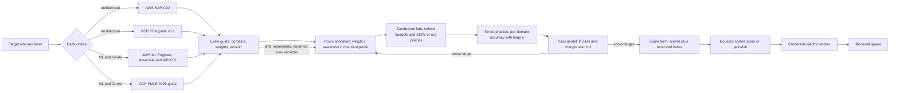

# Cloud and AI Certification Strategic Navigation Guide

## TL;DR

A certification shows you cleared a minimum-competence cut on one versioned blueprint, under a compensatory scoring model; it does not show depth in any single domain.
Plan from the exam guide's domain weights, not from service lists: SAP-C02 is 26/29/25/20 across four domains, and MLA-C01 is 28/26/22/24 (AWS docs, as of 2026-10).
The AWS ML track changed underneath most study plans: MLS-C01 had its last test day on 2026-03-31, and AWS's AI coverage now runs through the ML Engineer Associate and the Generative AI Developer - Professional (AIP-C01) (third-party reports, as of 2026-10).
Google's blueprints change through guide versions and product renames: the PCA guide is v6.1 with four published case studies, and the current PMLE guide names "Gemini Enterprise Agent Platform" products (Google Cloud docs, as of 2026-10).
The real cost of a credential is study hours times the probability of a retake, not the $200-$300 fee, so size your preparation with a pass-probability model and a safety margin of about two standard errors.

## Mental Model



Treat a certification like a distributed system with a control plane and a data plane.
The vendor's control plane is the blueprint: job task analysis, domain weights, standard setting, and versioning.
Its data plane is the item bank, form assembly, delivery, and scoring.
Your study plan is a client of that control plane, and it fails the way clients usually fail: by caching a stale config, such as an old exam guide, a retired exam, or a retired case study, and acting on it after the server has moved on.
The feedback loop in the diagram (practice, model, reallocate) is the only part you control.
Run it as a closed control loop with a measurable error signal, not as a reading list.

## Internals

### Control plane: blueprint, standard setting, versioning

Every exam in scope starts as a blueprint that splits scored content into weighted domains.
The SAP-C02 guide lists Domain 1 "Design Solutions for Organizational Complexity" at 26%, Domain 2 "Design for New Solutions" at 29%, Domain 3 "Continuous Improvement for Existing Solutions" at 25%, and Domain 4 "Accelerate Workload Migration and Modernization" at 20% of scored content (AWS docs, as of 2026-10).
AWS describes the pass/fail cut as a minimum standard set by AWS professionals following certification-industry best practices (AWS docs, as of 2026-10).
AWS does not publish which method it uses.
The industry-standard method for criterion-referenced cuts is the modified Angoff procedure ([Angoff 1971](https://www.ets.org/research/policy_research_reports/publications/chapter/1971/hrdu.html); [Cizek and Bunch 2007](https://methods.sagepub.com/book/standard-setting)).
In that procedure, subject-matter experts estimate, item by item, the probability that a "minimally qualified candidate" answers correctly, and the sum of those estimates becomes the raw cut for that form.
In practice this means the cut is pinned to a hypothetical borderline engineer described by the "target candidate description", not to the average test taker.
If you read that paragraph in each exam guide as a spec, it is the most precise statement of the bar you will get.

Versioning is explicit on AWS and semi-explicit on Google.
AWS encodes the blueprint generation in the exam code suffix (SAP-C02, MLA-C01, AIP-C01).
One SAP-C02 study guide reports exam guide version 1.2 and no C03 announcement as of mid-2026 (third-party report, as of 2026-10).
Google versions the guide document itself: the PCA guide PDF is labeled v6.1 (Google Cloud docs, as of 2026-10).
Third parties report that the refreshed PCA exam went live on 2025-10-30 (third-party report, as of 2026-10).

### Data plane: forms, unscored items, and equating

A candidate never sees "the exam"; they see one form drawn from an item bank under the constraint that the form matches the blueprint weights.
Practically every form is a shard that must satisfy the same partition function, and the vendor must make the shards interchangeable.
Equating does that work: it maps raw scores on forms of slightly different difficulty onto one reporting scale ([Kolen and Brennan, Test Equating, Scaling, and Linking](https://link.springer.com/book/10.1007/978-1-4939-0317-7)).
AWS reports a scaled score from 100 to 1,000, with 750 as the passing score for professional and specialty exams (third-party reports citing AWS exam guides, as of 2026-10).
The scaled score is not a percentage.
The raw-to-scaled conversion is specific to each form and usually non-linear, which is why the folklore "you need 75%" is a category error.

Unscored items are the canary deployment of the item bank.
SAP-C02 is reported as 75 items, of which 65 are scored and 10 are unscored (third-party report, as of 2026-10).
Unscored items collect live response statistics, such as difficulty (p-value) and discrimination, before the item is promoted to scored status.
That is the calibration step that Item Response Theory models need ([Lord 1980](https://www.taylorfrancis.com/books/mono/10.4324/9780203056615/applications-item-response-theory-practical-testing-problems-lord)).
You cannot tell which items are canaries, so the only rational policy is to spend the same effort on every item.

Scoring is compensatory on AWS: the total decides pass or fail, and no single domain has to be passed on its own (third-party reports citing AWS exam guides, as of 2026-10).
This is an aggregate SLO, not a per-dependency SLO.
A candidate can be very weak in a 20% domain and still pass, which matters for how a hiring manager should read the credential (see Question 6).

Multiple-response items are all-or-nothing.
AWS defines them as two or more correct responses out of five or more options, says you must select all the correct responses to get credit, scores unanswered items as incorrect, and applies no penalty for guessing (AWS docs, as of 2026-10).
If you get each required selection right independently with probability p, a two-answer item succeeds with probability p squared.
At p = 0.80 that is 0.64, so multiple-response items pull your effective accuracy well below your single-answer accuracy.

Distractors are engineered, not random.
AWS defines a multiple-choice item as one correct response and three incorrect responses that it explicitly calls distractors (AWS docs, as of 2026-10).
Well-written distractors are plausible to a candidate with partial knowledge ([Haladyna, Downing, and Rodriguez 2002](https://doi.org/10.1207/S15324818AME1503_5)).
On architecture exams that usually means the distractor works technically but violates one stated constraint: least operational overhead, most cost-effective, minimal application change, or a compliance boundary.
The skill being tested is parsing constraints, and it is the same skill a design review tests.

### The mechanism most guides skip: section feedback is statistically noisy

The SAP-C02 guide says section-level feedback highlights strengths and weaknesses, and it tells you to use caution when you interpret it (AWS docs, as of 2026-10).
The reason is binomial sampling error.
With 65 scored items and a 20% domain, about 13 items fall in Domain 4.
For a true accuracy of 0.70, the standard error of the observed domain accuracy is sqrt(0.70 x 0.30 / 13) = 0.127.
A 95% interval is therefore about plus or minus 25 accuracy points, wide enough that "Needs improvement" in one domain is weak evidence on its own.
For the whole exam, the standard error is sqrt(0.21 / 65) = 0.057, about plus or minus 11 points at 95%.
If the raw cut on your form sits near 72%, a candidate whose true accuracy is 75% passes only about 70% of the time (z = 0.03 / 0.057 = 0.53).
To pass about 97.5% of the time, true accuracy has to sit roughly two standard errors above the cut, near 83%.
This is the arithmetic behind the margin rule in the TL;DR.

### Google-specific mechanics: published case studies and pass/fail reporting

Google publishes the PCA case studies in advance: Altostrat Media, Cymbal Retail, EHR Healthcare, and KnightMotives Automotive, several of which use Google's generative AI solutions (Google Cloud docs, as of 2026-10).
Treat this as context injection: you can pre-compute the architecture for each fictional company and then answer case-study items as diffs against that design.
The v6.1 guide says the Well-Architected Framework pillars (operational excellence, security, reliability, performance optimization, cost optimization, and sustainability) run implicitly and explicitly through the objectives (Google Cloud docs, as of 2026-10).
PCA Section 1, "Designing and planning a cloud solution architecture", is about 25% of the exam (Google Cloud docs, as of 2026-10).
Third parties report pass/fail results with no published score, 50-60 questions, 120 minutes, and a $200 fee (third-party report, as of 2026-10).

The PMLE guide is organized into six sections.
Low-code AI is about 13%, collaborating on data and models about 16%, scaling prototypes into ML models about 21%, and serving and scaling models about 20% (Google Cloud docs, as of 2026-10).
Pipelines (about 18%) and monitoring (about 13%) make up the rest (third-party report, as of 2026-10).
The guide says it does not directly assess coding, but expects enough Python and SQL to read code snippets (Google Cloud docs, as of 2026-10).
Section 3.3 explicitly covers choosing among CPU, GPU, and TPU, and distributed training with data and model parallelism (Google Cloud docs, as of 2026-10).
That ties it directly to [[17-Cloud-AI-Engineering/Volume_10_AI_Infrastructure_on_Cloud/Chapter_04_Distributed_Training_Parallelism_Strategies|Distributed Training Parallelism Strategies]].
The guide refers to products such as "AutoML on Gemini Enterprise Agent Platform" and "Agent Platform Pipelines" where older material says Vertex AI (Google Cloud docs, as of 2026-10).
Expect exam wording and older prep material to disagree on names.

### The AWS AI/ML track after MLS-C01

MLS-C01 had its last test day on 2026-03-31, and credentials already earned stay valid for three years from the pass date (third-party reports, as of 2026-10).
The industry's reading is that MLS-C01 targeted custom model training from scratch and had no Bedrock or generative AI content, while its successors focus on MLOps and on building with foundation models (third-party report, as of 2026-10).
MLA-C01 covers data preparation, model development, deployment and orchestration, and monitoring, maintenance, and security, weighted 28/26/22/24 (AWS docs, as of 2026-10).
The English MLA-C01 is reported to have ended on 2026-09-28, with MLA-C02 taking over (third-party report, as of 2026-10; UNVERIFIED against AWS primary).
AIP-C01 targets candidates with two or more years building production applications and one year of hands-on GenAI work (AWS docs, as of 2026-10).
It covers vector stores, RAG, knowledge bases, FM integration, prompt engineering and management, and agentic AI solutions (AWS docs, as of 2026-10).
AIP-C01 beta registration was reported to open on 2025-11-18 (third-party report, as of 2026-10).

### Syllabus alignment to this curriculum

| Exam domain | Primary chapters |
|---|---|
| SAP-C02 D1 Organizational complexity (26%) | [[17-Cloud-AI-Engineering/Volume_01_Cloud_Architecture_Principles/Chapter_06_Multi_Account_and_Multi_Project_Landing_Zones\|Landing Zones]], [[17-Cloud-AI-Engineering/Volume_02_AWS_Deep_Dive/Chapter_01_IAM_Policy_Evaluation_Engine\|IAM Evaluation]], [[17-Cloud-AI-Engineering/Volume_02_AWS_Deep_Dive/Chapter_03_VPC_Networking_Internals\|VPC Internals]] |
| SAP-C02 D2 New solutions (29%) | [[17-Cloud-AI-Engineering/Volume_01_Cloud_Architecture_Principles/Chapter_02_Regions_Zones_and_Static_Stability\|Static Stability]], [[17-Cloud-AI-Engineering/Volume_01_Cloud_Architecture_Principles/Chapter_03_Cell_Based_Architecture_and_Shuffle_Sharding\|Cells]], [[17-Cloud-AI-Engineering/Volume_07_Reliability_and_SRE/Chapter_04_Disaster_Recovery_Tiers_and_RTO_RPO_Engineering\|DR Tiers]] |
| SAP-C02 D3 Continuous improvement (25%) | [[17-Cloud-AI-Engineering/Volume_02_AWS_Deep_Dive/Chapter_14_Observability_CloudWatch_Metrics_Logs_and_X_Ray\|CloudWatch]], [[17-Cloud-AI-Engineering/Volume_09_FinOps_and_Cloud_Economics/Chapter_02_Commitment_Discounts_Savings_Plans_vs_CUDs\|Commitments]] |
| SAP-C02 D4 Migration (20%) | [[17-Cloud-AI-Engineering/Volume_04_AWS_vs_GCP_Translation/Chapter_04_Storage_and_Database_Translation\|Storage Translation]], [[17-Cloud-AI-Engineering/Volume_04_AWS_vs_GCP_Translation/Chapter_07_Multi_Cloud_and_Hybrid_Architecture_Reality\|Hybrid Reality]] |
| PCA S1 Design and plan (~25%) | [[17-Cloud-AI-Engineering/Volume_03_GCP_Deep_Dive/Chapter_04_Global_VPC_Andromeda_SDN_and_Network_Tiers\|Global VPC]], [[17-Cloud-AI-Engineering/Volume_03_GCP_Deep_Dive/Chapter_05_Cloud_Load_Balancing_GFEs_and_Maglev\|GFE and Maglev]] |
| PCA security and compliance | [[17-Cloud-AI-Engineering/Volume_03_GCP_Deep_Dive/Chapter_03_VPC_Service_Controls_Security_Perimeters\|VPC SC]], [[17-Cloud-AI-Engineering/Volume_03_GCP_Deep_Dive/Chapter_02_Cloud_IAM_Roles_Policies_and_Conditions\|Cloud IAM]] |
| PMLE S3 Scaling prototypes (~21%) | [[17-Cloud-AI-Engineering/Volume_10_AI_Infrastructure_on_Cloud/Chapter_01_Accelerator_Architectures_GPUs_Trainium_TPUs\|Accelerators]], [[17-Cloud-AI-Engineering/Volume_10_AI_Infrastructure_on_Cloud/Chapter_05_Memory_Optimization_ZeRO_FSDP_and_JAX_Sharding\|ZeRO and FSDP]] |
| PMLE S4 Serving (~20%) | [[17-Cloud-AI-Engineering/Volume_11_LLM_Serving_and_Inference_Systems_on_Cloud/Chapter_08_Cloud_GPU_Autoscaling_and_Cold_Start_Mitigation\|GPU Autoscaling]], [[17-Cloud-AI-Engineering/Volume_11_LLM_Serving_and_Inference_Systems_on_Cloud/Chapter_09_Managed_Inference_Amazon_Bedrock_vs_Vertex_AI\|Managed Inference]] |
| PMLE S5 Pipelines and S6 Monitoring | [[17-Cloud-AI-Engineering/Volume_12_AI_Applications_MLOps_and_Data_Platforms/Chapter_04_MLOps_Pipelines_SageMaker_vs_Vertex_AI\|MLOps Pipelines]], [[17-Cloud-AI-Engineering/Volume_12_AI_Applications_MLOps_and_Data_Platforms/Chapter_06_Model_Evaluation_Monitoring_and_Drift_Detection\|Drift Detection]] |
| AIP-C01 RAG, agents, guardrails | [[17-Cloud-AI-Engineering/Volume_12_AI_Applications_MLOps_and_Data_Platforms/Chapter_02_Enterprise_Retrieval_Augmented_Generation_Architecture\|Enterprise RAG]], [[17-Cloud-AI-Engineering/Volume_12_AI_Applications_MLOps_and_Data_Platforms/Chapter_03_Agent_Runtimes_and_Cloud_Execution_Environments\|Agent Runtimes]], [[17-Cloud-AI-Engineering/Volume_12_AI_Applications_MLOps_and_Data_Platforms/Chapter_07_AI_Safety_Guardrails_and_Governance\|Guardrails]] |

The exam answers themselves rest on foundational systems papers, which this curriculum covers.
Examples are DynamoDB partitioning ([[17-Cloud-AI-Engineering/Volume_13_Seminal_Papers_and_Case_Studies/Chapter_01_Dynamo_and_DynamoDB|Dynamo and DynamoDB]]), Aurora quorum storage ([[17-Cloud-AI-Engineering/Volume_13_Seminal_Papers_and_Case_Studies/Chapter_02_Amazon_Aurora|Aurora SIGMOD 2017]]), Spanner external consistency ([[17-Cloud-AI-Engineering/Volume_13_Seminal_Papers_and_Case_Studies/Chapter_06_Google_Spanner|Spanner OSDI 2012]]), and TPU interconnects ([[17-Cloud-AI-Engineering/Volume_13_Seminal_Papers_and_Case_Studies/Chapter_15_Google_TPU_Architecture_Evolution|TPU ISCA papers]]).
A candidate who knows why Aurora uses a 4-of-6 write quorum can eliminate a whole class of distractors without having memorized the product page.

## Numbers to Know

| Item | Value | Source and date |
|---|---|---|
| SAP-C02 domain weights | 26% / 29% / 25% / 20% | (AWS docs, as of 2026-10) |
| SAP-C02 items and time | 75 items (65 scored + 10 unscored), 180 min, about 2.4 min per item | (third-party report, as of 2026-10) |
| SAP-C02 fee | $300 USD | (third-party report, as of 2026-10) |
| AWS score scale and cut (Professional, Specialty) | 100-1,000 scaled, pass at 750, compensatory | (third-party reports citing AWS exam guides, as of 2026-10) |
| AWS multiple-response scoring | all correct selections required; no guessing penalty | (AWS docs, as of 2026-10) |
| MLS-C01 status | last test day 2026-03-31; existing credentials valid 3 years from pass | (third-party reports, as of 2026-10) |
| MLA-C01 domain weights | 28% / 26% / 22% / 24% | (AWS docs, guide v1.0, as of 2026-10) |
| MLA-C01 to MLA-C02 cutover | English MLA-C01 last day reported 2026-09-28 | (third-party report, as of 2026-10; UNVERIFIED) |
| AIP-C01 target candidate | 2+ years production apps, 1 year hands-on GenAI | (AWS docs, as of 2026-10) |
| AIP-C01 format | 75 items, 180 min; 65 scored per AWS guide | (third-party report and AWS docs, as of 2026-10) |
| AIP-C01 heaviest domains | FM integration, data management, compliance 31%; implementation and integration 26% | (third-party report, as of 2026-10) |
| PCA guide version and case studies | v6.1; Altostrat Media, Cymbal Retail, EHR Healthcare, KnightMotives Automotive | (Google Cloud docs, as of 2026-10) |
| PCA Section 1 weight | ~25% | (Google Cloud docs, as of 2026-10) |
| PCA format and fee | 50-60 items, 120 min, $200, pass/fail only, 2-year validity | (third-party report, as of 2026-10) |
| PMLE section weights | ~13 / ~16 / ~21 / ~20 / ~18 / ~13 | (Google Cloud docs for S1-S4; third-party for S5-S6, as of 2026-10) |
| PMLE format and fee | 2 h, 50-60 items, $200 | (third-party report, as of 2026-10) |
| Items per domain, SAP-C02 (derived) | 17 / 19 / 16 / 13 | computed from weights x 65 |
| Std. error of domain accuracy, 13 items at p = 0.70 (derived) | 0.127, so about +/- 25 pts at 95% | binomial math |
| Std. error of total accuracy, 65 items (derived) | 0.057, so about +/- 11 pts at 95% | binomial math |
| Practice items per domain for +/- 5 pts at 95% (derived) | about 323 | n = 1.96^2 x 0.21 / 0.05^2 |
| AWS credential validity | 3 years | (third-party reports, as of 2026-10) |

## AWS vs GCP Mechanism Parity

### Certification program mechanics

| Mechanism | AWS | Google Cloud | Critical difference |
|---|---|---|---|
| Blueprint versioning | Exam code suffix (C01, C02) | Guide document version (PCA v6.1) and dated guides | AWS bumps the code on a major change; Google can change wording and product names inside a guide revision |
| Weight disclosure | Exact percentages of scored content | Approximate percentages ("~25%") | Both are enough to allocate study hours; neither tells you which items are unscored |
| Score reporting | Scaled 100-1,000 plus section-level classifications | Pass/fail only (third-party) | AWS gives you a noisy signal; Google gives you one bit |
| Scoring model | Compensatory | Not published in detail | Do not assume Google behaves like AWS |
| Context injection | None; every stem is self-contained | Four published case studies for PCA | PCA rewards designing the case-study companies in advance |
| Item types | Multiple choice, multiple response (all-or-nothing) | Multiple choice, multiple select | Multiple-response math hits both |
| Validity | 3 years (third-party) | 2 years (third-party) | GCP holders recertify 1.5x as often per credential-year |
| Retirement pattern | Whole exam retired (MLS-C01) and replaced by a re-shaped track | Exam stays; blueprint and product names rotate | AWS risk: no successor to sit; Google risk: stale names in prep material |

### Technical content parity the exams test

| Concept tested | AWS mechanism | Google Cloud mechanism | Difference that produces distractors |
|---|---|---|---|
| Org-wide guardrails | SCPs and RCPs in AWS Organizations | Organization Policy constraints on the resource hierarchy | SCPs filter IAM permissions; org policies constrain resource configuration; they are not interchangeable |
| Network hub | Transit Gateway route domains | Shared VPC, Network Connectivity Center | VPC peering is non-transitive on both clouds |
| Private API access | VPC endpoints (Gateway and Interface/PrivateLink) | Private Google Access, Private Service Connect | Endpoint policies scope actions; VPC SC scopes API perimeters by project |
| Data exfiltration perimeter | aws:SourceVpce, aws:ResourceOrgID, RCPs | VPC Service Controls with dry-run mode | VPC SC is a perimeter around managed APIs; AWS assembles the perimeter from several policy types |
| Global entry | Global Accelerator, CloudFront, Route 53 | Global external Application Load Balancer on GFEs | GCP's single anycast VIP versus AWS's DNS-or-anycast choice |
| Managed ML platform | SageMaker AI | Vertex AI, renamed in guide text to Gemini Enterprise Agent Platform | Product names in PMLE items may not match older docs |
| Foundation model access | Amazon Bedrock | Model Garden and Gemini | Quota and provisioned-throughput models differ; see [[17-Cloud-AI-Engineering/Volume_11_LLM_Serving_and_Inference_Systems_on_Cloud/Chapter_09_Managed_Inference_Amazon_Bedrock_vs_Vertex_AI\|Managed Inference]] |
| Custom accelerators | Trainium, Inferentia | TPU | PMLE tests hardware choice explicitly (Section 3.3) |

## Worked Example: Pass-Probability Model, Study Sizing, and a Budget-Guarded Perimeter Lab

### Part A: model your pass probability before you book

The script below allocates scored items to domains by blueprint weight.
It applies all-or-nothing scoring to an assumed share of two-answer multiple-response items and samples the unpublished raw cut from a uniform prior.
It then reports, for each domain, how much pass probability you gain per study hour.
It uses only the standard library and was executed as written.

```python
#!/usr/bin/env python3
"""Monte Carlo pass-probability and study-allocation model for compensatory, scaled-score exams.

Blueprint weights come from official exam guides (see chapter Numbers to Know).
The raw cut score is NOT published by either vendor; it is modeled as a uniform prior.
Scored-item counts for MLA-C01, PCA and PMLE are assumptions; edit them.
"""
import argparse
import json
import random

BLUEPRINTS = {
    "SAP-C02": {"scored": 65, "weights": {"D1-org-complexity": 0.26, "D2-new-solutions": 0.29,
                                          "D3-continuous-improvement": 0.25, "D4-migration": 0.20}},
    "MLA-C01": {"scored": 50, "weights": {"D1-data-prep": 0.28, "D2-model-dev": 0.26,
                                          "D3-deploy-orchestrate": 0.22, "D4-monitor-secure": 0.24}},
    "PCA-v6.1": {"scored": 50, "weights": {"S1-design-plan": 0.25, "S2-provision": 0.175,
                                           "S3-6-other": 0.575}},
    "PMLE-2026": {"scored": 50, "weights": {"S1-low-code": 0.13, "S2-collab-data": 0.16,
                                            "S3-scale-prototypes": 0.21, "S4-serve-scale": 0.20,
                                            "S5-pipelines": 0.18, "S6-monitoring": 0.13}},
}


def allocate_items(n, weights):
    """Largest-remainder allocation of n scored items to domains by blueprint weight."""
    total = sum(weights.values())
    raw = {d: n * w / total for d, w in weights.items()}
    alloc = {d: int(v) for d, v in raw.items()}
    rest = sorted(raw, key=lambda d: raw[d] - alloc[d], reverse=True)
    for d in rest[: n - sum(alloc.values())]:
        alloc[d] += 1
    return alloc


def p_pass(spec, acc, mr_frac, cut_lo, cut_hi, trials, seed):
    """Probability that raw correct >= cut, with multiple-response items scored all-or-nothing."""
    rng = random.Random(seed)
    alloc = allocate_items(spec["scored"], spec["weights"])
    n = spec["scored"]
    passes = 0
    for _ in range(trials):
        correct = 0
        for d, k in alloc.items():
            p = acc[d]
            for _ in range(k):
                # A two-answer multiple-response item needs both selections right: p^2.
                q = p * p if rng.random() < mr_frac else p
                correct += rng.random() < q
        cut = rng.uniform(cut_lo, cut_hi) * n
        passes += correct >= cut
    return passes / trials


def main():
    ap = argparse.ArgumentParser()
    ap.add_argument("--exam", choices=sorted(BLUEPRINTS), default="SAP-C02")
    ap.add_argument("--acc", type=json.loads, required=True,
                    help='per-domain single-answer accuracy from timed practice, e.g. {"D1-org-complexity":0.7,...}')
    ap.add_argument("--mr-frac", type=float, default=0.25, help="assumed share of multiple-response items")
    ap.add_argument("--cut-lo", type=float, default=0.65, help="raw cut prior, lower bound (assumption)")
    ap.add_argument("--cut-hi", type=float, default=0.75, help="raw cut prior, upper bound (assumption)")
    ap.add_argument("--fee", type=float, default=300.0)
    ap.add_argument("--hours-per-point", type=float, default=2.0,
                    help="hours per accuracy point at 60%% accuracy (assumption, measure yours)")
    ap.add_argument("--trials", type=int, default=20000)
    a = ap.parse_args()

    spec = BLUEPRINTS[a.exam]
    missing = set(spec["weights"]) - set(a.acc)
    if missing:
        raise SystemExit(f"missing accuracy for domains: {sorted(missing)}")

    base = p_pass(spec, a.acc, a.mr_frac, a.cut_lo, a.cut_hi, a.trials, 7)
    print(f"exam={a.exam} items={allocate_items(spec['scored'], spec['weights'])}")
    print(f"P(pass)={base:.3f}  expected attempts={1/max(base,1e-6):.2f}  expected fees=${a.fee/max(base,1e-6):,.0f}")
    print("marginal P(pass) per study hour, by domain (spend the next block on the top row):")
    gains = []
    for d in spec["weights"]:
        bumped = dict(a.acc)
        bumped[d] = min(1.0, bumped[d] + 0.05)
        p2 = p_pass(spec, bumped, a.mr_frac, a.cut_lo, a.cut_hi, a.trials, 7)
        # Diminishing returns: closing the last points of a strong domain costs more hours.
        hours = 5 * a.hours_per_point * (0.4 / max(1e-3, 1.0 - a.acc[d]))
        gains.append(((p2 - base) / hours, d, p2, hours))
    for g, d, p2, h in sorted(gains, reverse=True):
        print(f"  {d:28s} +5pt in {h:5.1f}h -> P={p2:.3f}  dP/hour={g:.4f}")


if __name__ == "__main__":
    main()
```

Run it with per-domain accuracy measured on timed, never-seen practice items:

```bash
python3 pass_model.py --exam SAP-C02 \
  --acc '{"D1-org-complexity":0.62,"D2-new-solutions":0.78,"D3-continuous-improvement":0.74,"D4-migration":0.60}'
```

Observed output from the run:

```text
exam=SAP-C02 items={'D1-org-complexity': 17, 'D2-new-solutions': 19, 'D3-continuous-improvement': 16, 'D4-migration': 13}
P(pass)=0.181  expected attempts=5.51  expected fees=$1,654
marginal P(pass) per study hour, by domain (spend the next block on the top row):
  D1-org-complexity            +5pt in  10.5h -> P=0.240  dP/hour=0.0056
  D4-migration                 +5pt in  10.0h -> P=0.225  dP/hour=0.0044
  D2-new-solutions             +5pt in  18.2h -> P=0.257  dP/hour=0.0041
  D3-continuous-improvement    +5pt in  15.4h -> P=0.238  dP/hour=0.0037
```

A weighted single-answer accuracy near 69% gives only an 18% pass probability, because multiple-response items drag effective accuracy down.
The next hours should go to D1, which is both weak and heavy, not to D2, which carries the most weight but is already strong and therefore expensive to improve.
Lift every domain to 78-85% and the same model reports P(pass) = 0.903 and an expected fee of $332.
The "expected attempts" figure assumes no learning between attempts, so it is an upper bound.
Its real use is to show that booking early is a negative-expected-value decision.

### Part B: back-of-the-envelope sizing for a four-credential plan

Assumptions, which you should replace with your own measurements: an engineer at the L5 bar with production AWS and GCP experience, 8 focused hours per week, and a loaded opportunity cost of $100 per hour.
SAP-C02: 65 scored items at 2.4 minutes each leaves no slack for re-reading long stems, so budget 20 hours just for timed practice.
Add about 60 hours of domain work driven by the model, for 80 hours total.
PCA: about 50 hours, of which about 8 go to pre-designing the four case-study companies end to end.
PMLE: about 60 hours, weighted toward Sections 3 and 4, which together are about 41% of the exam.
AIP-C01 (if you take the AWS GenAI route in place of the retired MLS-C01): about 70 hours, because AWS targets candidates with a year of hands-on GenAI work.
Total: 260 hours, or about 33 weeks at 8 hours per week.
Fees at first attempt: $300 + $200 + $200 + $300 = $1,000.
Opportunity cost: 260 x $100 = $26,000, so the fees are under 4% of the economic cost.
If you book at P(pass) = 0.7 instead of 0.9, each exam carries a 30% chance of a retake costing about 15 extra hours.
That is 4 x 0.3 x 15 x $100 = $1,800 in expected time plus $300 in expected fees, which far exceeds the cost of the additional preparation needed to reach 0.9.
Lab spend: with the guardrails below, expect well under $20 per month (estimate).
Unguarded GPU labs are the dominant cost risk, not exam fees.

### Part C: budget-guarded data-perimeter lab (SAP Domain 1, PCA security)

This lab builds the perimeter primitive that appears in both architecture exams: an S3 bucket reachable only through a VPC gateway endpoint (with an admin break-glass exception) and a hardened GCS bucket.
On GCP there is an optional VPC Service Controls dry-run perimeter.
Cost estimate: S3 gateway endpoints carry no hourly charge, and kilobytes of object storage round to cents, so the expected total is under $1 if you tear down the same day (estimate).

```bash
#!/usr/bin/env bash
set -euo pipefail

# ---------- AWS: budget first, then resources ----------
export AWS_REGION=us-east-1
ACCT=$(aws sts get-caller-identity --query Account --output text)
ME=$(aws sts get-caller-identity --query Arn --output text)
# aws:PrincipalArn is the ROLE ARN, not the sts assumed-role session ARN; convert it.
case "$ME" in
  arn:aws:sts::*:assumed-role/*) ADMIN_ARN="arn:aws:iam::${ACCT}:role/$(echo "$ME" | cut -d/ -f2)";;
  *) ADMIN_ARN="$ME";;
esac
EMAIL="you@example.com"

aws budgets create-budget --account-id "$ACCT" \
  --budget '{"BudgetName":"cert-lab","BudgetLimit":{"Amount":"20","Unit":"USD"},"TimeUnit":"MONTHLY","BudgetType":"COST"}' \
  --notifications-with-subscribers "[{\"Notification\":{\"NotificationType\":\"ACTUAL\",\"ComparisonOperator\":\"GREATER_THAN\",\"Threshold\":50,\"ThresholdType\":\"PERCENTAGE\"},\"Subscribers\":[{\"SubscriptionType\":\"EMAIL\",\"Address\":\"${EMAIL}\"}]}]"

B="cert-lab-${ACCT}-$(date +%s)"
aws s3api create-bucket --bucket "$B"
VPC=$(aws ec2 describe-vpcs --filters Name=isDefault,Values=true --query 'Vpcs[0].VpcId' --output text)
RT=$(aws ec2 describe-route-tables --filters Name=vpc-id,Values="$VPC" Name=association.main,Values=true \
  --query 'RouteTables[0].RouteTableId' --output text)
VPCE=$(aws ec2 create-vpc-endpoint --vpc-id "$VPC" --service-name "com.amazonaws.${AWS_REGION}.s3" \
  --route-table-ids "$RT" --query 'VpcEndpoint.VpcEndpointId' --output text)

# Deny unless (request arrives via the endpoint) OR (caller is the admin role). Conditions are ANDed.
cat > /tmp/policy.json <<EOF
{"Version":"2012-10-17","Statement":[{"Sid":"DenyOutsideVpce","Effect":"Deny","Principal":"*",
 "Action":"s3:*","Resource":["arn:aws:s3:::${B}","arn:aws:s3:::${B}/*"],
 "Condition":{"StringNotEquals":{"aws:SourceVpce":"${VPCE}"},"ArnNotEquals":{"aws:PrincipalArn":"${ADMIN_ARN}"}}}]}
EOF
aws s3api put-bucket-policy --bucket "$B" --policy file:///tmp/policy.json
echo "AWS: bucket=$B endpoint=$VPCE admin=$ADMIN_ARN"

# ---------- GCP: budget first, then resources ----------
PROJECT=$(gcloud config get-value project)
BILLING=$(gcloud billing projects describe "$PROJECT" --format='value(billingAccountName)' | sed 's#billingAccounts/##')
gcloud billing budgets create --billing-account="$BILLING" --display-name=cert-lab \
  --budget-amount=20USD --threshold-rule=percent=0.5 --threshold-rule=percent=0.9 \
  --filter-projects="projects/${PROJECT}"
GB="cert-lab-${PROJECT}-$(date +%s)"
gcloud storage buckets create "gs://${GB}" --location=us-central1 \
  --uniform-bucket-level-access --public-access-prevention
echo "GCP: bucket=gs://${GB}"

# Optional, requires an organization-level access policy (POLICY) and project number (PNUM):
# gcloud access-context-manager perimeters dry-run create cert_lab --policy="$POLICY" \
#   --perimeter-title=cert_lab --perimeter-type=regular \
#   --perimeter-resources="projects/${PNUM}" --perimeter-restricted-services=storage.googleapis.com
```

Exact teardown, in order: delete resources before budgets so the alarms stay armed while anything billable exists.

```bash
aws s3 rb "s3://${B}" --force
aws ec2 delete-vpc-endpoints --vpc-endpoint-ids "$VPCE"
aws budgets delete-budget --account-id "$ACCT" --budget-name cert-lab

gcloud storage rm --recursive "gs://${GB}"
# gcloud access-context-manager perimeters delete cert_lab --policy="$POLICY"   # only if created
BUDGET=$(gcloud billing budgets list --billing-account="$BILLING" --filter="displayName=cert-lab" --format='value(name)')
gcloud billing budgets delete "$BUDGET"
```

What the lab teaches beyond the getting-started guide: if you leave out the ArnNotEquals clause, the Deny locks out every caller outside the VPC, including your own CLI session.
Recovering then requires the account root user to delete the bucket policy.
That lockout is a classic SAP distractor and a real production pitfall.
The assumed-role conversion matters too, because aws:PrincipalArn resolves to the role ARN.
A policy written against the sts session ARN silently fails to exempt anyone.
The conversion above drops IAM role paths, so adjust it if your admin role uses a path.

## Failure Modes and Pitfalls

### Stale control-plane cache: studying a retired blueprint

The most expensive failure is preparing for an exam that no longer exists.
MLS-C01 stopped testing on 2026-03-31 (third-party reports, as of 2026-10), yet ML study plans written in 2025 still point to it.
The PCA equivalent is quieter.
At least one 2026 third-party PCA guide still lists Helicopter Racing League, Mountkirk Games, and TerramEarth as the case studies (third-party report, as of 2026-10).
Google's v6.1 guide lists Altostrat Media, Cymbal Retail, EHR Healthcare, and KnightMotives Automotive (Google Cloud docs, as of 2026-10).
Mitigation: treat the vendor's exam guide as the only source of truth, record its version and date in your plan, and re-check it the week you book.

### Name drift inside a live blueprint

The PMLE guide uses "Agent Platform" names where most courses, blogs, and older docs say Vertex AI (Google Cloud docs, as of 2026-10).
Candidates who learned the product only under its old name lose time on items that use the new names.
Mitigation: keep a two-column name ledger (old name, guide name) and drill with the guide's wording.

### Over-reading noisy telemetry

Retaking with a plan built entirely on one domain's "Needs improvement" flag treats a measurement with about plus or minus 25 points of error as precise.
AWS itself tells you to be careful with section-level feedback (AWS docs, as of 2026-10).
Mitigation: estimate per-domain accuracy from hundreds of fresh practice items and feed those numbers into the pass model.

### Practice-test overfitting and fraudulent material

Repeating the same practice bank turns recall into apparent mastery: accuracy on seen items climbs while accuracy on unseen items stays flat.
Third-party authors warn explicitly about fake PCA practice tests after the refresh (third-party report, as of 2026-10).
Using leaked live items breaches candidate agreements and puts the credential at risk (UNVERIFIED: exact revocation terms not re-checked this session).
Mitigation: hold back a never-seen validation set and only trust accuracy measured on it.

### Time-budget exhaustion

SAP-C02 and AIP-C01 give about 2.4 minutes per item across 75 items, while professional-level stems often run to a paragraph and four long options.
Candidates who spend 6 minutes on two early items enter a deficit that compounds, the exam-taking version of a retry storm.
Mitigation: take one pass with a hard per-item timeout, flag and move on, and use a second pass for flagged items, the same deadline-propagation discipline as in [[17-Cloud-AI-Engineering/Volume_07_Reliability_and_SRE/Chapter_03_Resilient_Communication_Retries_Jitter_and_Circuit_Breakers|Retries, Jitter, and Circuit Breakers]].

### Lab cost leaks

The study-time equivalent of an unbounded queue is a GPU instance or managed inference endpoint left running after a lab.
Real-time endpoints bill while idle (UNVERIFIED: not re-checked against current pricing pages this session).
Budgets alert; they do not cap spend by default (UNVERIFIED: not re-checked this session).
Mitigation: run labs in a sandbox account or project with an SCP or org policy that denies accelerator instance types, plus scripted teardown that runs before the budget is deleted.

### Exam answers that fail in production: read the PIRs

Exam stems are written so that one option is cleanly correct, while public post-incident reviews show where those clean answers break.
In the 2017 S3 us-east-1 event, a mistyped command during debugging removed more capacity than intended, and restarting the index and placement subsystems took far longer than expected ([AWS PIR](https://aws.amazon.com/message/41926/)).
The October 2025 us-east-1 event began with a latent race condition in DynamoDB's automated DNS management that left the regional endpoint record empty, and the impact spread to dependent services ([AWS PIR](https://aws.amazon.com/message/101925/)).
In the June 2025 Google Cloud event, a new Service Control code path without a feature-flag guard crashed on blank policy fields that replicated globally ([Google Cloud incident report](https://status.cloud.google.com/incidents/ow5i3PPK96RduMcb1SsW)).
The exam rarely prices in control-plane dependencies, recovery-time behavior of large caches, or global configuration push.
Read [[17-Cloud-AI-Engineering/Volume_07_Reliability_and_SRE/Chapter_07_Anatomy_of_Major_Cloud_Outages|Anatomy of Major Cloud Outages]] alongside exam prep so the "correct" answer and the production answer are both in your head.

### Renewal clustering

Engineers who certify in a single quarter create a synchronized expiry wave every 2 or 3 years, the human version of a thundering herd.
Mitigation: stagger exam dates deliberately, as discussed in Question 5.

## Security and Cost Angles

### IAM scoping for study environments

Run labs in a dedicated sandbox account under an Organizations OU, with SCPs that deny regions you do not use and deny GPU or accelerator instance types using the ec2:InstanceType condition key.
On GCP, put lab projects in a sandbox folder and apply organization policy constraints such as resource-location restrictions (gcp.resourceLocations) and denial of external IPs on VMs.
Use federated SSO or short-lived credentials for labs, never long-lived access keys; the mechanics are in [[17-Cloud-AI-Engineering/Volume_08_Security_Identity_and_the_Data_Perimeter/Chapter_02_Workload_Identity_Federation|Workload Identity Federation]].
In both clouds the break-glass principal belongs in resource policies by role ARN or service account, never by session identifier, as Part C shows.

### Encryption and perimeter content the exams weight heavily

Both architecture exams test envelope encryption: a KMS or Cloud KMS key-encryption key wraps per-object data keys, and key policies or IAM bindings decide who can unwrap.
The details are in [[17-Cloud-AI-Engineering/Volume_08_Security_Identity_and_the_Data_Perimeter/Chapter_04_Encryption_Key_Hierarchies_and_Envelope_Encryption|Envelope Encryption]].
Perimeter questions reward knowing that AWS builds its perimeter from identity, resource, and network policies, while Google builds one perimeter object around managed APIs with a dry-run mode.
See [[17-Cloud-AI-Engineering/Volume_08_Security_Identity_and_the_Data_Perimeter/Chapter_06_Constructing_an_Impenetrable_Data_Perimeter|Data Perimeter]].
AIP-C01 and PMLE add AI-specific controls: guardrails, PII handling, and model-monitoring products such as Model Armor in the PMLE monitoring section (third-party report, as of 2026-10).

### Unit economics of credentials

Cost per credential = fee / P(pass) + hours x hourly opportunity cost + lab spend.
Only the hours term moves the result.
Recertification load scales as holders divided by validity years: 60 AWS holders on a 3-year cycle make 20 renewals per year, and 60 GCP holders on a 2-year cycle make 30.
Free credits lower lab spend; third parties report $300 in credits for new Google Cloud accounts (third-party report, as of 2026-10).
The cheapest lever is the pass model itself: book at P(pass) of at least 0.9 rather than 0.7.

## Interview Questions and Model Answers

### Question 1 (L5 - Senior)

An exam-style stem: "A company with 400 accounts in AWS Organizations must inspect all internet-bound egress centrally with the LEAST operational overhead."
The options are a NAT gateway plus AWS Network Firewall in every VPC, a centralized egress VPC behind Transit Gateway with AWS Network Firewall, third-party proxies on EC2 in each account, or a VPC peering mesh to a shared inspection VPC.
Walk through how you eliminate options, then say what the exam does not price in.

#### Model Answer

First I parse the constraints: "centrally", "all egress", "least operational overhead".
The peering mesh fails on mechanism, not preference: VPC peering is non-transitive, and a VPC cannot send internet traffic out through a peer's NAT gateway or internet gateway, so it cannot implement central egress at all.
Per-VPC NAT plus firewall works technically but violates "centrally" and multiplies rule management by 400.
Per-account EC2 proxies have the highest overhead because you own patching, scaling, and high availability.
The answer is the centralized egress VPC: spoke VPC route tables send 0.0.0.0/0 to Transit Gateway, the TGW route table sends it to the inspection VPC, and the firewall endpoints sit in front of NAT gateways.
What the exam does not price in starts with flow symmetry.
Stateful inspection needs both directions of a flow to hit the same zonal firewall endpoint, and TGW appliance mode on the inspection VPC attachment keeps a flow pinned to one AZ.
Without it, return traffic can land in a different AZ and stateful rules drop it intermittently, which is miserable to debug.
Second is cost shape: every egress byte now pays TGW data processing and NAT processing, plus inter-AZ transfer if spokes and inspection endpoints are not zonally aligned.
I would model that per GB using [[17-Cloud-AI-Engineering/Volume_09_FinOps_and_Cloud_Economics/Chapter_04_Network_Egress_Economics_and_Optimization|Egress Economics]] before committing.
Third is blast radius: one inspection VPC is shared fate for 400 accounts, so in production I deploy one per region and per environment and treat firewall policy changes like code with staged rollout.
On GCP the analogous design is a Shared VPC or NCC hub with Cloud NAT and Cloud NGFW policies, where global VPC routing removes the per-region hub but not the policy blast radius.

#### Follow-up Interviewer Question

What exactly does appliance mode change in how Transit Gateway selects an attachment ENI, and how would you detect from flow logs that you forgot it?

### Question 2 (L5 - Senior)

You failed SAP-C02 with a scaled score of 712.
The report says "Needs improvement" only in Domain 4, and your practice tests averaged 76%.
Plan the retake.

#### Model Answer

The score report carries less information than it appears to.
Domain 4 is 20% of 65 scored items, about 13 items, so the standard error of the observed domain accuracy is around 0.127 and the 95% interval is plus or minus 25 points.
That classification is consistent with my true Domain 4 accuracy being anywhere from mediocre to fine, and AWS itself warns against over-reading section feedback.
The useful signal is the total: 712 against a 750 cut means I was close, and because scoring is compensatory, gains in any domain count the same per item.
Next I distrust my 76% practice average, because it probably includes items I had already seen and it counts multiple-response items as if they behaved like single-answer items.
I would build a fresh holdout of a few hundred items, measure single-answer accuracy per domain, and run the pass model with a multiple-response share and a cut prior.
I would allocate hours by marginal pass probability per hour, which favors domains that are both heavy and weak, since the last points in a strong domain are expensive.
I would book only when the model shows about 0.9, roughly two standard errors over the plausible cut.
Last, I would review the clock: if I finished with flagged items unanswered, that is free points lost, because unanswered items are scored incorrect and guessing carries no penalty.

#### Follow-up Interviewer Question

How many fresh practice items per domain do you need to estimate accuracy within plus or minus 5 points at 95%, and what does that imply about the size of a good practice bank?

### Question 3 (L6 - Staff)

Your company runs ML training data in S3 and GCS.
Design a data-exfiltration perimeter that holds even if a developer's credentials leak, and explain where each cloud's mechanism breaks.

#### Model Answer

I start with the threat model: a leaked credential used from outside our networks, or a valid credential used to copy data to an attacker-owned bucket.
On AWS the perimeter is three interlocking statements.
The identity perimeter is an SCP that denies data actions unless the resource belongs to our organization, so principals cannot write to foreign buckets.
The resource perimeter is an RCP or bucket policy that denies access unless the principal belongs to our organization (aws:PrincipalOrgID).
The network perimeter denies access unless the request arrives through our VPC endpoints (aws:SourceVpce) or from our egress IPs, with endpoint policies that restrict which buckets are reachable.
The breakage on AWS is AWS services acting on our behalf: Athena, Glue, SageMaker jobs, and CloudFormation do not come from our VPC endpoint.
So the network condition needs exceptions keyed on aws:ViaAWSService or aws:PrincipalIsAWSService, and every exception is a reviewed hole.
On GCP the primary control is a VPC Service Controls perimeter around the projects, restricting storage.googleapis.com and the ML APIs, with ingress and egress rules for the pipelines that legitimately cross it.
The breakage on GCP is cross-project workflows: a training job in a project outside the perimeter, or a BigQuery export to a non-perimeter project, fails with VPC SC violations that look like random permission errors.
Rollout is where the two clouds differ most.
VPC SC has a first-class dry-run mode, so I deploy in dry-run, mine the violation logs for two weeks, write ingress and egress rules, then enforce.
AWS has no single dry-run switch, so I simulate by first logging what would be denied, using the IAM policy simulator and CloudTrail analysis, then roll SCPs out OU by OU, sandbox first.
For cross-cloud transfer, the data should move over a private path with a dedicated identity whose permissions are scoped to one prefix, not over public endpoints with a broad key.
Operationally, the perimeter is a control plane with a large blast radius, so changes go through staged rollout like any other config push.
The June 2025 Google Cloud incident, where an unguarded policy-handling change propagated globally, shows the class of failure, and it argues for exactly the staging discipline described above.

#### Follow-up Interviewer Question

A SageMaker training job reading from your perimeter bucket starts failing with AccessDenied after the RCP rollout; walk me through how you would find which condition denied it.

### Question 4 (L6 - Staff)

A team wants to fine-tune and serve an open-weights 8B-parameter model with spiky traffic.
The PMLE-style "correct" answer is a managed endpoint.
What decision variables would you put in front of them on GCP and AWS?

#### Model Answer

I start from memory and data movement, not product names.
In bf16 the weights are 8e9 x 2 bytes = 16 GB.
For a Llama-3-8B-class configuration (32 layers, 8 KV heads, head dimension 128, assumed), the KV cache costs 2 x 32 x 8 x 128 x 2 bytes = 128 KiB per token, so one 8K-token sequence holds about 1 GiB.
On a 24 GB accelerator that leaves room for only a handful of concurrent long sequences after weights and runtime overhead.
That pushes me toward 8-bit quantization or a larger-memory GPU, as covered in [[17-Cloud-AI-Engineering/Volume_11_LLM_Serving_and_Inference_Systems_on_Cloud/Chapter_06_Model_Quantization_and_Compression|Quantization]].
Spiky traffic turns the decision into cold start versus idle cost.
A cold replica must pull the image and load 16 GB of weights; at an assumed 1 GB/s effective read that is 16 seconds of weight load alone before warm-up.
So scale-to-zero only works if the latency SLO tolerates tens of seconds for the first request.
On GCP the options are a managed Agent Platform (Vertex AI) endpoint, GKE with vLLM, or Cloud Run with GPUs.
On AWS they are a SageMaker real-time endpoint, Bedrock Custom Model Import, or EKS with vLLM.
Managed endpoints minimize operational overhead, which is why the exam picks them, but they give the least control over batching, KV-cache policy, and weight caching on local NVMe.
GKE or EKS gives full control, but you own autoscaling on queue depth and GPU quota management.
GPU quota and regional capacity are a hard constraint that exam stems usually assume away, so I would check accelerator quota in two regions before choosing an architecture.
My recommendation for an unknown traffic shape is to start managed with a minimum of one warm replica, instrument TTFT and queue depth, and move to self-managed only if utilization data shows the managed premium exceeds the engineering cost.

#### Follow-up Interviewer Question

Your p99 TTFT doubles during traffic spikes even though GPU utilization stays at 60%; what are the three most likely causes and how do you tell them apart?

### Question 5 (L6 - Staff)

You own the upskilling budget for a 150-engineer AI platform organization.
Which credentials do you fund, in what order, and how do you show the money was not wasted?

#### Model Answer

I map credentials to roles, not to prestige.
Platform and infrastructure engineers target SAP-C02 and PCA, because their blueprints (organizational complexity, migration, design and planning) match their daily work.
ML platform engineers target PMLE and the AWS ML Engineer Associate.
Engineers building GenAI products target AIP-C01, which AWS aims at people with a year of hands-on GenAI work.
Nobody starts MLS-C01, because it stopped testing on 2026-03-31.
I sequence by dependency: architecture credentials before ML credentials for platform people, because PMLE serving and pipeline questions assume networking and IAM fluency.
On cost, fees are noise: 150 engineers at about $300 each is $45,000.
The real cost is roughly 60-80 hours each, about 10,000 engineer-hours, so the program has to be justified on time.
I protect that time with the pass model, so engineers do not book exams at a 70% pass probability and burn retake cycles.
I stagger exam dates by quarter so the renewal load stays flat.
With 3-year AWS validity and 2-year GCP validity, 75 holders of each generate about 25 and 38 renewals per year respectively.
For ROI I refuse pass rate as the metric, because that is Goodhart's law: the organization will optimize for passing.
I measure leading indicators that the credential is supposed to move: design-review findings per proposal in IAM and networking, perimeter or quota-related incidents, and time to first production deploy on the second cloud.
I set baselines before the program and review after two quarters.
If those indicators do not move, I redirect budget to internal labs built on our own architecture, which transfer better than generic blueprints.

#### Follow-up Interviewer Question

Half your engineers pass but design-review findings do not change; what is your hypothesis about why, and what experiment would you run to test it?

### Question 6 (L7+ - Principal)

A candidate holds SAP-C02, PCA, and PMLE.
As a hiring bar raiser, what can you infer from that, what can you not infer, and how would you design the loop to cover the gap?

#### Model Answer

I can infer that on three occasions the candidate scored above a criterion-referenced cut set for a "minimally qualified" practitioner on a specific blueprint version.
That is evidence of breadth and of the discipline to prepare.
I cannot infer depth in any particular domain, because AWS scoring is compensatory: a candidate can pass SAP-C02 while weak in a 20% domain such as migration, and Google reports only pass or fail.
I cannot infer currency, because blueprints drift and a credential earned on an older version validated different products and different case studies.
I cannot infer production judgment, because exam items have one keyed answer under explicit constraints, while production problems have unstated constraints, competing stakeholders, and failure modes such as control-plane dependencies.
The October 2025 us-east-1 PIR is a good example of something no multiple-choice item covers.
So I design the loop to measure what the exam does not.
One session takes a stem the candidate would recognize, such as central egress or a data perimeter, and then removes the constraints: no cost ceiling stated, a compliance owner who disagrees, and a mid-interview failure injection like "the inspection VPC's AZ goes down".
A second session is a numbers drill drawn from [[17-Cloud-AI-Engineering/Volume_14_Staff_Plus_Interview_Arena/Chapter_06_Cloud_AI_Numbers_Every_Staff_Engineer_Must_Know|Cloud AI Numbers]], checking that the candidate can derive KV-cache size or egress cost rather than recite it.
A third session is a past incident the candidate owned, probed for how they found the root cause and what mechanism they changed.
I weight the credentials as a prior that shifts my starting estimate of breadth, never as a substitute for those three signals.
The loop's calibration criteria are in [[17-Cloud-AI-Engineering/Volume_14_Staff_Plus_Interview_Arena/Chapter_08_Staff_Plus_Evaluation_Bar_L5_L6_L7|Staff+ Evaluation Bar]].

#### Follow-up Interviewer Question

If you had to give the recruiting team one rule for how much weight credentials get at L5 versus L7, what is it and what data would make you change it?

### Question 7 (L7+ - Principal)

Exams reward "multi-region active-active" as the resilient answer.
Using public PIRs, argue when that answer is wrong, and describe what you would build instead for an AI inference platform.

#### Model Answer

The exam framing assumes regions fail independently and that adding a region adds availability.
Both assumptions break in the PIRs.
In the October 2025 us-east-1 event, the trigger was an empty DNS record for a regional DynamoDB endpoint, and the damage came through services in the region that depended on it.
A multi-region design whose failover path itself depends on a us-east-1 control plane, such as a global configuration or identity service, fails together with the region it was meant to survive.
In the June 2025 Google Cloud event, a globally replicated policy change crashed a shared API-management component in many regions at once, so regional redundancy did not help against a global config push.
So active-active is wrong when the dominant failure mode is a correlated control-plane or configuration failure, when the data layer cannot support multi-writer semantics without unacceptable latency, or when GPU capacity cannot be pre-provisioned in the second region.
For inference, the third point is decisive: GPU or TPU capacity in a failover region is not elastic during a regional event, because everyone else is failing over too.
What I would build is statically stable cells, as in [[17-Cloud-AI-Engineering/Volume_01_Cloud_Architecture_Principles/Chapter_02_Regions_Zones_and_Static_Stability|Static Stability]].
Each region runs pre-provisioned capacity sized for its failover share, routing decisions are made on the data plane from cached health state, and no failover step calls a control-plane API.
Model weights are pre-staged per region, so failover never streams 16-140 GB checkpoints across regions under load.
Config pushes, including guardrail and routing policy, roll out region by region with a bake time, and cells reject malformed config instead of crashing on it.
When cost forbids full N+1 accelerator capacity, I degrade deliberately by tier: priority tenants keep their reserved capacity, others shed to a smaller model or a managed API.
That degradation is decided in advance, encoded in admission control as described in [[17-Cloud-AI-Engineering/Volume_07_Reliability_and_SRE/Chapter_02_Load_Shedding_Backpressure_and_Admission_Control|Load Shedding]], and rehearsed in game days.
The exam answer is a starting point; the principal answer names the correlated failure, prices the idle accelerators, and chooses where to degrade.

#### Follow-up Interviewer Question

Your CFO rejects paying for idle failover GPUs; quantify the trade between reserved failover capacity and a tiered degradation plan in terms the CFO will accept.

## Further Reading

- [AWS Certified Solutions Architect - Professional (SAP-C02) exam guide](https://docs.aws.amazon.com/aws-certification/latest/examguides/solutions-architect-professional-02.html) - the only authoritative source for domain weights, in-scope services, and the target-candidate description that defines the cut.
- [AWS Certified Generative AI Developer - Professional (AIP-C01) exam guide](https://docs.aws.amazon.com/aws-certification/latest/ai-professional-01/ai-professional-01.html) - AWS's professional-level AI credential now that MLS-C01 is retired, with explicit RAG, agent, and FM-integration tasks.
- [AWS Certified Machine Learning Engineer - Associate exam guide (MLA-C01)](https://d1.awsstatic.com/training-and-certification/docs-machine-learning-engineer-associate/AWS-Certified-Machine-Learning-Engineer-Associate_Exam-Guide.pdf) - shows the MLOps-first shape of the AWS ML track; check for the MLA-C02 successor before booking.
- [Google Professional Cloud Architect exam guide](https://cloud.google.com/learn/certification/guides/professional-cloud-architect) and [v6.1 PDF](https://services.google.com/fh/files/misc/v6.1_pca_professional_cloud_architect_exam_guide_english.pdf) - current section weights, links to the four case studies, and the Well-Architected Framework framing.
- [Google Professional Machine Learning Engineer exam guide](https://services.google.com/fh/files/misc/professional_machine_learning_engineer_exam_guide_english_new.pdf) - the six-section blueprint and the Agent Platform naming that exam items use.
- [Kolen and Brennan, Test Equating, Scaling, and Linking](https://link.springer.com/book/10.1007/978-1-4939-0317-7) - the standard reference for how multiple exam forms are made interchangeable on one scaled score.
- [Lord 1980, Applications of Item Response Theory to Practical Testing Problems](https://www.taylorfrancis.com/books/mono/10.4324/9780203056615/applications-item-response-theory-practical-testing-problems-lord) - the foundation for item calibration, which is why unscored pretest items exist.
- [Cizek and Bunch 2007, Standard Setting](https://methods.sagepub.com/book/standard-setting) - explains Angoff-family cut-score methods and why the bar is defined by a "minimally qualified candidate".
- [Haladyna, Downing, and Rodriguez 2002, item-writing guidelines](https://doi.org/10.1207/S15324818AME1503_5) - how plausible distractors are engineered, which teaches you to parse stems the way item writers build them.
- [AWS Builders' Library](https://aws.amazon.com/builders-library/) - the mechanism-level reasoning (static stability, shuffle sharding, constant work) behind the "most resilient" exam answers.
- [Google Cloud Well-Architected Framework](https://cloud.google.com/architecture/framework) - the six pillars the PCA guide says run through every objective.
- [AWS PIR: DynamoDB service disruption in us-east-1, October 2025](https://aws.amazon.com/message/101925/) - a modern case study of a regional control-plane dependency that exam stems rarely model.
- [Google Cloud incident report, June 2025](https://status.cloud.google.com/incidents/ow5i3PPK96RduMcb1SsW) - a global config push failure that shows the limits of regional redundancy.
- [Jouppi et al., TPU v4, ISCA 2023](https://arxiv.org/abs/2304.01433) - the primary source behind PMLE hardware-selection questions on TPU interconnect and scale.
