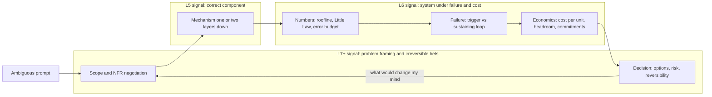

# Staff+ Evaluation Bar: What Separates L5, L6, and L7+

## TL;DR

- L5 designs a correct component, L6 designs a system that stays correct and affordable while it fails, and L7+ decides which system the organization should build, how reversible the choice is, and what would change the decision.
- Depth is measured by how many layers below the API you can explain with a mechanism and a number, for example why decode is bound by HBM bandwidth and why HBM capacity, not price, often sets the replica count.
- Failure-mode intuition means separating the trigger from the sustaining effect: in a metastable failure the system stays down after the trigger is gone, because of retries, lease storms, or a backlog of expired work.
- Unit economics defense means deriving dollars per unit of work from first principles (roofline, Little's Law, static-stability headroom, commitment breakeven) and then admitting where measured numbers will be worse.
- Executive communication is the answer compressed into decision, cost, risk, and reversibility in under a minute, with the supporting math held in reserve for when someone asks.

## Mental Model



Think of a design interview as having a control plane and a data plane.
The data plane is the artifact: boxes, APIs, schemas, and sizing.
The control plane is the conversation that sets scope, picks which non-functional requirement binds, and decides when the design is good enough.
L5 candidates work almost entirely in the data plane and wait for the interviewer to steer them.
L6 candidates run the control plane for one system: they name the binding constraint, put numbers on it, and push the design toward the failure that matters most.
L7+ candidates change the problem statement itself, for example by showing that the requested multi-region active-active design costs more than the outage it prevents, and then proposing a portfolio of cheaper mitigations with explicit reversibility.
The feedback edge from Decision back to Scope is the clearest principal-level signal: the candidate says up front which measurement would flip the recommendation.

## Internals

### The evaluation rubric as five orthogonal axes

Most large-company loops score some version of the same five axes, even when the rubric names differ.
The axes are orthogonal: a candidate can be L7 on depth and L5 on communication, and calibrated interviewers score each axis on evidence rather than on overall impression.
Level names differ across companies, so this vault uses a normalized scale: L5 Senior, L6 Staff, L7+ Principal.

| Axis | L5 - Senior | L6 - Staff | L7+ - Principal |
| --- | --- | --- | --- |
| Technical depth | Correct use of managed services and their documented limits | Explains the mechanism one to two layers below the API and derives the binding number | Knows where the mechanism breaks at 10x and which vendor roadmap or physical limit moves the boundary |
| Failure-mode intuition | Lists component failures and adds redundancy | Separates trigger from sustaining effect and designs out amplification loops | Identifies correlated and organizational failure domains, such as a shared global control plane or a shared deploy pipeline |
| Unit economics | Quotes list prices | Derives cost per unit of work, including headroom and utilization, and states the error bars | Frames commitments, build vs buy, and hardware generation risk as a portfolio with breakeven points |
| NFR trade-offs | Names latency, availability, and consistency | Puts each NFR on a number, shows which one binds, and prices relaxing it | Negotiates the NFRs themselves with product and finance and sets the org-wide default |
| Communication | Clear walkthrough of the design | Leads the conversation, checkpoints assumptions, and summarizes decisions | Bottom line up front for executives, decision memo with options and reversibility, and names who must agree |

### Axis 1: Technical depth markers

The depth marker is not vocabulary; it is the ability to predict a number from a mechanism before measuring it.
Take LLM decode on a dense 70B model with grouped-query attention, 80 layers, 8 KV heads, and head dimension 128 (Llama 3 70B architecture per [the Llama 3 paper](https://arxiv.org/abs/2407.21783), UNVERIFIED in this pass).
KV-cache bytes per token are 2 (K and V) x 80 layers x 8 heads x 128 dims x bytes per element, which is 163,840 bytes or 160 KiB at one byte per element and 320 KiB at BF16.
Each decode step reads every weight once plus the KV cache for every sequence in the batch, so step time is bounded below by (W + B x L x kv) / HBM bandwidth, where W is weight bytes, B is batch size, and L is average context length.
Tokens per second per replica are therefore B divided by step time, and they rise with batch size only until either the inter-token-latency SLO or the HBM capacity left over for KV cache runs out.
The getting-started guide tells you that larger batches raise throughput.
The staff-level observation is that at realistic context lengths the HBM capacity left for KV cache binds before bandwidth does, so the accelerator with more HBM per chip needs fewer replicas, even when price per FLOP and price per byte per second are similar.
The worked example below shows an 8x H100 node and a TPU v6e-8 slice landing within 10 percent of each other on roofline cost per million output tokens, while needing 4 and 9 replicas respectively for the same load.
That replica count then drives failure-domain granularity, static-stability overhead, and capacity-reservation risk, none of which show up in a price-per-chip comparison.
The roofline model this rests on is from [Williams, Waterman, and Patterson (CACM 2009)](https://dl.acm.org/doi/10.1145/1498765.1498785), and the paging mechanism that makes high-occupancy KV cache practical is from [vLLM PagedAttention (SOSP 2023)](https://arxiv.org/abs/2309.06180).
See [[17-Cloud-AI-Engineering/Volume_11_LLM_Serving_and_Inference_Systems_on_Cloud/Chapter_01_LLM_Inference_Mechanics_Prefill_vs_Decode|Prefill vs Decode]] and [[17-Cloud-AI-Engineering/Volume_11_LLM_Serving_and_Inference_Systems_on_Cloud/Chapter_03_KV_Cache_Management_and_PagedAttention|KV-Cache Management]] for the full derivation.

The altitude test makes the difference concrete: ask "should we add a cache in front of our embedding service?" and listen for altitude.
An L5 answer picks Redis or Memcached, sets a TTL, and discusses cache-aside versus write-through.
An L6 answer first asks for the hit-rate distribution, because a cache that serves 90 percent of reads creates a 10x load cliff on the embedding fleet when it is cold or flushed, and then sizes the backing fleet for cold-cache load or adds request coalescing and a warm-up path.
An L7 answer also asks whether embeddings should be precomputed at ingestion time instead, which removes the online dependency, and names the organizational owner of the cold-start drill.

### Axis 2: Failure-mode intuition - trigger versus sustaining effect

[Bronson, Aghayev, Charapko, and Zhu, "Metastable Failures in Distributed Systems" (HotOS 2021)](https://sigops.org/s/conferences/hotos/2021/papers/hotos21-s11-bronson.pdf) gives the vocabulary bar raisers look for.
A metastable system has a stable good state and a stable bad state, and a temporary trigger pushes it into the bad state.
A sustaining effect, usually work amplification, then keeps it there after the trigger is removed.
The L5 root cause stops at the trigger.
The L6 root cause names the sustaining loop and the mechanism that breaks it.

Three amplification mechanisms recur in cloud post-incident reviews.

First, retry multiplication across layers.
If each of d layers makes up to a attempts, worst-case load at the bottom layer is a^d times the offered load.
With 3 attempts per layer across 5 layers that is 3^5 = 243x, and with 4 attempts it is 4^5 = 1024x.
The [Builders' Library article on timeouts, retries, and backoff with jitter](https://aws.amazon.com/builders-library/timeouts-retries-and-backoff-with-jitter/) is the canonical treatment of why retries need both backoff and a bound.

Second, FIFO goodput collapse, which is the mechanism most candidates have never seen quantified.
A server cannot see that a client has timed out, so an abandoned request stays in its queue and still consumes capacity when it reaches the head.
Once the queueing delay exceeds the client timeout, every request the server completes is already useless, so goodput falls toward zero even though the server is running at 100 percent of its capacity.
In the worked-example simulation, a 30-second capacity dip from 1,000 to 400 requests per second under 800 requests per second of load drops FIFO goodput to 27 requests per second during the dip, not to 400.
With naive retries, offered load settles at 4x and the system never recovers, which is the textbook metastable state.
A server that drops requests whose deadline has passed keeps goodput at 400 during the dip and recovers the instant capacity returns.
See [Using load shedding to avoid overload](https://aws.amazon.com/builders-library/using-load-shedding-to-avoid-overload/) and [Avoiding insurmountable queue backlogs](https://aws.amazon.com/builders-library/avoiding-insurmountable-queue-backlogs/) for the production patterns.

Third, recovery work that grows with the size of the outage.
Lease re-establishment, cache refill, and reconnection storms all scale with the number of clients that lost state, so the longer the trigger lasts, the bigger the recovery spike.

Two recent hyperscaler incidents show all three mechanisms at work.
In the AWS us-east-1 event of 2025-10-19 and 2025-10-20, two DynamoDB DNS Enactor processes raced, a stale-plan check let an old plan overwrite a newer one, and cleanup automation then deleted it, leaving the regional DynamoDB endpoint with an empty DNS record ([techupkeep summary of the AWS post-event summary](https://www.techupkeep.dev/blog/aws-outage-october-2025-analysis), as of 2026-10).
DynamoDB recovered in about 3 hours, but EC2's Droplet Workflow Manager needed 12 or more additional hours to clear, and the event lasted about 15 hours end to end ([DEV Community analysis](https://dev.to/techlogstack/a-race-condition-in-dynamodbs-dns-took-down-snapchat-fortnite-ring-and-half-the-internet-for-15-3l9f), as of 2026-10).
The trigger was the DNS race.
The sustaining effect, per the [AWS post-event summary](https://aws.amazon.com/message/101925/), was congestive collapse in Droplet Workflow Manager as it tried to re-establish host leases across the fleet faster than it could finish them (detail of the mechanism UNVERIFIED in this pass against the primary text).
In the Google Cloud incident of 2025-06-12, a policy change containing unintended blank fields was written to the regional Spanner tables behind Service Control, replicated globally within seconds, and hit a null-pointer code path that put the binaries into a crash loop ([Google Cloud Service Health incident report](https://status.cloud.google.com/incidents/ow5i3PPK96RduMcb1SsW), as of 2026-10).
Google's report states that if the code had been behind a feature flag, the issue would have been caught in staging (same source).
Recovery lagged in us-central1 because Service Control lacked randomized exponential backoff, so restarting tasks overloaded the backing infrastructure ([outagecost case study](https://outagecost.com/case-studies/gcp-june-2025), as of 2026-10).
Both incidents have the same structure: fast global or regional propagation of bad state, then a recovery path that amplified load.
[[17-Cloud-AI-Engineering/Volume_07_Reliability_and_SRE/Chapter_07_Anatomy_of_Major_Cloud_Outages|Anatomy of Major Cloud Outages]] dissects them further.

Fan-out tail latency is the fourth intuition a staff candidate should be able to produce without being prompted.
If a request fans out to 100 leaves that are each slow 1 percent of the time, the probability that at least one leaf is slow is 1 - 0.99^100 = 63.4 percent, so the leaf p99 becomes the median of the parent ([Dean and Barroso, "The Tail at Scale", CACM 2013](https://research.google/pubs/the-tail-at-scale/)).
In retrieval-augmented generation this means a sharded vector search with 100 shards and a hedged-request budget is a latency design, not just a capacity design.

### Axis 3: Unit economics defense

A defended number has four parts: a mechanism-derived ceiling, a realism factor with a stated source, the headroom multiplier imposed by the availability design, and the commitment discount.
The ceiling comes from the roofline: for memory-bound decode, the floor on cost per million output tokens is replica price per hour divided by 3,600 x ceiling tokens per second, times 10^6.
The realism factor comes from scheduler occupancy, kernel efficiency, and prefill interference, and you either measure it on a replayed production trace or state it as an assumption.
The headroom multiplier for static stability across k zones that must survive the loss of one zone is k / (k - 1), which is 2x for two zones and 1.5x for three, before integer rounding per zone.
Concurrency comes from Little's Law, which says in-flight requests equal arrival rate times dwell time, and dwell time for streaming generation is TTFT plus output tokens divided by per-stream token rate.
The commitment breakeven is the committed price divided by the on-demand price: a commitment priced at 45 percent of on-demand breaks even at 45 percent average utilization of the committed capacity.
An L6 candidate who states all four and says which one has the widest error bar passes this axis.
An L7 candidate also prices the scenario in which the model architecture changes mid-commitment.
See [[17-Cloud-AI-Engineering/Volume_09_FinOps_and_Cloud_Economics/Chapter_05_GPU_and_TPU_Unit_Economics|GPU and TPU Unit Economics]] and [[17-Cloud-AI-Engineering/Volume_09_FinOps_and_Cloud_Economics/Chapter_02_Commitment_Discounts_Savings_Plans_vs_CUDs|Commitment Discounts]].

### Axis 4: Non-functional requirements as priced constraints

Every NFR should end up as a number with a price attached.
A 99.9 percent monthly availability SLO allows 43.2 minutes of downtime in a 30-day month, and 99.99 percent allows 4.32 minutes.
A single regional event lasting about 15 hours, like the one above, uses up a 99.9 percent monthly budget about 20 times over, so a 99.99 percent target on a single-region dependency is not an engineering plan.
Burn-rate alerting turns the budget into a pager rule: a 14.4x burn sustained for one hour consumes 14.4 / 720 = 2 percent of a 30-day budget, which is the fast-burn page threshold in the [Google SRE Workbook chapter on alerting on SLOs](https://sre.google/workbook/alerting-on-slos/) (threshold values UNVERIFIED in this pass).
For LLM serving, the two NFRs that pull against each other most are inter-token latency and cost: a bigger batch lowers cost per token and raises step time, and the ITL SLO caps the batch.
Consistency trades against latency the same way it always does, and the AI-specific version is how fresh the retrieval index must be versus how much reindexing and embedding cost you pay for.
See [[17-Cloud-AI-Engineering/Volume_07_Reliability_and_SRE/Chapter_01_SLIs_SLOs_and_Error_Budget_Engineering|SLIs, SLOs, and Error Budgets]] and [[17-Cloud-AI-Engineering/Volume_01_Cloud_Architecture_Principles/Chapter_02_Regions_Zones_and_Static_Stability|Static Stability]].

### Axis 5: Executive communication

Executive communication is the same design with the order reversed: decision first, then cost, then risk, then what you need from the listener.
A good executive answer fits in four sentences: "Recommend X. It costs Y per month, Z percent more than today. The main risk is R, and we limit it with M. I need approval for the commitment by date D, and it can be reversed until milestone K."
Reversibility is the principal-level lens.
Two-way-door decisions should be made fast by the team closest to the data, and one-way-door decisions such as multi-year hardware commitments, data residency, or a public API contract deserve the written memo and the cross-functional review.
The control-plane habit carries over: the L7 candidate names the measurement that would reverse the recommendation, so the executive knows what to watch.

### How bar raisers actually separate L6 from L7

Calibrated interviewers record evidence such as quotes, numbers, and decisions, not adjectives, and then map each piece of evidence to an axis.
L6 evidence usually looks like a derived number that was later adjusted for a stated reason.
L7 evidence usually looks like a reframing that the interviewer did not plant, followed by a rough price on each option.
A common false positive is fluency: a candidate who names every service and paper but never commits to a number gets scored as L5 on economics no matter how senior they sound.
A common false negative is a quiet candidate who derives the binding constraint correctly but never summarizes, which is an L6 depth signal paired with an L5 communication signal.

## Numbers to Know

| Quantity | Value | Source and date |
| --- | --- | --- |
| p5.48xlarge on-demand, us-east-1 | $55.04 per hour, 8x H100 80 GiB, 192 vCPU, 2,048 GiB RAM | AWS list price via [DoiT tracker](https://www.doit.com/compute/compute/aws/us-east-1/p5.48xlarge), as of 2026-10 |
| P5 price reduction, June 2025 | about 44 percent | [Spheron summary of AWS announcement](https://www.spheron.network/blog/aws-h100-pricing-2026/), as of 2026-10 |
| p5.48xlarge Spot low, us-east-1 | about $20.78 to $27.87 per hour, varies by AZ and time | [DoiT tracker](https://compute.doit.com/spot/us-east-1/p5.48xlarge), as of 2026-10 |
| TPU v6e (Trillium) on-demand | $2.70 per chip-hour in selected US regions | Google Cloud list price via [itechguides](https://www.itechguides.com/how-to-choose-a-cloud-tpu-provider-for-ai-training-and-inference/), as of 2026-10 |
| TPU v6e committed | about $1.89 (1-year) and $1.22 (3-year) per chip-hour | [Spheron](https://www.spheron.network/blog/google-tpu-v7-ironwood-vs-nvidia-b200-inference-cost/), as of 2026-10 |
| TPU v6e HBM per chip | 32 GB at about 1,640 GB/s | [inferencebench](https://inferencebench.io/gpus/google-tpu-v6e/), as of 2026-10 |
| H100 SXM HBM per GPU | 80 GB at about 3.35 TB/s | NVIDIA datasheet, UNVERIFIED in this pass |
| H100 SXM dense FP8 peak | about 1,979 TFLOPS | NVIDIA datasheet, UNVERIFIED in this pass |
| KV cache, 70B GQA (80 layers, 8 KV heads, d=128) | 160 KiB per token at 1 byte, 320 KiB at BF16 | Derived; architecture UNVERIFIED in this pass |
| Fan-out tail | 100 leaves at p99 means 63.4 percent of parents see a slow leaf | Derived from [The Tail at Scale](https://research.google/pubs/the-tail-at-scale/) |
| Retry amplification | a^d for a attempts per layer and d layers; 3^5 = 243 | Derived |
| Static-stability headroom | k / (k - 1) for k zones surviving one zone loss | Derived |
| Error budget, 30-day month | 43.2 min at 99.9 percent, 4.32 min at 99.99 percent | Derived |
| Fast-burn page | 14.4x burn for 1 hour equals 2 percent of a 30-day budget | Derived; threshold per SRE Workbook, UNVERIFIED in this pass |
| AWS us-east-1 DynamoDB DNS event | about 3 hours to DynamoDB recovery, about 15 hours total | [DEV Community analysis of AWS PES](https://dev.to/techlogstack/a-race-condition-in-dynamodbs-dns-took-down-snapchat-fortnite-ring-and-half-the-internet-for-15-3l9f), as of 2026-10 |
| Google Cloud Service Control event | start about 10:51 PDT, most regions about 2 hours, full restoration 18:18 PDT | [Cultured Turtle timeline](https://culturedturtle.com/google-cloud-outage-on-june-12-2025-what-happened-why-it-matters/), as of 2026-10 |
| Large-scale training interruptions | 466 job interruptions in 54 days on about 16K H100 | [Llama 3 paper](https://arxiv.org/abs/2407.21783), UNVERIFIED in this pass |

## AWS vs GCP Mechanism Parity

The parity a staff candidate is expected to articulate is about failure domains and control planes, not service names.

| Concern | AWS mechanism | Google Cloud mechanism | Critical difference an L6 must state |
| --- | --- | --- | --- |
| Primary fault-isolation unit | Availability Zone inside a Region; cell-based architecture inside services | Zone inside a Region; many resources such as VPC, global load balancing, and IAM are global | GCP's global resources simplify multi-region designs but widen the blast radius of control-plane faults; the 2025-06-12 Service Control event was global because the policy data replicated globally within seconds |
| Global control-plane dependencies | Some global services run control planes in us-east-1 (per the AWS Fault Isolation Boundaries whitepaper, UNVERIFIED in this pass) | Service Control sits on the API request path for Google Cloud APIs | Data planes must stay statically stable when these control planes are impaired: cached credentials, pre-provisioned capacity, no launch-on-failover dependency |
| Published incident analysis | Post-Event Summaries, for example [the 2025-10 DynamoDB DNS event](https://aws.amazon.com/message/101925/) | Service Health incident reports, for example [the 2025-06-12 Service Control event](https://status.cloud.google.com/incidents/ow5i3PPK96RduMcb1SsW) | Both publish trigger and sustaining effect; read them for the recovery-amplification section, not the root-cause sentence |
| Accelerator scale-up unit | p5.48xlarge with 8x H100 and NVLink inside the instance | TPU slices such as v6e-8, with ICI between chips | Replica granularity differs, which changes N+1 overhead and how many zones you can spread across |
| Accelerator price levers | On-Demand, Spot, Savings Plans, Capacity Blocks for ML, On-Demand Capacity Reservations | On-demand, Spot, committed use discounts, reservations, Dynamic Workload Scheduler | Check GA status and regional availability for each lever per accelerator before quoting it; availability, not price, is usually the binding constraint |
| Client retry behavior | AWS SDK retry modes with exponential backoff; standard mode includes a client-side retry quota (UNVERIFIED in this pass) | Google client libraries retry selected methods with exponential backoff | Neither default protects you from multiplication across your own service layers; retry at one layer and propagate deadlines |
| Budget controls | AWS Budgets with notifications and budget actions | Cloud Billing budgets with email and Pub/Sub notifications | GCP budgets notify but do not stop spending on their own; AWS budget actions can apply IAM or SCP restrictions, and neither is a hard real-time cap |
| Private access to managed model APIs | Interface VPC endpoints through PrivateLink for Bedrock | Private Service Connect and VPC Service Controls perimeters for Vertex AI | VPC SC is a perimeter against data exfiltration across APIs, while AWS builds the equivalent from endpoint policies, SCPs, and resource policies |

## Worked Example: Defending a 70B Serving Fleet and Reproducing a Metastable Collapse

The lab runs locally in pure Python and provisions no cloud resources, so its compute cost is zero.
Part A derives cost per million output tokens and replica count from the roofline and Little's Law.
Part B reproduces FIFO goodput collapse and a metastable retry storm, then shows which mitigations actually break the sustaining loop.

### The artifact

Save as `staff_bar_lab.py` and run with `python3 staff_bar_lab.py`.

```python
#!/usr/bin/env python3
"""Staff+ bar lab: defend a unit-economics number and reproduce a metastable failure.
Pure Python 3.9+, no cloud resources, no third-party packages."""
import argparse
import collections
import heapq
import math
import random

# ---------- Part A: decode-bound serving economics ----------

def decode_economics(params_b=70.0, bytes_per_param=1.0, layers=80, kv_heads=8,
                     head_dim=128, kv_bytes=1.0, n_acc=8, hbm_gb=80.0,
                     hbm_tbps=3.35, bw_eff=0.6, reserve_frac=0.10,
                     avg_ctx=3000, itl_slo_ms=50.0, usd_per_hour=55.04,
                     peak_tflops=1979.0, mfu=0.5, occupancy=0.7):
    w_bytes = params_b * 1e9 * bytes_per_param
    kv_per_tok = 2 * layers * kv_heads * head_dim * kv_bytes
    bw = n_acc * hbm_tbps * 1e12 * bw_eff
    hbm = n_acc * hbm_gb * 1e9
    kv_cap = hbm * (1 - reserve_frac) - w_bytes
    b_mem = int(kv_cap // (kv_per_tok * avg_ctx))
    # step time t(B) = (W + B*L*kv)/bw ; largest B with t <= SLO
    b_slo = int(((itl_slo_ms / 1e3) * bw - w_bytes) // (avg_ctx * kv_per_tok))
    b = max(1, min(b_mem, b_slo))
    b_avg = max(1, int(b * occupancy))          # schedulers never run 100% full
    t_mem = (w_bytes + b_avg * avg_ctx * kv_per_tok) / bw
    t_cmp = (2 * params_b * 1e9 * b_avg) / (n_acc * peak_tflops * 1e12 * mfu)
    t_step = max(t_mem, t_cmp)
    tps = b_avg / t_step
    usd_per_m = usd_per_hour / (tps * 3600) * 1e6
    return dict(kv_kib_per_tok=kv_per_tok / 1024, kv_cap_gb=kv_cap / 1e9,
                b_mem=b_mem, b_slo=b_slo, batch=b_avg, step_ms=t_step * 1e3,
                bound="memory" if t_mem >= t_cmp else "compute",
                tok_per_s=tps, usd_per_m_out=usd_per_m)

def littles_law_replicas(rps, out_tokens, per_stream_tps, ttft_s, batch):
    dwell = ttft_s + out_tokens / per_stream_tps
    concurrency = rps * dwell
    return concurrency, math.ceil(concurrency / batch)

# ---------- Part B: metastable failure under retries ----------

def simulate(policy, seconds=300, dt=0.01, cap_rps=1000, base_rps=800,
             trigger=(60, 90), trigger_cap_rps=400, timeout_s=1.0,
             max_attempts=4, retry_budget=0.1, seed=7):
    """FIFO server, clients with fixed timeout. The server cannot see client
    timeouts, so a timed-out request stays queued and still consumes capacity
    unless the server sheds expired work (policy deadline_drop)."""
    rnd = random.Random(seed)
    q = collections.deque()          # (deadline, req_id)
    watch = collections.deque()      # (deadline, req_id, attempt) - same order as arrivals
    served_ok = set()
    goodput = collections.Counter()
    offered = collections.Counter()
    tokens, arr_carry, cap_carry = 10.0, 0.0, 0.0
    pending = []                     # heap of (fire_time, attempt)
    next_id = 0
    for i in range(int(seconds / dt)):
        t = i * dt
        sec = int(t)
        arr_carry += base_rps * dt
        n_new = int(arr_carry)
        arr_carry -= n_new
        new = [1] * n_new
        while pending and pending[0][0] <= t:
            new.append(heapq.heappop(pending)[1])
        for att in new:
            q.append((t + timeout_s, next_id))
            watch.append((t + timeout_s, next_id, att))
            next_id += 1
            offered[sec] += 1
            if att == 1:
                tokens = min(100.0, tokens + retry_budget)
        cap = trigger_cap_rps if trigger[0] <= t < trigger[1] else cap_rps
        cap_carry += cap * dt
        work = int(cap_carry)
        cap_carry -= work
        while work > 0 and q:
            dl, rid = q.popleft()
            if policy == "deadline_drop" and t > dl:
                continue                 # shedding expired work costs ~nothing
            work -= 1
            if t <= dl:
                goodput[sec] += 1
                served_ok.add(rid)
        while watch and watch[0][0] <= t:
            dl, rid, att = watch.popleft()
            if rid in served_ok:
                served_ok.discard(rid)
                continue
            if policy == "no_retry" or att >= max_attempts:
                continue
            if policy == "retry_budget":
                if tokens < 1.0:
                    continue
                tokens -= 1.0
            backoff = rnd.uniform(0, 0.05 * (2 ** att))   # capped full jitter
            heapq.heappush(pending, (t + backoff, att + 1))
    return goodput, offered

def report(policy):
    g, o = simulate(policy)
    def avg(c, a, b):
        return sum(c[s] for s in range(a, b)) / (b - a)
    rec = None
    for s0 in range(90, 296):
        if all(g[s] >= 0.95 * 800 for s in range(s0, s0 + 5)):
            rec = s0 - 90
            break
    return (policy, avg(g, 30, 60), avg(g, 60, 90), avg(g, 270, 300),
            avg(o, 270, 300), rec)

if __name__ == "__main__":
    ap = argparse.ArgumentParser()
    ap.add_argument("--usd-per-hour", type=float, default=55.04, help="price of one serving replica")
    ap.add_argument("--n-acc", type=int, default=8)
    ap.add_argument("--hbm-gb", type=float, default=80.0, help="HBM per accelerator")
    ap.add_argument("--hbm-tbps", type=float, default=3.35, help="HBM bandwidth per accelerator")
    ap.add_argument("--peak-tflops", type=float, default=1979.0, help="dense peak at serving precision")
    args = ap.parse_args()
    hw = dict(usd_per_hour=args.usd_per_hour, n_acc=args.n_acc, hbm_gb=args.hbm_gb,
              hbm_tbps=args.hbm_tbps, peak_tflops=args.peak_tflops)
    print(f"== Part A: 70B dense GQA model, 1-byte weights and KV, {args.n_acc} accelerators @ ${args.usd_per_hour}/h ==")
    for ctx in (1000, 3000, 8000):
        r = decode_economics(avg_ctx=ctx, **hw)
        print(f"ctx={ctx:5d} kv/tok={r['kv_kib_per_tok']:.0f}KiB B_mem={r['b_mem']:4d} "
              f"B_slo={r['b_slo']:4d} B_avg={r['batch']:4d} step={r['step_ms']:.1f}ms {r['bound']} "
              f"tok/s={r['tok_per_s']:7.0f} $/M_out={r['usd_per_m_out']:.3f}")
    r = decode_economics(avg_ctx=3000, **hw)
    conc, reps = littles_law_replicas(rps=200, out_tokens=400, per_stream_tps=1000 / r['step_ms'],
                                      ttft_s=0.8, batch=r['batch'])
    print(f"Little's Law: 200 rps -> concurrency={conc:.0f} streams -> replicas={reps}")
    print("== Part B: 30 s capacity dip 1000 -> 400 rps at t=60s, base load 800 rps, 1 s client timeout ==")
    for p in ("naive_retry", "retry_budget", "no_retry", "deadline_drop"):
        name, pre, dur, late, off, rec = report(p)
        rec_s = "never (metastable)" if rec is None else f"{rec}s after trigger ends"
        print(f"{name:14s} goodput pre={pre:4.0f} during={dur:4.0f} late={late:4.0f} "
              f"offered_late={off:5.0f} recovery={rec_s}")
```

### Observed output

Default run, modeling an 8x H100 node at the p5.48xlarge on-demand price:

```text
== Part A: 70B dense GQA model, 1-byte weights and KV, 8 accelerators @ $55.04/h ==
ctx= 1000 kv/tok=160KiB B_mem=3088 B_slo=4479 B_avg=2161 step=38.2ms compute tok/s=  56543 $/M_out=0.270
ctx= 3000 kv/tok=160KiB B_mem=1029 B_slo=1493 B_avg= 720 step=26.4ms memory tok/s=  27312 $/M_out=0.560
ctx= 8000 kv/tok=160KiB B_mem= 386 B_slo= 559 B_avg= 270 step=26.4ms memory tok/s=  10242 $/M_out=1.493
Little's Law: 200 rps -> concurrency=2269 streams -> replicas=4
== Part B: 30 s capacity dip 1000 -> 400 rps at t=60s, base load 800 rps, 1 s client timeout ==
naive_retry    goodput pre= 800 during=  27 late=   0 offered_late= 3201 recovery=never (metastable)
retry_budget   goodput pre= 800 during=  27 late= 800 offered_late=  800 recovery=112s after trigger ends
no_retry       goodput pre= 800 during=  27 late= 800 offered_late=  800 recovery=56s after trigger ends
deadline_drop  goodput pre= 800 during= 400 late= 800 offered_late=  800 recovery=0s after trigger ends
```

TPU v6e-8 run: `python3 staff_bar_lab.py --usd-per-hour 21.60 --hbm-gb 32 --hbm-tbps 1.64 --peak-tflops 918` (8 chips x $2.70; the 918 TFLOPS BF16 peak is UNVERIFIED and only matters for the compute-bound row).

```text
ctx= 1000 kv/tok=160KiB B_mem= 979 B_slo=1975 B_avg= 685 step=26.1ms compute tok/s=  26229 $/M_out=0.229
ctx= 3000 kv/tok=160KiB B_mem= 326 B_slo= 658 B_avg= 228 step=23.1ms memory tok/s=   9858 $/M_out=0.609
ctx= 8000 kv/tok=160KiB B_mem= 122 B_slo= 246 B_avg=  85 step=23.0ms memory tok/s=   3688 $/M_out=1.627
Little's Law: 200 rps -> concurrency=2010 streams -> replicas=9
```

### Step-by-step capacity and cost defense

Step 1, the workload: 200 requests per second, 400 output tokens each, 3,000-token average context, 50 ms ITL SLO, and 0.8 s TTFT budget.
Step 2, required decode throughput: 200 x 400 = 80,000 output tokens per second, or 288 million output tokens per hour.
Step 3, KV budget on H100: 640 GB of HBM, less 10 percent reserve, less 70 GB of 1-byte weights, leaves 506 GB, which holds 1,029 sequences at 3,000 tokens x 160 KiB.
Step 4, the binding constraint: HBM capacity allows a batch of 1,029 while the ITL SLO would allow 1,493, so capacity binds, not latency.
Step 5, realism: at 70 percent scheduler occupancy the average batch is 720, step time is 26.4 ms, and per-stream speed is about 38 tokens per second.
Step 6, Little's Law: dwell time is 0.8 + 400 / 37.9 = 11.35 s, so concurrency is 200 x 11.35 = 2,269 streams, which needs ceil(2,269 / 720) = 4 replicas.
Step 7, steady-state price: 4 x $55.04 = $220.16 per hour, or $160,717 per 730-hour month, which works out to $220.16 / 288 = $0.764 per million output tokens at real utilization.
Step 8, static stability: to survive the loss of one of three zones, each zone needs ceil(4 / 2) = 2 replicas, so the fleet is 6 replicas, $330.24 per hour, $241,075 per month, and $1.147 per million output tokens.
Step 9, the TPU alternative: 9 v6e-8 replicas cost $194.40 per hour, and three-zone static stability needs ceil(9 / 2) = 5 per zone, 15 replicas in total, $324.00 per hour, or $1.125 per million output tokens on demand.
Step 10, commitment: at the 1-year v6e rate of about $1.89 per chip-hour, 15 replicas cost 15 x 8 x $1.89 = $226.80 per hour, which is $0.788 per million output tokens, provided the committed capacity stays above 70 percent utilization (1.89 / 2.70 = 0.70).
Step 11, error bars: these are roofline ceilings, and measured engine throughput on replayed traces is routinely several times lower, so the defended number is "no better than $0.76 per million output tokens on H100 before headroom, with the measured figure to come from a trace-replay benchmark."
One third-party benchmark of a 70B model on vLLM reports a blended input-plus-output cost of $1.06 per million tokens on H100 at $2.70 per GPU-hour ([Artificial Analysis](https://x.com/ArtificialAnlys/status/1993878037226557519), as of 2026-10), versus a roofline floor of $0.22 per million output tokens at that price, which is the size of gap you should expect to explain.
Step 12, sensitivity: going from 3,000 to 8,000 tokens of context raises the cost floor 2.7x on both platforms, so context length policy, prompt caching, and KV quantization are the largest economic levers, larger than switching vendors.

The non-obvious result: TPU v6e and H100 are within 10 percent on roofline cost per token, but the 32 GB-per-chip HBM limit more than doubles the replica count.
That gives finer N+1 granularity, more reservation units to secure, and a different rollout blast radius per replica.

The Part B result to defend in an interview: retries did not cause the outage, but they turned a 30-second brownout into a permanent one.
Breaking the loop took either a retry budget or server-side shedding of expired work, and only shedding kept goodput up during the trigger itself.

### Budget alarm and teardown

The lab creates no billable resources; if you run it in a cloud shell attached to a lab account, add a budget first.

```bash
# AWS: monthly 25 USD cost budget with an 80 percent actual-spend email alert
ACCOUNT_ID="$(aws sts get-caller-identity --query Account --output text)"
aws budgets create-budget --account-id "$ACCOUNT_ID" \
  --budget '{"BudgetName":"staff-bar-lab","BudgetLimit":{"Amount":"25","Unit":"USD"},"TimeUnit":"MONTHLY","BudgetType":"COST"}' \
  --notifications-with-subscribers '[{"Notification":{"NotificationType":"ACTUAL","ComparisonOperator":"GREATER_THAN","Threshold":80,"ThresholdType":"PERCENTAGE"},"Subscribers":[{"SubscriptionType":"EMAIL","Address":"you@example.com"}]}]'

# Google Cloud: 25 USD budget with 50 and 90 percent threshold rules
gcloud billing budgets create --billing-account="$BILLING_ACCOUNT" \
  --display-name="staff-bar-lab" --budget-amount=25USD \
  --threshold-rule=percent=0.5 --threshold-rule=percent=0.9
```

```bash
# Teardown
aws budgets delete-budget --account-id "$ACCOUNT_ID" --budget-name staff-bar-lab
BUDGET_ID="$(gcloud billing budgets list --billing-account="$BILLING_ACCOUNT" \
  --filter="displayName=staff-bar-lab" --format="value(name)")"
gcloud billing budgets delete "$BUDGET_ID" --billing-account="$BILLING_ACCOUNT"
rm -f staff_bar_lab.py
```

## Failure Modes and Pitfalls

### Candidate failure modes that cap the level

- Quoting a roofline number as if it were throughput, without a realism factor, gets scored as L5 economics even when the derivation is correct.
- Stopping the root cause at the trigger ("a DNS race") without naming the sustaining loop ("lease re-establishment congestive collapse") misses the L6 failure-mode bar.
- Proposing autoscaling as the answer to GPU load spikes, without addressing capacity availability, weight-loading time, and cold-start minutes, shows no feel for accelerator fleets; see [[17-Cloud-AI-Engineering/Volume_11_LLM_Serving_and_Inference_Systems_on_Cloud/Chapter_08_Cloud_GPU_Autoscaling_and_Cold_Start_Mitigation|GPU Autoscaling and Cold Start]].
- Accepting a 99.99 percent target on top of a single-region managed dependency, without pointing out that one multi-hour regional event exhausts years of budget, is a missed NFR negotiation.
- Pricing redundancy at 1x by forgetting the k / (k - 1) static-stability multiplier understates the fleet by 50 to 100 percent.
- Talking for twenty minutes before stating a recommendation fails the executive-communication axis, however good the content is.

### System failure patterns every L6 should recognize

- Fast propagation of bad state: configuration or policy data that replicates globally within seconds turns one bad write into a global outage, as in the 2025-06-12 Google Cloud incident.
- Automation that deletes state it believes is stale: the cleanup step in the 2025-10 AWS DNS race deleted the plan that was actually live, so check invariants at apply time with compare-and-swap on a generation number, not only at plan time.
- Recovery work proportional to outage size: lease, session, and cache re-establishment after a long outage can exceed steady-state capacity, so recovery paths need their own rate limits and admission control.
- Synchronized restarts without randomized backoff: crash-looping tasks that all restart together overload their backing store, which is the herd effect reported for us-central1 in the Google event.
- FIFO goodput collapse: once queueing delay exceeds client timeout, a fully busy server produces almost no useful work; drop expired requests, propagate deadlines, and consider LIFO under backlog.
- Retry multiplication: retrying at every layer turns a transient fault into a^d load; retry at one layer, cap retries with a budget, and fail fast everywhere else.
- Correlated hardware failure in training fleets: at tens of thousands of GPUs, job interruptions arrive multiple times a day (Llama 3 paper, UNVERIFIED), so checkpoint cadence and automated node eviction are throughput features, not reliability extras; see [[17-Cloud-AI-Engineering/Volume_10_AI_Infrastructure_on_Cloud/Chapter_08_Fault_Tolerance_and_Fleet_Resiliency_at_Scale|Fault Tolerance at Scale]].
- Capacity is not fungible: a failover plan that relies on launching accelerators in another zone or region during an event depends on the same control plane and the same scarce capacity that everyone else is reaching for at that moment.

## Security and Cost Angles

At staff level, security comes up as blast-radius reasoning inside the design, not as a checklist at the end.
Serving fleets should use instance or workload identities scoped to read only their model artifact prefix and write only their telemetry, through IAM roles on EC2 or EKS Pod Identity on AWS and Workload Identity on GKE; see [[17-Cloud-AI-Engineering/Volume_08_Security_Identity_and_the_Data_Perimeter/Chapter_02_Workload_Identity_Federation|Workload Identity Federation]].
Model weights are high-value intellectual property, so store them under envelope encryption with a customer-managed KMS key whose key policy allows decrypt only to the serving and training roles, and log every decrypt; see [[17-Cloud-AI-Engineering/Volume_08_Security_Identity_and_the_Data_Perimeter/Chapter_04_Encryption_Key_Hierarchies_and_Envelope_Encryption|Envelope Encryption]].
Calls to managed model APIs should stay on private paths, through PrivateLink interface endpoints with endpoint policies on AWS and Private Service Connect inside a VPC Service Controls perimeter on Google Cloud; see [[17-Cloud-AI-Engineering/Volume_08_Security_Identity_and_the_Data_Perimeter/Chapter_06_Constructing_an_Impenetrable_Data_Perimeter|Data Perimeter]].
The failure-mode lens applies to security controls too: deciding whether a policy check fails open or fails closed is a blast-radius decision, and the 2025-06-12 incident shows that a crash in a policy and quota path can take down every API that depends on it.
An L6 answer separates the cases: authorization should fail closed on a cached last-known-good policy, while quota enforcement can fail open for a bounded time.

The cost levers rank roughly as follows, by the size of the effect shown in the worked example.
Context length and KV footprint come first, because cost per token scales close to linearly with average context once decode is memory-bound.
KV and weight quantization come second, because each halving of bytes per element roughly doubles batch capacity; see [[17-Cloud-AI-Engineering/Volume_11_LLM_Serving_and_Inference_Systems_on_Cloud/Chapter_06_Model_Quantization_and_Compression|Quantization]].
Commitment coverage of the steady-state floor comes third, sized at a low percentile of forecast usage rather than the mean.
Static-stability design comes fourth, using more zones to lower k / (k - 1) where accelerator capacity exists in those zones.
Spot is a lever for evaluation, batch inference, and checkpointed training, not for latency-SLO serving; see [[17-Cloud-AI-Engineering/Volume_09_FinOps_and_Cloud_Economics/Chapter_03_Spot_Economics_and_Interruption_Handling|Spot Economics]].

## Interview Questions and Model Answers

### Question 1 (L5 - Senior)

Size a self-hosted fleet to serve a 70B dense model at 200 requests per second with 400 output tokens per request, a 3,000-token average context, and a 50 ms inter-token latency SLO.

#### Model Answer

I start with the binding resource for decode, which is HBM, because each step reads every weight plus every active sequence's KV cache.
With 80 layers, 8 KV heads, and head dimension 128 at one byte per element, the KV cache is 160 KiB per token, so a 3,000-token sequence holds about 490 MB.
On an 8x H100 node with 640 GB of HBM, keeping a 10 percent reserve and 70 GB of FP8 weights leaves about 506 GB for KV, which fits roughly 1,029 concurrent sequences.
The ITL SLO allows about 1,493 sequences at 60 percent bandwidth efficiency, so capacity binds before latency.
At a realistic 70 percent occupancy the average batch is about 720 sequences, the step time is about 26 ms, and each stream gets about 38 tokens per second.
By Little's Law, dwell time is about 0.8 s TTFT plus 400 / 38 = 11.4 s, so about 2,270 streams are in flight, which needs 4 replicas.
Cross-checking on throughput, 80,000 tokens per second needed against about 27,000 per replica gives 3 replicas, so 4 is consistent once rounding and headroom are included.
At $55.04 per hour that is about $220 per hour and $0.76 per million output tokens before zone redundancy, and about $330 per hour with three-zone static stability.
I would present this as a ceiling and validate it by replaying a production trace through the actual engine before committing to capacity.

#### Follow-up Interviewer Question

Average context doubles to 6,000 tokens because of a new retrieval feature; which numbers change, by roughly how much, and what would you push back on?

### Question 2 (L5 - Senior)

During last week's brownout, a downstream embedding service lost 60 percent of its capacity for 30 seconds, but your inference gateway stayed unavailable for 20 minutes afterward; the team had recently added retries; explain what happened and fix it.

#### Model Answer

The 30-second capacity loss was the trigger, and the 20 minutes are the sustaining effect, which is the signature of a metastable failure.
Two mechanisms explain it.
First, the embedding service queues FIFO and cannot see client timeouts, so once its queueing delay passed the client timeout, it spent all its capacity on requests nobody was waiting for, and goodput dropped close to zero even though utilization stayed at 100 percent.
Second, every timed-out request came back as a retry, and if the gateway, the retrieval service, and the SDK each retry, load multiplies at every layer; in my simulation, four attempts at a single layer is enough to hold offered load at 4x capacity indefinitely.
The fix comes in layers.
On the server side, I drop requests whose propagated deadline has already passed before doing any work, and under backlog I consider serving newest-first.
On the client side, I retry at exactly one layer, use capped exponential backoff with full jitter, and enforce a retry budget, for example retries limited to 10 percent of first attempts through a token bucket.
I also propagate deadlines end to end, so a downstream call never runs longer than the caller's remaining time.
In the simulation, the retry budget alone turns "never recovers" into recovery about two minutes after the trigger ends, while deadline-based shedding keeps goodput at the reduced capacity during the dip and recovers immediately.
I would alert on the gap between offered load and goodput, because that gap is the symptom of the metastable state.

#### Follow-up Interviewer Question

How would you tell, from dashboards alone and in real time, that you are in a metastable state rather than simply overloaded, and what is the first lever you pull?

### Question 3 (L6 - Staff)

Product wants the LLM inference API to be multi-region active-active with a 99.99 percent availability SLO; evaluate the proposal.

#### Model Answer

First I would turn the request into numbers and prices.
99.99 percent is 4.32 minutes a month, and the 2025-10 us-east-1 event lasted about 15 hours, so any single-region dependency in the request path makes the target unreachable regardless of how the fleet is built.
Active-active with each region able to absorb the other's load means about 2x the accelerator capacity, on top of the 1.5x three-zone static-stability multiplier inside each region.
On the earlier sizing, that moves a $220-per-hour steady state to about $660 per hour, roughly $480,000 per month, before any engineering cost.
Accelerators are also the scarcest resource, so the plan has to show the standby capacity is reserved, because launching capacity at failover time depends on the control plane and the capacity pool that are under stress at that exact moment.
I would counter-propose tiers.
Tier 1 is three-zone static stability in a primary region, which covers the common failure domain at 1.5x.
Tier 2 is a degraded mode in a second region: a smaller model or a managed endpoint that is pre-provisioned and continuously receives a slice of real traffic, so it is known to work.
Tier 3 is an SLO stated per tier, for example 99.9 percent for the full-quality model and a separate target for "a useful answer from some model".
The control-plane audit matters as much as the data plane: authentication, quota, routing configuration, and model registry lookups must all work from cached state in the surviving region.
I would bring a table of options to the product lead with cost, the outage classes each one covers, and the residual risk, and I would ask which customer contract actually requires 99.99 percent.

#### Follow-up Interviewer Question

The degraded-mode model produces visibly worse answers; how do you decide when to fail over automatically versus requiring a human, and how do you keep the failover path from rotting?

### Question 4 (L6 - Staff)

Walk me through the AWS us-east-1 DynamoDB DNS event of October 2025 and tell me what you would change in a system you own.

#### Model Answer

The trigger was a race in DynamoDB's automated DNS management.
One Enactor was delayed while another applied a newer plan, the delayed Enactor's staleness check had passed earlier, so it overwrote the endpoint with an old plan, and cleanup automation then deleted that old plan, which left the regional endpoint with an empty record.
The bug class is check-then-act across a long delay, made worse by a cleanup job that could delete live state.
DynamoDB recovered in about three hours, but EC2's host-management workflow needed many more hours to re-establish leases across the fleet, and that recovery work is what stretched the event to about 15 hours.
In my own systems I would change four things.
First, I would enforce invariants at apply time, not plan time, using compare-and-swap on a monotonic generation number, so a stale writer cannot overwrite newer state, and I would make cleanup refuse to delete anything currently referenced.
Second, I would require every automated mutation of a critical record to check that the result is not empty and fall back to last-known-good instead.
Third, I would treat recovery as a workload: lease and session re-establishment gets its own admission control and rate limit, so a 3-hour outage cannot generate more recovery work than the system can finish before the new leases expire.
Fourth, I would audit which of my data-plane paths need a regional control plane, such as a DynamoDB lookup during instance launch or a DNS resolution at request time, and make those paths statically stable with cached values.
I would also run a cold-start drill in which the control plane comes back after hours of absence and the whole fleet reconnects at once.

#### Follow-up Interviewer Question

How would you find this class of race before production, given that it needs an unusual delay to show up?

### Question 5 (L6 - Staff)

Choose between 8x H100 instances on AWS and TPU v6e-8 slices on Google Cloud for serving a 70B model at the load in Question 1.

#### Model Answer

On roofline, the two are within about 10 percent: about $0.56 per million output tokens on H100 at $55.04 per hour and about $0.61 on v6e-8 at 8 x $2.70 per hour, both at a 3,000-token context.
The difference that matters is HBM capacity.
The v6e-8 slice has 256 GB of HBM against 640 GB, so after weights it fits about 326 sequences instead of about 1,029, and the fleet needs 9 replicas instead of 4.
More, smaller replicas have both costs and benefits.
On cost, there are more units to reserve, more rollout steps, and a lower ceiling on context length per replica.
On benefit, the granularity is finer, so three-zone static stability needs 15 replicas, a 1.67x overhead in units, while H100 needs 6, a 1.5x overhead, and the hourly totals end up close at about $324 and $330.
Commitments change the picture: at about $1.89 per chip-hour on a 1-year term, the v6e fleet falls to about $227 per hour if utilization of committed capacity stays above 70 percent.
The non-price factors usually decide it.
Those are engine maturity and kernel coverage for our model on each platform, where capacity actually exists in the zones we need, the team's operational experience, and lock-in, since a TPU path generally implies JAX- or XLA-based serving.
My recommendation would be a two-week bake-off that replays a production trace and measures tokens per second per dollar at the ITL SLO on both platforms, with the decision made on measured cost at SLO plus reservable capacity, not on list price.

#### Follow-up Interviewer Question

The research team says the next model is a mixture-of-experts with four times the total parameters but the same active parameters per token; does your decision survive, and what changes in the math?

### Question 6 (L7+ - Principal)

You own the configuration and policy delivery platform for a large cloud provider; using the Google Cloud Service Control incident of June 2025 as the case, design the platform and the organizational rules around it.

#### Model Answer

The incident shows that a globally replicated data store for policy is a global failure domain, and that a feature not behind a flag turns a data change into a code-path activation everywhere at once.
I would design around three principles.
First, every change to code or data that can activate a new code path ships behind a flag and rolls out progressively: internal projects, then one cell, then one region, with bake time and automated health gates between stages.
Global replication in seconds is valuable for correctness, so I would keep fast replication of the data but make activation progressive.
Second, consumers must survive bad configuration.
That means schema validation at write time, defensive parsing at read time, and a last-known-good cache that the binary falls back to instead of crashing.
I would make the fail-open versus fail-closed choice explicitly per check: quota fails open for a bounded window, while authorization fails closed on cached policy.
Third, the recovery path must not amplify load, so restarts use randomized exponential backoff, cache warm-up is rate-limited per region, and an emergency bypass is exercised in drills, not invented during the incident.
Organizationally, I would make the safe path the default path: the delivery platform enforces staged rollout so teams do not have to remember it, an emergency override exists but requires two people and is audited, and error-budget policy freezes risky rollouts in any region that is already burning budget.
I would measure success by the fraction of incidents whose blast radius was held to the first rollout stage, and I would report that number quarterly to leadership.

#### Follow-up Interviewer Question

Product teams complain that staged rollouts make urgent security fixes take hours; how do you design a fast path without recreating the global-blast-radius problem?

### Question 7 (L7+ - Principal)

The CFO asks you, in a five-minute meeting, whether to sign a 3-year accelerator commitment that would cut the serving bill by more than half; what do you say?

#### Model Answer

I would lead with the recommendation: commit for one year, not three, and only on the capacity floor we are confident we will use, with the rest on flexible pricing.
On the numbers, a 3-year rate of about $1.22 per chip-hour against $2.70 on demand is 45 percent of list, so it breaks even at 45 percent average utilization of the committed capacity, while the 1-year rate of about $1.89 is 70 percent of list and breaks even at 70 percent.
The 3-year deal looks better on paper, but the risk is not utilization today, it is relevance in year two and three.
Accelerator generations turn over on roughly annual cycles, and our model architecture may move toward mixture-of-experts or longer context, which changes which hardware is cost-optimal.
A 3-year commitment is a one-way door, while a 1-year commitment sized to the 10th-percentile usage forecast captures most of the discount with little stranding risk.
I would quantify the downside: if the next model generation cuts our need for this chip type by half in year two, the 3-year commitment strands half its value for two years, and I would bring that dollar figure to the meeting.
What I need from the CFO is approval of the 1-year floor now and a decision checkpoint in six months, when the next model's serving profile has been measured.
The one number I would review monthly is cost per million served tokens at SLO, because it captures pricing, utilization, and engineering efficiency together.

#### Follow-up Interviewer Question

The vendor offers an extra 10 percent discount if you sign the 3-year deal this quarter; what analysis, if any, would change your recommendation?

### Question 8 (L7+ - Principal)

Your company serves 60 percent of its LLM traffic on self-hosted GPUs and 40 percent through managed APIs on Amazon Bedrock and Vertex AI; an executive wants everything consolidated onto one path within a year; how do you decide?

#### Model Answer

I would reframe consolidation as a portfolio question: each traffic class should sit on the path whose cost curve and risk profile fit its shape, and the decision should rest on a crossover analysis rather than on preference.
Self-hosting has a fixed cost per replica-hour, so its cost per token falls with utilization, while managed on-demand pricing is roughly linear per token and includes the vendor's headroom, model updates, and operations.
The crossover sits at the utilization where fleet cost per hour, including static-stability headroom and the engineering team, divided by tokens served equals the managed per-token price.
Steady, high-volume traffic on a stable open-weights model usually sits above the crossover and belongs on the fleet.
Bursty traffic, long-tail models, and frontier proprietary models, which can only be reached through managed APIs, belong on the managed path, with provisioned throughput where we need guaranteed capacity.
Risk changes the answer too.
Managed APIs move capacity risk and model-update risk to the vendor but bring quota limits and regional routing behavior we do not control, so I would check current quotas and cross-region inference options before assigning SLO-critical traffic to them.
Self-hosting gives us control and data locality but concentrates accelerator capacity risk and operational load on our own team.
Governance is equal on both paths if we enforce private endpoints, customer-managed keys, and audit logging everywhere, so it should not be what decides this.
My recommendation would be to standardize the gateway, not the backend: one routing, quota, observability, and evaluation layer that can move a traffic class between paths in hours.
That makes the backend choice a reversible two-way door, which we revisit each quarter against the measured crossover.

#### Follow-up Interviewer Question

The gateway team estimates a year to build that abstraction layer; how do you decide whether it is worth it, and what would you cut to ship a first version in a quarter?

## Further Reading

- [Bronson et al., Metastable Failures in Distributed Systems (HotOS 2021)](https://sigops.org/s/conferences/hotos/2021/papers/hotos21-s11-bronson.pdf) - the trigger versus sustaining-effect vocabulary that separates L5 and L6 root-cause analysis.
- [Timeouts, retries, and backoff with jitter (Amazon Builders' Library)](https://aws.amazon.com/builders-library/timeouts-retries-and-backoff-with-jitter/) - the production reasoning behind bounded retries, jitter, and choosing a single retry layer.
- [Using load shedding to avoid overload (Amazon Builders' Library)](https://aws.amazon.com/builders-library/using-load-shedding-to-avoid-overload/) - why servers must stop doing work for clients that have already given up.
- [Avoiding insurmountable queue backlogs (Amazon Builders' Library)](https://aws.amazon.com/builders-library/avoiding-insurmountable-queue-backlogs/) - how backlogs become sustaining effects and the queueing policies that drain them.
- [Static stability using Availability Zones (Amazon Builders' Library)](https://aws.amazon.com/builders-library/static-stability-using-availability-zones/) - where the k / (k - 1) headroom argument comes from and why failover must not depend on control-plane actions.
- [AWS post-event summary, us-east-1 DynamoDB event, October 2025](https://aws.amazon.com/message/101925/) - primary source for the DNS race and the recovery-amplification cascade.
- [Google Cloud Service Health incident report, 2025-06-12](https://status.cloud.google.com/incidents/ow5i3PPK96RduMcb1SsW) - primary source on global policy propagation, missing feature flags, and restart herd effects.
- [Dean and Barroso, The Tail at Scale (CACM 2013)](https://research.google/pubs/the-tail-at-scale/) - fan-out tail math and hedged requests, which come up in every retrieval and RAG design.
- [Williams, Waterman, Patterson, Roofline (CACM 2009)](https://dl.acm.org/doi/10.1145/1498765.1498785) - the model behind every defensible accelerator throughput ceiling.
- [Kwon et al., Efficient Memory Management for LLM Serving with PagedAttention (SOSP 2023)](https://arxiv.org/abs/2309.06180) - why KV-cache occupancy, not FLOPs, governs serving economics.
- [Google SRE Workbook, Alerting on SLOs](https://sre.google/workbook/alerting-on-slos/) - multiwindow, multi-burn-rate alerting that turns an NFR into a pager rule.
- [Llama 3 Herd of Models (2024)](https://arxiv.org/abs/2407.21783) - rare public data on failure rates and goodput for training at tens of thousands of GPUs.
- [Will Larson, Staff Engineer archetypes](https://staffeng.com/guides/staff-archetypes/) - a practitioner model of what staff-plus scope means outside the interview room.
- [[17-Cloud-AI-Engineering/Volume_14_Staff_Plus_Interview_Arena/Chapter_06_Cloud_AI_Numbers_Every_Staff_Engineer_Must_Know|Cloud AI Numbers Every Staff Engineer Must Know]] - the numeric reference these answers draw on.
- [[17-Cloud-AI-Engineering/Volume_14_Staff_Plus_Interview_Arena/Chapter_07_Cloud_and_AI_Certification_Strategic_Navigation|Cloud and AI Certification Strategic Navigation Guide]] - the previous chapter, which maps certification syllabi to the L5 baseline this chapter builds on.
- [[17-Cloud-AI-Engineering/Volume_07_Reliability_and_SRE/Chapter_03_Resilient_Communication_Retries_Jitter_and_Circuit_Breakers|Retries, Jitter, and Circuit Breakers]] - the full treatment of the amplification mechanisms used in Part B.
- [[17-Cloud-AI-Engineering/Volume_11_LLM_Serving_and_Inference_Systems_on_Cloud/Chapter_11_End_to_End_Latency_Throughput_and_Cost_Modeling|End-to-End Latency, Throughput, and Cost Modeling]] - the extended version of the Part A capacity model.
