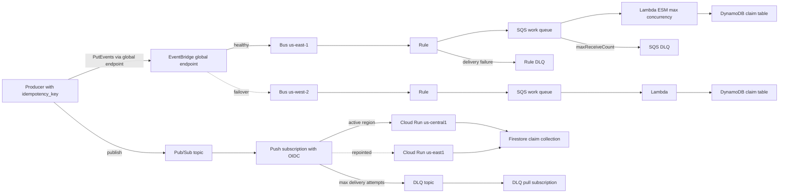

# Capstone 1: Resilient Multi-Region Serverless Event Pipeline

## TL;DR

- Every hop in both pipelines is at-least-once, so correctness comes from a producer-assigned idempotency key and a lease-based claim in the sink. Neither EventBridge `id` nor Pub/Sub `messageId` can serve as that key.
- On AWS, EventBridge to Lambda direct is the wrong shape for a resilient pipeline. Lambda's asynchronous API acknowledges the event with a 202, so the EventBridge target DLQ never sees function errors. Put an SQS queue between them, use ReportBatchItemFailures, and cap the event source mapping's maximum concurrency.
- On GCP, a Pub/Sub push subscription to Cloud Run needs three things: a dead-letter topic with its own pull subscription, IAM for the Pub/Sub service agent, and `expiration_policy.ttl = ""`. Without the last one an idle subscription is deleted after 31 days.
- Budgets are lagging, billing-data-driven alerts and are not a circuit breaker. Real-time spend control comes from concurrency caps (`maximum_concurrency`, `max_instance_count`), runaway alarms on 1-minute metrics, and a loop-proof event pattern.
- Multi-region means different things on each cloud. AWS gives you EventBridge global endpoints with Route 53 health-check failover in the data path. GCP gives you a global Pub/Sub topic with regional message storage and a subscription whose push endpoint you repoint, which is a control-plane action.

## Mental Model



Each cloud is a pipeline of at-least-once queues joined by retry loops, and each loop owns its own failure policy.
The router (EventBridge or Pub/Sub) is decoupled from the consumer by a durable buffer.
The buffer is SQS on AWS and the Pub/Sub subscription backlog on GCP.
The consumer is an elastic compute pool whose concurrency you cap on purpose, because the cap is the only spend and blast-radius limit that acts in real time.
The sink is a claim table that turns at-least-once delivery into effectively-once effects.
The DLQs are the only place where "give up" is allowed, and they exist so that a human or a redrive job decides what happens next.
Budgets sit outside the data path as slow, lagging observers.

## Internals

### Where duplicates come from

Duplicates enter the system at five places:

1. The producer retries a `PutEvents` or `publish` call that timed out after the service had already accepted it.
2. The router retries delivery after an ambiguous response.
3. The queue redelivers after a visibility timeout (SQS) or ack deadline (Pub/Sub) expires.
4. The consumer finishes the side effect but crashes before acknowledging.
5. Cross-region failover replays the same logical event into a second region.

Only the first is under your control at the source.
The service-assigned ids are minted per accepted publish, so a retried publish gets a new EventBridge `id` or a new Pub/Sub `messageId`.
The key must therefore be assigned by the producer before the first attempt and carried in `detail` (EventBridge) or in a message attribute (Pub/Sub).
This is the argument in the Builders' Library piece on [making retries safe with idempotent APIs](https://aws.amazon.com/builders-library/making-retries-safe-with-idempotent-APIs/) and in Pat Helland's "Idempotence Is Not a Medical Condition" (ACM Queue, 2012).
MillWheel (VLDB 2013) uses the same pattern internally: unique record ids plus a per-key dedupe store give effectively-once processing on at-least-once transport.
See [[17-Cloud-AI-Engineering/Volume_13_Seminal_Papers_and_Case_Studies/Chapter_14_MillWheel_and_Dataflow_Model|MillWheel and the Dataflow Model]].

### Mechanism 1: the layered retry stack on AWS, and where the DLQ really is

EventBridge delivers to each target with a retry policy.
The documented defaults are up to 24 hours and up to 185 attempts with exponential backoff and jitter (AWS docs, as of 2026-10, UNVERIFIED-recalled).
Both are tunable per target via `MaximumEventAgeInSeconds` and `MaximumRetryAttempts`.
A target DLQ is an SQS standard queue that receives the event after retries are exhausted.

When the target is Lambda, EventBridge uses the asynchronous `Invoke` path.
Lambda enqueues the event on an internal queue and returns HTTP 202 immediately.
From EventBridge's perspective the delivery succeeded.
Function errors are then handled by Lambda's own async policy: 2 retries by default and a maximum event age of 6 hours.
Throttles are retried on the same internal queue.
The result is that the EventBridge target DLQ only catches failures to reach the Lambda API (permissions, a deleted function, API errors).
It does not catch bugs in your handler.
You need a separate failure destination on the function to see those.
Failures are also split across two retry clocks, so the time to "give up" is hard to bound.

The design in this chapter removes the ambiguity.
EventBridge delivers to SQS, which is a plain, synchronous, durable enqueue.
The rule DLQ then captures only enqueue failures, which are rare and mean misconfiguration (queue policy, KMS key, deleted queue).
Lambda polls SQS through an event source mapping.
The time to give up is exactly `maxReceiveCount x visibility timeout` plus queueing time, and it is visible in one place.
The cost is one extra hop, a small polling-latency tax, and about $0.40 per million SQS requests (AWS pricing, as of 2026-10, UNVERIFIED-recalled).
What you gain is an elastic buffer measured in days rather than the 6-hour async age limit, concurrency control, and redrive tooling.
This follows the "avoid insurmountable queue backlogs" argument in the Builders' Library ([source](https://aws.amazon.com/builders-library/avoiding-insurmountable-queue-backlogs/)).

`PutEvents` has a producer-side trap too.
A request with several entries can return HTTP 200 with `FailedEntryCount > 0`, and the failed entries are listed per index in the response.
Code that only checks for exceptions silently drops events.

### Mechanism 2: the SQS event source mapping, receive counts, and the DLQ clock

The Lambda poller long-polls the queue and invokes your function with batches.
For standard queues it starts with a small number of pollers and scales concurrency up as backlog grows, bounded by function concurrency or by the mapping's `maximum_concurrency` (documented range 2 to 1000, AWS docs, as of 2026-10, UNVERIFIED-recalled).
Four consequences follow that you will not find in a getting-started guide:

1. **Throttling consumes receive count.**
   If the poller receives a batch and cannot invoke because the function is throttled, the messages return to the queue after the visibility timeout with `ApproximateReceiveCount` incremented.
   With `maxReceiveCount = 3` and a function pinned by reserved concurrency, healthy messages can reach the DLQ without ever executing.
   Limit concurrency with the mapping's `scaling_config.maximum_concurrency`, which makes the poller stop pulling instead of pulling and failing.
   Set `maxReceiveCount` to 5 or more.
2. **Visibility timeout must exceed function timeout by a margin.**
   AWS guidance is at least 6 times the function timeout plus the batching window (AWS docs, as of 2026-10, UNVERIFIED-recalled).
   If the timeout is shorter, a slow batch becomes visible again and a second invocation processes the same messages concurrently.
   That is a self-inflicted duplicate that your idempotency lease must absorb.
3. **Partial batch response is mandatory.**
   Without `ReportBatchItemFailures`, one bad message fails the whole batch.
   Nine good messages are re-received and re-processed on each attempt, and they accrue receive counts toward the DLQ.
   With it, the function returns `batchItemFailures` listing message ids, and Lambda deletes the rest.
4. **The DLQ retention clock does not restart.**
   For standard queues, a message moved to the DLQ by a redrive policy keeps its original enqueue timestamp.
   If the work queue and the DLQ both have 4-day retention and a message fails for 3.9 days, the DLQ copy has about 2.4 hours left.
   Set DLQ retention to the maximum (14 days) and alarm on DLQ depth, not on age.

### Mechanism 3: Pub/Sub push, flow control, and dead-lettering

Pub/Sub stores each message durably across zones in a region before acknowledging the publish.
The topic is a global resource, but storage is regional and `message_storage_policy.allowed_persistence_regions` constrains where.
A push subscription POSTs a JSON envelope to your endpoint.
A 102, 200, 201, 202, or 204 response acks the message, and anything else, including a timeout, is a nack (Google Cloud docs, as of 2026-10, UNVERIFIED-recalled).
Push delivery uses an adaptive outstanding-message window, described in the docs as a slow-start algorithm.
The window grows while the endpoint answers quickly with success.
It shrinks on errors and slow responses.
Two consequences matter for Cloud Run:

- A cold or saturated Cloud Run service (429 or 503, from a low `max_instance_count` or from CPU starvation) shrinks the window.
  Throughput then recovers only gradually, even after capacity returns.
  Backlog age is the SLI, not error rate.
- Each nack counts toward `max_delivery_attempts`.
  Undersizing Cloud Run can therefore push healthy messages to the DLQ, which is the same shape as the SQS throttling trap.

Dead-lettering has its own pitfalls:

- The delivery-attempt count is documented as best-effort.
  Treat `max_delivery_attempts` as "approximately N or more".
- The DLQ topic has no storage of its own.
  Published messages are retained only if a subscription exists on it, so you need a pull subscription.
- The Pub/Sub service agent (`service-PROJECT_NUMBER@gcp-sa-pubsub.iam.gserviceaccount.com`) needs `roles/pubsub.publisher` on the DLQ topic and `roles/pubsub.subscriber` on the source subscription.
- Subscriptions with no activity for 31 days are deleted by default.
  A DLQ subscription that is rarely read is exactly that case, so set `expiration_policy { ttl = "" }`.

The ack deadline for push is 10 to 600 seconds (Google Cloud docs, as of 2026-10, UNVERIFIED-recalled), and the Cloud Run request timeout must be at or below it.
Otherwise Pub/Sub redelivers while the first attempt is still running.
Exactly-once delivery exists for pull and StreamingPull subscriptions only, is regional, and is not available for push, so this pipeline does not rely on it.

### Mechanism 4: the idempotency lease protocol

A naive "write key, then do work" is wrong: if the process dies after the write and before the effect, the retry is skipped and the event is lost.
A naive "do work, then write key" is wrong too: a crash between the two duplicates the effect.
The protocol used on both clouds is a lease:

1. **Claim.** Conditionally write `{key, state=IN_PROGRESS, owner, expires_at=now+lease}`. The condition is: the item does not exist, or its `expires_at` is in the past.
2. **Branch.** If the claim fails, read the item strongly consistent. If it is `DONE`, ack and skip. If it is `IN_PROGRESS`, report an item failure so the message is retried after the visibility timeout or backoff.
3. **Effect.** Perform the side effect.
4. **Complete.** Set `state=DONE` and extend `expires_at` to the dedupe window, only if `owner` still matches.
5. **Release on error.** Delete the claim if `owner` matches, so a retry does not wait for the lease.

A crash during step 3 is recovered by lease expiry.
A crash between 3 and 4 still re-executes the effect once, so the effect itself must be idempotent or naturally keyed (upsert by key, or an external API that accepts an idempotency token).
The lease only narrows the window in which that matters.

Both TTL services are lazy.
DynamoDB TTL deletion usually happens within about 48 hours of expiry (AWS docs, as of 2026-10, UNVERIFIED-recalled).
Firestore TTL deletion is similarly lazy.
Expired items stay readable until deleted, so the claim condition must compare `expires_at` itself and must never assume that a missing item means "expired".
The dedupe window (7 days here) must exceed the longest possible redelivery horizon: SQS retention (4 days) plus EventBridge retry age plus replay.

### Mechanism 5: multi-region behavior

**AWS.**
EventBridge global endpoints give producers one endpoint backed by a bus in each of two regions.
Routing is a Route 53 failover record driven by a health check on a CloudWatch alarm.
The documented metric is `IngestionToInvocationStartLatency` (AWS docs, as of 2026-10, UNVERIFIED-recalled).
The alarm is driven by data-plane latency, so failover does not depend on a control-plane call.
That matches the static-stability principle in [[17-Cloud-AI-Engineering/Volume_01_Cloud_Architecture_Principles/Chapter_02_Regions_Zones_and_Static_Stability|Regions, Zones, and Static Stability]].
The cost is detection delay: an alarm over several 1-minute periods plus health-check polling puts failover on the order of minutes.
Every event accepted by the primary in that window sits in the primary region and is delivered only when it recovers, unless you enable event replication.

Replication is a design decision, not a free feature.
With replication on, both regions hold a copy of each event.
If both regions' rules are active, both consume every event, and the sink must dedupe across regions.
Region-local idempotency tables cannot do that, and a DynamoDB global table is eventually consistent, so two regions can claim the same key inside the replication window.
This chapter's lab disables replication and keeps the claim table region-local.
The accepted trade-off is that in-flight events in a failed primary are delayed, not lost, and that the two regions never consume the same event.
Producers must still send via the endpoint with SigV4a, which in `boto3` requires `awscrt`.

**GCP.**
Pub/Sub topics are global, and the publisher client routes to a region allowed by the storage policy.
A subscription has a single push endpoint.
Multi-region consumption is therefore achieved by repointing the endpoint at a Cloud Run service in the standby region, which is a control-plane write (`modify-push-config`).
Backlog accumulated in a failing region becomes available again only when that region recovers.
Pub/Sub does not replicate message storage across regions on your behalf, which is a design constraint to state plainly in interviews.
The failover path depends on the Pub/Sub and IAM control planes, which is the opposite trade-off to the AWS health-check design.

### Mechanism 6: why budgets cannot stop a runaway

AWS Budgets evaluates against billing data that is refreshed up to about three times a day (AWS docs, as of 2026-10, UNVERIFIED-recalled).
GCP budget notifications are likewise driven by lagging cost data and, per the docs, are alerts, not caps.
A budget notification is a pager, not a brake.
Spend rate during the blind window is bounded only by what you capped in the data path.
The sizing section below turns this into dollars per hour.

### Foundational references

- Helland, "Life beyond Distributed Transactions: an Apostate's Opinion" (CIDR 2007): entities, messages, and at-least-once with idempotent receivers.
- Akidau et al., "The Dataflow Model" (VLDB 2015) and the MillWheel paper (VLDB 2013): dedupe and watermarks for streaming over at-least-once transport.
- Agache et al., "Firecracker: Lightweight Virtualization for Serverless Applications" (NSDI 2020): the isolation substrate under Lambda. See [[17-Cloud-AI-Engineering/Volume_13_Seminal_Papers_and_Case_Studies/Chapter_04_Firecracker_MicroVM|Firecracker]].
- Elhemali et al., "Amazon DynamoDB: A Scalable, Predictably Performant, and Fully Managed NoSQL Database Service" (USENIX ATC 2022): conditional-write and partition semantics behind the claim table.
- Google SRE Book, "Addressing Cascading Failures": retry amplification and load shedding.
- See also [[17-Cloud-AI-Engineering/Volume_07_Reliability_and_SRE/Chapter_02_Load_Shedding_Backpressure_and_Admission_Control|Load Shedding, Backpressure, and Admission Control]] and [[17-Cloud-AI-Engineering/Volume_07_Reliability_and_SRE/Chapter_03_Resilient_Communication_Retries_Jitter_and_Circuit_Breakers|Resilient Communication]].

## Numbers to Know

Status note: live documentation access was unavailable while authoring this pass.
Every row is recalled from prior knowledge and tagged UNVERIFIED.
Re-verify each one against the cited primary source before promoting the chapter to `status: solid`.

| Quantity | Value | Source and status |
|---|---|---|
| EventBridge target retry default | up to 24 h and 185 attempts, exponential backoff with jitter | (AWS docs, as of 2026-10, UNVERIFIED) |
| EventBridge retry policy bounds | event age 60 s to 24 h, attempts 0 to 185 | (AWS docs, as of 2026-10, UNVERIFIED) |
| EventBridge targets per rule | 5 | (AWS docs, as of 2026-10, UNVERIFIED) |
| EventBridge PutEvents entries per call | 10 | (AWS docs, as of 2026-10, UNVERIFIED) |
| EventBridge event size | 256 KB historically; an increase to 1 MB was announced in 2025 | (AWS docs, as of 2026-10, UNVERIFIED) |
| EventBridge PutEvents quota | region-dependent, adjustable | (AWS docs, as of 2026-10, UNVERIFIED) |
| EventBridge custom event price | $1.00 per million events | (AWS pricing, as of 2026-10, UNVERIFIED) |
| Lambda async invoke defaults | 2 retries, max event age 6 h | (AWS docs, as of 2026-10, UNVERIFIED) |
| Lambda sync payload | 6 MB | (AWS docs, as of 2026-10, UNVERIFIED) |
| Lambda max timeout | 900 s | (AWS docs, as of 2026-10, UNVERIFIED) |
| Lambda default account concurrency | 1,000 per region; new accounts may start lower | (AWS docs, as of 2026-10, UNVERIFIED) |
| Lambda scale-up rate | 1,000 new execution environments per function per 10 s | (AWS docs, as of 2026-10, UNVERIFIED) |
| Lambda price (arm64) | $0.20 per million requests, $0.0000133334 per GB-s | (AWS pricing, as of 2026-10, UNVERIFIED) |
| SQS visibility timeout | 0 s to 12 h, default 30 s | (AWS docs, as of 2026-10, UNVERIFIED) |
| SQS retention | 60 s to 14 days, default 4 days | (AWS docs, as of 2026-10, UNVERIFIED) |
| SQS ESM maximum concurrency | 2 to 1000 | (AWS docs, as of 2026-10, UNVERIFIED) |
| SQS standard price | $0.40 per million requests after free tier | (AWS pricing, as of 2026-10, UNVERIFIED) |
| DynamoDB on-demand write price | about $0.625 per million WRU in us-east-1 after the 2024 price cut | (AWS pricing, as of 2026-10, UNVERIFIED) |
| DynamoDB TTL deletion lag | typically within about 48 h of expiry | (AWS docs, as of 2026-10, UNVERIFIED) |
| AWS Budgets data refresh | up to about 3 times per day | (AWS docs, as of 2026-10, UNVERIFIED) |
| Pub/Sub ack deadline | 10 s to 600 s | (Google Cloud docs, as of 2026-10, UNVERIFIED) |
| Pub/Sub retry backoff default | min 10 s, max 600 s | (Google Cloud docs, as of 2026-10, UNVERIFIED) |
| Pub/Sub dead letter attempts | 5 to 100, default 5, count is best-effort | (Google Cloud docs, as of 2026-10, UNVERIFIED) |
| Pub/Sub message retention | up to 31 days on subscription; default 7 days | (Google Cloud docs, as of 2026-10, UNVERIFIED) |
| Pub/Sub max message size | 10 MB | (Google Cloud docs, as of 2026-10, UNVERIFIED) |
| Pub/Sub inactive subscription expiry | 31 days by default | (Google Cloud docs, as of 2026-10, UNVERIFIED) |
| Pub/Sub throughput price | $40 per TiB, first 10 GiB per month free | (Google Cloud pricing, as of 2026-10, UNVERIFIED) |
| Cloud Run concurrency | default 80, max 1000 per instance | (Google Cloud docs, as of 2026-10, UNVERIFIED) |
| Cloud Run request timeout | default 300 s, max 3600 s | (Google Cloud docs, as of 2026-10, UNVERIFIED) |
| Cloud Run request-based price | $0.40 per million requests, $0.000018 per vCPU-s, $0.0000020 per GiB-s | (Google Cloud pricing, as of 2026-10, UNVERIFIED) |
| Firestore write price | about $0.09 to $0.18 per 100k writes, depends on location type | (Google Cloud pricing, as of 2026-10, UNVERIFIED) |

## AWS vs GCP Mechanism Parity

| Concern | AWS | GCP | Critical difference |
|---|---|---|---|
| Router | EventBridge bus plus rules, JSON-body content filtering | Pub/Sub topic plus subscriptions; Eventarc for CloudEvents routing | Pub/Sub subscription filters match attributes only, so producers must promote routing fields into attributes. EventBridge matches inside the payload. |
| Delivery guarantee | At-least-once, no ordering | At-least-once, optional per-ordering-key ordering, exactly-once for pull only | EventBridge has no ordering primitive. Pub/Sub ordering is regional and per key. |
| Retry policy | Per-target age and attempt count (24 h and 185 by default) | Per-subscription exponential backoff 10 s to 600 s, plus ack deadline | AWS bounds retries by time and count. Pub/Sub retries until retention unless a DLQ policy intervenes. |
| DLQ | Target DLQ (SQS), plus SQS redrive DLQ, plus Lambda failure destination | Dead letter topic with attempt count, best-effort | The AWS DLQ you need depends on which hop failed. Pub/Sub has one mechanism but needs a subscription and IAM on the DLQ topic. |
| Consumer binding | Lambda pulls from SQS (ESM) | Pub/Sub pushes to Cloud Run with OIDC | Pull-based lets the consumer set its own pace. Push relies on adaptive window flow control, so a slow endpoint shrinks throughput. |
| Concurrency cap | ESM `maximum_concurrency`, function reserved concurrency | Cloud Run `max_instance_count` and per-instance concurrency | AWS has an explicit poller-side cap that avoids throttle-induced receive count. On GCP, a cap that is too low causes 429s and nacks that consume delivery attempts. |
| Idempotency store | DynamoDB conditional write plus TTL | Firestore transaction plus TTL policy | Both TTLs are lazy, so compare expiry in the condition. |
| Multi-region ingest | Global endpoints, Route 53 health check on a CloudWatch alarm, optional replication | Global topic, regional message storage, storage policy | AWS failover is data-plane driven. GCP failover is a control-plane write, and messages already stored in a failed region wait for recovery. |
| Budget alerting | AWS Budgets, SNS or email, optional actions | Billing budgets, Pub/Sub notifications, optional programmatic response | Neither stops spend by itself. Both lag billing data. |
| Kill switch | Budget action attaching an IAM deny or SCP, or disabling the ESM | Function on budget topic that disables billing or scales services to zero | GCP's "disable billing" is a blunt instrument that can break running resources. |

## Worked Example: A Dual-Cloud Idempotent Event Pipeline

This lab provisions billable resources in two clouds.
Status note: this code was written without access to `tofu validate` or live provider schemas in this authoring pass.
Run `tofu validate` and `tofu plan` first, and treat resource argument names as UNVERIFIED until they pass.

### Layout

```text
capstone1/
  versions.tf
  variables.tf
  aws.tf
  gcp.tf
  budgets.tf
  modules/aws_region/main.tf
  handlers/lambda_handler.py
  handlers/cloudrun/main.py
  handlers/cloudrun/Dockerfile
  producer.py
  teardown.sh
  lab.tfvars
```

### versions.tf and variables.tf

```hcl
terraform {
  required_version = ">= 1.6.0"
  required_providers {
    aws     = { source = "hashicorp/aws", version = ">= 5.60, < 7.0" }
    google  = { source = "hashicorp/google", version = "~> 6.0" }
    archive = { source = "hashicorp/archive", version = "~> 2.4" }
  }
}

provider "aws" {
  alias  = "primary"
  region = var.aws_primary_region
}

provider "aws" {
  alias  = "secondary"
  region = var.aws_secondary_region
}

provider "google" {
  project               = var.gcp_project_id
  region                = var.gcp_regions[0]
  user_project_override = true
  billing_project       = var.gcp_project_id
}
```

```hcl
variable "aws_primary_region"   { default = "us-east-1" }
variable "aws_secondary_region" { default = "us-west-2" }
variable "gcp_project_id"       { type = string }
variable "gcp_billing_account"  { type = string }
variable "gcp_regions"          { default = ["us-central1", "us-east1"] }
variable "gcp_active_region"    { default = "us-central1" }
variable "firestore_location"   { default = "us-central1" }
variable "image"                { type = string }
variable "alert_email"          { type = string }
variable "monthly_budget_usd"   { default = "10" }
```

### modules/aws_region/main.tf

```hcl
variable "name"            { type = string }
variable "alert_email"     { type = string }
variable "handler_source"  { type = string }
variable "max_concurrency" { default = 20 }
variable "runaway_threshold_5m" { default = 5000 }

data "aws_caller_identity" "me" {}

resource "aws_cloudwatch_event_bus" "this" {
  name = var.name
}

resource "aws_sqs_queue" "rule_dlq" {
  name                      = "${var.name}-rule-dlq"
  message_retention_seconds = 1209600
  sqs_managed_sse_enabled   = true
}

resource "aws_sqs_queue" "dlq" {
  name                      = "${var.name}-dlq"
  message_retention_seconds = 1209600
  sqs_managed_sse_enabled   = true
}

resource "aws_sqs_queue" "work" {
  name                       = "${var.name}-work"
  visibility_timeout_seconds = 180
  message_retention_seconds  = 345600
  sqs_managed_sse_enabled    = true
  redrive_policy = jsonencode({
    deadLetterTargetArn = aws_sqs_queue.dlq.arn
    maxReceiveCount     = 5
  })
}

resource "aws_cloudwatch_event_rule" "orders" {
  name           = "${var.name}-orders"
  event_bus_name = aws_cloudwatch_event_bus.this.name
  event_pattern = jsonencode({
    source        = ["capstone1.producer"]
    "detail-type" = ["order.created"]
  })
}

resource "aws_cloudwatch_event_target" "to_work" {
  rule           = aws_cloudwatch_event_rule.orders.name
  event_bus_name = aws_cloudwatch_event_bus.this.name
  target_id      = "work-queue"
  arn            = aws_sqs_queue.work.arn
  dead_letter_config { arn = aws_sqs_queue.rule_dlq.arn }
  retry_policy {
    maximum_event_age_in_seconds = 3600
    maximum_retry_attempts       = 20
  }
}

data "aws_iam_policy_document" "queue_from_events" {
  for_each = {
    work     = aws_sqs_queue.work.arn
    rule_dlq = aws_sqs_queue.rule_dlq.arn
  }
  statement {
    actions   = ["sqs:SendMessage"]
    resources = [each.value]
    principals {
      type        = "Service"
      identifiers = ["events.amazonaws.com"]
    }
    condition {
      test     = "ArnEquals"
      variable = "aws:SourceArn"
      values   = [aws_cloudwatch_event_rule.orders.arn]
    }
  }
}

resource "aws_sqs_queue_policy" "work" {
  queue_url = aws_sqs_queue.work.id
  policy    = data.aws_iam_policy_document.queue_from_events["work"].json
}

resource "aws_sqs_queue_policy" "rule_dlq" {
  queue_url = aws_sqs_queue.rule_dlq.id
  policy    = data.aws_iam_policy_document.queue_from_events["rule_dlq"].json
}

resource "aws_dynamodb_table" "idem" {
  name         = "${var.name}-idem"
  billing_mode = "PAY_PER_REQUEST"
  hash_key     = "pk"
  attribute {
    name = "pk"
    type = "S"
  }
  ttl {
    attribute_name = "expires_at"
    enabled        = true
  }
}

data "archive_file" "zip" {
  type        = "zip"
  source_file = var.handler_source
  output_path = "${path.module}/${var.name}.zip"
}

resource "aws_iam_role" "fn" {
  name = "${var.name}-fn"
  assume_role_policy = jsonencode({
    Version = "2012-10-17"
    Statement = [{
      Effect    = "Allow"
      Action    = "sts:AssumeRole"
      Principal = { Service = "lambda.amazonaws.com" }
    }]
  })
}

resource "aws_iam_role_policy_attachment" "logs" {
  role       = aws_iam_role.fn.name
  policy_arn = "arn:aws:iam::aws:policy/service-role/AWSLambdaBasicExecutionRole"
}

resource "aws_iam_role_policy" "fn" {
  role = aws_iam_role.fn.id
  policy = jsonencode({
    Version = "2012-10-17"
    Statement = [
      {
        Effect   = "Allow"
        Action   = ["sqs:ReceiveMessage", "sqs:DeleteMessage", "sqs:GetQueueAttributes"]
        Resource = aws_sqs_queue.work.arn
      },
      {
        Effect   = "Allow"
        Action   = ["dynamodb:PutItem", "dynamodb:GetItem", "dynamodb:UpdateItem", "dynamodb:DeleteItem"]
        Resource = aws_dynamodb_table.idem.arn
      }
    ]
  })
}

resource "aws_cloudwatch_log_group" "fn" {
  name              = "/aws/lambda/${var.name}-handler"
  retention_in_days = 14
}

resource "aws_lambda_function" "handler" {
  function_name    = "${var.name}-handler"
  role             = aws_iam_role.fn.arn
  runtime          = "python3.13"
  architectures    = ["arm64"]
  handler          = "lambda_handler.lambda_handler"
  filename         = data.archive_file.zip.output_path
  source_code_hash = data.archive_file.zip.output_base64sha256
  memory_size      = 512
  timeout          = 30
  environment {
    variables = {
      IDEM_TABLE     = aws_dynamodb_table.idem.name
      LEASE_SECONDS  = "60"
      DONE_TTL       = "604800"
    }
  }
  depends_on = [aws_cloudwatch_log_group.fn]
}

resource "aws_lambda_event_source_mapping" "work" {
  event_source_arn                   = aws_sqs_queue.work.arn
  function_name                      = aws_lambda_function.handler.arn
  batch_size                         = 10
  maximum_batching_window_in_seconds = 1
  function_response_types            = ["ReportBatchItemFailures"]
  scaling_config {
    maximum_concurrency = var.max_concurrency
  }
}

resource "aws_sns_topic" "alerts" {
  name = "${var.name}-alerts"
}

resource "aws_sns_topic_subscription" "email" {
  topic_arn = aws_sns_topic.alerts.arn
  protocol  = "email"
  endpoint  = var.alert_email
}

resource "aws_cloudwatch_metric_alarm" "dlq_depth" {
  alarm_name          = "${var.name}-dlq-depth"
  namespace           = "AWS/SQS"
  metric_name         = "ApproximateNumberOfMessagesVisible"
  dimensions          = { QueueName = aws_sqs_queue.dlq.name }
  statistic           = "Maximum"
  period              = 60
  evaluation_periods  = 1
  threshold           = 0
  comparison_operator = "GreaterThanThreshold"
  treat_missing_data  = "notBreaching"
  alarm_actions       = [aws_sns_topic.alerts.arn]
}

resource "aws_cloudwatch_metric_alarm" "runaway" {
  alarm_name          = "${var.name}-runaway-ingest"
  namespace           = "AWS/SQS"
  metric_name         = "NumberOfMessagesSent"
  dimensions          = { QueueName = aws_sqs_queue.work.name }
  statistic           = "Sum"
  period              = 300
  evaluation_periods  = 1
  threshold           = var.runaway_threshold_5m
  comparison_operator = "GreaterThanThreshold"
  treat_missing_data  = "notBreaching"
  alarm_actions       = [aws_sns_topic.alerts.arn]
}

output "bus_arn"        { value = aws_cloudwatch_event_bus.this.arn }
output "bus_name"       { value = aws_cloudwatch_event_bus.this.name }
output "dlq_url"        { value = aws_sqs_queue.dlq.id }
output "idem_table"     { value = aws_dynamodb_table.idem.name }
```

### aws.tf

```hcl
module "aws_primary" {
  source         = "./modules/aws_region"
  providers      = { aws = aws.primary }
  name           = "capstone1"
  alert_email    = var.alert_email
  handler_source = "${path.root}/handlers/lambda_handler.py"
}

module "aws_secondary" {
  source         = "./modules/aws_region"
  providers      = { aws = aws.secondary }
  name           = "capstone1"
  alert_email    = var.alert_email
  handler_source = "${path.root}/handlers/lambda_handler.py"
}

resource "aws_cloudwatch_metric_alarm" "failover" {
  provider            = aws.primary
  alarm_name          = "capstone1-global-endpoint-failover"
  namespace           = "AWS/Events"
  metric_name         = "IngestionToInvocationStartLatency"
  statistic           = "Average"
  period              = 60
  evaluation_periods  = 5
  threshold           = 30000
  comparison_operator = "GreaterThanThreshold"
  treat_missing_data  = "notBreaching"
}

resource "aws_route53_health_check" "primary" {
  provider                        = aws.primary
  type                            = "CLOUDWATCH_METRIC"
  cloudwatch_alarm_name           = aws_cloudwatch_metric_alarm.failover.alarm_name
  cloudwatch_alarm_region         = var.aws_primary_region
  insufficient_data_health_status = "Healthy"
}

resource "aws_cloudwatch_event_endpoint" "global" {
  provider = aws.primary
  name     = "capstone1-global"
  event_bus { event_bus_arn = module.aws_primary.bus_arn }
  event_bus { event_bus_arn = module.aws_secondary.bus_arn }
  replication_config { state = "DISABLED" }
  routing_config {
    failover_config {
      primary   { health_check = aws_route53_health_check.primary.arn }
      secondary { route = var.aws_secondary_region }
    }
  }
}
```

### budgets.tf

```hcl
resource "aws_budgets_budget" "monthly" {
  provider     = aws.primary
  name         = "capstone1-monthly"
  budget_type  = "COST"
  limit_amount = var.monthly_budget_usd
  limit_unit   = "USD"
  time_unit    = "MONTHLY"

  dynamic "notification" {
    for_each = [
      { pct = 50,  type = "ACTUAL" },
      { pct = 100, type = "ACTUAL" },
      { pct = 100, type = "FORECASTED" },
    ]
    content {
      comparison_operator        = "GREATER_THAN"
      threshold                  = notification.value.pct
      threshold_type             = "PERCENTAGE"
      notification_type          = notification.value.type
      subscriber_email_addresses = [var.alert_email]
    }
  }
}

data "google_project" "this" {
  project_id = var.gcp_project_id
}

resource "google_pubsub_topic" "budget" {
  name       = "capstone1-budget-alerts"
  depends_on = [google_project_service.apis]
}

resource "google_billing_budget" "monthly" {
  billing_account = var.gcp_billing_account
  display_name    = "capstone1-monthly"
  budget_filter {
    projects = ["projects/${data.google_project.this.number}"]
  }
  amount {
    specified_amount {
      currency_code = "USD"
      units         = var.monthly_budget_usd
    }
  }
  threshold_rules { threshold_percent = 0.5 }
  threshold_rules { threshold_percent = 1.0 }
  threshold_rules {
    threshold_percent = 1.0
    spend_basis       = "FORECASTED_SPEND"
  }
  all_updates_rule {
    pubsub_topic   = google_pubsub_topic.budget.id
    schema_version = "1.0"
  }
  depends_on = [google_project_service.apis]
}
```

### gcp.tf

```hcl
resource "google_project_service" "apis" {
  for_each = toset([
    "run.googleapis.com", "pubsub.googleapis.com", "firestore.googleapis.com",
    "artifactregistry.googleapis.com", "cloudbuild.googleapis.com",
    "billingbudgets.googleapis.com", "cloudresourcemanager.googleapis.com",
  ])
  service            = each.key
  disable_on_destroy = false
}

resource "google_artifact_registry_repository" "repo" {
  location      = var.gcp_regions[0]
  repository_id = "capstone1"
  format        = "DOCKER"
  depends_on    = [google_project_service.apis]
}

resource "google_firestore_database" "db" {
  name                    = "capstone1"
  location_id             = var.firestore_location
  type                    = "FIRESTORE_NATIVE"
  delete_protection_state = "DELETE_PROTECTION_DISABLED"
  deletion_policy         = "DELETE"
  depends_on              = [google_project_service.apis]
}

resource "google_firestore_field" "ttl" {
  database   = google_firestore_database.db.name
  collection = "idem"
  field      = "expires_at"
  ttl_config {}
}

resource "google_service_account" "run" {
  account_id = "capstone1-run"
}

resource "google_service_account" "push" {
  account_id = "capstone1-push"
}

resource "google_project_iam_member" "run_firestore" {
  project = var.gcp_project_id
  role    = "roles/datastore.user"
  member  = "serviceAccount:${google_service_account.run.email}"
}

resource "google_cloud_run_v2_service" "handler" {
  for_each            = toset(var.gcp_regions)
  name                = "capstone1-handler"
  location            = each.key
  ingress             = "INGRESS_TRAFFIC_ALL"
  deletion_protection = false
  template {
    service_account                  = google_service_account.run.email
    timeout                          = "60s"
    max_instance_request_concurrency = 40
    scaling {
      min_instance_count = 0
      max_instance_count = 10
    }
    containers {
      image = var.image
      resources {
        limits = { cpu = "1", memory = "512Mi" }
      }
      env {
        name  = "FIRESTORE_DB"
        value = google_firestore_database.db.name
      }
    }
  }
  depends_on = [google_project_service.apis]
}

resource "google_cloud_run_v2_service_iam_member" "invoker" {
  for_each = google_cloud_run_v2_service.handler
  location = each.value.location
  name     = each.value.name
  role     = "roles/run.invoker"
  member   = "serviceAccount:${google_service_account.push.email}"
}

resource "google_pubsub_topic" "events" {
  name = "capstone1-events"
  message_storage_policy {
    allowed_persistence_regions = var.gcp_regions
  }
  depends_on = [google_project_service.apis]
}

resource "google_pubsub_topic" "dlq" {
  name       = "capstone1-events-dlq"
  depends_on = [google_project_service.apis]
}

resource "google_pubsub_subscription" "dlq_pull" {
  name                       = "capstone1-events-dlq-pull"
  topic                      = google_pubsub_topic.dlq.id
  ack_deadline_seconds       = 60
  message_retention_duration = "2678400s"
  expiration_policy {
    ttl = ""
  }
}

locals {
  active_uri = google_cloud_run_v2_service.handler[var.gcp_active_region].uri
  pubsub_sa  = "serviceAccount:service-${data.google_project.this.number}@gcp-sa-pubsub.iam.gserviceaccount.com"
}

resource "google_pubsub_subscription" "work" {
  name                       = "capstone1-events-work"
  topic                      = google_pubsub_topic.events.id
  ack_deadline_seconds       = 60
  message_retention_duration = "604800s"
  expiration_policy {
    ttl = ""
  }
  retry_policy {
    minimum_backoff = "10s"
    maximum_backoff = "300s"
  }
  dead_letter_policy {
    dead_letter_topic     = google_pubsub_topic.dlq.id
    max_delivery_attempts = 5
  }
  push_config {
    push_endpoint = local.active_uri
    oidc_token {
      service_account_email = google_service_account.push.email
      audience              = local.active_uri
    }
  }
  depends_on = [google_cloud_run_v2_service_iam_member.invoker]
}

resource "google_pubsub_topic_iam_member" "dlq_publisher" {
  topic  = google_pubsub_topic.dlq.name
  role   = "roles/pubsub.publisher"
  member = local.pubsub_sa
}

resource "google_pubsub_subscription_iam_member" "work_subscriber" {
  subscription = google_pubsub_subscription.work.name
  role         = "roles/pubsub.subscriber"
  member       = local.pubsub_sa
}
```

### handlers/lambda_handler.py

```python
import json
import os
import time

import boto3
from botocore.exceptions import ClientError

ddb = boto3.client("dynamodb")
TABLE = os.environ["IDEM_TABLE"]
LEASE = int(os.environ.get("LEASE_SECONDS", "60"))
DONE_TTL = int(os.environ.get("DONE_TTL", "604800"))


def effect(detail):
    # Replace with the real side effect. It must be idempotent or keyed by detail["idempotency_key"],
    # because a crash between effect() and complete() re-executes it once.
    if detail.get("poison"):
        raise ValueError("poison message")
    print(json.dumps({"applied": detail["idempotency_key"]}))


def claim(key, owner, now):
    try:
        ddb.put_item(
            TableName=TABLE,
            Item={
                "pk": {"S": key},
                "state": {"S": "IN_PROGRESS"},
                "owner": {"S": owner},
                "expires_at": {"N": str(now + LEASE)},
            },
            ConditionExpression="attribute_not_exists(pk) OR expires_at < :now",
            ExpressionAttributeValues={":now": {"N": str(now)}},
        )
        return "CLAIMED"
    except ClientError as e:
        if e.response["Error"]["Code"] != "ConditionalCheckFailedException":
            raise
    item = ddb.get_item(TableName=TABLE, Key={"pk": {"S": key}}, ConsistentRead=True).get("Item")
    if item and item["state"]["S"] == "DONE":
        return "DONE"
    return "BUSY"


def complete(key, owner, now):
    try:
        ddb.update_item(
            TableName=TABLE,
            Key={"pk": {"S": key}},
            UpdateExpression="SET #s = :d, expires_at = :e",
            ConditionExpression="#o = :o",
            ExpressionAttributeNames={"#s": "state", "#o": "owner"},
            ExpressionAttributeValues={
                ":d": {"S": "DONE"},
                ":e": {"N": str(now + DONE_TTL)},
                ":o": {"S": owner},
            },
        )
    except ClientError as e:
        if e.response["Error"]["Code"] != "ConditionalCheckFailedException":
            raise


def release(key, owner):
    try:
        ddb.delete_item(
            TableName=TABLE,
            Key={"pk": {"S": key}},
            ConditionExpression="#o = :o AND #s = :p",
            ExpressionAttributeNames={"#s": "state", "#o": "owner"},
            ExpressionAttributeValues={":o": {"S": owner}, ":p": {"S": "IN_PROGRESS"}},
        )
    except ClientError:
        pass


def lambda_handler(event, context):
    failures = []
    for rec in event["Records"]:
        mid = rec["messageId"]
        try:
            detail = json.loads(rec["body"])["detail"]
            key = detail["idempotency_key"]
        except Exception:
            failures.append({"itemIdentifier": mid})
            continue
        owner = "%s:%s" % (context.aws_request_id, mid)
        now = int(time.time())
        state = claim(key, owner, now)
        if state == "DONE":
            continue
        if state == "BUSY":
            failures.append({"itemIdentifier": mid})
            continue
        try:
            effect(detail)
            complete(key, owner, int(time.time()))
        except Exception:
            release(key, owner)
            failures.append({"itemIdentifier": mid})
    return {"batchItemFailures": failures}
```

### handlers/cloudrun/main.py and Dockerfile

```python
import base64
import json
import os
import uuid
from datetime import datetime, timedelta, timezone
from http.server import BaseHTTPRequestHandler, ThreadingHTTPServer

from google.cloud import firestore

db = firestore.Client(database=os.environ["FIRESTORE_DB"])
COL = db.collection("idem")
LEASE = timedelta(seconds=60)
DONE_TTL = timedelta(days=7)


def now():
    return datetime.now(timezone.utc)


@firestore.transactional
def _claim(tx, ref, owner):
    snap = ref.get(transaction=tx)
    if snap.exists:
        d = snap.to_dict()
        if d["expires_at"] > now():
            return "DONE" if d["state"] == "DONE" else "BUSY"
    tx.set(ref, {"state": "IN_PROGRESS", "owner": owner, "expires_at": now() + LEASE})
    return "CLAIMED"


@firestore.transactional
def _finish(tx, ref, owner, done):
    d = ref.get(transaction=tx).to_dict() or {}
    if d.get("owner") != owner:
        return
    if done:
        tx.update(ref, {"state": "DONE", "expires_at": now() + DONE_TTL})
    else:
        tx.delete(ref)


def effect(payload):
    if payload.get("poison"):
        raise ValueError("poison message")
    print(json.dumps({"applied": payload.get("idempotency_key")}))


class H(BaseHTTPRequestHandler):
    def _reply(self, code):
        self.send_response(code)
        self.end_headers()

    def do_POST(self):
        env = json.loads(self.rfile.read(int(self.headers.get("Content-Length", "0"))))
        msg = env["message"]
        key = (msg.get("attributes") or {}).get("idempotency_key")
        if not key:
            return self._reply(400)
        ref = COL.document(key)
        owner = uuid.uuid4().hex
        state = _claim(db.transaction(), ref, owner)
        if state == "DONE":
            return self._reply(204)
        if state == "BUSY":
            return self._reply(503)
        try:
            effect(json.loads(base64.b64decode(msg.get("data", "")) or b"{}") | {"idempotency_key": key})
            _finish(db.transaction(), ref, owner, True)
            return self._reply(204)
        except Exception:
            _finish(db.transaction(), ref, owner, False)
            return self._reply(500)

    def log_message(self, *a):
        pass


if __name__ == "__main__":
    ThreadingHTTPServer(("0.0.0.0", int(os.environ.get("PORT", "8080"))), H).serve_forever()
```

```dockerfile
FROM python:3.12-slim
RUN pip install --no-cache-dir "google-cloud-firestore>=2.16,<3"
COPY main.py /app/main.py
CMD ["python", "/app/main.py"]
```

### producer.py

```python
import argparse
import json
import uuid

import boto3
from google.cloud import pubsub_v1


def aws(region, endpoint_id, bus, keys, poison_key):
    eb = boto3.client("events", region_name=region)  # EndpointId needs boto3[crt] for SigV4a
    entries = []
    for k in keys + [k for k in keys[:2]] + [poison_key]:  # first two keys are re-sent to simulate retries
        entries.append({
            "Source": "capstone1.producer",
            "DetailType": "order.created",
            "EventBusName": bus,
            "Detail": json.dumps({"idempotency_key": k, "poison": k == poison_key}),
        })
    for i in range(0, len(entries), 10):
        r = eb.put_events(Entries=entries[i:i + 10], EndpointId=endpoint_id)
        if r["FailedEntryCount"]:
            raise RuntimeError(r["Entries"])


def gcp(project, topic, keys, poison_key):
    pub = pubsub_v1.PublisherClient()
    path = pub.topic_path(project, topic)
    futs = []
    for k in keys + keys[:2] + [poison_key]:
        body = json.dumps({"poison": k == poison_key}).encode()
        futs.append(pub.publish(path, body, idempotency_key=k))
    for f in futs:
        f.result(timeout=30)


if __name__ == "__main__":
    ap = argparse.ArgumentParser()
    ap.add_argument("--n", type=int, default=20)
    ap.add_argument("--aws-region", default="us-east-1")
    ap.add_argument("--endpoint-id", required=True)
    ap.add_argument("--bus", default="capstone1")
    ap.add_argument("--gcp-project", required=True)
    a = ap.parse_args()
    keys = [str(uuid.uuid4()) for _ in range(a.n)]
    poison = str(uuid.uuid4())
    aws(a.aws_region, a.endpoint_id, a.bus, keys, poison)
    gcp(a.gcp_project, "capstone1-events", keys, poison)
```

### Run order

```bash
cd capstone1
cat > lab.tfvars <<'EOF'
gcp_project_id      = "YOUR_PROJECT"
gcp_billing_account = "XXXXXX-XXXXXX-XXXXXX"
alert_email         = "you@example.com"
image               = "us-central1-docker.pkg.dev/YOUR_PROJECT/capstone1/handler:v1"
EOF
tofu init
tofu validate
tofu apply -var-file=lab.tfvars -target=google_artifact_registry_repository.repo -target=google_project_service.apis
gcloud builds submit handlers/cloudrun --tag us-central1-docker.pkg.dev/YOUR_PROJECT/capstone1/handler:v1
tofu apply -var-file=lab.tfvars
pip install "boto3[crt]" google-cloud-pubsub
EP=$(aws events describe-endpoint --name capstone1-global --region us-east-1 --query EndpointId --output text)
python producer.py --endpoint-id "$EP" --gcp-project YOUR_PROJECT --n 20
```

Verification:

```bash
aws sqs get-queue-attributes --region us-east-1 --attribute-names ApproximateNumberOfMessages \
  --queue-url "$(aws sqs get-queue-url --queue-name capstone1-dlq --region us-east-1 --query QueueUrl --output text)"
aws dynamodb scan --table-name capstone1-idem --region us-east-1 --select COUNT
gcloud pubsub subscriptions pull capstone1-events-dlq-pull --limit 5 --project YOUR_PROJECT
```

Expected result: 20 `DONE` claim items per cloud, so the 2 re-sent keys executed their effects once.
The one poison message appears in each DLQ after about 5 attempts.

GCP failover drill:

```bash
gcloud pubsub subscriptions modify-push-config capstone1-events-work \
  --push-endpoint "$(gcloud run services describe capstone1-handler --region us-east1 --format='value(status.url)')" \
  --push-auth-service-account capstone1-push@YOUR_PROJECT.iam.gserviceaccount.com \
  --push-auth-token-audience "$(gcloud run services describe capstone1-handler --region us-east1 --format='value(status.url)')"
```

Then set `gcp_active_region = "us-east1"` in `lab.tfvars` so the next apply does not revert the change.
For the AWS drill, `set-alarm-state` is not sufficient, because the alarm re-evaluates within a period.
Instead, lower the alarm threshold to 0 with producer traffic flowing and watch the endpoint route change.

### Cost estimate and budget guardrails

Lab cost: roughly $0.50 to $2.00 for a few hours (UNVERIFIED).
The recurring items are a Route 53 CloudWatch-metric health check (about $0.50 per month, prorated), CloudWatch alarms (about $0.10 per alarm per month), and a few hundred Lambda, Cloud Run, Pub/Sub, and Firestore operations.
Firestore's free quota may not apply to a named database (UNVERIFIED).
Budgets are created by this stack at $10 per month with 50 percent and 100 percent actual and 100 percent forecast thresholds on both clouds.
The AWS budget snippet is in `budgets.tf` above, and the GCP billing budget with Pub/Sub notifications is in the same file.

### Teardown

```bash
#!/usr/bin/env bash
# teardown.sh - destroys every billable resource in this lab and verifies it.
set -euo pipefail
PROJECT="${GCP_PROJECT:?set GCP_PROJECT}"
tofu destroy -auto-approve -var-file=lab.tfvars
gcloud storage rm -r "gs://${PROJECT}_cloudbuild" 2>/dev/null || true
aws events list-event-buses --region us-east-1 --query "EventBuses[?Name=='capstone1']"
aws events list-event-buses --region us-west-2 --query "EventBuses[?Name=='capstone1']"
aws sqs list-queues --queue-name-prefix capstone1 --region us-east-1
aws dynamodb list-tables --region us-east-1 --query "TableNames[?starts_with(@, 'capstone1')]"
gcloud run services list --project "$PROJECT"
gcloud pubsub topics list --project "$PROJECT" --filter="name:capstone1"
gcloud firestore databases list --project "$PROJECT"
```

Every verification command should print an empty result.
The `${PROJECT}_cloudbuild` bucket is created by `gcloud builds submit` outside Terraform, so `tofu destroy` does not remove it.

### Capacity and cost sizing

Assumptions: 50 million events per month, 1 KB each, peak-to-average ratio of 10, handler cost 20 ms per event.

1. **Rate.** Average is 50e6 / 2.592e6 s = 19.3 events/s. Peak is about 193 events/s.
2. **Lambda concurrency (Little's law).**
   - With full batches of 10, there are 19.3 invocations/s at peak, each 0.2 s, so concurrency is about 3.9.
   - In the worst case of batch size 1 at 40 ms, concurrency is 193 x 0.04 = 7.7.
   - A `maximum_concurrency` of 20 gives 2.6x to 5x headroom.
3. **DynamoDB load.** The lease protocol costs 2 writes per event (claim and complete), so peak is about 386 WRU/s, well inside on-demand burst behavior.
4. **AWS monthly cost.**
   - EventBridge: 50 x $1.00 = $50.00.
   - SQS: about 1.2 requests per message x 50M x $0.40/M = $24.
   - Lambda: $7.70 (full batches) to $26.70 (batch size 1).
   - DynamoDB: 100M WRU x $0.625/M = $62.50.
   - Total is about $144 to $163, or about $2.9 to $3.3 per million events.
   - The fixed per-event items (EventBridge and the claim writes) dominate compute.
   - The lease protocol alone doubles the largest controllable line item, so drop the `complete` write when the effect is already naturally idempotent.
5. **GCP monthly cost (approximate).**
   - Pub/Sub: about 100 GB (publish plus delivery) = 0.098 TiB x $40 = $3.90.
   - Cloud Run requests: 50 x $0.40 = $20.
   - Cloud Run CPU and memory: one always-busy 1 vCPU, 512 MiB instance for 2.592M s gives $46.66 + $2.59 = $49.25 (upper bound at 40 concurrency).
   - Firestore: 100M writes plus 50M reads, about $105 using the $0.09 per 100k write figure (UNVERIFIED).
   - Total is about $178, or about $3.6 per million events.
6. **Blind-window loss from a runaway loop (derived).**
   - At $2.88 per million events on AWS, a 10,000 events/s loop costs $0.0288/s, or about $104/h.
   - A 12-hour billing lag costs about $1,240 before a budget alert fires.
   - With `maximum_concurrency = 20`, drain rate is bounded at 20 x 10 events / 0.2 s = 1,000 events/s, which is about $10.4/h.
   - The same loop with the default 1,000 concurrency would be bounded at 50,000 events/s, or about $518/h, and in practice would hit EventBridge or DynamoDB limits first.
   - The concurrency cap is the spend cap.

## Failure Modes and Pitfalls

1. **The DLQ that never fires.**
   Teams attach a target DLQ to an EventBridge rule that targets Lambda directly and assume handler failures land in it.
   They do not, because the async 202 hides function errors, and the rule DLQ stays empty while Lambda's own retries run for up to 6 hours and then drop the event or send it to a function-level destination.
   Mitigation: SQS between EventBridge and Lambda, or a Lambda on-failure destination, and alarm on the actual queue that gives up.
2. **Throttle-induced false DLQ.**
   With reserved concurrency set low, the SQS poller receives batches it cannot invoke.
   Receive counts increment and good messages reach the DLQ.
   Mitigation: `scaling_config.maximum_concurrency` on the mapping, and `maxReceiveCount` of at least 5.
3. **Visibility timeout shorter than function timeout.**
   Concurrent duplicate execution of the same batch.
   The lease in the sink absorbs it, but only if the effect is idempotent.
4. **Expiring DLQ evidence.**
   Equal retention on source and DLQ means a message that fails late in life gets only the remainder of the original retention.
   Set DLQ retention to 14 days.
5. **Silent Pub/Sub DLQ gaps.**
   A DLQ topic without a subscription drops the message.
   Missing publisher or subscriber IAM for the Pub/Sub service agent makes dead-lettering fail while the message keeps redelivering.
   An idle DLQ subscription is deleted after 31 days unless `expiration_policy.ttl` is empty.
6. **Ack deadline versus processing time.**
   A Cloud Run timeout longer than the push ack deadline produces overlapping redeliveries.
   Keep timeout at or below the ack deadline, and keep both well above p99 handler latency.
7. **Cloud Run undersized into the DLQ.**
   A `max_instance_count` of 3 against a burst yields 429s, which are nacks, which count toward `max_delivery_attempts`.
   Size the instance cap from sizing math and alarm on `oldest_unacked_message_age`.
8. **Partial failure at the producer.**
   `PutEvents` returning 200 with `FailedEntryCount > 0`, and Pub/Sub client futures never resolved, both lose events silently.
9. **Idempotency on service ids.**
   Using EventBridge `id` or Pub/Sub `messageId` as the key lets producer retries bypass dedupe.
10. **Lazy TTL.**
    A claim condition of `attribute_not_exists(pk)` alone fails to re-admit expired keys, and one that assumes expired items are gone gives wrong answers for up to about 48 hours.
    Compare `expires_at` in the condition.
11. **Cross-region double processing.**
    Event replication to a secondary region with active rules and region-local claim tables executes effects twice.
    Pick one: replication off, standby rules disabled or buffered, or a cross-region dedupe store whose consistency you have measured.
12. **Event loops.**
    A handler that publishes an event matching its own rule is an unbounded amplifier.
    Exclude self-sourced events in the pattern, carry a hop counter in `detail`, and alarm on 1-minute ingest rates.
    Lambda's built-in recursive loop detection covers only some integrations (SQS, SNS, S3 as recalled, UNVERIFIED), so do not rely on it for EventBridge.
13. **Region-coupled dependencies.**
    The AWS post-event summary for the October 2025 us-east-1 incident describes a DNS automation race that left the DynamoDB regional endpoint unresolvable, with knock-on delays in Lambda, SQS, and EventBridge delivery ([AWS](https://aws.amazon.com/message/101925/), details UNVERIFIED).
    This pipeline's claim table is a regional DynamoDB dependency of the consumer, so a regional DynamoDB event stalls processing even though the event buffers remain durable.
    The buffer protects data. The idempotency store gates progress.
14. **Global dependency on a provider's control layer.**
    Google Cloud's June 2025 incident report describes a policy-data change that crash-looped a global API-serving component across many products and regions ([status page](https://status.cloud.google.com/), exact incident id and details UNVERIFIED).
    Multi-region within one provider does not protect against a globally replicated bad config.
    Dual-cloud only helps if the failover decision does not run through the failing provider's control plane.
15. **Terraform teardown traps.**
    `deletion_protection` on Cloud Run v2 services defaults to true in recent providers.
    Firestore databases need delete protection off and a delete policy.
    The Cloud Build staging bucket is outside state.
    `google_billing_budget` needs the Budgets API enabled on the billing project and `user_project_override`.
    EventBridge global endpoints must be destroyed before buses (Terraform handles the dependency, but manual partial destroys do not).

## Security and Cost Angles

### Security

- **Confused deputy on queues.**
  The queue policy allows `sqs:SendMessage` only from `events.amazonaws.com` with `aws:SourceArn` equal to the specific rule.
  Without the condition, any EventBridge rule in any account that learns the queue ARN could write to it.
- **Lambda role scope.**
  Four DynamoDB actions on one table ARN, and three SQS actions on one queue ARN.
  No wildcard resources.
- **Encryption.**
  SQS uses SSE-SQS in the lab.
  With a customer-managed KMS key, the key policy must allow the EventBridge service principal to use it, and the AWS-managed SQS key does not work for EventBridge delivery.
  Pub/Sub supports CMEK on topics.
  Both DynamoDB and Firestore encrypt at rest by default.
  See [[17-Cloud-AI-Engineering/Volume_08_Security_Identity_and_the_Data_Perimeter/Chapter_04_Encryption_Key_Hierarchies_and_Envelope_Encryption|Encryption Key Hierarchies and Envelope Encryption]].
- **Push authentication.**
  The push subscription mints an OIDC token for a dedicated service account with audience equal to the service URL.
  The Cloud Run service grants `roles/run.invoker` only to that account and never `allUsers`.
  Verify the token on the service even though the platform checks IAM, if the service might later be exposed on another ingress.
- **Producer identity.**
  Producers get `events:PutEvents` on the endpoint's buses and `pubsub.publisher` on the topic only.
  Use workload identity federation, not keys. See [[17-Cloud-AI-Engineering/Volume_08_Security_Identity_and_the_Data_Perimeter/Chapter_02_Workload_Identity_Federation|Workload Identity Federation]].
- **Budget action privileges.**
  If you automate a kill switch, give it a role that can only attach a deny policy or set concurrency to zero.
  A function that can disable billing on a GCP project can also take down unrelated resources.
- **Perimeters.**
  In regulated accounts, add VPC endpoints with endpoint policies and VPC Service Controls around Pub/Sub, Firestore, and Cloud Run APIs. See [[17-Cloud-AI-Engineering/Volume_08_Security_Identity_and_the_Data_Perimeter/Chapter_06_Constructing_an_Impenetrable_Data_Perimeter|Constructing an Impenetrable Data Perimeter]].

### Cost levers

- Drop the `complete` write when effects are naturally idempotent. This halves the largest AWS line item.
- Filter early. EventBridge pattern filtering and Pub/Sub attribute filters avoid paying downstream per-event costs for events nobody wants.
- Batch where latency allows. A 1-second batching window on SQS raises average batch size, which cuts Lambda invocations and request charges. Cloud Run per-instance concurrency does the equivalent on GCP.
- Use arm64 on Lambda for lower duration price.
- Keep Cloud Run `min_instance_count = 0` for spiky workloads and raise it only when cold-start latency breaches the SLO. See [[17-Cloud-AI-Engineering/Volume_09_FinOps_and_Cloud_Economics/Chapter_01_Cloud_Billing_Models_and_Unit_Cost_Allocation|Cloud Billing Models and Unit Cost Allocation]].
- Treat cross-cloud publishing as an egress line item. Dual-publishing from one producer means the second cloud's ingress is free, but the producer's own network path may not be.

## Interview Questions and Model Answers

### Question 1 (L5 - Senior)

A team sends EventBridge events directly to a Lambda function and configures an SQS target DLQ on the rule.
A bug makes the function throw on 10 percent of events, and the DLQ stays empty.
Explain why, and how you would fix it.

#### Model Answer

EventBridge invokes Lambda through the asynchronous invoke API.
That API enqueues the event on Lambda's internal queue and returns 202, so EventBridge records a successful delivery.
The rule DLQ only captures events EventBridge cannot deliver to the target API after its retry policy, which defaults to up to 24 hours and 185 attempts.
Function errors are Lambda's problem, governed by its own async policy of 2 retries and 6 hours maximum event age, after which the event is dropped unless an on-failure destination or function DLQ is configured.
So there are two retry clocks and the rule DLQ is on the wrong one.

Fix options, in order of preference:

1. Target an SQS queue from EventBridge and consume it with an event source mapping using `ReportBatchItemFailures`, a redrive policy with `maxReceiveCount` of about 5, and a DLQ with 14-day retention. This gives one bounded retry horizon and a buffer far longer than 6 hours.
2. If you must keep the direct path, set an on-failure destination on the function and alarm on it, and tune `MaximumRetryAttempts` and `MaximumEventAge` explicitly.

I would still keep the rule DLQ, because it catches enqueue failures from a bad queue policy or KMS misconfiguration, which are silent otherwise.

#### Follow-up Interviewer Question

You moved to SQS and now see messages in the DLQ that have never run your handler. What is happening, and how do you prove it?

### Question 2 (L5 - Senior)

Design the Pub/Sub dead-letter setup for a push subscription to Cloud Run.
What are the failure modes if you configure only the `dead_letter_policy`?

#### Model Answer

The policy references a topic and a maximum delivery attempts value between 5 and 100.
Four other pieces are required.

1. A subscription on the dead-letter topic. Topics do not retain messages themselves, so dead-lettered messages vanish without one.
2. IAM for the Pub/Sub service agent: publisher on the DLQ topic and subscriber on the source subscription. Without these, forwarding fails and the message keeps redelivering.
3. `expiration_policy` with an empty TTL on the DLQ subscription, because inactive subscriptions are deleted after 31 days by default.
4. An alarm on DLQ subscription backlog, not on delivery errors.

Two semantic caveats matter.
The delivery attempt count is best-effort, so I treat it as approximately N.
Every nack counts, including 429 and timeouts caused by an undersized Cloud Run service or a handler slower than the ack deadline.
So an under-provisioned service dead-letters healthy messages.
I size instance caps from Little's law and watch `oldest_unacked_message_age`.

#### Follow-up Interviewer Question

How would you distinguish a poison message from a capacity-induced dead-letter when triaging the DLQ?

### Question 3 (L6 - Staff)

Design the idempotency layer for a pipeline that is at-least-once on every hop and writes to a payment ledger API that accepts an idempotency token.
What key do you use, what is stored, and where can duplicates still occur?

#### Model Answer

The key is assigned by the producer before the first publish attempt and carried in the event body or attributes.
Service-assigned ids are minted per accepted publish, so a retried publish after a timeout generates a new id and defeats dedupe.
For the ledger, I would use the business key (for example order id plus operation type) as the key and pass the same value as the downstream API's idempotency token.

The stored record is a lease, not a flag: `{key, state, owner, expires_at}`.
The claim is a conditional write that succeeds if the item does not exist or its `expires_at` has passed.
If the claim fails and the state is DONE, ack and skip.
If it is IN_PROGRESS, fail the item so the queue retries after backoff.
After the effect, mark DONE with an extended expiry if the owner still matches.
On exception, release the claim.
Lease expiry covers a crashed worker.

Duplicates can still occur in one window: effect committed, process dies before marking DONE.
That is why the downstream call must be independently idempotent through the token.
The claim table then reduces load and latency, and the token provides correctness.
Without a token-aware downstream, the only honest answer is effectively-once with a small, documented duplicate window.

Operationally I need three things.
First, `expires_at` must be compared in the condition because TTL deletion is lazy (about 48 hours for DynamoDB).
Second, the dedupe window must exceed the maximum redelivery horizon, which here is SQS retention plus retry age plus any replay.
Third, the cost: two writes per event, which at 50M events per month is about $62 on DynamoDB on-demand. I would skip the second write when the downstream is idempotent by token.

#### Follow-up Interviewer Question

A lease is 60 seconds and one handler invocation stalls for 90 seconds in a GC pause, then completes the effect after another worker re-claimed. Walk through what happens and what additional mechanism closes it.

### Question 4 (L6 - Staff)

You run the AWS side in two regions behind an EventBridge global endpoint. A product manager asks for RPO of zero and RTO of one minute.
What can you promise, and what would you change?

#### Model Answer

I can promise neither as designed.
Failover on global endpoints is driven by a Route 53 health check on a CloudWatch alarm over ingestion-to-invocation latency.
Alarm evaluation over several 1-minute periods plus health-check polling puts failover in the minutes, so RTO of one minute is not achievable without a different mechanism, such as producer-side dual-publish with client-driven failover.

For RPO, there are two categories of events.
Events not yet accepted are retried by the producer and, after failover, land on the secondary bus, so they are not lost.
Events already accepted by the primary are durable there.
With replication disabled they are delivered when the primary recovers, which could be hours later.
With replication enabled, a copy exists in the secondary, so the RPO approaches zero for ingested events.
The price is that both regions hold every event, so double processing is possible.

I would choose between two designs.
First, replication on, secondary rule targeting an SQS queue whose consumer mapping is disabled, enabled by the failover runbook. The buffer bounds replay to SQS retention, and the claim table is never contended.
Second, replication on with both regions active, plus a cross-region dedupe store. I would only choose that after measuring cross-region replication lag on that store, because two regions can claim the same key within the lag window.

Beyond the mechanism, I would state the promise as: RTO of about 5 minutes for new ingest, RPO bounded by replication state, and processing delay for backlog dependent on region recovery.
I would also run a game day and publish the measured numbers.

#### Follow-up Interviewer Question

How do you test failover without taking production traffic through a deliberately broken primary, and how do you prove the alarm threshold does not flap?

### Question 5 (L6 - Staff)

Compare how this pipeline fails over on AWS versus GCP.
Which would you trust more during a provider-wide control-plane incident?

#### Model Answer

The AWS path uses a data-plane signal: a CloudWatch alarm drives a Route 53 health check, and routing flips without any API call from me.
That fits static stability, because the recovery path does not depend on the thing that is failing.
It does depend on CloudWatch alarm evaluation and Route 53 health-check propagation working in the primary region, which is why the alarm lives where the data does.

The GCP path is a write to the subscription's push config, or a Terraform apply.
That requires the Pub/Sub control plane and IAM to be healthy.
It also means failover is human-initiated or driven by automation I must run somewhere that is not the failing region.
Pub/Sub message storage is regional, and messages stored in a failed region are unavailable until it recovers.

In a provider-wide control-plane incident, the AWS path fares better for traffic flipping, because it needs no control-plane writes.
In neither case does intra-provider multi-region protect against a globally replicated bad configuration.
For that, you need a second provider or a pre-built static alternative, and then the failover decision must not rely on the failing provider.
I would add a producer-side circuit breaker that dual-publishes to the other cloud's pipeline during an incident, accepting duplicate effects that the idempotency keys absorb only if the two sinks share dedupe state or the effect is token-idempotent.

#### Follow-up Interviewer Question

Your dual-cloud producer is publishing to both pipelines during an incident. The two sinks write to the same downstream system. How do you stop double application?

### Question 6 (L6 - Staff)

A noisy deployment causes a 10x spike: 2,000 events/s for an hour into the AWS pipeline.
Walk me through what happens at each stage, which quotas you hit first, and what you would have set differently.

#### Model Answer

Walk it hop by hop.

1. **PutEvents.** The producer batches up to 10 entries per call. Regional `PutEvents` throttling is region-dependent (some regions have far lower defaults), so the first failure is likely `ThrottlingException` or `FailedEntryCount > 0`. Producers must retry with full jitter and cap total retry time, otherwise retries amplify.
2. **Rule to SQS.** EventBridge delivers to SQS with its own retry. Standard queues scale effectively without a provisioned limit, so this hop rarely fails except through misconfiguration.
3. **SQS to Lambda.** I capped mapping concurrency at 20 on purpose. Each slot handles about 50 events/s, so drain is 1,000 events/s. At 2,000 events/s in, backlog grows at 1,000 events/s, or 3.6M messages after an hour. Drain then takes an hour beyond the spike. Queue retention (4 days) comfortably holds it, so no loss.
4. **DynamoDB.** At 1,000 events/s with 2 writes each, 2,000 WRU/s, within on-demand behavior for an established table, but a newly created table or a sudden doubling of previous peak can throttle. Throttles surface as handler errors, which raise receive counts, so `maxReceiveCount` must be high enough not to dead-letter healthy messages.
5. **Cost.** At about $2.9 per million events, 7.2M events costs about $21. Bounded.

What I would change depends on the SLO.
If the freshness SLO is 5 minutes, then a 20-slot cap fails it, and I raise the cap and request a higher DynamoDB limit proactively.
If cost and downstream protection matter more, the cap stays and the SLO is expressed as "backlog age under N minutes at p99 load", with admission control (shedding low-priority event types at the producer) beyond that.
The alarm that matters is `ApproximateAgeOfOldestMessage`, not queue depth.

#### Follow-up Interviewer Question

The downstream ledger API starts returning 429 at 500 requests/s. How does your design behave, and where would you place the rate limiter?

### Question 7 (L7+ - Principal)

Finance asks how a runaway loop could cost $50,000 over a weekend despite budgets.
Design the guardrail system.

#### Model Answer

Budgets are lagging billing signals.
AWS Budgets refreshes up to about three times a day, and GCP budget notifications follow lagging cost data.
They detect that you already spent, and can never stop the spend in progress.
The design is therefore layered by reaction time.

1. **Structural caps (zero reaction time).** Spend rate equals concurrency x per-slot throughput x unit cost. Cap each: `maximum_concurrency` on the mapping, `max_instance_count` on Cloud Run, bounded SQS retention, DynamoDB max throughput settings where available. With 20 slots, the worst-case rate here is about $10/h. With 1,000 slots, it is about $500/h. This is the strongest control and costs nothing.
2. **Loop-proofing in the data path.** Event patterns that exclude self-sourced events, a hop counter in `detail` with a drop at N, and a rule that routes high-hop events to a quarantine queue.
3. **Real-time alarms (1 to 5 minute reaction).** SQS `NumberOfMessagesSent` per 5 minutes, Lambda concurrent executions, Pub/Sub `oldest_unacked_message_age` and publish rate. Page on rate, not cost.
4. **Automated containment (minutes).** An alarm-triggered function that sets the event source mapping to disabled or the Cloud Run max instances to 0. It has a narrowly scoped role and is itself rate-limited and idempotent. Prefer disabling the consumer over disabling billing.
5. **Budgets (hours).** Thresholds at 50 and 100 percent actual and 100 percent forecast, with a budget action attaching an IAM deny or SCP for the sandbox account, as the last-resort backstop.
6. **Organization controls.** Separate accounts or projects per environment, so a lab loop cannot consume production quota, and anomaly detection for unusual daily spend.

The principle is to bound spend by construction first and observe it second.
For the $50,000 case, with a 12-hour blind window the loss is rate x 12 hours.
To keep that under $500, the structural cap must hold the rate to about $40/h.

#### Follow-up Interviewer Question

Your structural cap throttles a legitimate Black Friday peak. How do you let the cap rise for a planned event without leaving it raised?

### Question 8 (L7+ - Principal)

Leadership wants "cloud-agnostic eventing": one producer API that fans out to AWS and GCP pipelines so either can serve if the other fails.
Argue for or against, and describe the architecture you would build.

#### Model Answer

I would argue for a narrow version and against the general abstraction.

The general abstraction fails because the two stacks have different semantics at exactly the points that matter.
Filtering differs (body versus attributes only), retry bounds differ (time and count versus backlog retention), DLQ placement differs, ordering differs, and the failover mechanism differs.
A lowest-common-denominator API either hides these and produces wrong assumptions, or exposes them and abstracts nothing.
It also doubles every operational burden: quotas, IAM, keys, runbooks, and on-call expertise.

The narrow version that pays for itself:

- A CloudEvents-style envelope with a producer-assigned idempotency key and a type field, used on both clouds. This is the real portability layer.
- An outbox in the producer's own database that records the event once, with a relay that publishes to each target. This avoids the dual-write inconsistency between the two clouds, and lets the relay retry each target independently.
- Each cloud runs its native pipeline as designed in this chapter, tuned to its semantics.
- Effects are deduplicated by the key against a sink that both pipelines use. If the sink is token-idempotent, no shared dedupe store is needed. If not, a single strongly consistent store (not replicated across clouds) arbitrates, and its availability becomes the system's.

Cost is the other argument.
Cross-cloud publishing is paid egress from wherever the producer runs, plus double per-event cost (roughly $3 per million events per cloud here).
I would run both only for tiers where the availability requirement justifies it, and run active-passive for the rest.

The honest limit: dual-cloud protects against provider-wide failures, but only if failover does not depend on the failed provider's control plane, and only if the shared sink is not itself in the failed provider.

#### Follow-up Interviewer Question

The shared sink is a Postgres instance in AWS. During an AWS regional event your GCP pipeline is healthy but cannot write. What do you do with the events it is holding, and what did you decide in advance?

## Further Reading

- [Amazon Builders' Library: Timeouts, retries, and backoff with jitter](https://aws.amazon.com/builders-library/timeouts-retries-and-backoff-with-jitter/) - the retry amplification and jitter math behind every retry setting in this chapter.
- [Amazon Builders' Library: Making retries safe with idempotent APIs](https://aws.amazon.com/builders-library/making-retries-safe-with-idempotent-APIs/) - the client-token pattern behind producer-assigned idempotency keys.
- [Amazon Builders' Library: Avoiding insurmountable queue backlogs](https://aws.amazon.com/builders-library/avoiding-insurmountable-queue-backlogs/) - why bounded concurrency and backlog age matter more than queue depth.
- [Google SRE Book: Addressing Cascading Failures](https://sre.google/sre-book/addressing-cascading-failures/) - retry storms, load shedding, and capacity cliffs.
- [EventBridge global endpoints (AWS docs)](https://docs.aws.amazon.com/eventbridge/latest/userguide/eb-global-endpoints.html) - failover metric, replication semantics, and SigV4a requirements.
- [EventBridge retry policy and DLQs (AWS docs)](https://docs.aws.amazon.com/eventbridge/latest/userguide/eb-rule-retry-policy.html) - dead-letter queue routing, retry duration, and event payload preservation.
- [Cloud Pub/Sub dead-letter topics (Google Cloud docs)](https://cloud.google.com/pubsub/docs/handling-failures) - forwarding undeliverable messages, delivery attempt tracking, and exponential backoff configuration.
- Next chapter: [[17-Cloud-AI-Engineering/Volume_15_Capstones_Production_Systems/Chapter_02_Capstone_Production_Kubernetes_Platform_with_GitOps|Capstone 2: Production EKS and GKE Platform with GitOps]].
