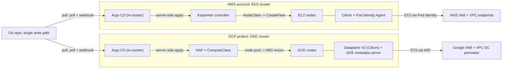

# Capstone 2: Production EKS and GKE Platform with GitOps

## TL;DR

1. One Git repository is the only write path. Each cluster runs its own Argo CD, so a cross-cloud hub never becomes a shared dependency of two failure domains.
2. Node supply is a control loop with a cost function. Karpenter on EKS and Node Auto-Provisioning (NAP) with ComputeClass on GKE both turn unschedulable pods into instances. Karpenter's voluntary disruption (consolidation, drift) is what causes most self-inflicted incidents, and `expireAfter` bypasses disruption budgets.
3. Identity must not travel with the node. Use EKS Pod Identity and GKE Workload Identity Federation so a pod gets a short-lived, per-service-account credential. Block the node credential path (IMDS or the node service account). A default-deny egress policy will silently break the credential endpoints unless you allow them.
4. Cilium (self-managed on EKS in CNI-chaining mode, managed Dataplane V2 on GKE) enforces identity-based policy in eBPF at the pod's virtual interface. The real operational limits are BPF map capacity (conntrack), the node startup race, and DNS-driven FQDN policy, not YAML syntax.
5. A perimeter is a set of independent layers: private control plane endpoints, VPC endpoint policies with SCP/RCP on AWS, and VPC Service Controls on GCP. Each layer stops a different exfiltration path, and none replaces egress filtering at the pod layer.

## Mental Model



The platform is three decoupled loops that share only Git.
The delivery loop pulls desired state from Git into each cluster.
The supply loop turns pending pods into machines and removes machines that are no longer worth their price.
The trust loop turns a projected service account token into a cloud credential, and the perimeter bounds where that credential is usable.
Each loop has its own failure domain, and the design goal is that every loop keeps the last known good state when its upstream is unreachable.
That is the static stability property from [[17-Cloud-AI-Engineering/Volume_01_Cloud_Architecture_Principles/Chapter_02_Regions_Zones_and_Static_Stability|Regions, Zones, and Static Stability]].
This capstone reuses the budget-guardrail and exact-teardown discipline from [[17-Cloud-AI-Engineering/Volume_15_Capstones_Production_Systems/Chapter_01_Capstone_Resilient_Serverless_Event_Pipeline|Capstone 1]].
Its output is the substrate for [[17-Cloud-AI-Engineering/Volume_15_Capstones_Production_Systems/Chapter_03_Capstone_High_Throughput_LLM_Serving_Stack|Capstone 3]].

## Internals

### Control plane versus data plane on each cloud

In both managed offerings the Kubernetes API server and etcd are provider-operated and sit outside your account or project network.
AWS documents the EKS control plane as API servers and a three-member etcd ensemble spread across Availability Zones (UNVERIFIED, recalled from AWS docs).
GKE regional clusters replicate control plane instances across three zones, while zonal clusters have a single control plane replica that is unavailable during upgrades.
etcd is a Raft group, so a write needs a majority and loses availability if it loses two of three members.
See [[08-Distinguished-Engineering/02-Distributed-Systems-Internals/Raft-Consensus|Raft Consensus]] and [[04-System-Design/07-Infrastructure-and-Orchestration/Kubernetes-Architecture|Kubernetes Architecture]].
Controllers (Argo CD, Karpenter, Cilium operator) are clients of this API and use optimistic concurrency through `resourceVersion`, the same shared-state pattern as Omega ([Omega, EuroSys 2013](https://research.google/pubs/omega-flexible-scalable-schedulers-for-large-compute-clusters/)).
Borg's lineage and the reasons Kubernetes keeps scheduling state in a shared store are in [Borg (EuroSys 2015)](https://research.google/pubs/large-scale-cluster-management-at-google-with-borg/) and [Borg, Omega, and Kubernetes (ACM Queue 2016)](https://queue.acm.org/detail.cfm?id=2898444).

The data plane is everything that continues to work when the API is unreachable.
Running pods, the Cilium BPF programs and maps, and the kubelet's cached pod specs keep serving.
New scheduling, new node registration, credential association changes, and Argo reconciliation do not.
This is the invariant to design around: a control plane brownout must not require new nodes or new identities to stay up.

### Delivery loop: how Argo CD actually reconciles

Argo CD has three moving parts.
The repo-server renders manifests (Helm, Kustomize, plain YAML) from a Git commit and caches the result keyed by commit and source parameters.
The application-controller maintains a cluster cache of live objects fed by Kubernetes watch streams, not by per-application list calls, and compares live state to rendered state.
The API server and UI sit on top.

Two timers are often conflated.
The refresh timer (default 3 minutes, `timeout.reconciliation`, UNVERIFIED for 2026-10 defaults) decides how often Git is re-checked for each application.
Watch events on live objects trigger a comparison immediately, so drift (a manual `kubectl edit`) is detected in seconds while a new commit can take up to a refresh interval unless a webhook fires.
Cost scales with the number of watched resource types and objects in the cluster cache, not with the application count, which is why CRD-heavy clusters (Karpenter, Cilium, Gateway API) inflate controller memory.
The controller can be sharded across clusters, so a per-cluster Argo CD never needs sharding in this design.
The operator manual's [high availability](https://argo-cd.readthedocs.io/en/stable/operator-manual/high_availability/) page covers the tunables.

Resource tracking is the second non-obvious mechanism.
Argo must decide which live objects belong to which Application.
The label-based method writes `app.kubernetes.io/instance`, which collides with Helm charts and other tools that set the same label and produces phantom ownership and surprise pruning.
The annotation-based method (annotation, or annotation plus label) records an explicit `application-name:group/kind/namespace/name` identifier and is the safer choice.
See [resource tracking](https://argo-cd.readthedocs.io/en/stable/user-guide/resource_tracking/).

Diffing is where GitOps meets controllers that mutate objects.
HPA owns `spec.replicas`, admission webhooks inject sidecars, and NAP or Karpenter add status and annotations.
Without `ignoreDifferences` and `RespectIgnoreDifferences=true`, `selfHeal` will fight HPA, and each fight is an API write.
Server-side apply (`ServerSideApply=true`) is required in practice for large CRDs such as Argo's own ApplicationSet and Karpenter's CRDs, which exceed the client-side `last-applied-configuration` annotation size limit.

Topology decision: this capstone runs one Argo CD per cluster rather than one central hub controlling both.
A hub holds credentials to every spoke API server and becomes a cross-cloud, cross-failure-domain dependency.
A hub outage then freezes drift correction everywhere, and a hub compromise yields cluster-admin on both clouds.
The per-cluster model costs one more control loop to operate and loses the single pane of glass, which is recovered by shipping Argo metrics to a shared telemetry backend.

### Supply loop A: Karpenter on EKS

Karpenter is a controller that watches pods the kube-scheduler has marked unschedulable and creates `NodeClaim` objects directly against the EC2 API.
There are no Auto Scaling groups in the loop.
The v1 APIs are `karpenter.sh/v1` `NodePool` and `karpenter.k8s.aws/v1` `EC2NodeClass` (Karpenter docs, as of 2026-10; v1 migration notes at [karpenter.sh](https://karpenter.sh/docs/upgrading/v1-migration/)).

The provisioning path:

1. A batching window collects pending pods. Defaults are about 1 s idle and 10 s maximum (UNVERIFIED, recalled from Karpenter settings docs).
2. Karpenter runs its own scheduling simulation. It sorts pods largest first, tries to place each on existing nodes and in-flight NodeClaims, then opens a new NodeClaim whose requirements are the intersection of the pods' constraints and the NodePool's requirements.
3. Each NodeClaim is mapped to the set of instance types that satisfy those constraints and is submitted to EC2 `CreateFleet` with many overrides (UNVERIFIED: a 60-type cap in the request, recalled). Spot uses a price-capacity-optimized allocation strategy and on-demand uses lowest-price (UNVERIFIED, recalled).
4. The kubelet registers the node. The kube-scheduler, not Karpenter, binds pods (UNVERIFIED for current versions).

The consequence of step 4 is that Karpenter's simulation and the real scheduler are two implementations of the same constraints.
Where they disagree (topology spread `minDomains`, scheduler plugins, dynamic resource allocation), Karpenter can launch a node the pod will not use.
Treat unexplained "launched but pod still Pending" as a simulator-versus-scheduler disagreement first, and a capacity problem second.

The disruption path is where production incidents originate.
Consolidation evaluates candidates by disruption cost.
It first removes empty nodes.
It then tries multi-node consolidation, which searches for the largest set of nodes whose pods fit on the remaining capacity plus at most one cheaper replacement (the search is a binary search over the sorted candidate list, UNVERIFIED).
Last it tries single-node replacement.
For each decision Karpenter taints the node `karpenter.sh/disrupted`, launches replacements first, waits for readiness, then drains through the Eviction API, which honors PodDisruptionBudgets.
The `NodePool.spec.disruption.budgets` field rate-limits voluntary disruption.
The default budget is 10 percent of nodes in the pool when none is defined, `nodes: "0"` blocks voluntary disruption, and budgets can be scoped by reason (`Empty`, `Drifted`, `Underutilized`) and by cron schedule (secondary summary of Karpenter docs, [Cast AI](https://cast.ai/blog/karpenter-disruption-drift/), as of 2026-10).
`expireAfter` is not voluntary disruption in this sense.
A node past its expiry is drained regardless of budgets, so a fleet launched at the same instant (for example after an AMI roll) expires at the same instant.
Set `terminationGracePeriod` to bound how long a stuck PDB can hold a node, and stagger `expireAfter` across NodePools.

AMI selection is a fleet-wide change vector.
`amiSelectorTerms: - alias: al2023@latest` makes every new AMI release a drift event on every node of the pool.
Pin `al2023@v<release>` in Git and promote the pin through a canary NodePool, so the AMI roll is a reviewed commit and not a background process.

### Supply loop B: GKE NAP and ComputeClass

NAP extends the Cluster Autoscaler.
When pending pods do not fit any existing node pool, NAP computes a machine shape from the pods' requests and selectors, creates a node pool, and the autoscaler then resizes the managed instance group.
The unit of provisioning is therefore a node pool with a fixed machine type, not an individual instance.
The consequences are slower shape diversity than Karpenter's per-claim selection and an extra object (the pool) to garbage-collect, with empty pools deleted automatically (UNVERIFIED).
Cluster-wide `--min-cpu/--max-cpu/--min-memory/--max-memory` limits cap NAP and are the equivalent of `NodePool.spec.limits`.

ComputeClass (`cloud.google.com/v1`, UNVERIFIED for the current API version) is the declarative layer.
It carries an ordered `priorities` list (machine family, Spot or on-demand, optionally reservations), `nodePoolAutoCreation`, a `whenUnsatisfiable` policy, and `activeMigration` to move workloads back to a higher-priority rule when it becomes available (all UNVERIFIED, recalled from GKE docs; see [custom compute classes](https://cloud.google.com/kubernetes-engine/docs/concepts/about-custom-compute-classes) and [node auto-provisioning](https://cloud.google.com/kubernetes-engine/docs/concepts/node-auto-provisioning)).
Pods opt in with `nodeSelector: cloud.google.com/compute-class: <name>`.
The fallback list is the closest GKE analogue to Karpenter's multi-type, multi-capacity-type NodePool requirements.
The scale-down side follows OSS Cluster Autoscaler semantics: it removes underutilized nodes but does not replace a node with a cheaper one, which is the main behavioral difference from Karpenter consolidation.

AWS also offers EKS Auto Mode, which runs a managed Karpenter-derived node lifecycle with an additional per-instance fee (UNVERIFIED: GA status and fee not re-checked).
GKE Autopilot is the managed counterpart on GCP.
This capstone uses the self-managed paths because they expose the mechanisms an L6 candidate must reason about.

### Network dataplane: Cilium eBPF

On GKE, Dataplane V2 is the Cilium-based managed dataplane.
It is chosen at cluster creation with `--enable-dataplane-v2` and you do not run your own agent (GKE docs, as of 2026-10, [Dataplane V2](https://cloud.google.com/kubernetes-engine/docs/concepts/dataplane-v2)).
On EKS this capstone runs open-source Cilium in CNI-chaining mode over the AWS VPC CNI (`cni.chainingMode=aws-cni`, [Cilium docs](https://docs.cilium.io/en/stable/installation/cni-chaining-aws-cni/)).
The VPC CNI keeps IP address management, so pods get VPC-routable ENI secondary IPs and the maximum pods per node remains bounded by the instance's ENI and IP limits.
Cilium adds identity-based policy, Hubble flow visibility, and optional kube-proxy replacement.
The alternative, Cilium in ENI IPAM mode, replaces the VPC CNI and gives Cilium ownership of ENI attachment, at the price of giving the Cilium operator EC2 ENI permissions and owning the IP-exhaustion failure mode yourself.

The datapath mechanics a getting-started guide omits:

- **Identity, not IP.** Each distinct set of pod labels is assigned a numeric security identity. The agent keeps an IP-to-identity map (`ipcache`) in a BPF LPM trie. Policy is compiled into a per-endpoint policy map keyed on (remote identity, destination port, protocol, direction). Pod churn changes map entries and does not rewrite iptables rules, which is why policy update cost does not grow with the number of pods the way an iptables ruleset does.
- **Enforcement point.** Programs attached with tc to the pod's host-side virtual interface evaluate egress policy for traffic leaving the pod and ingress policy for traffic arriving at the destination pod. The packet is dropped in the kernel before any socket or userspace proxy sees it.
- **Service load balancing at connect time.** With kube-proxy replacement, a `cgroup/connect4` BPF hook rewrites the destination from the ClusterIP to a backend pod IP before the first packet is sent. The packet on the wire already carries the backend address, so policy evaluates against the backend's identity and there is no per-packet DNAT for pod-originated traffic.
- **Connection tracking in BPF maps.** Stateful allow decisions and NAT state live in a bounded BPF hash map. Default capacities are of the order of 500 thousand TCP entries per map (UNVERIFIED, version dependent). When the map fills, new connections are dropped even though CPU and policy are fine (Little's law sizing is in the worked example).
- **FQDN policy.** `toFQDNs` rules require a DNS rule so that DNS responses pass through the agent's DNS proxy. The proxy learns name-to-IP mappings and inserts them into the ipcache as CIDR identities before the answer is returned to the pod (UNVERIFIED ordering guarantee, recalled from Cilium docs). Established connections survive after the DNS TTL expires but new connections to a rotated IP are dropped until the pod re-resolves.

The node startup race matters on autoscaled fleets.
A node becomes `Ready` as soon as the kubelet and a CNI config exist, which can be before the Cilium agent has loaded its programs.
Pods scheduled in that window get no policy enforcement or a failed sandbox.
Cilium documents a startup taint, `node.cilium.io/agent-not-ready`, that the agent removes once it is ready (UNVERIFIED for the exact effect).
Karpenter's `startupTaints` field is designed for this: Karpenter assumes startup taints are temporary and does not require pods to tolerate them when simulating placement.

### Trust loop: workload identity

**EKS Pod Identity** (AWS docs, [Pod Identity](https://docs.aws.amazon.com/eks/latest/userguide/pod-identities.html)):

1. The Pod Identity Agent runs as a hostNetwork DaemonSet that listens on a link-local address, `169.254.170.23` (UNVERIFIED, recalled).
2. A mutating webhook injects `AWS_CONTAINER_CREDENTIALS_FULL_URI` and a token file path into pods whose service account has an association.
3. The token is a projected service account token with audience `pods.eks.amazonaws.com`.
4. The agent calls the EKS Auth API (`eks-auth:AssumeRoleForPodIdentity`) using the node role and returns role credentials to the pod's SDK through the container credential provider.
5. The IAM role trust policy names the service principal `pods.eks.amazonaws.com` with `sts:AssumeRole` and `sts:TagSession`. The credentials carry session tags such as cluster name and namespace, which enables attribute-based access control.

Compared with IRSA, there is no per-cluster OIDC provider, no cluster-specific condition in the trust policy, and no pod-side call to STS.
This removes the per-account OIDC provider count and trust policy size ceilings that large multi-cluster fleets hit (UNVERIFIED: specific quota values not re-checked).

**GKE Workload Identity Federation:**

1. The cluster gets a workload pool `PROJECT_ID.svc.id.goog`.
2. A node-local GKE metadata server intercepts requests to the metadata IP and maps the caller pod to its Kubernetes service account.
3. It exchanges the service account token through Google STS for a federated token.
4. IAM policies bind directly to the principal `principal://iam.googleapis.com/projects/PROJECT_NUMBER/locations/global/workloadIdentityPools/PROJECT_ID.svc.id.goog/subject/ns/NAMESPACE/sa/KSA`. Alternatively, the pod impersonates a Google service account (all UNVERIFIED in detail, [GKE docs](https://cloud.google.com/kubernetes-engine/docs/concepts/workload-identity)).

Both designs share an invariant: the node's own cloud credential must be unreachable from pods.
On EC2, Karpenter's `EC2NodeClass.spec.metadataOptions` should require IMDSv2 with a response hop limit of 1 (UNVERIFIED defaults, recalled).
On GKE, node pools must run with `GKE_METADATA` workload metadata mode, which NAP pools inherit when the cluster has a workload pool (UNVERIFIED inheritance).

### Failure-domain boundaries

| Boundary | Blast radius | Controlled by |
|---|---|---|
| Pod | One replica | PDB, readiness, topology spread |
| Node | Up to max pods on the node | Karpenter budgets, `terminationGracePeriod` |
| AZ or zone | One third of capacity | Spread constraints, headroom |
| Cluster | Everything in one cloud | Per-cluster Argo CD, cluster-per-cell |
| Cloud | Everything in one provider | Independent Git write path, second cloud |

## Numbers to Know

| Quantity | Value | Source and date |
|---|---|---|
| EKS control plane fee, standard support | $0.10 per cluster per hour | ([AWS Containers blog](https://aws.amazon.com/blogs/containers/amazon-eks-extended-support-for-kubernetes-versions-pricing/), as of 2026-10) |
| EKS control plane fee, extended support | $0.60 per cluster per hour, 12 extra months of support | ([AWS Containers blog](https://aws.amazon.com/blogs/containers/amazon-eks-extended-support-for-kubernetes-versions-pricing/), as of 2026-10) |
| EKS standard support window | 14 months per minor version | UNVERIFIED (recalled from AWS docs, as of 2026-10) |
| GKE cluster management fee | $0.10 per cluster per hour, one-second billing | (secondary summaries of the GKE pricing page, as of 2026-10; verify on the Google pricing page) |
| GKE free tier | $74.40 per month credit per billing account, covers one Autopilot or zonal Standard cluster, not regional clusters | (secondary summaries of the GKE pricing page, as of 2026-10; verify) |
| Karpenter v1 API groups | `karpenter.sh/v1` NodePool, `karpenter.k8s.aws/v1` EC2NodeClass | (Karpenter docs, as of 2026-10) |
| Karpenter default disruption budget | 10 percent of nodes in the NodePool | (secondary summary of Karpenter docs, as of 2026-10) |
| Karpenter budget `nodes: "0"` | Blocks voluntary disruption only, not `expireAfter` | (secondary summary of Karpenter docs, as of 2026-10) |
| Karpenter batching window | about 1 s idle, 10 s max | UNVERIFIED (recalled from Karpenter settings, as of 2026-10) |
| EKS max pods per node, VPC CNI without prefix delegation | ENIs x (IPv4 per ENI - 1) + 2 | UNVERIFIED (AWS `eni-max-pods` reference, as of 2026-10) |
| m6i.large / xlarge / 2xlarge / 4xlarge ENIs x IPv4 per ENI | 3x10 / 4x15 / 4x15 / 8x30, so 29 / 58 / 58 / 234 max pods | UNVERIFIED (EC2 docs, as of 2026-10) |
| m6i.large / xlarge on-demand, us-east-1 | $0.096 / $0.192 per hour | UNVERIFIED (AWS pricing, as of 2026-10) |
| GKE Standard default max pods per node, Autopilot default | 110, 32 | UNVERIFIED (GKE docs, as of 2026-10) |
| Cilium conntrack default TCP map size | about 524288 entries | UNVERIFIED (Cilium docs, version dependent, as of 2026-10) |
| Argo CD default refresh interval | 180 s | UNVERIFIED (Argo CD docs, as of 2026-10) |
| AWS NAT gateway | $0.045 per hour plus $0.045 per GB processed, us-east-1 | UNVERIFIED (AWS pricing, as of 2026-10) |
| Spot interruption signal | about 2 min on AWS, about 30 s on GCE Spot | UNVERIFIED here; see [[17-Cloud-AI-Engineering/Volume_09_FinOps_and_Cloud_Economics/Chapter_03_Spot_Economics_and_Interruption_Handling\|Spot Economics]] |

Derived numbers from this chapter's capacity model are in the worked example.

## AWS vs GCP Mechanism Parity

| Concern | EKS on AWS | GKE on GCP | Critical difference |
|---|---|---|---|
| Control plane | Provider-run API servers and etcd across AZs, per-cluster fee | Regional (3-zone) or zonal control plane, per-cluster fee with free tier credit | Zonal GKE control plane is a single replica and is unavailable during its own upgrades |
| Node supply | Karpenter: NodeClaim to `CreateFleet`, per-instance selection, cost-aware replacement | NAP: creates node pools, Cluster Autoscaler resizes MIGs; ComputeClass gives priority fallback | Karpenter replaces nodes with cheaper ones, CA scale-down only removes underutilized nodes |
| Node disruption controls | NodePool budgets by reason and schedule, `expireAfter`, `terminationGracePeriod` | Maintenance windows and exclusions, surge upgrade settings, PDBs | `expireAfter` bypasses Karpenter budgets, GKE auto-upgrade honors maintenance exclusions |
| Pod networking | VPC CNI IPAM (ENI secondary IPs) plus chained Cilium, or Cilium ENI mode | Dataplane V2 (managed Cilium), alias IP ranges per node | EKS pod density is ENI-limited, GKE pod density is bounded by a per-node pod CIDR, 110 pods per node by default (UNVERIFIED) |
| Network policy | Cilium identity policy and Hubble, L3/L4 plus L7 and FQDN | Dataplane V2 enforcement, policy logging, FQDN policy (UNVERIFIED feature set) | On GKE you cannot tune the agent, on EKS you own agent upgrades and map sizing |
| Workload identity | Pod Identity: agent + `AssumeRoleForPodIdentity`, session tags; IRSA as legacy | WIF: node metadata server + STS exchange, direct principal binding or SA impersonation | AWS trust is a role trust policy with a service principal, GCP trust is an IAM binding on a workload pool principal |
| Private API access | Public and private endpoint toggles, CIDR allowlist, access entries replace `aws-auth` | Private nodes, authorized networks, optional private endpoint | GKE private nodes need Cloud NAT for internet pulls, EKS private subnets need NAT or VPC endpoints |
| Image pull path | ECR via interface endpoints plus S3 gateway endpoint for layers | Artifact Registry via Private Google Access or restricted VIP | ECR layer fetches go through S3, so the S3 endpoint policy must allow the ECR layer bucket (UNVERIFIED) |
| Data perimeter | SCP/RCP, VPC endpoint policies, `aws:PrincipalOrgID` and `aws:ResourceOrgID` keys | VPC Service Controls perimeters, access levels, ingress and egress rules, dry-run mode | VPC-SC is a service-level perimeter on API calls, AWS builds the equivalent from several independent policy layers |
| GitOps controller auth | Argo CD uses in-cluster service account, no remote credentials | Same | Hub-and-spoke would add exec-plugin credentials for each remote cluster |
| Secrets at rest | KMS envelope encryption via `encryptionConfig` | Application-layer secrets encryption with Cloud KMS | Both encrypt a per-object data key under a KMS key, see [[17-Cloud-AI-Engineering/Volume_08_Security_Identity_and_the_Data_Perimeter/Chapter_04_Encryption_Key_Hierarchies_and_Envelope_Encryption\|Encryption Key Hierarchies]] |

## Worked Example: Dual-Cloud Platform Lab with Capacity Model

### Capacity sizing and cost arithmetic

The workload is 1,000 pods requesting 0.25 vCPU and 0.5 GiB each.
Each node runs five DaemonSet pods (Cilium, VPC CNI, kube-proxy or node exporter, log agent, Pod Identity Agent) that request 0.40 vCPU and 0.5 GiB in total.
Allocatable CPU uses the tiered reservation formula (6 percent of core 1, 1 percent of core 2, 0.5 percent of cores 3-4, 0.25 percent above 4).
Allocatable memory subtracts 255 MiB plus 11 MiB per max pod plus a 100 MiB eviction threshold (both formulas UNVERIFIED for exact current values).
Running `capacity_model.py` below yields:

| Instance | Max pods (ENI) | Pods per node (limiter) | Nodes | On-demand $/month | Spot $/month at 60 percent discount |
|---|---|---|---|---|---|
| m6i.large | 29 | 6 (cpu) | 167 | 11,703 | 4,681 |
| m6i.xlarge | 58 | 14 (cpu) | 72 | 10,092 | 4,037 |
| m6i.2xlarge | 58 | 30 (cpu) | 34 | 9,531 | 3,812 |
| m6i.4xlarge | 234 | 61 (cpu) | 17 | 9,531 | 3,812 |

Prices are the UNVERIFIED on-demand figures above, 730 hours per month, and the 60 percent Spot discount is an assumption and not a quote.
The reading is that the DaemonSet tax dominates small nodes: 0.40 vCPU is 20 percent of an m6i.large and 2.5 percent of an m6i.4xlarge.
Moving from m6i.large to m6i.2xlarge saves (11,703 - 9,531) / 11,703, about 18.6 percent, with no change in workload.
Pods per node never hit the ENI ceiling for these small pods, so the IP limit becomes the constraint only for tiny pods (below about 0.05 vCPU).
This is why Karpenter's `instance-size` and `instance-cpu` requirements are a cost lever and not only a safety limit.

Conntrack sizing uses Little's law: entries equal new connections per second times average entry lifetime.
At 20,000 new connections per second and a 60 s average tracked lifetime the node-level need is 1,200,000 entries.
Against an assumed 524,288-entry TCP map this is a headroom ratio of 0.44, so the node drops new connections under that load.
The fix is to raise the map size through Helm values and to shorten idle timeouts, and to alarm on the agent's map pressure metrics.

Argo CD refresh load at 300 applications and a 180 s interval is about 1.67 Git checks per second before webhooks and the repo-server cache.
That is trivial, which confirms the earlier point: scale limits come from the live object cache, not the application count.

### capacity_model.py

```python
#!/usr/bin/env python3
"""Offline capacity and cost model for the Capstone 2 platform. ASCII only."""
import math

WORKLOAD = {"pods": 1000, "cpu_req": 0.25, "mem_req_gib": 0.5}
DAEMONSET = {"pods": 5, "cpu": 0.40, "mem_gib": 0.50}
HOURS = 730
SPOT_DISCOUNT = 0.60  # assumption, not a quote

# name: (vcpu, mem_gib, enis, ipv4_per_eni, usd_per_hour_on_demand)
EC2 = {
    "m6i.large":   (2, 8, 3, 10, 0.096),
    "m6i.xlarge":  (4, 16, 4, 15, 0.192),
    "m6i.2xlarge": (8, 32, 4, 15, 0.384),
    "m6i.4xlarge": (16, 64, 8, 30, 0.768),
}

def max_pods_eni(enis, ips):
    return enis * (ips - 1) + 2

def alloc_cpu(vcpu):
    r = 0.06 * min(vcpu, 1)
    r += 0.01 * max(0, min(vcpu, 2) - 1)
    r += 0.005 * max(0, min(vcpu, 4) - 2)
    r += 0.0025 * max(0, vcpu - 4)
    return vcpu - r

def alloc_mem(mem_gib, max_pods):
    return mem_gib - (255 + 11 * max_pods + 100) / 1024.0

def plan(name):
    vcpu, mem, enis, ips, price = EC2[name]
    mp = max_pods_eni(enis, ips)
    cpu = alloc_cpu(vcpu) - DAEMONSET["cpu"]
    mm = alloc_mem(mem, mp) - DAEMONSET["mem_gib"]
    by_ip = mp - DAEMONSET["pods"]
    by_cpu = int(cpu // WORKLOAD["cpu_req"])
    by_mem = int(mm // WORKLOAD["mem_req_gib"])
    per_node = min(by_ip, by_cpu, by_mem)
    limiter = {by_ip: "ip", by_cpu: "cpu", by_mem: "mem"}[per_node]
    nodes = math.ceil(WORKLOAD["pods"] / per_node)
    od = nodes * price * HOURS
    return name, mp, per_node, limiter, nodes, od, od * (1 - SPOT_DISCOUNT)

print("%-12s %7s %9s %8s %6s %10s %10s" % ("type", "maxPods", "pods/node", "limiter", "nodes", "OD $/mo", "spot $/mo"))
for n in EC2:
    name, mp, pn, lim, nodes, od, spot = plan(n)
    print("%-12s %7d %9d %8s %6d %10.0f %10.0f" % (name, mp, pn, lim, nodes, od, spot))

entries = 20000 * 60
print("\nconntrack entries needed (Little's law): %d" % entries)
print("vs assumed default TCP map size 524288 -> headroom ratio %.2f" % (524288.0 / entries))
print("\nargo refresh checks: %.2f per second" % (300 / 180.0))

H = 4
eks = H * 0.10 + 2 * H * 0.096 + H * 0.045 + 1 * H * 0.192 * (1 - SPOT_DISCOUNT)
gke = H * 0.10 + 2 * H * 0.134  # zonal, 2 x e2-standard-4, placeholder price
print("\nlab estimate for %d h: EKS ~ $%.2f, GKE ~ $%.2f (excl. NAT data)" % (H, eks, gke))
```

### Cost estimate and budget alarms

The four-hour lab costs about $1.66 on EKS and $1.47 on GKE at the placeholder prices in the script, excluding NAT data processing and any load balancers (UNVERIFIED prices, so check the AWS and Google calculators before running).
Budgets are alerts and not caps, and billing data lags, so the real control is the teardown script plus a calendar reminder.

```bash
# AWS: monthly cost budget with an 80 percent actual-spend alert
aws budgets create-budget --account-id "$ACCOUNT_ID" \
  --budget '{"BudgetName":"capstone2","BudgetLimit":{"Amount":"25","Unit":"USD"},"TimeUnit":"MONTHLY","BudgetType":"COST"}' \
  --notifications-with-subscribers '[{"Notification":{"NotificationType":"ACTUAL","ComparisonOperator":"GREATER_THAN","Threshold":80,"ThresholdType":"PERCENTAGE"},"Subscribers":[{"SubscriptionType":"EMAIL","Address":"you@example.com"}]}]'

# GCP: project-scoped budget with 50 and 90 percent thresholds
gcloud billing budgets create --billing-account="$BILLING_ACCOUNT" \
  --display-name=capstone2 --budget-amount=25USD \
  --threshold-rule=percent=0.5 --threshold-rule=percent=0.9 \
  --filter-projects="projects/$PROJECT"
```

### Step 1: EKS cluster, Karpenter, Cilium, Argo CD

Pin `K8S_VERSION` to a version in standard support, and pin `KARPENTER_VERSION`, `CILIUM_VERSION`, and `ARGOCD_VERSION` to current releases.
The CloudFormation template path below follows Karpenter's getting-started layout and is UNVERIFIED for your chosen version.
Check it against the Karpenter getting-started guide before running.

```bash
#!/usr/bin/env bash
set -euo pipefail
export AWS_REGION=us-east-1 CLUSTER=capstone-eks
: "${K8S_VERSION:?pin a version in standard support}"
: "${KARPENTER_VERSION:?}" "${CILIUM_VERSION:?}" "${ARGOCD_VERSION:?}" "${MY_CIDR:?e.g. 203.0.113.7/32}"
ACCOUNT_ID=$(aws sts get-caller-identity --query Account --output text)
export K8S_VERSION MY_CIDR

cat > /tmp/eks.yaml <<EOF
apiVersion: eksctl.io/v1alpha5
kind: ClusterConfig
metadata:
  name: ${CLUSTER}
  region: ${AWS_REGION}
  version: "${K8S_VERSION}"
  tags: {project: capstone2}
accessConfig:
  authenticationMode: API
vpc:
  nat: {gateway: Single}
  clusterEndpoints: {publicAccess: true, privateAccess: true}
  publicAccessCIDRs: ["${MY_CIDR}"]
addons:
  - {name: vpc-cni}
  - {name: kube-proxy}
  - {name: coredns}
  - {name: eks-pod-identity-agent}
managedNodeGroups:
  - name: system
    instanceType: m6i.large
    desiredCapacity: 2
    minSize: 2
    maxSize: 3
    privateNetworking: true
EOF
eksctl create cluster -f /tmp/eks.yaml

# Tag only private subnets and the cluster SG for Karpenter discovery
SUBNETS=$(aws eks describe-cluster --name "$CLUSTER" --query 'cluster.resourcesVpcConfig.subnetIds' --output text)
PRIV=$(aws ec2 describe-subnets --subnet-ids $SUBNETS --filters Name=map-public-ip-on-launch,Values=false --query 'Subnets[].SubnetId' --output text)
aws ec2 create-tags --resources $PRIV --tags "Key=karpenter.sh/discovery,Value=${CLUSTER}"
SG=$(aws eks describe-cluster --name "$CLUSTER" --query 'cluster.resourcesVpcConfig.clusterSecurityGroupId' --output text)
aws ec2 create-tags --resources "$SG" --tags "Key=karpenter.sh/discovery,Value=${CLUSTER}"

# Karpenter prerequisites: node role, controller policy, interruption queue
curl -fsSL "https://raw.githubusercontent.com/aws/karpenter-provider-aws/v${KARPENTER_VERSION}/website/content/en/preview/getting-started/getting-started-with-karpenter/cloudformation.yaml" -o /tmp/karpenter-cfn.yaml
aws cloudformation deploy --stack-name "Karpenter-${CLUSTER}" --template-file /tmp/karpenter-cfn.yaml \
  --capabilities CAPABILITY_NAMED_IAM --parameter-overrides "ClusterName=${CLUSTER}"
aws eks create-access-entry --cluster-name "$CLUSTER" \
  --principal-arn "arn:aws:iam::${ACCOUNT_ID}:role/KarpenterNodeRole-${CLUSTER}" --type EC2_LINUX

cat > /tmp/trust.json <<'EOF'
{"Version":"2012-10-17","Statement":[{"Effect":"Allow","Principal":{"Service":"pods.eks.amazonaws.com"},"Action":["sts:AssumeRole","sts:TagSession"]}]}
EOF
aws iam create-role --role-name "KarpenterController-${CLUSTER}" --assume-role-policy-document file:///tmp/trust.json
aws iam attach-role-policy --role-name "KarpenterController-${CLUSTER}" \
  --policy-arn "arn:aws:iam::${ACCOUNT_ID}:policy/KarpenterControllerPolicy-${CLUSTER}"
aws eks create-pod-identity-association --cluster-name "$CLUSTER" --namespace kube-system \
  --service-account karpenter --role-arn "arn:aws:iam::${ACCOUNT_ID}:role/KarpenterController-${CLUSTER}"

# Cilium in chaining mode, then Karpenter
helm repo add cilium https://helm.cilium.io && helm repo update
helm upgrade --install cilium cilium/cilium --version "$CILIUM_VERSION" -n kube-system \
  --set cni.chainingMode=aws-cni --set cni.exclusive=false --set enableIPv4Masquerade=false \
  --set routingMode=native --set endpointRoutes.enabled=true --set hubble.relay.enabled=true
helm upgrade --install karpenter oci://public.ecr.aws/karpenter/karpenter --version "$KARPENTER_VERSION" \
  -n kube-system --set settings.clusterName="$CLUSTER" --set settings.interruptionQueue="$CLUSTER" \
  --set controller.resources.requests.cpu=500m --set controller.resources.requests.memory=512Mi

# Argo CD, server-side apply for the large CRDs
kubectl create namespace argocd
kubectl apply -n argocd --server-side --force-conflicts \
  -f "https://raw.githubusercontent.com/argoproj/argo-cd/${ARGOCD_VERSION}/manifests/install.yaml"
```

### Step 2: GKE cluster with Dataplane V2, WIF, NAP, Argo CD

```bash
#!/usr/bin/env bash
set -euo pipefail
: "${PROJECT:?}" "${MY_CIDR:?}" "${ARGOCD_VERSION:?}"
REGION=us-central1; ZONE=us-central1-a; CLUSTER=capstone-gke

gcloud services enable container.googleapis.com compute.googleapis.com \
  iamcredentials.googleapis.com sts.googleapis.com artifactregistry.googleapis.com --project "$PROJECT"
gcloud compute networks create capstone-vpc --subnet-mode=custom --project "$PROJECT"
gcloud compute networks subnets create capstone-sn --network capstone-vpc --region "$REGION" \
  --range 10.20.0.0/20 --secondary-range pods=10.24.0.0/16,services=10.28.0.0/20 \
  --enable-private-ip-google-access --project "$PROJECT"
gcloud compute routers create capstone-rtr --network capstone-vpc --region "$REGION" --project "$PROJECT"
gcloud compute routers nats create capstone-nat --router capstone-rtr --region "$REGION" \
  --auto-allocate-nat-external-ips --nat-all-subnet-ip-ranges --project "$PROJECT"

gcloud container clusters create "$CLUSTER" --project "$PROJECT" --zone "$ZONE" \
  --network capstone-vpc --subnetwork capstone-sn \
  --cluster-secondary-range-name pods --services-secondary-range-name services \
  --enable-ip-alias --enable-private-nodes --enable-dataplane-v2 \
  --workload-pool="${PROJECT}.svc.id.goog" --release-channel regular \
  --num-nodes 2 --machine-type e2-standard-4 --shielded-secure-boot \
  --enable-master-authorized-networks --master-authorized-networks "$MY_CIDR" \
  --enable-autoprovisioning --min-cpu 1 --max-cpu 64 --min-memory 1 --max-memory 256

gcloud container clusters get-credentials "$CLUSTER" --zone "$ZONE" --project "$PROJECT"
kubectl create namespace argocd
kubectl apply -n argocd --server-side --force-conflicts \
  -f "https://raw.githubusercontent.com/argoproj/argo-cd/${ARGOCD_VERSION}/manifests/install.yaml"
```

The lab uses a zonal cluster so the management fee is covered by the free-tier credit (secondary source, see Numbers to Know).
A production cluster is regional, which removes the single control plane replica and costs the full management fee.
A $74.40 per month credit is not a design input.

### Step 3: The GitOps repository

```text
platform-gitops/
  bootstrap/root-app.yaml
  clusters/eks-prod-use1/
    00-karpenter-nodeclass.yaml
    10-karpenter-nodepool.yaml
    20-netpol-baseline.yaml
  clusters/gke-prod-usc1/
    00-computeclass.yaml
    20-netpol-baseline.yaml
```

```yaml
# bootstrap/root-app.yaml (one per cluster, path differs)
apiVersion: argoproj.io/v1alpha1
kind: Application
metadata:
  name: platform-root
  namespace: argocd
  finalizers: [resources-finalizer.argocd.argoproj.io]
spec:
  project: default
  source:
    repoURL: https://github.com/YOUR_ORG/platform-gitops.git
    targetRevision: main
    path: clusters/eks-prod-use1
    directory: {recurse: true}
  destination: {server: "https://kubernetes.default.svc", namespace: argocd}
  ignoreDifferences:
    - {group: apps, kind: Deployment, jsonPointers: [/spec/replicas]}
  syncPolicy:
    automated: {prune: true, selfHeal: true}
    syncOptions: [ServerSideApply=true, CreateNamespace=true, SkipDryRunOnMissingResource=true, RespectIgnoreDifferences=true]
```

```yaml
# clusters/eks-prod-use1/00-karpenter-nodeclass.yaml
apiVersion: karpenter.k8s.aws/v1
kind: EC2NodeClass
metadata:
  name: default
  annotations: {argocd.argoproj.io/sync-wave: "-1"}
spec:
  role: KarpenterNodeRole-capstone-eks
  amiSelectorTerms:
    - alias: al2023@latest   # lab only; pin al2023@v<release> in production
  subnetSelectorTerms: [{tags: {karpenter.sh/discovery: capstone-eks}}]
  securityGroupSelectorTerms: [{tags: {karpenter.sh/discovery: capstone-eks}}]
  metadataOptions: {httpEndpoint: enabled, httpTokens: required, httpPutResponseHopLimit: 1}
  blockDeviceMappings:
    - deviceName: /dev/xvda
      ebs: {volumeSize: 50Gi, volumeType: gp3, encrypted: true, deleteOnTermination: true}
```

```yaml
# clusters/eks-prod-use1/10-karpenter-nodepool.yaml
apiVersion: karpenter.sh/v1
kind: NodePool
metadata:
  name: general
spec:
  template:
    spec:
      nodeClassRef: {group: karpenter.k8s.aws, kind: EC2NodeClass, name: default}
      requirements:
        - {key: karpenter.sh/capacity-type, operator: In, values: ["spot", "on-demand"]}
        - {key: kubernetes.io/arch, operator: In, values: ["amd64"]}
        - {key: karpenter.k8s.aws/instance-category, operator: In, values: ["c", "m", "r"]}
        - {key: karpenter.k8s.aws/instance-generation, operator: Gt, values: ["5"]}
        - {key: karpenter.k8s.aws/instance-cpu, operator: In, values: ["4", "8", "16"]}
      startupTaints:
        - {key: node.cilium.io/agent-not-ready, value: "true", effect: NoExecute}
      expireAfter: 336h
      terminationGracePeriod: 30m
  limits: {cpu: "200"}
  disruption:
    consolidationPolicy: WhenEmptyOrUnderutilized
    consolidateAfter: 5m
    budgets:
      - nodes: "10%"
      - nodes: "0"
        reasons: ["Underutilized"]
        schedule: "0 13 * * mon-fri"
        duration: 9h
```

```yaml
# clusters/gke-prod-usc1/00-computeclass.yaml
apiVersion: cloud.google.com/v1
kind: ComputeClass
metadata:
  name: general
spec:
  priorities:
    - {machineFamily: n2, spot: true}
    - {machineFamily: n2, spot: false}
    - {machineFamily: e2, spot: false}
  nodePoolAutoCreation: {enabled: true}
  whenUnsatisfiable: ScaleUpAnyway
  activeMigration: {optimizeRulePriority: true}
```

```yaml
# clusters/*/20-netpol-baseline.yaml (EKS Cilium and GKE Dataplane V2 use different CRDs; EKS shown)
apiVersion: cilium.io/v2
kind: CiliumNetworkPolicy
metadata: {name: baseline-egress, namespace: payments}
spec:
  endpointSelector: {}
  egress:
    - toEndpoints:
        - matchLabels: {"k8s:io.kubernetes.pod.namespace": kube-system, "k8s:k8s-app": kube-dns}
      toPorts:
        - ports: [{port: "53", protocol: ANY}]
          rules: {dns: [{matchPattern: "*"}]}
    - toCIDR: ["169.254.170.23/32"]      # Pod Identity Agent; also verify toEntities host
      toPorts: [{ports: [{port: "80", protocol: TCP}]}]
    - toFQDNs: [{matchPattern: "*.amazonaws.com"}]
```

On GKE, the equivalent baseline is a standard Kubernetes `NetworkPolicy` that allows DNS and the metadata server.
The metadata server address and port that Dataplane V2 needs for Workload Identity are in the GKE Workload Identity documentation, and the exact tuple should be taken from there (UNVERIFIED in this chapter, recalled as `169.254.169.252` port `988` for Dataplane V2).
Validate every baseline in audit mode before enforcement.
Run `hubble observe --verdict DROPPED -n payments` on EKS, and use GKE network policy logging on Dataplane V2 (UNVERIFIED feature name).

### Step 4: Perimeter snippets

```bash
# GCP: VPC Service Controls perimeter in dry-run first (flag names UNVERIFIED, check gcloud reference)
gcloud access-context-manager perimeters dry-run create capstone_perimeter --policy="$POLICY_ID" \
  --perimeter-title=capstone --perimeter-type=regular \
  --perimeter-resources="projects/$PROJECT_NUMBER" \
  --perimeter-restricted-services=container.googleapis.com,storage.googleapis.com,artifactregistry.googleapis.com,sts.googleapis.com,iamcredentials.googleapis.com
# Read violations in Cloud Audit Logs for a week, add ingress/egress rules, then enforce:
gcloud access-context-manager perimeters dry-run enforce capstone_perimeter --policy="$POLICY_ID"
```

```json
{
  "Version": "2012-10-17",
  "Statement": [
    {"Sid": "OrgPrincipalsOnly", "Effect": "Allow", "Principal": "*", "Action": "*", "Resource": "*",
     "Condition": {"StringEquals": {"aws:PrincipalOrgID": "o-exampleorgid"}}},
    {"Sid": "EcrLayerBucket", "Effect": "Allow", "Principal": "*", "Action": "s3:GetObject",
     "Resource": "arn:aws:s3:::prod-us-east-1-starport-layer-bucket/*"}
  ]
}
```

The second statement lets image pulls through an S3 gateway endpoint reach ECR's layer bucket, which is AWS-owned and outside your organization.
The bucket naming is recalled from ECR documentation (UNVERIFIED).

### Teardown (exact order)

```bash
# EKS: remove Karpenter-launched capacity BEFORE the cluster, then the cluster, then helpers
kubectl delete application platform-root -n argocd --wait=true --timeout=10m || true
kubectl delete nodepools.karpenter.sh --all --wait=true --timeout=15m
kubectl wait --for=delete nodeclaims.karpenter.sh --all --timeout=15m
kubectl delete svc -A -l app.kubernetes.io/managed-by!=none --field-selector spec.type=LoadBalancer || true
helm uninstall karpenter -n kube-system
aws cloudformation delete-stack --stack-name "Karpenter-${CLUSTER}"
aws iam detach-role-policy --role-name "KarpenterController-${CLUSTER}" --policy-arn "arn:aws:iam::${ACCOUNT_ID}:policy/KarpenterControllerPolicy-${CLUSTER}" || true
aws iam delete-role --role-name "KarpenterController-${CLUSTER}" || true
eksctl delete cluster --name "$CLUSTER" --region "$AWS_REGION" --wait
# Orphan sweep: should print nothing
aws ec2 describe-instances --region "$AWS_REGION" \
  --filters Name=tag-key,Values=karpenter.sh/nodepool Name=instance-state-name,Values=pending,running \
  --query 'Reservations[].Instances[].InstanceId' --output text

# GKE
gcloud container clusters delete capstone-gke --zone us-central1-a --project "$PROJECT" --quiet
gcloud compute routers nats delete capstone-nat --router capstone-rtr --region us-central1 --project "$PROJECT" --quiet
gcloud compute routers delete capstone-rtr --region us-central1 --project "$PROJECT" --quiet
gcloud compute networks subnets delete capstone-sn --region us-central1 --project "$PROJECT" --quiet
gcloud compute networks delete capstone-vpc --project "$PROJECT" --quiet
gcloud compute disks list --project "$PROJECT" --filter="name~gke-capstone"   # should be empty

# Budgets
aws budgets delete-budget --account-id "$ACCOUNT_ID" --budget-name capstone2
```

The `kubectl delete svc` line is deliberately broad for a lab account and must not run in a shared one.
List load balancer services first and delete them by name.

## Failure Modes and Pitfalls

### Orphaned capacity at teardown

Karpenter-launched instances are not members of the EKS managed node group.
`eksctl delete cluster` removes the stacks it created, but instances Karpenter launched keep running and hold ENIs in the VPC, which makes the VPC stack deletion fail and leaves a recurring bill.
Delete NodePools first and wait for NodeClaims to disappear, then sweep by the `karpenter.sh/nodepool` tag as in the teardown script.

### Startup race with the CNI

Without `startupTaints`, pods can land on a node that is Ready but whose Cilium programs are not loaded.
Symptoms are `FailedCreatePodSandBox` events or a window with no policy enforcement, which is a security failure and not just an availability one.
Karpenter does not wait for application-level CNI readiness on its own.
The startup taint plus the agent removing it closes the window.

### Karpenter disruption churn

Aggressive `consolidateAfter` (the secondary guides recommend 5 to 10 minutes and warn that 1 minute causes churn) combined with the 10 percent default budget can drain a tenth of the fleet at once.
Services whose pods are all on those nodes lose capacity together, especially when PDBs allow too much disruption or long-lived gRPC connections do not drain.
Expiry-driven and drift-driven disruption ignore the "Underutilized" business-hours budget.
A fleet launched together by an AMI roll expires together.

### Conntrack exhaustion and BPF map pressure

Bounded BPF maps fail closed at their limits.
New connections are dropped with healthy CPU and no policy denials, and the signature is connection resets in services with high fan-out such as NAT-like egress proxies and DNS-heavy workloads.
Size maps from measured connection rates with Little's law, and alarm on map occupancy.

### Default deny that breaks identity and DNS

A default-deny egress policy blocks the node-local credential endpoints, so SDKs fall through to errors that look like IAM denials.
On EKS the Pod Identity Agent link-local address must be allowed, and whether Cilium classifies it as the `host` entity or a CIDR on your version is UNVERIFIED, so test both with Hubble.
DNS must be allowed to kube-dns with DNS visibility, or `toFQDNs` rules will never match.

### IP and CIDR exhaustion

EKS pods consume VPC IPs from subnets, so a /24 private subnet per AZ caps the whole zone at roughly 250 addresses regardless of instance size.
With prefix delegation the ceiling moves but the planning problem remains.
GKE gives each node a pod CIDR block sized by max pods per node, so a /16 pod range yields 256 nodes at 110 pods per node (/24 per node, UNVERIFIED mapping).
Secondary ranges cannot be resized freely after the fact, so size them for the 3-year node count.

### Quota and capacity errors

Karpenter and NAP encounter insufficient capacity and regional vCPU quotas as asynchronous failures.
Karpenter caches unavailable offerings briefly after an insufficient-capacity error and moves to the next instance type (UNVERIFIED duration).
Requirement sets that are too narrow turn a transient shortage into a pending-pod outage.
GKE returns zone resource-pool exhaustion errors for the same reason, which ComputeClass fallbacks and multi-zone node pools mitigate.
Set cloud quotas as a platform-owned, monitored resource and not as a surprise.

### Argo CD pruning and ownership accidents

`prune: true` with a renamed or moved directory deletes the old objects, including namespaces and PVCs, which can destroy state.
Protect stateful and foundational resources with the `Prune=false` sync option annotation and `PruneLast`.
Label-based tracking can claim objects that Helm created.
Use annotation tracking, `AppProject` source and destination allowlists, and restrict which cluster-scoped kinds tenants may sync.

### Public post-incident reviews to study

- **AWS us-east-1, October 2025.** AWS's [post-event summary](https://aws.amazon.com/message/101925/) describes a DynamoDB DNS automation race that cascaded into EC2 instance launch impairment and load balancer health issues (UNVERIFIED in detail; link and details recalled). The lesson for this platform is that autoscaling was itself impaired, so any design that needs new nodes during a regional event is not statically stable. Pre-provisioned headroom and capacity reservations are the mitigation.
- **Google Cloud, June 2025.** A global Service Control issue (null pointer in a quota policy path, UNVERIFIED in detail) degraded API surfaces broadly. Workload identity exchanges and registry pulls depend on Google APIs, so cached credentials and pre-pulled images are availability features.
- **Datadog, March 2023.** An unattended OS update restarted a networking service on many nodes and removed routes that Cilium managed, causing a multi-cloud outage (UNVERIFIED in detail, recalled from Datadog's public postmortem). The lesson is that node OS and CNI interactions must be tested together and that fleet-wide OS updates must be staged. This is the same hazard as `al2023@latest` drift in Karpenter.
- **Reddit, March 2023.** A Kubernetes upgrade interacted with node role labels used by a routing component (UNVERIFIED in detail, recalled from Reddit's engineering postmortem). Upgrades need canary clusters and a rollback path that does not depend on the upgraded component.
- **OpenAI, December 2024.** A new telemetry deployment overloaded Kubernetes API servers and DNS-based service discovery failed (UNVERIFIED in detail, recalled from the public status postmortem). Large-fleet controllers (Argo CD, Karpenter, Cilium operator, new observability agents) are API load, and the data plane must not depend on live API or DNS resolution of the control plane.

Cross-reference the general catalog in [[17-Cloud-AI-Engineering/Volume_07_Reliability_and_SRE/Chapter_07_Anatomy_of_Major_Cloud_Outages|Anatomy of Major Cloud Outages]].

## Security and Cost Angles

### IAM scoping

- The Karpenter controller role needs EC2 launch, tag, and `iam:PassRole` for the node role only. Scope `iam:PassRole` to the single node role ARN and require `ec2:CreateFleet` and `RunInstances` calls to carry the cluster tag. The AWS-published policy does this and should be reviewed, not widened.
- Pod roles are per-namespace, per-service-account. Use Pod Identity session tags (cluster, namespace) in `aws:PrincipalTag` conditions so one role definition can be reused across clusters without trusting every namespace.
- On GCP, bind IAM roles to the workload principal, not to the node service account. Give the node pool service account only logging, monitoring, and registry read.
- Argo CD gets in-cluster service accounts, and the `AppProject` model limits repositories, destination namespaces, and cluster-scoped kinds per team. Production Git requires signed commits and protected branches because Git write equals cluster-admin on this design (see [[17-Cloud-AI-Engineering/Volume_08_Security_Identity_and_the_Data_Perimeter/Chapter_05_Software_Supply_Chain_Security_SLSA_and_Sigstore|Supply Chain Security]]).

### Encryption and secrets

EKS supports KMS envelope encryption of Kubernetes Secrets in etcd through cluster `encryptionConfig`.
GKE supports application-layer secrets encryption with a Cloud KMS key.
In both, a per-object data key is wrapped by a KMS key, so key policy is the control point.
Do not store plaintext secrets in Git.
Use External Secrets or CSI Secret Store with the workload identity from above.
Details are in [[17-Cloud-AI-Engineering/Volume_08_Security_Identity_and_the_Data_Perimeter/Chapter_03_Secrets_Management_and_Dynamic_Credentials|Secrets Management]].

### Network and data perimeter

Layer the perimeter so each layer stops a different path.

1. **API endpoint.** Restrict public endpoint CIDRs or use private endpoints only (EKS endpoint access, GKE private nodes with authorized networks).
2. **Node and image path.** Interface endpoints for ECR, STS, and CloudWatch, plus an S3 gateway endpoint with an endpoint policy on AWS. Private Google Access or the restricted VIP on GCP.
3. **Identity layer.** Organization-wide SCPs and RCPs requiring `aws:PrincipalOrgID` or `aws:ResourceOrgID` on data actions. VPC-SC with ingress and egress rules on GCP.
4. **Pod egress.** Cilium or Dataplane V2 policy with FQDN allowlists, because VPC endpoint policies and VPC-SC do not stop a pod from posting data to an arbitrary internet host through NAT.
5. **Credential theft.** IMDSv2 with hop limit 1 on EC2, `GKE_METADATA` on GCP nodes, and an admission policy (ValidatingAdmissionPolicy or Kyverno) that denies `hostNetwork` and privileged pods, since those bypass the pod-level identity boundary.

The full composition is in [[17-Cloud-AI-Engineering/Volume_08_Security_Identity_and_the_Data_Perimeter/Chapter_06_Constructing_an_Impenetrable_Data_Perimeter|Constructing an Impenetrable Data Perimeter]] and [[17-Cloud-AI-Engineering/Volume_03_GCP_Deep_Dive/Chapter_03_VPC_Service_Controls_Security_Perimeters|VPC Service Controls]].
Always run VPC-SC in dry-run and read violation logs first, because enforcing blind will break image pulls and token exchange.

### Unit-economics levers

- **Right-size nodes against the DaemonSet tax.** From the model, 2xlarge nodes cut cost by about 18.6 percent against large nodes for the same pods, with a larger per-node blast radius. Choose the knee where the per-node blast radius is acceptable.
- **Spot with fallback.** Allow `spot` and `on-demand` in one NodePool or put Spot first in a ComputeClass `priorities` list. Use interruption handling (SQS queue on AWS, graceful shutdown on GCE) and the guidance in [[17-Cloud-AI-Engineering/Volume_09_FinOps_and_Cloud_Economics/Chapter_03_Spot_Economics_and_Interruption_Handling|Spot Economics]].
- **Consolidation with brakes.** The saving from consolidation is real, but each disruption is a rollout. Prefer `WhenEmpty` for stateful pools and budgets by schedule for the rest.
- **Cluster count.** At $0.10 per cluster-hour, each extra cluster costs about $73 per month (730 h x $0.10) before nodes, so cluster-per-team is a cost and an operations decision as much as an isolation one.
- **Cross-AZ and NAT traffic.** Topology-aware routing in Services keeps traffic in-zone, and VPC endpoints remove NAT data processing for AWS API and S3 traffic (see [[17-Cloud-AI-Engineering/Volume_09_FinOps_and_Cloud_Economics/Chapter_04_Network_Egress_Economics_and_Optimization|Network Egress Economics]]).

## Interview Questions and Model Answers

### Question 1 (L5 - Senior)

A pod on EKS and a pod on GKE both need to read an object store bucket. Trace exactly how each gets credentials, and say what an attacker who compromises a node can reach.

#### Model Answer

On EKS with Pod Identity, the pod's service account has an association to an IAM role.
A webhook injects environment variables that make the SDK use the container credential provider against the node-local Pod Identity Agent.
The SDK presents a projected service account token with audience `pods.eks.amazonaws.com`.
The agent calls the EKS Auth API with the node role to assume the pod's role and returns short-lived credentials.
The role's trust policy names the `pods.eks.amazonaws.com` service principal and allows `sts:TagSession`, so credentials carry cluster and namespace session tags usable in ABAC conditions.
With IRSA the pod instead calls STS `AssumeRoleWithWebIdentity` itself and the trust policy references the cluster's OIDC issuer, which couples every role to a cluster.

On GKE with Workload Identity Federation, the node-local metadata server identifies the calling pod and its Kubernetes service account.
It exchanges the service account token with Google STS for a federated token, and IAM bindings reference a `principal://` workload pool identity directly, or the pod impersonates a Google service account.

A compromised node can read the agent's cached credentials and any pod tokens on that node, so the blast radius is every role of every pod on that node.
It must not also gain the node's own cloud identity, which is why IMDSv2 with hop limit 1 on EC2 and `GKE_METADATA` mode on GKE nodes are required, together with a ban on `hostNetwork` pods.
Least privilege means roles scoped per workload and session tags or conditions bounding what even a stolen role can touch.

#### Follow-up Interviewer Question

A team asks for `hostNetwork: true` for a monitoring agent. What specifically changes in your threat model, and what do you require before approving?

### Question 2 (L5 - Senior)

Why would you adopt Karpenter over Cluster Autoscaler on EKS, and what operational dependency does it add?

#### Model Answer

Cluster Autoscaler resizes pre-defined node groups.
Capacity shapes are fixed per group, so cost-optimal mixes require many groups and the autoscaler simulates against group templates.
Karpenter reads pending pods, simulates scheduling with the NodePool's requirements, and creates NodeClaims backed by EC2 `CreateFleet` calls with a set of acceptable instance types, so it picks shape and capacity type per request.
It also consolidates by replacing nodes with cheaper ones, which CA does not do.
It adds three dependencies.
First, the controller itself must run on capacity it does not manage, usually a small managed node group, because it cannot launch its own host.
Second, a set of AWS resources: node role, interruption queue, and controller permissions.
Third, a disruption model (consolidation, drift, expiry) that becomes part of your availability story and must be tuned with budgets and PDBs.

#### Follow-up Interviewer Question

The Karpenter pods are down for 30 minutes during a traffic ramp. What happens to existing capacity, to new pods, and what do you change so this is not a pager event?

### Question 3 (L6 - Staff)

Latency p99 spikes every weekday afternoon on a stateless service after you enabled Karpenter consolidation. The service has PDBs. Diagnose and fix without turning consolidation off.

#### Model Answer

First establish causality by correlating NodeClaim deletion times with the latency spikes.
PDBs only gate evictions.
They do not protect against connection draining problems, cold caches on replacement pods, or capacity dips if several replicas sit on nodes drained concurrently.

The relevant knobs:
the default budget lets 10 percent of a pool disrupt at once, so on a 100-node pool ten nodes drain together, and if a service's replicas are packed onto those nodes a PDB of `maxUnavailable: 1` just serializes evictions into a long degraded window.
`consolidateAfter` at 1 minute makes the churn continuous, so raise it to minutes.
Drift and expiry are separate reasons.
If the spikes follow an AMI or NodeClass change, it is drift, and `expireAfter` additionally bypasses budgets entirely.

The fix is layered:

- Topology spread constraints with zone and hostname spread so replicas are not co-located.
- A budget with `reasons: [Underutilized]`, `nodes: "0"`, and a business-hours schedule, plus a small positive budget for `Drifted`.
- A `preStop` hook and `terminationGracePeriodSeconds` sized for connection drain, readiness gates, and gRPC GOAWAY on SIGTERM.
- `karpenter.sh/do-not-disrupt` for long-running jobs, bounded by `terminationGracePeriod` so a stuck pod cannot hold a node past a limit.
- Keep latency-critical NodePools on `WhenEmpty` and let the batch pools consolidate aggressively.

The deeper point is that consolidation is a rollout with the same hazards as a deploy, and it should be treated as one: rate-limited, observable, and schedulable.

#### Follow-up Interviewer Question

How do you roll a new AMI across 400 nodes safely, and what stops `expireAfter` from undoing your staging if all nodes were created on the same day?

### Question 4 (L6 - Staff)

You roll out default-deny egress via CiliumNetworkPolicy. Within minutes pods report "unable to retrieve credentials" and DNS failures. Explain the datapath reasons and how you roll out policy safely.

#### Model Answer

Cilium evaluates egress policy in a BPF program on the pod's virtual interface using the destination's security identity and a per-endpoint policy map.
Default-deny means any destination without an allow entry is dropped, including kube-dns and the node-local credential endpoints.
On EKS, the Pod Identity Agent listens on a link-local address, so the SDK's credential call is dropped and surfaces as a credential error and not a network error.
DNS fails if the policy does not allow the kube-dns identity on port 53, and `toFQDNs` rules additionally require a DNS rule so the proxy sees responses, otherwise names never populate the IP-to-identity entries and every FQDN allow silently matches nothing.
On GKE the equivalent is the metadata server address under Dataplane V2.

A safe rollout uses audit mode first: policy audit mode on the agent or endpoint, and Hubble flow queries filtered by verdict, so you see what would be dropped without dropping it.
Build the allowlist from observed flows per namespace, ship the baseline (DNS, credential endpoint, observability) as a shared Kustomize component, enable enforcement namespace by namespace behind Argo sync waves, and keep a break-glass path that removes the policy via a Git revert or a pre-agreed `kubectl` delete with `selfHeal` suspended for that application.
Watch conntrack map pressure while enabling stateful policy at scale.

#### Follow-up Interviewer Question

How do you test that this policy works identically on GKE Dataplane V2 and on EKS with chained Cilium, given that the CRDs and some features differ?

### Question 5 (L6 - Staff)

Argue for or against a single central Argo CD managing both the EKS and GKE clusters.

#### Model Answer

Central hub: one pane of glass, one RBAC model, ApplicationSets can fan out across clusters trivially, and it is cheaper to operate.
Against it: the hub holds credentials for every spoke, so a compromise or bug there is cluster-admin everywhere.
It is a cross-cloud dependency, so an outage in the hub's region freezes drift correction and rollouts in both clouds, which breaks the static stability goal.
Network reachability is also an issue, because private control plane endpoints on both clouds must be reachable from the hub, which widens the perimeter.

My choice is one Argo CD per cluster, pulling from Git.
Each cluster's failure and compromise domain is itself, and credentials are in-cluster service accounts.
The costs are duplicated operations, version skew management across controllers, and no native fleet view.
I recover those with an identical bootstrap from Git, a common repo layout (per-cluster directory plus shared bases), metrics from every Argo instance into a shared backend, and a fleet dashboard.
Application-controller scale does not drive the decision, because it scales with watched objects per cluster and a per-cluster instance sees only its own objects.
If an org later needs a hub, I would make it read-only (observability and promotion) and keep write authority local.

Additional controls that apply either way: annotation resource tracking, server-side apply, `ignoreDifferences` for HPA-owned fields and `RespectIgnoreDifferences`, sync waves so CRDs and NodeClasses apply before NodePools, and `Prune=false` on stateful resources.

#### Follow-up Interviewer Question

Git itself is now the single point of failure for delivery. How do you keep clusters operating and recoverable if your Git provider is down during an incident?

### Question 6 (L7+ - Principal)

Design the perimeter so that a compromised pod on either cloud cannot exfiltrate data to an attacker-controlled bucket, and say what you would not claim the design stops.

#### Model Answer

Assume code execution inside a pod with its legitimate workload identity.
Exfiltration paths are: the cloud storage API to an attacker's bucket, arbitrary internet egress, DNS tunneling, and stolen credentials used from elsewhere.

For storage APIs on AWS: the pod role is least-privilege per workload, an S3 gateway endpoint policy restricts access to resources in the organization (`aws:ResourceOrgID`) plus the ECR layer bucket exception, an SCP denies data actions unless the request came through the expected VPC endpoint or the principal is in the org (`aws:PrincipalOrgID`), and an RCP on the data side denies access from principals outside the org.
On GCP: a VPC-SC perimeter around the project with the relevant services restricted, so API calls to a bucket outside the perimeter are blocked, with egress rules that are explicit and minimal.
VPC-SC is a service-level boundary and is closest to a single control that covers many services, while the AWS version is the composition of endpoint policy, SCP, and RCP, each covering a different edge.

For internet egress, API perimeters do nothing.
Use Cilium or Dataplane V2 FQDN allowlists and a default-deny egress baseline, with NAT as the only exit and flow logs and Hubble as detection.
DNS tunneling is bounded by restricting DNS to the cluster resolver and logging queries.

For credential theft, IMDSv2 hop limit 1 and `GKE_METADATA`, short-lived credentials, `hostNetwork` and privileged pods denied by admission policy, and conditions that bind credentials to the VPC endpoint or perimeter so a stolen credential is useless outside it.

What I would not claim: that a compromised pod cannot read data its role legitimately allows, that DNS or timing covert channels are closed, or that dry-run VPC-SC results are enforcement.
I would validate with dry-run perimeter logs, an exfil game day, and policy simulation, and track the SCP/RCP and VPC-SC exceptions as a reviewed inventory.

#### Follow-up Interviewer Question

Your perimeter is enforced and Argo CD can no longer pull a Helm chart from a SaaS registry. Walk through how you decide between an exception, a mirror, and a vendored chart.

### Question 7 (L7+ - Principal)

The AWS regional EC2 launch path is impaired, similar to what AWS's October 2025 summary describes, while your traffic doubles. What does your platform do, and what should you have built beforehand?

#### Model Answer

If launching is impaired, any plan that requires new nodes is not a plan.
Karpenter will report pending NodeClaims and may cycle through instance types and capacity types, and that cycling adds API load to an already degraded endpoint.
GitOps also cannot create capacity.

Prebuilt resilience: N+1 headroom per zone.
With three zones and one lost, survivors must carry 3/2, so steady state must run at no more than about 67 percent of per-zone capacity to absorb an AZ loss without scaling, and more if the event is regional.
Use low-priority placeholder pods (pause pods with a low PriorityClass) so headroom is real, preemptible, and visible to the autoscaler, instead of hidden idle nodes.
Hold capacity reservations for the baseline tier, because reserved capacity does not depend on the launch path's marginal availability, and Karpenter has reservation-selection support (UNVERIFIED for your version).
The GKE analogue is reservations as top-priority entries in a ComputeClass (UNVERIFIED).
Pre-pull images and keep node-local caches so replacement pods do not depend on registry availability.

During the event: freeze voluntary disruption (set budgets to zero for all reasons via an emergency commit, or a direct patch with Argo `selfHeal` suspended), because consolidating nodes you cannot replace converts a launch problem into a capacity loss.
Shed load by priority tier, use cross-cloud traffic steering for stateless tiers if the second cloud has warm capacity (see [[17-Cloud-AI-Engineering/Volume_07_Reliability_and_SRE/Chapter_02_Load_Shedding_Backpressure_and_Admission_Control|Load Shedding]]), and avoid new rollouts.

The deeper principle is the static stability pattern from the [AWS Builders' Library](https://aws.amazon.com/builders-library/static-stability-using-availability-zones/): the data plane should keep working at the last known capacity without needing the control plane to do new work.
Every autoscaler is a control plane dependency, and the platform's SLO should state what traffic it can absorb without one.

#### Follow-up Interviewer Question

Your CFO asks why you are paying for 33 percent idle headroom and reserved capacity. How do you quantify the trade-off against an outage, and what is the cheapest tier of the platform that can skip it?

### Question 8 (L7+ - Principal)

Leadership wants "one Kubernetes platform on two clouds." Where do you unify, where do you let the clouds differ, and when would you tell them to use EKS Auto Mode and GKE Autopilot instead?

#### Model Answer

Unify at contracts, not implementations.
The Kubernetes API with a conformance-tested set of CRDs and admission policies, the identity contract (a namespace and service account gets exactly one cloud role, defined in Git), the network policy contract (default deny, DNS and credential baseline, FQDN allowlist), the delivery contract (Git write path, per-cluster Argo CD, sync-wave ordering), and observability schemas.
Let the clouds differ where mechanisms differ in ways that matter: node supply (Karpenter versus NAP/ComputeClass, because their disruption and fallback models differ), pod IP management (ENI-bound versus per-node CIDR), and perimeter implementation (composed AWS policies versus VPC-SC).
Hiding those differences behind a lowest-common-denominator abstraction costs the features that make each cloud cost-effective, such as Karpenter's cost-aware replacement or ComputeClass fallback.

Test the contracts, not the config: a conformance suite run on both clusters in CI that asserts default-deny works, credentials are scoped, IMDS and metadata paths are blocked, and a drained node does not violate PDBs.

Managed modes: EKS Auto Mode and GKE Autopilot transfer node lifecycle, upgrades, and part of the dataplane to the provider, trading control for operational load.
They are the right default for teams without platform engineers, workloads that fit the managed constraints, and cases where per-pod pricing is acceptable.
They are wrong when you need custom AMIs or kernel settings, DaemonSet-based agents the managed mode forbids, specific accelerators or machine shapes, or fine control over disruption timing.
Most orgs end up with a mix, and the platform team should make the choice a property of a cluster class (tiers defined in Git), not a one-off.

The cost of two stacks is real: two upgrade cadences, two on-call runbooks, and conformance drift.
The justification must be a business requirement (regulatory, customer-residency, negotiating leverage, or failure-domain independence), not an aesthetic preference.

#### Follow-up Interviewer Question

Six months in, the GKE cluster consistently costs 25 percent less per pod than EKS. How do you determine whether that is the platform, the workloads, or the commitments, before you move anything?

## Further Reading

- [Karpenter documentation: NodePools, NodeClasses, Disruption](https://karpenter.sh/docs/) - The primary specification for the provisioning and disruption behavior discussed here, including budgets and the v1 migration notes.
- [Cilium documentation: AWS VPC CNI chaining and the Concepts section](https://docs.cilium.io/en/stable/installation/cni-chaining-aws-cni/) - The authoritative source for datapath, identity, and BPF map behavior and for the chaining configuration used here.
- [GKE Dataplane V2 overview](https://cloud.google.com/kubernetes-engine/docs/concepts/dataplane-v2) - Defines what is managed for you on GKE and which Cilium features are exposed.
- [Argo CD operator manual: high availability and resource tracking](https://argo-cd.readthedocs.io/en/stable/operator-manual/high_availability/) - Explains the controller, repo-server, and cache mechanics that determine real scale limits.
- [Amazon EKS Pod Identity](https://docs.aws.amazon.com/eks/latest/userguide/pod-identities.html) - The agent, token audience, trust policy, and session tag details.
- [GKE Workload Identity Federation](https://cloud.google.com/kubernetes-engine/docs/concepts/workload-identity) - The metadata server and STS exchange flow and the principal identifier format.
- [GKE custom compute classes and node auto-provisioning](https://cloud.google.com/kubernetes-engine/docs/concepts/about-custom-compute-classes) - The declarative fallback model that parallels Karpenter requirements.
- [AWS Builders' Library: Static stability using Availability Zones](https://aws.amazon.com/builders-library/static-stability-using-availability-zones/) - The principle behind the headroom and no-scale-up-during-incident design.
- [Large-scale cluster management at Google with Borg (EuroSys 2015)](https://research.google/pubs/large-scale-cluster-management-at-google-with-borg/) - The origin of the control loop, priority, and preemption model Kubernetes inherits.
- [Borg, Omega, and Kubernetes (ACM Queue 2016)](https://queue.acm.org/detail.cfm?id=2898444) - Why Kubernetes uses a shared-state API with controllers, which explains Argo, Karpenter, and Cilium's operating model.
- [AWS post-event summary, DynamoDB service disruption in us-east-1 (October 2025)](https://aws.amazon.com/message/101925/) - A primary-source case study of control-plane-dependent capacity failure.
- [[17-Cloud-AI-Engineering/Volume_05_Kubernetes_and_Platform_Engineering/Chapter_04_Autoscaling_at_Scale_HPA_KEDA_and_Karpenter|Autoscaling at Scale: HPA, KEDA, and Karpenter]] - The curriculum chapter on the autoscaling pipeline this capstone applies.
- [[17-Cloud-AI-Engineering/Volume_05_Kubernetes_and_Platform_Engineering/Chapter_03_CNI_and_eBPF_with_Cilium|Container Networking Interface and eBPF with Cilium]] - Curriculum background for the dataplane section.
- [[17-Cloud-AI-Engineering/Volume_05_Kubernetes_and_Platform_Engineering/Chapter_07_GitOps_Delivery_Argo_CD_and_Flux|GitOps Delivery: Argo CD and Flux]] - Curriculum background for the delivery loop.
- [[17-Cloud-AI-Engineering/Volume_08_Security_Identity_and_the_Data_Perimeter/Chapter_02_Workload_Identity_Federation|Workload Identity Federation]] - Curriculum background for the trust loop.
