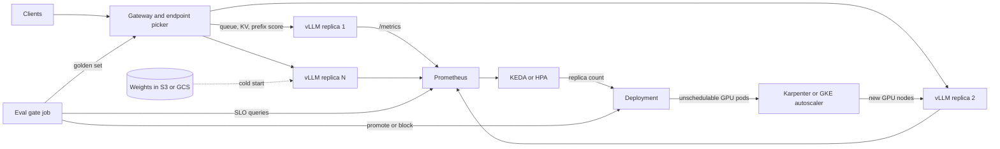

# Capstone 3: High-Throughput LLM Serving Stack with Autoscaling

## TL;DR

- A vLLM replica's capacity is set by its KV block pool, not by FLOPs. The pool is whatever HBM remains after weights, profiled peak activations and runtime reserve, and it caps concurrent sequences.
- Scale on concurrency (running plus waiting requests per replica, from Little's law), guarded by `kv_cache_usage_perc`. Never scale on GPU utilization or CPU.
- Autoscaler lag (detect + provision + pull + load + warm) sets your steady-state headroom: utilization must stay below `exp(-g * lag)`, where `g` is the traffic growth rate. A 7-minute lag against traffic that doubles in 10 minutes means running at 62% of capacity or less.
- Routing is part of the serving engine. Round-robin discards per-replica KV and prefix-cache state, so use queue-, KV- and prefix-aware endpoint picking, and bound cache affinity with load so a hot prefix cannot melt one replica.
- A release gate must check quality (paired, non-inferiority, sized for power) and performance (p99 TTFT, preemptions) on the same candidate. Exact-match evals fail because batch composition changes numerics.

## Mental Model



The system has two coupled loops around a stateful engine.
The fast loop runs inside each replica: every engine step fills a token budget, runs one forward pass, and streams one token per running sequence.
The slow loop is a stack of controllers (metrics scrape, HPA or KEDA, node autoscaler, image pull, weight load, warmup) that adds replicas minutes after load rises.
The gateway is the only component that sees both loops, so it must route on replica state (KV pressure, queue depth, cached prefixes) rather than on connection counts.
The eval gate sits outside both loops and decides whether a new model, quantization or engine version may take traffic.
Everything is decoupled by the Prometheus text endpoint, which makes metric names and semantics part of your control-plane contract.

## Internals

### Data plane versus control plane

The data plane is the gateway, the endpoint picker, and the vLLM engine core (scheduler, KV cache manager, GPU workers).
The control plane is Prometheus, the HPA or KEDA operator, the node autoscaler, the GitOps controller from [[17-Cloud-AI-Engineering/Volume_15_Capstones_Production_Systems/Chapter_02_Capstone_Production_Kubernetes_Platform_with_GitOps|Capstone 2]], and the eval gate.
The rule from [[17-Cloud-AI-Engineering/Volume_01_Cloud_Architecture_Principles/Chapter_04_Control_Plane_vs_Data_Plane_Separation|Control Plane vs Data Plane Separation]] applies in full.
Serving existing traffic must never require a control-plane call, so a replica must keep serving when Prometheus, the scaler or the EC2 and GCE APIs are impaired.
Scale-out is the only data-plane capability that depends on the control plane, and you must budget for its failure (see Failure Modes).

### Mechanism 1: where the KV block pool comes from

PagedAttention ([Kwon et al., SOSP 2023](https://arxiv.org/pdf/2309.06180)) stores the KV cache in fixed-size blocks mapped through per-sequence block tables, like virtual memory pages.
The paper reports 2-4x throughput over prior systems, and its authors summarize waste as under 4% versus large reservation-based waste in earlier systems (paper and summary slides, as of 2026-10).
The sizing mechanism is not in getting-started guides, and the following description comes from reading the engine, so confirm it against your pinned version.

1. At startup the engine loads weights.
2. It runs a profiling forward pass with a dummy batch of `max_num_batched_tokens` tokens to measure peak activation memory.
3. It computes the pool as `gpu_memory_utilization * total_HBM - weights - peak_activations - non_torch_memory`.
4. It divides the pool by bytes per block (`block_size * kv_bytes_per_token`) to get the block count.
5. It logs the result as a KV cache size in tokens.

Four consequences follow.

- Raising `max_num_batched_tokens` raises profiled peak activations and therefore shrinks the KV pool. It is a memory knob as well as a latency knob.
- `gpu_memory_utilization` is a fraction of the whole device, not of what is free. Two pods co-scheduled on one GPU with 0.9 each will fail one of the two.
- KV bytes per token is `2 * layers * kv_heads * head_dim * dtype_bytes`. GQA is why a 70B model with 8 KV heads costs 320 KiB per token in BF16 rather than several MiB. Quantizing KV to FP8 doubles token capacity at the same pool size.
- Tensor parallelism helps KV capacity superlinearly. Weights are sharded, so each added GPU contributes its whole HBM to the pool minus its weight shard.

### Mechanism 2: the step loop and the token budget

vLLM V1 schedules per step rather than per phase.
Each step spends at most `max_num_batched_tokens` tokens across running sequences (one token each for decoders) and chunks of waiting prompts.
The step time is the inter-token latency (ITL) every running sequence experiences, so any prefill chunk that rides in a step delays all decoders in that step.
The vLLM tuning docs state the trade-off: smaller values improve ITL and larger values improve TTFT ([vLLM optimization docs](https://docs.vllm.ai/en/stable/configuration/optimization/), as of 2026-10).
The docs also say that with chunked prefill disabled, `max_num_batched_tokens` must exceed `max_model_len` or startup can crash.
Chunked prefill in V1 is on by default whenever possible ([Parasail, as of 2026-10](https://www.parasail.io/blog/offline-llm-inference-batching-throughput)), and defaults vary by version and hardware, so read the startup log rather than trusting a doc table.
The lineage is Orca's iteration-level scheduling (OSDI 2022) and Sarathi-Serve's stall-free chunked batching (OSDI 2024).
Disaggregation is the next step and is covered in [[17-Cloud-AI-Engineering/Volume_11_LLM_Serving_and_Inference_Systems_on_Cloud/Chapter_07_Prefill_and_Decode_Disaggregation|Prefill and Decode Disaggregation]].

### Mechanism 3: preemption is a positive feedback loop

When the KV pool cannot hold all running sequences, vLLM preempts a request, frees its blocks, and recomputes it later.
The docs describe recompute and recommend raising `gpu_memory_utilization` or tensor parallel size ([vLLM docs, as of 2026-10](https://docs.vllm.ai/en/stable/configuration/optimization/)).
V1 defaults to recompute over swap and dropped the swap-space flag ([Parasail, as of 2026-10](https://www.parasail.io/blog/offline-llm-inference-batching-throughput)).
Recompute makes overload self-amplifying:

1. A preempted request re-enters the waiting queue.
2. Its prompt plus already-generated tokens must be prefilled again, which spends the shared token budget.
3. The extra prefill delays decoders and lengthens sequence lifetimes.
4. Longer lifetimes mean more resident KV, which means more preemption.

This is the same shape as the metastable queue collapse in the [AWS Builders' Library on insurmountable backlogs](https://aws.amazon.com/builders-library/avoiding-insurmountable-queue-backlogs/).
The defense is admission control before the engine saturates, plus alerting on the preemption counter rate (`vllm:num_preemptions_total`) rather than on latency alone.

### Mechanism 4: prefix cache semantics that confuse dashboards and routers

Automatic prefix caching hashes full blocks as a chain, where each block's hash covers its parent hash and its tokens (plus extras such as LoRA identity).
Only complete blocks are shareable.
Unreferenced cached blocks sit in a free list in LRU order and are evicted only when an allocation needs them.
As a result `kv_cache_usage_perc` can read low on a replica whose free list is full of valuable cached prefixes.
Usage therefore tells you about admission headroom, not about cache value.
The cache-value signals are `vllm:prefix_cache_hits` divided by `vllm:prefix_cache_queries`, as the llm-d metrics page describes (as of 2026-10).
The same page warns that a low hit rate suggests the endpoint picker is not routing effectively.
In production, Vertex AI doubled its prefix hit rate from 35% to 70% after adopting GKE Inference Gateway ([Google Cloud blog, as of 2026-10](https://cloud.google.com/blog/products/containers-kubernetes/how-gke-inference-gateway-improved-latency-for-vertex-ai)).
The same post shows that the picker is a weighted scorer over prefix, queue and KV utilization.
Moving the weights from 3:3:2 to 3:5:2 made the picker bypass hot replicas even when they had a cache hit.
Cache affinity and load balance are in direct tension, and the weights are the dial.

### Mechanism 5: the autoscaler lag budget

A new serving replica becomes useful only after every stage below completes.
The stage times here are planning assumptions, not measurements, so measure your own.

| Stage | Typical mechanism | Planning assumption |
|---|---|---|
| Detect | scrape interval + rule evaluation + HPA sync | 30-60 s |
| Provision | node autoscaler creates and joins a GPU node | 60-300 s |
| Image pull | multi-GB CUDA and vLLM image | 30-180 s |
| Weight load | object storage to host to HBM | 30-300 s |
| Warm | CUDA graph capture, kernel autotune, or TPU XLA compile | 30-300 s |

If load grows exponentially with doubling time `T_d`, the growth rate is `g = ln(2) / T_d`.
During a lag `L` the load multiplies by `exp(g * L)`.
To avoid saturating before new capacity arrives, steady-state utilization must stay below `exp(-g * L)`.
This is why headroom is a function of cold-start time, and why cold-start engineering (weights on local NVMe, image pre-pull, a compile cache) buys real money.
The same lag is why a bare queue-depth trigger fires too late.
The GKE docs recommend `num_requests_waiting` for throughput and cost optimization.
They recommend cache usage when latency targets are tight and queue-based scaling is not fast enough ([GKE docs, as of 2026-10](https://docs.cloud.google.com/kubernetes-engine/docs/how-to/machine-learning/inference/autoscaling)).
This chapter's trigger sums running and waiting requests, which acts as a Little's-law concurrency estimate and moves earlier than waiting alone.

### Mechanism 6: TPU path

GKE documents serving an LLM on TPU Trillium with vLLM and scaling it with the same `num_requests_waiting` and cache-usage metrics.
The doc notes that the metric works the same on GPUs and TPUs even though its name follows the GPU naming schema ([GKE TPU tutorial, as of 2026-10](https://cloud.google.com/kubernetes-engine/docs/tutorials/serve-vllm-tpu)).
The operational difference is compilation.
XLA compiles for static shapes, so the TPU backend pads token counts and batch sizes into buckets and compiles per bucket at startup.
Warmup is therefore longer, and an unexpected shape can trigger a mid-traffic recompile stall (UNVERIFIED, from backend design; check your version's startup log).
Treat the XLA compile cache as a first-class artifact on a persistent volume, the same way you treat weights.

### Mechanism 7: why an eval gate cannot use exact match

At temperature 0, outputs still vary with batch composition.
Floating-point addition is not associative, and kernels pick different reduction strategies for different batch shapes.
Two correct deployments of the same weights can therefore disagree on a small fraction of prompts.
A gate that demands identical outputs will fail healthy builds, and one that checks only mean score on a small set will pass bad ones.
The correct design is a paired non-inferiority test.
For each prompt compute `delta = score_candidate - score_baseline`, bootstrap the mean, and block if the lower bound of the 95% interval is below `-margin`.
Power matters.
With a discordant-pair rate `d` (prompts where the two versions differ in correctness), the standard error of the mean delta is about `sqrt(d / n)`.
Certifying a 2-point margin at a one-sided 95% level with `d = 0.15` needs `n ~= d * (1.645 / 0.02)^2 ~= 1015` prompts.
Two hundred prompts cannot do it, and the lab output below shows this.

## Numbers to Know

| Quantity | Value | Source |
|---|---|---|
| PagedAttention throughput vs prior systems | 2-4x | [Kwon et al., SOSP 2023](https://arxiv.org/pdf/2309.06180) (paper, as of 2026-10) |
| KV waste under PagedAttention | under 4% | Paper results as summarized in course slides, [UT Austin](https://www.cs.utexas.edu/~pingali/CS395TFall25/presentations/grassi_pagedattention.pdf) (as of 2026-10) |
| KV usage danger zone | above 0.9 means preemption or rejection risk | [llm-d metrics docs](https://llm-d.ai/docs/operations/observability/model-server-metrics) (as of 2026-10) |
| Vertex AI prefix hit rate with Inference Gateway | 35% to 70% | [Google Cloud blog](https://cloud.google.com/blog/products/containers-kubernetes/how-gke-inference-gateway-improved-latency-for-vertex-ai) (as of 2026-10) |
| Default gateway scorer weights prefix:queue:KV | 3:3:2, tuned to 3:5:2 | Same post (as of 2026-10) |
| Multi-cluster gateway spill trigger in a Google example | 40% KV-cache utilization | [Google Cloud blog](https://cloud.google.com/blog/products/containers-kubernetes/gpu-and-tpu-utilization-with-multi-cluster-gke-inference-gateway) (as of 2026-10) |
| GMP scrape interval in GKE autoscaling example | 15 s | [GKE docs](https://docs.cloud.google.com/kubernetes-engine/docs/how-to/machine-learning/inference/autoscaling) (as of 2026-10) |
| p5.48xlarge shape | 8x H100 80 GB (640 GB HBM3), 192 vCPU, 2 TiB RAM, 3200 Gbps EFA, 8x3.84 TB NVMe | Instance catalog mirrors: [Spare Cores](https://sparecores.com/server/aws/p5.48xlarge), [CloudZero](https://advisor.cloudzero.com/aws/ec2/p5.48xlarge) (as of 2026-10) |
| p5.48xlarge on-demand, us-east-1 | $55.04/hr ($6.88 per GPU-hr) | [Spheron](https://www.spheron.network/blog/aws-h100-pricing-2026/), [Thunder Compute](https://www.thundercompute.com/blog/aws-p5-vs-thunder-compute), both citing AWS list price (as of 2026-10) |
| AWS P5 price cut | about 44% in June 2025 | Spheron (as of 2026-10) |
| p5.48xlarge 1-yr / 3-yr commitment | about $38.53 / about $24.77 per hr | Spheron (approximate, as of 2026-10) |
| p5.48xlarge observed Spot, us-east-1 | $20.78 to $27.87 per hr snapshots (volatile) | [DoiT Spot tracker](https://compute.doit.com/spot/us-east-1/p5.48xlarge) (as of 2026-10) |
| Derived: commitment breakeven utilization | 70% (1-yr), 45% (3-yr) | `1 - discount` from the two rows above |
| Derived: KV per token, 70B-class with 8 KV heads, 80 layers, head_dim 128 | 320 KiB BF16, 160 KiB FP8 | Computed by `capacity_model.py` below |
| Derived: gate sample size for 2-pt margin, d = 0.15 | about 1015 prompts | Formula in Internals |

I could not re-verify list prices on the official AWS and Google pricing pages in this session.
Treat every dollar figure as a planning input and re-pull it before spending money.

## AWS vs GCP Mechanism Parity

| Concern | AWS | Google Cloud | Critical difference |
|---|---|---|---|
| Serving accelerators | EC2 P5 (H100) and G6e family; see [[17-Cloud-AI-Engineering/Volume_10_AI_Infrastructure_on_Cloud/Chapter_01_Accelerator_Architectures_GPUs_Trainium_TPUs\|Accelerator Architectures]] | A3 and G2 GPU machine types, plus Cloud TPU Trillium on GKE (documented vLLM tutorial) | Only GCP offers TPU in this stack. TPU needs shape-bucketed compilation and slice-shaped node pools |
| Node autoscaler | Karpenter `NodePool` with `limits` as a hard GPU cap | GKE node pools with autoscaling, or node auto-provisioning and compute classes | Karpenter bin-packs and picks instance types per pod. GKE pool autoscalers scale pre-defined machine shapes |
| Capacity assurance | On-Demand Capacity Reservations and Capacity Blocks (fixed-duration, fixed-price, seen in P5 listings) | Reservations; flex-start and calendar-mode options (UNVERIFIED in this session) | Both require a plan for GPU stockouts. Neither autoscaler can create capacity that does not exist |
| Metrics store | Self-managed Prometheus or Amazon Managed Prometheus | Google Managed Prometheus with `PodMonitoring` | GMP names metrics for HPA as `prometheus.googleapis.com\|<metric>\|gauge` per the GKE docs |
| HPA plumbing | KEDA Prometheus scaler (lab) or Prometheus adapter | HPA directly on GMP metrics via the GKE adapter, or KEDA | Both converge on the same external-metric HPA mechanics |
| AI-aware load balancing | Gateway API Inference Extension or llm-d endpoint picker on your own proxy (first-party equivalent UNVERIFIED) | GKE Inference Gateway, a managed endpoint picker scoring KV, queue, LoRA and prefix | On GCP this is a managed feature. On AWS you operate the picker |
| Weights path | S3 to local NVMe, parallel or streamed load | GCS to local SSD or FUSE | Both are bounded by object-store concurrency and the first-byte tail. Pre-stage weights |
| Spot or preemptible signal | 2-minute interruption notice | 30-second preemption notice | See [[17-Cloud-AI-Engineering/Volume_09_FinOps_and_Cloud_Economics/Chapter_03_Spot_Economics_and_Interruption_Handling\|Spot Economics]]. A 30 s window cannot drain a 30 s generation |
| Managed fallback | Amazon Bedrock | Vertex AI | See [[17-Cloud-AI-Engineering/Volume_11_LLM_Serving_and_Inference_Systems_on_Cloud/Chapter_09_Managed_Inference_Amazon_Bedrock_vs_Vertex_AI\|Managed Inference]]. The overflow tier needs its own eval parity |

## Worked Example: A Portable vLLM Stack with Queue-Driven Autoscaling and an Eval Gate

The lab serves a small open model on one GPU per replica, so it is cheap and uses the same manifests on EKS and GKE.
The production sizing that follows uses a 70B-class model on p5.48xlarge.
Prerequisites are the Capstone 2 cluster (Cilium, Karpenter or GKE autoscaling, Argo CD, workload identity), plus kube-prometheus-stack (for the `PodMonitor` CRD) and KEDA installed.
Use any open model your license permits; the examples assume `Qwen/Qwen2.5-1.5B-Instruct`.
Pin `VLLM_IMAGE` to a specific release tag you have tested, and never use `latest`.

### Step 0: cost estimate, budget alarm, teardown plan

Worst case is 4 GPU nodes for 3 hours.

- GPU nodes: 4 x 3 h x $2.50/hr planning ceiling (UNVERIFIED; look up the real rate below) = $30.
- Control plane: 3 h x $0.10/hr = $0.30 (UNVERIFIED).
- NAT, EBS and data transfer: allow $5.
- Total ceiling is about $36, so set the budget to $50.

A budget alert is not a cap.
The real caps are the NodePool `limits` of 4 GPUs, the KEDA `maxReplicaCount: 4`, and the teardown below.

```bash
aws pricing get-products --region us-east-1 --service-code AmazonEC2 \
  --filters Type=TERM_MATCH,Field=instanceType,Value=g6e.xlarge \
            Type=TERM_MATCH,Field=location,Value="US East (N. Virginia)" \
            Type=TERM_MATCH,Field=operatingSystem,Value=Linux \
            Type=TERM_MATCH,Field=tenancy,Value=Shared \
            Type=TERM_MATCH,Field=preInstalled,Value=NA \
            Type=TERM_MATCH,Field=capacitystatus,Value=Used --max-items 1
```

```bash
cat > budget.json <<'EOF'
{"BudgetName":"capstone3-llm","BudgetLimit":{"Amount":"50","Unit":"USD"},
 "TimeUnit":"MONTHLY","BudgetType":"COST"}
EOF
cat > notify.json <<'EOF'
[{"Notification":{"NotificationType":"ACTUAL","ComparisonOperator":"GREATER_THAN",
  "Threshold":80,"ThresholdType":"PERCENTAGE"},
  "Subscribers":[{"SubscriptionType":"EMAIL","Address":"you@example.com"}]}]
EOF
aws budgets create-budget --account-id "$AWS_ACCOUNT_ID" \
  --budget file://budget.json --notifications-with-subscribers file://notify.json

# GCP equivalent
gcloud billing budgets create --billing-account="$BILLING_ACCOUNT" \
  --display-name=capstone3-llm --budget-amount=50USD \
  --threshold-rule=percent=0.8 --threshold-rule=percent=1.0
```

Exact teardown (also in Step 6):

```bash
kubectl delete namespace llm
kubectl delete nodepool gpu-inference            # AWS: Karpenter removes the nodes
kubectl get nodeclaims                           # AWS: must be empty before you walk away
gcloud container node-pools delete gpu-l4 --cluster "$CLUSTER" --region "$REGION" --quiet   # GCP
```

### Step 1: capacity model (production sizing)

`capacity_model.py` computes the KV pool, the maximum concurrency, a bandwidth roofline for decode, and the headroom formula.
It takes model shape from `config.json` fields; in real use load them from the model's file instead of hard-coding.

```python
#!/usr/bin/env python3
"""Roofline capacity model for a vLLM replica. Reads model shape from a HF-style config.json."""
import json, math, sys

def kv_bytes_per_token(cfg, kv_dtype_bytes):
    layers = cfg["num_hidden_layers"]
    kv_heads = cfg.get("num_key_value_heads", cfg["num_attention_heads"])
    head_dim = cfg.get("head_dim") or cfg["hidden_size"] // cfg["num_attention_heads"]
    return 2 * layers * kv_heads * head_dim * kv_dtype_bytes

def plan(cfg, params_b, weight_bytes, kv_dtype_bytes, tp, hbm_gib, mem_util, reserve_gib,
         hbm_tbps, eta, ctx_tokens, price_per_node_hr, replicas_per_node):
    gib = 1024 ** 3
    kv_tok = kv_bytes_per_token(cfg, kv_dtype_bytes)
    weights_gib = params_b * 1e9 * weight_bytes / gib
    pool_gib = tp * (hbm_gib * mem_util - reserve_gib) - weights_gib
    kv_tokens = int(pool_gib * gib / kv_tok)
    conc = kv_tokens // ctx_tokens
    bw = tp * hbm_tbps * 1e12 * eta
    step_s = (weights_gib * gib + conc * ctx_tokens * kv_tok) / bw
    tok_s = conc / step_s
    cost_per_replica_hr = price_per_node_hr / replicas_per_node
    usd_per_mtok = cost_per_replica_hr / (tok_s * 3600 / 1e6)
    return dict(kv_bytes_per_token=kv_tok, weights_gib=round(weights_gib, 1), kv_pool_gib=round(pool_gib, 1),
                kv_tokens=kv_tokens, max_concurrent_seqs=conc, decode_step_ms=round(step_s * 1e3, 1),
                decode_tokens_per_s=int(tok_s), usd_per_million_output_tokens=round(usd_per_mtok, 2))

def target_utilization(doubling_s, lag_s):
    g = math.log(2) / doubling_s
    return math.exp(-g * lag_s)

if __name__ == "__main__":
    cfg70 = dict(num_hidden_layers=80, num_key_value_heads=8, num_attention_heads=64, hidden_size=8192)
    out = plan(cfg70, params_b=70.6, weight_bytes=1, kv_dtype_bytes=2, tp=4, hbm_gib=80, mem_util=0.90,
               reserve_gib=6, hbm_tbps=3.35, eta=0.65, ctx_tokens=3000, price_per_node_hr=55.04, replicas_per_node=2)
    print(json.dumps(out, indent=2))
    out8 = plan(cfg70, params_b=70.6, weight_bytes=1, kv_dtype_bytes=1, tp=4, hbm_gib=80, mem_util=0.90,
                reserve_gib=6, hbm_tbps=3.35, eta=0.65, ctx_tokens=3000, price_per_node_hr=55.04, replicas_per_node=2)
    print("fp8 kv:", json.dumps(out8))
    for lag in (120, 300, 420, 600):
        print("lag", lag, "s -> max steady utilization", round(target_utilization(600, lag), 2))
```

The script ran in the sandbox and produced the following for a 70B-class model in FP8 weights, TP=4, two replicas per p5.48xlarge.
Inputs are 80 GiB per GPU, `gpu_memory_utilization` 0.90, 6 GiB per-GPU runtime reserve, 3.35 TB/s HBM per GPU, roofline efficiency 0.65 (an assumption to calibrate), 3000-token average resident context, and $55.04 per node-hour.
The HBM bandwidth and the 70B shape are from memory and are UNVERIFIED.

| Quantity | BF16 KV | FP8 KV |
|---|---|---|
| KV bytes per token | 327,680 | 163,840 |
| Weights (FP8) | 65.8 GiB | 65.8 GiB |
| KV pool across 4 GPUs | 198.2 GiB | 198.2 GiB |
| KV capacity | 649,621 tokens | 1,299,242 tokens |
| Max concurrent sequences at 3000 tokens | 216 | 433 |
| Decode step at full KV (roofline) | 32.5 ms | 32.5 ms |
| Decode throughput per replica | about 6,650 tok/s | about 13,300 tok/s |
| Decode-only cost | $1.15 per M output tokens | $0.57 per M output tokens |

Read this table with four caveats.

- The roofline counts HBM bytes only. It ignores TP all-reduce time, attention-kernel inefficiency and the compute ceiling at 433 sequences, so the FP8-KV column is an upper bound. Calibrate `eta` with Step 4.
- It is decode-only. Prefill is compute-bound. With FP8 dense peak of about 1.98 PFLOPS per H100 (datasheet, UNVERIFIED) and 40% utilization, a 2000-token prompt on a 70.6B model costs about `2 * 70.6e9 * 2000 / (4 * 1.98e15 * 0.4)` = 0.09 replica-seconds.
- A 1000-token response costs about 0.15 replica-seconds of decode at 6,650 tok/s. Prefill is therefore about 37% of replica time for this 2000-in, 1000-out mix, and an output-only $/M figure understates real cost.
- One replica sustains about `1 / 0.24` = 4.2 requests per second, which is about 15,000 requests per hour. At $27.52 per replica-hour (half a node) that is about $0.0018 per request.

Fleet sizing for a 100 rps peak with traffic doubling in 10 minutes and a 420 s scale-up lag:

1. Raw replicas: `100 / 4.2` = 24.
2. Maximum steady utilization from the headroom formula: `exp(-ln2/600 * 420)` = 0.62.
3. Provisioned replicas: `24 / 0.62` = 39, or 20 p5.48xlarge nodes at two replicas each.
4. Cost at on-demand: 20 x $55.04 = $1,100 per hour.
5. Cutting scale-up lag from 420 s to 120 s moves utilization from 0.62 to 0.87 and shrinks the fleet from 39 to 28 replicas. A 30% GPU saving comes purely from cold-start engineering.

Per-replica autoscaling threshold: take the lower of the KV-bound concurrency (216) and the concurrency at which ITL p99 meets your SLO, then multiply by 0.7.
Set `CONC_PER_REPLICA` to that value.

### Step 2: GPU capacity on each cloud

AWS (reuses the Capstone 2 `EC2NodeClass` named `default`; `limits` is the hard cost cap):

```yaml
apiVersion: karpenter.sh/v1
kind: NodePool
metadata:
  name: gpu-inference
spec:
  template:
    metadata:
      labels: {workload: llm-inference}
    spec:
      nodeClassRef: {group: karpenter.k8s.aws, kind: EC2NodeClass, name: default}
      taints: [{key: nvidia.com/gpu, value: "true", effect: NoSchedule}]
      requirements:
        - {key: karpenter.k8s.aws/instance-family, operator: In, values: ["g6e"]}
        - {key: karpenter.k8s.aws/instance-size, operator: In, values: ["xlarge", "2xlarge"]}
        - {key: karpenter.sh/capacity-type, operator: In, values: ["on-demand"]}
  limits:
    nvidia.com/gpu: "4"
  disruption:
    consolidationPolicy: WhenEmpty
    consolidateAfter: 15m
```

GCP:

```bash
gcloud container node-pools create gpu-l4 --cluster "$CLUSTER" --region "$REGION" \
  --machine-type g2-standard-8 --accelerator type=nvidia-l4,count=1,gpu-driver-version=latest \
  --num-nodes 0 --enable-autoscaling --min-nodes 0 --max-nodes 4 \
  --node-labels workload=llm-inference
```

### Step 3: the serving stack

`WhenEmpty` consolidation matters.
Cost-driven consolidation that moves a running vLLM pod destroys its warm KV and prefix cache and forces a cold start, so only reclaim nodes that are empty.

Set the node selector for your cloud before applying: on AWS use `GPU_NODE_LABEL_KEY=workload GPU_NODE_LABEL_VAL=llm-inference`; on GKE use `GPU_NODE_LABEL_KEY=cloud.google.com/gke-accelerator GPU_NODE_LABEL_VAL=nvidia-l4`.
`PROM_URL` is your in-cluster Prometheus.

```yaml
apiVersion: v1
kind: Namespace
metadata:
  name: llm
---
apiVersion: apps/v1
kind: Deployment
metadata:
  name: vllm
  namespace: llm
  labels: {app: vllm}
spec:
  replicas: 1
  selector:
    matchLabels: {app: vllm}
  strategy:
    type: RollingUpdate
    rollingUpdate: {maxSurge: 1, maxUnavailable: 0}
  template:
    metadata:
      labels: {app: vllm}
    spec:
      terminationGracePeriodSeconds: 180
      nodeSelector:
        ${GPU_NODE_LABEL_KEY}: "${GPU_NODE_LABEL_VAL}"
      tolerations:
        - {key: nvidia.com/gpu, operator: Exists, effect: NoSchedule}
      containers:
        - name: vllm
          image: ${VLLM_IMAGE}
          args:
            - --model=${MODEL}
            - --served-model-name=${MODEL}
            - --max-model-len=8192
            - --gpu-memory-utilization=0.90
            - --max-num-seqs=128
            - --port=8000
          ports:
            - {name: http, containerPort: 8000}
          resources:
            limits: {nvidia.com/gpu: 1}
          startupProbe:
            httpGet: {path: /health, port: http}
            periodSeconds: 10
            failureThreshold: 90
          readinessProbe:
            httpGet: {path: /health, port: http}
            periodSeconds: 5
          lifecycle:
            preStop:
              exec: {command: ["sleep", "20"]}
          volumeMounts:
            - {name: shm, mountPath: /dev/shm}
            - {name: hf, mountPath: /root/.cache/huggingface}
      volumes:
        - name: shm
          emptyDir: {medium: Memory, sizeLimit: 8Gi}
        - name: hf
          emptyDir: {sizeLimit: 100Gi}
---
apiVersion: v1
kind: Service
metadata:
  name: vllm
  namespace: llm
  labels: {app: vllm}
spec:
  selector: {app: vllm}
  ports:
    - {name: http, port: 8000, targetPort: http}
---
apiVersion: monitoring.coreos.com/v1
kind: PodMonitor
metadata:
  name: vllm
  namespace: llm
spec:
  selector:
    matchLabels: {app: vllm}
  podMetricsEndpoints:
    - {port: http, path: /metrics, interval: 15s}
---
apiVersion: keda.sh/v1alpha1
kind: ScaledObject
metadata:
  name: vllm
  namespace: llm
spec:
  scaleTargetRef: {name: vllm}
  minReplicaCount: 1
  maxReplicaCount: 4
  pollingInterval: 15
  advanced:
    horizontalPodAutoscalerConfig:
      behavior:
        scaleUp:
          stabilizationWindowSeconds: 0
          policies: [{type: Pods, value: 2, periodSeconds: 60}]
        scaleDown:
          stabilizationWindowSeconds: 900
          policies: [{type: Pods, value: 1, periodSeconds: 300}]
  triggers:
    - type: prometheus
      metadata:
        serverAddress: ${PROM_URL}
        query: sum(max_over_time(vllm:num_requests_running{namespace="llm"}[1m]) + max_over_time(vllm:num_requests_waiting{namespace="llm"}[1m]))
        threshold: "${CONC_PER_REPLICA}"
```

```bash
export MODEL=Qwen/Qwen2.5-1.5B-Instruct CONC_PER_REPLICA=64
export VLLM_IMAGE=<your pinned vllm-openai image>
export PROM_URL=http://prometheus-operated.monitoring.svc:9090
envsubst < vllm.yaml | kubectl apply -f -
kubectl -n llm rollout status deploy/vllm --timeout=15m
```

Design choices that a getting-started guide omits:

- The query uses `max_over_time` over 1 minute. A gauge sampled every 15 s misses bursts shorter than the scrape interval, and the max over a window is a cheap guard.
- KEDA exposes the query as an external metric with average-value semantics. Desired replicas are `ceil(total_concurrency / threshold)`, so the threshold is literally your per-replica concurrency target.
- Scale-up stabilization is 0 and the step is 2 pods per minute, because slow scale-up is already paid for by lag. Scale-down is 900 s and one pod per 5 minutes, so a replica that took 7 minutes to build is not discarded on a 2-minute lull.
- `maxSurge: 1, maxUnavailable: 0` and the 90-attempt `startupProbe` keep a slow, warm-up-heavy start from being killed by liveness-style probes.
- The `preStop` sleep (20 s) lets endpoint removal propagate to the proxy before SIGTERM, and `terminationGracePeriodSeconds: 180` bounds how long in-flight streams may finish.

### Step 4: open-loop load test and calibration

The generator schedules arrivals by wall clock and measures TTFT from the scheduled arrival time.
A closed-loop client that waits for each response before sending the next hides queueing (coordinated omission), and it will report a healthy p99 for a saturated server.
The shared prefix exercises the prefix cache.

```python
#!/usr/bin/env python3
"""Open-loop Poisson load generator for an OpenAI-compatible streaming endpoint. Standard library only.
Arrivals are scheduled by wall clock, not by completion, so queueing delay is measured (no coordinated omission)."""
import argparse, json, random, threading, time, urllib.request

def one(url, model, prompt, max_tokens, t_sched, out):
    body = json.dumps({"model": model, "stream": True, "max_tokens": max_tokens, "temperature": 0,
                       "messages": [{"role": "user", "content": prompt}]}).encode()
    req = urllib.request.Request(url + "/v1/chat/completions", body, {"Content-Type": "application/json"})
    ttft, n, last, itl = None, 0, None, []
    try:
        with urllib.request.urlopen(req, timeout=600) as r:
            for line in r:
                if not line.startswith(b"data: ") or line.startswith(b"data: [DONE]"):
                    continue
                now = time.time()
                if ttft is None:
                    ttft = now - t_sched
                elif last is not None:
                    itl.append(now - last)
                last, n = now, n + 1
        out.append((ttft, n, itl, None))
    except Exception as e:
        out.append((None, 0, [], str(e)))

def pct(xs, p):
    xs = sorted(xs)
    return xs[min(len(xs) - 1, int(p * len(xs)))] if xs else float("nan")

def main():
    ap = argparse.ArgumentParser()
    ap.add_argument("--url", required=True); ap.add_argument("--model", required=True)
    ap.add_argument("--rps", type=float, default=4.0); ap.add_argument("--duration", type=float, default=120.0)
    ap.add_argument("--prompt-words", type=int, default=1500); ap.add_argument("--max-tokens", type=int, default=200)
    ap.add_argument("--shared-prefix-words", type=int, default=1000)
    a = ap.parse_args()
    vocab = ["alpha", "bravo", "charlie", "delta", "echo", "foxtrot", "golf", "hotel"]
    shared = " ".join(random.choice(vocab) for _ in range(a.shared_prefix_words))
    out, threads, t0, t = [], [], time.time(), 0.0
    while t < a.duration:
        t += random.expovariate(a.rps)
        time.sleep(max(0.0, t0 + t - time.time()))
        tail = " ".join(random.choice(vocab) for _ in range(a.prompt_words - a.shared_prefix_words))
        th = threading.Thread(target=one, args=(a.url, a.model, shared + " " + tail, a.max_tokens, t0 + t, out))
        th.start(); threads.append(th)
    for th in threads: th.join()
    ok = [o for o in out if o[0] is not None]
    itl = [x for o in ok for x in o[2]]
    print(json.dumps({"sent": len(out), "ok": len(ok), "errors": len(out) - len(ok),
                      "ttft_p50": pct([o[0] for o in ok], .5), "ttft_p99": pct([o[0] for o in ok], .99),
                      "itl_p50": pct(itl, .5), "itl_p99": pct(itl, .99)}))
if __name__ == "__main__":
    main()
```

```bash
kubectl -n llm port-forward svc/vllm 8000:8000 &
python3 loadgen.py --url http://127.0.0.1:8000 --model "$MODEL" --rps 4 --duration 180
python3 loadgen.py --url http://127.0.0.1:8000 --model "$MODEL" --rps 16 --duration 300   # watch replicas
kubectl -n llm get hpa -w
```

Calibrate in three passes.

1. At low rate, record ITL p50. Divide the roofline step time by it to get your real `eta`.
2. Ramp rps until ITL p99 or TTFT p99 crosses your SLO, and record `num_requests_running` at that moment. That concurrency, times 0.7, is `CONC_PER_REPLICA`.
3. Time the cold start with `kubectl get events` and pod conditions, and plug the number into the headroom formula.

Also confirm the load generator is not the bottleneck: Python threads cap out at a few hundred concurrent streams, so shard it across pods for large runs.

### Step 5: the release gate

The gate runs as an Argo CD `PostSync` hook Job (or an Argo Rollouts analysis step) against the canary Service before any traffic weight moves.
It compares candidate with baseline on a golden set, then asks Prometheus whether the canary met its latency SLO and avoided preemptions during the run.

```python
#!/usr/bin/env python3
"""Release gate: quality non-inferiority (paired bootstrap) plus latency SLO from Prometheus.
Exit code 0 = promote, 1 = block. Standard library only."""
import argparse, json, random, sys, urllib.parse, urllib.request

def post_json(url, body, timeout=120):
    req = urllib.request.Request(url, json.dumps(body).encode(), {"Content-Type": "application/json"})
    with urllib.request.urlopen(req, timeout=timeout) as r:
        return json.load(r)

def ask(base, model, prompt):
    out = post_json(base + "/v1/chat/completions", {
        "model": model, "temperature": 0, "max_tokens": 256, "seed": 1234,
        "messages": [{"role": "user", "content": prompt}]})
    return out["choices"][0]["message"]["content"]

def grade(answer, expected):
    return 1.0 if expected.strip().lower() in answer.strip().lower() else 0.0

def paired_bootstrap_lower(deltas, iters=5000, alpha=0.05, seed=7):
    rng = random.Random(seed)
    n = len(deltas)
    means = sorted(sum(deltas[rng.randrange(n)] for _ in range(n)) / n for _ in range(iters))
    return means[int(alpha * iters)]

def prom_instant(prom, query):
    url = prom + "/api/v1/query?" + urllib.parse.urlencode({"query": query})
    with urllib.request.urlopen(url, timeout=30) as r:
        data = json.load(r)
    res = data["data"]["result"]
    return float(res[0]["value"][1]) if res else float("nan")

def main():
    ap = argparse.ArgumentParser()
    ap.add_argument("--golden", required=True, help="JSONL with prompt, expected")
    ap.add_argument("--baseline", required=True)
    ap.add_argument("--candidate", required=True)
    ap.add_argument("--model", required=True)
    ap.add_argument("--prom", required=True)
    ap.add_argument("--margin", type=float, default=0.02)
    ap.add_argument("--ttft-p99-slo", type=float, default=1.5)
    ap.add_argument("--window", default="10m")
    a = ap.parse_args()

    rows = [json.loads(l) for l in open(a.golden) if l.strip()]
    deltas = []
    for r in rows:
        b = grade(ask(a.baseline, a.model, r["prompt"]), r["expected"])
        c = grade(ask(a.candidate, a.model, r["prompt"]), r["expected"])
        deltas.append(c - b)
    mean_delta = sum(deltas) / len(deltas)
    lower = paired_bootstrap_lower(deltas)
    quality_ok = lower > -a.margin

    sel = 'job="vllm-canary"'
    ttft = prom_instant(a.prom, "histogram_quantile(0.99, sum by (le) (rate(vllm:time_to_first_token_seconds_bucket{%s}[%s])))" % (sel, a.window))
    preempt = prom_instant(a.prom, "sum(increase(vllm:num_preemptions_total{%s}[%s]))" % (sel, a.window))
    latency_ok = ttft == ttft and ttft <= a.ttft_p99_slo
    preempt_ok = preempt == preempt and preempt <= 0

    print(json.dumps({"n": len(rows), "mean_delta": round(mean_delta, 4), "ci95_lower": round(lower, 4),
                      "margin": a.margin, "ttft_p99_s": ttft, "preemptions": preempt,
                      "quality_ok": quality_ok, "latency_ok": latency_ok, "preempt_ok": preempt_ok}))
    sys.exit(0 if (quality_ok and latency_ok and preempt_ok) else 1)

if __name__ == "__main__":
    main()
```

I tested the gate against mock endpoints with a 200-prompt golden set.
A candidate with true accuracy 0.89 against a 0.90 baseline produced a mean delta of -0.03 and a 95% lower bound of -0.08, so the gate blocked it against a 0.02 margin.
That is a false block caused by too few samples, which is the power argument from Internals.
A candidate at 0.70 was blocked correctly, with a lower bound of -0.32.
In production use at least 1,000 prompts, stratify by task and prompt length, and treat a sample-size shortfall as "inconclusive" rather than as a pass or a fail.
Check that the `job` label (`vllm-canary`) matches your scrape config.
Metric names changed across vLLM releases (see Failure Modes), so verify `/metrics` on your pinned version and fail the gate on `NaN`, as the script does.
For open-ended tasks, replace `grade` with an LLM judge and see [[13-Agentic-AI/Agentic_AI_Zero_to_Godhood/Volume_10_Evaluation_and_Observability/Chapter_05_LLM_As_Judge|LLM As Judge]] and [[13-Agentic-AI/Agentic_AI_Zero_to_Godhood/Volume_10_Evaluation_and_Observability/Chapter_07_Production_Evaluation|Production Evaluation]].

### Step 6: GKE and TPU variants, then teardown

On GKE you can skip KEDA and use the HPA directly on Managed Service for Prometheus metrics.
The GKE docs show the pod metric name pattern `prometheus.googleapis.com|<metric>|gauge`.
For vLLM the name is `prometheus.googleapis.com|vllm:num_requests_waiting|gauge` (confirm the exact string against your cluster's custom metrics API).
GMP replaces the `PodMonitor` with a `PodMonitoring` resource.
For TPU, follow the [GKE Trillium tutorial](https://cloud.google.com/kubernetes-engine/docs/tutorials/serve-vllm-tpu), and mount a persistent volume for the XLA compile cache.

```bash
kubectl delete namespace llm
kubectl delete nodepool gpu-inference || true
kubectl get nodeclaims
gcloud container node-pools delete gpu-l4 --cluster "$CLUSTER" --region "$REGION" --quiet || true
aws budgets delete-budget --account-id "$AWS_ACCOUNT_ID" --budget-name capstone3-llm || true
```

## Failure Modes and Pitfalls

- **Silent metric rename.**
  The cache-usage gauge is `vllm:kv_cache_usage_perc` in current vLLM docs and dashboards, and the GKE docs still discuss `gpu_cache_usage_perc`.
  A community walkthrough explicitly calls out a Grafana and HPA fix for the real names.
  If an HPA or KEDA query references a missing series, the HPA stays at its floor or stops scaling, because missing metrics are treated conservatively (scale-up is blocked and scale-down avoided).
  Alert on `kube_horizontalpodautoscaler_status_condition` for `ScalingActive=False`, and pin the engine version in the same change that pins queries.
- **Preemption storm.**
  `kv_cache_usage_perc` near 1.0 with `num_requests_waiting` above 0 and `num_preemptions` rising is the signature, and the [Red Hat triage guide](https://developers.redhat.com/articles/2026/03/09/5-steps-triage-vllm-performance) describes the same symptoms.
  Root causes are an over-large `max-num-seqs`, a lowered `gpu_memory_utilization`, a raised `max_num_batched_tokens`, or a long-context tenant.
  Fix with admission limits first, then capacity.
- **Cache-affinity hot spot.**
  A popular system prompt makes the prefix-aware router pile traffic onto one replica until its queue explodes.
  The Vertex rebalance from 3:3:2 to 3:5:2 is the same trade-off documented from production.
  Bound affinity by load, and alert on per-replica queue skew (max over mean), not just the fleet average.
- **Averaging hides imbalance.**
  An HPA on average queue depth reads 3 when one pod holds 40 and eleven hold 0.
  Use the sum divided by replicas (as the lab query does) plus a per-replica max alert.
- **Probe-induced restart loops.**
  Warmup (CUDA graph capture on GPU, XLA compile on TPU) can exceed a naive liveness timeout, and the kubelet kills the pod mid-compile.
  Use a generous `startupProbe`, and never make the liveness probe stricter than the readiness probe.
- **Cold-start thundering herd.**
  Scaling from 4 to 20 replicas makes 16 pods pull a multi-GB image and read the same weight objects at once.
  Object-store per-prefix request limits and Hugging Face Hub rate limits become your scale-up ceiling.
  Mirror weights into your own bucket in the same region, shard them into many safetensors files, and stage them onto local NVMe (p5 ships 8x3.84 TB NVMe).
- **Scale-out depends on a control plane that fails.**
  The AWS us-east-1 DynamoDB DNS event in October 2025 impaired EC2 launches in the region, which is the call your node autoscaler makes (see the AWS post-event summary; details UNVERIFIED in this session).
  The June 2025 Google Cloud incident, where a bad quota or policy path crashed a global API-serving service, shows the same pattern from the other side.
  Both are analyzed in [[17-Cloud-AI-Engineering/Volume_07_Reliability_and_SRE/Chapter_07_Anatomy_of_Major_Cloud_Outages|Anatomy of Major Cloud Outages]].
  Lesson: serving capacity that exists keeps serving, and capacity you planned to create does not arrive.
  Keep static headroom sized to survive a lost zone with no scaling, as in [[17-Cloud-AI-Engineering/Volume_01_Cloud_Architecture_Principles/Chapter_02_Regions_Zones_and_Static_Stability|Regions, Zones, and Static Stability]].
- **Stream truncation on scale-down or Spot reclaim.**
  Removing a pod ends in-flight SSE streams.
  A 30-second GCP preemption notice cannot drain a long generation, and the 2-minute AWS notice only helps if `terminationGracePeriodSeconds` and the gateway's drain logic cooperate.
  Keep interactive traffic off Spot, or make clients resume.
- **Consolidation churn.**
  Cost-driven node consolidation moves warm replicas and discards their caches, so use `WhenEmpty` for GPU pools.
- **Closed-loop benchmarks.**
  A benchmark that waits for each reply reports a p99 that is an order of magnitude too good.
  Use open-loop arrivals.
- **Gate false passes and false blocks.**
  Small golden sets cannot certify small margins, and exact match flags harmless numerics changes (see Mechanism 7).
  Golden sets also saturate and leak into training data, so rotate and version them.
- **GPU hardware faults.**
  A failing GPU or an NCCL hang looks like a stuck replica with healthy `/health`, so add a synthetic generation probe and automated node replacement.
  See [[17-Cloud-AI-Engineering/Volume_10_AI_Infrastructure_on_Cloud/Chapter_08_Fault_Tolerance_and_Fleet_Resiliency_at_Scale|Fault Tolerance and Fleet Resiliency at Scale]].
- **Overload without shedding.**
  Queue as long as the TTFT SLO allows, then reject with a retry hint.
  See the [AWS Builders' Library on load shedding](https://aws.amazon.com/builders-library/using-load-shedding-to-avoid-overload/) and [[17-Cloud-AI-Engineering/Volume_07_Reliability_and_SRE/Chapter_02_Load_Shedding_Backpressure_and_Admission_Control|Load Shedding, Backpressure, and Admission Control]].

## Security and Cost Angles

### Security

- Run the workload with pod-scoped identity, not node roles: IRSA or EKS Pod Identity on AWS, Workload Identity on GKE. Grant read-only access to the single weights prefix or bucket.
- Mirror weights into your own bucket. Egress to a public model hub from production nodes is a supply-chain and availability dependency. Pin revisions by hash, prefer safetensors, and never enable remote code execution flags on untrusted repos.
- Encrypt the weights bucket with SSE-KMS or CMEK, and key access to the serving identity so a leaked bucket policy alone does not expose weights. See [[17-Cloud-AI-Engineering/Volume_08_Security_Identity_and_the_Data_Perimeter/Chapter_04_Encryption_Key_Hierarchies_and_Envelope_Encryption|Encryption Key Hierarchies and Envelope Encryption]].
- Use private paths: S3 gateway endpoint and ECR interface endpoints on AWS, Private Google Access and VPC Service Controls on GCP ([[17-Cloud-AI-Engineering/Volume_08_Security_Identity_and_the_Data_Perimeter/Chapter_06_Constructing_an_Impenetrable_Data_Perimeter|Data Perimeter]]).
- The `/metrics` and completion endpoints are unauthenticated by default. Put NetworkPolicy in front, require an API key or gateway authentication, and scrape only from the monitoring namespace.
- Treat prompts and completions as sensitive. Do not put them in metric labels or access logs, and redact before they reach shared tracing.
- Multi-tenant prefix caching can leak timing information across tenants who share a prefix. Isolate by tenant salt or separate pools where that matters (see [[17-Cloud-AI-Engineering/Volume_12_AI_Applications_MLOps_and_Data_Platforms/Chapter_08_Cloud_Security_for_AI_Systems_Attacks_and_Defenses|Cloud Security for AI Systems]]).

### Cost

The unit that matters is dollars per good request at SLO, not dollars per GPU-hour.
Levers in rough order of impact:

1. Quantization of weights and KV: FP8 KV doubled concurrency in the capacity model, and the quality cost goes through the eval gate (see [[17-Cloud-AI-Engineering/Volume_11_LLM_Serving_and_Inference_Systems_on_Cloud/Chapter_06_Model_Quantization_and_Compression|Model Quantization and Compression]]).
2. Cold-start engineering: it directly reduces the headroom multiplier (39 versus 28 replicas in the example).
3. Prefix-hit rate through cache-aware routing, which is free capacity.
4. Commitment coverage: for the p5 rates above, a commitment pays off when the covered capacity is busy more than `1 - discount` of the time (about 70% for 1-year and about 45% for 3-year, using the third-party figures). Cover the baseline and burst above it ([[17-Cloud-AI-Engineering/Volume_09_FinOps_and_Cloud_Economics/Chapter_02_Commitment_Discounts_Savings_Plans_vs_CUDs|Commitment Discounts]]).
5. Spot for batch and offline evaluation tiers only.
6. Scale-down discipline: a 900 s window costs idle GPU-minutes, so quantify it. At $6.88 per GPU-hour, 10 extra idle minutes on 8 GPUs is about $9 per scale-down event.

See [[17-Cloud-AI-Engineering/Volume_09_FinOps_and_Cloud_Economics/Chapter_05_GPU_and_TPU_Unit_Economics|GPU and TPU Unit Economics]] and [[17-Cloud-AI-Engineering/Volume_11_LLM_Serving_and_Inference_Systems_on_Cloud/Chapter_11_End_to_End_Latency_Throughput_and_Cost_Modeling|End-to-End Latency, Throughput, and Cost Modeling]] for the full models.

## Interview Questions and Model Answers

### Question 1 (L5 - Senior)

Your vLLM fleet sits behind a round-robin load balancer.
p99 TTFT is 4x p50 while average GPU utilization is 55%.
What is happening, and what do you change?

#### Model Answer

Replica state diverges and round-robin ignores it.
Requests have a heavy-tailed cost: a 20-token prompt and a 20,000-token prompt both count as one connection.
Some replicas accumulate long prefills and a deep `num_requests_waiting` while others idle, so the tail is queueing on the unlucky replicas.
Average GPU utilization is the wrong lens.
It measures the fraction of time a kernel was running, not whether the KV pool or the scheduler is saturated, and it can read 55% while one replica is at 99% KV usage.

First I would prove it from metrics.
I would plot `vllm:num_requests_waiting` per pod (max versus mean) and `vllm:kv_cache_usage_perc` per pod, and compute fleet TTFT p99 with `histogram_quantile` over bucket rates summed across pods, never an average of per-pod p99s.
If skew is the cause, I would replace round-robin.
Least-connections is only a partial fix because request cost varies by 100x.
The better answer is a queue- and KV-aware endpoint picker that scores replicas on queue depth, KV utilization and prefix-cache locality, which is what GKE Inference Gateway and the llm-d picker do.
I would also cap `max-num-seqs`, and add load shedding so overload becomes a 429 rather than a long queue.

#### Follow-up Interviewer Question

Prefix-aware routing now sends a viral system prompt to a single replica and that replica's queue explodes.
How do you bound it without giving up cache hits?

### Question 2 (L5 - Senior)

`kv_cache_usage_perc` sits at 0.99, `num_requests_waiting` is climbing and `num_preemptions` is increasing.
Walk through diagnosis and the levers you have.

#### Model Answer

This is KV exhaustion, and the engine is preempting requests by recompute.
V1 frees the preempted request's blocks and re-prefills it later, so overload amplifies itself: re-prefill spends the shared token budget, delays decoders, lengthens sequence lifetimes, and increases resident KV.
I would check `request_num_preemptions` to see whether it is a few unlucky requests or the whole population, and look at the prompt and output length distribution for a long-context tenant.

The levers fall into three groups.

- Admission: lower `max-num-seqs` or gateway concurrency so the engine never reaches the cliff. This trades queueing at the gateway, where it is cheap and observable, for recompute inside the engine.
- Capacity per replica: raise `gpu_memory_utilization` carefully, lower `max_num_batched_tokens` (smaller profiled activations leave more pool), quantize KV to FP8 for 2x tokens, or raise tensor parallelism so weights shard and the pool grows superlinearly.
- Fleet capacity: scale out. The scaler signal should fire before the cliff, which means a concurrency threshold set at about 0.7 of the sustainable level, not a queue-depth trigger that fires after saturation.

I would alert on the preemption rate directly, because latency alerts fire after users are hurt.

#### Follow-up Interviewer Question

Why does doubling tensor parallelism not simply double throughput per GPU, and when is it a net cost loss?

### Question 3 (L6 - Staff)

Traffic doubles every 10 minutes during launch peaks.
Your GPU replica takes 7 minutes from pod creation to ready.
Design the autoscaling so p99 TTFT holds.

#### Model Answer

Start from the lag budget.
With a doubling time of 600 s the growth rate is `ln2/600` = 0.00116 per second.
A 420 s lag means load grows by `exp(0.485)` = 1.62x before new capacity helps.
To survive that without saturating, steady-state utilization must stay under `1/1.62` = 0.62 of capacity.
That headroom is a standing GPU cost, which makes lag reduction a cost project: if I get the lag to 120 s the allowed utilization is 0.87, which in my 100 rps sizing cuts the fleet from 39 to 28 replicas.

The signal is concurrency, not GPU utilization or CPU.
By Little's law, concurrency equals arrival rate times residence time, so `sum(running + waiting) / threshold` gives replicas directly.
The threshold is the lower of the KV-bound concurrency and the ITL-SLO-bound concurrency, times 0.7, and I calibrate it with an open-loop load test.
I add `kv_cache_usage_perc` above 0.85 as a second trigger, since long-context traffic can exhaust KV at a modest request count.

Lag reduction is where the engineering is.

- Detect: 15 s scrape plus a short window, and a `max_over_time` over 1 minute.
- Provision: pre-provision a small pool of spare GPU nodes with low-priority placeholder pods that real pods preempt, or keep a Karpenter or GKE warm node.
- Pull: bake and pre-pull the image, or use lazy-loading image support.
- Load: weights on local NVMe or a parallel streamed load, from a same-region mirror.
- Warm: persist the compile cache (CUDA graphs rebuild each start, and XLA caches can be persisted).

Scale-up is aggressive (no stabilization, 2 pods per minute or more) and scale-down is slow (about 15 minutes, 1 pod per 5 minutes), because shedding capacity that took 7 minutes to build is asymmetric.
I also set a hard NodePool or max-nodes ceiling for cost and require the gateway to shed load once queue age exceeds the TTFT budget, so the lag window degrades into fast 429s instead of a latency meltdown.

#### Follow-up Interviewer Question

The scale-up lands and the cloud returns insufficient GPU capacity for your instance type.
What is your fallback ladder, and what does each rung cost you?

### Question 4 (L6 - Staff)

You want to roll out FP8 weights and FP8 KV cache to cut serving cost by 40%.
Design the gate that decides whether it ships.

#### Model Answer

The gate has to answer a quality question and a performance question on the same candidate, and both need statistics.

Quality: I use a paired design.
Run baseline and candidate on the same prompts, compute per-prompt score deltas, and run a non-inferiority test with a bootstrap lower bound against a pre-registered margin, for example -2 points.
Exact-match output comparison is wrong, because batch composition changes kernel reduction order, so two correct deployments differ on a few percent of prompts even at temperature 0.
Sample size comes from the discordant rate: if 15% of pairs disagree, the standard error is about `sqrt(0.15/n)`, so certifying a 2-point margin needs about 1,000 prompts.
In my lab a 200-prompt set produced a lower bound of -0.08 for a model that was 1 point worse, which is a false block caused by lack of power.
I stratify by task and prompt length, because FP8 KV problems tend to show up at long context and in reasoning-heavy outputs, which a short-prompt average hides.
For open-ended outputs I use an LLM judge with pairwise comparison and position swapping, calibrated against a human-labeled slice.

Performance: I replay a production-shaped open-loop trace and require p99 TTFT, p99 ITL, zero preemptions and tokens per second per dollar to meet thresholds, all read from the same Prometheus histograms production uses.
The cost claim itself must be shown at SLO, not at peak throughput: if FP8 KV doubles concurrency but ITL p99 breaks the SLO at the higher batch, the usable gain is smaller.

Rollout: canary at 1-5% behind the gateway, shadow-compare a sample, auto-roll back on burn rate, and keep the baseline warm until the canary has covered a full diurnal cycle.
Every engine or CUDA upgrade re-runs the same gate, since kernel changes are the other main source of silent regressions.

#### Follow-up Interviewer Question

Your golden set has been used for six months and the candidate scores 99%.
How do you know the gate still has power?

### Question 5 (L6 - Staff)

You scale from 6 to 12 replicas to relieve load.
p99 TTFT gets worse for 15 minutes before it improves.
Give hypotheses in order of likelihood and how you would test each.

#### Model Answer

My first hypothesis is cache locality loss.
Adding replicas reshuffles routing, hit rate drops, and more prompts pay full prefill.
Vertex AI's move from 35% to 70% prefix hit rate shows how large this swing is.
I would test by plotting `prefix_cache_hits / prefix_cache_queries` per replica around the event.
New replicas start with empty caches and the router also shifts existing prefixes onto them.

Second, new pods receive traffic before they are warm.
Readiness may pass before the first requests are efficient (graph capture or compilation still pending, or lazy weight paging).
I would compare TTFT from the new pods against old pods, and check the readiness probe against an actual generation.

Third, scale-out contention.
Twelve cold starts at once hammer the image registry, the weights bucket or the Hub, and they also slow node bootstrap.
I would check pull and load timing on the new pods, and whether the old pods were affected, for example by a shared NAT gateway.

Fourth, routing imbalance.
The picker weights may send hot prefixes to cold replicas, or its metric view may lag by a scrape interval, so new pods get a burst when they appear.
I would look at per-replica queue depth right after the event.

Fixes follow the diagnosis.
Add a warm-up step (replay hot prefixes and a synthetic generation before readiness), ramp traffic to new pods with slow-start weights, use bounded-load hashing so scale events move few prefixes, and spread cold starts with the scaler's step policy.

#### Follow-up Interviewer Question

How would you scale out without destroying cache locality at all, and what does that cost in complexity?

### Question 6 (L7+ - Principal)

You must serve a 70B-class model at 100 rps peak with a 99.9% availability SLO across AWS and GCP.
GPUs are scarce, autoscaling can fail, and finance wants the cheapest design.
Defend your capacity and cost strategy.

#### Model Answer

First, size it.
From the capacity model, one 4-GPU replica handles about 4 rps, so 100 rps needs about 24 replicas of raw capacity and about 39 with 0.62 utilization headroom for a 420 s lag.
That is about 20 p5.48xlarge nodes at roughly $1,100 per hour on-demand using third-party list figures, so every point of headroom is real money.

Second, split the demand curve into tiers rather than one pool.
Baseline load (what is busy more than 70% of the day) goes on commitments: the commitment breakeven is `1 - discount`, so a 30% one-year discount pays off above 70% utilization and a 55% three-year discount above 45%.
I would commit up to the load level that stays busy past breakeven, not to the peak.
The next tier is on-demand or reserved capacity (ODCR or Capacity Blocks on AWS, reservations on GCP) sized to the lag-driven headroom.
Capacity Blocks are fixed-duration, so they suit planned peaks and not always-on baseline.
Batch, evaluation and offline traffic goes on Spot with checkpointed or retryable work.
The last tier is managed overflow (Bedrock or Vertex AI) behind admission control for traffic that exceeds provisioned capacity, with explicit price and quality parity in the eval gate.

Third, availability.
Static stability says the design must meet SLO with the scaler dead.
The October 2025 us-east-1 event impaired instance launches, and the June 2025 Google incident hit API-serving paths, so I would size provisioned capacity to survive losing a zone with no scale-out.
Two clouds help only if each side can carry the SLO alone for the failure windows I care about, otherwise I pay for two partial fleets and a consensus-free routing layer with a second operational surface.
I would take active-active across zones in one cloud first, a second cloud for a defined disaster tier, and I would be honest that egress, duplicate tooling and dual eval parity (GPU and TPU numerics differ) is a real tax.

Fourth, the guardrail: priority tiers with token-bucket admission, queue-age shedding at the TTFT budget, and client retry budgets so rejections do not amplify.
The headline metric is dollars per good request at SLO, reviewed weekly against the commitment coverage.

#### Follow-up Interviewer Question

Finance asks you to drop the headroom to raise utilization from 62% to 85%.
What is your quantitative response, and what would you do instead?

### Question 7 (L7+ - Principal)

Define the SLIs, SLOs and error-budget policy for a streaming LLM API where one request can run 30 seconds and costs vary 100x.

#### Model Answer

Request-count availability is the wrong unit.
A cheap 10-token request and a 30-second 8,000-token generation are not equal, and a stream can fail halfway after emitting 90% of its tokens.

I would define four SLIs.

- Admission success: fraction of requests accepted or answered without a gateway-level 5xx, measured from the client side.
- TTFT: the fraction of requests with TTFT under a threshold that scales with prompt length (for example a base plus a per-1000-token allowance), since prefill is compute-bound and long prompts legitimately take longer.
- Streaming health: the fraction of streams with p99 ITL under the interactive threshold and no mid-stream abort.
- Goodput: good tokens (tokens from requests meeting TTFT and ITL targets) divided by total tokens. This weights by cost and is the closest proxy for what customers feel.

SLOs are per tier (interactive, standard, batch) because they have different latency promises.
Burn alerts follow the multi-window multi-burn-rate method (see [[17-Cloud-AI-Engineering/Volume_07_Reliability_and_SRE/Chapter_01_SLIs_SLOs_and_Error_Budget_Engineering|SLIs, SLOs, and Error Budget Engineering]]).

The policy matters more than the numbers.
Queueing is allowed only up to the TTFT budget, after which the gateway answers 429 with `Retry-After`, because an unbounded queue turns a short overload into a long outage (the backlog pattern in the Builders' Library).
Shedding is priority-ordered and favors fresh requests (queue-age or LIFO) since old waiters have already blown their budget.
Clients get a retry budget so 429s do not multiply load.
When the error budget is exhausted, the freeze applies to risky changes (engine upgrades, quantization rollouts) and not to capacity additions.
I would also separate customer-visible SLO breaches from internal saturation signals (KV above 0.9, preemption rate) as leading indicators that page earlier.

#### Follow-up Interviewer Question

Mid-stream failures are 0.3% of streams.
Do they consume error budget the same as pre-first-token failures, and how do you design the client and server to make resumption possible?

## Further Reading

- [Efficient Memory Management for Large Language Model Serving with PagedAttention (SOSP 2023)](https://arxiv.org/pdf/2309.06180) - The foundational paper for block-table KV management and the throughput claim used throughout this chapter.
- [vLLM Optimization and Tuning](https://docs.vllm.ai/en/stable/configuration/optimization/) - Primary source for chunked prefill, token budget and preemption behavior.
- [vLLM Metrics design](https://docs.vllm.ai/en/stable/design/metrics/) and [Production Metrics](https://docs.vllm.ai/en/stable/usage/metrics/) - Authoritative metric names and semantics your autoscaler and gate depend on.
- [llm-d model server metrics](https://llm-d.ai/docs/operations/observability/model-server-metrics) - How an endpoint picker interprets KV usage, queue depth and prefix hit rate.
- [GKE: autoscaling LLM workloads](https://docs.cloud.google.com/kubernetes-engine/docs/how-to/machine-learning/inference/autoscaling) - Google's guidance on queue versus cache-usage triggers and GMP-backed HPA.
- [GKE: serve an LLM on TPU Trillium with vLLM](https://cloud.google.com/kubernetes-engine/docs/tutorials/serve-vllm-tpu) - The documented TPU serving path and its autoscaling metrics.
- [How GKE Inference Gateway improved latency for Vertex AI](https://cloud.google.com/blog/products/containers-kubernetes/how-gke-inference-gateway-improved-latency-for-vertex-ai) - Production evidence for prefix-aware routing and scorer weight tuning.
- [Choose a load balancing strategy for AI/ML inference on GKE](https://docs.cloud.google.com/kubernetes-engine/docs/concepts/machine-learning/choose-lb-strategy) - The signals an AI-aware gateway uses and when plain load balancing is enough.
- [Red Hat: 5 steps to triage vLLM performance](https://developers.redhat.com/articles/2026/03/09/5-steps-triage-vllm-performance) - A practical decision tree for queue, KV and preemption symptoms.
- [Orca (OSDI 2022)](https://www.usenix.org/conference/osdi22/presentation/yu) - Origin of iteration-level scheduling, the basis of continuous batching.
- [Sarathi-Serve (OSDI 2024)](https://www.usenix.org/conference/osdi24/presentation/agrawal) - Stall-free chunked prefill and the throughput-latency trade-off behind `max_num_batched_tokens`.
- [DistServe (OSDI 2024)](https://www.usenix.org/conference/osdi24/presentation/zhong-yinmin) - Goodput-driven prefill and decode disaggregation, the next step beyond this stack.
- [AWS Builders' Library: Avoiding insurmountable queue backlogs](https://aws.amazon.com/builders-library/avoiding-insurmountable-queue-backlogs/) - The failure mechanism behind preemption storms and unbounded queues.
- [AWS Builders' Library: Using load shedding to avoid overload](https://aws.amazon.com/builders-library/using-load-shedding-to-avoid-overload/) - Admission-control patterns for the gateway.
- [Google SRE Book: Handling Overload](https://sre.google/sre-book/handling-overload/) - Per-client quotas, criticality and retry budgets for the priority-tier design.
- In this vault: [[17-Cloud-AI-Engineering/Volume_11_LLM_Serving_and_Inference_Systems_on_Cloud/Chapter_03_KV_Cache_Management_and_PagedAttention|KV-Cache Management and PagedAttention]], [[17-Cloud-AI-Engineering/Volume_11_LLM_Serving_and_Inference_Systems_on_Cloud/Chapter_08_Cloud_GPU_Autoscaling_and_Cold_Start_Mitigation|Cloud GPU Autoscaling and Cold-Start Mitigation]], [[17-Cloud-AI-Engineering/Volume_05_Kubernetes_and_Platform_Engineering/Chapter_04_Autoscaling_at_Scale_HPA_KEDA_and_Karpenter|Autoscaling at Scale]] and [[13-Agentic-AI/Agentic_AI_Zero_to_Godhood/Volume_12_Production_Engineering/Chapter_06_Capacity_and_Quotas|Capacity and Quotas]] - Companion chapters for the mechanisms used here.
