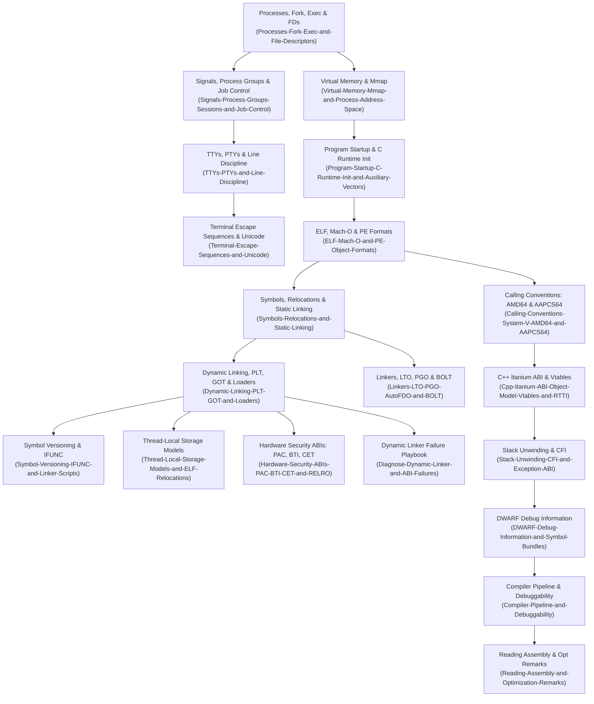

# Program Execution

Foundational mechanics governing how code is compiled, linked, loaded, and executed across Linux and macOS operating systems.
Owns the operating system process model, binary object representations, static and dynamic linking, runtime ABIs, calling conventions, stack unwinding, and low-level binary optimization.
Establishes the technical bedrock required to debug crashes, profile performance bottlenecks, and design robust build systems.

## Learning order

1. [[Program-Execution-Topic-Inventory]] - Authoritative specification inventory and coverage matrix.
2. [[Program-Execution-Skill-Ladder]] - Observable behavioral milestones from L4 to L8+.
3. [[Processes-Fork-Exec-and-File-Descriptors]] - Process creation, file descriptor inheritance, copy-on-write, and execve.
4. [[Signals-Process-Groups-Sessions-and-Job-Control]] - Asynchronous signals, disposition tables, sessions, and terminal process groups.
5. [[Proc-Filesystem-and-Process-Credentials]] - Kernel process introspection via /proc and credential transitions.
6. [[TTYs-PTYs-and-Line-Discipline]] - Teletype subsystem, pseudoterminals, and termios line disciplines.
7. [[Terminal-Escape-Sequences-and-Unicode]] - ANSI/ECMA-48 escape codes, terminal modes, and Unicode character width.
8. [[Virtual-Memory-Mmap-and-Process-Address-Space]] - Address space layout, ASLR, mmap flags, and memory consumption metrics.
9. [[Program-Startup-C-Runtime-Init-and-Auxiliary-Vectors]] - Kernel-to-user transition, auxiliary vectors, vDSO, and runtime initialization.
10. [[ELF-Mach-O-and-PE-Object-Formats]] - Structural anatomy of ELF, Mach-O, and PE object containers.
11. [[Symbols-Relocations-and-Static-Linking]] - Symbol binding, visibility, archive extraction, and static relocation calculations.
12. [[Dynamic-Linking-PLT-GOT-and-Loaders]] - Position-independent code, PLT/GOT lazy binding, and dynamic loader resolution.
13. [[Symbol-Versioning-IFUNC-and-Linker-Scripts]] - GNU symbol versioning, dynamic IFUNC dispatch, and linker script control.
14. [[Thread-Local-Storage-Models-and-ELF-Relocations]] - TLS access models, thread pointers, and static TLS exhaustion limits.
15. [[Hardware-Security-ABIs-PAC-BTI-CET-and-RELRO]] - RELRO, stack canaries, ARM PAC/BTI, Intel CET, and Darwin chained fixups.
16. [[Calling-Conventions-System-V-AMD64-and-AAPCS64]] - Register conventions, stack frame layout, and procedure call standards.
17. [[Cpp-Itanium-ABI-Object-Model-Vtables-and-RTTI]] - Object layout, virtual table structures, RTTI, and C++ symbol mangling.
18. [[Stack-Unwinding-CFI-and-Exception-ABI]] - Frame pointer chaining, DWARF CFI, compact unwinding, and two-phase exception handling.
19. [[DWARF-Debug-Information-and-Symbol-Bundles]] - DWARF DIE hierarchies, line tables, Split DWARF, and symbol packages.
20. [[Compiler-Pipeline-and-Debuggability]] - Compiler optimization passes and their impact on debuggability.
21. [[Reading-Assembly-and-Optimization-Remarks]] - Systematic assembly inspection, Compiler Explorer, and compiler remarks.
22. [[Linkers-LTO-PGO-AutoFDO-and-BOLT]] - Linker performance, ThinLTO, profile-guided optimization, and BOLT binary layout.
23. [[macOS-vs-Linux-Toolchain-Mechanics]] - Darwin security boundaries, SIP, codesigning, Mach task ports, and Linux differences.
24. [[Program-Execution-Decision-Records]] - Architectural decision records for linking, unwinding, and optimization at scale.
25. [[Diagnose-Dynamic-Linker-and-ABI-Failures]] - Operational playbook for dynamic loader crashes and missing symbol triage.
26. [[Drill-Program-Execution-Broken-Rpath-and-Symbol-Interposition]] - Problem drill: resolving broken runpath lookups and symbol preemption.
27. [[Drill-Program-Execution-Stripped-Binary-Crash-and-Split-DWARF]] - Problem drill: symbolication of stripped binary crashes using Split DWARF.
28. [[Drill-Program-Execution-Cross-DSO-Exception-and-RTTI-Failure]] - Problem drill: diagnosing cross-DSO C++ exception and RTTI visibility aborts.

Related books: [[19-Shell-and-Unix-Engineering/01-Unix-Process-Model/README.md\|19-Shell-and-Unix-Engineering (Process Model)]], [[01-CS-Foundations/Operating-Systems/README.md\|01-CS-Foundations (Operating Systems)]], and [[02-Programming-Languages/C++/CPP_Zero_to_Godhood/Volume_08_Advanced_Systems/Chapter_102_Linking_Loading_ABI/Chapter_102_Linking_Loading_ABI_and_WPO.md\|C++ Zero to Godhood (Ch 102 Linking & ABI)]].
