# Command Line

The developer command-line environment, shell execution semantics, text stream processing, remote access, and agent-friendly interface design.
Owns POSIX shell grammar, expansion stages, pipeline buffering, process management, high-performance search, terminal multiplexing, SSH infrastructure, and reproducible workstation environments.
Establishes the command-line discipline required to build robust automation, inspect production systems, and design interfaces for autonomous AI coding agents.

```mermaid
flowchart TD
    Parse["Shell Parsing & Expansion Order<br/>(Shell-Parsing-Tokenization-and-Expansion-Order)"] --> Pipe["Pipelines, Redirection & Subshells<br/>(Pipelines-Subshells-Redirection-and-Process-Substitution)"]
    Pipe --> Buf["Pipe Buffering & Stdbuf<br/>(Pipe-Buffering-and-Stdbuf)"]
    Parse --> Comp["Shells Compared: sh, bash, zsh, fish<br/>(POSIX-sh-Bash-Zsh-and-Fish-Compared)"]
    Pipe --> Script["Robust Scripting & ShellCheck<br/>(Robust-Shell-Scripting-and-ShellCheck)"]
    Regex["Regex Engines & ReDoS<br/>(Regex-Engines-Automata-Backtracking-and-ReDoS)"] --> Rg["Ripgrep Internals & Text Search<br/>(Ripgrep-Internals-and-Fast-Text-Search)"]
    Parse --> Sed["Sed & Awk Stream Processing<br/>(Sed-and-Awk-Stream-Processing)"]
    Pipe --> Data["Data Wrangling: jq, yq, Coreutils<br/>(Structured-Data-Wrangling-Jq-Yq-and-Coreutils)"]
    Pipe --> Batch["File Discovery: find, xargs, parallel<br/>(File-Discovery-and-Batch-Execution-Find-Fd-Xargs-Parallel)"]
    Data --> Locale["Locale, Collation & Unicode<br/>(Locale-Collation-and-Unicode-in-CLI-Tools)"]
    Data --> Logs["Analyze Gigabyte Terminal Logs<br/>(Analyze-Gigabyte-Terminal-Logs)"]
    Rg --> Logs
    Buf --> Logs
    Tmux["Tmux Architecture & Persistence<br/>(Tmux-Architecture-and-Session-Persistence)"] --> DrillSSH["Drill: SSH Mux & Broken PTY<br/>(Drill-Command-Line-SSH-Multiplexing-and-Broken-PTY)"]
    SSH["SSH in Depth: Forwarding & Keys<br/>(SSH-In-Depth-Keys-Forwarding-Certificates-and-FIDO2)"] --> Harden["Harden SSH Access With CAs & FIDO2<br/>(Harden-SSH-Access-With-Certificates-and-Hardware-Keys)"]
    SSH --> DrillSSH
    Edit["Modal Editing, LSP, Tree-Sitter, DAP<br/>(Modal-Editing-LSP-Tree-Sitter-and-DAP)"]
    Env["Dotfiles, Nix, Direnv, Mise, Containers<br/>(Dotfiles-Nix-Direnv-Mise-and-Devcontainers)"] --> Nix["Nix Store, Derivations & Flakes<br/>(Nix-Store-Derivations-and-Flakes-Internals)"]
    Sys["System Inspection & Syscall Tracing<br/>(System-Inspection-and-Syscall-Tracing-From-the-Shell)"]
    VM["Containers & VMs for macOS Dev<br/>(Containers-and-VMs-for-macOS-Development)"]
    AXI["CLI Design & AXI Principles<br/>(CLI-Design-and-Agent-Friendly-Interfaces-AXI)"]
    Pipe --> ShellRebuild["Rebuild a Minimal Shell<br/>(Rebuild-a-Minimal-Shell-With-Job-Control)"]
```

## Learning order

1. [[Command-Line-Topic-Inventory]] - Authoritative specification inventory and coverage matrix.
2. [[Command-Line-Skill-Ladder]] - Observable behavioral milestones from L4 to L8+.
3. [[Shell-Parsing-Tokenization-and-Expansion-Order]] - POSIX grammar, lexing, and the exact seven-stage word expansion sequence.
4. [[Pipelines-Subshells-Redirection-and-Process-Substitution]] - Kernel pipelines, file descriptors, subshells, and process substitutions.
5. [[Pipe-Buffering-and-Stdbuf]] - Kernel pipe buffers vs stdio line and block buffering, latency lag, and stdbuf.
6. [[POSIX-sh-Bash-Zsh-and-Fish-Compared]] - Architectural and language divergences across sh, bash, zsh, and fish.
7. [[Robust-Shell-Scripting-and-ShellCheck]] - Strict mode pitfalls, signal traps, mktemp safety, and ShellCheck static analysis.
8. [[Regex-Engines-Automata-Backtracking-and-ReDoS]] - Automata theory (NFA/DFA) vs backtracking engines and ReDoS prevention.
9. [[Ripgrep-Internals-and-Fast-Text-Search]] - Substring literal extraction, SIMD Teddy prefiltering, and parallel directory walks.
10. [[Sed-and-Awk-Stream-Processing]] - Sed cycle state machines, hold space buffers, and gawk record/field stream programming.
11. [[Structured-Data-Wrangling-Jq-Yq-and-Coreutils]] - Relational terminal wrangling with coreutils joins, sort stability, and jq filters.
12. [[File-Discovery-and-Batch-Execution-Find-Fd-Xargs-Parallel]] - Directory traversal with find/fd, NUL separation, and xargs/parallel worker pools.
13. [[Locale-Collation-and-Unicode-in-CLI-Tools]] - LC_ALL byte vs collation modes, regex character ranges, and UTF-8 normalization.
14. [[Analyze-Gigabyte-Terminal-Logs]] - Operational runbook for gigabyte log triage using parallel decompression and streaming pipelines.
15. [[Tmux-Architecture-and-Session-Persistence]] - Terminal multiplexer client-server sockets, PTY hierarchies, and control mode.
16. [[SSH-In-Depth-Keys-Forwarding-Certificates-and-FIDO2]] - OpenSSH transport, agent forwarding hazards, ProxyJump, and security keys.
17. [[Harden-SSH-Access-With-Certificates-and-Hardware-Keys]] - Operational playbook for deploying SSH User/Host CAs and FIDO2 resident keys.
18. [[Modal-Editing-LSP-Tree-Sitter-and-DAP]] - Modal editing, Language Server Protocol lifecycle, Tree-sitter queries, and DAP.
19. [[Dotfiles-Nix-Direnv-Mise-and-Devcontainers]] - Dotfile managers, directory environment hooks (direnv), mise shims, and devcontainers.
20. [[Nix-Store-Derivations-and-Flakes-Internals]] - Cryptographic store paths, derivation realization, sandboxing, and flake hermeticity.
21. [[System-Inspection-and-Syscall-Tracing-From-the-Shell]] - Live system triage via ps, lsof, ss, /proc, and syscall tracing with strace.
22. [[Containers-and-VMs-for-macOS-Development]] - Hypervisor virtualization, bind-mount filesystem latency, Rosetta 2, and virtual networks.
23. [[CLI-Design-and-Agent-Friendly-Interfaces-AXI]] - Human-first CLI design standards and the 10 AXI principles for AI agents.
24. [[Command-Line-Decision-Records]] - Architectural decision records for language migration, dev environments, and remote access.
25. [[Rebuild-a-Minimal-Shell-With-Job-Control]] - Implementation blueprint for rebuilding a POSIX shell with job control in C++ or Rust.
26. [[Drill-Command-Line-Quoting-and-Signal-Trap-Race]] - Problem drill: resolving quoting hazards, subshell variable leaks, and trap races.
27. [[Drill-Command-Line-Catastrophic-Backtracking-and-Stream-Bottleneck]] - Problem drill: mitigating catastrophic regex backtracking and stdio buffer deadlocks.
28. [[Drill-Command-Line-SSH-Multiplexing-and-Broken-PTY]] - Problem drill: recovering hung SSH multiplexing sockets and wedged raw terminal states.

Related books: [[19-Shell-and-Unix-Engineering/README.md\|19-Shell-and-Unix-Engineering]], [[13-Agentic-AI/Agentic-Harness/components/axi.md\|Agentic AI Harness (AXI)]], and [[15-Technical-Whitepapers/08-Developer-Tooling-and-Foundations/Developer-Tooling-and-SysAdmin.md\|Technical Whitepapers (Developer Tooling)]].
