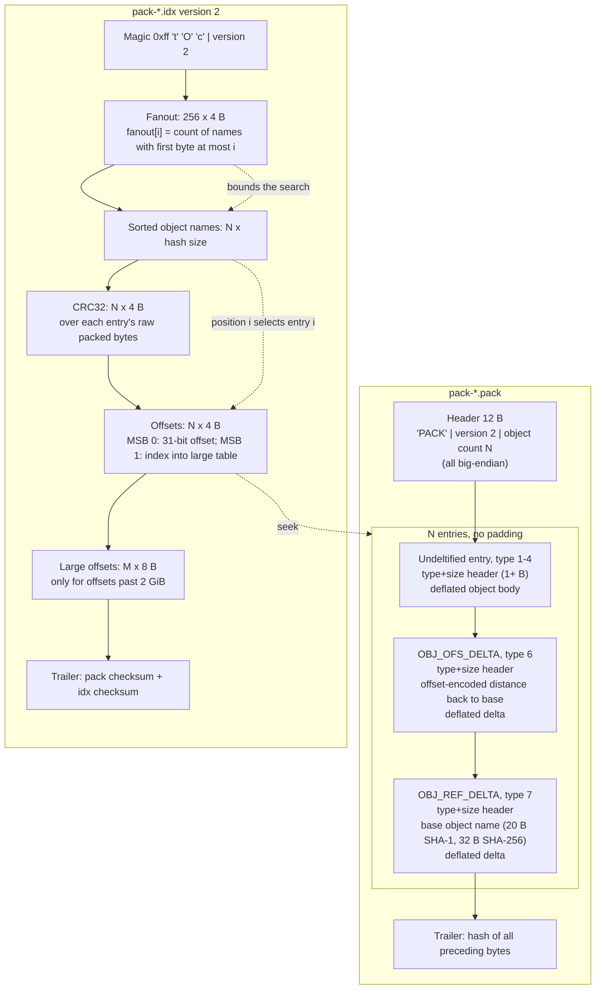
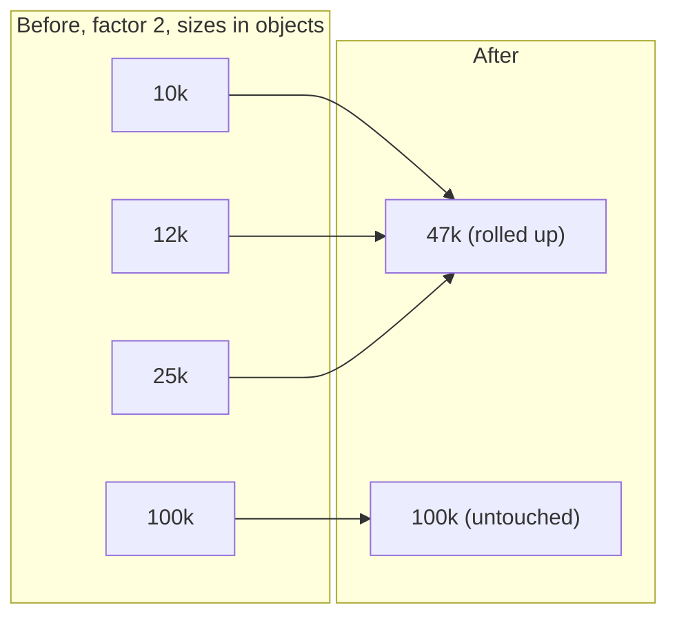

# Git Packfiles and Delta Compression

> [!summary] Claim:
> A packfile is a 12-byte header (`PACK`, version 2, object count), a run of zlib-deflated entries, and a trailing checksum of everything before it; the companion `.idx` v2 file maps object names to pack offsets.
> Each entry starts with a 3-bit type and a variable-length size, and a delta entry adds its base either as a backwards byte offset inside the same pack (`OBJ_OFS_DELTA`, type 6) or as a full object name (`OBJ_REF_DELTA`, type 7).
> A delta is a stream of copy-from-base and insert-literal instructions, and `git pack-objects` chooses bases by sorting objects by type, a path name-hash, and descending size, then trying each object against a sliding window of earlier candidates (default window 10, depth 50).
> Lookup is a fanout-bounded binary search over a sorted table of names, and the per-object CRC32 in `.idx` v2 lets repack copy compressed bytes between packs without inflating them to check for corruption.



## The Mechanism

[[Git-Object-Model-and-Content-Addressing]] owns loose objects: each object is a separate zlib file under `.git/objects/??/`.
One file per object costs a filesystem block, an inode, and a directory entry per object, and a loose object can never share bytes with a similar object.
A pack fixes both problems: it stores many objects in one file and stores most of them as deltas against similar objects.
Every format fact below is from `gitformat-pack` in Git 2.55.0 unless another source is named.

### 1. The `.pack` file

A pack starts with a 12-byte header:

- A 4-byte signature `PACK` (`0x5041434b`).
- A 4-byte version in network byte order; Git accepts version 2 or 3 but generates only version 2 (as of 2026-10, Both).
- A 4-byte object count in network byte order, so one pack holds at most 2^32 - 1 objects.

The header is followed by the entries, back to back, and then a trailer holding the checksum of all preceding bytes.
In a SHA-1 repository the trailer is 20 bytes; in a SHA-256 repository it is 32 bytes.

#### The entry header: type and size

A packed entry does not carry the loose-object prefix `"<type> <size>\0"`; Git rebuilds that prefix from the entry header when it needs the object name.
The first header byte holds three fields:

- Bit 7: continuation flag, set when another size byte follows.
- Bits 6..4: the 3-bit object type.
- Bits 3..0: the low 4 bits of the size.

Each continuation byte contributes 7 more bits, least significant group first:

$$\text{size} = (b_0 \,\&\, \text{0x0F}) \;|\; \sum_{i=1}^{k} (b_i \,\&\, \text{0x7F}) \ll (4 + 7(i-1))$$

| Constant | Type code | Bits 6..4 | Meaning |
| :--- | :--- | :--- | :--- |
| `OBJ_COMMIT` | 1 | `001` | Commit |
| `OBJ_TREE` | 2 | `010` | Tree |
| `OBJ_BLOB` | 3 | `011` | Blob |
| `OBJ_TAG` | 4 | `100` | Annotated tag |
| (reserved) | 5 | `101` | Reserved for future expansion |
| `OBJ_OFS_DELTA` | 6 | `110` | Delta whose base is at a backwards offset in this pack |
| `OBJ_REF_DELTA` | 7 | `111` | Delta whose base is named by object ID |

Type 0 is invalid.
For an undeltified entry the size is the size of the uncompressed object.
For a delta entry the size is the size of the uncompressed delta, not of the object it rebuilds, which is why `git verify-pack -v` reports small sizes for deltas.

#### Naming the base: OFS_DELTA and REF_DELTA

`OBJ_REF_DELTA` follows the header with the base's full object name (20 bytes for SHA-1, 32 for SHA-256).
The base may be elsewhere in the pack or, in a thin pack sent over the network, not in the pack at all; `git index-pack --fix-thin` appends such missing bases so that the pack stored on disk is self-contained.

`OBJ_OFS_DELTA` follows the header with a distance measured backwards from the first byte of this entry's header to the first byte of the base's header.
It was added in Git 1.4.4 (2006) without a pack version bump, so it is negotiated: the `ofs-delta` protocol capability enables it on the wire, and `repack.useDeltaBaseOffset` (default true) enables it on disk.
The distance uses an "offset encoding" that differs from the size encoding: most significant group first, and each continuation adds a bias.

```text
offset = byte & 0x7F
while byte & 0x80:
    byte = next_byte()
    offset = ((offset + 1) << 7) | (byte & 0x7F)
base_entry_start = this_entry_start - offset
```

The `+ 1` bias means a two-byte encoding starts where the one-byte range ends, so every distance has exactly one encoding and no byte is wasted on redundant forms.
A typical offset fits in 1 to 4 bytes, against 20 or 32 bytes for a base name, and resolving it needs no index lookup.

### 2. The delta instruction stream

Inflating a delta entry yields a delta, the format produced by Git's `diff-delta.c` and applied by `patch-delta.c`.
`diff-delta.c` says it was "greatly inspired by parts of LibXDiff" and rewritten for Git by Nicolas Pitre; it indexes the base in 16-byte Rabin-fingerprint blocks (`RABIN_WINDOW 16` at v2.55.0).

The delta begins with two size-encoded integers, 7 bits per byte, least significant group first:

1. The size of the base object.
2. The size of the object to rebuild.

$$\text{value} = \sum_{i=0}^{m} (b_i \,\&\, \text{0x7F}) \ll 7i$$

`patch_delta()` rejects the delta if the first size differs from the actual base size, then allocates exactly the target size.
The rest of the delta is a sequence of instructions selected by bit 7 of the first byte.

#### Copy from base: `1xxxxxxx`

```text
+----------+---------+---------+---------+---------+-------+-------+-------+
| 1xxxxxxx | offset1 | offset2 | offset3 | offset4 | size1 | size2 | size3 |
+----------+---------+---------+---------+---------+-------+-------+-------+
```

- Bits 0..3 say which of the four little-endian offset bytes are present.
- Bits 4..6 say which of the three little-endian size bytes are present.
- An omitted byte is zero and does not shift the others, so `10000101` carries offset1 and offset3 only.
- A size that decodes to zero means `0x10000` (65,536) bytes.

```text
offset = 0; size = 0
for i in 0..3: if op & (1 << i):       offset |= next_byte() << (8 * i)
for i in 0..2: if op & (1 << (4 + i)): size   |= next_byte() << (8 * i)
if size == 0: size = 0x10000
```

Git's encoder caps one copy at `0x10000` bytes ("A copy op is currently limited to 64KB (pack v2)" in `diff-delta.c`) and writes only size1 and size2, so it never sets bit 6 (as of 2026-10, Both).
A copy of exactly `0x10000` bytes has zero in both low size bytes, so the encoder emits no size bytes and the decoder's zero rule restores 65,536.
A decoder must still accept bit 6, because the format defines size3 and `patch-delta.c` parses it.

#### Insert literal: `0xxxxxxx`

The low 7 bits give a length from 1 to 127, and that many literal bytes follow the opcode.
The byte `0x00` is reserved for future expansion, and `patch_delta()` fails on it with "unexpected delta opcode 0".

`patch_delta()` also fails when a copy reaches past the end of the base, when an instruction would overrun the declared target size, or when the stream ends without producing exactly that size ("delta replay has gone wild").

### 3. Choosing bases: `git pack-objects`

Git does not delta along commit history.
It collects the objects to pack, sorts them, and slides a window over the sorted list, as described in Jon Loeliger's `pack-heuristics` write-up and implemented in `builtin/pack-objects.c`.

#### The sort

`type_size_sort()` at v2.55.0 compares, in order:

1. Object type, so only objects of the same type are adjacent; `try_delta()` refuses any pair of different types.
2. The name-hash of the path the object was reached through.
3. Whether the object is a preferred base (an object the receiver already has).
4. Delta-island order, when delta islands are enabled.
5. Size, largest first.
6. Original list position, which the source comments as "newest first".

The default name-hash (version 1) is `pack_name_hash()`:

```c
static inline uint32_t pack_name_hash(const char *name)
{
	uint32_t c, hash = 0;

	if (!name)
		return 0;

	while ((c = *name++) != 0) {
		if (isspace(c))
			continue;
		hash = (hash >> 2) + (c << 24);
	}
	return hash;
}
```

Each character pushes earlier ones two bits down, so the hash is dominated by the last 16 non-whitespace characters of the path.
Every revision of `src/main.c` gets the same hash, and files with similar endings, such as other `main.c` files in other directories, sort near it, which is how Git finds deltas across renames.
The same property causes collisions in trees with many files that share a basename, which is why Git 2.49 added `--name-hash-version=2` (hashes each path component and salts with parent directories) and Git 2.51 added `--path-walk` (groups by full path first); version 2 cannot be used when writing a bitmap index and is changed to version 1 there.

#### The window

`find_deltas()` keeps the last `pack.window` objects in a circular array and tries each new object as a target against the other `pack.window - 1` entries, which are the same type, usually the same name-hash, and usually larger.
`try_delta()` skips a pair when:

- The candidate base is already at the maximum depth.
- The size difference alone exceeds the size budget, which starts at `target_size / 2 - hash_size` and shrinks as the base's depth approaches the maximum.
- The target is smaller than 1/32 of the base.
- Delta islands are enabled and the pair is not in the same island.

Objects under 50 bytes are never delta targets (`should_attempt_deltas()`), and Git keeps the smallest delta found for each target.
Sorting larger objects first means most deltas rebuild a smaller object from a larger one; the heuristics document gives the reasons as "files grow", so larger usually means newer, and removing data is cheaper to encode than adding it, because removal needs only copy instructions.

#### Depth

A base can itself be a delta, so a read may walk a chain such as D -> C -> B -> A.
`pack.depth` bounds that chain (default 50, maximum 4095, as of 2026-10, Both), trading pack size against the CPU cost of reading old revisions.
The newest revision of a file tends to be stored whole, so checkouts of recent history usually touch short chains, but this is a heuristic outcome, not a guarantee.

### 4. The `.idx` version 2 file

Index version 2 dates from Git 1.5.2 and is the default; Git forces version 2 whenever the pack is larger than 2 GB, whatever `pack.indexVersion` says.
For hash size H and L large offsets, its layout is:

- A 4-byte magic `\377tOc` (`0xff744f63`), chosen because it is an impossible `fanout[0]` value in a version 1 index, which starts directly with the fanout.
- A 4-byte version number, 2.
- A 256-entry fanout table of 4-byte network-order counts, where `fanout[i]` is the number of objects whose first name byte is at most `i`, so `fanout[255]` is N.
- N sorted object names of H bytes each, packed together "without offset values to reduce the cache footprint of the binary search".
- N 4-byte CRC32 values, each computed with zlib's CRC32 over the entry's whole packed form: header, base name or offset, and compressed data.
- N 4-byte offsets in network order; when the most significant bit is set, the low 31 bits index the large-offset table instead.
- L 8-byte offsets, empty unless the pack is larger than 2 GiB; Git writes an entry there only for offsets above `0x7fffffff` (`pack-write.c`).
- A trailer holding a copy of the pack checksum followed by the checksum of all preceding index bytes.

The file size is therefore `8 + 1024 + N * (H + 8) + 8 * L + 2 * H` bytes, which the lab confirms.

A third companion file, `pack-*.rev` (magic `RIDX`), lists index positions in pack-offset order so Git can map an offset back to an object without building that table in memory; `pack.writeReverseIndex` defaults to true (as of 2026-10, Both).

### 5. Looking up an object

`bsearch_hash()` in `hash-lookup.c` resolves a name in four steps:

1. Take the first byte `b` and set `hi = fanout[b]` and `lo = fanout[b - 1]`, or `lo = 0` when `b` is `0x00`.
2. Binary search the names in `[lo, hi)`, which costs about log2(N / 256) comparisons, about 12 for a pack of one million objects.
3. Read offset entry `i`, following the large-offset table when the most significant bit is set.
4. Read the entry at that offset; if it is a delta, rebuild its base first, then apply the delta.

### 6. SHA-256 status (as of 2026-10, Both)

A repository created with `git init --object-format=sha256` computes object names, pack checksums, and index checksums with SHA-256, so every H in the layout becomes 32 bytes; the index stays at version 2, verified locally with Git 2.55.0.
`sha1` is still the default object format in Git 2.55.0.
`git-init` documents that there is no interoperability between SHA-256 and SHA-1 repositories at present.
`extensions.compatObjectFormat` exists, but its documentation calls it incomplete and "not designed to be enabled by end users".
[[Case-Study-SHAttered-SHA1-Collision-and-Git-Hardening]] covers why the migration matters.

## Commands and Numbers to Know

| Item | Value | Platform and date | What it controls |
| :--- | :--- | :--- | :--- |
| `pack.window` | `10` | Both (as of 2026-10) | Candidates tried per object; delta search CPU grows with it |
| `gc.aggressiveWindow` | `250` | Both (as of 2026-10) | Window used by `git gc --aggressive` |
| `pack.depth` | `50`, maximum `4095` | Both (as of 2026-10) | Longest delta chain written |
| `gc.aggressiveDepth` | `50` | Both (as of 2026-10) | Depth used by `git gc --aggressive` |
| `pack.windowMemory` | `0` (no limit) | Both (as of 2026-10) | Window memory per thread; set it when large blobs cause OOM during repack |
| `pack.threads` | unset or `0` = number of CPUs | Both (as of 2026-10) | Delta search threads; window memory multiplies by this count |
| `pack.deltaCacheSize` | 256 MiB | Both (as of 2026-10) | Memory for caching computed deltas until they are written |
| `pack.deltaCacheLimit` | `1000` bytes, maximum `65535` | Both (as of 2026-10) | Largest single delta that is cached |
| `pack.compression` | `core.compression`, else `-1` (zlib default, level 6) | Both (as of 2026-10) | Deflate level for pack entries |
| `pack.packSizeLimit` | unlimited | Both (as of 2026-10) | Splits packs on repack; the docs call it rarely useful because deltas never cross packs |
| `pack.indexVersion` | `2` | Both (as of 2026-10) | Index format; version 2 is forced for packs over 2 GB |
| `repack.useDeltaBaseOffset` | `true` | Both (as of 2026-10) | Writes `OBJ_OFS_DELTA` instead of `OBJ_REF_DELTA` on disk |
| `pack.writeReverseIndex` | `true` | Both (as of 2026-10) | Writes the `.rev` file next to each new pack |
| `--name-hash-version` | `1` | Both (as of 2026-10) | `2` reduces basename collisions; not allowed with bitmaps |
| Pack header | `PACK`, version `2`, count | Both (as of 2026-10) | 12 bytes, big-endian; versions 2 and 3 are read |
| Index magic | `0xff744f63` (`\377tOc`) | Both (as of 2026-10) | Identifies index version 2 and later |
| Large-offset flag | `0x80000000` | Both (as of 2026-10) | MSB of a 4-byte offset entry |
| Copy size zero | means `0x10000` | Both (as of 2026-10) | Git's encoder also caps one copy at 64 KiB |
| Insert length | 1 to 127 | Both (as of 2026-10) | Opcode `0x00` is reserved and rejected |
| Smallest delta target | 50 bytes | Both (as of 2026-10) | Smaller objects are always stored whole |
| `git verify-pack -v` | `name type size size-in-pack offset [depth base]` | Both (as of 2026-10) | Lists every entry, then a chain-length histogram |

## Multi-Language Comparison: C / Python / Rust

Git itself is written in C, and C++ tools usually reach packs through Git or the C library libgit2, so the reference column is C.

| Concern | C (git v2.55.0) | Python (this lab; Dulwich) | Rust (gitoxide `gix-pack`) |
| :--- | :--- | :--- | :--- |
| Index access | `xmmap()` of the whole `.idx` in `packfile.c` | Lab reads the file into `bytes`; Dulwich uses `mmap` when available | `memmap2` crate |
| Name lookup | `bsearch_hash()`: fanout bounds, then binary search with a fixed stride | Lab's `find_offset()`: fanout bounds, then binary search over the raw 20-byte name table, no `dict`; Dulwich has `bisect_find_sha()` | Binary search over the mapped name table |
| Pack access | Sliding `mmap` windows sized by `core.packedGitWindowSize` | Lab slices the whole pack held in memory | `memmap2` crate |
| Inflate | zlib through Git's `git_inflate()` wrappers | `zlib.decompressobj()` | `gix-zlib`, built on the pure-Rust `zlib-rs` crate |
| Delta apply | `patch_delta()`: allocate exact target size, `memcpy` per instruction, bounds-check each copy | `bytearray.extend()` per instruction, size checks at start and end | Rust buffer copies into a preallocated `Vec<u8>` |
| CRC32 | zlib `crc32()` | `zlib.crc32()` in the lab; `binascii.crc32()` in Dulwich | `crc32fast` crate |

The Rust and Dulwich entries reflect the projects' `main` branches as of 2026-10.

## Worked Lab Example

The lab is `code/02-Version-Control/packfile_parser/`; it needs only `git` and `python3`.

`run.sh` builds a deterministic repository: fixed author and committer identities and dates, `GIT_CONFIG_GLOBAL=/dev/null`, and `LC_ALL=C`.
It commits a 500-line `code.c` (15,000 bytes), then six revisions that each rewrite 20 lines and append one, and packs everything with `git -c pack.threads=1 gc --prune=now`.
One thread keeps the delta search, and therefore the pack bytes, reproducible.

`packfile.py` then parses the pack with the standard library only:

1. It checks the `.idx` magic and version, reads the fanout, the name table, the CRC32 table, and the 4-byte offsets, and follows the large-offset table when the MSB is set.
2. It verifies both trailers before trusting either file: the pack's trailing SHA-1 over all preceding pack bytes, the index's trailing SHA-1 over all preceding index bytes, and the index's copy of the pack checksum against the pack's own; any failure raises an error.
3. It rejects a fanout table that is not monotonic, then looks names up with `find_offset()`, which narrows the range with the fanout entries for the first name byte and binary searches the raw name table, so no name-to-offset `dict` is built.
4. It checks the `.pack` header for `PACK`, version 2, and an object count equal to `fanout[255]`.
5. For every entry it decodes the type and size header, decodes the `OBJ_OFS_DELTA` distance or reads the `OBJ_REF_DELTA` base name (resolved through `find_offset()`), inflates the payload, and computes the CRC32 of the raw entry bytes.
6. It resolves delta chains iteratively: it walks from the target down to a whole object or an already rebuilt one, then applies the collected deltas back up, so chain depth never touches the Python recursion limit.
7. It applies deltas with the copy rules above, including size3 and the `0x10000` rule, rejects opcode `0x00`, and checks both the base size and the target size.
8. It raises an error unless every entry's CRC32 matches the index and every rebuilt object's SHA-1 of `"<type> <size>\0" + body` equals its name, so a clean run means all 21 objects passed both checks.
9. It prints type counts and a depth histogram, then feeds every name to `git cat-file --batch` and compares each rebuilt object's type and bytes with Git's own output, which matched for 21 of 21 objects.
10. Last, it resolves three fixed blobs through `find_offset()` and compares their rebuilt sizes with `git cat-file -s`.

```bash
cd code/02-Version-Control/packfile_parser
bash run.sh
```

### Verified output

Recorded by `make record` on darwin-arm64 on 2026-10-25 and re-checked by `make verify`; the file is `code/02-Version-Control/packfile_parser/expected/darwin-arm64.txt`.

```text
Objects total: 21

Object counts by type:
  blob: 7
  commit: 7
  tree: 7

Delta-chain depth histogram:
  chain length 0: 15
  chain length 1: 1
  chain length 2: 1
  chain length 3: 1
  chain length 4: 1
  chain length 5: 1
  chain length 6: 1

Trailer checksums: pack SHA-1 OK, idx SHA-1 OK, idx copy of pack checksum OK

Byte-for-byte match with git cat-file --batch: 21/21 objects

Spot checks (fanout binary search, then git cat-file -s):
  ee4882e3d2e51878fc2e905dbcf7e762dd5c5c18 (base blob, depth 0): size=17352 (git: 17352) OK
  552d35aa8847740dfa7b1417590d32b7c478bdd6 (delta blob, depth 1): size=16960 (git: 16960) OK
  97b8f0240c0a7de782f9d49f50d9f276766cb3d8 (delta blob, depth 6): size=15000 (git: 15000) OK
```

### Reading the result

- The whole blob at depth 0 is the newest and largest revision (17,352 bytes), and the depth 6 blob is the original 15,000-byte file, which is the larger-first sort at work: Git rebuilds old revisions from new ones.
- The seven trees are 34 bytes each, below the 50-byte threshold, so they are never deltified, and no commit found a delta under its size budget, which accounts for the 15 objects at depth 0.
- `git verify-pack -v` on the same repository (Git 2.55.0, darwin-arm64) agrees: `non delta: 15 objects` and one object at each chain length from 1 to 6.
- It also shows the entry-header size rule: the depth 1 blob is listed as `blob 139 106 2554 1 ee4882e3...`, a 139-byte delta stored in 106 bytes that rebuilds a 16,960-byte object.
- The `.idx` is 1,660 bytes, which equals `8 + 1024 + 21 * (20 + 8) + 2 * 20`, and the `.pack` is 3,434 bytes for seven blob revisions that are each at least 15,000 bytes uncompressed.

## Pitfalls

> [!warning] Pitfall: measuring the OFS_DELTA distance from the wrong byte
> The distance is measured back from the first byte of the delta entry's type and size header, and it lands on the first byte of the base's header.
> Subtracting from the end of the header or from the start of the compressed data points into the middle of another entry and fails as a zlib or type error.

> [!warning] Pitfall: treating a zero copy size as zero
> A copy whose size bytes are absent or zero copies 65,536 bytes.
> A decoder that copies nothing produces a short object, which a target-size check catches and a decoder without one turns into a wrong object name.

> [!warning] Pitfall: reading the entry header size as the object size
> For a delta entry the header size is the size of the delta, not of the rebuilt object.
> Use the target size inside the delta, or `git cat-file -s`, when you need the object's real size.

> [!warning] Pitfall: CRC32 over the wrong bytes
> The index CRC32 covers the entry's raw packed bytes, from the first header byte through the end of the compressed data, including any base offset or name.
> A CRC over the inflated body, or over the compressed data alone, never matches.

> [!warning] Pitfall: recursive delta resolution on untrusted packs
> `pack.depth` bounds chains that Git writes, but a corrupt or hostile pack can carry chains up to whatever its writer chose, or a REF_DELTA cycle.
> Resolve chains with an explicit stack, cap the depth, and detect cycles; Python's default recursion limit of 1000 is below Git's allowed depth of 4095.

> [!warning] Pitfall: hard-coding 20-byte names
> Object names, REF_DELTA bases, and both trailer checksums are 32 bytes in a SHA-256 repository.
> Read the hash size from the repository's `extensions.objectFormat` instead of assuming SHA-1.

> [!warning] Pitfall: reaching for `gc --aggressive` or `pack.packSizeLimit`
> `--aggressive` passes `-f`, which throws away every existing delta and recomputes it with window 250, and the `git-gc` documentation says not using it is the right trade-off for most repositories.
> `pack.packSizeLimit` splits packs that cannot share deltas and slows lookups, so it rarely helps.

## At Scale

A single developer never needs to think about packs: `git gc --auto` and `git maintenance` keep them healthy.
The problems start when one object store gets large, busy, or shared.

- A full repack (`git repack -a -d`) rewrites every object, and with `-f` recomputes every delta, so its cost grows with the whole repository rather than with recent changes.
- Unreachable objects must be kept for a grace period (`gc.pruneExpire`, default `2.weeks.ago`) because a concurrent push may still reference them, and keeping them loose brings back the one-file-per-object problem.
- A server reuses on-disk deltas when it builds a fetch pack, so a delta whose base the client will not receive must be recomputed per fetch.

The tools Git provides for these problems, as of Git 2.55.0:

| Tool | What it does | Introduced |
| :--- | :--- | :--- |
| `git repack --geometric=<factor>` | Rolls up only the smallest packs so each remaining pack holds at least `<factor>` times the objects of the next smaller one | Documented in Git 2.55.0 |
| Multi-pack index and its bitmaps | One index over many packs, and reachability bitmaps that span them | MIDX bitmaps in Git 2.34 |
| Cruft packs | Unreachable objects in one pack with a `.mtimes` table of 4-byte epoch seconds; `gc.cruftPacks` defaults to true | Git 2.37 |
| `git maintenance` geometric strategy | Geometric repacks plus auxiliary structures, with a cruft pack on an all-into-one repack | Git 2.52, default since Git 2.54 |
| Delta islands (`pack.island`) | Refuses a delta from object A against a base not present in all of A's islands | Long-standing; see `git-pack-objects` |



In the diagram, 12k is less than twice 10k, so those two roll up into 22k; 25k is less than twice 22k, so it joins them; 100k is at least twice 47k, so it stays.

Decision rules:

- One developer to a few hundred engineers on an ordinary repository: leave `pack.window`, `pack.depth`, and compression at their defaults and let `git maintenance` run; tune only after measuring a specific problem.
- From about 1,000 to 50,000 engineers sharing a server-side store, the server, not the laptop, is where pack policy matters; give it an owner, metrics on pack count and fetch CPU, and the rules below.
- When a full repack no longer fits the maintenance window, switch the server to geometric repacking with a multi-pack index and MIDX bitmaps, and reserve all-into-one repacks for rare, scheduled runs.
- When many forks or ref groups share one object store and clients fetch them separately, configure delta islands so that served deltas never cross a group boundary; the cost is a slightly larger pack.
- When blame or log over old history is the hot path, measure with a lower `--depth` before shipping it, because shorter chains trade disk and transfer size for read CPU.
- Use `--aggressive` or a large window only as a one-time repack after a bulk import, and only when a benchmark shows the gain is worth the CPU.

[[Git-GC-Maintenance-MIDX-and-Commit-Graph]] owns the maintenance schedule, and [[Git-At-Scale-VFS-Scalar-and-Monorepos]] owns client-side scaling.

## Practice Drill

> [!tip] Practice Drill:
> Build a five-revision repository and predict two things before running `git verify-pack -v`: which blob is stored whole, and whether the other blobs form one chain, as in the lab, or all point at the same base.
> Hand-decode the first bytes of a delta blob's entry from the `xxd` dump: the type bits must give 6 (`OBJ_OFS_DELTA`), the size bits must give the delta size `verify-pack` prints, and the offset-encoded distance subtracted from the entry's offset must give the base's offset.
> Then run a corrupted-byte experiment on a copy of the lab's repository: flip one byte inside a delta entry's compressed data and predict which of the lab's checks fails first, then rewrite the pack trailer and the index's copy of it (and the index trailer) with `hashlib` so the corruption gets past the trailer checks, and predict which per-entry check (CRC32, inflate, delta size, object SHA-1) catches it next.
> As a stretch, extend a copy of `packfile.py` to read SHA-256 repositories (`git init --object-format=sha256`): take the hash size from `extensions.objectFormat`, use 32-byte names, REF_DELTA bases, and trailers, and hash with `hashlib.sha256`.
> On Git 2.55.0 (darwin-arm64) the four older blobs all deltify directly against the newest one, and the first delta entry starts `e5 02 87 39`: type 6, size 37, distance 1081.

```bash
export GIT_CONFIG_GLOBAL=/dev/null
DIR=$(mktemp -d) && cd "$DIR"
git init -q
git config user.name "Drill Engineer"
git config user.email "drill@example.com"

for i in 1 2 3 4 5; do
    python3 -c "
import sys
i = int(sys.argv[1])
rows = [f'row {j:04d} common payload line\n' for j in range(400)]
rows[i * 10] = f'row {i * 10:04d} changed in revision {i}\n'
rows += [f'extra row for revision {k}\n' for k in range(i)]
open('data.txt', 'w').writelines(rows)
" "$i"
    git add data.txt
    GIT_AUTHOR_DATE="2026-10-25T12:00:0${i}Z" GIT_COMMITTER_DATE="2026-10-25T12:00:0${i}Z" \
        git commit -q -m "revision $i"
done

git -c pack.threads=1 repack -a -d -f -q --window=50 --depth=50
PACK=$(ls .git/objects/pack/*.pack)
IDX=$(ls .git/objects/pack/*.idx)

git verify-pack -v "$IDX" | grep blob
git verify-pack -v "$IDX" | tail -n 4

# Offset of the first deltified blob (a delta line has 7 columns).
OFFSET=$(git verify-pack -v "$IDX" | awk '$2 == "blob" && NF == 7 {print $5; exit}')
xxd -s "$OFFSET" -l 4 "$PACK"

python3 -c "
import struct, sys
data = open(sys.argv[1], 'rb').read()
magic, version = struct.unpack('>4sI', data[:8])
fanout = struct.unpack('>256I', data[8:1032])
print(magic, version, 'objects:', fanout[255], 'idx bytes:', len(data))
" "$IDX"

cd / && rm -rf "$DIR"
```

## Interview Questions

> [!question] L5: How does Git's choice of delta base differ from file-by-file history deltas in RCS-style systems?
>
> > [!success]- Answer
> > RCS-style systems store each revision of a file as a delta against an adjacent revision of the same file.
> > Git ignores history when it picks bases: `pack-objects` sorts all objects to pack by type, path name-hash, and descending size, then tries each object against the earlier objects in a sliding window of `pack.window` entries.
> > Because the name-hash is dominated by the last characters of the path, a base can be a revision on another branch, a renamed file, or a same-named file in another directory.
> > The trade-off is CPU at pack time, which is why window and depth are bounded and why existing deltas are reused instead of recomputed.

> [!question] L5: `git verify-pack -v` lists a blob with size 139 that `git cat-file -s` reports as 16,960 bytes; which one is wrong?
>
> > [!success]- Answer
> > Neither is wrong.
> > For a delta entry, the size in the entry header, which `verify-pack` prints, is the size of the uncompressed delta, here 139 bytes.
> > The size of the rebuilt object is the target size stored at the start of the delta, which is what `cat-file -s` reports.
> > The extra columns on that line, chain depth and base name, are the tell that the entry is a delta.

> [!question] L6: Why does the version 2 index keep names, CRCs, and offsets in separate tables instead of one record per object?
>
> > [!success]- Answer
> > The binary search touches only names, so packing names together keeps every byte the search loads useful; `gitformat-pack` gives exactly this reason.
> > With 20-byte names a 64-byte cache line holds 3.2 names, while a 28-byte record of name and offset would hold about 2.3.
> > The fanout table first narrows the search to objects sharing the first byte, so a lookup costs about log2(N / 256) comparisons.
> > Offsets and CRCs are read once, after the position is known, so their layout barely matters for lookup speed.

> [!question] L6: Walk through decoding an `OBJ_OFS_DELTA` entry, and explain why Git keeps both delta types.
>
> > [!success]- Answer
> > Read the first byte: bits 6..4 are the type (6), the low 4 bits start the delta size, and each byte with bit 7 set adds 7 more size bits, low group first.
> > Then read the distance in offset encoding: start with the low 7 bits and, for each continuation byte, compute `((offset + 1) << 7) | (byte & 0x7F)`.
> > The base entry starts at this entry's first header byte minus that distance, and the zlib stream that follows is the delta.
> > `OBJ_REF_DELTA` came first and names the base by object ID; `OBJ_OFS_DELTA` arrived in Git 1.4.4 to save the 20-byte name and the index lookup.
> > REF_DELTA remains necessary for thin packs, whose bases are not in the pack at all, and for peers that do not advertise the `ofs-delta` capability.

> [!question] L7: Why does a copy instruction with no size bytes copy 65,536 bytes, and what does Git's own encoder do with the third size byte?
>
> > [!success]- Answer
> > A zero-length copy would be useless, so the format gives size zero the meaning `0x10000`.
> > Git's encoder in `diff-delta.c` caps a single copy at `0x10000` bytes and writes only the two low size bytes, omitting any that are zero.
> > A maximal 64 KiB copy has zero in both low bytes, so it is encoded as the opcode and offset bytes alone, and the decoder's zero rule restores 65,536.
> > The format still defines a third size byte (bit 6), `patch-delta.c` parses it, and a correct third-party decoder must too, even though Git's encoder never sets it as of v2.55.0.

> [!question] L7: How does the version 2 index CRC32 make repacking safer and cheaper, and where does that protection not apply?
>
> > [!success]- Answer
> > When `pack-objects` reuses an entry from an existing pack, it copies the compressed bytes without inflating and recompressing them.
> > Before copying, it computes the CRC32 of those bytes and compares it with the index; a mismatch prints "bad packed object CRC" and Git falls back to writing the object from scratch.
> > With a version 1 index there is no CRC, so Git must inflate the entry to check it, which is the cost version 2 removed.
> > The check is skipped when the pack goes to standard output, as when serving a fetch, so the receiver's `index-pack`, which hashes every object it receives, is what catches corruption on the wire.

> [!question] L8+: You host thousands of forks in one shared object store and fetch CPU spikes; how do delta islands help, and what do they cost?
>
> > [!success]- Answer
> > A server serves fetches fast by sending on-disk deltas as-is, but a delta can be sent as-is only when the client has or is receiving its base.
> > In a shared store, the best base for an object in fork A may exist only in fork B, so every clone of A forces Git to break that delta and search for a new one on the fly.
> > Delta islands group refs into islands with `pack.island` regular expressions, and `pack-objects` refuses a delta from object A against a base that is not present in all of A's islands.
> > The cost is a slightly larger pack on disk because some deltas are forbidden; the gain is that a fetch of one island never needs to recompute deltas, and `pack.islandCore` can place one island's objects first for faster copying.
> > This is a performance mechanism, not an access control: fetches only send objects reachable from the requested refs regardless of islands.

> [!question] L8+: A server repository has hundreds of millions of objects and nightly full repacks no longer finish; design the maintenance architecture.
>
> > [!success]- Answer
> > Stop doing all-into-one repacks on the hot path and adopt geometric repacking (`git repack --geometric=2`), which rolls up only the small packs that pushes keep creating.
> > Write a multi-pack index with a multi-pack bitmap so lookups and reachability queries span all packs without merging them, and set `pack.allowPackReuse=multi` so fetches can reuse bytes from every pack in the MIDX.
> > Collect unreachable objects into cruft packs with `.mtimes`, so the grace period is enforced per object without millions of loose files.
> > Configure delta islands if forks share the store, and keep window and depth at defaults unless benchmarks justify more.
> > Schedule the rare all-into-one repack, which `git maintenance`'s geometric strategy pairs with a cruft pack, off-peak, and alert on pack count and on fetch CPU so that drift is visible before it becomes an outage.

> [!question] L8+: What changes in the pack and index formats for a SHA-256 repository, and what would you tell a team planning to migrate a large repository in 2026?
>
> > [!success]- Answer
> > The layouts stay the same, but every object name, REF_DELTA base name, and pack and index checksum becomes 32 bytes, so the index grows by 12 bytes per object plus 24 in the trailer.
> > The `.rev` and `.mtimes` files carry a hash identifier (1 for SHA-1, 2 for SHA-256), and the multi-pack index has an object ID version byte for the same reason.
> > As of Git 2.55.0 there is no interoperability between SHA-1 and SHA-256 repositories, and `extensions.compatObjectFormat` is documented as incomplete and not for end users.
> > A migration is therefore a full history rewrite into a new repository that changes every object name, so every hosting service, CI system, and tool that stores commit IDs must support SHA-256 first.

> [!question] L8+: Your team wants a pure-Python pack reader in a hot service path; what do you review before approving it?
>
> > [!success]- Answer
> > Correctness first: both delta types, the offset encoding bias, all three copy size bytes and the `0x10000` rule, rejection of opcode `0x00`, bounds checks on every copy and insert, and the large-offset table.
> > Integrity next: CRC32 against the index, object name over the rebuilt `"<type> <size>\0"` prefix and body, and the pack and index trailer checksums.
> > Robustness against hostile input: an explicit stack with a depth cap and cycle detection instead of recursion, and limits on declared sizes before allocating.
> > Performance: map the files instead of reading them whole, binary search the name table instead of building a dictionary of every object, cache rebuilt bases, and avoid copying the pack tail into each decompressor.
> > Portability: take the hash size from the repository instead of assuming 20 bytes.

## Further Reading

- `gitformat-pack` (Git 2.55.0): the normative layout of `.pack`, `.idx`, `.rev`, `.mtimes`, and the multi-pack index.
- `git-pack-objects` (Git 2.55.0): window, depth, name-hash versions, `--path-walk`, and the delta islands section.
- `git-repack` and `git-maintenance` (Git 2.55.0): geometric repacking, cruft packs, and the maintenance strategies that schedule them.
- `gitprotocol-capabilities` (Git 2.55.0): the `ofs-delta` and `thin-pack` capabilities that decide which delta type goes over the wire.
- Jon Loeliger, "Concerning Git's Packing Heuristics" (2006): Linus Torvalds explaining the sort order and why Git deltas from larger to smaller objects.
- `diff-delta.c`, `patch-delta.c`, `builtin/pack-objects.c`, and `hash-lookup.c` at v2.55.0: the encoder, the decoder with its validation rules, base selection, and the fanout binary search.
- Taylor Blau, "Scaling Git's garbage collection" (The GitHub Blog, 2022): why cruft packs exist and how they are used at GitHub's scale.
- Scott Chacon and Ben Straub, *Pro Git*, Section 10.4: a gentle walkthrough of `git gc` and `verify-pack` output before the format details.

## Related

- Prerequisites: [[Git-Object-Model-and-Content-Addressing]]
- Next: [[Git-GC-Maintenance-MIDX-and-Commit-Graph]]
- See also: [[Git-Transfer-Protocol-and-Partial-Clone]], [[Drill-Git-Corrupted-Packfile-and-MIDX-Rescue]]
- Lab: `code/02-Version-Control/packfile_parser/`
