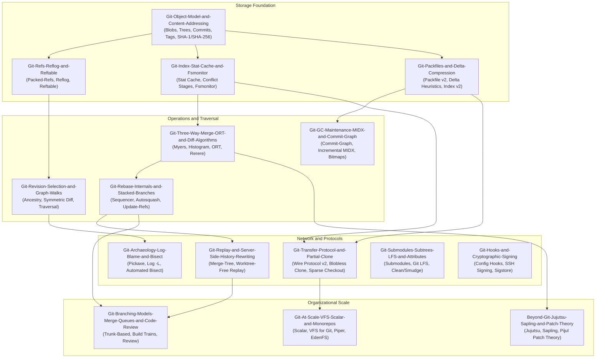

# Version Control and Git

This pillar covers the complete engineering principles, internal mechanics, and operational mastery of version control systems centered on Git and its modern successors.
It develops the depth ladder from daily command-line fluency and binary object file formats up through automated recovery playbooks, custom rebuild implementations, and enterprise monorepo architectures scaling to billions of lines.
It establishes strict ownership over content-addressable storage, index stat caching, packfile delta compression, wire protocols, linear rebasing, and speculative merge queues.
The material prepares software engineers and infrastructure architects to diagnose subtle repository corruptions, eliminate CI scaling bottlenecks, and design organizational source control systems.

## Learning order

1. [[Git-Object-Model-and-Content-Addressing]]
2. [[Git-Refs-Reflog-and-Reftable]]
3. [[Git-Revision-Selection-and-Graph-Walks]]
4. [[Git-Index-Stat-Cache-and-Fsmonitor]]
5. [[Git-Packfiles-and-Delta-Compression]]
6. [[Git-GC-Maintenance-MIDX-and-Commit-Graph]]
7. [[Git-Transfer-Protocol-and-Partial-Clone]]
8. [[Git-Three-Way-Merge-ORT-and-Diff-Algorithms]]
9. [[Git-Rebase-Internals-and-Stacked-Branches]]
10. [[Git-Replay-and-Server-Side-History-Rewriting]]
11. [[Git-Archaeology-Log-Blame-and-Bisect]]
12. [[Git-Submodules-Subtrees-LFS-and-Attributes]]
13. [[Git-Hooks-and-Cryptographic-Signing]]
14. [[Git-Email-and-Patch-Workflows]]
15. [[Git-Trace2-Telemetry-and-Diagnostics]]
16. [[Git-Expert-Config]]
17. [[Git-Branching-Models-Merge-Queues-and-Code-Review]]
18. [[Decision-Record-Merge-vs-Rebase-and-Branching]]
19. [[Git-At-Scale-VFS-Scalar-and-Monorepos]]
20. [[Decision-Record-Monorepo-vs-Polyrepo]]
21. [[Beyond-Git-Jujutsu-Sapling-and-Patch-Theory]]
22. [[Recover-Lost-Git-Work]]
23. [[Repair-a-Corrupted-Git-Repository]]
24. [[Remove-Secrets-and-Rewrite-Git-History]]
25. [[Case-Study-SHAttered-SHA1-Collision-and-Git-Hardening]]
26. [[Rebuild-Mini-Git-Lab]]
27. [[Drill-Git-Detached-Rebase-and-Dangling-Tree-Recovery]]
28. [[Drill-Git-Corrupted-Packfile-and-MIDX-Rescue]]
29. [[Drill-Git-Automated-Bisect-on-Non-Linear-History]]

Related books: [[19-Shell-and-Unix-Engineering/README.md|19-Shell-and-Unix-Engineering]] covers shell scripting, terminal interfaces, and Unix process controls that complement Git client tooling.

<!-- moc:start (generated by tools/build_mocs.py; edits inside are overwritten) -->
## Also in this folder

**Notes**

- [Git and Version Control Skill Ladder](Git-Skill-Ladder.md)
- [Git and Version Control Topic Inventory](Git-Topic-Inventory.md)

<!-- moc:end -->
