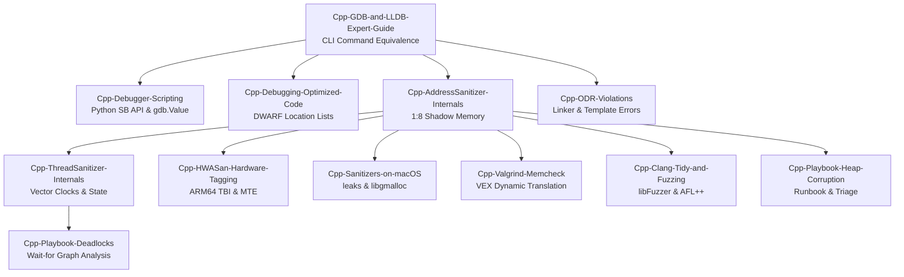

# C++ Debugging

This subfolder owns the C++ debugging curriculum, covering CLI debugger mastery, memory sanitizers, undefined behavior diagnostics, and post-mortem crash analysis.
It details the internal mechanisms of AddressSanitizer, ThreadSanitizer, MemorySanitizer, and Valgrind VEX translation.
It provides production runbooks for isolating wild heap memory overwrites, deadlocks, and subtle One Definition Rule violations.
Engineers learn to diagnose complex bugs in heavily optimized release binaries using DWARF location expressions and register state reconstruction.

### Learning order

1. [[Cpp-GDB-and-LLDB-Expert-Guide]]
2. [[Cpp-Debugger-Scripting-and-Pretty-Printers]]
3. [[Cpp-Debugging-Optimized-Code]]
4. [[Cpp-AddressSanitizer-and-LeakSanitizer-Internals]]
5. [[Cpp-ThreadSanitizer-and-MemorySanitizer-Internals]]
6. [[Cpp-UndefinedBehaviorSanitizer-and-UB-Field-Guide]]
7. [[Cpp-HWASan-and-Hardware-Memory-Tagging]]
8. [[Cpp-Sanitizers-and-Memory-Debugging-on-macOS]]
9. [[Cpp-Valgrind-Memcheck-Helgrind-and-DRD]]
10. [[Cpp-ODR-Violations-Static-Init-and-Linker-Template-Errors]]
11. [[Cpp-Clang-Tidy-Static-Analyzer-and-Fuzzing-libFuzzer-AFLPlusPlus]]
12. [[Cpp-Playbook-Heap-Corruption]]
13. [[Cpp-Playbook-Deadlocks-and-Livelocks]]

Related books: For C++ language foundations and compiler optimization behavior, see [[02-Programming-Languages/C++/CPP_Zero_to_Godhood/Volume_08_Advanced_Systems/Chapter_104_Undefined_Behaviour_and_the_Optimiser/Chapter_104_Undefined_Behaviour_and_the_Optimiser|Chapter 104 Undefined Behaviour]] and [[02-Programming-Languages/C++/CPP_Zero_to_Godhood/Volume_08_Advanced_Systems/Chapter_105_Sanitizers_Fuzzing_Testing_Concurrency/Chapter_105_Sanitizers_Fuzzing_and_Testing_Concurrent_Code|Chapter 105 Sanitizers and Fuzzing]].
