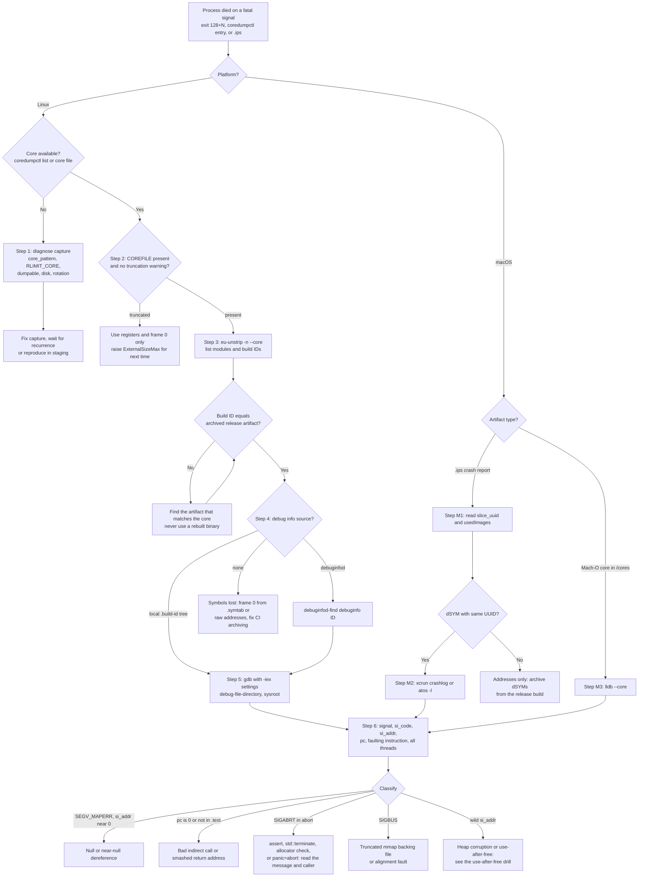
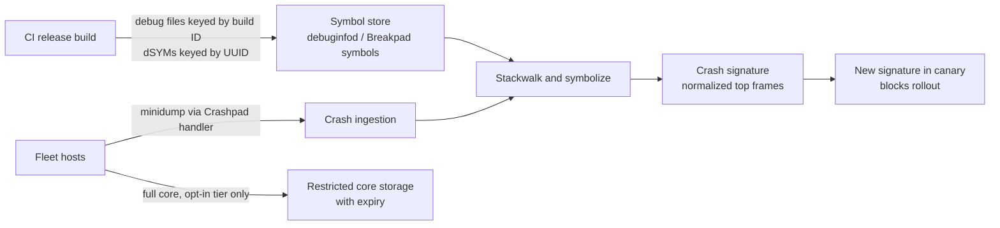

# Debug a Production Crash From a Core Dump

> [!summary] Claim:
> A core dump is the process's registers, signal information, mapped-file table, and a filtered subset of its memory at the moment it died.
> A stripped release binary keeps its GNU Build ID (Linux) or Mach-O LC_UUID (macOS), so the core names the exact build that crashed even though the debug sections are gone.
> Triage is a matching problem first: prove the core is complete, prove the build ID matches, fetch the matching debug info, and only then read the backtrace.
> A backtrace from mismatched or missing symbols looks plausible and is wrong, so every step below ends with a check that fails loudly.

The kernel and OS capture mechanisms are owned by [[Core-Dumps-Minidumps-and-Crash-Reporting]].
Symbol indexing and retrieval are owned by [[Symbol-Servers-and-debuginfod]].
This playbook owns the incident procedure that uses both.

## Trigger and Symptoms

Activate this playbook when a native process dies on a fatal signal and you need the root cause from the artifact rather than from a reproduction.

- A shell or orchestrator reports exit status 128 + signal number: 139 (`SIGSEGV`), 134 (`SIGABRT`), 135 (`SIGBUS`), 132 (`SIGILL`), or 136 (`SIGFPE`).
  The process did not call `exit()` with that number; the shell encodes "killed by signal N" as 128 + N.
- A Kubernetes container shows `lastState.terminated.exitCode: 139` or `134`.
  An `OOMKilled` reason with exit code 137 is `SIGKILL` from the OOM killer, which never dumps core, so it belongs to a memory playbook instead.
- `coredumpctl list` shows a new entry, or the journal has a `systemd-coredump` message with a stack trace.
- The kernel log has an unhandled-signal line, which the kernel prints only when `debug.exception-trace` (`show_unhandled_signals`) is 1.
- On macOS, a new `.ips` file appears in `~/Library/Logs/DiagnosticReports/` (processes of the logged-in user) or `/Library/Logs/DiagnosticReports/` (system processes), with `EXC_BAD_ACCESS`, `EXC_BAD_INSTRUCTION`, `EXC_BREAKPOINT`, or `EXC_CRASH`.

An x86-64 kernel log line has this shape (the addresses are illustrative):

```text
order_matcher[41829]: segfault at 0 ip 000055d1c2a0113d sp 00007ffd2b8e4a98 error 6 in order_matcher[55d1c2a01000+1000]
```

`segfault at 0` is the faulting data address, `ip` is the instruction pointer, and `error 6` is the x86 page-fault error code (bit 1 write, bit 2 user mode, bit 0 clear means the page was not present).
The bracket names the mapping that contains `ip` with its start and size, so `ip` minus the start, plus that mapping's file offset from `/proc/PID/maps` or `info proc mappings`, is the address to look up in the binary.
Suffixes vary by kernel version (recent x86 kernels append `likely on CPU N (core N, socket N)`), and arm64 kernels print a different line that includes the ESR (Exception Syndrome Register) value (as of 2026-10, Linux).
On the OrbStack lab VM `debug.exception-trace` was 0, so no line was printed at all; absence of a kernel line is not evidence of absence of a crash.

## Decision Tree



## Prerequisites

Do the analysis on a triage host, not on the production node, and treat the core as sensitive data from the moment it exists.

### Linux

```bash
command -v gdb eu-readelf eu-unstrip objcopy file coredumpctl debuginfod-find
```

On Ubuntu 24.04 these come from the packages `gdb`, `elfutils`, `binutils`, `file`, `systemd-coredump`, and `debuginfod` (as of 2026-10, Linux).
The lab was recorded with gdb 15.1 and elfutils 0.190 on Ubuntu 24.04; the commands below are not new, since the GDB debuginfod client dates from GDB 10 and the `debuginfod` tools from elfutils 0.178.

Permissions:
- `coredumpctl` shows an unprivileged user only that user's own crashes, because the entries live in the system journal; use `sudo` or membership in `systemd-journal` or `adm` for service crashes.
- The stored cores in `/var/lib/systemd/coredump/` are compressed and readable only by privileged users or the crashing user.
- Free disk on the triage host must cover the decompressed core, because `coredumpctl dump` decompresses it, plus the debug files.

Symbol-server client configuration:

```bash
export DEBUGINFOD_URLS="https://debuginfod.example.com https://debuginfod.ubuntu.com"
export DEBUGINFOD_TIMEOUT=60
export DEBUGINFOD_CACHE_PATH="${HOME}/.cache/debuginfod_client"
```

`DEBUGINFOD_URLS` is a space-separated list; on Ubuntu, `/etc/profile.d/debuginfod.sh` sets it from `/etc/debuginfod/*.urls`, which contains `https://debuginfod.ubuntu.com` (as of 2026-10, Linux).
`debuginfod.example.com` stands for your internal server.
`DEBUGINFOD_TIMEOUT` defaults to 90 seconds and skips a server that sends less than 100 KiB in that window, per debuginfod-find(1).

**Verification:**

```bash
debuginfod-find --help >/dev/null && echo client-ok
gdb -nx -batch -ex 'show debug-file-directory' -ex 'show debuginfod enabled'
```

On Ubuntu 24.04 GDB prints `The directory where separate debug symbols are searched for is "/usr/lib/debug".` and `Debuginfod functionality is currently set to "ask".`; in `-batch` mode "ask" does not prompt, so pass `set debuginfod enabled on` explicitly.

### macOS

```bash
command -v lldb dwarfdump dsymutil atos
xcrun --find crashlog
```

`lldb`, `dwarfdump`, `dsymutil`, and `atos` ship with the Command Line Tools; `xcrun crashlog` resolved inside a full Xcode installation on the test host (as of 2026-10, macOS).
You need the `.dSYM` bundle archived from the exact release build; one generated later from a rebuild has a different UUID and is useless.

**Verification:** `dwarfdump --uuid /path/to/order_matcher.dSYM` prints one `UUID: ... (arm64) ...` line per architecture slice.

## Commands and Numbers to Know

| Item | Platform | Value `(as of 2026-10)` | Why it matters |
| :--- | :--- | :--- | :--- |
| `kernel.core_pattern` default | Linux | `core` (relative file in the crashing process's cwd) | A leading `\|` pipes the core to a program that runs as root in the initial (host) namespaces. |
| `kernel.core_pattern` length | Linux | 127 characters (kernel docs); core(5) says 128 bytes | Long collector command lines get cut. |
| `kernel.core_uses_pid` | Linux | `0` | When `1` and the pattern lacks `%p`, `.PID` is appended. |
| `kernel.core_pipe_limit` | Linux | `0` kernel default; `16` set by systemd's `50-coredump.conf` (systemd 255) | `0` means unlimited parallel pipes but no guarantee `/proc/PID` survives for the collector; over the limit, dumps are skipped and logged. |
| `fs.suid_dumpable` | Linux | `0` kernel default; `2` set by systemd's `50-coredump.conf` | Controls dumps after setuid, setgid, or capability changes. |
| `/proc/PID/coredump_filter` | Linux | `0x33` (bits 0, 1, 4, 5) | Private and shared anonymous memory, ELF header pages, private huge pages; file-backed mappings are excluded. |
| `RLIMIT_CORE` (`ulimit -c`) | Both | Distribution and service dependent; `0` in the lab container | Blocks file targets on Linux; ignored by the kernel for pipe targets; macOS core(5) says cores are disabled by default this way. |
| `ProcessSizeMax=` / `ExternalSizeMax=` | Linux | `32G` each on 64-bit (`1G` on 32-bit) | Above `ProcessSizeMax` no backtrace is generated; above `ExternalSizeMax` the stored core is truncated. |
| `JournalSizeMax=` | Linux | `767M` | Cap when `Storage=journal`. |
| `MaxUse=` / `KeepFree=` | Linux | 10% / 15% of the filesystem | Old cores are deleted silently to stay under these. |
| Stored-core age | Linux | `2w` in `/usr/lib/tmpfiles.d/systemd.conf` on Ubuntu 24.04 | `coredumpctl list` then shows `missing`. |
| `DEBUGINFOD_TIMEOUT` | Linux | 90 seconds | Per-server connect-and-first-100-KiB timeout. |
| debuginfod server port | Linux | 8002 | Default for `debuginfod -p`. |
| `kern.coredump` | macOS | `1` on the macOS 27.2 test host | Kernel switch for Mach-O cores; the practical gates are `RLIMIT_CORE`, `/cores` permissions, and the entitlement below. |
| `kern.corefile` | macOS | `/cores/core.%P` | Core path template. |
| `/cores` mode | macOS | `drwxr-xr-x root wheel` on the macOS 27.2 test host; Apple DTS described `drwxrwxrwt root admin` in 2021 | Check it with `ls -ld /cores`; an unwritable directory means no core. |
| `com.apple.security.get-task-allow` | macOS | Required in the code signature for a core dump, per Apple DTS | Release builds signed with the hardened runtime do not have it. |
| `.ips` `bug_type` | macOS | `309` for crash reports | First line is a JSON metadata object; the rest is the crash report JSON. |
| `SEGV_MAPERR` / `SEGV_ACCERR` | Both | `si_code` 1 / 2 | Unmapped address versus permission violation (for example a write to read-only text). |

## Step-by-Step Execution (Linux)

Each step ends with a check.
Do not continue past a failed check; go to Failure Modes.
Shell variables set in one step are reused in later ones.

### Step 1: Confirm the capture path on the crashing host

```bash
cat /proc/sys/kernel/core_pattern
cat /proc/sys/kernel/core_uses_pid /proc/sys/kernel/core_pipe_limit /proc/sys/fs/suid_dumpable
systemctl show -p LimitCORE order-matcher.service
PID="$(pidof order_matcher)"   # the restarted instance, if any
grep -i 'core file' "/proc/${PID}/limits"
cat "/proc/${PID}/coredump_filter"
```

Read the result with core(5) in mind:
- A pattern starting with `|` pipes to a collector (`systemd-coredump`, `apport`, or a vendor agent); the kernel ignores `RLIMIT_CORE` for pipes, but `systemd-coredump` still records the limit and processes the core only when the resource limits allow it.
- A plain pattern is a file path, so `RLIMIT_CORE` must be non-zero and the directory must exist, be writable, and have free space.
- A process that called `prctl(PR_SET_DUMPABLE, 0)`, or that changed credentials while `fs.suid_dumpable` is 0, produces no core.
- An executable without read permission produces no core.

**Verification:** you can state which collector receives the core and that the limit allows it.
For example, the lab container printed `core` for the pattern, `0` for `core_uses_pid` and `suid_dumpable`, `00000033` for `coredump_filter`, and `0` for `ulimit -c`, which means no core at all until `ulimit -c unlimited` is set, which is what the lab's `run.sh` does before it crashes the program.

### Step 2: Retrieve the core and prove it is complete

```bash
sudo coredumpctl list --no-pager /usr/local/bin/order_matcher
sudo coredumpctl info --no-pager -1 /usr/local/bin/order_matcher
CORE=/var/tmp/incident_4092.core
sudo coredumpctl dump -1 --output="$CORE" /usr/local/bin/order_matcher
sudo chmod 600 "$CORE"
eu-readelf -h "$CORE" | grep -E 'Type|Machine'
file "$CORE"
```

An `EXE` match must contain a slash and a `COMM` match must not, per coredumpctl(1).
Copy the file to the triage host with a checksum (`sha256sum "$CORE"` on both ends).

**Verification:**
- The `COREFILE` column is `present`; `missing` means it was rotated (MaxUse, KeepFree, tmpfiles age), `truncated` means it exceeded the size cap, and `journal` means it is stored inside the journal.
- `eu-readelf -h` prints `Type: CORE (Core file)`; the lab core printed `Machine: AARCH64`.
- `file` prints a line that begins `ELF 64-bit LSB core file`, and its `execfn:` field names the executable that crashed.

### Step 3: Read module identities from the core

```bash
eu-unstrip -n --core="$CORE"
APP=/release-archive/order_matcher/1.42.0/order_matcher   # the artifact you shipped
eu-readelf -n "$APP" | grep 'Build ID'
```

Each `eu-unstrip -n` line is `START+SIZE BUILDID@NOTEADDR FILE DEBUGFILE MODULE`, where `.` means "the file found on this host" and `-` means "not found".
The lab core printed:

```text
0xaaaabadb0000+0x21000 a73912f85f2bf7003f6d41b12c830c6c45e55c76@0xaaaabadb0264 . - /w/app
0xffff8eb41000+0x1000 5f55d352604d2595e21441d32924574223f22ac6@0xffff8eb412f0 . - linux-vdso.so.1
0xffff8e940000+0x1bdf90 27027b96e5b8c475fc327aa445bea1c71d37b4e2@0xffff8e940280 /lib/aarch64-linux-gnu/libc.so.6 /usr/lib/debug/.build-id/27/027b96e5b8c475fc327aa445bea1c71d37b4e2.debug libc.so.6
```

The build ID is in the core only because `coredump_filter` bit 4 dumps the first page of each ELF mapping, and the linker places `.note.gnu.build-id` in that page.
In the lab core's `eu-readelf -l` output, the text segments of `app` and of libc each have `FileSiz 0x1000`, one page, although libc's text has `MemSiz 0x19a000`.

**Verification:** the build ID for the main executable in the core equals the one printed by `eu-readelf -n "$APP"`.
GNU ld's default `--build-id` style is SHA-1, so expect 40 hex digits there; other linkers and styles produce other lengths, so compare the strings rather than their length.

### Step 4: Fetch the matching debug info

From a debuginfod server:

```bash
BUILD_ID=a73912f85f2bf7003f6d41b12c830c6c45e55c76
debuginfod-find debuginfo "$BUILD_ID"
debuginfod-find executable "$BUILD_ID"
```

`debuginfod-find` prints the local cache path of the downloaded file; the server endpoints are `/buildid/ID/debuginfo`, `/buildid/ID/executable`, `/buildid/ID/source/PATH`, and `/buildid/ID/section/NAME`.

From your own release archive, install the split debug file into a `.build-id` tree, which is what the lab does:

```bash
DEBUG_ROOT=/var/tmp/debug_root
mkdir -p "${DEBUG_ROOT}/.build-id/${BUILD_ID:0:2}"
cp /release-archive/order_matcher/1.42.0/order_matcher.debug \
   "${DEBUG_ROOT}/.build-id/${BUILD_ID:0:2}/${BUILD_ID:2}.debug"
```

The release pipeline should have produced that file with `objcopy --only-keep-debug app app.debug`, then `strip --strip-all app` (what the lab runs; it also removes `.symtab`) or `strip --strip-debug app` (keeps `.symtab`, so function names survive without the debug file), then optionally `objcopy --add-gnu-debuglink=app.debug app`.

**Verification:**

```bash
eu-readelf -n "${DEBUG_ROOT}/.build-id/${BUILD_ID:0:2}/${BUILD_ID:2}.debug" | grep 'Build ID'
```

It prints the same `Build ID:` as Step 3.

### Step 5: Open the core with the right symbols and libraries

```bash
SYSROOT=/var/tmp/rootfs_of_the_crashing_image   # see below; omit for same-distro cores
gdb -q -nx \
    -iex "set sysroot ${SYSROOT}" \
    -iex "set debug-file-directory ${DEBUG_ROOT}:/usr/lib/debug" \
    -iex "set debuginfod enabled on" \
    "$APP" "$CORE"
```

Use `-iex`, not `-ex`, for these settings: `-iex` runs before GDB reads the executable and core, so the symbol search uses them.
`set debug-file-directory` takes a colon-separated list, and GDB looks for `DIR/.build-id/nn/rest.debug` in each entry.
`set sysroot` makes GDB load `/lib/.../libc.so.6` and the dynamic loader from the crashing image instead of the triage host; extract it with `docker create IMAGE` followed by `docker export CONTAINER | tar -x -C "$SYSROOT"`.
On the crashing host itself, `coredumpctl debug -1 /usr/local/bin/order_matcher` does the same with that host's files.

**Verification:** the lab session printed:

```text
Reading symbols from ./app...
Reading symbols from /w/dbg/.build-id/a7/3912f85f2bf7003f6d41b12c830c6c45e55c76.debug...
Core was generated by `./app'.
Program terminated with signal SIGSEGV, Segmentation fault.
#0  0x0000aaaabadb0764 in trigger_crash (ptr=ptr@entry=0x0) at ./crash.c:6
6	    *ptr = 42;
```

Then check three things:
- No `warning: core file may not match specified executable file.`; GDB 15.1 printed exactly that when the lab core was opened with a rebuilt unstripped binary, but printed nothing for a rebuilt binary stripped with `--strip-all`, so this check never replaces the Step 3 build ID comparison.
- No `has a segment extending past end of file` warning; GDB 15.1 printed `warning: BFD: warning: /w/./core.trunc has a segment extending past end of file` for a core cut to 8 KiB.
- `info sharedlibrary` marks libraries without debug info with `(*)`; fetch those you need before reading their frames.

### Step 6: Triage the crashing thread

```gdb
(gdb) bt
(gdb) info registers pc x0 lr
(gdb) x/1i $pc
(gdb) print $_siginfo.si_signo
(gdb) print $_siginfo.si_code
(gdb) print $_siginfo._sifields._sigfault.si_addr
(gdb) info threads
(gdb) thread apply all bt
(gdb) info proc mappings
```

On x86-64 use `info registers rip rdi rsp` instead of the arm64 register names.

**Verification:** the lab core printed:

```text
#0  0x0000aaaabadb0764 in trigger_crash (ptr=ptr@entry=0x0) at ./crash.c:6
#1  0x0000aaaabadb077c in process_transaction (ptr=ptr@entry=0x0) at ./crash.c:11
#2  0x0000aaaabadb061c in main (argc=<optimized out>, argv=<optimized out>) at ./crash.c:17
pc             0xaaaabadb0764      0xaaaabadb0764 <trigger_crash+4>
x0             0x0                 0
lr             0xaaaabadb077c      187650256078716
=> 0xaaaabadb0764 <trigger_crash+4>:	str	w1, [x0]
$1 = 11
$2 = 1
$3 = (void *) 0x0
```

Signal 11 is `SIGSEGV`, `si_code` 1 is `SEGV_MAPERR`, and `si_addr` 0 with `str w1, [x0]` and `x0 == 0` proves a store through a null pointer.
On x86-64 the same C line compiles to `movl $0x2a,(%rdi)` with `rdi == 0`.
`ptr=ptr@entry=0x0` is a DWARF entry value: GDB recovered the argument as it was on function entry even though the register may have been reused since.

Read frame 1 critically.
The lab compiles with `-fno-optimize-sibling-calls`, so `disassemble process_transaction` shows a real call: `stp x29, x30, [sp, #-16]!`, `mov x29, sp`, `bl trigger_crash`, `ldp x29, x30, [sp], #16`, `ret`.
That is why `lr` points into `process_transaction` (`0xaaaabadb077c`, the instruction after the `bl`) rather than into `main`, and `frame 1` followed by `info frame` lists `x29` and `x30` saved on the stack, so all three frames are unwound from real stack state and none is synthesized.
Without that flag GCC at `-O2` turns the call into a single `b trigger_crash`, a tail call that leaves no frame for `process_transaction`; GDB can then only infer frame 1 from DWARF call-site information, and `info frame` on it says `tail call frame`.
Without any debug info the lab's stripped binary gives `?? ()` for all three of its frames, and because GDB cannot recognize `main` it keeps unwinding into libc startup code: six frames, of which only `#4 __libc_start_main` has a name, taken from libc's own symbols.

### Step 7: Classify and widen

1. **Null or near-null dereference:** `SEGV_MAPERR` with a small `si_addr` is a null pointer or a field of a null object (`si_addr` equals the field offset).
2. **Bad jump:** `pc` of 0 or outside any `r-x` range in `info proc mappings` is a bad function pointer, vtable, or return address; recover the caller from `lr` on arm64 or from `x/gx $sp` on x86-64 right after a `call`.
3. **Abort:** `SIGABRT` with `abort` near frame 0 means someone chose to die; walk up to the first frame in your code and read the assertion, `std::terminate` cause, or allocator message (glibc writes it to stderr, so pull the journal too).
4. **SIGBUS:** usually access to an `mmap` page past the end of a truncated file; check `si_addr` against `info proc mappings`.
5. **Wild address:** heap corruption or use-after-free; the crashing thread is often not the corrupting one, so read `thread apply all bt` and continue with [[Drill-Debugging-Use-After-Free-Core-Dump]].

**Verification:** you can write one sentence of the form "thread T died on signal S (`si_code` C) at `function file:line` because register R held V", and every value in it came from Step 6 output.

## Step-by-Step Execution (macOS)

macOS does not dump cores by default; the normal artifact is an `.ips` crash report written by ReportCrash.

### Step M1: Find the report and its identities

```bash
ls -t ~/Library/Logs/DiagnosticReports/order_matcher-*.ips /Library/Logs/DiagnosticReports/order_matcher-*.ips 2>/dev/null | head -n 1
IPS="$HOME/Library/Logs/DiagnosticReports/order_matcher-2026-10-25-223807.ips"
head -n 1 "$IPS"
python3 - "$IPS" <<'EOF'
import json, sys
text = open(sys.argv[1]).read()
meta, body = text.split("\n", 1)
report = json.loads(body)
print(json.loads(meta)["bug_type"], report["exception"])
image = report["usedImages"][0]
print(image["uuid"], hex(image["base"]), image["path"])
thread = report["threads"][report["faultingThread"]]
for frame in thread["frames"][:5]:
    print(frame.get("imageIndex"), hex(frame["imageOffset"]), frame.get("symbol"))
EOF
```

**Verification:** a crash report has `"bug_type":"309"` in the first line; the lab program crashed on macOS 27.2 produced `'type': 'EXC_BAD_ACCESS', 'signal': 'SIGSEGV', 'subtype': 'KERN_INVALID_ADDRESS at 0x0000000000000000'`.
The `uuid` of the crashing image must equal `dwarfdump --uuid` of your archived dSYM, ignoring case (`.ips` writes lowercase, `dwarfdump` uppercase).

### Step M2: Symbolicate

```bash
xcrun crashlog "$IPS"
atos -arch arm64 -o order_matcher.dSYM/Contents/Resources/DWARF/order_matcher -l 0x102120000 0x10212032c
```

`xcrun crashlog` loads the report into LLDB and resolves every frame for which it finds a matching dSYM; `atos -l LOAD_ADDRESS ADDRESS` resolves one address, where `LOAD_ADDRESS` is the image `base` and `ADDRESS` is `base + imageOffset`.

**Verification:** on the test host `atos` printed `trigger_crash (in app) (crash.c:6)`.
For a return address in a caller frame, `atos` reports the line after the call (`main ... (crash.c:18)` in the test, while the call is on line 17); subtract 1 from return addresses before looking them up.
The macOS report also has no `process_transaction` frame: that test build did not pass `-fno-optimize-sibling-calls`, clang emitted a tail call, and crash reports do not synthesize tail-call frames.

### Step M3: Load a Mach-O core, when you have one

Three conditions must hold before the crash: `ulimit -c unlimited` in the launching shell (launchd.conf no longer works, per Apple DTS), a writable `/cores`, and the `com.apple.security.get-task-allow` entitlement in the binary's signature, for example `codesign -s - -f --entitlements debug.entitlements order_matcher`.

```bash
lldb --core /cores/core.41829 /path/to/order_matcher
```

Inside LLDB, `target create --core /cores/core.41829 /path/to/order_matcher` is the equivalent command, `target symbols add order_matcher.dSYM` attaches a dSYM by hand, and `process save-core FILE` writes a core from a live debugged process (the LLDB analogue of `gcore`).

**Verification:** `bt` shows source lines for your frames and `image list order_matcher` shows the same UUID as the dSYM.

## Worked Example: Core Dump Triage Lab

The lab in `code/03-Debugging/core_dump_triage/` runs the Linux procedure end to end on a toy program.

1. `run.sh` compiles `crash.c` with `gcc -O2 -g -fno-optimize-sibling-calls -Wl,--build-id` and a `-fdebug-prefix-map` for the temporary directory; `-O2` matches a release build, and turning off sibling-call optimization keeps a real frame for every function, so no frame has to be synthesized.
   `main` passes a pointer that is `NULL` unless `argc > 1000`, so the optimizer cannot fold the crash away.
2. It reads the build ID with `eu-readelf -n`, splits debug info with `objcopy --only-keep-debug`, and runs `strip --strip-all`, which removes the DWARF sections and `.symtab` but keeps the build ID note.
3. It installs `app.debug` as `debug_root/.build-id/nn/rest.debug`.
4. It sets `ulimit -c unlimited` and reads `/proc/sys/kernel/core_pattern`.
   When the pattern is a file path, it runs the program, fails unless the exit status is 139 (`SIGSEGV`), and takes the core the kernel wrote into the working directory.
   When the pattern pipes to a handler such as `systemd-coredump` or `apport`, the core never lands there, so it falls back to GDB's `generate-core-file` after `run` stops on the `SIGSEGV`.
   Either way it fails if no non-empty core exists, and it reports which source it used on the `Core source:` line.
5. It compares the executable's build ID with the one `eu-unstrip -n --core` reads from the core and exports the result.
6. It opens the core in GDB batch mode twice and runs `triage.py` each time.
   Pass 1 sets `debug-file-directory` to a nonexistent path and prints only how many frames have a function name and a source line.
   Pass 2 sets it to the `.build-id` tree and prints the core source, the build ID check, the backtrace, the faulting `pc` as `function+offset`, the faulting instruction, the signal from `$_siginfo`, and a frame count.

What the output proves and what it does not:
- The recorded run took a real kernel core, so it exercised `core_pattern` as a file path and `RLIMIT_CORE`, but not `systemd-coredump`; on a host whose pattern pipes to a handler, the `Core source:` line names the GDB fallback instead.
- Pass 1 shows `1 of 6` frames named and `0 of 6` with a source line: with `strip --strip-all` and no reachable debug file, none of the program's own frames has a name or a line, and GDB, unable to recognize `main`, unwinds on into libc startup code.
  The one named frame is `__libc_start_main`, which GDB names from libc's exported dynamic symbols, not from any debug info.
- In pass 2 every function name and line (`trigger_crash` at `crash.c:6`, `process_transaction` at `crash.c:11`, `main` at `crash.c:17`) comes from the `.build-id` debug file, because the only change from pass 1 is `debug-file-directory` and the binary has no `.symtab` left.
- `Frame count: 3` counts three real frames, as Step 6 shows; GDB stops at `main` because `backtrace past-main` is off by default.
- `Signal name: SIGSEGV` was read from `$_siginfo`; if the core has no signal information, `triage.py` prints `unknown (no siginfo in core)` instead of guessing a signal.

### Verified output

Recorded by `make record` on linux-aarch64 on 2026-10-25 and re-checked by `make verify`; the file is `code/03-Debugging/core_dump_triage/expected/linux-aarch64.txt`.

```text
=== Pass: without-debug-info ===
Frames with a function name: 1 of 6
Frames with a source line: 0 of 6

=== Pass: with-build-id ===
Core source: kernel (core_pattern is a file path)
Build ID match: yes

=== Backtrace (Symbols Resolved via .build-id) ===
#0 trigger_crash at crash.c:6
#1 process_transaction at crash.c:11
#2 main at crash.c:17

=== Register State ===
Faulting program counter (pc): <trigger_crash+4>

=== Faulting Instruction ===
=> str	w1, [x0]

=== Summary ===
Build ID equal: yes
Crashing function: trigger_crash
Crashing line: 6
Signal name: SIGSEGV
Frame count: 3
```

## Rollback Procedure

The procedure changes capture settings and creates copies of sensitive memory; undo both.

1. **Restore `core_pattern`.** Save the value before any change with `cat /proc/sys/kernel/core_pattern > /var/tmp/core_pattern.saved`, and restore it with `sudo sysctl -w kernel.core_pattern="$(cat /var/tmp/core_pattern.saved)"`.
   If the host's configured value lives in `sysctl.d`, `sudo /usr/lib/systemd/systemd-sysctl` re-applies it, including systemd's `50-coredump.conf`.
   Do not paste a remembered collector command line; it differs across systemd versions (systemd 255 on Ubuntu 24.04 ships `|/usr/lib/systemd/systemd-coredump %P %u %g %s %t 9223372036854775808 %h %d`).
   **Check:** `cat /proc/sys/kernel/core_pattern` matches the saved file.
2. **Remove temporary limits.** Delete a `LimitCORE=` drop-in with `sudo systemctl revert order-matcher.service` (this removes all drop-ins for the unit, so read `systemctl cat` first) and write back any `coredump_filter` you changed.
   A new `LimitCORE` applies only after a restart, so schedule it rather than restarting a healthy service mid-incident.
   **Check:** `systemctl show -p LimitCORE order-matcher.service` shows the previous value.
3. **Destroy core copies.** Delete `"$CORE"`, decompressed copies, and any copy on laptops; cores contain keys, tokens, and customer data.
   **Check:** `ls -l "$CORE"` fails, and the incident ticket records where the one retained copy is stored and when it expires.
4. **Clean the symbol cache if it holds proprietary debug info:** `rm -rf "${DEBUGINFOD_CACHE_PATH:-$HOME/.cache/debuginfod_client}"`.
5. **macOS:** remove `/cores/core.*` files (each can be gigabytes), restore `/cores` to the mode you recorded with `ls -ld /cores`, and delete any build you re-signed with `get-task-allow`.

## Failure Modes of the Procedure

| Failure | How it shows up | Recovery |
| :--- | :--- | :--- |
| No core produced | Exit 139 but nothing in `coredumpctl list` and no file | Walk Step 1: `RLIMIT_CORE` 0 for file patterns, unwritable or missing directory, `PR_SET_DUMPABLE` 0, setuid with `suid_dumpable` 0, `Storage=none`, unreadable executable. |
| Pipe collector absent in a container | `core_pattern` names a host path such as `/usr/lib/systemd/systemd-coredump` that the container lacks | The helper runs in the host's initial namespaces, so collect on the host, not in the container; `core_pattern` is not per-container. |
| Core rotated away | `COREFILE` shows `missing` | Raise `MaxUse=` or move storage; ship cores off-host on capture in the fleet design. |
| Core truncated | `COREFILE` shows `truncated`, or GDB warns `segment extending past end of file` | Use frame 0, registers, and `$_siginfo` only, since stack pages may be absent; raise `ExternalSizeMax=` for the next crash. |
| Build ID mismatch | GDB warns `core file may not match specified executable file`, or Step 3 strings differ | Find the shipped artifact by the core's build ID; never rebuild "the same commit" and hope. |
| Debug info not found | No `Reading symbols from .../.build-id/...` line; frames show names without `file:line` | Check the `.build-id` path spelling (first two hex digits, then the rest plus `.debug`), and that settings were given with `-iex`; query `debuginfod-find debuginfo ID` directly to separate server from GDB problems. |
| Symbols fully stripped and lost | Frames are `?? ()` | Use `info proc mappings` plus the offset into the mapping, then `addr2line -e` on any surviving unstripped copy; fix CI to archive debug files keyed by build ID. |
| Wrong shared libraries | Plausible but wrong frames inside libc or libstdc++; `info sharedlibrary` paths point at the triage host | `set sysroot` to the crashing image's rootfs, or fetch exact libraries by build ID with `debuginfod-find executable`. |
| Frames that cannot exist | A caller frame for a function whose body is a jump | It is a tail-call frame synthesized from DWARF; confirm with `info frame`. |

## Pitfalls

> [!warning] Cores are secrets
> A core contains every dumped anonymous page: keys, session tokens, passwords, and customer records.
> Mark secret buffers with `madvise(addr, len, MADV_DONTDUMP)`, restrict who can read `/var/lib/systemd/coredump/`, and give retained cores an expiry date.
> Clearing bits in `coredump_filter` to save space also removes the evidence for heap bugs, so decide it per service, not fleet-wide.

> [!warning] Crash loops fill disks
> A service that crashes and restarts every few seconds produces a core every few seconds.
> `systemd-coredump` bounds this with `MaxUse=`, `KeepFree=`, and `ExternalSizeMax=`, but a file `core_pattern` on the root filesystem has no bound at all.
> Use the systemd caps or a collector that rate-limits, and add a restart backoff to the unit.

> [!warning] Analyzing against the triage host's libraries
> Without `set sysroot`, GDB loads the triage host's libc and applies its unwind tables to the crashing image's memory.
> The result is a wrong backtrace inside library frames that looks normal.
> Always bind the exact libraries, by sysroot or by build ID.

> [!warning] Rebuilding with -O0 to reproduce
> A `-O0` rebuild changes inlining, register allocation, stack layout, and timing, so memory-corruption and race bugs often stop reproducing.
> Debug the shipped optimized artifact with its archived debug file, and treat `<optimized out>` as a cue to read the disassembly.

> [!warning] Blaming the crashing thread
> The thread that faults is often not the thread that corrupted memory or freed the object.
> Read `thread apply all bt` and check which other threads hold the same object or lock before naming a culprit.

> [!warning] dSYMs that contain nothing
> On macOS the linker leaves DWARF in the object files and records a debug map; `dsymutil` must run while those `.o` files still exist.
> `clang -g crash.c -o app && dsymutil app` on the test host warned `unable to open object file` because the one-step compile deleted its temporary object, and the dSYM had no debug info.
> Compile and link in separate steps, or let the build system run `dsymutil`, and archive the dSYM with the release.

## At Scale

At 1,000 to 50,000 hosts nobody logs into a node to run `coredumpctl`; crashes become a data pipeline whose quality depends on symbol archiving done at build time.



### Fleet crash pipelines

- `systemd-coredump` is a good per-host collector: it records rich metadata (cmdline, environment, `/proc/PID/maps`, limits, container hostname) and, when the executable carries a `.package` metadata ELF note (which `ld --package-metadata` writes), the package name and version.
- Its metadata lives in the journal, so fleet collection usually means exporting journal entries and shipping cores off-host promptly, before `MaxUse=` and tmpfiles rotation delete them.
- A custom pipe collector (`|/path/to/agent %P ...`) runs as root in the host's initial namespaces for every crash in every container, so it must be small, fast, and bounded by `core_pipe_limit`.

### Minidumps and Crashpad

- Crashpad splits a client library linked into the application from a handler running in a separate process; the handler snapshots the crashed process, writes a minidump to a local database, and uploads it over HTTPS using the Breakpad wire protocol.
- On macOS the client registers a Mach port as the `EXC_CRASH` exception port; on Linux a signal handler notifies the handler over a socket, and the handler reads the crashed process with `ptrace`, directly or through a broker forked from the crashing process.
- A minidump holds the module list with identities, each thread's registers and stack memory, selected OS state, memory referenced from registers and stacks, and application annotations, but not the whole heap; that is why it is small enough to upload from every crash.
- Servers symbolize minidumps with Breakpad-format symbol files produced at build time by `dump_syms` and walked by `minidump_stackwalk`, so symbol upload is a mandatory CI step, not an afterthought.

### Symbol servers and debuginfod

- debuginfod serves `debuginfo`, `executable`, `source`, and single `section` artifacts by build ID over HTTP, scans build trees or distro packages, and federates to upstream servers listed in its own `DEBUGINFOD_URLS`.
- Public distro servers (for example `debuginfod.ubuntu.com`) cover distro libraries; your own server must cover your binaries, and because it serves source, it must stay internal.
- Windows uses the same idea with PDBs keyed by GUID and age on a symbol server; Apple uses dSYMs keyed by LC_UUID; the invariant everywhere is "index by the identity embedded in the binary, never by version string".

### Decision rules

- Default every service to minidumps plus build-ID-keyed symbols; enable full cores only for a canary tier, for staging, or temporarily for a service under active investigation.
- Fail the release if debug files or dSYMs were not uploaded for every shipped build ID or UUID.
- Bucket crashes by a signature of the top frames after removing `abort`, `raise`, assertion helpers, and allocator frames, and alert on a new signature during rollout rather than on raw crash counts.
- Give full cores the same access control and retention policy as production databases.

## Practice Drill

> [!tip] Practice Drill: Break each link of the chain
> Copy `code/03-Debugging/core_dump_triage/` to a scratch directory on a Linux host with gdb and elfutils (the lab itself stays unchanged), run `bash run.sh`, and confirm the output equals `expected/linux-aarch64.txt` (on x86-64 the register name and instruction differ).
> Then make one change at a time, predict the output first, and explain the difference.
> 1. Delete the `.build-id` copy step: pass 2 now looks like pass 1, with every frame `?? at ??:0`, six frames instead of three, `Crashing function: None`, and the faulting `pc` as `<None+0>`, because `--strip-all` left no `.symtab` to fall back on.
> 2. Replace `strip --strip-all` with `strip --strip-debug` and run pass 1's GDB command with `-ex bt`: `trigger_crash`, `process_transaction`, and `main` come back from `.symtab` without lines, and the backtrace stops at `main` with three frames; explain why `triage.py` still prints `0 of 3` for function names.
> 3. Truncate the core with `head -c 8192 core > core.trunc` and open it: GDB warns that the core `has a segment extending past end of file`, frame 1 still resolves from `lr`, and the backtrace stops with `Cannot access memory` because the stack pages are gone.
> 4. Change `42` to `43` in `crash.c`, rebuild with the same flags, and open the old core with the new binary: compare the two build IDs, and note that GDB 15.1 warned that the core may not match only when the new binary was unstripped.
> 5. Drop `-fno-optimize-sibling-calls`, rebuild, and run `disassemble process_transaction` and `info frame` on frame 1: the call becomes `b trigger_crash` and frame 1 is a synthesized tail-call frame.
> 6. Stretch: replace the null store with a call through a null function pointer and recover the caller from `lr` (arm64) or `*(void **)$sp` (x86-64) when `bt` shows `0x0000000000000000 in ?? ()`.
> Target time: under 20 minutes for steps 1 to 5, then repeat the full Linux procedure on [[Drill-Debugging-Use-After-Free-Core-Dump]].

## Interview Questions

> [!question] L5
> A service exited with 139 and there is no core anywhere.
> What do you check, in order?
>
> > [!success]- Answer
> > First `cat /proc/sys/kernel/core_pattern`, because it decides everything else.
> > For a pipe (`|...`) the kernel ignores `RLIMIT_CORE`, so check the collector: `coredumpctl list` for `systemd-coredump`, its `Storage=` setting, and whether rotation already removed the file (`missing`).
> > For a file pattern, check `RLIMIT_CORE` in `/proc/PID/limits` or `systemctl show -p LimitCORE`, that the directory exists and is writable, and free space.
> > Then check dumpability: `prctl(PR_SET_DUMPABLE, 0)`, credential changes with `fs.suid_dumpable` 0, and an executable without read permission all suppress the core.
> > In a container, remember `core_pattern` is host-global and a pipe helper runs on the host.

> [!question] L5
> How does GDB find debug info for a stripped executable?
>
> > [!success]- Answer
> > It reads the build ID from `.note.gnu.build-id` and looks for `DIR/.build-id/nn/rest.debug` in each `debug-file-directory` entry, where `nn` is the first two hex digits.
> > If that fails it uses `.gnu_debuglink`, which stores a file name and a CRC-32, and searches the executable's directory, its `.debug` subdirectory, and the global debug directory; the CRC confirms the match.
> > If both fail and debuginfod is enabled, it downloads by build ID.
> > The settings must be in place before the file is read, which is why the playbook passes them with `-iex`.

> [!question] L5
> A macOS crash report shows only addresses for your app.
> How do you symbolicate it?
>
> > [!success]- Answer
> > Take the image `uuid` from `usedImages` and find the dSYM whose `dwarfdump --uuid` matches it.
> > Run `xcrun crashlog` on the `.ips`, or `atos -arch arm64 -o X.dSYM/Contents/Resources/DWARF/X -l BASE ADDRESS` per frame.
> > Subtract 1 from return addresses in caller frames so the lookup lands on the call instruction.
> > If no dSYM matches, the build pipeline failed to archive it; a dSYM from a rebuild has a different UUID.

> [!question] L6
> A backtrace shows `process_transaction` at line 11, but its disassembly is a single `b trigger_crash`.
> Is the backtrace wrong, and why does the lab compile with `-fno-optimize-sibling-calls`?
>
> > [!success]- Answer
> > The backtrace is not wrong; frame 1 is a synthesized tail-call frame.
> > The tail call replaced `process_transaction`'s frame, so the stack and `lr` lead straight to `main`.
> > GCC emitted DWARF call-site entries that let GDB infer the missing frame, and `info frame` on it says `tail call frame`.
> > Without debug info nothing can infer it, which is why the macOS crash report of the same program, built without the flag, shows only `trigger_crash` and `main`.
> > Treat such frames as inferred: they are right when the call-site data is unambiguous, and they can be absent when it is not.
> > The lab disables sibling calls so its three frames are all real: `process_transaction` saves `x29` and `x30`, calls with `bl`, and `lr` at the fault points back into it.
> > The cost is a few instructions and 16 bytes of stack per call, so production builds usually keep the optimization, and triage must recognize inferred frames.

> [!question] L6
> Frame 0 is `0x0000000000000000 in ?? ()`.
> How do you find who jumped there?
>
> > [!success]- Answer
> > A `pc` of zero means an indirect call or return went through a null pointer, so there is no code to unwind from.
> > On arm64 a `blr` writes the return address to `x30`, so `info symbol $lr` and `x/2i $lr-4` usually show the calling instruction and the register that held zero.
> > On x86-64 a `call` pushed the return address, so `x/gx $sp` gives it right after the jump; `info symbol` on it names the caller.
> > If a corrupted return address caused the jump, scan `x/64gx $sp` for values inside `r-x` mappings from `info proc mappings` and confirm each candidate by disassembling the instruction before it.

> [!question] L6
> Why does GDB print `<optimized out>` and `ptr@entry`, and how do you recover a value?
>
> > [!success]- Answer
> > At `-O2` a variable lives in different registers or stack slots over different PC ranges, described by DWARF location lists; where no location covers the current PC, GDB prints `<optimized out>`.
> > `ptr@entry` is a DWARF entry value: the caller's call-site description tells GDB what the argument was on entry, even if the register was overwritten later.
> > To recover others, disassemble around the PC, look for the value in callee-saved registers (`rbx`, `r12`-`r15` on x86-64, `x19`-`x28` on arm64) in this or outer frames, and inspect the object the value came from in a caller.

> [!question] L6
> The lab takes a kernel core when `core_pattern` is a file path and falls back to GDB `generate-core-file` only when it pipes to a handler.
> Why prefer the kernel core, and what does the fallback give up?
>
> > [!success]- Answer
> > The kernel core is the artifact production hands you: the kernel writes it on the fatal-signal path, subject to `core_pattern`, `RLIMIT_CORE`, dumpability, and `coredump_filter`, so taking it tests the capture chain as well as the analysis.
> > A pipe pattern sends the core to `systemd-coredump` or `apport`, outside the lab's directory (and, in a container, to the host), so the lab cannot pick it up and lets GDB write one instead.
> > `gcore` writes a core from a process GDB has stopped under `ptrace`; nothing in `core_pattern`, `RLIMIT_CORE`, or `systemd-coredump` is involved, so a working fallback says nothing about whether production capture works.
> > GDB also chooses which memory to write, so contents and size differ: for the lab program the GDB core was about 2.1 MB and the kernel core 272 KiB, the latter filtered by `coredump_filter`.
> > Both carry `NT_PRSTATUS`, `NT_SIGINFO`, `NT_AUXV`, and `NT_FILE` notes, so `$_siginfo` and the build ID lookup work on both, and the lab prints `Core source:` so a reader knows which path produced the result.
> > Use `gcore` for a hung process you must keep alive; for crashes, rely on the kernel path, and on a pipe host retrieve the core with `coredumpctl dump` rather than trusting a GDB-made substitute.

> [!question] L7
> Design crash reporting for 50,000 Linux services that balances fidelity, cost, and privacy.
>
> > [!success]- Answer
> > Capture: Crashpad-style out-of-process minidumps by default, with full cores only in an opt-in tier with its own storage, access control, and expiry.
> > Symbols: CI uploads debug files keyed by build ID (and dSYMs by UUID) to an internal debuginfod or Breakpad symbol store, and the release fails if the upload fails.
> > Processing: stackwalk and symbolize centrally, normalize frames, drop `abort` and allocator helpers, and hash the top frames into a signature.
> > Action: alert on new signatures in canary and block rollout; track signature counts per build for regressions.
> > Privacy: `MADV_DONTDUMP` on secret buffers, no heap in minidumps beyond memory near registers and stacks, and redaction of environment and command lines in metadata.
> > Bounds: rate-limit uploads per host and per signature so a crash loop cannot become a self-inflicted outage.

> [!question] L7
> An Ubuntu container's core is analyzed on a Fedora workstation and the libc frames look wrong.
> Why, and what fixes it?
>
> > [!success]- Answer
> > GDB finds loaded libraries by reading the dynamic loader's `r_debug` and `link_map` list from the core's memory, locating the loader through `AT_BASE` in `NT_AUXV`, and then opens each library path on the analysis host.
> > On a different distro those paths resolve to different builds, so symbols and `.eh_frame` unwind rules do not match the code that ran, and unwinding through libc produces plausible but wrong frames.
> > `set sysroot` pointing at the image's exported rootfs, or fetching each library by build ID from debuginfod, makes GDB use the exact files; `info sharedlibrary` confirms which paths it loaded.

> [!question] L8+
> A low-latency matching engine corrupts its heap once a week and the allocator metadata is already destroyed in every core.
> How do you catch the writer without hurting latency?
>
> > [!success]- Answer
> > Make the corruption fault at the bad write instead of at a later read.
> > Sampling allocators such as GWP-ASan put a tiny random fraction of allocations on their own pages with `PROT_NONE` guards and delay reuse, so an overflow or use-after-free on a sampled object faults immediately with the culprit on the stack; overhead is small because sampling is rare, and it works on any architecture.
> > On arm64 hardware with MTE, allocator support (for example glibc's `glibc.mem.tagging` tunable or Scudo) tags 16-byte granules and pointers with 4-bit tags, and a mismatched access raises `SIGSEGV` with `SEGV_MTESERR` (synchronous) or `SEGV_MTEAERR` (asynchronous); measure the overhead on your workload before claiming it is free.
> > If the victim address is predictable, a hardware watchpoint through `perf_event_open` with `PERF_TYPE_BREAKPOINT`, optionally with a BPF program attached, catches the writer; there are only a few debug registers, so this is narrow.
> > Combine with record and replay in staging when the trigger can be reproduced; see [[Record-and-Replay-rr-UDB-and-Pernosco]].

> [!question] L8+
> Compare Linux ELF core dumping with macOS Mach exception handling as platform designs.
>
> > [!success]- Answer
> > Linux does the dump in the kernel on the fatal-signal path, then writes a file or pipes the image to one global, root-run helper in the initial namespaces; this gives full-memory fidelity but makes `core_pattern` a host-wide setting that containers cannot own.
> > macOS turns the fault into a Mach exception message delivered to exception ports at thread, task, or host level; a user-space handler such as ReportCrash or Crashpad's handler inspects the task from outside and writes a compact report.
> > The macOS default favors small, privacy-preserving reports that aggregate well, and full cores require explicit opt-in (limit, writable `/cores`, `get-task-allow`).
> > The Linux default favors complete evidence on the host, and fleets add minidumps and rate limits to recover the macOS-style economics.
> > Both converge on the same invariant: the artifact carries a binary identity (build ID or UUID), and symbols are joined later from a store keyed by it.

## Further Reading

- core(5), Linux man-pages project, https://man7.org/linux/man-pages/man5/core.5.html.
  The conditions under which no core is produced, `core_pattern` pipe semantics, and the `coredump_filter` bits.
- Kernel sysctl documentation, https://docs.kernel.org/admin-guide/sysctl/kernel.html.
  Current defaults and limits for `core_pattern`, `core_pipe_limit`, and `core_uses_pid`.
- prctl(2), Linux man-pages project, https://man7.org/linux/man-pages/man2/prctl.2.html.
  `PR_SET_DUMPABLE` and when the kernel resets it.
- systemd-coredump(8), coredumpctl(1), and coredump.conf(5), https://www.freedesktop.org/software/systemd/man/latest/systemd-coredump.html.
  How the default Linux collector stores, caps, rotates, and annotates cores.
- Debugging with GDB, Separate Debug Files, https://sourceware.org/gdb/current/onlinedocs/gdb.html/Separate-Debug-Files.html.
  The exact build-ID and debuglink search rules, plus the `objcopy` recipe.
- Debugging with GDB, Core File Generation and Debuginfod, https://sourceware.org/gdb/current/onlinedocs/gdb.html/Core-File-Generation.html.
  `gcore` behavior and GDB's debuginfod client settings.
- elfutils debuginfod, https://sourceware.org/elfutils/Debuginfod.html.
  The client and server, federation, and the public server list.
- GNU binutils objcopy, https://sourceware.org/binutils/docs/binutils/objcopy.html.
  `--only-keep-debug` and `--add-gnu-debuglink` semantics.
- Apple, Adding identifiable symbol names to a crash report, https://developer.apple.com/documentation/xcode/adding-identifiable-symbol-names-to-a-crash-report.
  `xcrun crashlog`, `atos`, and dSYM matching from the vendor.
- Apple, Interpreting the JSON format of a crash report, https://developer.apple.com/documentation/xcode/interpreting-the-json-format-of-a-crash-report.
  The `.ips` layout, including `bug_type` 309.
- Apple Developer Forums thread 694233, https://developer.apple.com/forums/thread/694233.
  Apple DTS on enabling macOS core dumps, including the `get-task-allow` requirement.
- LLDB Symbolication, https://lldb.llvm.org/use/symbolication.html.
  How LLDB loads crash logs and matches images by UUID.
- Crashpad Overview Design, https://chromium.googlesource.com/crashpad/crashpad/+/HEAD/doc/overview_design.md.
  The client and handler split, capture on each OS, and minidump contents.
- Michael Kerrisk, The Linux Programming Interface, No Starch Press, 2010.
  Signals, dispositions, and core dumps from first principles.

## Related

- Prerequisites: [[Core-Dumps-Minidumps-and-Crash-Reporting]], [[Symbol-Servers-and-debuginfod]]
- Next: [[Rebuild-Lab-ptrace-Debugger-with-DWARF-Backtrace]]
- See also: [[14-Low-Latency-Systems/13 - Reliability, Ops & Testing/Observability Without Perturbation|Observability Without Perturbation]]
- Lab: `code/03-Debugging/core_dump_triage/` (requires: linux)
