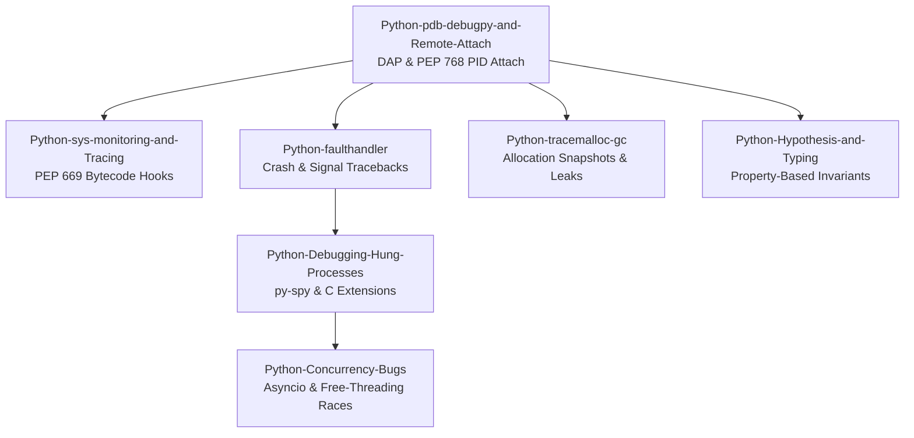

# Python Debugging

This subfolder owns the Python runtime debugging curriculum, spanning interactive post-mortem tools, bytecode tracing hooks, memory leak detection, and native C extension triage.
It covers the standard pdb CLI, debugpy DAP server integration, and live PID attachment via PEP 768.
It examines PEP 669 sys.monitoring event slots alongside async-signal-safe crash reporting with faulthandler.
Engineers learn to diagnose memory leaks with tracemalloc, isolate deadlocks with py-spy, and debug multi-core concurrency bugs in free-threaded Python builds.

### Learning order

1. [[Python-pdb-debugpy-and-Remote-Attach]]
2. [[Python-sys-monitoring-and-Tracing]]
3. [[Python-faulthandler-and-Crash-Diagnostics]]
4. [[Python-tracemalloc-gc-and-Memory-Leaks]]
5. [[Python-Debugging-Hung-Processes-and-C-Extensions]]
6. [[Python-Concurrency-Asyncio-Multiprocessing-and-Free-Threading-Bugs]]
7. [[Python-Hypothesis-and-Type-Checkers-as-Bug-Prevention]]

Related books: For backend testing methodologies and practical production diagnostics, see [[02-Programming-Languages/Python/Python-Backend-Interview-Prep/10-Testing-Debugging-Production|Python Backend Interview Prep: Testing & Debugging]] and [[02-Programming-Languages/Python/Python_Zero_to_Godhood/Chapter_41_Testing_Debugging_and_Quality_Assurance|Python Zero to Godhood Chapter 41]].
