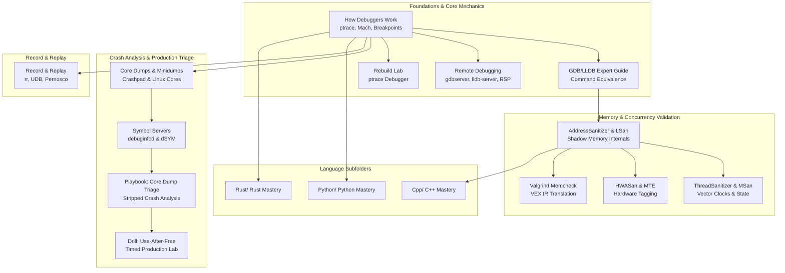

# Debugging

This folder provides a complete curriculum on systems and application debugging across C++, Python, and Rust.
It begins with fundamental operating system debugging primitives, including Linux ptrace, Mach exception ports, and hardware breakpoint registers.
It advances through interactive debugger mastery, memory sanitizers, core dump triage, and deterministic execution replay.
Finally, it establishes enterprise-scale crash analysis infrastructure, symbol server pipelines, and automated incident runbooks.

### Learning order

1. [[Scientific-Debugging-Delta-Debugging-and-Heisenbugs]]
2. [[Debugging-Without-a-Debugger-and-Concurrency-Bugs]]
3. [[How-Debuggers-Work-ptrace-Mach-and-Breakpoints]]
4. [[Remote-Debugging-gdbserver-lldb-server-and-RSP]]
5. [[Core-Dumps-Minidumps-and-Crash-Reporting]]
6. [[Symbol-Servers-and-debuginfod]]
7. [[Record-and-Replay-rr-UDB-and-Pernosco]]
8. [[Debugging-Distributed-Systems-with-Traces-and-Correlation]]
9. [[Debugging-Decision-Records]]
10. [[Debugging-Expert-Defaults-gdbinit-and-lldbinit]]
11. [[Debug-a-Production-Crash-From-a-Core-Dump]]
12. [[Rebuild-Lab-ptrace-Debugger-with-DWARF-Backtrace]]
13. [[Cpp/README|Cpp/README]]
14. [[Python/README|Python/README]]
15. [[Rust/README|Rust/README]]
16. [[Drill-Debugging-Use-After-Free-Core-Dump]]
17. [[Drill-Debugging-Asyncio-and-Tokio-Deadlock]]
18. [[Drill-Debugging-Mixed-Python-Rust-FFI-Segfault]]

Related books: For shell-level script debugging, trap mechanisms, and terminal strace workflows, consult [[19-Shell-and-Unix-Engineering/05-Bash-Internals/Debugging-Bash-with-lldb|19-Shell-and-Unix-Engineering]]. For low-latency production crash diagnostics and deterministic PCAP replay, see [[14-Low-Latency-Systems/13 - Reliability, Ops & Testing/MOC - 13 Reliability, Ops & Testing|14-Low-Latency-Systems]].

<!-- moc:start (generated by tools/build_mocs.py; edits inside are overwritten) -->
## Also in this folder

**Notes**

- [Debugging Skill Ladder](Debugging-Skill-Ladder.md)
- [Debugging Topic Inventory](Debugging-Topic-Inventory.md)

<!-- moc:end -->
