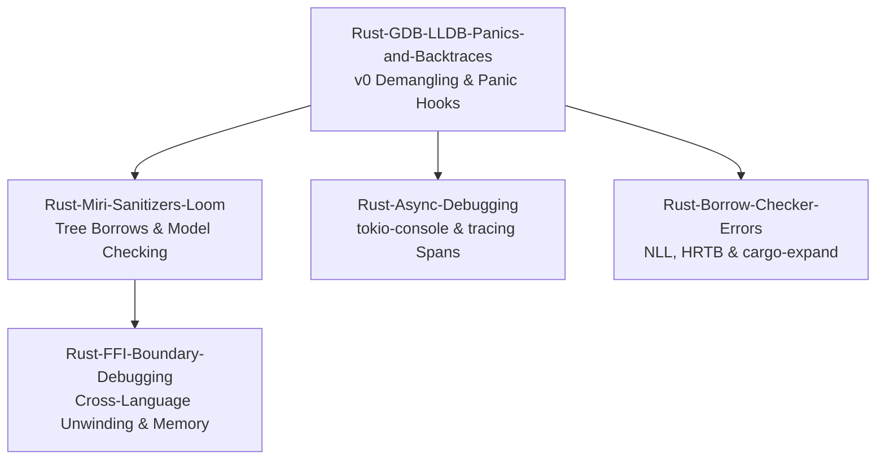

# Rust Debugging

This subfolder owns the Rust debugging curriculum, addressing native CLI inspection, compile-time borrow diagnostics, undefined behavior detection in unsafe code, and async runtime tracing.
It details the operation of rust-gdb and rust-lldb with v0 symbol demangling and standard panic hooks.
It covers undefined behavior validation using Miri under Stacked and Tree Borrows, model checking with Loom, and structure-aware fuzzing.
Engineers learn to diagnose complex async task stalls and lost wakers in Tokio runtimes while debugging FFI boundaries connecting Rust, C++, and Python.

### Learning order

1. [[Rust-GDB-LLDB-Panics-and-Backtraces]]
2. [[Rust-Miri-Sanitizers-Loom-and-Cargo-Fuzz]]
3. [[Rust-Async-Debugging-tokio-console-and-tracing]]
4. [[Rust-Borrow-Checker-Trait-Errors-Cargo-Expand-and-Clippy]]
5. [[Rust-FFI-Boundary-Debugging-Across-Cpp-and-Python]]

Related books: For cross-language ABI standards and C interop mechanics, see [[02-Programming-Languages/C++/CPP_Zero_to_Godhood/Volume_09_Specialized_Mastery/Chapter_111_Interoperability/Chapter_111_Interoperability_and_the_Stable_C_ABI|Chapter 111 Interoperability and Stable C ABI]].
