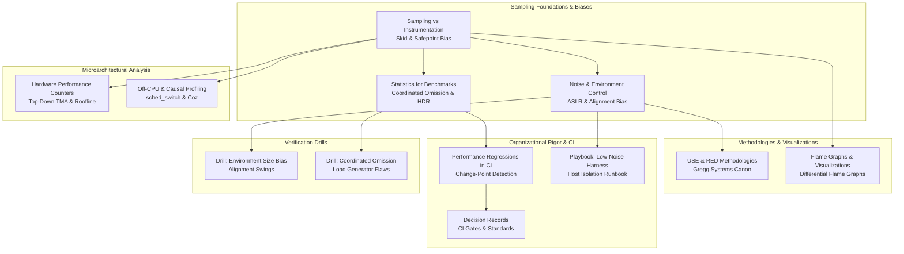

# Measurement Methodology

This folder establishes the methodological foundations for rigorous software performance measurement, experimental benchmarking, and statistical analysis.
It examines why measurement tools frequently mislead engineers, detailing instruction skid, sampling bias, and environment size artifacts.
It guides engineers through host isolation, microarchitectural analysis via Top-Down TMA, and non-parametric statistics.
Finally, it covers production regression gating in continuous integration and organizational measurement policies.

### Learning order

1. [[Sampling-vs-Instrumentation-Skid-and-Safepoint-Bias]]
2. [[Benchmark-Methodology-Noise-and-Environment-Control]]
3. [[Statistics-for-Benchmarks-Coordinated-Omission-and-HDR-Histograms]]
4. [[Hardware-Performance-Counters-Top-Down-TMA-and-Roofline]]
5. [[USE-RED-and-Systems-Performance-Methodologies]]
6. [[Off-CPU-Analysis-Thread-States-and-Causal-Profiling]]
7. [[Flame-Graphs-Differential-Flame-Graphs-and-Visualizations]]
8. [[Performance-Regression-Detection-in-CI]]
9. [[Measurement-Methodology-Decision-Records]]
10. [[Design-a-Low-Noise-Benchmark-Harness-Playbook]]
11. [[Drill-Measurement-Methodology-Environment-Size-Bias]]
12. [[Drill-Measurement-Methodology-Coordinated-Omission-Trap]]

Related books: For hardware timestamping and low-latency cycle measurement, consult [[14-Low-Latency-Systems/07 - Time & Measurement/MOC - 07 Time & Measurement|14-Low-Latency-Systems: Time & Measurement]]. For systems performance engineering whitepapers and Linux tracing theory, see [[15-Technical-Whitepapers/01-Systems-Performance-and-Tracing/Brendan-Gregg-Performance-Canon|Brendan Gregg Performance Canon]].

<!-- moc:start (generated by tools/build_mocs.py; edits inside are overwritten) -->
## Also in this folder

**Notes**

- [Measurement Methodology Skill Ladder](Measurement-Methodology-Skill-Ladder.md)
- [Measurement Methodology Topic Inventory](Measurement-Methodology-Topic-Inventory.md)

<!-- moc:end -->
