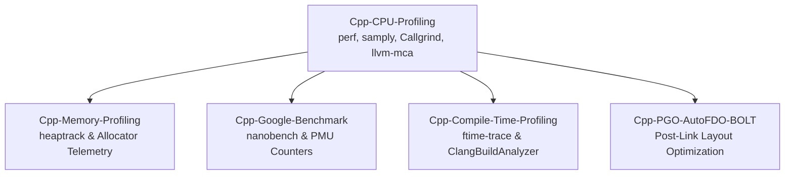

# C++ Profiling

This subfolder owns the C++ performance profiling curriculum, covering CPU sampling, memory allocation analysis, microbenchmarking, and compiler-driven feedback optimizations.
It covers Linux perf and samply with Firefox Profiler UI, Callgrind cache simulation, and llvm-mca basic-block pipeline modeling.
It details heaptrack memory profiling alongside allocator telemetry in jemalloc, tcmalloc, and mimalloc.
Engineers learn to write robust microbenchmarks with Google Benchmark and nanobench, profile template instantiations via Clang -ftime-trace, and deploy PGO and LLVM BOLT pipelines.

### Learning order

1. [[Cpp-CPU-Profiling-perf-samply-Callgrind-and-llvm-mca]]
2. [[Cpp-Memory-Profiling-heaptrack-Massif-DHAT-and-Allocators]]
3. [[Cpp-Google-Benchmark-and-nanobench]]
4. [[Cpp-Compile-Time-Profiling-ftime-trace-and-ClangBuildAnalyzer]]
5. [[Cpp-PGO-AutoFDO-and-BOLT-Workflow]]

Related books: For microbenchmarking theory and tail latency analysis, see [[02-Programming-Languages/C++/CPP_Zero_to_Godhood/Volume_08_Advanced_Systems/Chapter_103_Microbenchmarking_and_Tail_Latency/Chapter_103_Microbenchmarking_and_Tail_Latency|Chapter 103 Microbenchmarking and Tail Latency]]. For linking and whole-program optimization, see [[02-Programming-Languages/C++/CPP_Zero_to_Godhood/Volume_08_Advanced_Systems/Chapter_102_Linking_Loading_ABI/Chapter_102_Linking_Loading_ABI_and_WPO|Chapter 102 Linking, Loading, ABI]].
