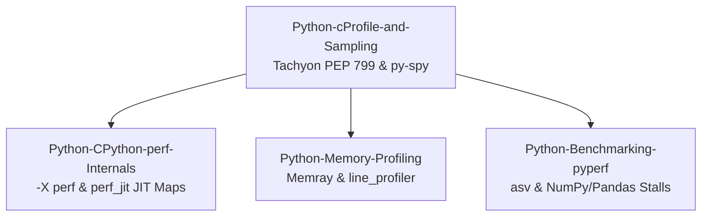

# Python Profiling

This subfolder owns the Python performance profiling curriculum, addressing CPU sampling, bytecode specialization, native memory profiling, and array pipeline analysis.
It contrasts deterministic function tracing in cProfile with statistical out-of-process sampling in Tachyon (PEP 799) and py-spy.
It explains CPython 3.12 -X perf trampoline maps and Python 3.13+ -X perf_jit DWARF JIT registration.
Engineers learn to diagnose native memory allocations with Bloomberg's memray, audit tight loops with line_profiler, and benchmark data pipelines with pyperf and asv.

### Learning order

1. [[Python-cProfile-Tachyon-and-Sampling-Profilers]]
2. [[Python-CPython-perf-Trampoline-and-Tachyon-Internals]]
3. [[Python-Memory-Profiling-Memray-and-Line-Profiler]]
4. [[Python-Benchmarking-pyperf-asv-and-NumPy-Pandas-Profiling]]

Related books: For Python production diagnostic patterns and performance profiling fundamentals, see [[02-Programming-Languages/Python/Python-Backend-Interview-Prep/10-Testing-Debugging-Production|Python Backend Interview Prep: Testing & Diagnostics]] and [[02-Programming-Languages/Python/Python_Zero_to_Godhood/Chapter_29_PROFILING_BENCHMARKING_AND_DIAGNOSTICS|Python Zero to Godhood Chapter 29]].
